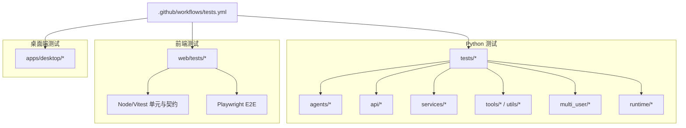
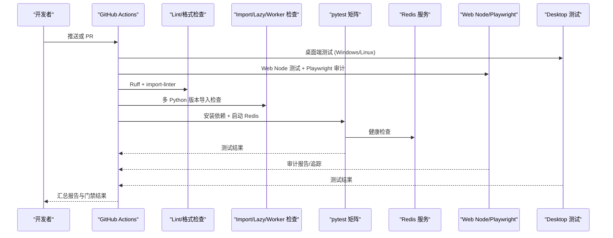
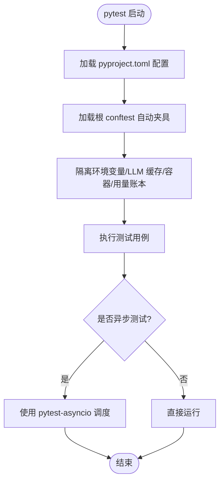
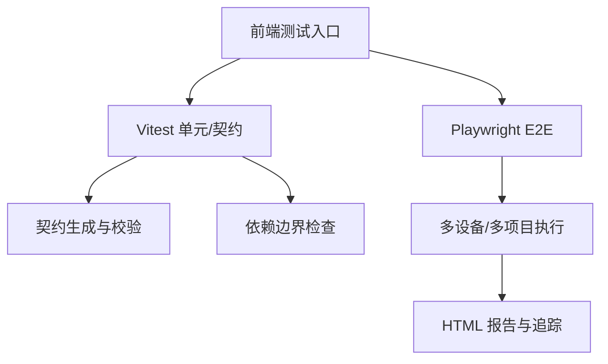
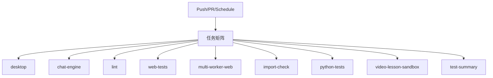
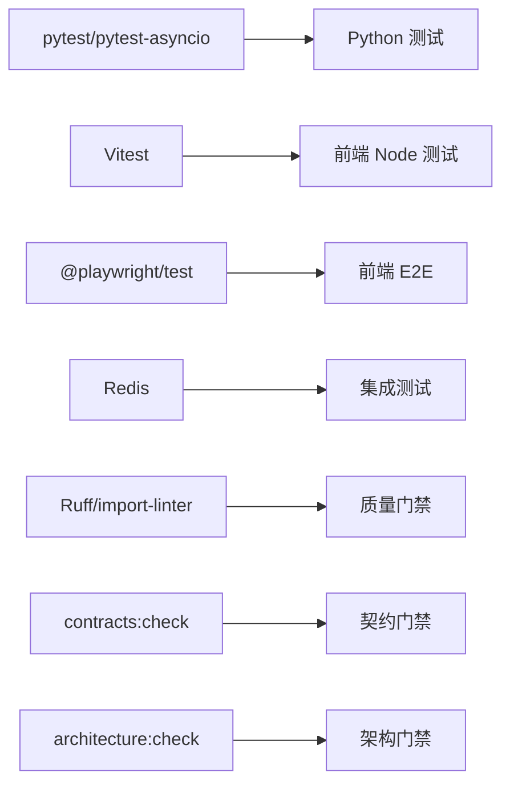

# 测试策略

<cite>
**本文引用的文件**   
- [pyproject.toml](file://pyproject.toml)
- [tests/conftest.py](file://tests/conftest.py)
- [.github/workflows/tests.yml](file://.github/workflows/tests.yml)
- [web/playwright.config.ts](file://web/playwright.config.ts)
- [web/package.json](file://web/package.json)
- [tests/agents/question/test_pipeline.py](file://tests/agents/question/test_pipeline.py)
</cite>

## 目录
1. [引言](#引言)
2. [项目结构](#项目结构)
3. [核心组件](#核心组件)
4. [架构总览](#架构总览)
5. [详细组件分析](#详细组件分析)
6. [依赖关系分析](#依赖关系分析)
7. [性能与并发测试考虑](#性能与并发测试考虑)
8. [故障排查指南](#故障排查指南)
9. [结论](#结论)
10. [附录](#附录)

## 引言
本测试策略文档面向 DeepTutor 项目的后端 Python、前端 Web、桌面端以及端到端场景，覆盖单元测试、集成测试和端到端测试的组织方式、执行策略、测试框架选择、用例编写规范、测试数据管理、模拟对象与桩函数使用、API/数据库/前端组件测试实践、持续集成配置、覆盖率与质量门禁、异步与并发测试注意事项、性能测试要点、调试技巧与常见问题。目标是让不同技术背景的读者都能理解并维护这套测试体系。

## 项目结构
DeepTutor 的测试分布在多个层次：
- Python 后端与 CLI 测试位于 tests 目录，按模块划分（agents、api、services、tools、utils、multi_user、runtime 等）。
- 前端 Node/Vitest 单元与契约测试位于 web/tests，Playwright 端到端测试位于 web/tests/e2e 及相关审计脚本。
- 桌面端测试位于 apps/desktop。
- 持续集成流水线在 .github/workflows/tests.yml 中统一编排。
- 测试运行器与标记由 pyproject.toml 中的 pytest 配置定义。

图表来源
- [pyproject.toml:277-293](file://pyproject.toml#L277-L293)
- [.github/workflows/tests.yml:1-436](file://.github/workflows/tests.yml#L1-L436)
- [web/playwright.config.ts:1-58](file://web/playwright.config.ts#L1-L58)
- [web/package.json:1-98](file://web/package.json#L1-L98)

章节来源
- [pyproject.toml:277-293](file://pyproject.toml#L277-L293)
- [.github/workflows/tests.yml:1-436](file://.github/workflows/tests.yml#L1-L436)
- [web/playwright.config.ts:1-58](file://web/playwright.config.ts#L1-L58)
- [web/package.json:1-98](file://web/package.json#L1-L98)

## 核心组件
- 测试运行器与配置
  - pytest 作为 Python 测试运行器，启用严格模式、短回溯、importlib 导入模式，并通过 markers 区分 asyncio、integration、redis_integration、real_llm_resolver 等测试类别。
  - 前端使用 Vitest 进行 Node 环境单元与契约测试，使用 Playwright 进行浏览器端到端测试。
- 共享夹具与环境隔离
  - tests/conftest.py 提供全局自动夹具，保护真实用户密钥树、迁移路径、CodeBuddy 登录状态、LLM 配置缓存、应用容器、环境变量、用量账本等，确保测试之间互不干扰且不会污染开发者机器。
- 持续集成矩阵
  - GitHub Actions 对桌面端、TypeScript 聊天引擎、Lint、Web Node 测试、多工作进程浏览器验收、Import/Lazy/Worker 检查、Python 多版本测试、视频课程沙箱隔离等进行矩阵化执行，并在失败时汇总报告。

章节来源
- [pyproject.toml:277-293](file://pyproject.toml#L277-L293)
- [tests/conftest.py:1-312](file://tests/conftest.py#L1-L312)
- [.github/workflows/tests.yml:1-436](file://.github/workflows/tests.yml#L1-L436)

## 架构总览
下图展示从代码变更到测试执行的端到端流程，包括触发条件、并行任务、服务依赖与产物归档。

图表来源
- [.github/workflows/tests.yml:1-436](file://.github/workflows/tests.yml#L1-L436)

## 详细组件分析

### Python 测试组织与执行
- 测试入口与参数
  - 通过 pyproject.toml 的 [tool.pytest.ini_options] 指定 testpaths、markers、asyncio_default_fixture_loop_scope 与 addopts。
- 关键夹具与环境隔离
  - 自动保护真实 owner secrets 树、legacy multi-user 迁移路径、CodeBuddy 登录状态。
  - 提供 StreamBus、UnifiedContext、SQLiteSessionStore 临时库、Fake LLM 配置、Stub Capability 等常用夹具。
  - 清理 LLM 配置缓存与应用容器缓存，避免跨测试污染。
  - 恢复 os.environ，防止子进程读取到残留环境变量。
  - 将 usage ledger 重定向到 tmp_path，避免写入真实用量统计。
- 异步与并发
  - 使用 pytest-asyncio，默认 fixture loop scope 为 function，适合细粒度异步测试。
  - 需要显式标记的测试可使用 asyncio marker。

图表来源
- [pyproject.toml:277-293](file://pyproject.toml#L277-L293)
- [tests/conftest.py:1-312](file://tests/conftest.py#L1-L312)

章节来源
- [pyproject.toml:277-293](file://pyproject.toml#L277-L293)
- [tests/conftest.py:1-312](file://tests/conftest.py#L1-L312)

### API 测试
- 路由与服务层测试集中在 tests/api 下，覆盖认证、CORS、会话、知识图谱、MCP、工具选项、语音、统一 WebSocket 协议等。
- 典型测试关注点
  - 请求/响应契约与错误码。
  - 中间件行为（如认证上下文、Cookie、CORS）。
  - 流式输出与 WebSocket 事件顺序。
  - 外部依赖隔离（Redis、LLM、文件系统）。
- 建议
  - 使用 FastAPI TestClient 或等效客户端发起请求。
  - 通过 conftest 提供的 SQLiteSessionStore 与 StreamBus 夹具验证持久化与流式事件。
  - 对外部服务使用 monkeypatch 或 mock，避免网络与模型调用。

章节来源
- [tests/conftest.py:124-181](file://tests/conftest.py#L124-L181)
- [tests/conftest.py:212-266](file://tests/conftest.py#L212-L266)

### 数据库测试
- 使用 aiosqlite 与临时 SQLite 文件进行无外部依赖的数据库测试。
- 通过 tmp_db_path 与 sqlite_store 夹具创建临时数据库路径与存储实例。
- 建议
  - 所有写操作均指向 tmp_path，避免影响真实数据。
  - 在测试结束时清理临时文件（pytest tmp_path 自动处理）。
  - 对复杂查询与事务进行断言，确保一致性。

章节来源
- [tests/conftest.py:170-181](file://tests/conftest.py#L170-L181)

### 前端组件与契约测试
- Node 环境与单元
  - 使用 Vitest 运行 web/tests 下的 Node 测试，涵盖类型契约、工具函数、状态管理等。
  - 脚本 npm run test:node 与 npm run test:unit 分别用于 Node 测试与 UI 相关单元。
- 契约与架构检查
  - 通过 contracts:check 与 architecture:check 保证前端 API 契约与模块边界稳定。
- Playwright 端到端
  - 基于 web/playwright.config.ts 定义多项目（ui-audit、critical-turns、multi-worker-turns-desktop/mobile、epub-reader-*），支持并行与串行模式。
  - CI 中启动 Next.js 服务，轮询就绪后执行审计与 E2E。

图表来源
- [web/package.json:1-98](file://web/package.json#L1-L98)
- [web/playwright.config.ts:1-58](file://web/playwright.config.ts#L1-L58)

章节来源
- [web/package.json:1-98](file://web/package.json#L1-L98)
- [web/playwright.config.ts:1-58](file://web/playwright.config.ts#L1-L58)

### 模拟对象、桩函数与测试夹具
- 通用夹具
  - stream_bus：提供独立 StreamBus 实例。
  - minimal_context/rich_context：构造最小与富上下文。
  - fake_llm_config：模拟 LLMConfig 常见字段。
  - stub_capability：实现 TurnCapability 的最小可运行能力。
- 自动化隔离
  - _isolate_llm_config：注入固定 ResolvedLLMConfig 并清空缓存，避免跨测试污染。
  - _isolate_application_container：重置默认容器，避免协调后端被前一个测试决定。
  - _restore_process_env：恢复 os.environ，避免子进程继承脏环境。
  - _isolate_usage_ledger：将用量账本重定向到 tmp_path。
- 示例参考
  - tests/agents/question/test_pipeline.py 中使用 monkeypatch 替换 get_llm_config 与工具解析逻辑，以纯辅助函数与 Stub 驱动 Pipeline 行为。

章节来源
- [tests/conftest.py:124-266](file://tests/conftest.py#L124-L266)
- [tests/conftest.py:269-312](file://tests/conftest.py#L269-L312)
- [tests/agents/question/test_pipeline.py:35-41](file://tests/agents/question/test_pipeline.py#L35-L41)

### 持续集成与质量门禁
- 触发与并发
  - 在 push/PR/schedule 上触发，使用 concurrency 取消旧任务，缩短反馈时间。
- 任务矩阵
  - desktop：Windows/Linux 桌面端测试。
  - chat-engine：TypeScript 聊天引擎与 Python 参考实现对比。
  - lint：Ruff 检查与 import-linter 依赖边界。
  - web-tests：Next.js 启动、Playwright 审计。
  - multi-worker-web：多工作进程浏览器验收（可选变量控制）。
  - import-check：多 Python 版本导入、惰性启动、隔离 Worker 协议检查。
  - python-tests：Redis 服务 + 多 Python 版本 pytest 全量测试。
  - video-lesson-sandbox：视频渲染、隔离、取消与超时。
- 质量门禁
  - 所有关键任务失败则整体失败；必要时上传浏览器追踪与视频证据。

图表来源
- [.github/workflows/tests.yml:1-436](file://.github/workflows/tests.yml#L1-L436)

章节来源
- [.github/workflows/tests.yml:1-436](file://.github/workflows/tests.yml#L1-L436)

## 依赖关系分析
- 测试与运行时依赖
  - pytest、pytest-asyncio 作为 Python 测试基础。
  - Vitest 与 @playwright/test 作为前端测试基础。
  - Redis 作为部分集成测试的外部服务。
- 模块边界与导入检查
  - import-linter 与 scripts/check_architecture.py 在 CI 中强制执行模块导入边界，防止循环依赖与不当耦合。
- 前端契约与架构
  - contracts:check 与 architecture:check 在前端侧保证 API 契约与依赖图稳定。

图表来源
- [pyproject.toml:277-293](file://pyproject.toml#L277-L293)
- [web/package.json:1-98](file://web/package.json#L1-L98)
- [.github/workflows/tests.yml:117-145](file://.github/workflows/tests.yml#L117-L145)

章节来源
- [pyproject.toml:277-293](file://pyproject.toml#L277-L293)
- [web/package.json:1-98](file://web/package.json#L1-L98)
- [.github/workflows/tests.yml:117-145](file://.github/workflows/tests.yml#L117-L145)

## 性能与并发测试考虑
- 异步测试
  - 使用 pytest-asyncio，fixture loop scope 为 function，避免跨测试共享异步状态。
  - 对长耗时异步流程（如流式输出、WebSocket）使用断言事件顺序与超时。
- 并发测试
  - Playwright 支持 fullyParallel 与 workers 控制，CI 中根据 PW_SERIAL 切换串行/并行。
  - 多工作进程浏览器验收通过 DEEPTUTOR_MULTI_WORKER_E2E 与 WEB_BASE_URL 等环境变量驱动。
- 性能测试
  - 前端 perf:check 与 route_budgets.mjs 用于路由预算与构建性能检查。
  - 视频课程沙箱测试覆盖真实渲染、隔离、取消与超时。

章节来源
- [web/playwright.config.ts:1-58](file://web/playwright.config.ts#L1-L58)
- [.github/workflows/tests.yml:191-235](file://.github/workflows/tests.yml#L191-L235)
- [.github/workflows/tests.yml:385-409](file://.github/workflows/tests.yml#L385-L409)
- [web/package.json:1-98](file://web/package.json#L1-L98)

## 故障排查指南
- 测试互相污染
  - 现象：某个测试改变了全局 LLM 配置、应用容器或环境变量，导致后续测试失败。
  - 解决：确认 conftest 中的 _isolate_llm_config、_isolate_application_container、_restore_process_env 是否生效；必要时在测试中显式清理缓存或重置模块级状态。
- 真实数据被写入
  - 现象：owner secrets、CLI apps、usage ledger 被写入开发者机器。
  - 解决：确保使用 tmp_path 与 conftest 的 _guard_real_owner_secrets、_isolate_usage_ledger；不要绕过这些自动夹具。
- Redis 不可用
  - 现象：集成测试报连接失败。
  - 解决：确认 CI 已启动 Redis 服务并设置 DEEPTUTOR_TEST_REDIS_URL；本地测试需手动启动 Redis 或使用跳过标记。
- Playwright 不稳定
  - 现象：E2E 在 CI 偶发失败。
  - 解决：开启 trace 与重试；检查 WEB_BASE_URL 与 NEXT_PUBLIC_API_BASE；必要时切换到串行模式 PW_SERIAL=1。
- 前端契约不一致
  - 现象：contracts:check 失败。
  - 解决：重新生成契约脚本并更新前端类型；确保后端 API 变更同步更新契约。

章节来源
- [tests/conftest.py:48-116](file://tests/conftest.py#L48-L116)
- [tests/conftest.py:212-312](file://tests/conftest.py#L212-L312)
- [.github/workflows/tests.yml:312-383](file://.github/workflows/tests.yml#L312-L383)
- [web/playwright.config.ts:1-58](file://web/playwright.config.ts#L1-L58)

## 结论
DeepTutor 的测试体系以 pytest 与 pytest-asyncio 为核心，结合 Vitest 与 Playwright 覆盖前端与端到端场景；通过严格的 conftest 夹具与环境隔离保障测试稳定性；CI 矩阵化执行并设置质量门禁，确保代码变更快速反馈与回归防护。建议在新增功能时遵循以下原则：
- 优先编写单元测试，必要时补充集成与 E2E。
- 使用现有夹具与隔离机制，避免污染真实环境与全局状态。
- 对异步与并发场景明确断言顺序与超时。
- 保持前端契约与架构边界稳定，及时更新契约脚本。
- 在 CI 中为新测试选择合适的标记与矩阵位置。

## 附录
- 常用命令
  - Python：pytest -q tests deeptutor/learning/tests
  - 前端 Node：npm run test:node
  - 前端单元：npm run test:unit
  - 前端审计：npm run audit
  - 端到端关键路径：npm run test:e2e:critical
  - 多工作进程 E2E：npm run test:e2e:multi-worker
- 关键配置文件
  - Python 测试配置：pyproject.toml
  - 前端测试配置：web/playwright.config.ts、web/package.json
  - CI 流水线：.github/workflows/tests.yml