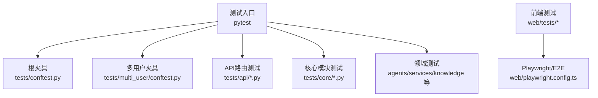
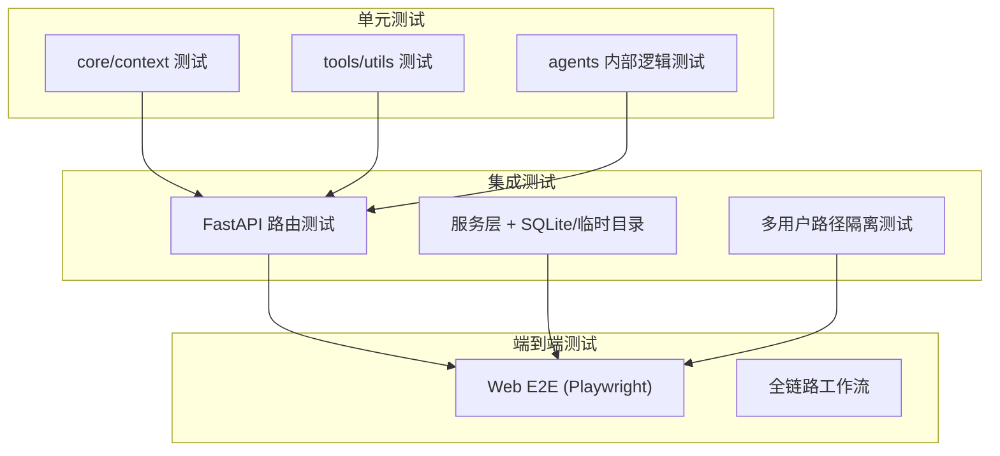
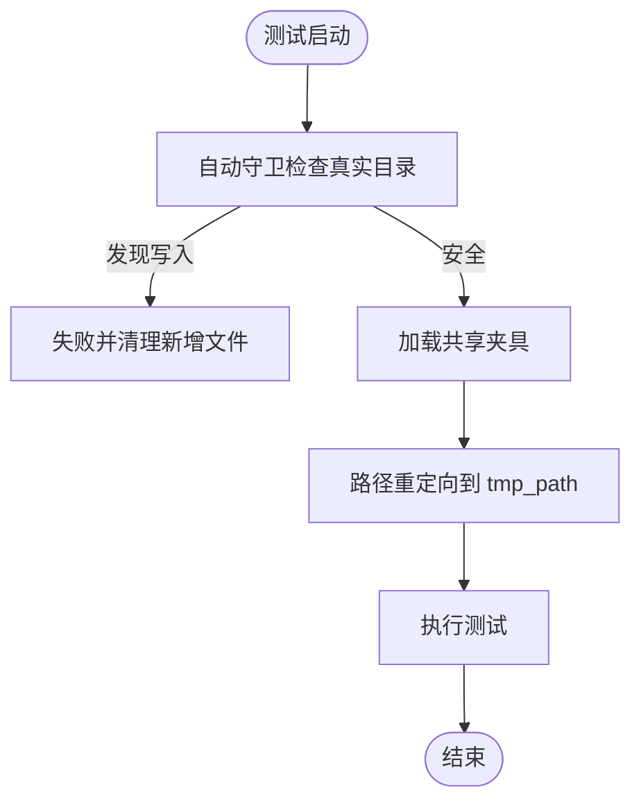
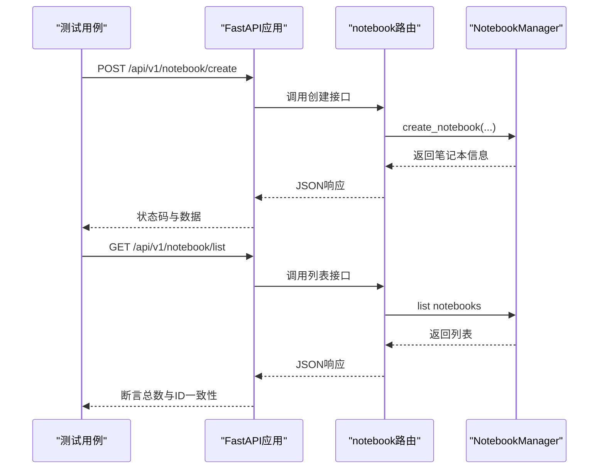
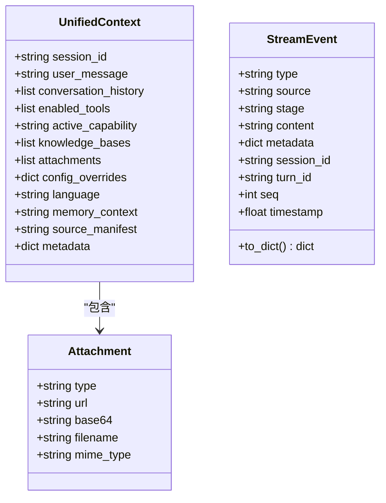
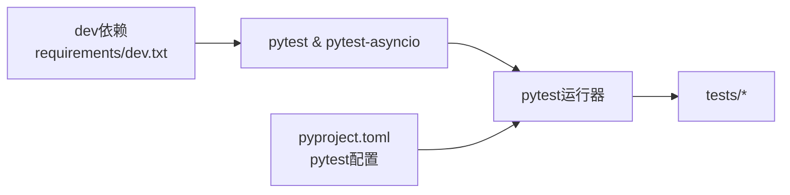

# 测试策略

<cite>
**本文引用的文件**
- [pyproject.toml](file://pyproject.toml)
- [tests/conftest.py](file://tests/conftest.py)
- [tests/multi_user/conftest.py](file://tests/multi_user/conftest.py)
- [tests/api/test_main_notebook_router.py](file://tests/api/test_main_notebook_router.py)
- [tests/core/test_context.py](file://tests/core/test_context.py)
- [requirements/dev.txt](file://requirements/dev.txt)
</cite>

## 目录
1. [简介](#简介)
2. [项目结构](#项目结构)
3. [核心组件](#核心组件)
4. [架构总览](#架构总览)
5. [详细组件分析](#详细组件分析)
6. [依赖分析](#依赖分析)
7. [性能考虑](#性能考虑)
8. [故障排查指南](#故障排查指南)
9. [结论](#结论)
10. [附录](#附录)

## 简介
本文件面向DeepTutor项目的测试策略与落地实践，覆盖测试分层（单元测试、集成测试、端到端测试）、测试环境与数据准备、Mock/Stub与外部服务模拟、异步与并发测试处理、覆盖率与质量门禁、性能与负载测试实施，以及高质量用例编写与最佳实践。内容基于仓库中现有测试代码与配置进行归纳与扩展建议，确保读者可据此建立稳定、可维护的测试体系。

## 项目结构
- 测试根目录位于 tests，按功能域组织：agents、api、book、capabilities、cli、core、knowledge、logging、multi_user、partners、runtime、scripts、services、tools、utils 等。
- 前端测试位于 web/tests，包含单元与E2E相关脚本与用例。
- 测试运行与工具链由 pyproject.toml 中的 pytest 配置驱动，支持异步标记、严格模式、导入模式等。
- 开发依赖在 requirements/dev.txt 中声明，包含 pytest、pytest-asyncio 等。

**图表来源**
- [pyproject.toml:415-428](file://pyproject.toml#L415-L428)
- [tests/conftest.py:1-195](file://tests/conftest.py#L1-L195)
- [tests/multi_user/conftest.py:1-119](file://tests/multi_user/conftest.py#L1-L119)
- [tests/api/test_main_notebook_router.py:1-162](file://tests/api/test_main_notebook_router.py#L1-L162)
- [tests/core/test_context.py:1-200](file://tests/core/test_context.py#L1-L200)

**章节来源**
- [pyproject.toml:415-428](file://pyproject.toml#L415-L428)
- [requirements/dev.txt:1-26](file://requirements/dev.txt#L1-L26)

## 核心组件
- 根级共享夹具：提供 StreamBus、UnifiedContext、SQLiteSessionStore（临时文件）、Fake LLM配置、能力存根等，减少重复搭建成本并保证隔离性。
- 多用户隔离夹具：将 multi_user 路径重定向到 tmp_path，避免污染真实数据；提供 as_user 上下文管理器与 seed_user 种子数据生成器。
- API集成测试：使用 FastAPI TestClient 挂载路由器，验证路由行为与数据持久化；通过 monkeypatch 注入服务实例以控制副作用。
- 核心对象测试：对 UnifiedContext、Attachment、StreamEvent、错误层次与追踪元数据进行断言，保障数据结构与行为契约。

**章节来源**
- [tests/conftest.py:97-195](file://tests/conftest.py#L97-L195)
- [tests/multi_user/conftest.py:20-119](file://tests/multi_user/conftest.py#L20-L119)
- [tests/api/test_main_notebook_router.py:25-162](file://tests/api/test_main_notebook_router.py#L25-L162)
- [tests/core/test_context.py:28-200](file://tests/core/test_context.py#L28-L200)

## 架构总览
测试架构遵循“分层+隔离”的原则：
- 单元测试：针对纯函数、模型、工具类，快速、无IO、高内聚。
- 集成测试：围绕API路由、服务层、存储层，使用临时文件或内存数据库，验证跨模块协作。
- 端到端测试：前端E2E（Playwright）与后端联调场景，覆盖用户关键路径。

[此图为概念性架构图，不直接映射具体源码文件]

## 详细组件分析

### 根级夹具与测试环境隔离
- 自动守卫：防止测试写入真实的多用户密钥与应用安装目录；若检测到新增文件则清理并失败，强制路径重定向。
- 迁移保护：禁用遗留 multi-user 迁移路径，避免误操作开发者机器上的真实目录。
- 通用夹具：提供 StreamBus、UnifiedContext（最小/丰富两种）、SQLiteSessionStore（tmp_path 驱动）、Fake LLM配置、能力存根。

**图表来源**
- [tests/conftest.py:47-90](file://tests/conftest.py#L47-L90)
- [tests/conftest.py:97-155](file://tests/conftest.py#L97-L155)
- [tests/multi_user/conftest.py:20-60](file://tests/multi_user/conftest.py#L20-L60)

**章节来源**
- [tests/conftest.py:17-90](file://tests/conftest.py#L17-L90)
- [tests/conftest.py:97-195](file://tests/conftest.py#L97-L195)
- [tests/multi_user/conftest.py:20-119](file://tests/multi_user/conftest.py#L20-L119)

### API集成测试示例：笔记本路由
- 使用 FastAPI TestClient 挂载 notebook 路由，构造 NotebookManager 实例并通过 monkeypatch 注入，实现无外部依赖的集成测试。
- 覆盖创建、列出、添加记录、流式摘要清洗等场景，并对非法ID（如问题分类整数ID）进行防御性断言。

**图表来源**
- [tests/api/test_main_notebook_router.py:25-63](file://tests/api/test_main_notebook_router.py#L25-L63)
- [tests/api/test_main_notebook_router.py:66-117](file://tests/api/test_main_notebook_router.py#L66-L117)

**章节来源**
- [tests/api/test_main_notebook_router.py:1-162](file://tests/api/test_main_notebook_router.py#L1-L162)

### 核心对象与事件测试
- UnifiedContext：验证默认值、可变默认独立、完整构造、enabled_tools语义（None vs []）。
- Attachment：字段默认与完整构造。
- StreamEvent：默认字段、to_dict序列化、枚举值规范。
- 错误层次：断言继承关系与字符串表示。
- 追踪元数据：call_id前缀、唯一性、构建/派生/合并逻辑。

**图表来源**
- [tests/core/test_context.py:28-103](file://tests/core/test_context.py#L28-L103)
- [tests/core/test_context.py:110-139](file://tests/core/test_context.py#L110-L139)

**章节来源**
- [tests/core/test_context.py:28-200](file://tests/core/test_context.py#L28-L200)

### 异步与并发测试
- 使用 pytest-asyncio 管理异步测试生命周期，默认 fixture 循环作用域为 function。
- 在需要时通过 asyncio.run 或 async for 收集事件，确保事件流正确性与最终结果一致。
- 建议在复杂异步流程中使用明确的超时与重试策略，并在测试中注入可控的延迟或固定输出。

**章节来源**
- [pyproject.toml:415-428](file://pyproject.toml#L415-L428)
- [tests/api/test_main_notebook_router.py:119-162](file://tests/api/test_main_notebook_router.py#L119-L162)

### Mock与Stub的使用
- 能力存根：_StubCapability 实现 BaseCapability，仅发送一条内容事件，用于验证能力运行时与流式总线交互。
- Fake LLM配置：MagicMock 模拟 LLMConfig 常用字段，便于在不连接真实LLM的情况下测试配置与参数传递。
- 服务注入：通过 monkeypatch 替换模块级单例或全局变量（如 NotebookManager），实现无外部依赖的集成测试。

**章节来源**
- [tests/conftest.py:162-195](file://tests/conftest.py#L162-L195)
- [tests/api/test_main_notebook_router.py:31-38](file://tests/api/test_main_notebook_router.py#L31-L38)

### 外部服务模拟
- 文档解析引擎：可选依赖，缺失时降级为不可用；测试应覆盖可用与不可用分支。
- RAG/向量库：通过惰性导入与适配器隔离，测试可切换不同后端或注入内存实现。
- 第三方通道（Matrix/IM）：通过可选 extra 与条件导入，测试可按需启用或跳过。

[本节为通用指导，未直接分析具体文件]

## 依赖分析
- 测试框架与异步支持：pytest、pytest-asyncio 在 dev 依赖中声明。
- 测试运行配置：testpaths 包含 tests 与 deeptutor/learning/tests；markers 定义 asyncio；addopts 启用严格模式与短回溯。
- 类型与安全：mypy 与 bandit 配置用于静态检查与安全扫描，可在CI中作为质量门禁。

**图表来源**
- [requirements/dev.txt:1-26](file://requirements/dev.txt#L1-L26)
- [pyproject.toml:415-428](file://pyproject.toml#L415-L428)

**章节来源**
- [requirements/dev.txt:1-26](file://requirements/dev.txt#L1-L26)
- [pyproject.toml:415-428](file://pyproject.toml#L415-L428)

## 性能考虑
- 测试数据隔离：优先使用 tmp_path 与内存数据库，避免磁盘IO瓶颈。
- 异步优化：合理设置超时，避免阻塞事件循环；对长耗时外部调用进行Mock或限流。
- 并行执行：利用 pytest-xdist（可选）提升并行度；注意共享资源隔离与随机种子固定。
- 覆盖率目标：建议设定最低覆盖率阈值（如行覆盖率≥80%），在CI中阻断低覆盖率提交。

[本节为通用指导，未直接分析具体文件]

## 故障排查指南
- 路径污染告警：若出现“写入真实账户状态树”的错误，检查是否遗漏路径重定向或意外恢复monkeypatch。
- 迁移误操作：确认 legacy multi-user 根被指向不存在路径，且迁移标志已重置。
- 异步超时：为长耗时异步任务设置合理超时，或在测试中注入固定延迟与输出。
- 依赖缺失：对于可选引擎（解析、RAG、矩阵E2EE），在测试中显式处理不可用分支，避免ImportError导致用例跳过。

**章节来源**
- [tests/conftest.py:47-90](file://tests/conftest.py#L47-L90)
- [tests/multi_user/conftest.py:20-60](file://tests/multi_user/conftest.py#L20-L60)

## 结论
DeepTutor的测试体系以Pytest为核心，结合严格的夹具隔离与模块化组织，覆盖了从核心对象到API路由再到多用户场景的广泛范围。通过Mock/Stub与临时数据，实现了对外部依赖的有效解耦；异步与并发测试借助pytest-asyncio获得良好支持。建议在CI中引入覆盖率门禁与安全扫描，逐步完善性能与负载测试，持续提升交付质量。

## 附录
- 运行测试：pip install -e ".[dev]" 后使用 pytest 命令；可通过 markers 选择异步测试。
- 前端E2E：参考 web/playwright.config.ts 与 web/tests/e2e 下的用例。
- 覆盖率与门禁：可集成 pytest-cov 与覆盖率报告上传；在CI中设置阈值并阻断低覆盖率变更。

[本节为通用指导，未直接分析具体文件]