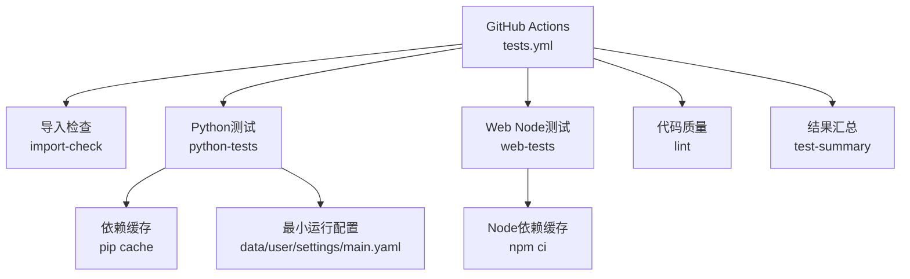
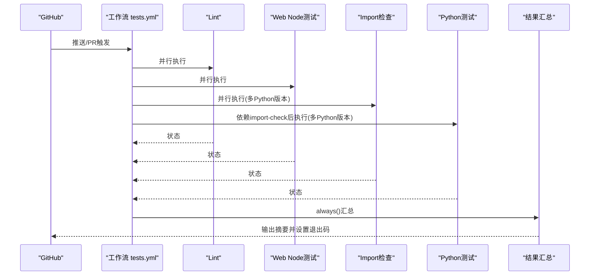
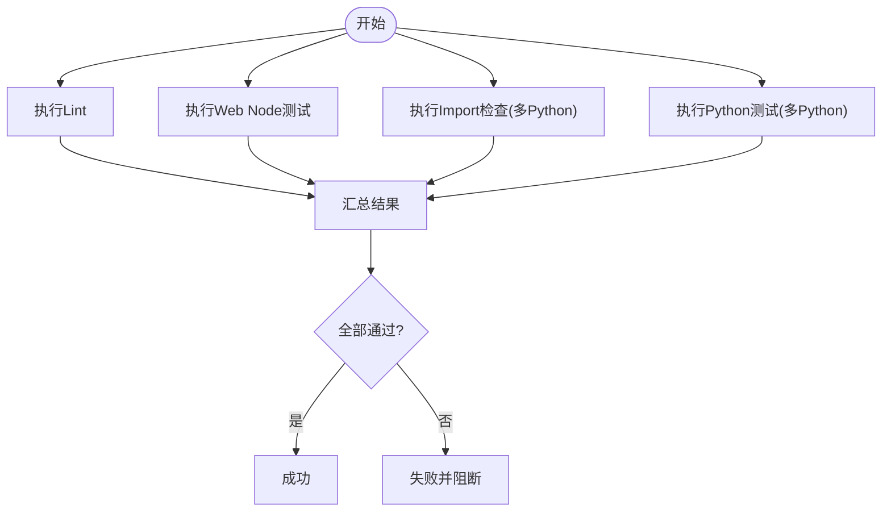
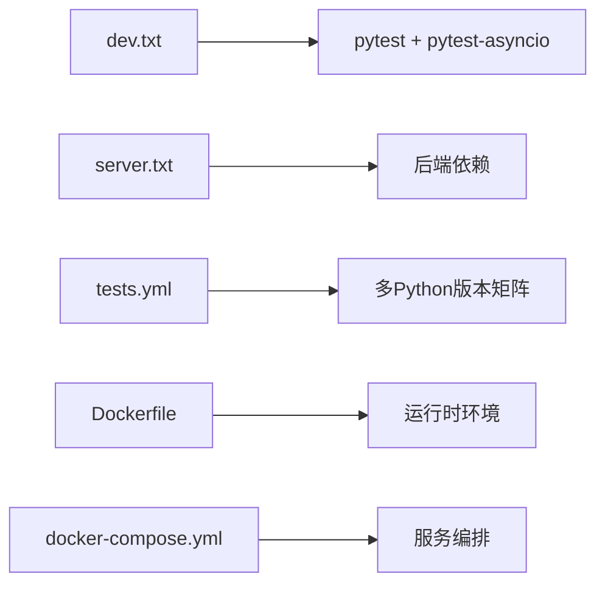

# 测试自动化

<cite>
**本文引用的文件**
- [tests.yml](file://.github/workflows/tests.yml)
- [docker-release.yml](file://.github/workflows/docker-release.yml)
- [pypi-release.yml](file://.github/workflows/pypi-release.yml)
- [pyproject.toml](file://pyproject.toml)
- [server.txt](file://requirements/server.txt)
- [dev.txt](file://requirements/dev.txt)
- [Dockerfile](file://Dockerfile)
- [docker-compose.yml](file://docker-compose.yml)
- [docker-compose.dev.yml](file://docker-compose.dev.yml)
- [conftest.py](file://tests/conftest.py)
- [test_matrix_requirements.py](file://tests/test_matrix_requirements.py)
</cite>

## 目录
1. [简介](#简介)
2. [项目结构](#项目结构)
3. [核心组件](#核心组件)
4. [架构总览](#架构总览)
5. [详细组件分析](#详细组件分析)
6. [依赖关系分析](#依赖关系分析)
7. [性能考虑](#性能考虑)
8. [故障排查指南](#故障排查指南)
9. [结论](#结论)
10. [附录](#附录)

## 简介
本文件面向DeepTutor项目的测试自动化，聚焦CI/CD流水线中的测试配置与执行策略。内容涵盖：
- GitHub Actions工作流如何触发、并行化与汇总报告
- Python与Web前端测试的矩阵化执行
- 测试环境自动搭建（Python/Node缓存、最小运行时配置）
- 测试结果收集与总结
- 失败处理与门禁策略
- Docker容器化测试与多环境矩阵
- 与发布流程（PyPI、Docker镜像）的质量门禁集成

## 项目结构
仓库将测试相关能力分布在多处：
- CI编排：.github/workflows/tests.yml 定义Lint、Web Node测试、Import检查、Python测试及汇总步骤
- 测试框架与夹具：tests/conftest.py提供全局pytest夹具与环境隔离保护
- 依赖与工具链：pyproject.toml中pytest配置、开发依赖；requirements/*.txt用于CI安装
- 容器化：Dockerfile与docker-compose系列提供可复现的运行环境与开发模式
- 发布流水线：docker-release.yml与pypi-release.yml在发布时构建并校验产物

**图表来源**
- [tests.yml:31-203](file://.github/workflows/tests.yml#L31-L203)

**章节来源**
- [tests.yml:31-203](file://.github/workflows/tests.yml#L31-L203)
- [pyproject.toml:415-428](file://pyproject.toml#L415-L428)
- [dev.txt:1-26](file://requirements/dev.txt#L1-L26)
- [server.txt:1-32](file://requirements/server.txt#L1-L32)

## 核心组件
- Lint与格式化：使用Ruff进行静态检查与格式校验，作为质量门禁的第一步
- Web Node测试：在web目录下安装依赖并执行Node测试套件
- Import检查：在多Python版本下验证关键模块可导入，提前发现依赖或兼容性问题
- Python测试：基于pytest执行全量单元测试，包含异步测试标记与严格模式
- 结果汇总：在所有任务完成后生成统一摘要，并在任一失败时阻断流水线

**章节来源**
- [tests.yml:31-203](file://.github/workflows/tests.yml#L31-L203)
- [pyproject.toml:415-428](file://pyproject.toml#L415-L428)

## 架构总览
下图展示从代码变更到测试执行的端到端流程，包括并行作业、依赖缓存、环境准备与结果汇总。

**图表来源**
- [tests.yml:31-203](file://.github/workflows/tests.yml#L31-L203)

**章节来源**
- [tests.yml:31-203](file://.github/workflows/tests.yml#L31-L203)

## 详细组件分析

### GitHub Actions测试工作流
- 触发条件：对main与dev分支的push与pull_request，路径过滤覆盖后端、CLI、测试、依赖与前端
- 并行策略：lint、web-tests、import-check、python-tests并行执行；import-check与python-tests通过matrix在多个Python版本上运行
- 依赖缓存：pip与npm缓存加速重复执行
- 环境准备：为Python测试创建最小运行时配置，避免外部依赖干扰
- 结果汇总：always()阶段汇总各任务结果，并在任一失败时使工作流失败

**图表来源**
- [tests.yml:31-203](file://.github/workflows/tests.yml#L31-L203)

**章节来源**
- [tests.yml:31-203](file://.github/workflows/tests.yml#L31-L203)

### 测试并行执行与分片
- 并行执行：通过jobs并行实现Lint、Web测试、Import检查与Python测试同时运行，缩短整体耗时
- 版本矩阵：import-check与python-tests使用matrix在Python 3.11/3.12/3.13上执行，并包含3.14的实验性任务（允许失败）
- 分片建议：当前未显式拆分测试集；可按功能域划分测试集合，结合pytest的-x/--dist或第三方分片插件进一步并行化

**章节来源**
- [tests.yml:79-180](file://.github/workflows/tests.yml#L79-L180)
- [pyproject.toml:415-428](file://pyproject.toml#L415-L428)

### 增量测试
- 当前工作流未基于diff选择性地仅运行受影响测试；可通过路径过滤与测试标签组合实现更细粒度的增量执行
- 建议：为不同子系统添加pytest markers，并在CI中根据变更路径匹配对应markers执行

[本节为概念性说明，不直接分析具体文件]

### 测试环境自动搭建与数据准备
- Python环境：setup-python安装指定版本，pip缓存依赖；安装server与partners依赖以满足导入与测试需求
- Node环境：setup-node安装Node 22，npm ci安装前端依赖
- 最小运行时配置：在CI中创建data/user/settings/main.yaml，设置语言与日志级别，确保应用启动与测试稳定
- 数据库与存储：测试夹具使用临时路径与内存对象，避免污染真实用户数据

**章节来源**
- [tests.yml:141-180](file://.github/workflows/tests.yml#L141-L180)
- [conftest.py:47-90](file://tests/conftest.py#L47-L90)
- [conftest.py:143-155](file://tests/conftest.py#L143-L155)

### 测试结果收集、分析与报告生成
- 结果收集：pytest默认输出到标准输出；CI步骤将结果写入GITHUB_STEP_SUMMARY形成表格摘要
- 分析能力：可在后续步骤引入pytest-html或Junit XML解析器生成可视化报告
- 报告生成：当前以文本摘要为主；可扩展为HTML报告并上传为Artifacts供下载

**章节来源**
- [tests.yml:182-203](file://.github/workflows/tests.yml#L182-L203)

### 测试失败处理策略与通知机制
- continue-on-error：实验性Python版本（如3.14）设置为允许失败，不影响主版本门禁
- fail-fast：关闭fail-fast，确保所有矩阵任务完整执行后再汇总
- 门禁阻断：test-summary阶段若任一任务失败则exit 1，阻断合并与发布
- 通知机制：可结合GitHub通知或企业通道扩展通知（当前未内置）

**章节来源**
- [tests.yml:79-203](file://.github/workflows/tests.yml#L79-L203)

### Docker容器化测试与多环境矩阵
- 生产镜像：Dockerfile多阶段构建，包含前端构建、Python依赖、supervisord管理前后端进程与健康检查
- 开发镜像：development目标启用热重载与源码挂载，便于本地调试
- Compose编排：提供PocketBase侧车与沙箱执行器，支持健康检查与服务间依赖
- 测试适配：可在CI中使用Docker运行测试，保证环境一致性；也可复用现有容器服务进行集成测试

**章节来源**
- [Dockerfile:1-504](file://Dockerfile#L1-L504)
- [docker-compose.yml:1-183](file://docker-compose.yml#L1-L183)
- [docker-compose.dev.yml:1-52](file://docker-compose.dev.yml#L1-L52)

### 与发布流程的质量门禁集成
- PyPI发布：pypi-release.yml在发布时校验tag与代码版本一致，构建wheel并发布至PyPI
- Docker发布：docker-release.yml构建多平台镜像并推送到GHCR，启用SBOM与缓存
- 质量门禁：发布前需通过测试工作流；建议在release触发前先运行tests.yml并通过门禁

**章节来源**
- [pypi-release.yml:1-155](file://.github/workflows/pypi-release.yml#L1-L155)
- [docker-release.yml:1-73](file://.github/workflows/docker-release.yml#L1-L73)

## 依赖关系分析
- 测试依赖：dev.txt包含pytest、pytest-asyncio等；server.txt提供后端运行所需依赖
- 导入检查：在多个Python版本下验证关键模块导入，确保依赖兼容
- 前端依赖：web目录通过npm ci安装依赖，执行Node测试
- 容器依赖：Dockerfile与compose文件定义了系统级依赖与运行时配置

**图表来源**
- [dev.txt:1-26](file://requirements/dev.txt#L1-L26)
- [server.txt:1-32](file://requirements/server.txt#L1-L32)
- [tests.yml:79-180](file://.github/workflows/tests.yml#L79-L180)
- [Dockerfile:1-504](file://Dockerfile#L1-L504)
- [docker-compose.yml:1-183](file://docker-compose.yml#L1-L183)

**章节来源**
- [dev.txt:1-26](file://requirements/dev.txt#L1-L26)
- [server.txt:1-32](file://requirements/server.txt#L1-L32)
- [tests.yml:79-180](file://.github/workflows/tests.yml#L79-L180)

## 性能考虑
- 依赖缓存：pip与npm缓存显著减少重复安装时间
- 并行执行：jobs并行与matrix多版本执行提升吞吐
- 最小化依赖：Import检查仅安装必要依赖，快速定位问题
- 容器层缓存：Docker BuildKit缓存中间层，加速构建

[本节提供通用指导，不直接分析具体文件]

## 故障排查指南
- 导入失败：检查requirements与Python版本兼容性；确认Import检查是否通过
- 测试失败：查看pytest输出与GITHUB_STEP_SUMMARY；必要时增加日志或缩小测试范围
- 环境不一致：使用Docker容器执行测试，确保与生产一致
- 权限与路径：确认data目录与settings文件存在且可写；避免写入真实用户数据

**章节来源**
- [tests.yml:79-203](file://.github/workflows/tests.yml#L79-L203)
- [conftest.py:47-90](file://tests/conftest.py#L47-L90)

## 结论
DeepTutor的测试自动化通过GitHub Actions实现了跨语言、跨版本的并行测试与质量门禁。借助依赖缓存、最小环境配置与容器化，保证了测试的可重复性与稳定性。未来可进一步增强增量测试、分片执行与可视化报告，以提升效率与可观测性。

[本节为总结性内容，不直接分析具体文件]

## 附录

### 测试夹具与环境隔离
- conftest.py提供全局夹具，包括StreamBus、UnifiedContext、SQLite存储与Fake LLM配置
- 自动保护真实用户数据目录，防止测试写入生产路径
- 临时数据库与路径隔离，确保测试互不干扰

**章节来源**
- [conftest.py:47-195](file://tests/conftest.py#L47-L195)

### 依赖矩阵与E2EE分离
- matrix.txt与matrix-e2e.txt分离非E2EE与E2EE依赖，避免不必要的重依赖
- 测试验证依赖拆分正确性

**章节来源**
- [test_matrix_requirements.py:1-19](file://tests/test_matrix_requirements.py#L1-L19)