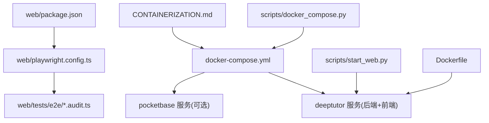
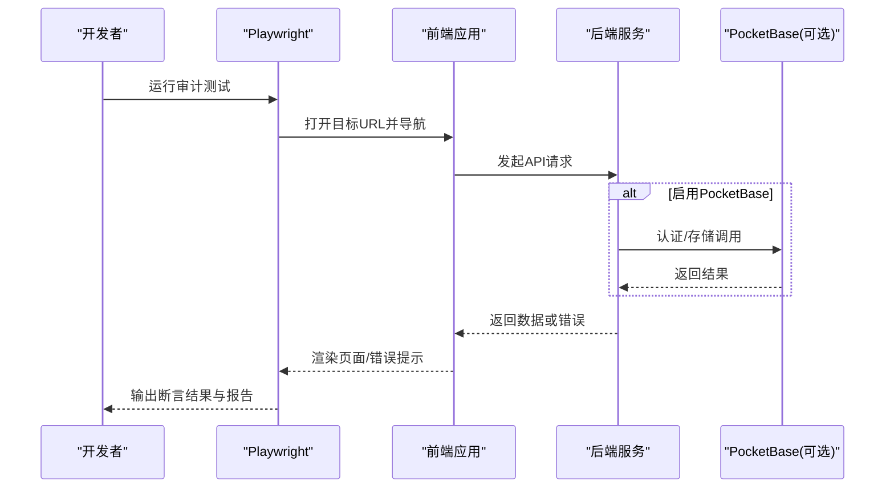
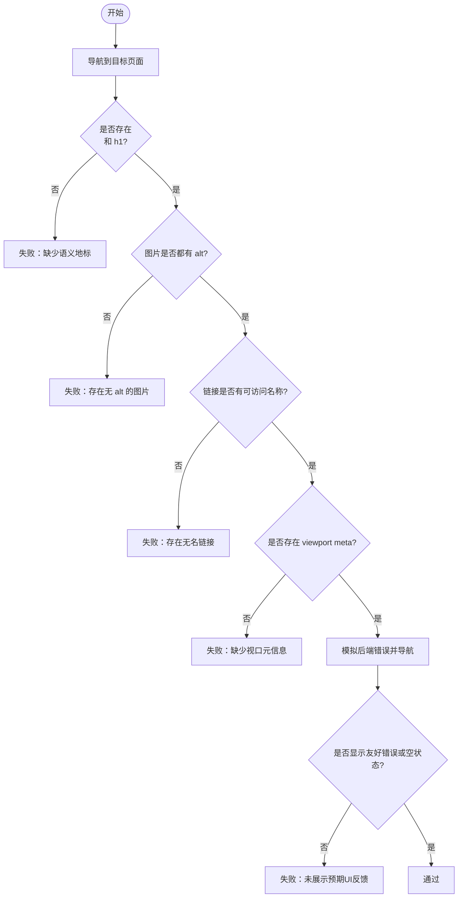
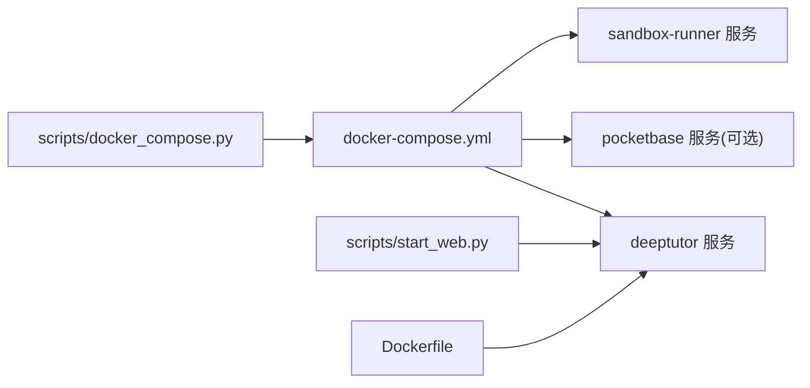
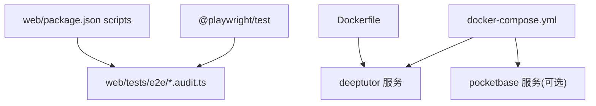

# 端到端测试

<cite>
**本文引用的文件**
- [playwright.config.ts](file://web/playwright.config.ts)
- [compliance-and-ux.audit.ts](file://web/tests/e2e/compliance-and-ux.audit.ts)
- [package.json](file://web/package.json)
- [docker-compose.yml](file://docker-compose.yml)
- [docker_compose.py](file://scripts/docker_compose.py)
- [start_web.py](file://scripts/start_web.py)
- [Dockerfile](file://Dockerfile)
- [CONTAINERIZATION.md](file://CONTAINERIZATION.md)
</cite>

## 目录
1. [简介](#简介)
2. [项目结构](#项目结构)
3. [核心组件](#核心组件)
4. [架构总览](#架构总览)
5. [详细组件分析](#详细组件分析)
6. [依赖关系分析](#依赖关系分析)
7. [性能考虑](#性能考虑)
8. [故障排查指南](#故障排查指南)
9. [结论](#结论)
10. [附录](#附录)

## 简介
本文件面向DeepTutor的端到端（E2E）测试，聚焦于基于Playwright的浏览器自动化与合规性/可访问性审计。文档涵盖：
- E2E测试策略与场景设计
- Playwright框架使用要点（浏览器自动化、用户交互模拟、页面元素操作）
- 测试环境搭建（前端应用启动、后端服务配置、测试数据准备）
- 跨浏览器、响应式与可访问性测试实现方法
- 用例组织与命名规范
- 复杂工作流示例
- 报告生成、截图录制与调试技巧

## 项目结构
E2E测试位于前端工程内，采用Playwright进行UI级验证，并通过Docker Compose编排后端与可选的PocketBase侧车，形成完整的运行环境。

图表来源
- [playwright.config.ts:1-28](file://web/playwright.config.ts#L1-L28)
- [compliance-and-ux.audit.ts:1-101](file://web/tests/e2e/compliance-and-ux.audit.ts#L1-L101)
- [package.json:1-63](file://web/package.json#L1-L63)
- [docker-compose.yml:1-183](file://docker-compose.yml#L1-L183)
- [docker_compose.py:1-113](file://scripts/docker_compose.py#L1-L113)
- [start_web.py:1-40](file://scripts/start_web.py#L1-L40)
- [Dockerfile:202-229](file://Dockerfile#L202-L229)
- [CONTAINERIZATION.md:335-362](file://CONTAINERIZATION.md#L335-L362)

章节来源
- [playwright.config.ts:1-28](file://web/playwright.config.ts#L1-L28)
- [package.json:1-63](file://web/package.json#L1-L63)
- [docker-compose.yml:1-183](file://docker-compose.yml#L1-L183)
- [docker_compose.py:1-113](file://scripts/docker_compose.py#L1-L113)
- [start_web.py:1-40](file://scripts/start_web.py#L1-L40)
- [Dockerfile:202-229](file://Dockerfile#L202-L229)
- [CONTAINERIZATION.md:335-362](file://CONTAINERIZATION.md#L335-L362)

## 核心组件
- Playwright配置与项目定义：通过配置文件指定测试目录、并行度、重试、Reporter、基础URL、追踪策略以及按匹配规则划分的Project。
- 审计测试用例：以“*.audit.ts”为后缀的测试文件，聚焦语义化标签、可访问性与错误提示等UX信号。
- 脚本与命令：在包脚本中暴露审计相关命令，便于本地或CI执行。
- 容器编排：通过Compose启动后端与可选PocketBase，提供健康检查与端口映射；辅助脚本从JSON设置渲染环境变量。
- 启动器：Python启动脚本封装开发/生产模式的前后端启动逻辑。

章节来源
- [playwright.config.ts:1-28](file://web/playwright.config.ts#L1-L28)
- [compliance-and-ux.audit.ts:1-101](file://web/tests/e2e/compliance-and-ux.audit.ts#L1-L101)
- [package.json:1-63](file://web/package.json#L1-L63)
- [docker-compose.yml:1-183](file://docker-compose.yml#L1-L183)
- [docker_compose.py:1-113](file://scripts/docker_compose.py#L1-L113)
- [start_web.py:1-40](file://scripts/start_web.py#L1-L40)

## 架构总览
E2E测试运行在已启动的前端应用之上，通过Playwright驱动浏览器访问页面，断言关键语义与交互反馈。后端与可选存储由Compose管理，确保API可用与健康。

图表来源
- [playwright.config.ts:1-28](file://web/playwright.config.ts#L1-L28)
- [compliance-and-ux.audit.ts:1-101](file://web/tests/e2e/compliance-and-ux.audit.ts#L1-L101)
- [docker-compose.yml:1-183](file://docker-compose.yml#L1-L183)

## 详细组件分析

### Playwright配置与项目划分
- 测试目录与匹配：测试位于web/tests，Project通过testMatch限定仅运行*.audit.ts。
- 并行与串行：支持通过环境变量切换全并行或串行模式，便于不同环境稳定性控制。
- Reporter与追踪：默认输出HTML与列表报告；首次重试时开启Trace以便定位问题。
- 基础URL：优先读取WEB_BASE_URL或NEXT_PUBLIC_API_BASE，否则回退到默认地址。

章节来源
- [playwright.config.ts:1-28](file://web/playwright.config.ts#L1-L28)

### 审计测试用例（可访问性与UX信号）
- 首页主区域与标题：断言存在<main>与h1，保证基本语义结构。
- 图片alt文本：统计缺失alt的图片数量，要求为零。
- 链接可访问名称：断言所有<a>具备可见文本、aria-label或title之一。
- 视口元信息：断言存在viewport meta，保障响应式基础。
- 错误处理与UX信号：通过拦截特定API返回500，验证页面是否展示友好的错误提示或空状态。

图表来源
- [compliance-and-ux.audit.ts:1-101](file://web/tests/e2e/compliance-and-ux.audit.ts#L1-L101)

章节来源
- [compliance-and-ux.audit.ts:1-101](file://web/tests/e2e/compliance-and-ux.audit.ts#L1-L101)

### 测试环境与启动流程
- 后端与前端服务：通过Compose启动deeptutor服务，包含后端与前端端口映射，并附带健康检查。
- PocketBase侧车：可选启用，用于认证与存储，具备独立健康检查。
- Sandbox Runner：隔离执行不受信代码的边车服务，增强安全性。
- 端口与环境变量：通过脚本从JSON设置渲染端口与环境变量，避免硬编码。
- 启动脚本：Python脚本封装开发/生产模式的启动入口，支持dev参数。

图表来源
- [docker_compose.py:1-113](file://scripts/docker_compose.py#L1-L113)
- [docker-compose.yml:1-183](file://docker-compose.yml#L1-L183)
- [start_web.py:1-40](file://scripts/start_web.py#L1-L40)
- [Dockerfile:202-229](file://Dockerfile#L202-L229)

章节来源
- [docker-compose.yml:1-183](file://docker-compose.yml#L1-L183)
- [docker_compose.py:1-113](file://scripts/docker_compose.py#L1-L113)
- [start_web.py:1-40](file://scripts/start_web.py#L1-L40)
- [Dockerfile:202-229](file://Dockerfile#L202-L229)
- [CONTAINERIZATION.md:335-362](file://CONTAINERIZATION.md#L335-L362)

### 跨浏览器测试
- 当前配置仅定义了Desktop Chrome项目，适用于快速回归与可访问性审计。
- 扩展建议：在配置中新增其他设备/浏览器项目（如Firefox、Safari），并通过命令行选择运行。

章节来源
- [playwright.config.ts:1-28](file://web/playwright.config.ts#L1-L28)

### 响应式测试
- 通过断言viewport meta的存在，确保页面具备响应式基础。
- 可扩展：在不同视口尺寸下重复断言布局关键点，验证移动端体验。

章节来源
- [compliance-and-ux.audit.ts:1-101](file://web/tests/e2e/compliance-and-ux.audit.ts#L1-L101)

### 可访问性测试
- 当前实现聚焦基础语义地标、标题层级、图片alt与链接可访问名称。
- 可扩展：引入更全面的可访问性扫描工具，覆盖更多WCAG规则。

章节来源
- [compliance-and-ux.audit.ts:1-101](file://web/tests/e2e/compliance-and-ux.audit.ts#L1-L101)

### 测试用例组织与命名规范
- 文件组织：E2E用例集中于web/tests/e2e，审计类用例以“.audit.ts”结尾，便于Project匹配。
- 命名规范：文件名体现测试类型（如合规与UX），描述清晰；用例分组使用describe包裹主题。
- 命令入口：通过包脚本暴露审计命令，统一执行入口。

章节来源
- [playwright.config.ts:1-28](file://web/playwright.config.ts#L1-L28)
- [package.json:1-63](file://web/package.json#L1-L63)
- [compliance-and-ux.audit.ts:1-101](file://web/tests/e2e/compliance-and-ux.audit.ts#L1-L101)

### 复杂用户工作流示例
- 场景：模拟后端异常，验证前端是否正确呈现错误提示或空状态。
- 步骤：
  - 拦截特定API并返回500错误负载。
  - 导航至对应页面。
  - 断言页面出现预期的错误提示或空状态元素。
- 价值：确保在不可用后端或服务降级时，用户体验依然可控且可感知。

章节来源
- [compliance-and-ux.audit.ts:1-101](file://web/tests/e2e/compliance-and-ux.audit.ts#L1-L101)

## 依赖关系分析
- 测试框架：@playwright/test作为开发与运行依赖。
- 命令脚本：包脚本提供审计相关命令，简化执行。
- 运行时依赖：前端依赖Next.js生态，后端通过Compose与Dockerfile构建镜像。
- 外部服务：可选PocketBase用于认证与存储，Sandbox Runner用于安全执行。

图表来源
- [package.json:1-63](file://web/package.json#L1-L63)
- [docker-compose.yml:1-183](file://docker-compose.yml#L1-L183)
- [Dockerfile:202-229](file://Dockerfile#L202-L229)

章节来源
- [package.json:1-63](file://web/package.json#L1-L63)
- [docker-compose.yml:1-183](file://docker-compose.yml#L1-L183)
- [Dockerfile:202-229](file://Dockerfile#L202-L229)

## 性能考虑
- 并行执行：默认全并行提升速度，可通过环境变量切换串行模式提高稳定性。
- 重试机制：CI环境下自动重试，减少偶发失败影响。
- 追踪与报告：首次重试开启Trace，配合HTML报告快速定位问题。
- 资源限制：Sandbox Runner对进程数与内存进行限制，避免资源滥用。

章节来源
- [playwright.config.ts:1-28](file://web/playwright.config.ts#L1-L28)
- [docker-compose.yml:1-183](file://docker-compose.yml#L1-L183)

## 故障排查指南
- 常见问题：
  - 前端无法访问：检查基础URL环境变量与Compose端口映射。
  - 后端不可用：确认服务健康检查通过，查看日志输出。
  - 测试不稳定：启用串行模式与重试，结合Trace定位。
- 调试技巧：
  - 使用HTML报告查看步骤与截图。
  - 在本地运行UI模式，逐步观察页面变化。
  - 通过拦截API模拟异常，验证错误路径。

章节来源
- [playwright.config.ts:1-28](file://web/playwright.config.ts#L1-L28)
- [docker-compose.yml:1-183](file://docker-compose.yml#L1-L183)
- [compliance-and-ux.audit.ts:1-101](file://web/tests/e2e/compliance-and-ux.audit.ts#L1-L101)

## 结论
本项目采用轻量而实用的E2E策略，聚焦可访问性与UX信号，借助Playwright与Compose构建稳定可靠的测试闭环。通过合理的配置与脚本，既能满足日常回归需求，也为后续扩展跨浏览器、响应式与更全面的可访问性测试奠定基础。

## 附录
- 常用命令：
  - 运行审计测试：通过包脚本执行审计命令。
  - 查看报告：使用内置命令展示HTML报告。
  - 启动服务：通过Compose或启动脚本拉起前后端与可选服务。
- 参考文件：
  - 配置与用例：见web/playwright.config.ts与web/tests/e2e/compliance-and-ux.audit.ts。
  - 服务编排：见docker-compose.yml与scripts/docker_compose.py。
  - 启动入口：见scripts/start_web.py。
  - 容器构建：见Dockerfile与CONTAINERIZATION.md。

章节来源
- [package.json:1-63](file://web/package.json#L1-L63)
- [playwright.config.ts:1-28](file://web/playwright.config.ts#L1-L28)
- [compliance-and-ux.audit.ts:1-101](file://web/tests/e2e/compliance-and-ux.audit.ts#L1-L101)
- [docker-compose.yml:1-183](file://docker-compose.yml#L1-L183)
- [docker_compose.py:1-113](file://scripts/docker_compose.py#L1-L113)
- [start_web.py:1-40](file://scripts/start_web.py#L1-L40)
- [Dockerfile:202-229](file://Dockerfile#L202-L229)
- [CONTAINERIZATION.md:335-362](file://CONTAINERIZATION.md#L335-L362)