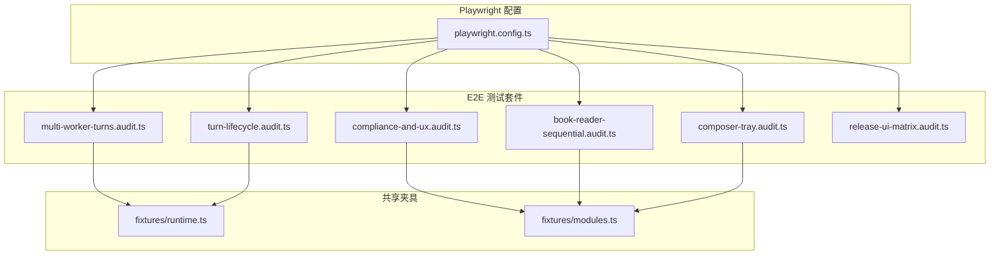
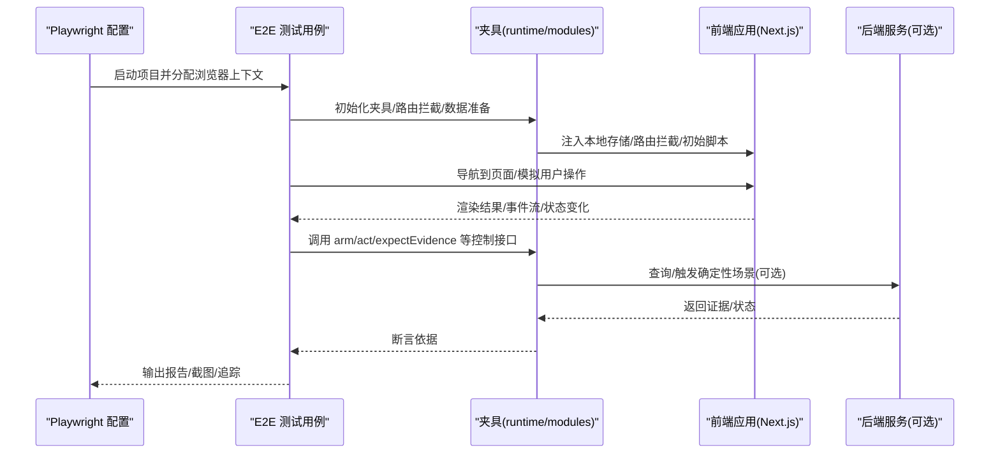
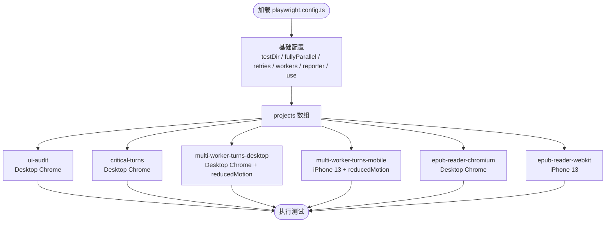
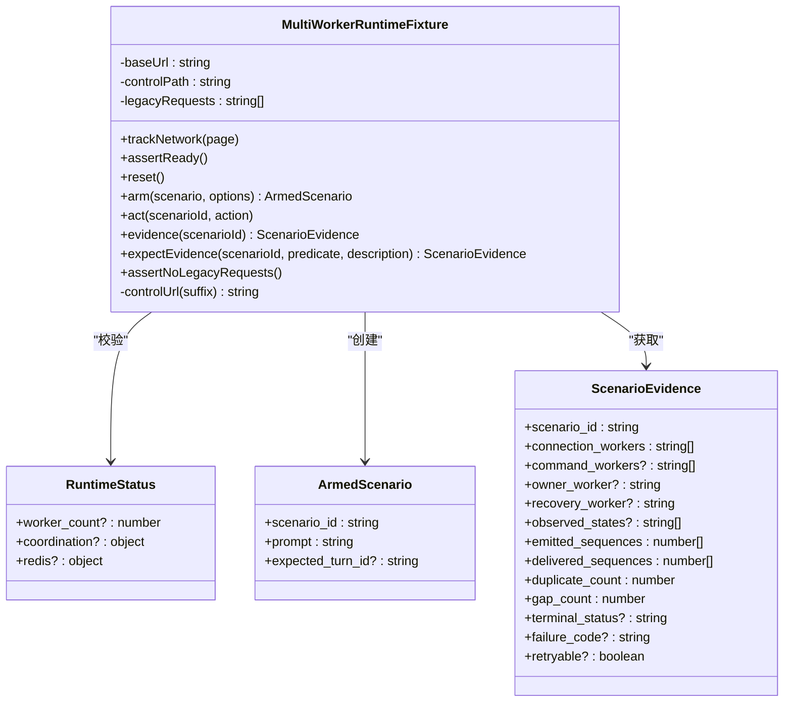
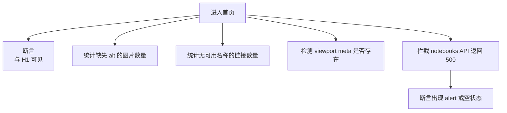
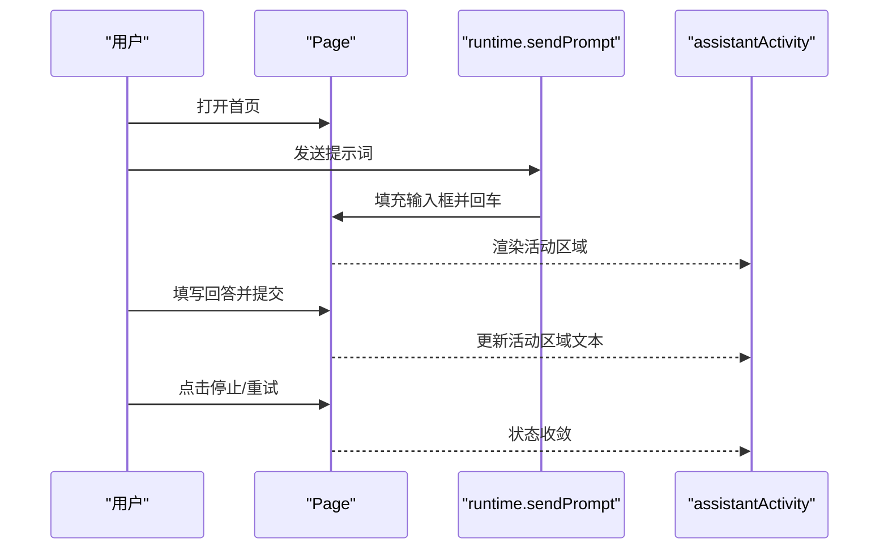
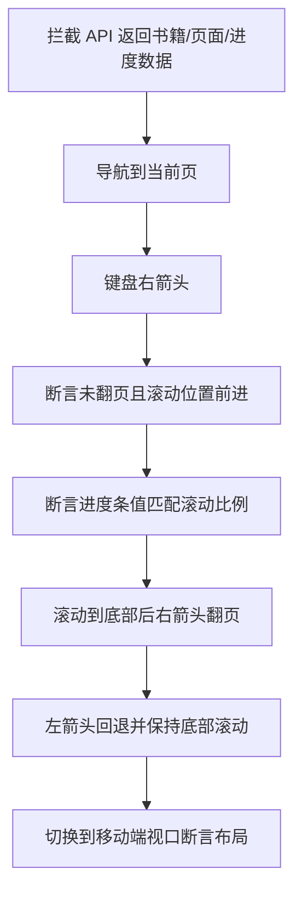
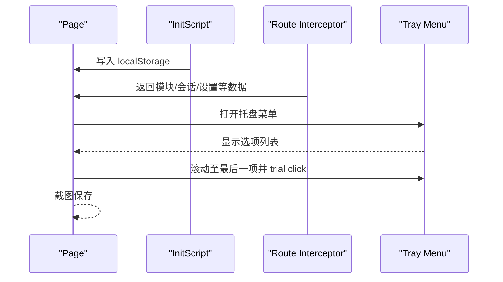
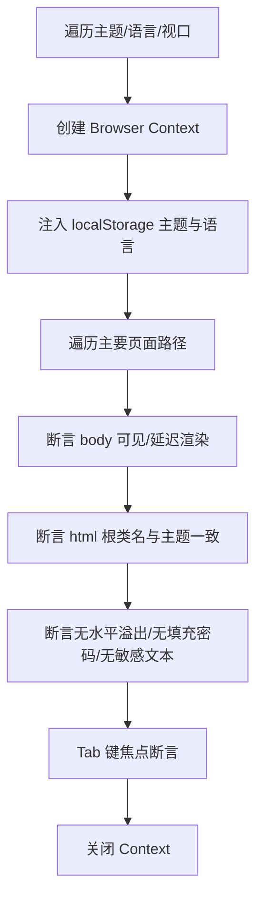
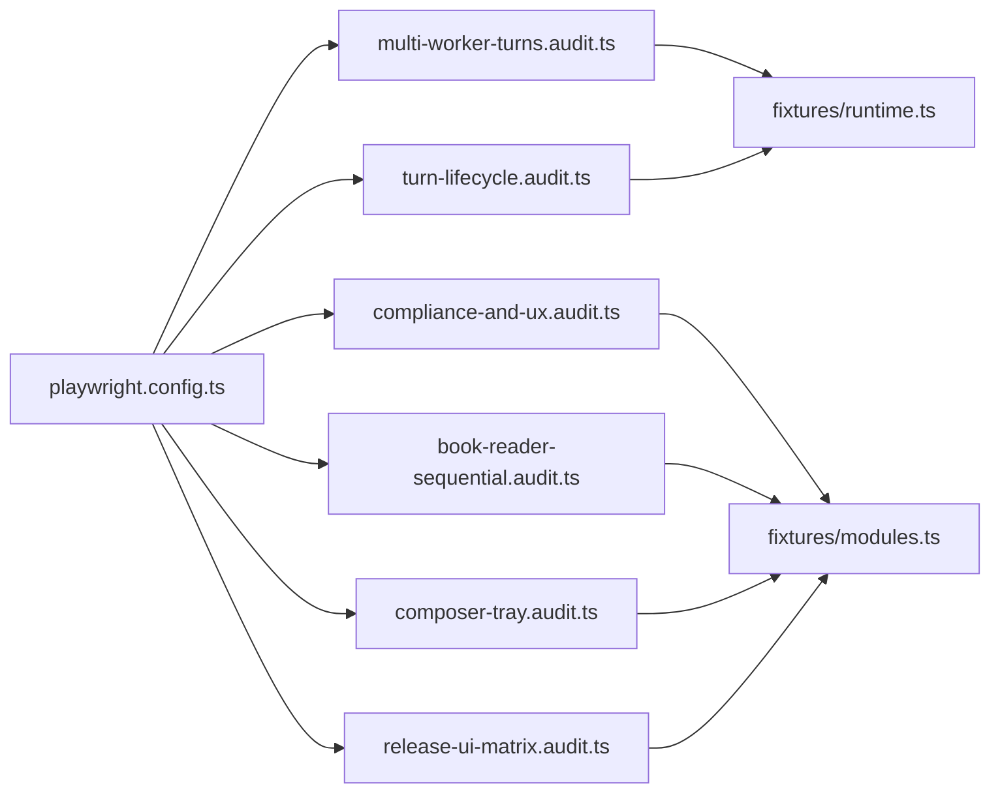

# 端到端测试

<cite>
**本文引用的文件**   
- [playwright.config.ts](file://web/playwright.config.ts)
- [multi-worker-turns.audit.ts](file://web/tests/e2e/multi-worker-turns.audit.ts)
- [compliance-and-ux.audit.ts](file://web/tests/e2e/compliance-and-ux.audit.ts)
- [turn-lifecycle.audit.ts](file://web/tests/e2e/turn-lifecycle.audit.ts)
- [book-reader-sequential.audit.ts](file://web/tests/e2e/book-reader-sequential.audit.ts)
- [composer-tray.audit.ts](file://web/tests/e2e/composer-tray.audit.ts)
- [release-ui-matrix.audit.ts](file://web/tests/e2e/release-ui-matrix.audit.ts)
- [runtime.ts](file://web/tests/e2e/fixtures/runtime.ts)
- [modules.ts](file://web/tests/e2e/fixtures/modules.ts)
</cite>

## 目录
1. [简介](#简介)
2. [项目结构](#项目结构)
3. [核心组件](#核心组件)
4. [架构总览](#架构总览)
5. [详细组件分析](#详细组件分析)
6. [依赖关系分析](#依赖关系分析)
7. [性能与稳定性考虑](#性能与稳定性考虑)
8. [故障排查指南](#故障排查指南)
9. [结论](#结论)

## 简介
本文面向 DeepTutor 前端端到端测试，聚焦 Playwright 在浏览器自动化、用户交互模拟和页面元素定位方面的实践。文档基于仓库中 web 子项目的 e2e 测试代码，说明测试配置、用例组织、跨浏览器与移动端适配、复杂用户流程验证、可访问性与合规性检查、截图对比思路、性能与稳定性保障，以及调试与失败排查方法。

## 项目结构
DeepTutor 前端的端到端测试位于 web 子项目下：
- 配置文件：web/playwright.config.ts
- 测试套件：web/tests/e2e/*.audit.ts
- 共享夹具：web/tests/e2e/fixtures/*

**图表来源**
- [playwright.config.ts:1-58](file://web/playwright.config.ts#L1-L58)
- [multi-worker-turns.audit.ts:1-169](file://web/tests/e2e/multi-worker-turns.audit.ts#L1-L169)
- [compliance-and-ux.audit.ts:1-114](file://web/tests/e2e/compliance-and-ux.audit.ts#L1-L114)
- [turn-lifecycle.audit.ts:1-55](file://web/tests/e2e/turn-lifecycle.audit.ts#L1-L55)
- [book-reader-sequential.audit.ts:1-224](file://web/tests/e2e/book-reader-sequential.audit.ts#L1-L224)
- [composer-tray.audit.ts:1-122](file://web/tests/e2e/composer-tray.audit.ts#L1-L122)
- [release-ui-matrix.audit.ts:1-105](file://web/tests/e2e/release-ui-matrix.audit.ts#L1-L105)
- [runtime.ts:1-195](file://web/tests/e2e/fixtures/runtime.ts#L1-L195)
- [modules.ts:1-22](file://web/tests/e2e/fixtures/modules.ts#L1-L22)

**章节来源**
- [playwright.config.ts:1-58](file://web/playwright.config.ts#L1-L58)

## 核心组件
- Playwright 配置与项目分组：通过 playwright.config.ts 定义多项目运行策略，包括 UI 审计、关键轮次、多工作进程轮次（桌面与移动）、EPUB 阅读器在不同引擎下的执行等。
- 运行时夹具：runtime.ts 提供多工作进程场景的“武装-动作-证据”控制能力，用于断言轮次恢复、取消、重试、重放等复杂行为。
- 模块清单夹具：modules.ts 从源码目录读取模块清单，为无后端或纯浏览器审计提供稳定的模块状态数据。
- 典型 E2E 用例：
  - 多工作进程轮次验收：multi-worker-turns.audit.ts
  - 合规与可访问性：compliance-and-ux.audit.ts
  - 轮次生命周期：turn-lifecycle.audit.ts
  - 书籍阅读顺序与滚动：book-reader-sequential.audit.ts
  - 组合器托盘布局与可点击性：composer-tray.audit.ts
  - 发布 UI 矩阵（主题/语言/视口）：release-ui-matrix.audit.ts

**章节来源**
- [playwright.config.ts:10-56](file://web/playwright.config.ts#L10-L56)
- [runtime.ts:56-178](file://web/tests/e2e/fixtures/runtime.ts#L56-L178)
- [modules.ts:6-21](file://web/tests/e2e/fixtures/modules.ts#L6-L21)

## 架构总览
Playwright 作为浏览器自动化框架，驱动真实浏览器实例访问应用基址，按项目分组并行或串行执行测试。夹具层屏蔽后端差异，将网络请求、会话状态、错误注入等抽象为稳定接口，使 E2E 用例专注于用户行为与界面断言。

**图表来源**
- [playwright.config.ts:1-58](file://web/playwright.config.ts#L1-L58)
- [runtime.ts:1-195](file://web/tests/e2e/fixtures/runtime.ts#L1-L195)
- [multi-worker-turns.audit.ts:1-169](file://web/tests/e2e/multi-worker-turns.audit.ts#L1-L169)

## 详细组件分析

### Playwright 配置与项目分组
- 基础设置
  - 测试目录：tests
  - 并行策略：默认全并行，可通过环境变量切换串行模式
  - CI 行为：禁止仅标记测试、重试次数、工作进程数
  - 报告：HTML + List
  - 全局 use：baseURL、trace 策略
- 项目分组
  - ui-audit：通用 UI 审计，排除特定用例
  - critical-turns：关键轮次用例
  - multi-worker-turns-desktop/mobile：多工作进程轮次，桌面与 iPhone 13
  - epub-reader-chromium/webkit：EPUB 阅读器在 Chromium 与 WebKit 上运行

**图表来源**
- [playwright.config.ts:9-56](file://web/playwright.config.ts#L9-L56)

**章节来源**
- [playwright.config.ts:1-58](file://web/playwright.config.ts#L1-L58)

### 运行时夹具：多工作进程轮次控制
- 能力概览
  - 环境就绪校验：检查系统运行时、Redis 协调、确定性夹具健康
  - 场景武装：arm(scenario, options) 生成 scenario_id 与 prompt
  - 动作注入：act(scenario_id, action) 注入断点/异常/断开等
  - 证据获取：evidence/expectEvidence 轮询等待终态
  - 网络追踪：trackNetwork 记录旧版 chat 接口调用，防止回归
- 典型断言
  - 跨工作进程恢复：连接 worker 集合、序列号一致性、无重复/无缺口
  - 取消确认：命令 worker 参与、停止按钮消失
  - 回复完成：同一等待轮次在不同 worker 完成
  - 所有者丢失：失败可重试并在恢复 worker 再生
  - 重载回放：仅回放保存游标之后的事件
  - 非所有者观察：不改变轮次失败状态

**图表来源**
- [runtime.ts:14-40](file://web/tests/e2e/fixtures/runtime.ts#L14-L40)
- [runtime.ts:56-167](file://web/tests/e2e/fixtures/runtime.ts#L56-L167)

**章节来源**
- [runtime.ts:1-195](file://web/tests/e2e/fixtures/runtime.ts#L1-L195)
- [multi-worker-turns.audit.ts:1-169](file://web/tests/e2e/multi-worker-turns.audit.ts#L1-L169)

### 合规与可访问性测试
- 语义化与无障碍
  - 首页存在 main 地标与 H1
  - 图片具备 alt 文本
  - 链接具备可访问名称（文本/aria-label/title/图片 alt）
  - viewport meta 标签存在
- 错误处理与用户体验信号
  - 拦截 API 返回 500，断言出现友好提示或空状态

**图表来源**
- [compliance-and-ux.audit.ts:28-86](file://web/tests/e2e/compliance-and-ux.audit.ts#L28-L86)
- [compliance-and-ux.audit.ts:89-113](file://web/tests/e2e/compliance-and-ux.audit.ts#L89-L113)

**章节来源**
- [compliance-and-ux.audit.ts:1-114](file://web/tests/e2e/compliance-and-ux.audit.ts#L1-L114)

### 轮次生命周期与聊天交互
- 使用 canonical activity 与 ask-user 表面进行交互
- 断言活动区域文本包含预期状态词
- 支持中断、重试、恢复等流程

**图表来源**
- [turn-lifecycle.audit.ts:14-53](file://web/tests/e2e/turn-lifecycle.audit.ts#L14-L53)
- [runtime.ts:182-194](file://web/tests/e2e/fixtures/runtime.ts#L182-L194)

**章节来源**
- [turn-lifecycle.audit.ts:1-55](file://web/tests/e2e/turn-lifecycle.audit.ts#L1-L55)
- [runtime.ts:182-194](file://web/tests/e2e/fixtures/runtime.ts#L182-L194)

### 书籍阅读顺序与滚动进度
- 通过 route 拦截构建书籍、页面、进度等数据
- 断言左右箭头在当前章节内滚动而非翻页
- 断言滚动进度条与 scrollTop/maxScrollTop 一致
- 移动端视口下面包屑与滚动行为正确

**图表来源**
- [book-reader-sequential.audit.ts:94-135](file://web/tests/e2e/book-reader-sequential.audit.ts#L94-L135)
- [book-reader-sequential.audit.ts:137-223](file://web/tests/e2e/book-reader-sequential.audit.ts#L137-L223)

**章节来源**
- [book-reader-sequential.audit.ts:1-224](file://web/tests/e2e/book-reader-sequential.audit.ts#L1-L224)

### 组合器托盘布局与可点击性
- 注入本地存储以固定布局/语言/主题
- 拦截大量 API 返回最小可用数据
- 断言托盘菜单最后一项始终可点击且不被组合器遮挡

**图表来源**
- [composer-tray.audit.ts:6-99](file://web/tests/e2e/composer-tray.audit.ts#L6-L99)
- [composer-tray.audit.ts:102-121](file://web/tests/e2e/composer-tray.audit.ts#L102-L121)

**章节来源**
- [composer-tray.audit.ts:1-122](file://web/tests/e2e/composer-tray.audit.ts#L1-L122)

### 发布 UI 矩阵：主题/语言/视口
- 遍历主题、语言、视口组合，为每个组合创建独立 browser context
- 注入主题与语言到 localStorage
- 断言根节点类名、水平溢出、密码字段、焦点顺序、文本内容安全

**图表来源**
- [release-ui-matrix.audit.ts:25-104](file://web/tests/e2e/release-ui-matrix.audit.ts#L25-L104)

**章节来源**
- [release-ui-matrix.audit.ts:1-105](file://web/tests/e2e/release-ui-matrix.audit.ts#L1-L105)

## 依赖关系分析
- 测试对夹具的依赖
  - runtime.ts 被 multi-worker-turns.audit.ts 与 turn-lifecycle.audit.ts 引用，提供确定性后端交互与断言辅助
  - modules.ts 被 compliance-and-ux.audit.ts、book-reader-sequential.audit.ts、composer-tray.audit.ts、release-ui-matrix.audit.ts 引用，提供模块清单数据
- 配置对浏览器的依赖
  - playwright.config.ts 声明多个 project，分别绑定 Desktop Chrome、iPhone 13、WebKit 等

**图表来源**
- [playwright.config.ts:20-56](file://web/playwright.config.ts#L20-L56)
- [multi-worker-turns.audit.ts:1-7](file://web/tests/e2e/multi-worker-turns.audit.ts#L1-L7)
- [turn-lifecycle.audit.ts:1-4](file://web/tests/e2e/turn-lifecycle.audit.ts#L1-L4)
- [compliance-and-ux.audit.ts:1-2](file://web/tests/e2e/compliance-and-ux.audit.ts#L1-L2)
- [book-reader-sequential.audit.ts:1-3](file://web/tests/e2e/book-reader-sequential.audit.ts#L1-L3)
- [composer-tray.audit.ts:1-2](file://web/tests/e2e/composer-tray.audit.ts#L1-L2)
- [release-ui-matrix.audit.ts:1-2](file://web/tests/e2e/release-ui-matrix.audit.ts#L1-L2)

**章节来源**
- [playwright.config.ts:20-56](file://web/playwright.config.ts#L20-L56)

## 性能与稳定性考虑
- 并行与串行
  - 默认 fullyParallel，CI 环境下 retries=2；可通过 PW_SERIAL=1 强制串行
- 动画与性能
  - 多处使用 reducedMotion 减少动画干扰，提升稳定性
- 资源与内存
  - release-ui-matrix 断言无水平溢出、无填充密码、无敏感令牌泄露
- 网络与错误
  - compliance-and-ux 模拟 500 错误，断言用户可见反馈
- 追踪与报告
  - trace 开启于首次重试，配合 HTML 报告便于定位

[本节为通用指导，不直接分析具体文件]

## 故障排查指南
- 常见失败原因
  - 后端不可达：runtime.assertReady 会校验系统运行时与 Redis 健康，若失败需检查 DEEPTUTOR_MULTI_WORKER_E2E 与相关 URL 环境变量
  - 旧接口回归：fixture.trackNetwork 会收集 /api/chat 相关请求，断言为空，否则抛出明确信息
  - 视图不稳定：优先使用 role/testid 选择器，避免脆弱选择器；必要时增加 expect.poll 或显式等待
- 调试技巧
  - 使用 trace：CI 首次重试自动开启 trace，结合 HTML 报告查看步骤快照
  - 截图：在关键步骤调用 page.screenshot 保存失败截图
  - 日志：利用 expect.poll 的 message 参数输出自定义失败信息
- 失败用例排查流程
  - 复现：在本地启用对应 project，必要时设置环境变量
  - 隔离：缩小到最小用例，禁用其他并行任务
  - 定位：查看 trace 与截图，确认是网络、渲染还是交互问题
  - 修复：修正选择器或业务逻辑，补充更稳健的断言

**章节来源**
- [runtime.ts:64-102](file://web/tests/e2e/fixtures/runtime.ts#L64-L102)
- [runtime.ts:156-167](file://web/tests/e2e/fixtures/runtime.ts#L156-L167)
- [playwright.config.ts:11-19](file://web/playwright.config.ts#L11-L19)

## 结论
DeepTutor 前端的端到端测试以 Playwright 为核心，通过项目分组覆盖不同浏览器与设备，借助夹具屏蔽后端差异，确保复杂用户流程（轮次生命周期、聊天交互、书籍阅读、托盘布局）的稳定验证。同时，合规与可访问性检查、UI 矩阵扫描、错误处理断言共同构成质量保障体系。建议持续完善截图对比与性能基准，扩展更多跨浏览器矩阵，并结合 CI 流水线实现自动化回归。