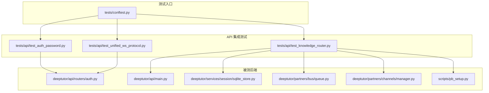
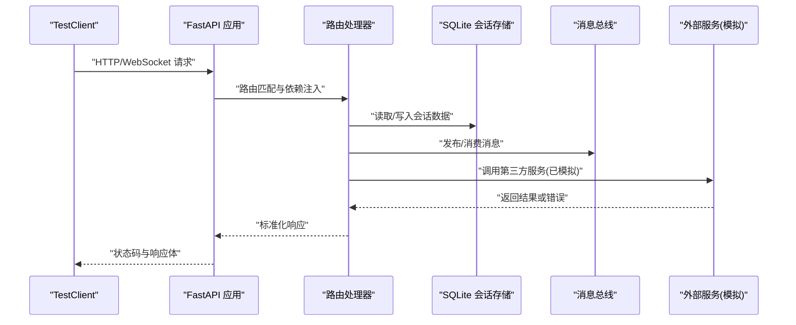
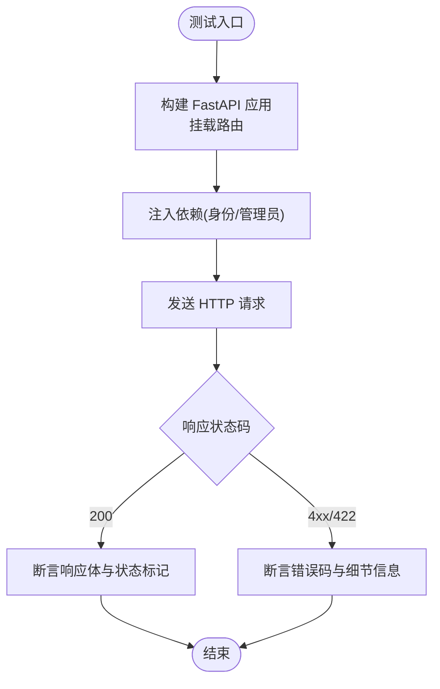
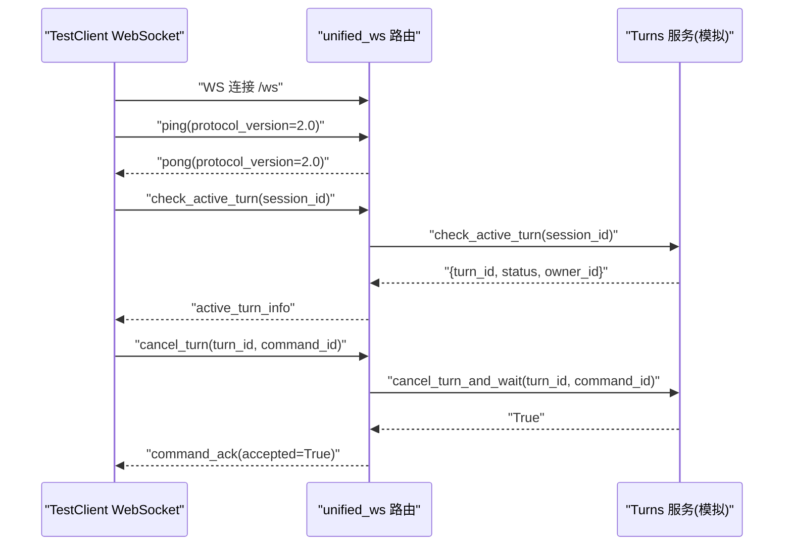
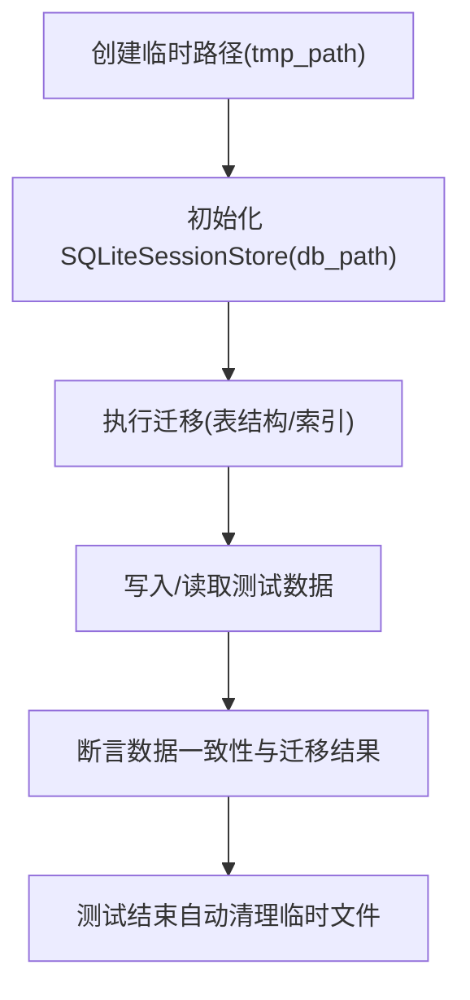
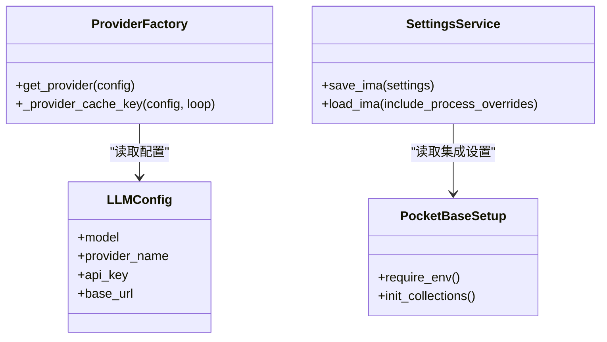
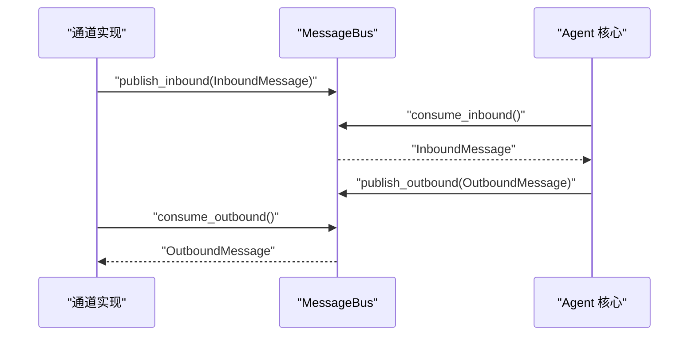
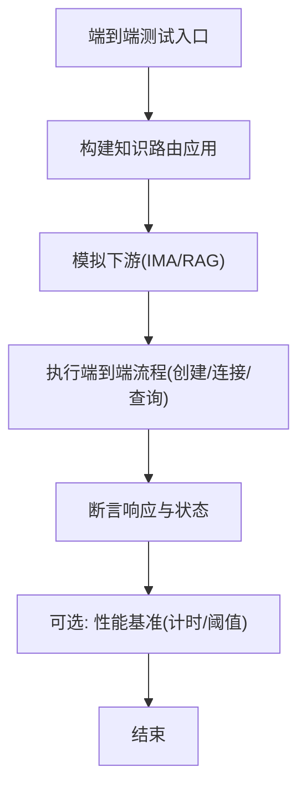
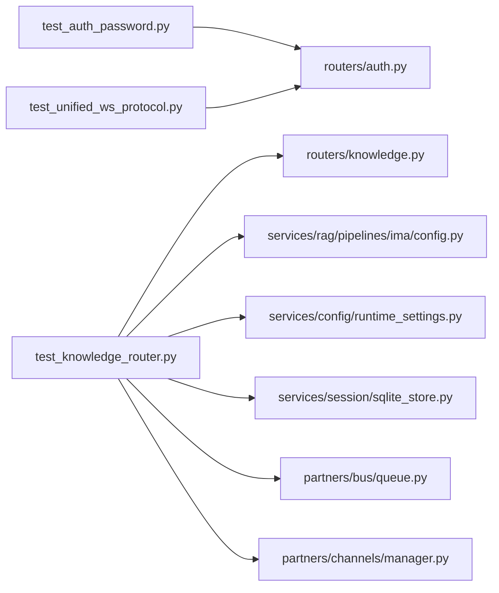

# 集成测试

<cite>
**本文引用的文件**   
- [tests/conftest.py](file://tests/conftest.py)
- [tests/api/test_auth_password.py](file://tests/api/test_auth_password.py)
- [tests/api/test_unified_ws_protocol.py](file://tests/api/test_unified_ws_protocol.py)
- [tests/api/test_knowledge_router.py](file://tests/api/test_knowledge_router.py)
- [deeptutor/api/routers/auth.py](file://deeptutor/api/routers/auth.py)
- [deeptutor/api/main.py](file://deeptutor/api/main.py)
- [deeptutor/services/session/sqlite_store.py](file://deeptutor/services/session/sqlite_store.py)
- [deeptutor/partners/bus/queue.py](file://deeptutor/partners/bus/queue.py)
- [deeptutor/partners/channels/manager.py](file://deeptutor/partners/channels/manager.py)
- [scripts/pb_setup.py](file://scripts/pb_setup.py)
</cite>

## 目录
1. [简介](#简介)
2. [项目结构](#项目结构)
3. [核心组件](#核心组件)
4. [架构总览](#架构总览)
5. [详细组件分析](#详细组件分析)
6. [依赖关系分析](#依赖关系分析)
7. [性能考虑](#性能考虑)
8. [故障排查指南](#故障排查指南)
9. [结论](#结论)

## 简介
本文件面向 DeepTutor 项目的集成测试，聚焦以下目标：
- API 端点测试：基于 FastAPI TestClient 的请求构造、依赖注入与响应断言。
- 数据库集成测试：SQLite 临时库、迁移路径与事务隔离策略。
- 外部服务模拟：LLM 提供商、存储服务、PocketBase 等第三方服务的替换与校验。
- WebSocket 集成测试：统一协议版本、心跳、活跃轮次检查与命令确认。
- 微服务间通信：消息队列与通道管理器在集成场景下的行为验证。
- 测试数据准备、清理与状态管理：根级 conftest 提供的隔离夹具与环境保护。
- 端到端工作流示例与性能基准方法：从路由到下游服务的完整链路验证思路。

## 项目结构
DeepTutor 的集成测试主要位于 tests 目录，按模块划分；API 相关测试集中在 tests/api，WebSocket 协议测试、知识库路由测试、认证密码变更测试等分别由独立文件覆盖。根级 conftest.py 提供跨测试共享的夹具与环境隔离策略。

**图表来源**
- [tests/conftest.py:1-312](file://tests/conftest.py#L1-L312)
- [tests/api/test_auth_password.py:1-267](file://tests/api/test_auth_password.py#L1-L267)
- [tests/api/test_unified_ws_protocol.py:1-117](file://tests/api/test_unified_ws_protocol.py#L1-L117)
- [tests/api/test_knowledge_router.py:1-800](file://tests/api/test_knowledge_router.py#L1-L800)
- [deeptutor/api/routers/auth.py:170-265](file://deeptutor/api/routers/auth.py#L170-L265)
- [deeptutor/api/main.py:71-109](file://deeptutor/api/main.py#L71-L109)
- [deeptutor/services/session/sqlite_store.py:398-735](file://deeptutor/services/session/sqlite_store.py#L398-L735)
- [deeptutor/partners/bus/queue.py:1-44](file://deeptutor/partners/bus/queue.py#L1-L44)
- [deeptutor/partners/channels/manager.py:249-276](file://deeptutor/partners/channels/manager.py#L249-L276)
- [scripts/pb_setup.py:1-42](file://scripts/pb_setup.py#L1-L42)

**章节来源**
- [tests/conftest.py:1-312](file://tests/conftest.py#L1-L312)
- [tests/api/test_auth_password.py:1-267](file://tests/api/test_auth_password.py#L1-L267)
- [tests/api/test_unified_ws_protocol.py:1-117](file://tests/api/test_unified_ws_protocol.py#L1-L117)
- [tests/api/test_knowledge_router.py:1-800](file://tests/api/test_knowledge_router.py#L1-L800)

## 核心组件
- 根级夹具与环境隔离：
  - 防止测试写入真实用户密钥树与多用户遗留迁移目录。
  - 隔离 CodeBuddy 登录状态与 LLM 配置缓存，避免跨测试污染。
  - 提供 StreamBus、UnifiedContext、SQLiteSessionStore 等轻量夹具。
- API 测试基座：
  - 使用 FastAPI TestClient 构建最小应用、挂载路由、注入依赖。
  - 通过 monkeypatch 替换身份、存储、外部客户端，确保可重复性。
- WebSocket 协议测试：
  - 验证协议版本、心跳、活跃轮次查询与取消命令确认。
- 知识库路由测试：
  - 覆盖 RAG 提供者列表、IMA 凭证处理、连接与模式设置、文件类型策略等。
- 消息总线与通道管理器：
  - 异步队列解耦通道与 Agent，测试入队出队与元数据时间戳。

**章节来源**
- [tests/conftest.py:18-117](file://tests/conftest.py#L18-L117)
- [tests/conftest.py:124-181](file://tests/conftest.py#L124-L181)
- [tests/conftest.py:212-266](file://tests/conftest.py#L212-L266)
- [tests/api/test_auth_password.py:20-52](file://tests/api/test_auth_password.py#L20-L52)
- [tests/api/test_unified_ws_protocol.py:24-35](file://tests/api/test_unified_ws_protocol.py#L24-L35)
- [tests/api/test_knowledge_router.py:49-54](file://tests/api/test_knowledge_router.py#L49-L54)
- [deeptutor/partners/bus/queue.py:9-44](file://deeptutor/partners/bus/queue.py#L9-L44)
- [deeptutor/partners/channels/manager.py:249-276](file://deeptutor/partners/channels/manager.py#L249-L276)

## 架构总览
下图展示 API 集成测试的典型调用链：TestClient 发起 HTTP/WebSocket 请求，FastAPI 路由解析并调用业务逻辑，必要时访问 SQLite 会话存储或消息总线，同时通过依赖注入替换外部服务（如 PocketBase、LLM）。

**图表来源**
- [tests/api/test_auth_password.py:20-28](file://tests/api/test_auth_password.py#L20-L28)
- [tests/api/test_unified_ws_protocol.py:24-35](file://tests/api/test_unified_ws_protocol.py#L24-L35)
- [tests/api/test_knowledge_router.py:49-54](file://tests/api/test_knowledge_router.py#L49-L54)
- [deeptutor/services/session/sqlite_store.py:398-735](file://deeptutor/services/session/sqlite_store.py#L398-L735)
- [deeptutor/partners/bus/queue.py:9-44](file://deeptutor/partners/bus/queue.py#L9-L44)

## 详细组件分析

### API 端点测试：FastAPI TestClient 的使用、请求构造与响应验证
- 最小应用构建：
  - 使用 FastAPI() 创建应用，add_api_route/include_router 挂载被测路由。
  - 通过 dependency_overrides 注入 TokenPayload 或管理员身份，绕过真实鉴权。
- 请求构造：
  - PUT /profile/password 与 PUT /users/{username}/password 两种路径，分别对应用户自改密与管理员重置。
  - JSON 载荷包含 current_password/new_password 或仅 new_password。
- 响应验证：
  - 成功时返回 200 与 ok 字段；失败时返回 400/404/422，并断言 detail 内容。
  - 对密码哈希更新与 must_change_password 标记进行断言，确保状态一致性。

**图表来源**
- [tests/api/test_auth_password.py:20-52](file://tests/api/test_auth_password.py#L20-L52)
- [tests/api/test_auth_password.py:55-129](file://tests/api/test_auth_password.py#L55-L129)
- [tests/api/test_auth_password.py:131-165](file://tests/api/test_auth_password.py#L131-L165)
- [tests/api/test_auth_password.py:167-215](file://tests/api/test_auth_password.py#L167-L215)
- [tests/api/test_auth_password.py:217-267](file://tests/api/test_auth_password.py#L217-L267)

**章节来源**
- [tests/api/test_auth_password.py:1-267](file://tests/api/test_auth_password.py#L1-L267)
- [deeptutor/api/routers/auth.py:170-265](file://deeptutor/api/routers/auth.py#L170-L265)

### WebSocket 连接的集成测试：实时通信协议与数据流
- 协议版本校验：
  - 缺失或未来版本的 protocol_version 会返回 protocol_error，提示期望版本。
- 心跳与活跃轮次：
  - ping/pong 心跳正常；check_active_turn 返回当前 turn_id、status、owner_id。
- 命令确认：
  - cancel_turn 需要 command_id，否则返回 invalid_command 协议错误；成功后返回 command_ack。

**图表来源**
- [tests/api/test_unified_ws_protocol.py:24-35](file://tests/api/test_unified_ws_protocol.py#L24-L35)
- [tests/api/test_unified_ws_protocol.py:38-55](file://tests/api/test_unified_ws_protocol.py#L38-L55)
- [tests/api/test_unified_ws_protocol.py:58-98](file://tests/api/test_unified_ws_protocol.py#L58-L98)
- [tests/api/test_unified_ws_protocol.py:101-117](file://tests/api/test_unified_ws_protocol.py#L101-L117)

**章节来源**
- [tests/api/test_unified_ws_protocol.py:1-117](file://tests/api/test_unified_ws_protocol.py#L1-L117)

### 数据库集成测试：SQLite 设置、迁移与事务回滚策略
- 临时数据库路径：
  - 使用 tmp_path 生成临时 .db 文件，确保每个测试拥有独立存储。
- 会话存储：
  - SQLiteSessionStore 负责会话表结构与索引；测试中可通过夹具直接实例化。
- 迁移与兼容性：
  - sqlite_store.py 中包含表结构定义与迁移 SQL（例如 notebook_entries 字段调整），测试应覆盖迁移后的数据完整性。
- 事务回滚策略：
  - 由于使用临时文件，测试结束后自动删除；对于需要显式事务的场景，建议在测试内开启事务并在 finally 中回滚。

**图表来源**
- [tests/conftest.py:170-181](file://tests/conftest.py#L170-L181)
- [deeptutor/services/session/sqlite_store.py:398-735](file://deeptutor/services/session/sqlite_store.py#L398-L735)

**章节来源**
- [tests/conftest.py:170-181](file://tests/conftest.py#L170-L181)
- [deeptutor/services/session/sqlite_store.py:398-735](file://deeptutor/services/session/sqlite_store.py#L398-L735)

### 外部服务集成测试：LLM 提供商、存储服务与 PocketBase
- LLM 提供商模拟：
  - 通过 monkeypatch 替换 resolve_llm_runtime_config 与 _LLM_CONFIG_CACHE，固定模型与 provider_name，避免真实网络调用。
- 存储服务模拟：
  - 使用内存字典或临时目录替代真实存储（如 IMA 凭证、KB 配置），并通过 TestClient 验证读写行为。
- PocketBase 集成：
  - scripts/pb_setup.py 用于首次启动后初始化集合；测试中可通过环境变量与 settings 注入模拟 PocketBase URL 与凭据。

**图表来源**
- [tests/conftest.py:212-266](file://tests/conftest.py#L212-L266)
- [scripts/pb_setup.py:1-42](file://scripts/pb_setup.py#L1-L42)

**章节来源**
- [tests/conftest.py:212-266](file://tests/conftest.py#L212-L266)
- [scripts/pb_setup.py:1-42](file://scripts/pb_setup.py#L1-L42)

### 微服务间通信测试：消息队列与进程间通信
- 消息总线：
  - MessageBus 提供 inbound/outbound 两个 asyncio.Queue，解耦通道与 Agent。
  - 测试可验证 publish_inbound/consume_outbound 的时序与元数据时间戳。
- 通道管理器：
  - channels/manager.py 负责通道实例化、配置校验与运行状态；测试需覆盖 allow_from 为空时的跳过逻辑。

**图表来源**
- [deeptutor/partners/bus/queue.py:9-44](file://deeptutor/partners/bus/queue.py#L9-L44)
- [deeptutor/partners/channels/manager.py:249-276](file://deeptutor/partners/channels/manager.py#L249-L276)

**章节来源**
- [deeptutor/partners/bus/queue.py:1-44](file://deeptutor/partners/bus/queue.py#L1-L44)
- [deeptutor/partners/channels/manager.py:249-276](file://deeptutor/partners/channels/manager.py#L249-L276)

### 测试数据准备、清理与状态管理
- 根级夹具保护：
  - _guard_real_owner_secrets：检测并删除测试意外写入的真实用户密钥树。
  - _guard_legacy_multi_user_migration：将 LEGACY_MULTI_USER_ROOT 指向不存在路径，防止迁移影响开发者环境。
  - _isolate_codebuddy_login：隐藏真实 CodeBuddy 会话，强制使用测试数据。
  - _isolate_application_container：清除进程级容器缓存，避免跨测试状态继承。
  - _restore_process_env：恢复 os.environ，防止子进程调用异常。
- 使用建议：
  - 所有涉及文件系统的测试应使用 tmp_path 夹具。
  - 所有涉及全局状态的测试应在 setUp/tearDown 中显式清理或通过 autouse fixture 自动隔离。

**章节来源**
- [tests/conftest.py:18-117](file://tests/conftest.py#L18-L117)
- [tests/conftest.py:269-312](file://tests/conftest.py#L269-L312)

### 端到端工作流测试示例与性能基准方法
- 端到端示例：
  - 以知识库路由为例，构造最小 FastAPI 应用，挂载 knowledge 路由，使用 TestClient 发起 GET/POST/PUT 请求，断言响应体与下游行为（如 IMA 凭证探测、RAG 提供者列表）。
- 性能基准方法：
  - 使用 pytest-benchmark 或 timeit 对关键路径（如 IMA 凭证合并、RAG 提供者枚举）进行计时。
  - 在 CI 中限制最大耗时阈值，避免回归。

**图表来源**
- [tests/api/test_knowledge_router.py:49-54](file://tests/api/test_knowledge_router.py#L49-L54)
- [tests/api/test_knowledge_router.py:289-330](file://tests/api/test_knowledge_router.py#L289-L330)
- [tests/api/test_knowledge_router.py:463-521](file://tests/api/test_knowledge_router.py#L463-L521)

**章节来源**
- [tests/api/test_knowledge_router.py:1-800](file://tests/api/test_knowledge_router.py#L1-L800)

## 依赖关系分析
- 低耦合高内聚：
  - API 路由与业务逻辑分离，测试通过依赖注入替换外部服务。
  - 消息总线与通道管理器解耦，便于单独测试消息流转。
- 直接依赖：
  - auth 路由依赖 multi_user.identity 与 services.auth。
  - knowledge 路由依赖 knowledge.manager、services.rag.pipelines.ima.config 与 runtime_settings。
- 间接依赖：
  - LLM 配置通过 provider_factory 与 config 模块缓存，测试需清理缓存避免污染。

**图表来源**
- [tests/api/test_auth_password.py:1-267](file://tests/api/test_auth_password.py#L1-L267)
- [tests/api/test_unified_ws_protocol.py:1-117](file://tests/api/test_unified_ws_protocol.py#L1-L117)
- [tests/api/test_knowledge_router.py:1-800](file://tests/api/test_knowledge_router.py#L1-L800)

**章节来源**
- [tests/api/test_auth_password.py:1-267](file://tests/api/test_auth_password.py#L1-L267)
- [tests/api/test_unified_ws_protocol.py:1-117](file://tests/api/test_unified_ws_protocol.py#L1-L117)
- [tests/api/test_knowledge_router.py:1-800](file://tests/api/test_knowledge_router.py#L1-L800)

## 性能考虑
- 避免真实网络调用：
  - 所有外部服务（LLM、IMA、PocketBase）必须通过 monkeypatch 或依赖注入替换为模拟实现。
- 减少 I/O 开销：
  - 使用内存数据结构或临时文件，避免磁盘竞争。
- 基准测试：
  - 对热点路径（如 RAG 提供者枚举、IMA 凭证合并）添加性能基准，设定阈值告警。

[本节为通用指导，不直接分析具体文件]

## 故障排查指南
- 测试写入真实用户密钥树：
  - 检查是否遗漏 paths.SYSTEM_ROOT 与 paths.ADMIN_WORKSPACE_ROOT 的重定向。
- LLM 配置缓存导致不一致：
  - 确保在测试前后清理 _LLM_CONFIG_CACHE，或使用 real_llm_resolver 标记。
- WebSocket 协议错误：
  - 确认 protocol_version 为 2.0，且 cancel_turn 携带 command_id。
- PocketBase 初始化失败：
  - 检查 integrations.pocketbase_url/admin_email/admin_password 是否配置正确。

**章节来源**
- [tests/conftest.py:18-117](file://tests/conftest.py#L18-L117)
- [tests/conftest.py:212-266](file://tests/conftest.py#L212-L266)
- [tests/api/test_unified_ws_protocol.py:38-55](file://tests/api/test_unified_ws_protocol.py#L38-L55)
- [scripts/pb_setup.py:1-42](file://scripts/pb_setup.py#L1-L42)

## 结论
DeepTutor 的集成测试体系通过根级 conftest 提供强大的环境与状态隔离，结合 FastAPI TestClient 与 monkeypatch 机制，能够稳定地覆盖 API、WebSocket、数据库与外部服务的关键路径。建议在新增功能时遵循以下实践：
- 优先使用依赖注入替换外部服务。
- 所有文件系统操作使用 tmp_path。
- 对 WebSocket 协议增加版本与命令确认用例。
- 对热点路径添加性能基准，防止回归。

[本节为总结性内容，不直接分析具体文件]