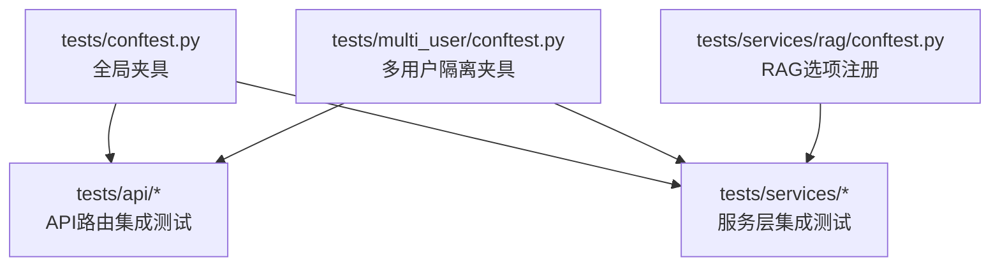
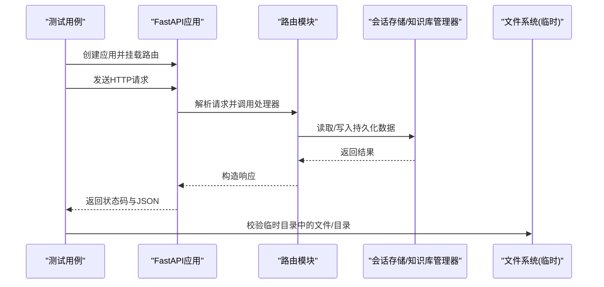
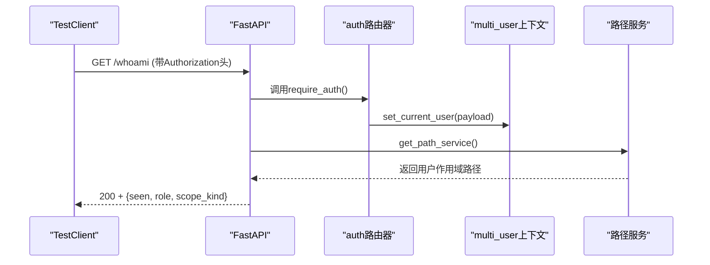
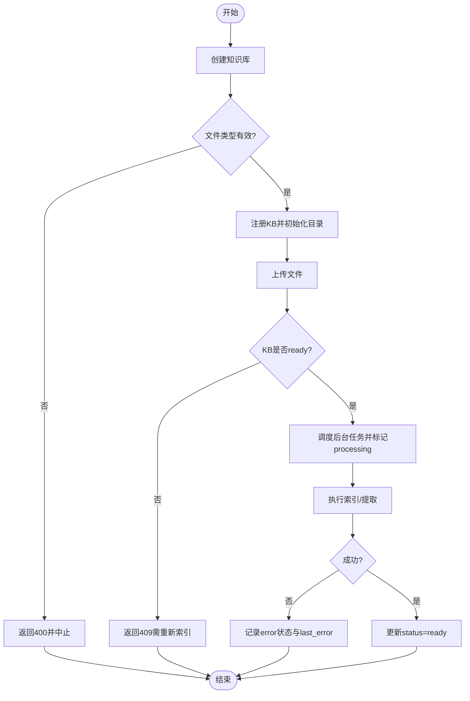
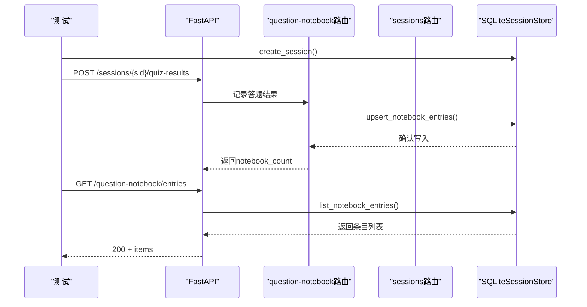
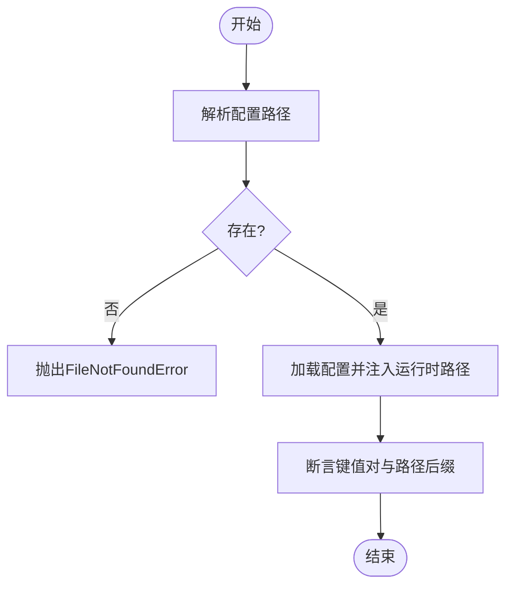
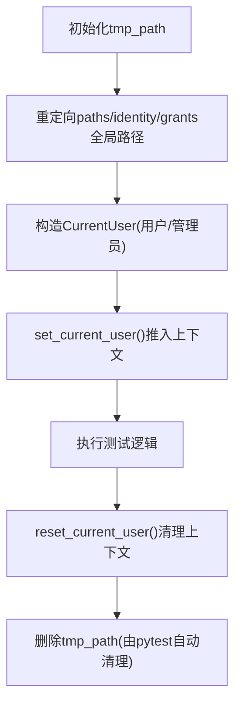
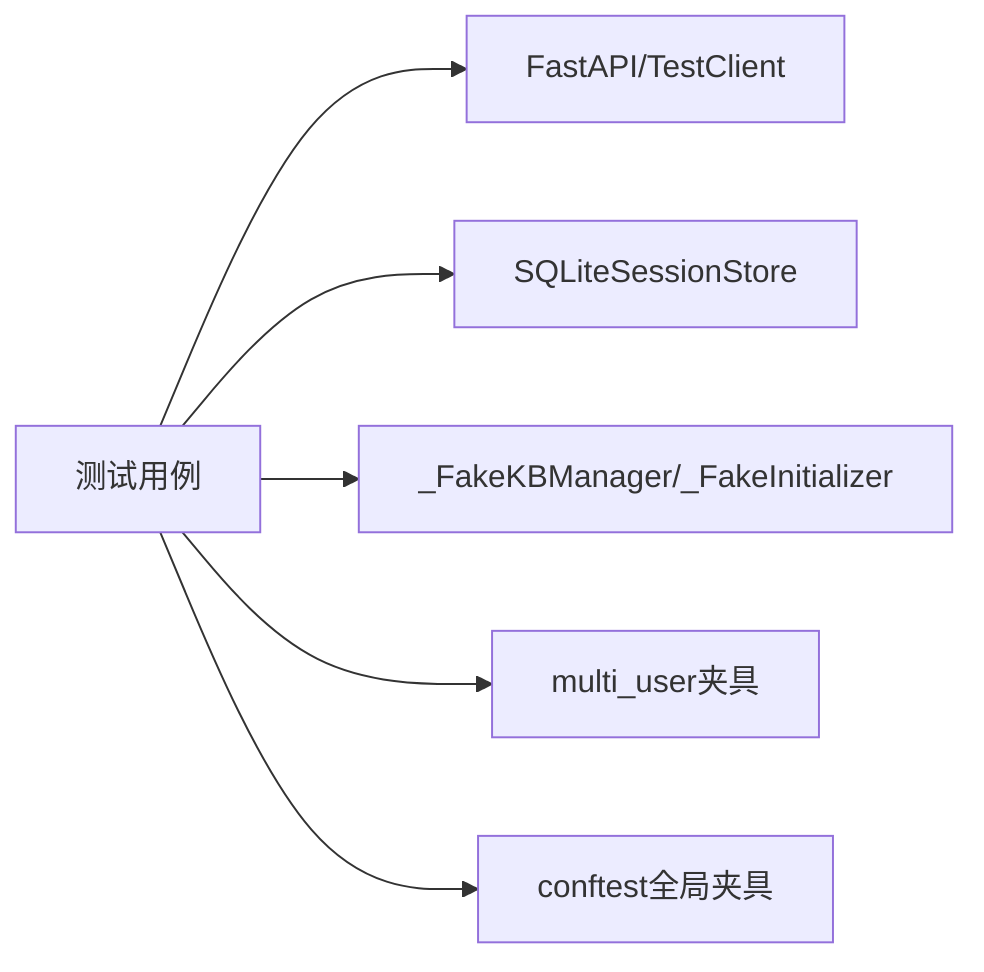

# 集成测试

<cite>
**本文引用的文件**
- [tests/conftest.py](file://tests/conftest.py)
- [tests/api/test_auth_contextvar.py](file://tests/api/test_auth_contextvar.py)
- [tests/api/test_knowledge_router.py](file://tests/api/test_knowledge_router.py)
- [tests/api/test_notebook_router.py](file://tests/api/test_notebook_router.py)
- [tests/services/rag/conftest.py](file://tests/services/rag/conftest.py)
- [tests/multi_user/conftest.py](file://tests/multi_user/conftest.py)
- [tests/services/test_config_loader.py](file://tests/services/test_config_loader.py)
</cite>

## 目录
1. [简介](#简介)
2. [项目结构](#项目结构)
3. [核心组件](#核心组件)
4. [架构总览](#架构总览)
5. [详细组件分析](#详细组件分析)
6. [依赖关系分析](#依赖关系分析)
7. [性能考虑](#性能考虑)
8. [故障排查指南](#故障排查指南)
9. [结论](#结论)
10. [附录](#附录)

## 简介
本文件面向DeepTutor的集成测试，聚焦于API路由、数据库交互与外部服务集成的端到端验证。文档基于仓库中现有测试实现，总结其设计原则、测试范围、环境搭建、数据准备与管理策略、并发与事务处理、以及执行优化方法，并提供多组件协作场景的具体示例路径与流程说明。

## 项目结构
DeepTutor的测试位于tests目录下，按功能域划分：
- tests/api：针对FastAPI路由的集成测试，使用TestClient直接调用路由，覆盖认证、知识管理、会话与笔记等。
- tests/services：针对服务层的集成测试，包含配置加载、RAG管道、会话存储等。
- tests/multi_user：多用户隔离相关的共享夹具，确保测试不会污染真实用户数据。
- tests/conftest.py：全局测试夹具，提供流式总线、上下文、SQLite会话存储、能力模拟等通用资源。

图表来源
- [tests/conftest.py:1-195](file://tests/conftest.py#L1-L195)
- [tests/multi_user/conftest.py:1-119](file://tests/multi_user/conftest.py#L1-L119)
- [tests/services/rag/conftest.py:1-19](file://tests/services/rag/conftest.py#L1-L19)

章节来源
- [tests/conftest.py:1-195](file://tests/conftest.py#L1-L195)
- [tests/multi_user/conftest.py:1-119](file://tests/multi_user/conftest.py#L1-L119)
- [tests/services/rag/conftest.py:1-19](file://tests/services/rag/conftest.py#L1-L19)

## 核心组件
- 全局夹具（StreamBus、UnifiedContext、SQLiteSessionStore、Fake LLM）：为测试提供轻量、可替换的运行时依赖，避免对外部服务的强耦合。
- API路由集成测试：通过TestClient挂载路由并发送HTTP请求，断言状态码与响应体，必要时用monkeypatch替换模块级依赖。
- RAG集成测试：通过pytest选项选择具体管道，便于在CI或本地按需运行不同引擎的集成用例。
- 多用户隔离夹具：将路径、身份、权限等全局变量重定向到tmp_path，保证测试间完全隔离且安全。

章节来源
- [tests/conftest.py:97-155](file://tests/conftest.py#L97-L155)
- [tests/api/test_knowledge_router.py:29-35](file://tests/api/test_knowledge_router.py#L29-L35)
- [tests/services/rag/conftest.py:11-18](file://tests/services/rag/conftest.py#L11-L18)
- [tests/multi_user/conftest.py:20-60](file://tests/multi_user/conftest.py#L20-L60)

## 架构总览
下图展示了一个典型的API集成测试流程：测试构建最小应用、挂载路由、发送请求、断言响应，并在需要时替换后端依赖（如知识库管理器、会话存储）。

图表来源
- [tests/api/test_knowledge_router.py:29-35](file://tests/api/test_knowledge_router.py#L29-L35)
- [tests/api/test_notebook_router.py:19-23](file://tests/api/test_notebook_router.py#L19-L23)

## 详细组件分析

### API路由测试：认证上下文传播
该测试验证require_auth与require_admin必须声明为异步函数，以确保ContextVar在请求生命周期内正确传播；同时验证从令牌到当前用户的映射以及路径服务解析到用户工作区。

图表来源
- [tests/api/test_auth_contextvar.py:98-133](file://tests/api/test_auth_contextvar.py#L98-L133)
- [tests/api/test_auth_contextvar.py:161-199](file://tests/api/test_auth_contextvar.py#L161-L199)

章节来源
- [tests/api/test_auth_contextvar.py:29-96](file://tests/api/test_auth_contextvar.py#L29-L96)
- [tests/api/test_auth_contextvar.py:98-199](file://tests/api/test_auth_contextvar.py#L98-L199)

### API路由测试：知识管理（KB）上传与索引
该测试覆盖创建知识库、上传文件、重索引、错误状态回写、默认别名支持、文件树操作等。通过临时目录与伪造的知识库管理器，避免真实外部依赖。

图表来源
- [tests/api/test_knowledge_router.py:212-242](file://tests/api/test_knowledge_router.py#L212-L242)
- [tests/api/test_knowledge_router.py:348-416](file://tests/api/test_knowledge_router.py#L348-L416)
- [tests/api/test_knowledge_router.py:418-469](file://tests/api/test_knowledge_router.py#L418-L469)

章节来源
- [tests/api/test_knowledge_router.py:130-210](file://tests/api/test_knowledge_router.py#L130-L210)
- [tests/api/test_knowledge_router.py:212-346](file://tests/api/test_knowledge_router.py#L212-L346)
- [tests/api/test_knowledge_router.py:348-469](file://tests/api/test_knowledge_router.py#L348-L469)

### API路由测试：问答笔记本与会话
该测试验证问答结果写入、书签切换、分类CRUD、按问题查找条目、按turn_id隔离状态等。通过SQLiteSessionStore与TestClient组合，覆盖完整的“会话→笔记”链路。

图表来源
- [tests/api/test_notebook_router.py:19-23](file://tests/api/test_notebook_router.py#L19-L23)
- [tests/api/test_notebook_router.py:72-109](file://tests/api/test_notebook_router.py#L72-L109)
- [tests/api/test_notebook_router.py:243-290](file://tests/api/test_notebook_router.py#L243-L290)

章节来源
- [tests/api/test_notebook_router.py:65-109](file://tests/api/test_notebook_router.py#L65-L109)
- [tests/api/test_notebook_router.py:111-210](file://tests/api/test_notebook_router.py#L111-L210)
- [tests/api/test_notebook_router.py:243-371](file://tests/api/test_notebook_router.py#L243-L371)

### 服务层集成测试：配置加载
该测试验证配置路径解析与加载行为，包括自定义配置文件读取、缺失配置抛出异常、显式项目根路径注入等。

图表来源
- [tests/services/test_config_loader.py:14-57](file://tests/services/test_config_loader.py#L14-L57)

章节来源
- [tests/services/test_config_loader.py:14-57](file://tests/services/test_config_loader.py#L14-L57)

### 多用户隔离与种子数据
多用户测试夹具将PROJECT_ROOT、USERS_ROOT、SYSTEM_ROOT等重定向到tmp_path，并提供as_user上下文管理器设置CurrentUser，seed_user用于在磁盘上创建用户记录。这确保了测试间的完全隔离与可重复性。

图表来源
- [tests/multi_user/conftest.py:20-60](file://tests/multi_user/conftest.py#L20-L60)
- [tests/multi_user/conftest.py:88-119](file://tests/multi_user/conftest.py#L88-L119)

章节来源
- [tests/multi_user/conftest.py:20-119](file://tests/multi_user/conftest.py#L20-L119)

### RAG集成测试选项
RAG测试通过pytest_addoption注册--pipeline选项，允许在命令行指定要运行的管道（如llamaindex、all），便于选择性执行集成测试。

章节来源
- [tests/services/rag/conftest.py:11-18](file://tests/services/rag/conftest.py#L11-L18)

## 依赖关系分析
- API路由测试依赖FastAPI与TestClient，并通过importorskip或条件导入确保在轻量环境中可跳过。
- 会话存储使用SQLiteSessionStore，测试通过临时文件路径隔离数据库实例。
- 知识管理测试通过伪造KBManager与Initializer，避免真实RAG引擎与外部服务。
- 多用户测试通过monkeypatch全局路径与缓存，避免影响开发者真实数据。

图表来源
- [tests/api/test_knowledge_router.py:29-35](file://tests/api/test_knowledge_router.py#L29-L35)
- [tests/api/test_notebook_router.py:19-23](file://tests/api/test_notebook_router.py#L19-L23)
- [tests/multi_user/conftest.py:20-60](file://tests/multi_user/conftest.py#L20-L60)
- [tests/conftest.py:143-155](file://tests/conftest.py#L143-L155)

章节来源
- [tests/api/test_knowledge_router.py:29-35](file://tests/api/test_knowledge_router.py#L29-L35)
- [tests/api/test_notebook_router.py:19-23](file://tests/api/test_notebook_router.py#L19-L23)
- [tests/multi_user/conftest.py:20-60](file://tests/multi_user/conftest.py#L20-L60)
- [tests/conftest.py:143-155](file://tests/conftest.py#L143-L155)

## 性能考虑
- 使用临时目录与内存/文件型SQLite减少IO开销，提升测试稳定性与速度。
- 通过伪造外部依赖（KBManager、Initializer、RAGService）避免网络与重型计算。
- 使用pytest选项选择性运行特定管道，降低整体执行时间。
- 利用fixture隔离与自动清理，避免跨测试污染导致的额外清理成本。

## 故障排查指南
- 认证上下文未生效：检查require_auth是否为异步函数，并确保ContextVar在请求范围内可见。参考认证上下文传播测试。
- 路径服务解析错误：确认多用户路径已重定向至tmp_path，并清除路径服务缓存。参考多用户隔离夹具。
- 知识库上传失败：检查文件类型白名单与KB状态（needs_reindex），确认后台任务正确标记error状态。参考知识管理测试。
- 配置加载异常：确认配置文件存在且路径解析正确，必要时显式传入项目根路径。参考配置加载测试。

章节来源
- [tests/api/test_auth_contextvar.py:29-96](file://tests/api/test_auth_contextvar.py#L29-L96)
- [tests/multi_user/conftest.py:20-60](file://tests/multi_user/conftest.py#L20-L60)
- [tests/api/test_knowledge_router.py:348-469](file://tests/api/test_knowledge_router.py#L348-L469)
- [tests/services/test_config_loader.py:43-57](file://tests/services/test_config_loader.py#L43-L57)

## 结论
DeepTutor的集成测试以FastAPI TestClient为核心，结合临时存储、伪造依赖与多用户隔离夹具，实现了高内聚、低耦合的端到端验证。测试覆盖了认证上下文传播、知识管理全链路、问答笔记本与会话、配置加载等关键场景，具备良好的可维护性与扩展性。建议继续遵循现有模式：优先使用临时资源、明确依赖替换点、细化断言与错误分支覆盖，以提升测试质量与执行效率。

## 附录
- 测试环境搭建要点
  - 数据库：使用SQLiteSessionStore配合tmp_path，无需外部数据库服务。
  - 缓存服务：通过conftest提供的StreamBus与内存对象替代外部缓存。
  - 消息队列：通过异步任务与临时目录模拟后台任务，避免引入真实队列。
- 测试数据准备与管理
  - 种子数据：使用临时目录与伪造管理器创建初始数据；多用户测试通过seed_user生成用户记录。
  - 清理机制：pytest的tmp_path自动清理；conftest守卫防止写入真实用户目录。
- 并发与事务
  - 并发：测试独立运行，互不干扰；如需并发，建议使用不同的tmp_path与独立的SQLite文件。
  - 事务：SQLiteSessionStore支持原子写入；测试可通过多次upsert验证幂等与一致性。
- 依赖管理与执行优化
  - 可选依赖：fastapi与TestClient通过importorskip保护轻量环境。
  - 选择性执行：RAG测试通过--pipeline选项控制运行范围。
  - Fixture复用：集中定义常用夹具，减少重复代码与启动开销。