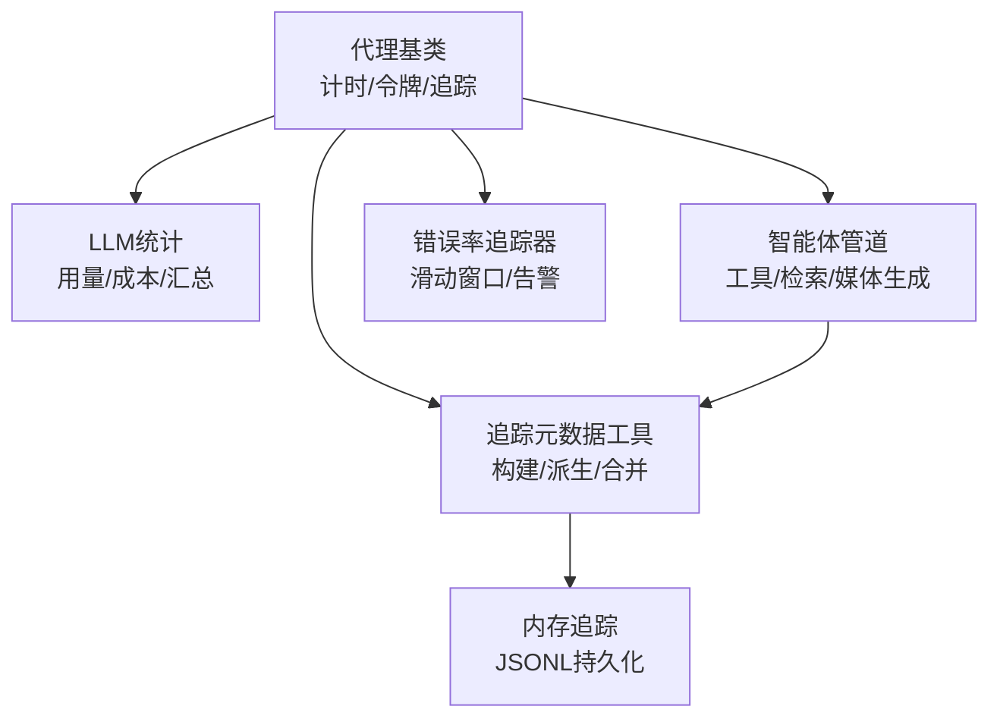
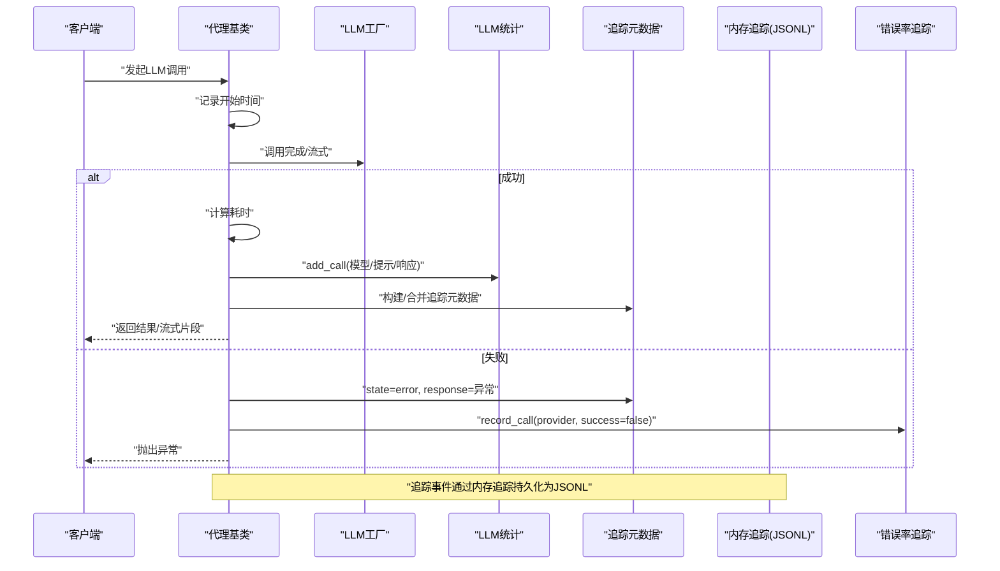
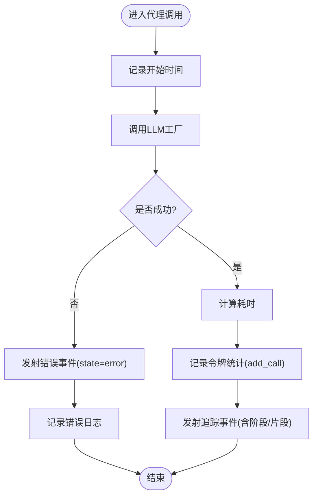
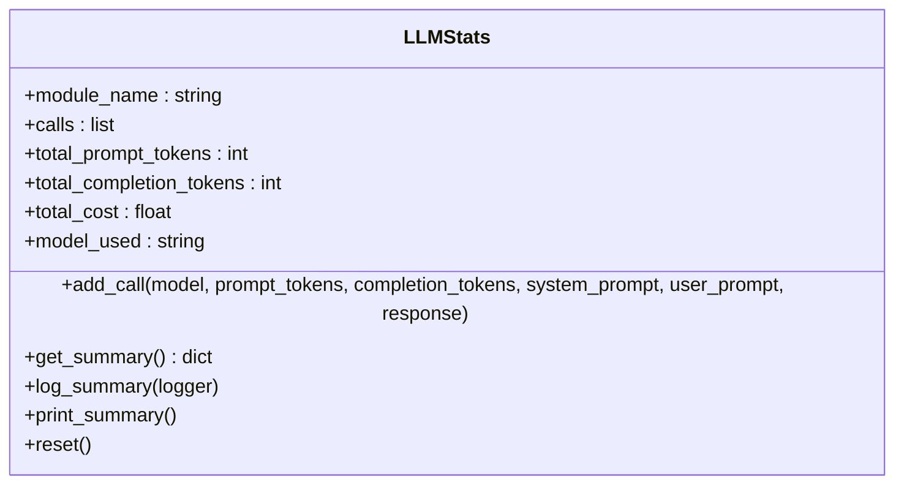
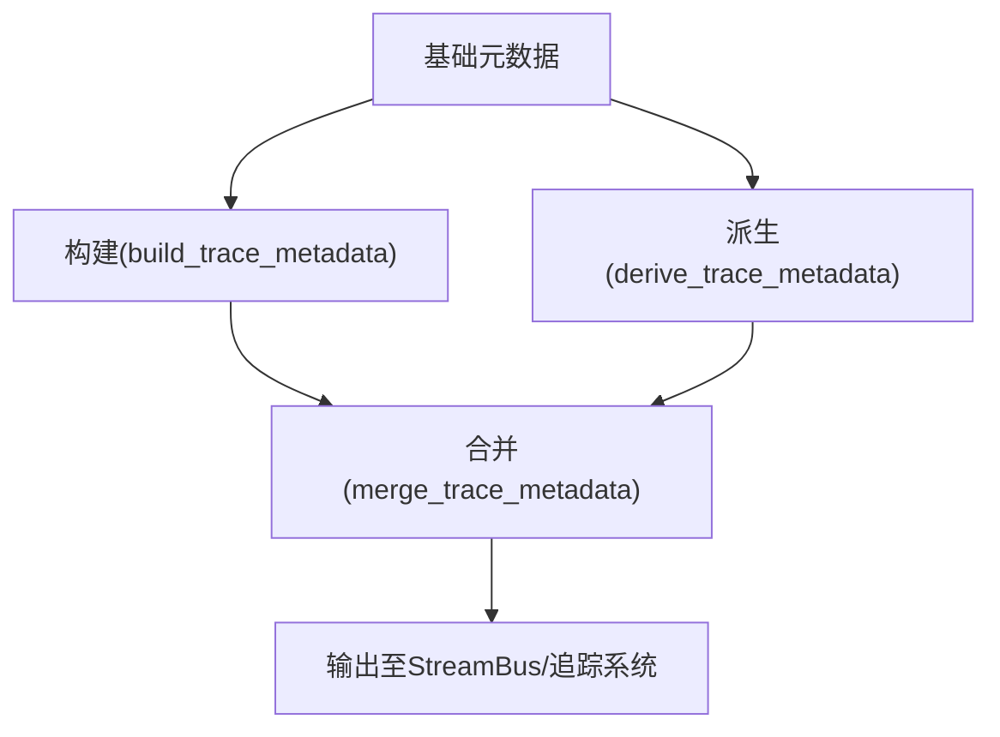
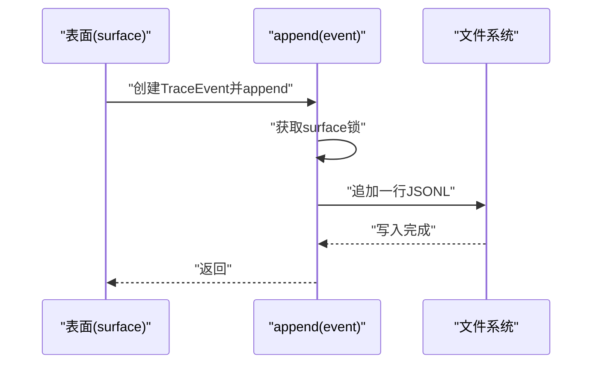
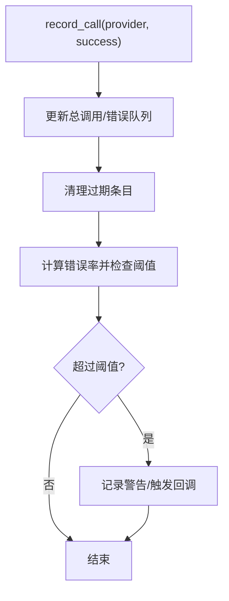
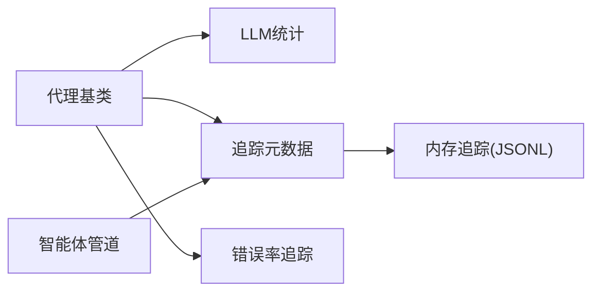

# 性能监控

<cite>
**本文引用的文件**
- [deeptutor/agents/base_agent.py](file://deeptutor/agents/base_agent.py)
- [deeptutor/logging/stats/llm_stats.py](file://deeptutor/logging/stats/llm_stats.py)
- [deeptutor/core/trace.py](file://deeptutor/core/trace.py)
- [deeptutor/services/memory/trace.py](file://deeptutor/services/memory/trace.py)
- [deeptutor/utils/error_rate_tracker.py](file://deeptutor/utils/error_rate_tracker.py)
- [deeptutor/agents/chat/agentic_pipeline.py](file://deeptutor/agents/chat/agentic_pipeline.py)
</cite>

## 目录
1. [简介](#简介)
2. [项目结构](#项目结构)
3. [核心组件](#核心组件)
4. [架构总览](#架构总览)
5. [详细组件分析](#详细组件分析)
6. [依赖关系分析](#依赖关系分析)
7. [性能考量](#性能考量)
8. [故障排查指南](#故障排查指南)
9. [结论](#结论)
10. [附录](#附录)

## 简介
本文件面向DeepTutor的性能监控系统，聚焦于LLM调用统计数据的收集与记录、关键性能指标的定义与采集方法（响应时间、令牌使用量、错误率）、分布式追踪与链路跟踪的实现原理、API调用性能与资源使用监控、性能瓶颈识别与优化建议、第三方APM工具集成方式，以及生产环境的最佳实践。内容基于代码仓库中的实际实现进行说明，确保可追溯与可落地。

## 项目结构
DeepTutor在性能监控方面采用“分层+多通道”的设计：
- 代理层（Agent）统一封装LLM调用，负责计时、令牌统计与追踪事件发射。
- 统计层提供模块级LLM用量与成本估算，并输出汇总日志。
- 追踪层提供结构化元数据构建与合并能力，支撑前端渲染与链路串联。
- 内存追踪层以追加式JSONL持久化原始事件，支持按表面（surface）和日期归档。
- 错误率追踪器提供滑动窗口错误率计算与告警回调，可与熔断器联动。
- 智能体管道将工具调用、检索、媒体生成等步骤纳入统一的追踪元数据体系。

**图表来源**
- [deeptutor/agents/base_agent.py:248-486](file://deeptutor/agents/base_agent.py#L248-L486)
- [deeptutor/logging/stats/llm_stats.py:68-194](file://deeptutor/logging/stats/llm_stats.py#L68-L194)
- [deeptutor/core/trace.py:9-82](file://deeptutor/core/trace.py#L9-L82)
- [deeptutor/services/memory/trace.py:35-86](file://deeptutor/services/memory/trace.py#L35-L86)
- [deeptutor/utils/error_rate_tracker.py:14-112](file://deeptutor/utils/error_rate_tracker.py#L14-L112)
- [deeptutor/agents/chat/agentic_pipeline.py:1049-1230](file://deeptutor/agents/chat/agentic_pipeline.py#L1049-L1230)

**章节来源**
- [deeptutor/agents/base_agent.py:248-486](file://deeptutor/agents/base_agent.py#L248-L486)
- [deeptutor/logging/stats/llm_stats.py:68-194](file://deeptutor/logging/stats/llm_stats.py#L68-L194)
- [deeptutor/core/trace.py:9-82](file://deeptutor/core/trace.py#L9-L82)
- [deeptutor/services/memory/trace.py:35-86](file://deeptutor/services/memory/trace.py#L35-L86)
- [deeptutor/utils/error_rate_tracker.py:14-112](file://deeptutor/utils/error_rate_tracker.py#L14-L112)
- [deeptutor/agents/chat/agentic_pipeline.py:1049-1230](file://deeptutor/agents/chat/agentic_pipeline.py#L1049-L1230)

## 核心组件
- 代理基类：统一封装LLM调用流程，包含计时、令牌统计、追踪事件发射与异常处理。
- LLM统计：按模块维护调用记录、估算令牌与成本，并输出汇总信息。
- 追踪元数据：提供call_id、phase、label、call_kind、trace_id、trace_role、trace_group、trace_kind等字段构建与合并，用于前后端一致呈现。
- 内存追踪：以追加式JSONL存储原始事件，按surface与日期分文件，支持并发安全写入与回溯查询。
- 错误率追踪：滑动窗口统计各提供者错误率，支持阈值告警与熔断器集成。
- 智能体管道：为工具调用、检索、媒体生成等步骤注入追踪元数据，形成端到端链路。

**章节来源**
- [deeptutor/agents/base_agent.py:248-486](file://deeptutor/agents/base_agent.py#L248-L486)
- [deeptutor/logging/stats/llm_stats.py:68-194](file://deeptutor/logging/stats/llm_stats.py#L68-L194)
- [deeptutor/core/trace.py:9-82](file://deeptutor/core/trace.py#L9-L82)
- [deeptutor/services/memory/trace.py:35-86](file://deeptutor/services/memory/trace.py#L35-L86)
- [deeptutor/utils/error_rate_tracker.py:14-112](file://deeptutor/utils/error_rate_tracker.py#L14-L112)
- [deeptutor/agents/chat/agentic_pipeline.py:1049-1230](file://deeptutor/agents/chat/agentic_pipeline.py#L1049-L1230)

## 架构总览
下图展示从请求进入代理到最终输出与追踪落盘的完整链路，包括计时、令牌统计、错误率追踪与JSONL持久化。

**图表来源**
- [deeptutor/agents/base_agent.py:451-486](file://deeptutor/agents/base_agent.py#L451-L486)
- [deeptutor/logging/stats/llm_stats.py:88-151](file://deeptutor/logging/stats/llm_stats.py#L88-L151)
- [deeptutor/core/trace.py:14-82](file://deeptutor/core/trace.py#L14-L82)
- [deeptutor/services/memory/trace.py:66-86](file://deeptutor/services/memory/trace.py#L66-L86)
- [deeptutor/utils/error_rate_tracker.py:33-67](file://deeptutor/utils/error_rate_tracker.py#L33-L67)

## 详细组件分析

### 代理基类：计时、令牌统计与追踪事件
- 计时：在LLM调用前后记录时间戳，计算单次调用耗时。
- 令牌统计：优先使用外部TokenTracker（若提供），否则回退到共享LLMStats；支持按阶段标注。
- 追踪事件：通过回调机制发射结构化事件，包含状态、响应或流式片段，便于前端渲染与链路串联。
- 异常处理：捕获异常后发射错误事件并记录日志，保证主流程不受影响。

**图表来源**
- [deeptutor/agents/base_agent.py:451-486](file://deeptutor/agents/base_agent.py#L451-L486)
- [deeptutor/agents/base_agent.py:297-342](file://deeptutor/agents/base_agent.py#L297-L342)

**章节来源**
- [deeptutor/agents/base_agent.py:248-486](file://deeptutor/agents/base_agent.py#L248-L486)

### LLM统计：令牌使用量与成本估算
- 记录每次调用的模型、输入/输出令牌与成本。
- 当未直接提供令牌数时，根据文本长度估算。
- 汇总模块级统计，包含调用次数、总令牌数与成本，并通过统一日志系统输出。

**图表来源**
- [deeptutor/logging/stats/llm_stats.py:68-194](file://deeptutor/logging/stats/llm_stats.py#L68-L194)

**章节来源**
- [deeptutor/logging/stats/llm_stats.py:68-194](file://deeptutor/logging/stats/llm_stats.py#L68-L194)

### 追踪元数据：构建、派生与合并
- 构建：统一字段包括call_id、phase、label、call_kind、trace_id、trace_role、trace_group、trace_kind等。
- 派生：基于基础元数据覆盖或补充字段，适配不同场景（如检索、媒体生成）。
- 合并：将多个来源的元数据合并，确保前端渲染一致性。

**图表来源**
- [deeptutor/core/trace.py:9-82](file://deeptutor/core/trace.py#L9-L82)
- [deeptutor/agents/chat/agentic_pipeline.py:1167-1230](file://deeptutor/agents/chat/agentic_pipeline.py#L1167-L1230)

**章节来源**
- [deeptutor/core/trace.py:9-82](file://deeptutor/core/trace.py#L9-L82)
- [deeptutor/agents/chat/agentic_pipeline.py:1049-1230](file://deeptutor/agents/chat/agentic_pipeline.py#L1049-L1230)

### 内存追踪：追加式JSONL持久化
- 事件结构：id、ts、surface、kind、payload、session_id、turn_id。
- 写入策略：按surface与日期分文件，异步锁串行写入，避免并发交错。
- 读取策略：支持按时间范围迭代与按ID跨surface解析。

**图表来源**
- [deeptutor/services/memory/trace.py:35-86](file://deeptutor/services/memory/trace.py#L35-L86)

**章节来源**
- [deeptutor/services/memory/trace.py:35-86](file://deeptutor/services/memory/trace.py#L35-L86)

### 错误率追踪：滑动窗口与告警
- 滑动窗口：维护最近N秒内的总调用与错误调用时间戳队列。
- 错误率计算：errors / total，支持阈值检查。
- 告警回调：超过阈值触发警告并可联动熔断器。

**图表来源**
- [deeptutor/utils/error_rate_tracker.py:33-112](file://deeptutor/utils/error_rate_tracker.py#L33-L112)

**章节来源**
- [deeptutor/utils/error_rate_tracker.py:33-112](file://deeptutor/utils/error_rate_tracker.py#L33-L112)

### 智能体管道：工具调用与检索的追踪
- 工具调用：为rag、imagegen、videogen等工具注入call_kind与标签，便于前端分类渲染。
- 最终响应：构造final response的追踪元数据，标记阶段与角色，支持回退路径。
- 上下文关联：结合会话与所有者信息，确保追踪事件具备上下文标识。

**章节来源**
- [deeptutor/agents/chat/agentic_pipeline.py:1049-1230](file://deeptutor/agents/chat/agentic_pipeline.py#L1049-L1230)

## 依赖关系分析
- 代理基类依赖LLM工厂进行调用，依赖LLMStats进行统计，依赖追踪元数据工具进行事件构建，依赖错误率追踪器进行异常统计。
- 智能体管道依赖追踪元数据工具为工具调用与最终响应注入元数据。
- 内存追踪独立于业务逻辑，仅接收事件并持久化，保证不阻塞主流程。

**图表来源**
- [deeptutor/agents/base_agent.py:248-486](file://deeptutor/agents/base_agent.py#L248-L486)
- [deeptutor/core/trace.py:9-82](file://deeptutor/core/trace.py#L9-L82)
- [deeptutor/services/memory/trace.py:66-86](file://deeptutor/services/memory/trace.py#L66-L86)
- [deeptutor/utils/error_rate_tracker.py:33-112](file://deeptutor/utils/error_rate_tracker.py#L33-L112)
- [deeptutor/agents/chat/agentic_pipeline.py:1049-1230](file://deeptutor/agents/chat/agentic_pipeline.py#L1049-L1230)

**章节来源**
- [deeptutor/agents/base_agent.py:248-486](file://deeptutor/agents/base_agent.py#L248-L486)
- [deeptutor/core/trace.py:9-82](file://deeptutor/core/trace.py#L9-L82)
- [deeptutor/services/memory/trace.py:66-86](file://deeptutor/services/memory/trace.py#L66-L86)
- [deeptutor/utils/error_rate_tracker.py:33-112](file://deeptutor/utils/error_rate_tracker.py#L33-L112)
- [deeptutor/agents/chat/agentic_pipeline.py:1049-1230](file://deeptutor/agents/chat/agentic_pipeline.py#L1049-L1230)

## 性能考量
- 响应时间：在代理基类中通过记录开始时间与调用结束后计算耗时，适用于同步与流式调用。
- 令牌使用量：通过LLMStats记录每次调用的输入/输出令牌，并在缺失时基于文本估算；支持模块级汇总与成本计算。
- 错误率：错误率追踪器以滑动窗口统计各提供者错误率，支持阈值告警与熔断器联动，有助于快速发现不稳定服务。
- I/O开销：内存追踪采用追加式JSONL与异步锁，避免并发写冲突；读取支持按时间与ID过滤，降低查询成本。
- 可扩展性：追踪元数据工具提供统一的字段规范，便于扩展新的工具类型与阶段。

[本节为通用性能讨论，不直接分析具体文件]

## 故障排查指南
- 令牌统计异常：检查代理基类的令牌统计入口与LLMStats的add_call逻辑，确认模型名称与文本估算是否合理。
- 追踪事件丢失：确认内存追踪的append流程是否被异常中断，检查异步锁与文件写入权限。
- 错误率告警频繁：调整滑动窗口大小与阈值，检查上游提供者稳定性与重试策略。
- 前端渲染不一致：核对追踪元数据的字段构建与合并逻辑，确保call_kind、phase、label等字段正确传递。

**章节来源**
- [deeptutor/agents/base_agent.py:297-342](file://deeptutor/agents/base_agent.py#L297-L342)
- [deeptutor/logging/stats/llm_stats.py:88-151](file://deeptutor/logging/stats/llm_stats.py#L88-L151)
- [deeptutor/services/memory/trace.py:66-86](file://deeptutor/services/memory/trace.py#L66-L86)
- [deeptutor/utils/error_rate_tracker.py:33-112](file://deeptutor/utils/error_rate_tracker.py#L33-L112)
- [deeptutor/core/trace.py:14-82](file://deeptutor/core/trace.py#L14-L82)

## 结论
DeepTutor的性能监控体系围绕代理基类、LLM统计、追踪元数据、内存追踪与错误率追踪展开，形成了从调用计时、令牌统计到链路追踪与持久化的完整闭环。通过统一的追踪元数据与追加式JSONL存储，系统既保证了低侵入性与高可靠性，也为前端可视化与后端分析提供了坚实基础。在生产环境中，建议结合错误率告警与熔断器，持续优化令牌使用与响应时间，确保系统稳定高效运行。

[本节为总结性内容，不直接分析具体文件]

## 附录
- 指标定义与采集方法
  - 响应时间：代理基类在调用前后记录时间戳并计算差值。
  - 令牌使用量：LLMStats记录输入/输出令牌，缺失时基于文本估算。
  - 错误率：错误率追踪器以滑动窗口统计错误比例，支持阈值告警。
- 分布式追踪与链路跟踪
  - 通过追踪元数据工具统一字段，智能体管道为工具调用与最终响应注入元数据，内存追踪持久化事件以实现链路串联。
- API调用性能与资源使用监控
  - 建议在代理层增加更细粒度的计时点，结合错误率追踪与日志汇总，定位慢调用与高错误率接口。
- 性能瓶颈识别与优化建议
  - 关注长耗时LLM调用与高令牌消耗场景，优化提示词与上下文长度，减少不必要的工具调用。
- 第三方APM工具集成
  - 可将追踪元数据与错误率指标导出至APM平台，结合JSONL事件进行链路分析与问题定位。
- 生产环境最佳实践
  - 启用错误率告警与熔断器，定期清理历史JSONL文件，监控令牌成本与响应时间趋势，持续优化提示词与模型选择。

[本节为通用指导内容，不直接分析具体文件]