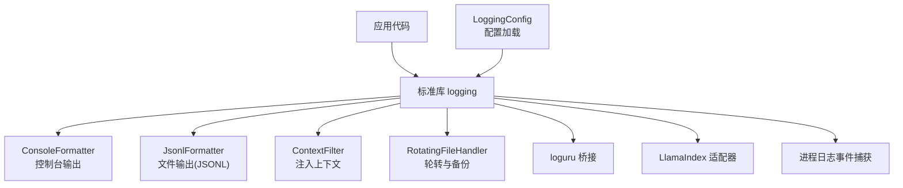
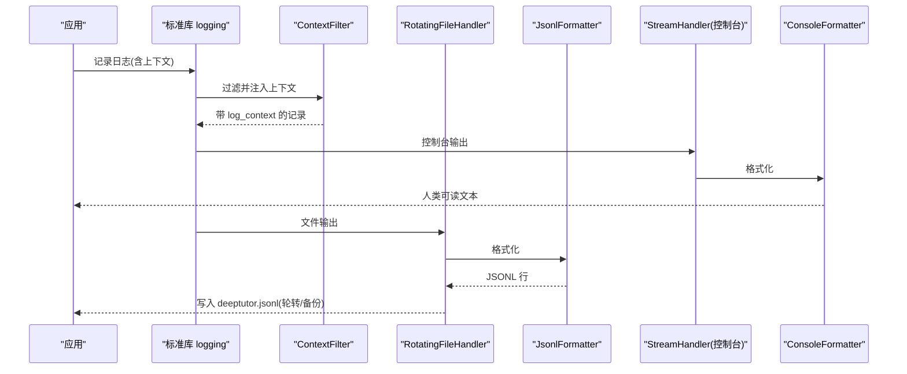
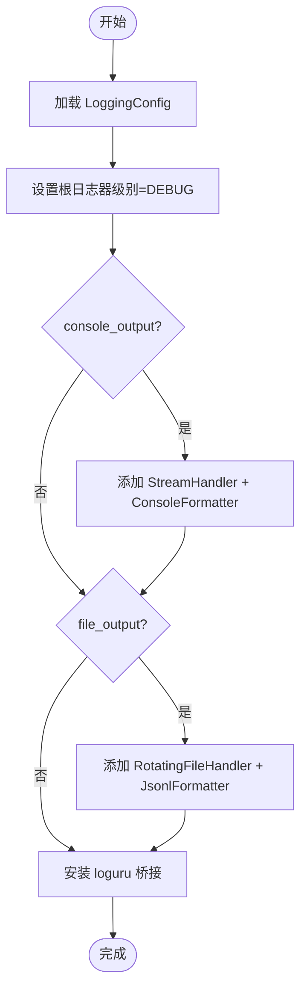
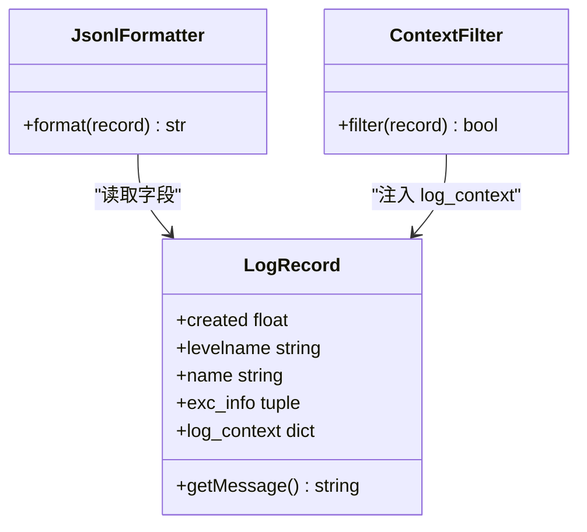
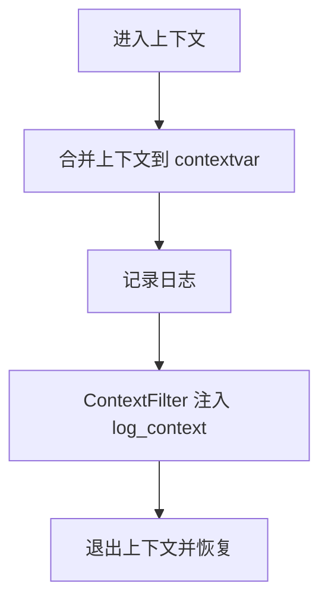
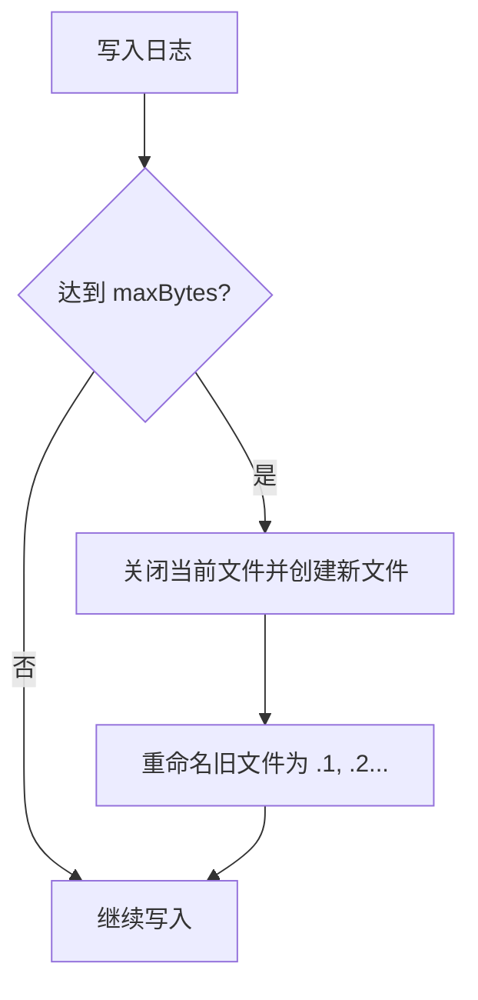
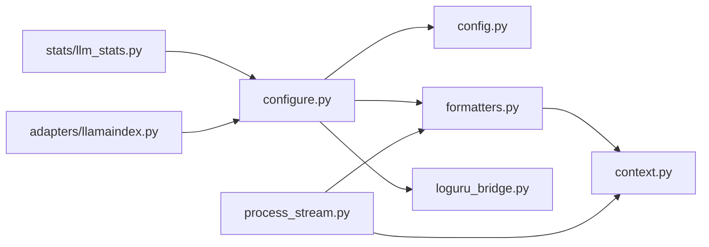

# 日志系统

<cite>
**本文引用的文件**
- [__init__.py](file://deeptutor/logging/__init__.py)
- [config.py](file://deeptutor/logging/config.py)
- [configure.py](file://deeptutor/logging/configure.py)
- [formatters.py](file://deeptutor/logging/formatters.py)
- [context.py](file://deeptutor/logging/context.py)
- [loguru_bridge.py](file://deeptutor/logging/loguru_bridge.py)
- [process_stream.py](file://deeptutor/logging/process_stream.py)
- [llm_stats.py](file://deeptutor/logging/stats/llm_stats.py)
- [llamaindex.py](file://deeptutor/logging/adapters/llamaindex.py)
- [test_configure.py](file://tests/logging/test_configure.py)
- [test_context.py](file://tests/logging/test_context.py)
</cite>

## 目录
1. [简介](#简介)
2. [项目结构](#项目结构)
3. [核心组件](#核心组件)
4. [架构总览](#架构总览)
5. [详细组件分析](#详细组件分析)
6. [依赖关系分析](#依赖关系分析)
7. [性能考量](#性能考量)
8. [故障排查指南](#故障排查指南)
9. [结论](#结论)
10. [附录](#附录)

## 简介
本文件面向 DeepTutor 的日志子系统，系统性说明日志配置与初始化、控制台与文件输出、结构化 JSONL 格式、日志级别管理、上下文过滤器、日志轮转与备份策略、日志收集与存储最佳实践，以及如何在不同环境中切换日志策略。同时提供自定义格式化器与处理器的开发指引，帮助开发者在统一日志体系下扩展能力。

## 项目结构
日志子系统位于 deeptutor/logging 目录下，采用“配置-初始化-格式化-上下文-适配器”的分层组织：
- 配置与加载：LoggingConfig、load_logging_config、get_default_log_dir
- 初始化与装配：configure_logging（注册处理器、设置级别、桥接 loguru）
- 格式化与过滤：JsonlFormatter、ConsoleFormatter、ContextFilter
- 上下文：bind_log_context、current_log_context、LOG_CONTEXT_FIELDS
- 进程日志事件捕获：ProcessLogEvent、ProcessLogHandler、capture_process_logs
- 统计与成本：LLMStats、MODEL_PRICING、estimate_tokens、get_pricing
- 第三方库适配：loguru 桥接、LlamaIndex 日志转发

图表来源
- [configure.py:37-77](file://deeptutor/logging/configure.py#L37-L77)
- [formatters.py:13-49](file://deeptutor/logging/formatters.py#L13-L49)
- [config.py:9-49](file://deeptutor/logging/config.py#L9-L49)

章节来源
- [__init__.py:1-26](file://deeptutor/logging/__init__.py#L1-L26)
- [config.py:9-49](file://deeptutor/logging/config.py#L9-L49)
- [configure.py:37-77](file://deeptutor/logging/configure.py#L37-L77)

## 核心组件
- LoggingConfig：描述日志级别、是否输出到控制台/文件、日志目录、轮转大小与备份数量。
- configure_logging：一次性装配根日志器，注册控制台与文件处理器，安装 loguru 桥接，并启用 deeptutor 命名空间日志。
- ContextFilter + JsonlFormatter：为每条记录附加结构化上下文，并以 JSONL 单行对象形式落盘。
- bind_log_context：基于 contextvars 的请求级上下文绑定，支持嵌套与作用域清理。
- ProcessLogEvent / ProcessLogHandler / capture_process_logs：将匹配的 stdlib 日志转换为结构化事件，便于上层收集与转发。
- LLMStats：统计模型调用次数、Token 用量与成本，并通过统一日志输出摘要。
- LlamaIndexLogContext：在作用域内将 LlamaIndex 的噪声日志转发至指定 logger，避免污染主日志流。

章节来源
- [config.py:9-49](file://deeptutor/logging/config.py#L9-L49)
- [configure.py:37-77](file://deeptutor/logging/configure.py#L37-L77)
- [formatters.py:13-49](file://deeptutor/logging/formatters.py#L13-L49)
- [context.py:10-39](file://deeptutor/logging/context.py#L10-L39)
- [process_stream.py:17-109](file://deeptutor/logging/process_stream.py#L17-L109)
- [llm_stats.py:24-194](file://deeptutor/logging/stats/llm_stats.py#L24-L194)
- [llamaindex.py:11-75](file://deeptutor/logging/adapters/llamaindex.py#L11-L75)

## 架构总览
DeepTutor 日志以 Python 标准库 logging 为核心，通过统一的配置与初始化流程，将控制台可读输出与结构化 JSONL 文件输出并行落地；同时通过上下文过滤器将请求/任务/会话等维度信息注入每条日志，确保可追踪性。可选地桥接 loguru 与 LlamaIndex 日志，使其纳入统一管道。

图表来源
- [configure.py:52-71](file://deeptutor/logging/configure.py#L52-L71)
- [formatters.py:13-49](file://deeptutor/logging/formatters.py#L13-L49)

## 详细组件分析

### 配置与初始化
- 配置项
  - level：全局日志级别（如 INFO、WARNING），影响控制台与文件输出。
  - console_output：是否启用控制台输出。
  - file_output：是否启用文件输出。
  - log_dir：日志目录，默认来自路径服务。
  - max_bytes：单个日志文件大小上限，触发轮转。
  - backup_count：保留的历史备份数量。
- 初始化流程
  - 读取配置，设置根日志器级别为 DEBUG（允许子模块按需提高）。
  - 若开启控制台输出，添加 StreamHandler + ConsoleFormatter。
  - 若开启文件输出，添加 RotatingFileHandler + JsonlFormatter，目标文件为 deeptutor.jsonl。
  - 安装 loguru 桥接，使 loguru 输出进入统一管道。
  - 标记已配置，防止重复初始化。

图表来源
- [configure.py:37-77](file://deeptutor/logging/configure.py#L37-L77)
- [config.py:25-49](file://deeptutor/logging/config.py#L25-L49)

章节来源
- [config.py:9-49](file://deeptutor/logging/config.py#L9-L49)
- [configure.py:37-77](file://deeptutor/logging/configure.py#L37-L77)

### 结构化日志格式（JSONL）
- 每行一个 JSON 对象，包含时间戳、级别、logger、消息、上下文，异常时附带堆栈。
- 由 JsonlFormatter 生成，配合 ContextFilter 注入的 log_context 字段。
- 测试验证了级别过滤与上下文字段写入。

图表来源
- [formatters.py:13-49](file://deeptutor/logging/formatters.py#L13-L49)

章节来源
- [formatters.py:13-49](file://deeptutor/logging/formatters.py#L13-L49)
- [test_configure.py:24-53](file://tests/logging/test_configure.py#L24-L53)

### 日志级别管理与上下文过滤器
- 级别管理
  - 根日志器设为 DEBUG，具体 Handler 可按配置级别过滤。
  - 可通过 load_logging_config 从 main.yaml 中读取 level。
- 上下文过滤器
  - LOG_CONTEXT_FIELDS 定义了可注入的上下文键集合（如 request_id、task_id、session_id、stage 等）。
  - ContextFilter 将当前上下文合并到每条记录的 log_context。
  - bind_log_context 提供作用域绑定，自动恢复上一级上下文。

图表来源
- [context.py:10-39](file://deeptutor/logging/context.py#L10-L39)
- [formatters.py:13-23](file://deeptutor/logging/formatters.py#L13-L23)

章节来源
- [context.py:10-39](file://deeptutor/logging/context.py#L10-L39)
- [formatters.py:13-23](file://deeptutor/logging/formatters.py#L13-L23)
- [test_context.py:4-17](file://tests/logging/test_context.py#L4-L17)

### 日志轮转与备份策略
- 使用 RotatingFileHandler 实现按大小轮转，目标文件 deeptutor.jsonl。
- 通过 max_bytes 控制单文件大小，backup_count 控制备份数量。
- 测试覆盖了轮转行为与备份文件生成。

图表来源
- [configure.py:58-71](file://deeptutor/logging/configure.py#L58-L71)
- [test_configure.py:55-78](file://tests/logging/test_configure.py#L55-L78)

章节来源
- [configure.py:58-71](file://deeptutor/logging/configure.py#L58-L71)
- [test_configure.py:55-78](file://tests/logging/test_configure.py#L55-L78)

### 日志收集、格式化与存储最佳实践
- 收集
  - 使用 capture_process_logs 将匹配条件的日志转为 ProcessLogEvent，便于异步发送或聚合。
  - 支持按 task_id/turn_id 过滤，最小级别 min_level 控制采集粒度。
- 格式化
  - 控制台使用 ConsoleFormatter 便于调试；文件使用 JsonlFormatter 保证机器可读。
  - 始终通过 ContextFilter 注入上下文，提升可观测性。
- 存储
  - 建议在生产环境开启文件输出，合理设置 max_bytes 与 backup_count。
  - 结合外部日志系统（如 ELK/Loki）对 JSONL 进行索引与检索。
  - 对敏感字段进行脱敏后再输出。

章节来源
- [process_stream.py:52-109](file://deeptutor/logging/process_stream.py#L52-L109)
- [formatters.py:26-49](file://deeptutor/logging/formatters.py#L26-L49)

### 自定义日志格式化器与处理器开发指南
- 自定义 Formatter
  - 继承 logging.Formatter，重写 format(record) 方法，返回字符串。
  - 推荐复用 ContextFilter 注入的 log_context，保持上下文一致性。
- 自定义 Handler
  - 继承 logging.Handler，重写 emit(record)，实现自定义输出逻辑（网络发送、数据库写入等）。
  - 可在 __init__ 中设置级别与过滤器，必要时加入 ContextFilter。
- 集成方式
  - 在 configure_logging 中注册自定义处理器，或通过 capture_process_logs 动态挂载。

章节来源
- [formatters.py:26-49](file://deeptutor/logging/formatters.py#L26-L49)
- [process_stream.py:52-85](file://deeptutor/logging/process_stream.py#L52-L85)

### 在不同环境中配置不同的日志策略
- 开发环境
  - 开启控制台输出，级别可调低（如 DEBUG），便于快速定位问题。
  - 可关闭文件输出或限制轮转大小，减少磁盘占用。
- 生产环境
  - 关闭控制台输出，仅保留文件输出；级别设置为 INFO 或 WARNING。
  - 根据磁盘与吞吐调整 max_bytes 与 backup_count。
  - 通过 main.yaml 的 logging 段集中管理配置。
- 配置来源
  - load_logging_config 从 data/user/settings/main.yaml 读取 logging 配置。
  - 未找到或异常时回退到默认目录。

章节来源
- [config.py:25-49](file://deeptutor/logging/config.py#L25-L49)
- [configure.py:37-77](file://deeptutor/logging/configure.py#L37-L77)

### 第三方库日志集成
- loguru 桥接
  - install_loguru_bridge 将 loguru 输出转发到标准库 logging，统一走 JsonlFormatter/ConsoleFormatter。
- LlamaIndex 适配器
  - LlamaIndexLogContext 在作用域内屏蔽 LlamaIndex 的默认输出，并将必要日志转发到指定 logger，避免噪音。

章节来源
- [loguru_bridge.py:9-28](file://deeptutor/logging/loguru_bridge.py#L9-L28)
- [llamaindex.py:11-75](file://deeptutor/logging/adapters/llamaindex.py#L11-L75)

## 依赖关系分析
- 模块耦合
  - configure 依赖 config、formatters、loguru_bridge。
  - formatters 依赖 context。
  - process_stream 依赖 context 与 formatters。
  - stats 独立，通过 logging 输出摘要。
- 外部依赖
  - 标准库 logging、logging.handlers.RotatingFileHandler。
  - 可选依赖 loguru。
  - 可选依赖 LlamaIndex（通过适配器）。

图表来源
- [configure.py:1-13](file://deeptutor/logging/configure.py#L1-L13)
- [formatters.py:1-11](file://deeptutor/logging/formatters.py#L1-L11)
- [process_stream.py:1-15](file://deeptutor/logging/process_stream.py#L1-L15)
- [llm_stats.py:1-22](file://deeptutor/logging/stats/llm_stats.py#L1-L22)
- [llamaindex.py:1-10](file://deeptutor/logging/adapters/llamaindex.py#L1-L10)

章节来源
- [configure.py:1-13](file://deeptutor/logging/configure.py#L1-L13)
- [formatters.py:1-11](file://deeptutor/logging/formatters.py#L1-L11)
- [process_stream.py:1-15](file://deeptutor/logging/process_stream.py#L1-L15)
- [llm_stats.py:1-22](file://deeptutor/logging/stats/llm_stats.py#L1-L22)
- [llamaindex.py:1-10](file://deeptutor/logging/adapters/llamaindex.py#L1-L10)

## 性能考量
- 文件 I/O
  - 使用 RotatingFileHandler 避免单文件过大；合理设置 max_bytes 与 backup_count 平衡 I/O 与磁盘占用。
- 序列化开销
  - JsonlFormatter 每次记录都会进行 JSON 序列化；在高吞吐场景下注意批量与异步化。
- 上下文计算
  - ContextFilter 会复制与合并上下文字典；避免在上下文中放入超大对象。
- 异步处理
  - capture_process_logs 支持异步 emit；确保事件处理函数非阻塞。
- 日志级别
  - 生产环境适当提高级别以减少 I/O 与 CPU 消耗。

[本节为通用指导，不直接分析具体文件]

## 故障排查指南
- 日志未写入文件
  - 检查 file_output 是否为 True，确认 log_dir 存在且可写。
  - 检查 root 日志器级别与 Handler 级别是否过低导致过滤。
- 上下文缺失
  - 确认使用了 bind_log_context 包裹关键代码块。
  - 检查 ContextFilter 是否正确添加到处理器链。
- 轮转未生效
  - 确认 max_bytes 设置合理；测试覆盖轮转行为。
- loguru 日志未进入统一管道
  - 确认已调用 install_loguru_bridge；检查 loguru 是否可用。
- LlamaIndex 噪音过多
  - 使用 LlamaIndexLogContext 限定范围，降低无关日志干扰。

章节来源
- [configure.py:37-77](file://deeptutor/logging/configure.py#L37-L77)
- [formatters.py:13-49](file://deeptutor/logging/formatters.py#L13-L49)
- [test_configure.py:24-78](file://tests/logging/test_configure.py#L24-L78)
- [loguru_bridge.py:9-28](file://deeptutor/logging/loguru_bridge.py#L9-L28)
- [llamaindex.py:25-75](file://deeptutor/logging/adapters/llamaindex.py#L25-L75)

## 结论
DeepTutor 日志系统以标准库 logging 为核心，提供统一的配置、格式化、上下文与轮转能力，并通过桥接与适配器兼容生态工具。借助 JSONL 结构化输出与上下文注入，可实现高可观测性与易维护性。建议在开发环境侧重可读性，在生产环境侧重稳定性与性能，并结合外部日志平台构建完整的可观测体系。

[本节为总结性内容，不直接分析具体文件]

## 附录
- 常用 API 速查
  - 配置加载：load_logging_config、get_default_log_dir、get_global_log_level
  - 初始化：configure_logging(force=False)
  - 上下文：bind_log_context(**fields)、current_log_context()
  - 事件捕获：capture_process_logs(emit, task_id=None, turn_id=None, min_level=logging.INFO)
  - 统计：LLMStats.add_call(...)、log_summary()
  - 适配器：install_loguru_bridge(level)、LlamaIndexLogContext(...)

章节来源
- [__init__.py:3-25](file://deeptutor/logging/__init__.py#L3-L25)
- [config.py:19-49](file://deeptutor/logging/config.py#L19-L49)
- [configure.py:37-77](file://deeptutor/logging/configure.py#L37-L77)
- [context.py:25-39](file://deeptutor/logging/context.py#L25-L39)
- [process_stream.py:87-109](file://deeptutor/logging/process_stream.py#L87-L109)
- [llm_stats.py:88-177](file://deeptutor/logging/stats/llm_stats.py#L88-L177)
- [loguru_bridge.py:9-28](file://deeptutor/logging/loguru_bridge.py#L9-L28)
- [llamaindex.py:25-75](file://deeptutor/logging/adapters/llamaindex.py#L25-L75)