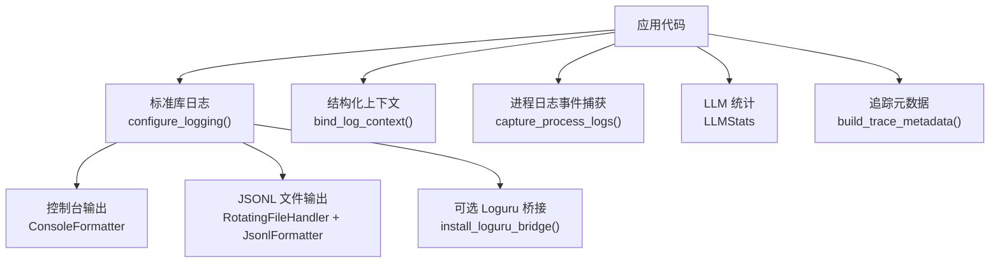
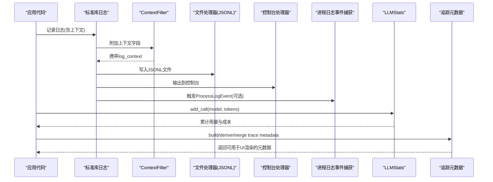
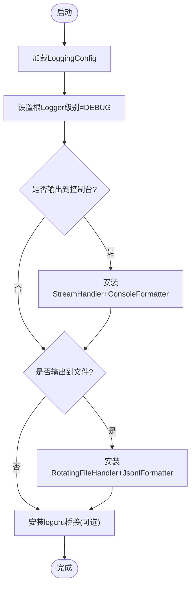
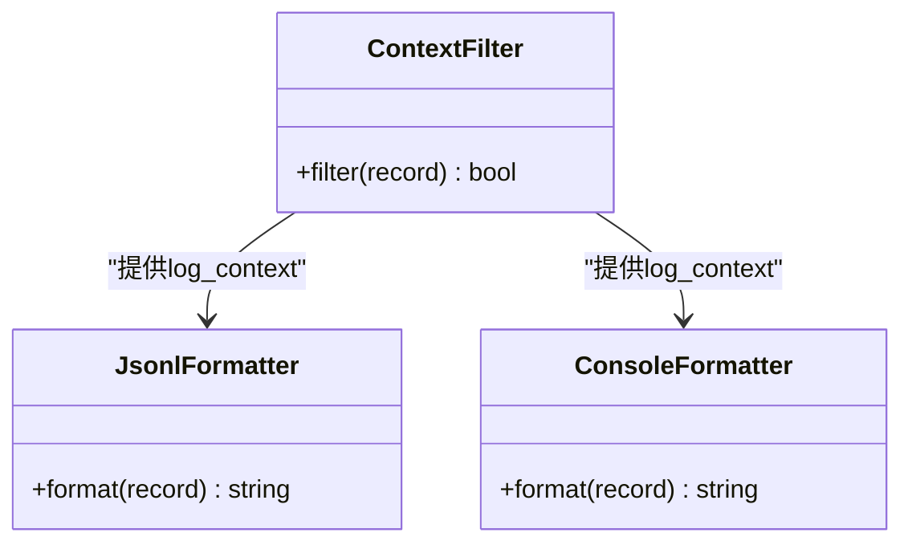
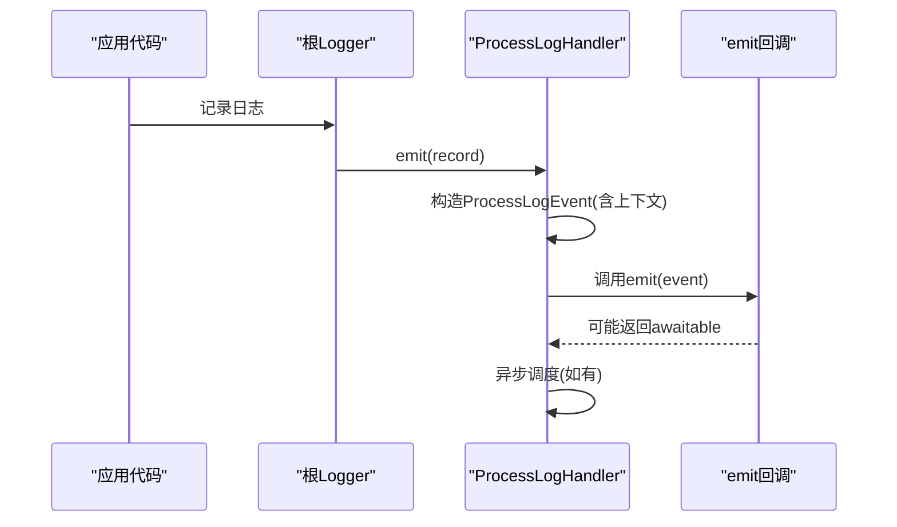
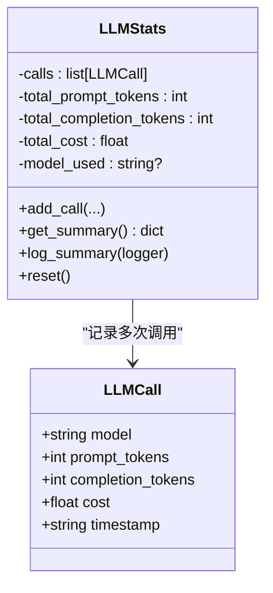
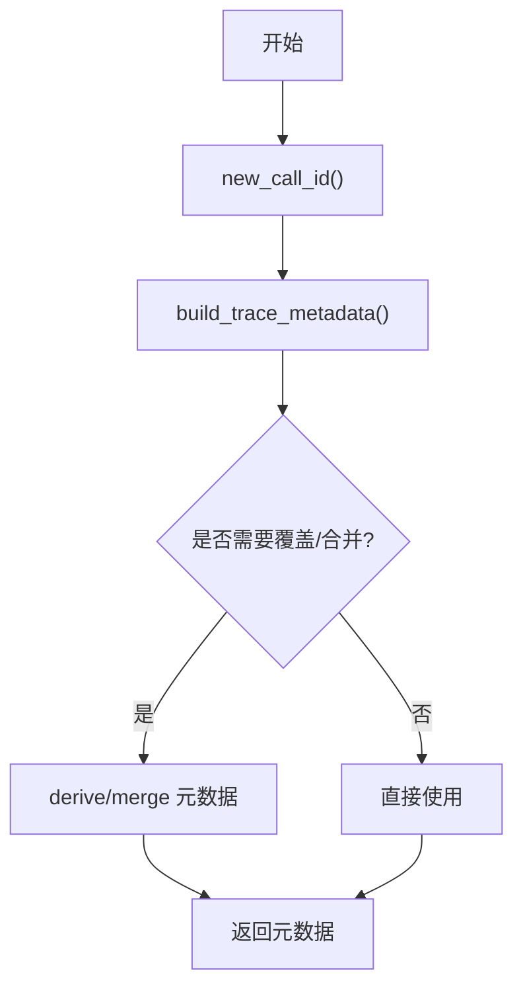
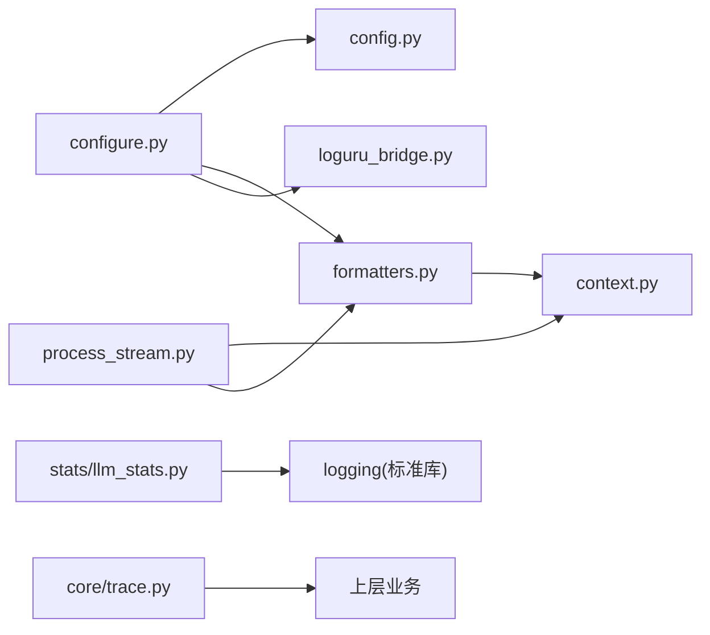

# 监控与日志

<cite>
**本文引用的文件**
- [deeptutor/logging/__init__.py](file://deeptutor/logging/__init__.py)
- [deeptutor/logging/config.py](file://deeptutor/logging/config.py)
- [deeptutor/logging/configure.py](file://deeptutor/logging/configure.py)
- [deeptutor/logging/formatters.py](file://deeptutor/logging/formatters.py)
- [deeptutor/logging/context.py](file://deeptutor/logging/context.py)
- [deeptutor/logging/process_stream.py](file://deeptutor/logging/process_stream.py)
- [deeptutor/logging/loguru_bridge.py](file://deeptutor/logging/loguru_bridge.py)
- [deeptutor/logging/stats/llm_stats.py](file://deeptutor/logging/stats/llm_stats.py)
- [deeptutor/core/trace.py](file://deeptutor/core/trace.py)
- [deeptutor/core/errors.py](file://deeptutor/core/errors.py)
</cite>

## 目录
1. [简介](#简介)
2. [项目结构](#项目结构)
3. [核心组件](#核心组件)
4. [架构总览](#架构总览)
5. [详细组件分析](#详细组件分析)
6. [依赖关系分析](#依赖关系分析)
7. [性能考量](#性能考量)
8. [故障排查指南](#故障排查指南)
9. [结论](#结论)
10. [附录](#附录)

## 简介
本文件面向 DeepTutor 的监控与日志系统，系统性说明日志收集、格式化与存储策略；结构化日志实现与级别管理；性能指标（特别是 LLM 调用）的定义与采集；分布式追踪与链路跟踪的实现思路；错误监控与告警机制的配置建议；日志分析与可视化方法；生产环境最佳实践与故障诊断流程；以及如何集成第三方监控服务。

## 项目结构
DeepTutor 的日志与监控能力集中在 logging 模块与 core 模块中：
- 配置与启动：从运行时设置加载日志配置，统一初始化标准库日志、控制台输出、滚动文件输出，并桥接可选的 loguru 输出。
- 结构化上下文：通过 contextvars 维护请求级上下文字段，自动注入到每条日志记录。
- 格式化器：提供 JSONL 结构化格式与开发用控制台格式。
- 进程日志事件：将匹配的日志记录转换为 ProcessLogEvent，便于流式转发或聚合。
- 统计指标：LLM 调用统计（token 用量、成本估算），以统一日志输出摘要。
- 追踪元数据：为 UI 渲染执行时间线提供统一的 trace 元数据构建与合并工具。
- 错误体系：定义应用层异常基类与细分类型，便于分类上报与告警。

图表来源
- [deeptutor/logging/configure.py:37-77](file://deeptutor/logging/configure.py#L37-L77)
- [deeptutor/logging/formatters.py:26-49](file://deeptutor/logging/formatters.py#L26-L49)
- [deeptutor/logging/context.py:25-39](file://deeptutor/logging/context.py#L25-L39)
- [deeptutor/logging/process_stream.py:52-109](file://deeptutor/logging/process_stream.py#L52-L109)
- [deeptutor/logging/loguru_bridge.py:9-28](file://deeptutor/logging/loguru_bridge.py#L9-L28)
- [deeptutor/logging/stats/llm_stats.py:68-194](file://deeptutor/logging/stats/llm_stats.py#L68-L194)
- [deeptutor/core/trace.py:14-82](file://deeptutor/core/trace.py#L14-L82)

章节来源
- [deeptutor/logging/configure.py:37-77](file://deeptutor/logging/configure.py#L37-L77)
- [deeptutor/logging/config.py:9-49](file://deeptutor/logging/config.py#L9-L49)
- [deeptutor/logging/formatters.py:13-49](file://deeptutor/logging/formatters.py#L13-L49)
- [deeptutor/logging/context.py:10-39](file://deeptutor/logging/context.py#L10-L39)
- [deeptutor/logging/process_stream.py:17-109](file://deeptutor/logging/process_stream.py#L17-L109)
- [deeptutor/logging/loguru_bridge.py:9-28](file://deeptutor/logging/loguru_bridge.py#L9-L28)
- [deeptutor/logging/stats/llm_stats.py:24-194](file://deeptutor/logging/stats/llm_stats.py#L24-L194)
- [deeptutor/core/trace.py:9-82](file://deeptutor/core/trace.py#L9-L82)

## 核心组件
- 日志配置与启动
  - 从运行时设置加载 LoggingConfig（级别、是否输出到控制台/文件、日志目录、轮转大小与备份数）。
  - 初始化根 logger，安装带 ContextFilter 的控制台与文件处理器，启用 JSONL 格式，并桥接 loguru。
- 结构化上下文
  - 使用 contextvars 维护 request_id、turn_id、session_id、task_id、capability、stage、sink 等字段，自动附加到每条日志。
- 格式化器
  - JsonlFormatter：每行一个 JSON 对象，包含时间戳、级别、logger、消息、上下文及可选异常信息。
  - ConsoleFormatter：开发友好的可读格式，附带 stage/task_id 等上下文片段。
- 进程日志事件
  - ProcessLogEvent：将匹配的记录转为结构化事件，支持按 task_id/turn_id 过滤，异步发送回调。
  - capture_process_logs：临时挂载处理器，捕获并转发日志事件。
- LLM 统计
  - LLMStats：记录每次调用的模型、提示与完成 token、成本估算，并在结束时输出汇总。
- 追踪元数据
  - build_trace_metadata/derive_trace_metadata/merge_trace_metadata/new_call_id：为 UI 渲染执行时间线提供统一元数据。
- 错误体系
  - DeepTutorError 及其子类用于区分配置、校验、服务等错误，便于分类处理与上报。

章节来源
- [deeptutor/logging/config.py:9-49](file://deeptutor/logging/config.py#L9-L49)
- [deeptutor/logging/configure.py:37-77](file://deeptutor/logging/configure.py#L37-L77)
- [deeptutor/logging/formatters.py:13-49](file://deeptutor/logging/formatters.py#L13-L49)
- [deeptutor/logging/context.py:10-39](file://deeptutor/logging/context.py#L10-L39)
- [deeptutor/logging/process_stream.py:17-109](file://deeptutor/logging/process_stream.py#L17-L109)
- [deeptutor/logging/stats/llm_stats.py:68-194](file://deeptutor/logging/stats/llm_stats.py#L68-L194)
- [deeptutor/core/trace.py:9-82](file://deeptutor/core/trace.py#L9-L82)
- [deeptutor/core/errors.py:10-58](file://deeptutor/core/errors.py#L10-L58)

## 架构总览
下图展示了日志在运行时的流转路径：应用代码通过标准库日志接口输出，ContextFilter 注入上下文，JsonlFormatter 生成结构化 JSONL 写入文件，同时可桥接 loguru 输出；进程日志事件捕获器可将关键日志转为事件并发出；统计模块汇总 LLM 调用并输出摘要；追踪元数据用于前端渲染执行时间线。

图表来源
- [deeptutor/logging/configure.py:37-77](file://deeptutor/logging/configure.py#L37-L77)
- [deeptutor/logging/formatters.py:13-49](file://deeptutor/logging/formatters.py#L13-L49)
- [deeptutor/logging/process_stream.py:52-109](file://deeptutor/logging/process_stream.py#L52-L109)
- [deeptutor/logging/stats/llm_stats.py:68-194](file://deeptutor/logging/stats/llm_stats.py#L68-L194)
- [deeptutor/core/trace.py:14-82](file://deeptutor/core/trace.py#L14-L82)

## 详细组件分析

### 日志配置与启动
- 功能要点
  - 从 main.yaml 加载 logging 配置项（level、console_output、save_to_file、user_log_dir、max_bytes、backup_count）。
  - 根 logger 设置为 DEBUG，业务模块 deeptutor 开启传播，确保子模块日志上抛。
  - 控制台与文件处理器均附加 ContextFilter，保证上下文注入。
  - 文件输出采用 RotatingFileHandler，默认输出 data/user/logs/deeptutor.jsonl。
  - 若存在 loguru，则移除其默认 sink 并将消息转发至标准库，统一出口。
- 关键行为
  - 重复调用 configure_logging 时，除非 force=True，否则不会重复安装处理器。
  - 可通过 load_logging_config 获取全局日志级别。

图表来源
- [deeptutor/logging/configure.py:37-77](file://deeptutor/logging/configure.py#L37-L77)
- [deeptutor/logging/config.py:25-49](file://deeptutor/logging/config.py#L25-L49)
- [deeptutor/logging/loguru_bridge.py:9-28](file://deeptutor/logging/loguru_bridge.py#L9-L28)

章节来源
- [deeptutor/logging/configure.py:37-77](file://deeptutor/logging/configure.py#L37-L77)
- [deeptutor/logging/config.py:25-49](file://deeptutor/logging/config.py#L25-L49)
- [deeptutor/logging/loguru_bridge.py:9-28](file://deeptutor/logging/loguru_bridge.py#L9-L28)

### 结构化日志与上下文
- 上下文字段
  - 固定字段集合：request_id、turn_id、session_id、task_id、capability、stage、sink。
- 绑定方式
  - bind_log_context 作为上下文管理器，临时合并字段到当前上下文，退出后恢复。
- 注入机制
  - ContextFilter 在每个 LogRecord 上读取当前上下文，并写入 record.log_context，供格式化器使用。

图表来源
- [deeptutor/logging/formatters.py:13-49](file://deeptutor/logging/formatters.py#L13-L49)
- [deeptutor/logging/context.py:10-39](file://deeptutor/logging/context.py#L10-L39)

章节来源
- [deeptutor/logging/context.py:10-39](file://deeptutor/logging/context.py#L10-L39)
- [deeptutor/logging/formatters.py:13-49](file://deeptutor/logging/formatters.py#L13-L49)

### 进程日志事件捕获
- 目标
  - 将匹配的 stdlib 日志记录转换为 ProcessLogEvent，便于实时转发（如 WebSocket）或聚合。
- 过滤与异步
  - 可按 task_id/turn_id 过滤，emit 回调支持异步，内部使用 asyncio.ensure_future 非阻塞执行。
- 生命周期
  - capture_process_logs 作为上下文管理器，自动添加/移除处理器，避免泄漏。

图表来源
- [deeptutor/logging/process_stream.py:52-109](file://deeptutor/logging/process_stream.py#L52-L109)

章节来源
- [deeptutor/logging/process_stream.py:17-109](file://deeptutor/logging/process_stream.py#L17-L109)

### LLM 性能指标与成本统计
- 指标定义
  - 单次调用：模型名、提示 token、完成 token、成本、时间戳。
  - 汇总：调用次数、输入/输出 token、总 token、成本（USD）、主要使用模型。
- 估算与定价
  - estimate_tokens：基于词数粗略估算 token。
  - get_pricing：模糊匹配模型名称获取单价，未命中时使用默认模型价格。
- 输出
  - log_summary 通过统一日志输出结构化摘要，便于集中采集与分析。

图表来源
- [deeptutor/logging/stats/llm_stats.py:57-194](file://deeptutor/logging/stats/llm_stats.py#L57-L194)

章节来源
- [deeptutor/logging/stats/llm_stats.py:24-194](file://deeptutor/logging/stats/llm_stats.py#L24-L194)

### 分布式追踪与链路跟踪
- 元数据构建
  - new_call_id：生成稳定且短小的唯一标识。
  - build_trace_metadata：构建包含 call_id、phase、label、call_kind 以及可选 trace_id/role/group/kind 的元数据。
  - derive_trace_metadata：在基础元数据上覆盖指定字段。
  - merge_trace_metadata：合并基础与额外元数据。
- 用途
  - 为前端 UI 渲染执行时间线提供统一的数据结构，便于跨服务/模块串联一次请求的完整链路。

图表来源
- [deeptutor/core/trace.py:9-82](file://deeptutor/core/trace.py#L9-L82)

章节来源
- [deeptutor/core/trace.py:9-82](file://deeptutor/core/trace.py#L9-L82)

### 错误监控与告警机制
- 错误分类
  - DeepTutorError 基类，派生 ConfigurationError、ValidationError、ServiceError、LLMServiceError、LLMContextError、EnvironmentConfigError。
- 建议实践
  - 在 API 层与服务层捕获并分类异常，记录结构化日志（包含上下文、错误码、堆栈摘要）。
  - 对 ServiceError 及以上级别进行告警路由（例如按错误类别分通道）。
  - 对 LLMContextError 等特殊错误做降级或重试策略。

章节来源
- [deeptutor/core/errors.py:10-58](file://deeptutor/core/errors.py#L10-L58)

## 依赖关系分析
- 模块内耦合
  - configure_logging 依赖 config、formatters、loguru_bridge。
  - formatters 依赖 context 提供的上下文字段。
  - process_stream 依赖 context 与 formatters 的 ContextFilter。
  - stats 独立于日志框架，但通过 logging 输出汇总。
  - core.trace 独立，仅被上层逻辑消费。
- 外部依赖
  - 标准库 logging、contextvars、asyncio。
  - 可选 loguru（若存在则桥接）。

图表来源
- [deeptutor/logging/configure.py:37-77](file://deeptutor/logging/configure.py#L37-L77)
- [deeptutor/logging/formatters.py:13-49](file://deeptutor/logging/formatters.py#L13-L49)
- [deeptutor/logging/context.py:10-39](file://deeptutor/logging/context.py#L10-L39)
- [deeptutor/logging/process_stream.py:52-109](file://deeptutor/logging/process_stream.py#L52-L109)
- [deeptutor/logging/stats/llm_stats.py:68-194](file://deeptutor/logging/stats/llm_stats.py#L68-L194)
- [deeptutor/core/trace.py:14-82](file://deeptutor/core/trace.py#L14-L82)

章节来源
- [deeptutor/logging/configure.py:37-77](file://deeptutor/logging/configure.py#L37-L77)
- [deeptutor/logging/formatters.py:13-49](file://deeptutor/logging/formatters.py#L13-L49)
- [deeptutor/logging/context.py:10-39](file://deeptutor/logging/context.py#L10-L39)
- [deeptutor/logging/process_stream.py:52-109](file://deeptutor/logging/process_stream.py#L52-L109)
- [deeptutor/logging/stats/llm_stats.py:68-194](file://deeptutor/logging/stats/llm_stats.py#L68-L194)
- [deeptutor/core/trace.py:14-82](file://deeptutor/core/trace.py#L14-L82)

## 性能考量
- 日志级别
  - 根 logger 设为 DEBUG，业务模块 deeptutor 开启传播；生产环境建议将 level 调整为 INFO 或更高以减少 I/O。
- 文件轮转
  - 使用 RotatingFileHandler，合理设置 max_bytes 与 backup_count，避免磁盘占用过大。
- 上下文开销
  - ContextFilter 每次记录都会复制上下文字典，建议在高频路径减少不必要的上下文字段。
- 异步事件
  - 进程日志事件的 emit 回调支持异步，避免阻塞主流程。
- LLM 统计
  - 仅在必要时记录 token 与成本，避免在热路径频繁计算；可在批处理或任务结束时汇总。

## 故障排查指南
- 无法输出日志
  - 检查 configure_logging 是否已调用；确认 console_output/file_output 配置；查看日志目录是否存在并可写。
- 日志缺少上下文
  - 确认是否在正确的上下文中使用 bind_log_context；检查 LOG_CONTEXT_FIELDS 是否被正确设置。
- 文件未轮转或过大
  - 调整 max_bytes 与 backup_count；确认文件系统权限。
- 进程日志事件未触发
  - 确认 capture_process_logs 已生效；检查 task_id/turn_id 过滤条件；确认 emit 回调未被异常中断。
- LLM 统计不准确
  - 确认 add_call 的参数是否正确；如需估算，确保传入 system_prompt/user_prompt/response。
- 追踪元数据缺失
  - 确认调用 build/derive/merge 函数并传递必要字段；检查前端渲染是否依赖这些字段。

章节来源
- [deeptutor/logging/configure.py:37-77](file://deeptutor/logging/configure.py#L37-L77)
- [deeptutor/logging/context.py:10-39](file://deeptutor/logging/context.py#L10-L39)
- [deeptutor/logging/process_stream.py:52-109](file://deeptutor/logging/process_stream.py#L52-L109)
- [deeptutor/logging/stats/llm_stats.py:68-194](file://deeptutor/logging/stats/llm_stats.py#L68-L194)
- [deeptutor/core/trace.py:14-82](file://deeptutor/core/trace.py#L14-L82)

## 结论
DeepTutor 的监控与日志系统以标准库日志为核心，结合结构化上下文、JSONL 输出、进程日志事件、LLM 统计与追踪元数据，形成一套可扩展、可观测、易分析的体系。通过合理的配置与最佳实践，可在开发与生产环境中获得一致的观测体验，并为后续接入第三方监控与告警平台奠定基础。

## 附录

### 日志收集、格式化与存储策略
- 收集
  - 所有模块通过标准库 logging 输出；可选 loguru 桥接到同一出口。
- 格式化
  - 生产：JSONL（一行一对象），包含时间戳、级别、logger、消息、上下文、异常信息。
  - 开发：控制台可读格式，附带 stage/task_id 等片段。
- 存储
  - 文件：data/user/logs/deeptutor.jsonl，按大小轮转并保留若干备份。
  - 进程事件：通过 capture_process_logs 将关键日志转为事件，可转发至 WebSocket 或消息队列。

章节来源
- [deeptutor/logging/configure.py:37-77](file://deeptutor/logging/configure.py#L37-L77)
- [deeptutor/logging/formatters.py:26-49](file://deeptutor/logging/formatters.py#L26-L49)
- [deeptutor/logging/process_stream.py:52-109](file://deeptutor/logging/process_stream.py#L52-L109)

### 结构化日志与日志级别管理
- 结构化
  - 通过 ContextFilter 自动注入 request_id、turn_id、session_id、task_id、capability、stage、sink。
- 级别
  - 根 logger 为 DEBUG；业务模块 deeptutor 开启传播；可通过 main.yaml 的 logging.level 控制。
- 建议
  - 生产环境将 level 上调至 INFO；对高频路径使用更高级别；对调试信息使用 DEBUG。

章节来源
- [deeptutor/logging/context.py:10-39](file://deeptutor/logging/context.py#L10-L39)
- [deeptutor/logging/configure.py:37-77](file://deeptutor/logging/configure.py#L37-L77)
- [deeptutor/logging/config.py:25-49](file://deeptutor/logging/config.py#L25-L49)

### 性能监控指标定义与采集
- 指标
  - LLM 调用次数、输入/输出 token、总 token、成本（USD）、主要使用模型。
- 采集
  - 在每次 LLM 调用后调用 LLMStats.add_call；任务结束时调用 log_summary 输出汇总。
- 估算
  - 未提供 token 时可使用 estimate_tokens 基于文本估算；未匹配模型时使用默认定价。

章节来源
- [deeptutor/logging/stats/llm_stats.py:24-194](file://deeptutor/logging/stats/llm_stats.py#L24-L194)

### 分布式追踪与链路跟踪
- 元数据
  - 使用 build/derive/merge 元数据函数，统一包含 call_id、phase、label、call_kind 及可选 trace_id/role/group/kind。
- 链路
  - 在跨服务/模块调用时传递 trace_id，以便前端渲染完整执行时间线。

章节来源
- [deeptutor/core/trace.py:9-82](file://deeptutor/core/trace.py#L9-L82)

### 错误监控与告警机制配置
- 分类
  - 使用 DeepTutorError 及其子类区分错误类型。
- 上报
  - 在服务层捕获异常，记录结构化日志（含上下文与堆栈摘要），并按错误类别路由到不同告警通道。
- 降级与重试
  - 针对 LLMContextError 等特定错误实施降级或重试策略。

章节来源
- [deeptutor/core/errors.py:10-58](file://deeptutor/core/errors.py#L10-L58)

### 日志分析与可视化工具与方法
- 本地分析
  - 直接解析 JSONL 文件，使用 jq、Python 脚本或日志分析工具进行筛选与聚合。
- 可视化
  - 将 ProcessLogEvent 与追踪元数据发送到前端，渲染执行时间线与用户可见的操作日志。
- 指标看板
  - 将 LLMStats 汇总结果接入监控系统（如 Prometheus/Grafana）或日志平台（如 ELK/Loki）进行展示。

### 生产环境监控最佳实践与故障诊断
- 最佳实践
  - 合理设置日志级别与轮转参数；限制上下文字段数量；对高频路径减少日志量。
  - 使用进程日志事件进行关键操作审计；对错误进行分类上报。
- 故障诊断
  - 通过 request_id/turn_id 关联全链路日志；利用追踪元数据定位慢点；结合 LLM 统计定位成本异常。

### 集成第三方监控服务
- 日志平台（ELK/Loki）
  - 将 JSONL 文件输出到集中式日志系统；配置索引与查询模板。
- 指标系统（Prometheus/Grafana）
  - 将 LLMStats 汇总指标暴露为指标端点或直接推送；创建仪表盘。
- 链路追踪（OpenTelemetry/Jaeger）
  - 在关键调用处注入 trace_id，并与现有追踪系统对接；前端使用追踪元数据渲染时间线。