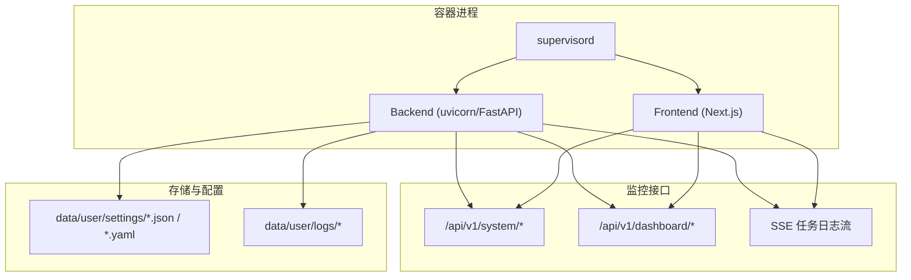
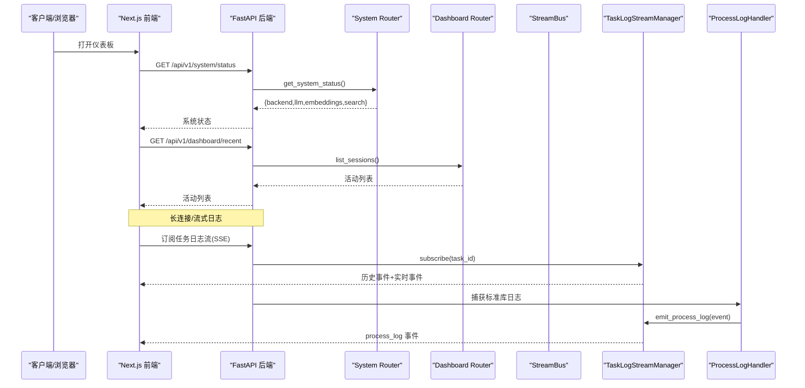
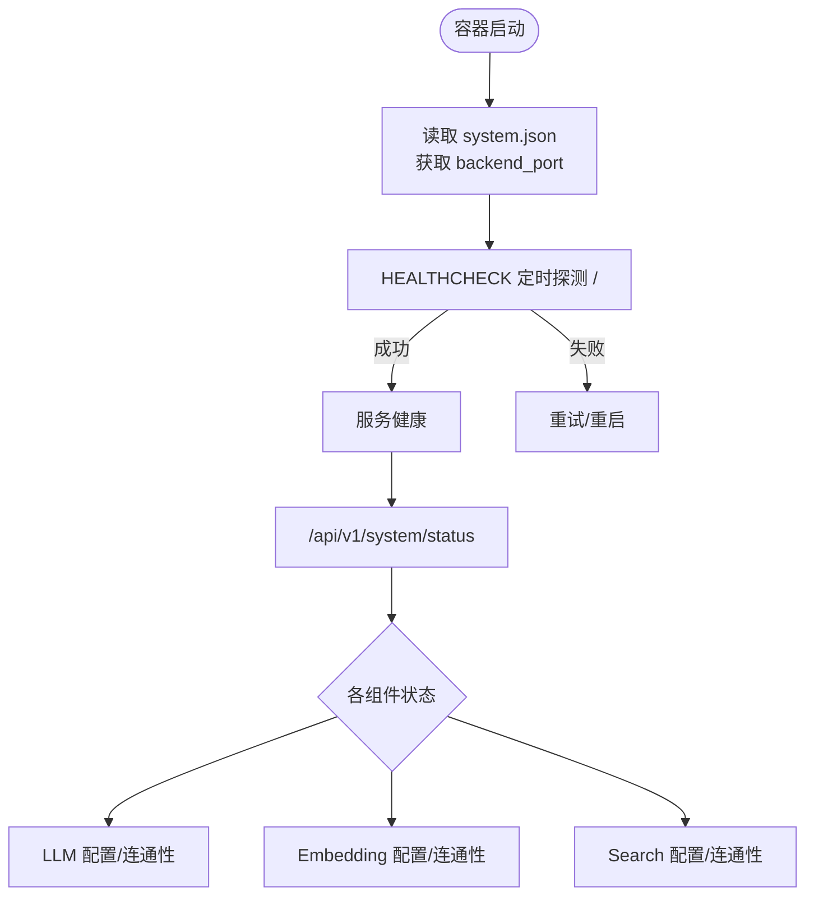
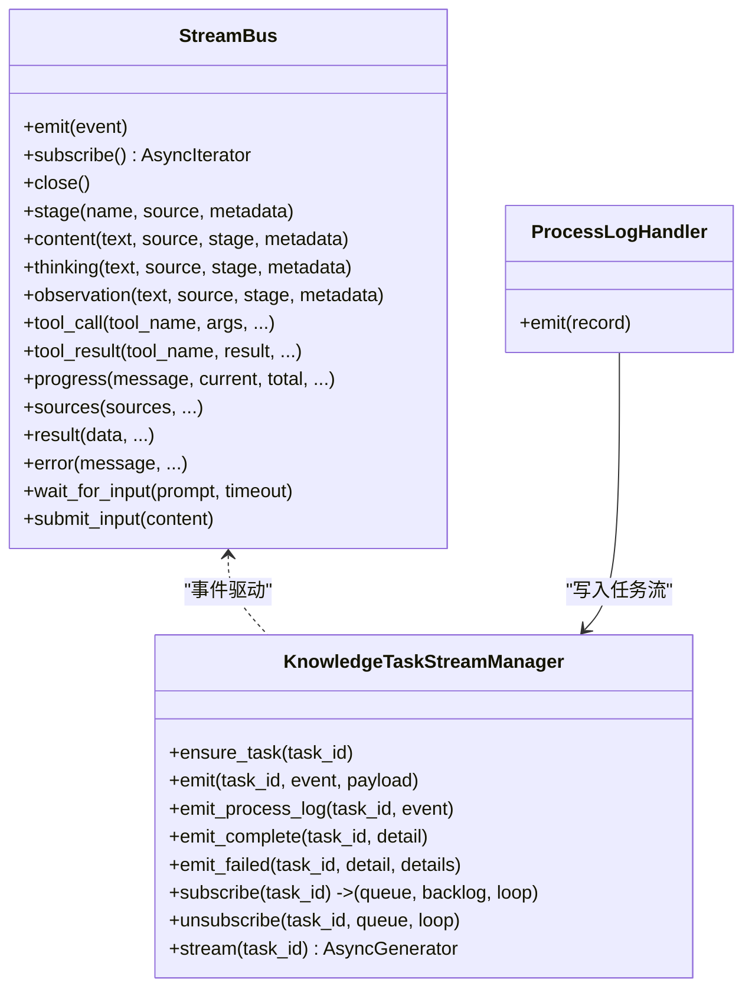
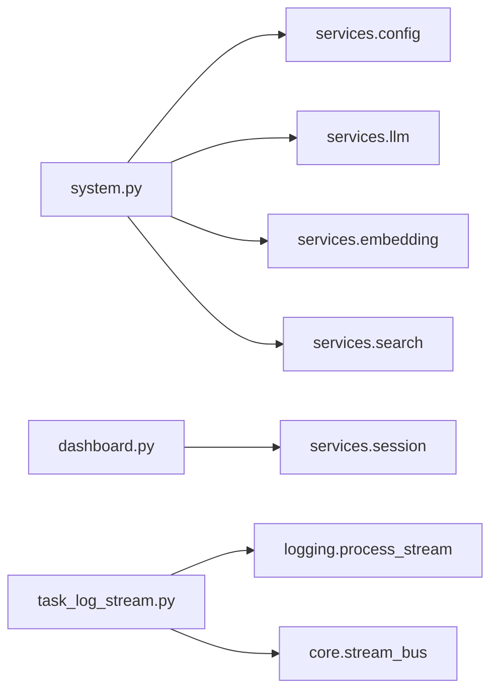

# 监控工具

<cite>
**本文引用的文件**
- [Dockerfile](file://Dockerfile)
- [compose.yaml](file://compose.yaml)
- [deeptutor/api/routers/system.py](file://deeptutor/api/routers/system.py)
- [deeptutor/api/routers/dashboard.py](file://deeptutor/api/routers/dashboard.py)
- [deeptutor/logging/process_stream.py](file://deeptutor/logging/process_stream.py)
- [deeptutor/logging/config.py](file://deeptutor/logging/config.py)
- [deeptutor/api/utils/task_log_stream.py](file://deeptutor/api/utils/task_log_stream.py)
- [deeptutor/core/stream_bus.py](file://deeptutor/core/stream_bus.py)
- [CONTAINERIZATION.md](file://CONTAINERIZATION.md)
</cite>

## 目录
1. [简介](#简介)
2. [项目结构](#项目结构)
3. [核心组件](#核心组件)
4. [架构总览](#架构总览)
5. [详细组件分析](#详细组件分析)
6. [依赖关系分析](#依赖关系分析)
7. [性能考量](#性能考量)
8. [故障排除指南](#故障排除指南)
9. [结论](#结论)
10. [附录](#附录)

## 简介
本文件面向运维与平台工程师，系统化说明 DeepTutor 的监控能力：启动时的系统状态检查与健康检查机制、进程间通信与日志流式传输、监控仪表板与可视化界面使用方法、自定义监控指标与告警规则的配置思路、监控数据的查询与分析方式，以及与外部监控系统（Prometheus、Grafana）的集成建议。文档同时提供可操作的排障步骤和最佳实践。

## 项目结构
DeepTutor 在容器内通过 supervisord 管理后端（FastAPI/uvicorn）与前端（Next.js），并通过内置 API 暴露系统状态、健康检查、会话活动与任务日志流。关键路径如下：
- 容器编排与运行：Dockerfile、compose.yaml、entrypoint.sh
- 系统状态与健康检查：system.py、dashboard.py、healthcheck.py（由 Dockerfile 注入）
- 日志与流式事件：process_stream.py、task_log_stream.py、stream_bus.py
- 运行时配置加载：main.yaml、system.json 等 JSON/YAML 配置

图表来源
- [Dockerfile:202-260](file://Dockerfile#L202-L260)
- [Dockerfile:264-293](file://Dockerfile#L264-L293)
- [Dockerfile:318-402](file://Dockerfile#L318-L402)
- [Dockerfile:414-436](file://Dockerfile#L414-L436)
- [deeptutor/api/routers/system.py:30-145](file://deeptutor/api/routers/system.py#L30-L145)
- [deeptutor/api/routers/dashboard.py:12-62](file://deeptutor/api/routers/dashboard.py#L12-L62)
- [deeptutor/api/utils/task_log_stream.py:237-252](file://deeptutor/api/utils/task_log_stream.py#L237-L252)

章节来源
- [Dockerfile:202-260](file://Dockerfile#L202-L260)
- [Dockerfile:264-293](file://Dockerfile#L264-L293)
- [Dockerfile:318-402](file://Dockerfile#L318-L402)
- [Dockerfile:414-436](file://Dockerfile#L414-L436)
- [compose.yaml:48-65](file://compose.yaml#L48-L65)

## 核心组件
- 系统状态与健康检查
  - 运行时拓扑与整体状态：/api/v1/system/runtime-topology、/api/v1/system/status
  - 组件连通性测试：/api/v1/system/test/llm、/api/v1/system/test/embeddings、/api/v1/system/test/search
  - 容器健康检查：Docker HEALTHCHECK 调用 healthcheck.py，探测后端根路径
- 监控仪表板数据
  - 最近活动列表与详情：/api/v1/dashboard/recent、/api/v1/dashboard/{entry_id}
- 进程间通信与日志流
  - 统一事件总线 StreamBus：用于一次对话轮次内的多生产者/消费者事件分发
  - 任务级日志流：KnowledgeTaskStreamManager + SSE 流式输出，支持回退与内存回收
  - 标准库日志捕获：ProcessLogHandler 将 stdlib 日志转为结构化事件并推送到任务流
- 配置与日志级别
  - 日志配置从 main.yaml 读取，支持控制台/文件输出、滚动策略
  - 运行时端口、API Base URL、认证开关等由 system.json 导出为环境变量

章节来源
- [deeptutor/api/routers/system.py:30-145](file://deeptutor/api/routers/system.py#L30-L145)
- [deeptutor/api/routers/system.py:148-323](file://deeptutor/api/routers/system.py#L148-L323)
- [deeptutor/api/routers/dashboard.py:12-62](file://deeptutor/api/routers/dashboard.py#L12-L62)
- [deeptutor/core/stream_bus.py:31-326](file://deeptutor/core/stream_bus.py#L31-L326)
- [deeptutor/api/utils/task_log_stream.py:24-336](file://deeptutor/api/utils/task_log_stream.py#L24-L336)
- [deeptutor/logging/process_stream.py:17-109](file://deeptutor/logging/process_stream.py#L17-L109)
- [deeptutor/logging/config.py:9-50](file://deeptutor/logging/config.py#L9-L50)
- [Dockerfile:414-436](file://Dockerfile#L414-L436)

## 架构总览
下图展示从请求到状态检查、日志流与仪表板的端到端流程。

图表来源
- [deeptutor/api/routers/system.py:61-145](file://deeptutor/api/routers/system.py#L61-L145)
- [deeptutor/api/routers/dashboard.py:12-38](file://deeptutor/api/routers/dashboard.py#L12-L38)
- [deeptutor/api/utils/task_log_stream.py:107-124](file://deeptutor/api/utils/task_log_stream.py#L107-L124)
- [deeptutor/api/utils/task_log_stream.py:237-252](file://deeptutor/api/utils/task_log_stream.py#L237-L252)
- [deeptutor/logging/process_stream.py:52-84](file://deeptutor/logging/process_stream.py#L52-L84)

## 详细组件分析

### 启动时系统状态检查与健康检查
- 容器健康检查
  - 通过 Dockerfile 注入 healthcheck.py，周期性访问后端根路径以确认服务可用；端口从 data/user/settings/system.json 的 backend_port 动态读取。
  - 健康检查间隔、超时、重试次数在 Dockerfile 中定义。
- 运行时拓扑与状态
  - /api/v1/system/runtime-topology 返回当前执行拓扑（主传输、管理器、编排器、会话存储、能力注册表、工具注册表）。
  - /api/v1/system/status 汇总后端、LLM、Embedding、Search 的状态与是否可测试，并对非管理员隐藏敏感模型信息。
- 组件连通性测试
  - /api/v1/system/test/llm：发送最小化提示验证 LLM 连通性与响应时间。
  - /api/v1/system/test/embeddings：对嵌入服务进行小批量向量生成校验。
  - /api/v1/system/test/search：根据搜索配置发起一次真实检索，验证凭据与可用性。

图表来源
- [Dockerfile:414-436](file://Dockerfile#L414-L436)
- [deeptutor/api/routers/system.py:61-145](file://deeptutor/api/routers/system.py#L61-L145)
- [deeptutor/api/routers/system.py:148-323](file://deeptutor/api/routers/system.py#L148-L323)

章节来源
- [Dockerfile:414-436](file://Dockerfile#L414-L436)
- [deeptutor/api/routers/system.py:30-145](file://deeptutor/api/routers/system.py#L30-L145)
- [deeptutor/api/routers/system.py:148-323](file://deeptutor/api/routers/system.py#L148-L323)

### 进程间通信与日志流式传输
- 统一事件总线 StreamBus
  - 单轮对话内的异步事件通道，支持内容、思考、观察、工具调用/结果、进度、来源、结果、错误、等待输入等事件类型。
  - 提供 stage 上下文管理器、JSON 序列化、用户输入提交等便捷方法。
  - 通过 per-turn 注册表按 turn_id 路由用户输入消息。
- 任务级日志流（SSE）
  - KnowledgeTaskStreamManager 维护每个 task_id 的事件缓冲、订阅者队列、终端墓碑与内存回收策略。
  - 支持历史回放、SSE 流式推送、完成/失败终止信号。
  - 通过 _capture_non_propagating_task_logs 捕获第三方库日志（如 lightrag/graphrag）并转发至任务流。
- 标准库日志捕获
  - ProcessLogHandler 将 logging.LogRecord 转换为 ProcessLogEvent，并按 task_id/turn_id 过滤后发射。
  - capture_process_logs 作为上下文管理器挂接 root logger，确保日志事件进入任务流。

图表来源
- [deeptutor/core/stream_bus.py:31-326](file://deeptutor/core/stream_bus.py#L31-L326)
- [deeptutor/api/utils/task_log_stream.py:24-336](file://deeptutor/api/utils/task_log_stream.py#L24-L336)
- [deeptutor/logging/process_stream.py:17-109](file://deeptutor/logging/process_stream.py#L17-L109)

章节来源
- [deeptutor/core/stream_bus.py:31-326](file://deeptutor/core/stream_bus.py#L31-L326)
- [deeptutor/api/utils/task_log_stream.py:24-336](file://deeptutor/api/utils/task_log_stream.py#L24-L336)
- [deeptutor/logging/process_stream.py:17-109](file://deeptutor/logging/process_stream.py#L17-L109)

### 监控仪表板与可视化界面使用方法
- 数据源
  - 最近活动：GET /api/v1/dashboard/recent?limit=50&type=chat|solve|...
  - 活动详情：GET /api/v1/dashboard/{entry_id}
- 使用步骤
  - 在前端“设置”或“工作区”页面查看会话列表与详情。
  - 通过 type 参数筛选不同能力类型的活动（如 chat、solve、research）。
  - 点击某条活动进入详情，查看消息、活跃轮次、状态与摘要。
- 扩展建议
  - 可在前端增加“刷新频率”“分页加载”“关键词过滤”等交互。
  - 结合任务日志流（SSE）实现实时活动追踪。

章节来源
- [deeptutor/api/routers/dashboard.py:12-62](file://deeptutor/api/routers/dashboard.py#L12-L62)

### 自定义监控指标与告警规则
- 指标采集点
  - 系统状态：/api/v1/system/status 中的后端、LLM、Embedding、Search 状态与错误信息。
  - 连通性测试：/api/v1/system/test/* 的响应时间与错误码。
  - 任务日志：SSE 流中的 process_log、complete、failed 事件。
- 推荐做法
  - 使用 HTTP 客户端定期轮询上述接口，记录状态、耗时、错误率，并上报到时序数据库（如 Prometheus）。
  - 基于事件流统计任务成功率、平均耗时、错误分布，形成业务指标。
  - 在 Grafana 中创建仪表盘，展示健康度、延迟、错误率趋势。
- 告警规则（概念性）
  - 当 /status 中任一组件状态为 error/not_configured 持续 N 分钟触发告警。
  - test/* 接口连续失败或响应时间超过阈值触发告警。
  - 任务流中 failed 事件比例突增或 complete 长时间无更新触发告警。

[本节为通用指导，不直接分析具体代码文件]

### 监控数据的查询与分析工具
- 会话与活动
  - 使用 dashboard API 获取最近活动与详情，便于快速定位问题会话。
- 任务日志
  - 通过 SSE 流订阅任务日志，结合 task_id 过滤，实现细粒度排查。
- 日志文件
  - 应用日志默认输出到 data/user/logs 下的 ai_tutor_*.log，可按日期/大小滚动。
  - 可通过 main.yaml 调整日志级别与输出目标。

章节来源
- [deeptutor/api/routers/dashboard.py:12-62](file://deeptutor/api/routers/dashboard.py#L12-L62)
- [deeptutor/api/utils/task_log_stream.py:237-252](file://deeptutor/api/utils/task_log_stream.py#L237-L252)
- [deeptutor/logging/config.py:9-50](file://deeptutor/logging/config.py#L9-L50)

### 与外部监控系统（Prometheus、Grafana）集成
- 指标暴露
  - 当前未内置 /metrics 端点。建议通过侧车或中间件封装现有 API（/status、/test/*、SSE 事件）并导出为 Prometheus 格式。
- 数据采集
  - 使用 prometheus-http-client 或自定义 exporter 定期拉取状态接口，计算延迟、错误率、可用性。
  - 解析 SSE 事件流，聚合任务成功率、错误分类、处理时长。
- 可视化与告警
  - 在 Grafana 中导入模板，构建“系统健康”“任务质量”“资源使用”等看板。
  - 配置 Alertmanager 规则，对接邮件/钉钉/Slack 等通知渠道。

[本节为通用指导，不直接分析具体代码文件]

## 依赖关系分析
- 运行时进程
  - supervisord 管理 backend/frontend，保证自动重启与日志收集。
- API 层
  - system.py 依赖 services.config、services.llm、services.embedding、services.search 等模块进行状态检测。
  - dashboard.py 依赖 services.session 获取会话与消息。
- 日志与流
  - task_log_stream.py 依赖 logging 模块与 ProcessLogEvent，结合 StreamBus 完成事件分发。
  - process_stream.py 将 stdlib 日志转换为结构化事件，按 task_id/turn_id 过滤。
- 配置
  - 运行时端口、API Base URL、认证开关等由 system.json 导出为环境变量，供前后端使用。

图表来源
- [deeptutor/api/routers/system.py:1-323](file://deeptutor/api/routers/system.py#L1-L323)
- [deeptutor/api/routers/dashboard.py:1-62](file://deeptutor/api/routers/dashboard.py#L1-L62)
- [deeptutor/api/utils/task_log_stream.py:1-336](file://deeptutor/api/utils/task_log_stream.py#L1-L336)
- [deeptutor/logging/process_stream.py:1-109](file://deeptutor/logging/process_stream.py#L1-L109)
- [deeptutor/core/stream_bus.py:1-326](file://deeptutor/core/stream_bus.py#L1-L326)

章节来源
- [deeptutor/api/routers/system.py:1-323](file://deeptutor/api/routers/system.py#L1-L323)
- [deeptutor/api/routers/dashboard.py:1-62](file://deeptutor/api/routers/dashboard.py#L1-L62)
- [deeptutor/api/utils/task_log_stream.py:1-336](file://deeptutor/api/utils/task_log_stream.py#L1-L336)
- [deeptutor/logging/process_stream.py:1-109](file://deeptutor/logging/process_stream.py#L1-L109)
- [deeptutor/core/stream_bus.py:1-326](file://deeptutor/core/stream_bus.py#L1-L326)

## 性能考量
- 事件缓冲与内存控制
  - KnowledgeTaskStreamManager 限制每任务事件数与字节数，避免内存膨胀；完成后保留终端墓碑以便后续查询。
- 日志级别与输出
  - 通过 main.yaml 调整日志级别，生产环境建议 INFO 及以上；关闭不必要的 DEBUG 日志以减少 I/O。
- WebSocket/HTTP 保持连接
  - uvicorn 的 --timeout-keep-alive 与前端代理保持一致，避免空闲连接被提前回收导致中断。
- 附件与消息大小
  - WS_MAX_SIZE 根据系统配置动态设置，避免大附件被截断。

章节来源
- [deeptutor/api/utils/task_log_stream.py:24-31](file://deeptutor/api/utils/task_log_stream.py#L24-L31)
- [deeptutor/logging/config.py:9-50](file://deeptutor/logging/config.py#L9-L50)
- [Dockerfile:273-293](file://Dockerfile#L273-L293)

## 故障排除指南
- 容器健康检查失败
  - 检查 system.json 中的 backend_port 是否正确；确认 / 路径可达。
  - 查看 supervisord 与 uvicorn 启动日志，确认端口绑定成功。
- 系统状态异常
  - 调用 /api/v1/system/status 查看各组件状态；若为 not_configured，检查 model_catalog.json 与 integrations.json。
  - 使用 /api/v1/system/test/* 逐一验证 LLM、Embedding、Search 连通性。
- 日志缺失或无法流式传输
  - 确认 capture_process_logs 已正确挂载 root logger。
  - 检查 task_id/turn_id 过滤条件是否与上下文一致。
  - 查看任务流是否收到 complete/failed 终止事件。
- 仪表板无数据
  - 确认 sessions store 中有会话记录；尝试增大 limit 或切换 type。
  - 检查 dashboard API 是否返回 404 或空列表。

章节来源
- [Dockerfile:414-436](file://Dockerfile#L414-L436)
- [deeptutor/api/routers/system.py:61-145](file://deeptutor/api/routers/system.py#L61-L145)
- [deeptutor/api/routers/system.py:148-323](file://deeptutor/api/routers/system.py#L148-L323)
- [deeptutor/logging/process_stream.py:52-84](file://deeptutor/logging/process_stream.py#L52-L84)
- [deeptutor/api/utils/task_log_stream.py:107-124](file://deeptutor/api/utils/task_log_stream.py#L107-L124)
- [deeptutor/api/routers/dashboard.py:12-62](file://deeptutor/api/routers/dashboard.py#L12-L62)

## 结论
DeepTutor 提供了完善的启动健康检查、系统状态查询、组件连通性测试、会话活动仪表板以及任务级日志流式传输能力。通过合理配置日志级别、利用 SSE 流与 dashboard API，并结合外部监控系统（Prometheus/Grafana），可实现端到端的可观测性与告警闭环。建议在部署中启用容器健康检查、限制日志体积、定期轮询状态接口，并在 Grafana 中建立统一看板。

## 附录
- 运行时配置位置
  - system.json：后端/前端端口、API Base、CORS、SSL 验证、附件目录
  - auth.json：可选认证开关、用户名、密码哈希、令牌/Cookie 设置
  - integrations.json：PocketBase 等集成配置
  - model_catalog.json：LLM、Embedding、Search 提供者与密钥
  - main.yaml：运行时行为默认值与路径注入
  - agents.yaml：能力/工具的温度与 token 设置
- 端口与环境变量
  - BACKEND_PORT、FRONTEND_PORT 由 entrypoint 从 system.json 导出；DEEPTUTOR_API_BASE_URL 与 DEEPTUTOR_AUTH_ENABLED 由运行时设置导出。

章节来源
- [CONTAINERIZATION.md:335-362](file://CONTAINERIZATION.md#L335-L362)
- [Dockerfile:318-402](file://Dockerfile#L318-L402)
- [compose.yaml:48-65](file://compose.yaml#L48-L65)