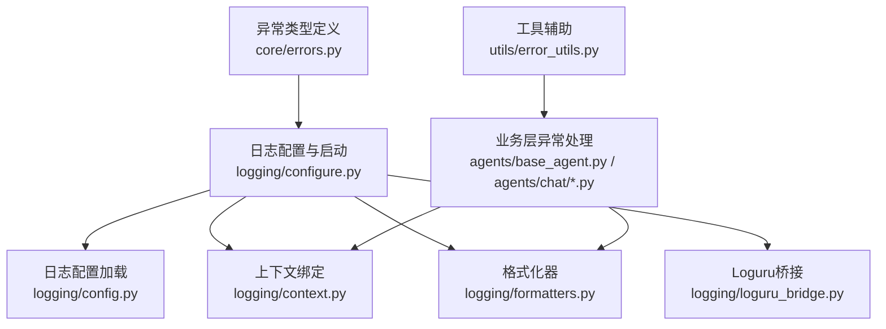
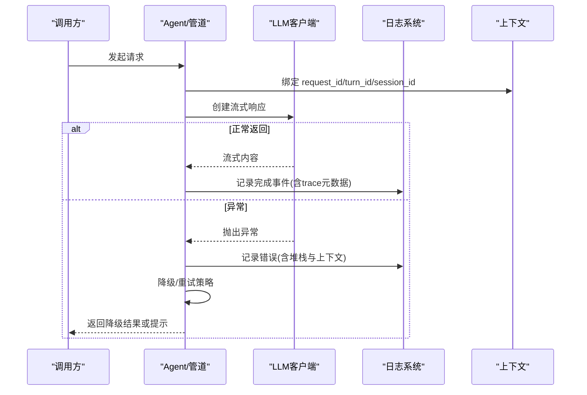
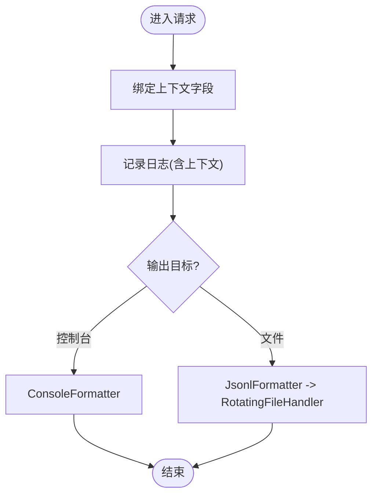
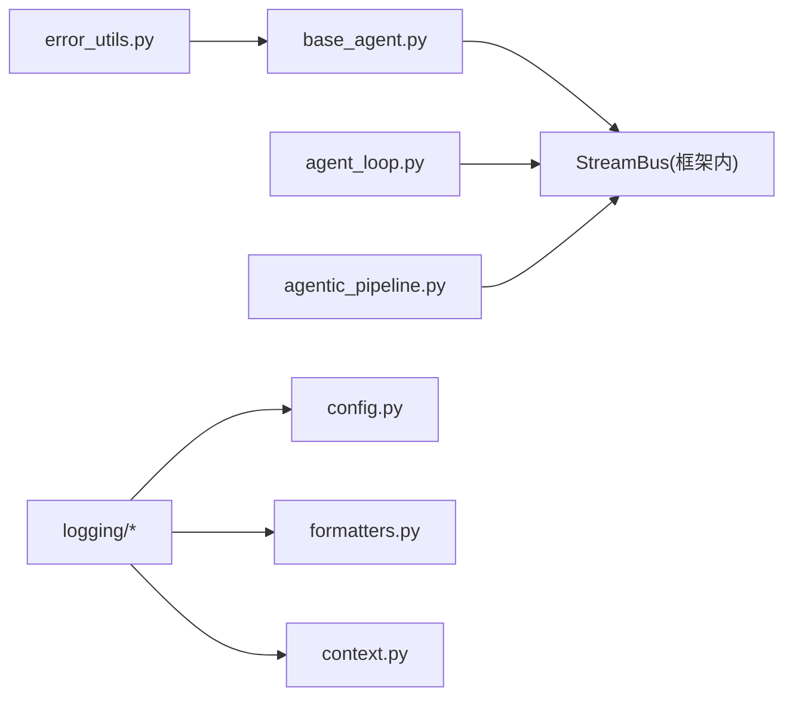

# 错误追踪

<cite>
**本文引用的文件**
- [deeptutor/core/errors.py](file://deeptutor/core/errors.py)
- [deeptutor/logging/configure.py](file://deeptutor/logging/configure.py)
- [deeptutor/logging/config.py](file://deeptutor/logging/config.py)
- [deeptutor/logging/context.py](file://deeptutor/logging/context.py)
- [deeptutor/logging/formatters.py](file://deeptutor/logging/formatters.py)
- [deeptutor/logging/loguru_bridge.py](file://deeptutor/logging/loguru_bridge.py)
- [deeptutor/utils/error_utils.py](file://deeptutor/utils/error_utils.py)
- [deeptutor/agents/base_agent.py](file://deeptutor/agents/base_agent.py)
- [deeptutor/agents/chat/agent_loop.py](file://deeptutor/agents/chat/agent_loop.py)
- [deeptutor/agents/chat/agentic_pipeline.py](file://deeptutor/agents/chat/agentic_pipeline.py)
</cite>

## 目录
1. [简介](#简介)
2. [项目结构](#项目结构)
3. [核心组件](#核心组件)
4. [架构总览](#架构总览)
5. [详细组件分析](#详细组件分析)
6. [依赖关系分析](#依赖关系分析)
7. [性能考量](#性能考量)
8. [故障排查指南](#故障排查指南)
9. [结论](#结论)
10. [附录](#附录)

## 简介
本文件面向DeepTutor的错误追踪系统，系统化说明异常分类、结构化日志记录、上下文信息捕获、堆栈跟踪与调试信息收集、告警通知配置思路、常见错误诊断与解决方案，以及Sentry等监控服务的集成建议。文档同时给出错误处理的编程模式与最佳实践，帮助开发者在复杂的多Agent、流式LLM调用链路中稳定地定位问题并快速恢复。

## 项目结构
DeepTutor将错误追踪能力拆分为“异常类型定义”、“日志基础设施”、“上下文绑定”、“格式化输出”、“工具辅助”和“业务层异常处理”六个层次：
- 异常类型定义：统一异常基类与领域异常（如LLM相关）。
- 日志基础设施：启动时配置标准库logging，支持控制台与JSONL文件输出，自动附加上下文。
- 上下文绑定：通过contextvars为每次请求/任务绑定可追踪字段（如request_id、turn_id、session_id等）。
- 格式化输出：JSONL结构化行日志，附带时间戳、级别、来源、消息与上下文；开发环境提供易读控制台格式。
- 工具辅助：对异常消息进行可读化整理，便于快速识别API错误码与类型。
- 业务层异常处理：在Agent循环、管道、流式响应等关键路径捕获异常、降级重试、上报trace元数据。



图表来源
- [deeptutor/logging/configure.py:37-77](file://deeptutor/logging/configure.py#L37-L77)
- [deeptutor/logging/config.py:25-45](file://deeptutor/logging/config.py#L25-L45)
- [deeptutor/logging/context.py:10-39](file://deeptutor/logging/context.py#L10-L39)
- [deeptutor/logging/formatters.py:13-49](file://deeptutor/logging/formatters.py#L13-L49)
- [deeptutor/logging/loguru_bridge.py:9-28](file://deeptutor/logging/loguru_bridge.py#L9-L28)
- [deeptutor/utils/error_utils.py:46-81](file://deeptutor/utils/error_utils.py#L46-L81)
- [deeptutor/agents/base_agent.py:643-670](file://deeptutor/agents/base_agent.py#L643-L670)
- [deeptutor/agents/chat/agent_loop.py:639-669](file://deeptutor/agents/chat/agent_loop.py#L639-L669)

章节来源
- [deeptutor/logging/configure.py:37-77](file://deeptutor/logging/configure.py#L37-L77)
- [deeptutor/logging/config.py:25-45](file://deeptutor/logging/config.py#L25-L45)
- [deeptutor/logging/context.py:10-39](file://deeptutor/logging/context.py#L10-L39)
- [deeptutor/logging/formatters.py:13-49](file://deeptutor/logging/formatters.py#L13-L49)
- [deeptutor/logging/loguru_bridge.py:9-28](file://deeptutor/logging/loguru_bridge.py#L9-L28)
- [deeptutor/utils/error_utils.py:46-81](file://deeptutor/utils/error_utils.py#L46-L81)
- [deeptutor/agents/base_agent.py:643-670](file://deeptutor/agents/base_agent.py#L643-L670)
- [deeptutor/agents/chat/agent_loop.py:639-669](file://deeptutor/agents/chat/agent_loop.py#L639-L669)

## 核心组件
- 异常体系
  - 应用基础异常与细分异常（配置、校验、服务、LLM服务等），便于上层按类别捕获与决策。
- 日志基础设施
  - 进程级一次性配置，支持控制台与JSONL文件输出；自动注入上下文；兼容loguru输出。
- 上下文绑定
  - 基于contextvars的请求级上下文，包含request_id、turn_id、session_id、task_id、capability、stage、sink等关键字段。
- 格式化器
  - JSONL每行一条结构化记录，包含时间戳、级别、logger、message、context，异常时附带堆栈。
- 工具辅助
  - 从异常消息中提取JSON块并标准化展示，提升可读性。
- 业务层异常处理
  - 在Agent循环与管道中捕获异常、降级重试、上报trace元数据，保证用户体验与可观测性。

章节来源
- [deeptutor/core/errors.py:10-57](file://deeptutor/core/errors.py#L10-L57)
- [deeptutor/logging/configure.py:37-77](file://deeptutor/logging/configure.py#L37-L77)
- [deeptutor/logging/context.py:10-39](file://deeptutor/logging/context.py#L10-L39)
- [deeptutor/logging/formatters.py:13-49](file://deeptutor/logging/formatters.py#L13-L49)
- [deeptutor/utils/error_utils.py:46-81](file://deeptutor/utils/error_utils.py#L46-L81)
- [deeptutor/agents/base_agent.py:643-670](file://deeptutor/agents/base_agent.py#L643-L670)
- [deeptutor/agents/chat/agent_loop.py:639-669](file://deeptutor/agents/chat/agent_loop.py#L639-L669)

## 架构总览
下图展示了错误追踪在运行时的整体流程：业务层抛出或捕获异常，通过日志基础设施以结构化方式记录，并附带上下文与堆栈；同时在关键路径进行降级与重试，确保系统韧性。



图表来源
- [deeptutor/agents/chat/agent_loop.py:639-669](file://deeptutor/agents/chat/agent_loop.py#L639-L669)
- [deeptutor/agents/base_agent.py:643-670](file://deeptutor/agents/base_agent.py#L643-L670)
- [deeptutor/logging/configure.py:37-77](file://deeptutor/logging/configure.py#L37-L77)
- [deeptutor/logging/context.py:10-39](file://deeptutor/logging/context.py#L10-L39)
- [deeptutor/logging/formatters.py:13-49](file://deeptutor/logging/formatters.py#L13-L49)

## 详细组件分析

### 异常分类与语义
- 基础异常：DeepTutorError作为所有应用异常的基类，携带message与details，便于扩展与序列化。
- 领域异常：
  - ConfigurationError/EnvironmentConfigError：配置与环境相关错误。
  - ValidationError：输入校验失败。
  - ServiceError：服务层错误。
  - LLMServiceError/LLMContextError：LLM服务与上下文窗口超限等错误。
- 使用建议：
  - 在边界处（API、工具调用）抛出具体异常类型，便于上层按类别处理。
  - 对可恢复错误（如网络抖动、模型不支持某特性）采用重试与降级。

章节来源
- [deeptutor/core/errors.py:10-57](file://deeptutor/core/errors.py#L10-L57)

### 结构化日志与上下文捕获
- 日志启动与配置：
  - 进程级configure_logging负责初始化控制台与文件输出，设置级别、轮转策略，并安装loguru桥接。
  - 配置文件来自运行时main.yaml的logging节，支持level、console_output、save_to_file、user_log_dir、max_bytes、backup_count。
- 上下文绑定：
  - 通过bind_log_context临时绑定request_id、turn_id、session_id、task_id、capability、stage、sink等字段。
  - ContextFilter在每个LogRecord上附加当前上下文，JsonlFormatter将其序列化为JSON对象。
- 输出格式：
  - JSONL每行一条记录，包含timestamp、level、logger、message、context，异常时附带exception字段。
  - 控制台格式用于本地开发，显示阶段与任务标识，便于快速定位。



图表来源
- [deeptutor/logging/configure.py:37-77](file://deeptutor/logging/configure.py#L37-L77)
- [deeptutor/logging/config.py:25-45](file://deeptutor/logging/config.py#L25-L45)
- [deeptutor/logging/context.py:10-39](file://deeptutor/logging/context.py#L10-L39)
- [deeptutor/logging/formatters.py:13-49](file://deeptutor/logging/formatters.py#L13-L49)

章节来源
- [deeptutor/logging/configure.py:37-77](file://deeptutor/logging/configure.py#L37-L77)
- [deeptutor/logging/config.py:25-45](file://deeptutor/logging/config.py#L25-L45)
- [deeptutor/logging/context.py:10-39](file://deeptutor/logging/context.py#L10-L39)
- [deeptutor/logging/formatters.py:13-49](file://deeptutor/logging/formatters.py#L13-L49)

### 错误堆栈跟踪与调试信息
- 异常堆栈：
  - JsonlFormatter在record.exc_info存在时，自动附加格式化后的异常堆栈到exception字段。
  - 业务层在捕获异常后记录error级别日志，并可选择上报trace元数据（如trace_kind=warning/error）。
- 调试信息：
  - 上下文中的stage、task_id、turn_id、session_id等字段有助于跨模块关联日志。
  - 工具函数format_exception_message可从异常消息中提取JSON块，标准化展示message/type/code等字段，便于快速识别API错误。

章节来源
- [deeptutor/logging/formatters.py:26-39](file://deeptutor/logging/formatters.py#L26-L39)
- [deeptutor/agents/base_agent.py:643-670](file://deeptutor/agents/base_agent.py#L643-L670)
- [deeptutor/utils/error_utils.py:46-81](file://deeptutor/utils/error_utils.py#L46-L81)

### 错误分类与处理流程（Agent循环与管道）
- 流式响应创建：
  - 在_create_response_stream中捕获异常，针对stream_options与tool_schema不被支持的情况进行降级重试，并通过progress上报警告。
- 最终响应与终止：
  - 在管道中构建trace元数据，标注trace_kind、call_kind、trace_role等，便于前端渲染与后端分析。
- 上下文窗口保护：
  - 估算消息token数，超过阈值时对tool结果进行裁剪，避免超出模型上下文窗口。

```mermaid
sequenceDiagram
participant Loop as "AgentLoop"
participant Client as "LLM客户端"
participant Stream as "StreamBus"
participant Log as "日志"
Loop->>Client : chat.completions.create(**kwargs)
alt 支持stream_options
Client-->>Loop : 返回流
else 不支持
Loop->>Stream : progress(警告 : 回退)
Loop->>Client : create(移除stream_options)
Client-->>Loop : 返回流
end
Note over Loop,Stream : 若tools schema不被支持，同样回退并重试
```

图表来源
- [deeptutor/agents/chat/agent_loop.py:639-669](file://deeptutor/agents/chat/agent_loop.py#L639-L669)
- [deeptutor/agents/chat/agentic_pipeline.py:1169-1229](file://deeptutor/agents/chat/agentic_pipeline.py#L1169-L1229)

章节来源
- [deeptutor/agents/chat/agent_loop.py:639-669](file://deeptutor/agents/chat/agent_loop.py#L639-L669)
- [deeptutor/agents/chat/agentic_pipeline.py:1169-1229](file://deeptutor/agents/chat/agentic_pipeline.py#L1169-L1229)

### 错误告警与通知机制（配置与实践）
- 日志告警：
  - 通过配置logging.level与保存策略，结合外部日志聚合平台（如ELK、云日志服务）实现告警规则。
  - 在业务层对特定trace_kind（如warning/error）进行标记，便于过滤与告警。
- 通知渠道：
  - 可将错误事件转发至企业微信、钉钉、Slack等通道（需自行集成发送逻辑）。
  - 对于关键错误（如LLM服务不可用、上下文窗口超限），建议在业务层触发即时通知。
- 建议：
  - 在API网关或中间件层集中捕获未处理异常，统一记录并触发告警。
  - 对高频错误进行去重与限流，避免告警风暴。

章节来源
- [deeptutor/logging/configure.py:37-77](file://deeptutor/logging/configure.py#L37-L77)
- [deeptutor/logging/config.py:25-45](file://deeptutor/logging/config.py#L25-L45)
- [deeptutor/agents/chat/agent_loop.py:639-669](file://deeptutor/agents/chat/agent_loop.py#L639-L669)

### 常见错误的诊断与解决方案
- LLM流式选项不被支持
  - 现象：创建流式响应时报错。
  - 处理：自动移除stream_options并重试，同时上报警告。
  - 诊断：查看progress消息与trace元数据中的tool_schema_fallback标志。
- 工具Schema不被支持
  - 现象：provider拒绝原生工具schema。
  - 处理：移除tools与tool_choice并重试，标记fallback。
  - 诊断：检查trace元数据与日志中的警告信息。
- 上下文窗口超限
  - 现象：消息过长导致模型无法处理。
  - 处理：裁剪tool结果，降低token占用，并提示用户。
  - 诊断：关注context_window_guard相关的进度提示与trace元数据。
- API错误消息可读性差
  - 现象：异常消息包含嵌套JSON，难以阅读。
  - 处理：使用format_exception_message提取并标准化message/type/code。
  - 诊断：对比原始异常与格式化后的消息。

章节来源
- [deeptutor/agents/chat/agent_loop.py:639-669](file://deeptutor/agents/chat/agent_loop.py#L639-L669)
- [deeptutor/agents/chat/agentic_pipeline.py:1232-1267](file://deeptutor/agents/chat/agentic_pipeline.py#L1232-L1267)
- [deeptutor/utils/error_utils.py:46-81](file://deeptutor/utils/error_utils.py#L46-L81)

### 集成错误监控服务（如Sentry）
- 集成位置建议：
  - 在日志配置阶段安装SDK，使所有日志与异常自动上报。
  - 在API路由层捕获未处理异常，统一记录并上报。
  - 在Agent循环与管道中，对关键异常进行标记（如trace_kind=error）并上报。
- 上下文关联：
  - 将request_id、turn_id、session_id、task_id等上下文字段同步至Sentry的事件标签，便于关联追踪。
- 告警与降噪：
  - 利用Sentry的分组与规则引擎，对高频错误进行合并与降噪。
  - 对敏感信息进行脱敏，避免泄露用户隐私。

[本节为概念性指导，不直接分析具体文件]

### 错误处理的编程模式与最佳实践
- 明确异常边界：
  - 在I/O、网络、解析等边界处抛出具体异常类型，避免吞掉异常。
- 分层处理：
  - 底层捕获并转换为领域异常；中层进行重试与降级；顶层统一记录与响应。
- 可观测性优先：
  - 每个关键路径记录trace元数据与上下文，确保问题可追溯。
- 健壮性与用户体验：
  - 对可恢复错误采用指数退避重试；对用户可见的错误提供友好提示。
- 安全与合规：
  - 避免在日志中记录敏感信息；对异常消息进行脱敏。

[本节为通用实践指导，不直接分析具体文件]

## 依赖关系分析
- 模块耦合：
  - base_agent与agent_loop强依赖StreamBus与trace元数据，用于上报状态与进度。
  - logging模块被全局初始化，其他模块通过标准库logging接口记录日志。
- 外部依赖：
  - loguru可选桥接，不影响主流程。
  - 配置文件main.yaml控制日志行为。
- 潜在循环依赖：
  - context_builder与agents模块间存在延迟导入以避免循环，已在工具函数中处理。



图表来源
- [deeptutor/agents/base_agent.py:643-670](file://deeptutor/agents/base_agent.py#L643-L670)
- [deeptutor/agents/chat/agent_loop.py:639-669](file://deeptutor/agents/chat/agent_loop.py#L639-L669)
- [deeptutor/agents/chat/agentic_pipeline.py:1169-1229](file://deeptutor/agents/chat/agentic_pipeline.py#L1169-L1229)
- [deeptutor/logging/config.py:25-45](file://deeptutor/logging/config.py#L25-L45)
- [deeptutor/logging/formatters.py:13-49](file://deeptutor/logging/formatters.py#L13-L49)
- [deeptutor/logging/context.py:10-39](file://deeptutor/logging/context.py#L10-L39)
- [deeptutor/utils/error_utils.py:46-81](file://deeptutor/utils/error_utils.py#L46-L81)

章节来源
- [deeptutor/agents/base_agent.py:643-670](file://deeptutor/agents/base_agent.py#L643-L670)
- [deeptutor/agents/chat/agent_loop.py:639-669](file://deeptutor/agents/chat/agent_loop.py#L639-L669)
- [deeptutor/agents/chat/agentic_pipeline.py:1169-1229](file://deeptutor/agents/chat/agentic_pipeline.py#L1169-L1229)
- [deeptutor/logging/config.py:25-45](file://deeptutor/logging/config.py#L25-L45)
- [deeptutor/logging/formatters.py:13-49](file://deeptutor/logging/formatters.py#L13-L49)
- [deeptutor/logging/context.py:10-39](file://deeptutor/logging/context.py#L10-L39)
- [deeptutor/utils/error_utils.py:46-81](file://deeptutor/utils/error_utils.py#L46-L81)

## 性能考量
- 日志写入：
  - 使用RotatingFileHandler限制文件大小与备份数量，避免磁盘占用过高。
  - JSONL格式高效且易于解析，适合大规模日志采集。
- 上下文开销：
  - contextvars轻量，适合高并发场景；避免在上下文中存储大对象。
- 异常处理：
  - 对频繁异常进行去重与采样，减少日志量与CPU开销。
- 流式处理：
  - 在流式响应中尽量减少阻塞操作，确保低延迟。

[本节提供一般性指导，不直接分析具体文件]

## 故障排查指南
- 定位问题：
  - 通过request_id/turn_id/session_id在日志中串联一次请求的全链路。
  - 关注trace元数据中的trace_kind、call_kind、trace_role等字段。
- 常见问题：
  - LLM服务不可用：检查网络与密钥，查看重试与降级是否生效。
  - 上下文窗口超限：确认消息长度与tool结果大小，必要时裁剪。
  - API错误：使用format_exception_message标准化错误消息，快速识别code与type。
- 调试技巧：
  - 提高日志级别至DEBUG，观察更详细的执行路径。
  - 在关键路径添加临时日志，验证假设。

章节来源
- [deeptutor/logging/context.py:10-39](file://deeptutor/logging/context.py#L10-L39)
- [deeptutor/logging/formatters.py:26-39](file://deeptutor/logging/formatters.py#L26-L39)
- [deeptutor/utils/error_utils.py:46-81](file://deeptutor/utils/error_utils.py#L46-L81)
- [deeptutor/agents/chat/agent_loop.py:639-669](file://deeptutor/agents/chat/agent_loop.py#L639-L669)

## 结论
DeepTutor的错误追踪系统通过统一的异常分类、结构化日志、上下文绑定与业务层降级重试，构建了高可观测性与韧性的错误处理能力。开发者应遵循明确的异常边界、分层处理与可观测性优先的原则，并结合外部监控服务实现完整的错误闭环。在生产环境中，建议配合日志聚合与告警平台，持续优化错误处理策略与用户体验。

## 附录
- 配置项参考：
  - logging.level：日志级别（INFO/DEBUG等）。
  - logging.console_output：是否输出到控制台。
  - logging.save_to_file：是否保存到文件。
  - logging.user_log_dir：日志目录。
  - logging.max_bytes：单个日志文件大小上限。
  - logging.backup_count：保留的备份文件数量。
- 上下文字段：
  - request_id、turn_id、session_id、task_id、capability、stage、sink。

章节来源
- [deeptutor/logging/config.py:25-45](file://deeptutor/logging/config.py#L25-L45)
- [deeptutor/logging/context.py:10-39](file://deeptutor/logging/context.py#L10-L39)