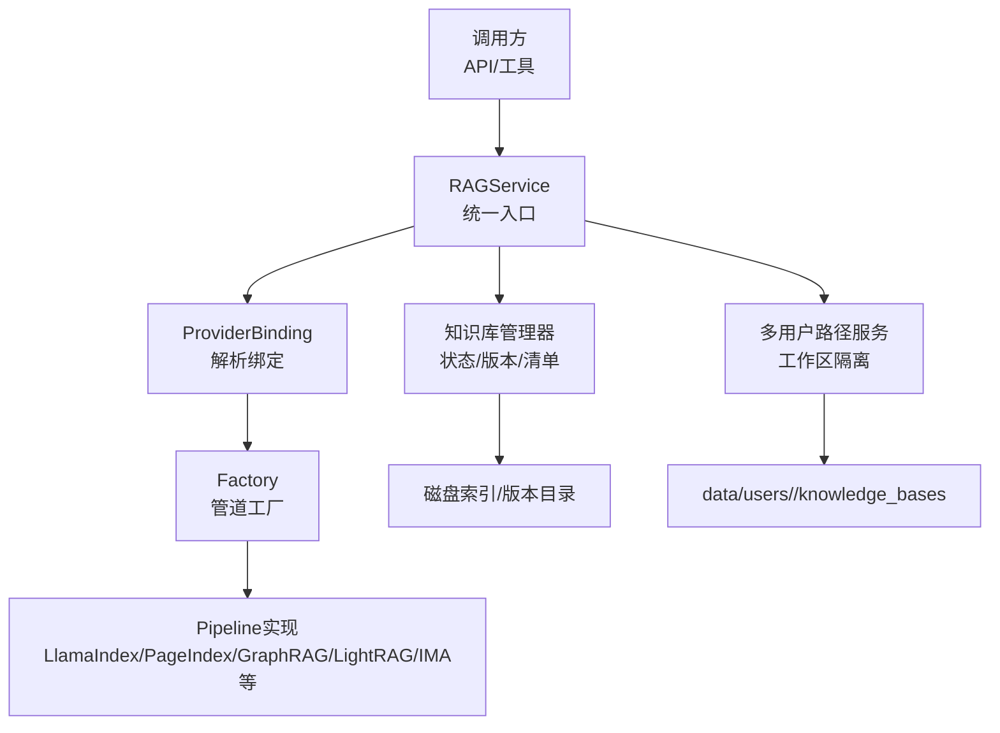
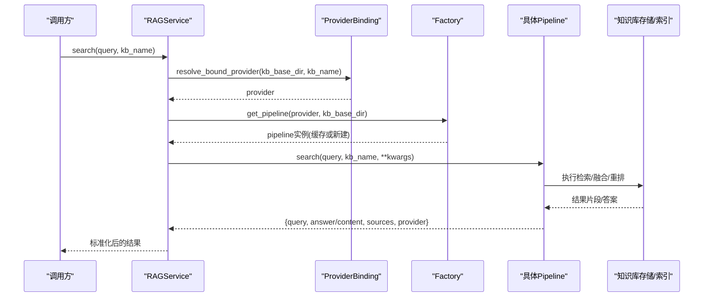
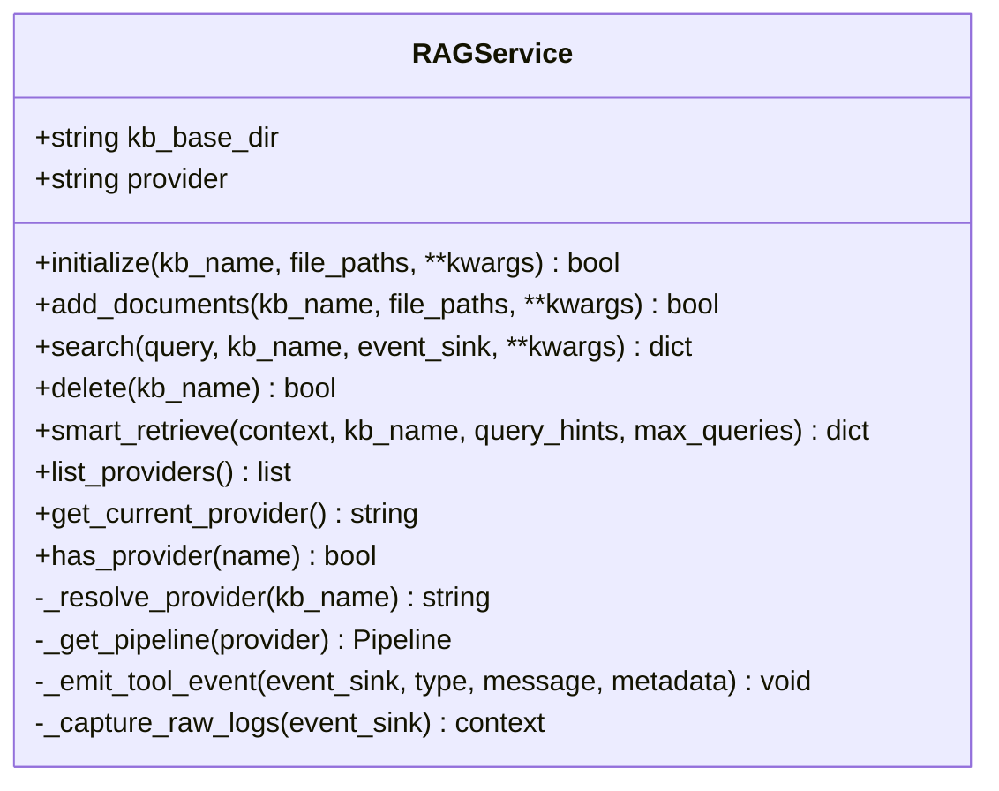
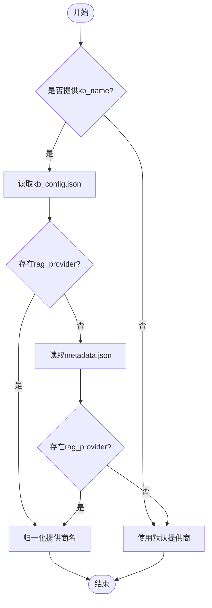
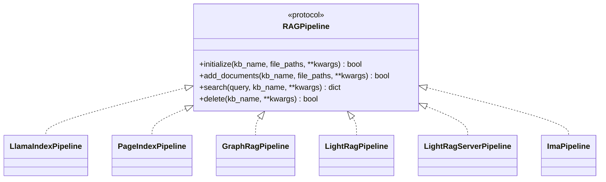
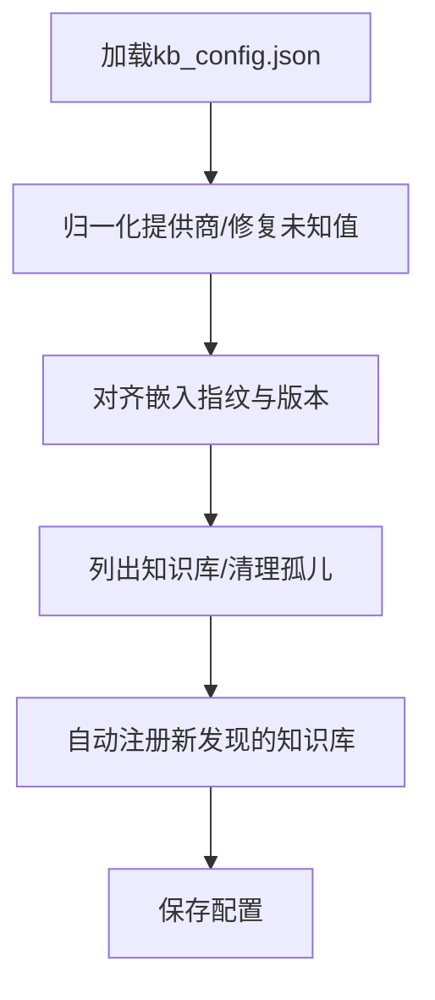
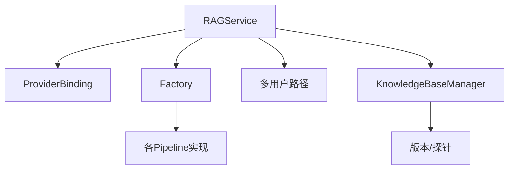

# RAG架构设计

<cite>
**本文引用的文件**
- [service.py](file://deeptutor/services/rag/service.py)
- [factory.py](file://deeptutor/services/rag/factory.py)
- [provider_binding.py](file://deeptutor/services/rag/provider_binding.py)
- [base.py](file://deeptutor/services/rag/pipelines/base.py)
- [manager.py](file://deeptutor/knowledge/manager.py)
- [paths.py](file://deeptutor/multi_user/paths.py)
- [manifest.py](file://deeptutor/knowledge/manifest.py)
</cite>

## 目录
1. [简介](#简介)
2. [项目结构](#项目结构)
3. [核心组件](#核心组件)
4. [架构总览](#架构总览)
5. [详细组件分析](#详细组件分析)
6. [依赖关系分析](#依赖关系分析)
7. [性能考量](#性能考量)
8. [故障排查指南](#故障排查指南)
9. [结论](#结论)
10. [附录](#附录)

## 简介
本文件面向DeepTutor的检索增强生成（RAG）子系统，系统性阐述统一RAG服务的设计理念、核心组件与数据流。重点包括：
- RAGService的统一入口与生命周期管理
- 提供商绑定机制：按知识库名称动态选择对应检索引擎
- 管道工厂模式：通过统一接口屏蔽不同RAG引擎差异
- 知识库基础目录管理与多用户路径隔离策略
- 从查询到返回结果的完整流程图
- 配置示例与最佳实践

## 项目结构
RAG相关代码主要分布在以下模块：
- 统一服务层：deeptutor/services/rag/service.py
- 管道工厂与提供者枚举：deeptutor/services/rag/factory.py
- 提供商绑定解析：deeptutor/services/rag/provider_binding.py
- 管道协议定义：deeptutor/services/rag/pipelines/base.py
- 知识库元数据与状态管理：deeptutor/knowledge/manager.py
- 多用户工作区路径：deeptutor/multi_user/paths.py
- 知识库文档清单与状态渲染：deeptutor/knowledge/manifest.py

图表来源
- [service.py:23-170](file://deeptutor/services/rag/service.py#L23-L170)
- [factory.py:120-179](file://deeptutor/services/rag/factory.py#L120-L179)
- [provider_binding.py:45-63](file://deeptutor/services/rag/provider_binding.py#L45-L63)
- [manager.py:244-350](file://deeptutor/knowledge/manager.py#L244-L350)
- [paths.py:109-161](file://deeptutor/multi_user/paths.py#L109-L161)

章节来源
- [service.py:23-170](file://deeptutor/services/rag/service.py#L23-L170)
- [factory.py:120-179](file://deeptutor/services/rag/factory.py#L120-L179)
- [provider_binding.py:45-63](file://deeptutor/services/rag/provider_binding.py#L45-L63)
- [manager.py:244-350](file://deeptutor/knowledge/manager.py#L244-L350)
- [paths.py:109-161](file://deeptutor/multi_user/paths.py#L109-L161)

## 核心组件
- RAGService：统一入口，负责根据知识库名称解析提供商、获取并复用管道实例、封装搜索/添加/删除/智能检索等能力，并在搜索过程中注入事件日志与内存追踪。
- ProviderBinding：权威读取知识库绑定的RAG提供商，优先从运行时配置kb_config.json读取，回退至旧版metadata.json，最终回退到默认提供商。
- Factory：管道工厂，维护已知提供商集合、提供标准化名称归一化、按提供商名构建具体管道实例，并对无参构造进行缓存。
- Pipeline协议：所有RAG引擎必须实现的统一接口（initialize/add_documents/search/delete），保证服务层对底层引擎的解耦。
- KnowledgeBaseManager：知识库注册、状态更新、自动发现、嵌入指纹与版本对齐、以及索引就绪性探测。
- Multi-user Paths：为多用户环境提供工作区根目录与知识基础目录隔离，确保每个用户拥有独立的knowledge_bases树。

章节来源
- [service.py:23-170](file://deeptutor/services/rag/service.py#L23-L170)
- [provider_binding.py:19-63](file://deeptutor/services/rag/provider_binding.py#L19-L63)
- [factory.py:30-179](file://deeptutor/services/rag/factory.py#L30-L179)
- [base.py:16-41](file://deeptutor/services/rag/pipelines/base.py#L16-L41)
- [manager.py:244-350](file://deeptutor/knowledge/manager.py#L244-L350)
- [paths.py:109-161](file://deeptutor/multi_user/paths.py#L109-L161)

## 架构总览
下图展示从查询到返回结果的端到端流程，体现“统一服务—提供商绑定—管道工厂—具体引擎”的分层设计。

图表来源
- [service.py:84-170](file://deeptutor/services/rag/service.py#L84-L170)
- [provider_binding.py:45-63](file://deeptutor/services/rag/provider_binding.py#L45-L63)
- [factory.py:163-179](file://deeptutor/services/rag/factory.py#L163-L179)

## 详细组件分析

### RAGService：统一入口与生命周期
- 职责
  - 初始化时确定知识库基础目录；支持在单用户/CLI模式下回退到默认目录，在多用户请求中应显式传入kb_base_dir。
  - 按知识库名称解析提供商（可被构造函数覆盖）。
  - 缓存已创建的管道实例，避免重复构建。
  - 提供initialize/add_documents/search/delete/smart_retrieve/list_providers/get_current_provider/has_provider等能力。
  - 在search中注入事件日志、捕获底层日志、写入内存trace，并标准化返回字段（answer/content/provider）。
- 关键行为
  - _resolve_provider：优先使用构造时覆盖的provider，否则读取绑定配置。
  - _get_pipeline：按provider懒加载并缓存。
  - search：发送状态事件、调用pipeline.search、规范化结果、错误标记上报、记录检索长度。
  - delete：若管道未实现delete则回退到删除本地目录。
  - smart_retrieve：委托SmartRetriever进行多查询扩展检索。

图表来源
- [service.py:23-170](file://deeptutor/services/rag/service.py#L23-L170)
- [service.py:279-324](file://deeptutor/services/rag/service.py#L279-L324)

章节来源
- [service.py:23-170](file://deeptutor/services/rag/service.py#L23-L170)
- [service.py:279-324](file://deeptutor/services/rag/service.py#L279-L324)

### 提供商绑定机制：按知识库名称动态选择引擎
- 优先级
  1) kb_config.json中的rag_provider（权威运行时状态）
  2) 旧版metadata.json中的rag_provider（兼容回退）
  3) 默认提供商
- 作用
  - 确保同一知识库始终走同一管道，避免混用导致索引不一致。
  - 上游路由强制约束创建后不可变更绑定，保障一致性。

图表来源
- [provider_binding.py:19-63](file://deeptutor/services/rag/provider_binding.py#L19-L63)

章节来源
- [provider_binding.py:19-63](file://deeptutor/services/rag/provider_binding.py#L19-L63)

### 管道工厂模式：统一接口的多引擎实现
- 已知提供商
  - llamaindex（默认，本地向量+BM25混合）
  - pageindex（托管、无需向量化，需API Key）
  - graphrag（本地知识图谱，可选依赖）
  - lightrag（图+向量，可选依赖）
  - lightrag-server（外部LightRAG服务，HTTP客户端）
  - ima（腾讯IMA知识库，HTTPS客户端）
- 工厂职责
  - normalize_provider_name：未知/废弃字符串回退到默认，避免配置过期导致崩溃。
  - get_pipeline：按provider构建具体管道，无额外参数时按(kb_base_dir, provider)缓存。
  - list_pipelines：为UI提供可用管道列表及配置状态。
- 兼容性
  - 通过Protocol/RAGPipeline统一接口，新增引擎只需实现initialize/add_documents/search/delete。

图表来源
- [base.py:16-41](file://deeptutor/services/rag/pipelines/base.py#L16-L41)
- [factory.py:120-179](file://deeptutor/services/rag/factory.py#L120-L179)

章节来源
- [factory.py:30-179](file://deeptutor/services/rag/factory.py#L30-L179)
- [base.py:16-41](file://deeptutor/services/rag/pipelines/base.py#L16-L41)

### 知识库基础目录管理与多用户路径隔离
- 单用户/CLI模式
  - 当无法获取PathService时，RAGService回退到默认知识库根目录。
- 多用户模式
  - 工作区根位于runtime-home/data，管理员workspace为data，普通用户workspace为data/users/<uid>。
  - ensure_scope_workspace会为用户scope创建knowledge_bases与memory目录。
  - get_current_path_service在当前用户上下文中返回对应PathService，确保每次请求都落在正确的用户目录。
- 建议
  - 在服务启动或请求入口处确保当前用户上下文正确设置，从而让RAGService能解析到正确的kb_base_dir。

图表来源
- [paths.py:109-161](file://deeptutor/multi_user/paths.py#L109-L161)
- [service.py:31-55](file://deeptutor/services/rag/service.py#L31-L55)

章节来源
- [paths.py:109-161](file://deeptutor/multi_user/paths.py#L109-L161)
- [service.py:31-55](file://deeptutor/services/rag/service.py#L31-L55)

### 知识库状态与版本管理
- 状态同步
  - update_kb_status持久化状态、进度、最后完成时间，并在ready时记录嵌入指纹与索引版本列表。
- 嵌入指纹与版本对齐
  - 加载配置时检测并归一化提供商，清理未知提供商并标记需要重建索引。
  - 扫描磁盘版本目录，匹配活跃嵌入签名，必要时提示重建索引。
- 自动发现与孤儿清理
  - list_knowledge_bases会清理不存在目录的条目，并自动注册发现的合法知识库。

图表来源
- [manager.py:262-350](file://deeptutor/knowledge/manager.py#L262-L350)
- [manager.py:515-600](file://deeptutor/knowledge/manager.py#L515-L600)

章节来源
- [manager.py:262-350](file://deeptutor/knowledge/manager.py#L262-L350)
- [manager.py:515-600](file://deeptutor/knowledge/manager.py#L515-L600)

### 文档清单与可用性
- 清单来源
  - 直接从磁盘遍历raw目录或外部路径，不依赖索引内部统计，避免误导。
- 远程/代理类型
  - LightRAG Server、IMA、Subagent等无本地文档集，清单标注不可枚举原因。
- 输出
  - 系统提示中嵌入精简清单，工具调用返回完整清单（带截断与过滤）。

章节来源
- [manifest.py:1-100](file://deeptutor/knowledge/manifest.py#L1-L100)
- [manifest.py:111-200](file://deeptutor/knowledge/manifest.py#L111-L200)
- [manifest.py:229-314](file://deeptutor/knowledge/manifest.py#L229-L314)

## 依赖关系分析
- RAGService依赖
  - ProviderBinding：解析知识库绑定的提供商
  - Factory：构建并缓存管道实例
  - PathService/多用户路径：确定kb_base_dir
  - 日志与内存追踪：事件与trace
- Factory依赖
  - 各Pipeline实现：按需导入，避免不必要的依赖开销
  - 探针与版本检查：用于UI与状态判断
- KnowledgeBaseManager依赖
  - 版本探测与嵌入签名：用于状态对齐与提示重建
  - 原子写JSON：并发安全地持久化配置

图表来源
- [service.py:23-170](file://deeptutor/services/rag/service.py#L23-L170)
- [factory.py:120-179](file://deeptutor/services/rag/factory.py#L120-L179)
- [manager.py:262-350](file://deeptutor/knowledge/manager.py#L262-L350)

章节来源
- [service.py:23-170](file://deeptutor/services/rag/service.py#L23-L170)
- [factory.py:120-179](file://deeptutor/services/rag/factory.py#L120-L179)
- [manager.py:262-350](file://deeptutor/knowledge/manager.py#L262-L350)

## 性能考量
- 管道实例缓存：Factory在无自定义参数时按(kb_base_dir, provider)缓存，减少重复构建成本。
- 懒加载：各Pipeline按需import，降低启动依赖与内存占用。
- 日志过滤：RAGService在search期间过滤高频低价值日志，避免干扰前端事件流。
- 清单与状态：清单直接读盘，避免解析大型docstore；状态更新仅在必要时持久化。
- 建议
  - 在高并发场景下，尽量复用RAGService实例，避免频繁创建。
  - 合理设置事件sink，避免过多raw_log影响吞吐。
  - 对大知识库，优先使用增量add_documents而非全量重建。

[本节为通用指导，不直接分析具体文件]

## 故障排查指南
- 搜索失败或返回needs_reindex
  - 检查知识库状态是否为ready；若为needs_reindex，请重新索引。
  - 确认提供商绑定是否正确，避免未知提供商导致回退与重建。
- 多用户路径问题
  - 确认当前用户上下文已设置，且kb_base_dir指向正确用户工作区。
  - 检查data/users/<uid>/knowledge_bases是否存在。
- 远程/代理类型不可枚举
  - LightRAG Server、IMA、Subagent等类型本身无本地文档集，属于预期行为。
- 日志噪音
  - 若前端收到过多raw_log，检查RAGService的事件捕获逻辑与过滤条件。

章节来源
- [service.py:112-169](file://deeptutor/services/rag/service.py#L112-L169)
- [manager.py:262-350](file://deeptutor/knowledge/manager.py#L262-L350)
- [manifest.py:53-66](file://deeptutor/knowledge/manifest.py#L53-L66)

## 结论
DeepTutor的RAG架构通过“统一服务—提供商绑定—管道工厂—具体引擎”的分层设计，实现了多引擎的统一接入与灵活扩展。RAGService作为单一入口，结合ProviderBinding与Factory，既保证了跨引擎的一致性体验，又保留了各引擎的特性优势。配合知识库状态管理与多用户路径隔离，系统在多租户环境下具备清晰的资源边界与稳定的运行表现。

[本节为总结，不直接分析具体文件]

## 附录

### 配置示例与最佳实践
- 提供商绑定
  - 在kb_config.json中为知识库设置rag_provider，以明确绑定引擎。
  - 若迁移旧知识库，系统将自动从metadata.json回退并归一化提供商。
- 多用户路径
  - 确保在请求上下文中设置当前用户，使RAGService能解析到正确的kb_base_dir。
  - 使用ensure_scope_workspace确保用户工作区目录存在。
- 索引与重建
  - 当嵌入模型或维度变化时，系统会标记embedding_mismatch与needs_reindex，请按提示重建索引。
  - 对已有索引，优先使用add_documents进行增量更新。
- 远程/代理类型
  - LightRAG Server与IMA类型无需本地索引，连接后即可检索；文档管理在其各自平台进行。
- 事件与日志
  - 为search提供event_sink以接收状态与原始日志，便于前端展示与调试。
  - 注意过滤高频日志，避免影响性能。

[本节为通用指导，不直接分析具体文件]