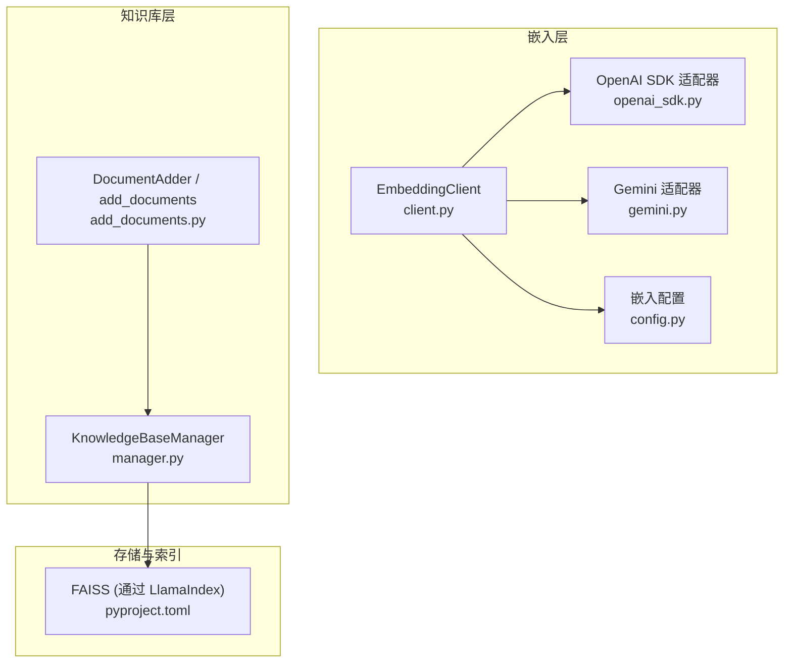
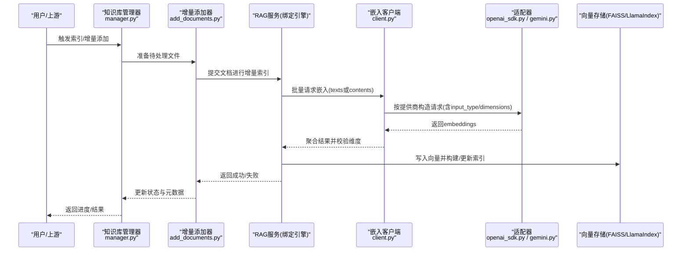
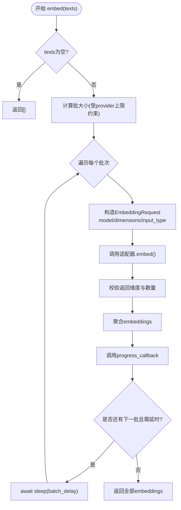
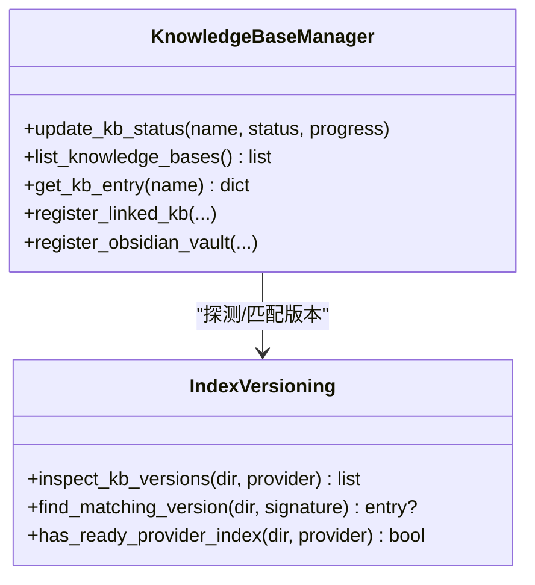
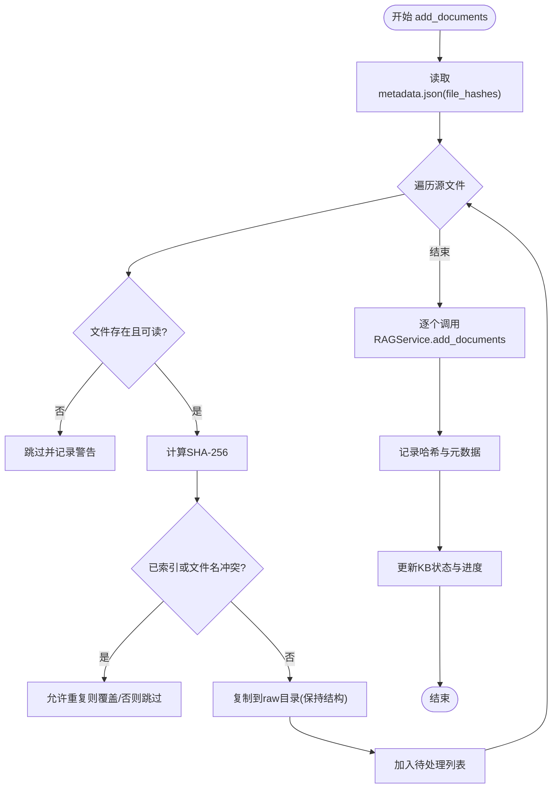
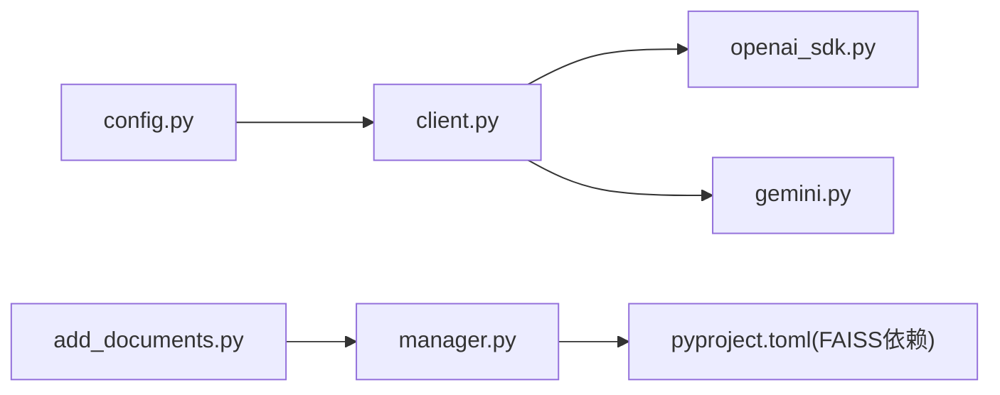

# 向量索引构建

<cite>
**本文引用的文件**
- [client.py](file://deeptutor/services/embedding/client.py)
- [config.py](file://deeptutor/services/embedding/config.py)
- [openai_sdk.py](file://deeptutor/services/embedding/adapters/openai_sdk.py)
- [gemini.py](file://deeptutor/services/embedding/adapters/gemini.py)
- [manager.py](file://deeptutor/knowledge/manager.py)
- [add_documents.py](file://deeptutor/knowledge/add_documents.py)
- [pyproject.toml](file://pyproject.toml)
</cite>

## 目录
1. [简介](#简介)
2. [项目结构](#项目结构)
3. [核心组件](#核心组件)
4. [架构总览](#架构总览)
5. [详细组件分析](#详细组件分析)
6. [依赖关系分析](#依赖关系分析)
7. [性能考虑](#性能考虑)
8. [故障排查指南](#故障排查指南)
9. [结论](#结论)
10. [附录](#附录)

## 简介
本文件面向DeepTutor的“向量索引构建”能力，系统性说明嵌入模型选择与配置、文本分块与向量化流程、向量存储与索引构建、多后端集成（OpenAI、Gemini、本地兼容等）、批量处理与并发控制、索引版本管理与增量更新策略，以及性能调优与监控指标。目标是帮助读者在大规模文档场景下高效、稳定地构建可检索的知识库索引。

## 项目结构
围绕向量索引构建的关键代码分布在以下模块：
- 嵌入客户端与适配器：统一接入多种嵌入服务，负责批处理、限流、维度校验与错误封装
- 知识库管理：负责KB生命周期、状态同步、索引版本探测与重索引标记
- 增量文档添加：将新文档安全入队、去重、调用RAG服务完成增量索引
- 依赖声明：显式引入FAISS等向量存储依赖，支持高性能近似最近邻检索

图表来源
- [client.py:37-169](file://deeptutor/services/embedding/client.py#L37-L169)
- [openai_sdk.py:27-156](file://deeptutor/services/embedding/adapters/openai_sdk.py#L27-L156)
- [gemini.py:28-368](file://deeptutor/services/embedding/adapters/gemini.py#L28-L368)
- [config.py:10-63](file://deeptutor/services/embedding/config.py#L10-L63)
- [manager.py:244-490](file://deeptutor/knowledge/manager.py#L244-L490)
- [add_documents.py:144-337](file://deeptutor/knowledge/add_documents.py#L144-L337)
- [pyproject.toml:41-71](file://pyproject.toml#L41-L71)

章节来源
- [client.py:37-169](file://deeptutor/services/embedding/client.py#L37-L169)
- [config.py:10-63](file://deeptutor/services/embedding/config.py#L10-L63)
- [manager.py:244-490](file://deeptutor/knowledge/manager.py#L244-L490)
- [add_documents.py:144-337](file://deeptutor/knowledge/add_documents.py#L144-L337)
- [pyproject.toml:41-71](file://pyproject.toml#L41-L71)

## 核心组件
- 嵌入客户端（EmbeddingClient）
  - 统一封装不同提供商的嵌入请求，自动按提供商上限裁剪批大小，逐批发送并聚合结果
  - 支持可选的输入类型（查询/文档），用于非对称检索（如Gemini Embedding 2）
  - 提供进度回调、批间延时、维度一致性校验与异常上下文记录
- 嵌入配置（EmbeddingConfig）
  - 从运行时解析器加载模型、端点、API Key、维度、超时、批大小与延时等参数
  - 强制校验必要字段，避免空配置导致失败
- 适配器（Adapters）
  - OpenAI SDK 适配器：基于官方AsyncOpenAI，支持dimensions透传与float编码格式
  - Gemini 适配器：原生批量接口与OpenAI兼容模式双通道，支持任务类型前缀与L2归一化
- 知识库管理器（KnowledgeBaseManager）
  - 维护KB元数据、状态、索引版本探测与重索引标记；与PocketBase同步状态
  - 根据当前嵌入指纹与磁盘版本匹配，决定是否需要重建索引
- 增量文档添加（DocumentAdder / add_documents）
  - 文件校验、去重、raw目录暂存、调用RAG服务完成增量索引，并持久化哈希与元数据

章节来源
- [client.py:37-169](file://deeptutor/services/embedding/client.py#L37-L169)
- [config.py:10-63](file://deeptutor/services/embedding/config.py#L10-L63)
- [openai_sdk.py:27-156](file://deeptutor/services/embedding/adapters/openai_sdk.py#L27-L156)
- [gemini.py:28-368](file://deeptutor/services/embedding/adapters/gemini.py#L28-L368)
- [manager.py:244-490](file://deeptutor/knowledge/manager.py#L244-L490)
- [add_documents.py:144-337](file://deeptutor/knowledge/add_documents.py#L144-L337)

## 架构总览
下图展示从文档到向量的端到端流程：文档进入知识库后，由RAG服务驱动分块与嵌入生成，最终写入向量存储并构建索引。

图表来源
- [add_documents.py:258-337](file://deeptutor/knowledge/add_documents.py#L258-L337)
- [client.py:70-169](file://deeptutor/services/embedding/client.py#L70-L169)
- [openai_sdk.py:65-146](file://deeptutor/services/embedding/adapters/openai_sdk.py#L65-L146)
- [gemini.py:166-341](file://deeptutor/services/embedding/adapters/gemini.py#L166-L341)
- [manager.py:381-490](file://deeptutor/knowledge/manager.py#L381-L490)

## 详细组件分析

### 嵌入客户端与适配器
- 批处理与限流
  - 自动按提供商最大项数裁剪batch_size，避免超限失败
  - 支持批间延时（batch_delay）规避速率限制
- 输入类型与维度
  - 对支持input_type的适配器传递search_query/search_document，提升检索质量
  - 维度不一致时抛出明确错误，提示使用单一模型/维度重建索引
- 错误与诊断
  - 捕获批次上下文（索引、chunk长度等）便于定位问题
  - 适配器统一包装为EmbeddingProviderError，包含状态码、URL、模型等信息

图表来源
- [client.py:70-169](file://deeptutor/services/embedding/client.py#L70-L169)

章节来源
- [client.py:70-169](file://deeptutor/services/embedding/client.py#L70-L169)
- [openai_sdk.py:65-146](file://deeptutor/services/embedding/adapters/openai_sdk.py#L65-L146)
- [gemini.py:166-341](file://deeptutor/services/embedding/adapters/gemini.py#L166-L341)

### 知识库管理与索引版本
- 版本探测与重索引标记
  - 扫描磁盘上的version-N目录与提供者索引，判断是否存在与当前嵌入签名匹配的可用版本
  - 若不匹配或无就绪版本，设置needs_reindex与embedding_mismatch标志，引导UI触发重建
- 状态同步与元数据
  - 更新KB状态（initializing/processing/ready/error），记录最后索引时间、动作与计数
  - 与PocketBase同步以支持管理面板可见性

图表来源
- [manager.py:117-241](file://deeptutor/knowledge/manager.py#L117-L241)
- [manager.py:381-490](file://deeptutor/knowledge/manager.py#L381-L490)

章节来源
- [manager.py:117-241](file://deeptutor/knowledge/manager.py#L117-L241)
- [manager.py:381-490](file://deeptutor/knowledge/manager.py#L381-L490)

### 增量文档添加与去重
- 文件校验与暂存
  - 校验存在性与类型，必要时复制到raw目录保持目录结构
  - 基于SHA-256与相对路径键去重，避免重复索引
- 增量索引与元数据更新
  - 调用RAG服务执行增量索引，成功后记录文件哈希与更新时间
  - 失败时收集错误并汇总，便于重试或人工干预

图表来源
- [add_documents.py:216-337](file://deeptutor/knowledge/add_documents.py#L216-L337)

章节来源
- [add_documents.py:216-337](file://deeptutor/knowledge/add_documents.py#L216-L337)

### 向量存储与索引构建
- 依赖与选型
  - 通过LlamaIndex集成FAISS作为向量存储，替代简单暴力搜索，提升大规模检索性能
- 构建方式
  - 默认由RAG服务内部完成分块、嵌入与索引写入；上层仅需触发索引/增量添加
  - 当检测到旧版rag_storage或需要切换提供商/模型时，会标记needs_reindex并重建

章节来源
- [pyproject.toml:41-71](file://pyproject.toml#L41-L71)
- [manager.py:284-337](file://deeptutor/knowledge/manager.py#L284-L337)

## 依赖关系分析
- 嵌入客户端依赖适配器与配置，适配器实现具体提供商协议
- 知识库管理器依赖RAG工厂与索引版本探测工具，协调状态与版本
- 增量添加器依赖RAG服务与文件路由，确保文件安全入队与去重
- 向量存储通过LlamaIndex抽象，底层可选择FAISS等高性能实现

图表来源
- [config.py:10-63](file://deeptutor/services/embedding/config.py#L10-L63)
- [client.py:37-169](file://deeptutor/services/embedding/client.py#L37-L169)
- [openai_sdk.py:27-156](file://deeptutor/services/embedding/adapters/openai_sdk.py#L27-L156)
- [gemini.py:28-368](file://deeptutor/services/embedding/adapters/gemini.py#L28-L368)
- [add_documents.py:144-337](file://deeptutor/knowledge/add_documents.py#L144-L337)
- [manager.py:244-490](file://deeptutor/knowledge/manager.py#L244-L490)
- [pyproject.toml:41-71](file://pyproject.toml#L41-L71)

章节来源
- [client.py:37-169](file://deeptutor/services/embedding/client.py#L37-L169)
- [manager.py:244-490](file://deeptutor/knowledge/manager.py#L244-L490)
- [add_documents.py:144-337](file://deeptutor/knowledge/add_documents.py#L144-L337)
- [pyproject.toml:41-71](file://pyproject.toml#L41-L71)

## 性能考虑
- 批大小与并发
  - 客户端自动按提供商上限裁剪batch_size，建议结合网络与配额调整batch_delay
  - 对于高吞吐场景，优先增大batch_size并在批间设置合理延时，避免触发429
- 内存与I/O
  - 大文档建议在RAG侧进行合理分块；避免单批过大导致内存峰值过高
  - 文件哈希计算与元数据写入采用线程/异步方式，减少阻塞事件循环
- 向量存储
  - 使用FAISS可显著降低大规模检索时的CPU开销；确保磁盘空间充足以容纳索引文件
- 监控指标建议
  - 每批耗时、成功率、平均向量维度、错误率（429/连接错误/JSON解析错误）
  - 增量索引的文件数、失败数、最后索引时间与动作

[本节为通用指导，无需特定文件引用]

## 故障排查指南
- 常见错误与定位
  - 提供商返回空向量或维度不一致：检查模型与维度配置，必要时重建索引
  - 429速率限制：增大batch_delay或降低并发；查看适配器重试与退避日志
  - JSON解析失败：确认提供商响应格式，检查代理/网关是否修改了响应体
- 日志与诊断
  - 嵌入客户端记录批次上下文（索引、chunk长度、模型、端点）
  - 适配器统一抛出EmbeddingProviderError，包含status_code、body、model、url、provider
- 知识库状态
  - 若出现needs_reindex或embedding_mismatch，检查当前嵌入指纹与磁盘版本是否匹配
  - 查看last_error与last_error_at定位最近失败原因

章节来源
- [client.py:113-169](file://deeptutor/services/embedding/client.py#L113-L169)
- [openai_sdk.py:86-146](file://deeptutor/services/embedding/adapters/openai_sdk.py#L86-L146)
- [gemini.py:208-341](file://deeptutor/services/embedding/adapters/gemini.py#L208-L341)
- [manager.py:117-241](file://deeptutor/knowledge/manager.py#L117-L241)
- [manager.py:381-490](file://deeptutor/knowledge/manager.py#L381-L490)

## 结论
DeepTutor的向量索引构建通过统一的嵌入客户端与多适配器设计，屏蔽了不同提供商差异，并提供批处理、限流、维度校验与错误诊断。知识库管理器负责版本探测与重索引决策，增量添加器保障文件安全入队与去重。配合FAISS等高性能向量存储，可在大规模文档场景下实现稳定高效的检索索引构建。建议在生产环境中结合监控指标持续优化批大小、延时与资源占用。

[本节为总结，无需特定文件引用]

## 附录
- 配置要点
  - 在设置中配置嵌入模型、端点、API Key与维度；确保effective_url与visible endpoint一致
  - 启用input_type（如Gemini Embedding 2）以提升检索质量
- 实际示例路径
  - 嵌入客户端初始化与批处理：[client.py:37-169](file://deeptutor/services/embedding/client.py#L37-L169)
  - 适配器实现（OpenAI/Gemini）：[openai_sdk.py:27-156](file://deeptutor/services/embedding/adapters/openai_sdk.py#L27-L156)、[gemini.py:28-368](file://deeptutor/services/embedding/adapters/gemini.py#L28-L368)
  - 知识库状态与版本管理：[manager.py:244-490](file://deeptutor/knowledge/manager.py#L244-L490)
  - 增量添加流程：[add_documents.py:216-337](file://deeptutor/knowledge/add_documents.py#L216-L337)
  - 向量存储依赖：[pyproject.toml:41-71](file://pyproject.toml#L41-L71)

[本节为参考指引，无需额外来源]