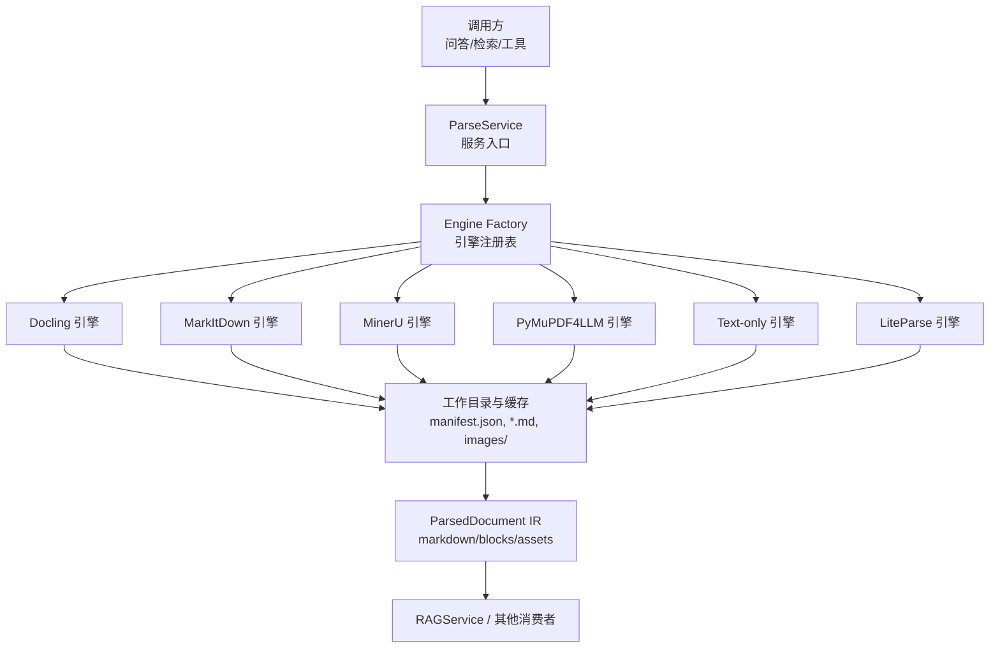
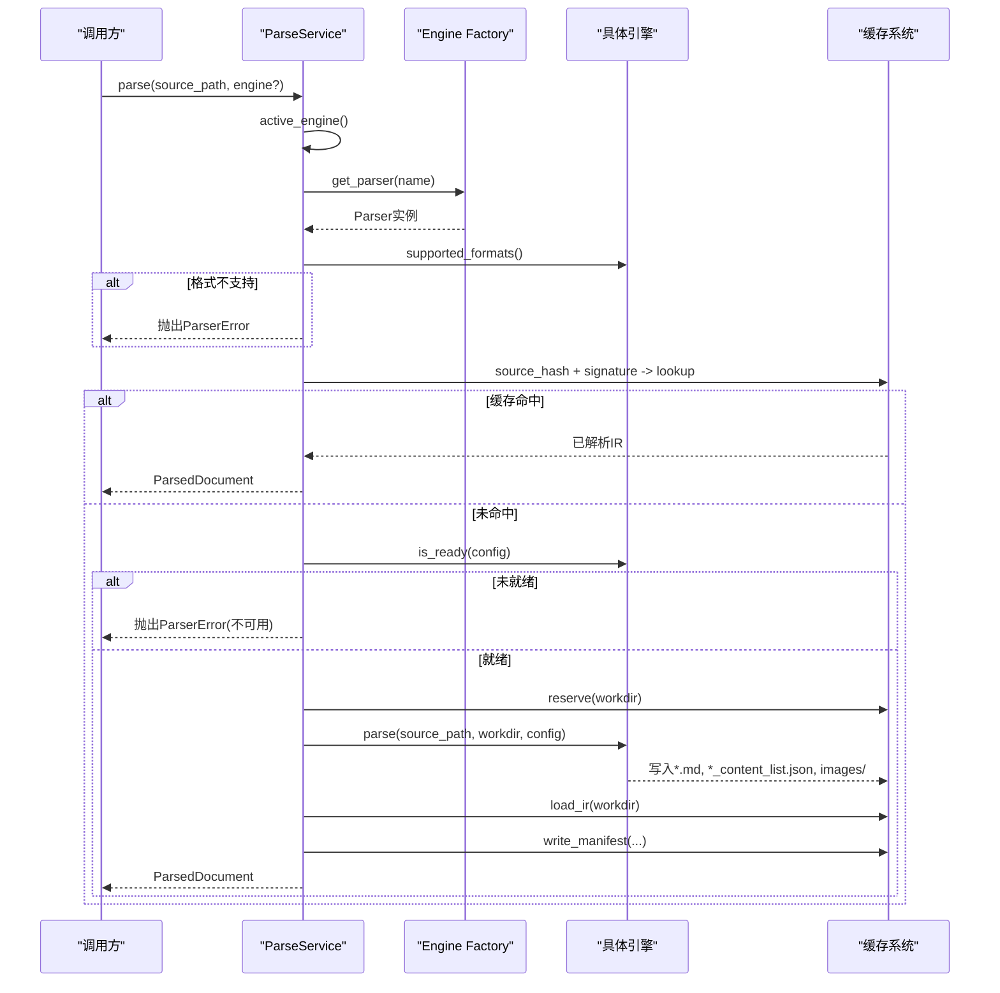
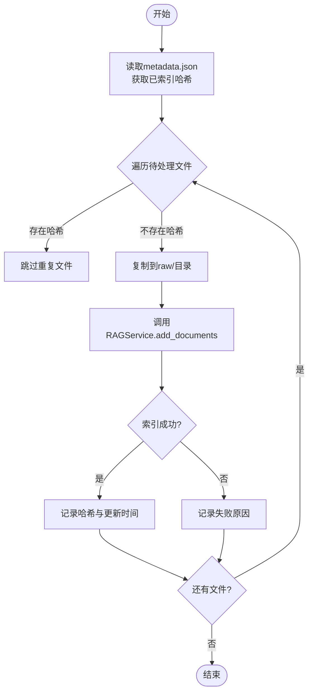
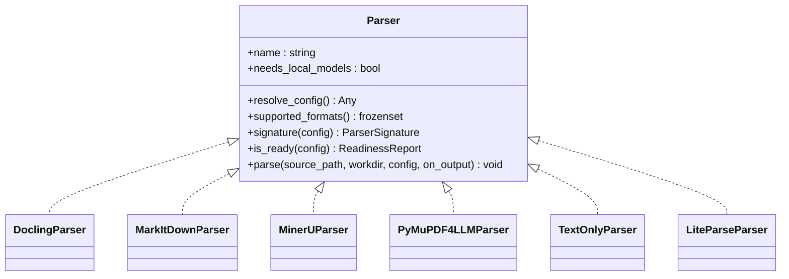

# 文档处理管道

<cite>
**本文引用的文件**
- [service.py](file://deeptutor/services/parsing/service.py)
- [base.py](file://deeptutor/services/parsing/base.py)
- [types.py](file://deeptutor/services/parsing/types.py)
- [cache.py](file://deeptutor/services/parsing/cache.py)
- [factory.py](file://deeptutor/services/parsing/engines/factory.py)
- [liteparse/engine.py](file://deeptutor/services/parsing/engines/liteparse/engine.py)
- [liteparse/config.py](file://deeptutor/services/parsing/engines/liteparse/config.py)
- [docling/engine.py](file://deeptutor/services/parsing/engines/docling/engine.py)
- [markitdown/engine.py](file://deeptutor/services/parsing/engines/markitdown/engine.py)
- [mineru/engine.py](file://deeptutor/services/parsing/engines/mineru/engine.py)
- [pymupdf4llm/engine.py](file://deeptutor/services/parsing/engines/pymupdf4llm/engine.py)
- [text_only/engine.py](file://deeptutor/services/parsing/engines/text_only/engine.py)
- [add_documents.py](file://deeptutor/knowledge/add_documents.py)
- [manager.py](file://deeptutor/knowledge/manager.py)
- [runtime_settings.py](file://deeptutor/services/config/runtime_settings.py)
- [pyproject.toml](file://pyproject.toml)
</cite>

## 更新摘要
**变更内容**
- 新增第六个文档解析引擎：LiteParse（由LlamaIndex开发）
- 更新了引擎注册表和配置系统
- 增强了多模态内容处理能力
- 优化了PDF处理和空间文本提取功能

## 目录
1. [简介](#简介)
2. [项目结构](#项目结构)
3. [核心组件](#核心组件)
4. [架构总览](#架构总览)
5. [详细组件分析](#详细组件分析)
6. [依赖关系分析](#依赖关系分析)
7. [性能考量](#性能考量)
8. [故障排除指南](#故障排除指南)
9. [结论](#结论)
10. [附录：配置与使用示例](#附录配置与使用示例)

## 简介
本文件系统性说明 DeepTutor 的文档处理管道，覆盖多引擎解析器的选择与配置、预处理流程（格式检测、内容提取、文本清洗、分块策略）、多模态内容处理（PDF、Word、Excel、PPT、图片等）、元数据提取与管理、去重与增量更新机制，以及性能优化与故障排除方法。文档面向不同技术背景的读者，提供从高层架构到代码级细节的分层说明，并辅以图示帮助理解。

**更新** 现已支持六个文档解析引擎，包括最新的LiteParse引擎，提供更快的PDF处理和空间文本提取能力。

## 项目结构
DeepTutor 将"文档解析"作为独立可插拔层，位于 services/parsing 下，通过统一接口暴露给上层能力（如问答抽取、RAG 索引）。解析结果以统一的中间表示（IR）输出，便于下游消费而不关心具体引擎实现。知识库管理在 knowledge 模块中负责文件的增量添加、去重与索引状态维护。

**图表来源**
- [service.py:1-144](file://deeptutor/services/parsing/service.py#L1-L144)
- [factory.py:1-168](file://deeptutor/services/parsing/engines/factory.py#L1-L168)
- [cache.py:1-193](file://deeptutor/services/parsing/cache.py#L1-L193)
- [types.py:1-53](file://deeptutor/services/parsing/types.py#L1-L53)

**章节来源**
- [service.py:1-144](file://deeptutor/services/parsing/service.py#L1-L144)
- [factory.py:1-168](file://deeptutor/services/parsing/engines/factory.py#L1-L168)
- [cache.py:1-193](file://deeptutor/services/parsing/cache.py#L1-L193)
- [types.py:1-53](file://deeptutor/services/parsing/types.py#L1-L53)

## 核心组件
- ParseService：解析服务的统一入口，负责选择引擎、计算内容地址化缓存键、命中缓存直接返回或执行解析并写入缓存。
- Parser 协议：所有引擎必须实现的接口，包括配置加载、支持格式、签名、就绪检查与解析过程。
- ParsedDocument：引擎无关的统一结果结构，包含 markdown、可选的结构化 blocks、资源目录及元信息。
- 引擎工厂：按名称懒加载具体引擎类，并提供可用性与列表能力。
- 缓存系统：基于源文件哈希与引擎签名的内容地址化缓存，避免重复解析。

**章节来源**
- [service.py:28-144](file://deeptutor/services/parsing/service.py#L28-L144)
- [base.py:19-79](file://deeptutor/services/parsing/base.py#L19-L79)
- [types.py:16-53](file://deeptutor/services/parsing/types.py#L16-L53)
- [factory.py:55-168](file://deeptutor/services/parsing/engines/factory.py#L55-L168)
- [cache.py:36-193](file://deeptutor/services/parsing/cache.py#L36-L193)

## 架构总览
下图展示从请求到解析结果的完整调用链，包括缓存命中、引擎就绪检查、解析产物写入与 IR 组装。

**图表来源**
- [service.py:48-129](file://deeptutor/services/parsing/service.py#L48-L129)
- [cache.py:54-81](file://deeptutor/services/parsing/cache.py#L54-L81)
- [base.py:56-76](file://deeptutor/services/parsing/base.py#L56-L76)

## 详细组件分析

### 多引擎解析器：选择与配置
- 引擎注册与可用性
  - 通过工厂按名称获取引擎；每个引擎模块内部懒加载第三方依赖，确保导入成本低且不会因缺失可选依赖而失败。
  - 提供 list_engines 用于设置界面展示，包含是否需要本地模型、描述与可用性。
- 各引擎特点与适用场景
  - **Docling**：结构化文档转换（布局/表格），首次运行下载本地模型；支持 PDF/Office/HTML/图片。
  - **MarkItDown**：轻量、无需模型下载，广泛格式支持，输出 Markdown。
  - **MinerU**：高保真多模态解析（布局、表格、公式），本地 CLI 需下载模型或使用托管云 API；当前主要面向 PDF。
  - **PyMuPDF4LLM**：轻量、无需模型/CUDA，适合低端设备；PDF/e-book → Markdown，可提取图片。
  - **Text-only**：内置纯文本提取，无可选包、无模型下载、无布局结构。
  - **LiteParse** ⭐ **新增**：快速、轻量级的PDF解析器，具有空间文本提取功能，支持Markdown输出和可选图片提取，无需模型下载，由LlamaIndex开发。

**更新** LiteParse引擎提供了更快的PDF处理速度和更好的空间文本提取能力，特别适合需要高性能PDF处理的场景。

**章节来源**
- [factory.py:55-168](file://deeptutor/services/parsing/engines/factory.py#L55-L168)
- [service.py:43-78](file://deeptutor/services/parsing/service.py#L43-L78)
- [base.py:44-58](file://deeptutor/services/parsing/base.py#L44-L58)

### LiteParse引擎详解
LiteParse是一个由LlamaIndex开发的Rust后端PDF解析器，具有以下特点：

- **高性能**：基于Rust实现，提供快速的PDF解析速度
- **空间文本提取**：能够保留文本在页面中的空间位置信息
- **多格式支持**：支持PDF、DOCX、PPTX、XLSX以及多种图片格式（PNG、JPG、JPEG、GIF、WebP）
- **灵活的图片处理**：支持三种图片模式（off、placeholder、embed）
- **无模型依赖**：无需下载任何模型权重，开箱即用
- **可配置性**：支持链接提取、图片提取、最大页数限制等配置选项

**章节来源**
- [liteparse/engine.py:1-146](file://deeptutor/services/parsing/engines/liteparse/engine.py#L1-L146)
- [liteparse/config.py:1-66](file://deeptutor/services/parsing/engines/liteparse/config.py#L1-L66)

### 文档预处理流程：格式检测、内容提取、文本清洗、分块策略
- 格式检测
  - 引擎声明支持的扩展名集合；ParseService 根据文件后缀判断是否由该引擎处理，否则抛出错误提示切换引擎。
- 内容提取
  - 引擎将输入文件解析为 Markdown 与可选的结构化 blocks（例如 MinerU 的 content_list），同时可能产出 images/ 资源目录。
- 文本清洗
  - 解析阶段由引擎完成；缓存加载时会对 blocks 中的相对图片路径进行绝对化修正，保证跨目录可访问性。
- 分块策略
  - 解析层不强制分块；下游消费者（如 RAG 索引）根据需求对 markdown 或 blocks 进行分块。对于仅有 markdown 的情况，优先按段落/标题等语义切分；对于有 blocks 的情况，优先保留结构化单元再按需合并。

**章节来源**
- [service.py:70-76](file://deeptutor/services/parsing/service.py#L70-L76)
- [cache.py:126-178](file://deeptutor/services/parsing/cache.py#L126-L178)
- [types.py:23-53](file://deeptutor/services/parsing/types.py#L23-L53)

### 多模态内容处理：PDF、Word、Excel、PPT、图片
- 支持范围
  - 各引擎声明各自支持的格式；例如 Docling 支持 PDF/Office/HTML/图片，MarkItDown 广泛格式，PyMuPDF4LLM 专注 PDF/e-book，MinerU 侧重 PDF，**LiteParse 支持 PDF/Office/图片**。
- 资源处理
  - 引擎可将图片等资源输出到 images/ 目录；缓存加载时识别并返回 asset_dir，供后续渲染或索引使用。
- 结构化内容
  - 具备 blocks 的引擎（如 MinerU）可直接传递结构化片段；不具备 blocks 的引擎则回退到 markdown 分块。

**更新** LiteParse引擎增强了对Office格式和图片格式的支持，提供了更全面的文档处理能力。

**章节来源**
- [factory.py:67-125](file://deeptutor/services/parsing/engines/factory.py#L67-L125)
- [cache.py:93-178](file://deeptutor/services/parsing/cache.py#L93-L178)
- [types.py:23-53](file://deeptutor/services/parsing/types.py#L23-L53)

### 文档元数据的提取与管理
- 解析产物元数据
  - 缓存 manifest.json 记录引擎、签名、源文件哈希、源文件名与创建时间；便于追踪解析来源与版本。
- 知识库元数据
  - 知识库 metadata.json 维护 file_hashes、rag_provider、last_updated、update_history 等字段；用于去重、增量更新与审计。
- 知识基线状态
  - KnowledgeBaseManager 维护 kb_config.json，记录 KB 的状态、最后索引时间与动作、嵌入指纹与版本信息等。

**章节来源**
- [cache.py:73-81](file://deeptutor/services/parsing/cache.py#L73-L81)
- [add_documents.py:82-141](file://deeptutor/knowledge/add_documents.py#L82-L141)
- [manager.py:381-489](file://deeptutor/knowledge/manager.py#L381-L489)

### 文档去重与增量更新机制
- 去重策略
  - 基于文件内容的 SHA256 哈希；若哈希已存在于 metadata.json 的 file_hashes 中，则跳过重复文件（除非显式允许重复）。
- 增量索引
  - DocumentAdder 将新文件暂存至 raw/ 目录，并通过 RAGService 逐个文件索引；成功索引后记录哈希与更新时间，更新 update_history。
- 删除与清理
  - remove_raw_document 删除原始文件并从 file_hashes 移除对应记录；若之前已索引，后续重新索引会清理向量。

**图表来源**
- [add_documents.py:199-336](file://deeptutor/knowledge/add_documents.py#L199-L336)
- [add_documents.py:216-297](file://deeptutor/knowledge/add_documents.py#L216-L297)

**章节来源**
- [add_documents.py:199-336](file://deeptutor/knowledge/add_documents.py#L199-L336)
- [add_documents.py:216-297](file://deeptutor/knowledge/add_documents.py#L216-L297)

### 引擎类图（代码级关系）

**更新** 新增了LiteParseParser类，实现了标准的Parser接口。

**图表来源**
- [base.py:30-79](file://deeptutor/services/parsing/base.py#L30-L79)
- [liteparse/engine.py:40-146](file://deeptutor/services/parsing/engines/liteparse/engine.py#L40-L146)
- [docling/engine.py](file://deeptutor/services/parsing/engines/docling/engine.py)
- [markitdown/engine.py](file://deeptutor/services/parsing/engines/markitdown/engine.py)
- [mineru/engine.py](file://deeptutor/services/parsing/engines/mineru/engine.py)
- [pymupdf4llm/engine.py](file://deeptutor/services/parsing/engines/pymupdf4llm/engine.py)
- [text_only/engine.py](file://deeptutor/services/parsing/engines/text_only/engine.py)

## 依赖关系分析
- 可选依赖与安装
  - pyproject.toml 定义了可选的解析特性：parse-markitdown、parse-docling、parse-pymupdf4llm、**parse-liteparse**；默认核心依赖包含 PyMuPDF、python-docx、openpyxl、python-pptx、pypdf、pdfplumber 等。
  - MinerU 作为外部 CLI/托管 API，非 pip 依赖；LightRAG（含 MinerU 透传）为可选重型依赖，受 Python 版本限制。
  - **LiteParse** 作为编译的Rust扩展包，版本锁定在 >=2.11.1,<3.0，以确保API稳定性。
- 运行时懒加载
  - 引擎模块在工厂中通过函数延迟导入，避免启动时加载重型依赖；仅在需要时引入具体引擎。

**更新** 新增了LiteParse的依赖配置，包括版本锁定和安装说明。

**章节来源**
- [pyproject.toml:40-239](file://pyproject.toml#L40-L239)
- [runtime_settings.py:69-200](file://deeptutor/services/config/runtime_settings.py#L69-L200)
- [factory.py:25-70](file://deeptutor/services/parsing/engines/factory.py#L25-L70)

## 性能考量
- 内容地址化缓存
  - 基于源文件哈希与引擎签名的缓存键，避免重复解析；同一字节流在不同引擎/配置下产生不同签名，确保隔离。
- 懒加载与最小依赖
  - 引擎模块按需导入，减少启动开销；UI 可通过 list_engines 快速列出可用引擎而不触发重型依赖。
- 并发与事件循环友好
  - 哈希计算与文件 IO 尽量放在线程池中执行，避免阻塞事件循环；索引过程中进度更新与后台任务分离。
- 资源占用控制
  - PyMuPDF4LLM 适合低配环境；MinerU/Docling 本地模式需模型下载，建议按需启用；Cloud 后端可规避本地资源压力。
  - **LiteParse** 作为Rust后端解析器，提供了出色的性能和内存效率，特别适合大规模PDF处理场景。

**更新** LiteParse引擎的性能优势使其成为处理大量PDF文档的理想选择。

[本节为通用指导，不直接分析具体文件]

## 故障排除指南
- 常见错误与定位
  - 引擎不可用：is_ready 返回未就绪，通常由于本地模型未下载或未配置云 API；请检查设置并下载所需模型或配置云端凭据。
  - 格式不支持：engine.supported_formats 不包含目标后缀；请在设置中切换到支持该格式的引擎。
  - 解析结果为空：引擎未产出任何 markdown/blocks；检查源文件有效性或尝试其他引擎。
  - 图片路径问题：blocks 中的相对 img_path 在加载时被绝对化；若仍无法访问，确认 images/ 目录与内容目录一致。
  - **LiteParse特定问题**：如果LiteParse不可用，检查是否正确安装了 `pip install deeptutor[parse-liteparse]`。
- 日志与诊断
  - 关注解析服务与缓存系统的日志输出；缓存失败时会清理未完成目录，避免脏数据影响后续重试。
- 恢复步骤
  - 清除缓存目录中无 manifest 的残留目录；重新触发解析。
  - 对知识库进行重新索引以修复向量不一致或嵌入版本不匹配。

**更新** 新增了LiteParse相关的故障排除指南。

**章节来源**
- [service.py:96-129](file://deeptutor/services/parsing/service.py#L96-L129)
- [cache.py:84-90](file://deeptutor/services/parsing/cache.py#L84-L90)
- [cache.py:126-178](file://deeptutor/services/parsing/cache.py#L126-L178)

## 结论
DeepTutor 的文档处理管道通过统一的解析接口与缓存机制，将多种引擎的能力抽象为一致的中间表示，既保证了可扩展性，又提升了稳定性与性能。**新增的LiteParse引擎进一步增强了系统的PDF处理能力，提供了更快的解析速度和更好的空间文本提取功能。**结合知识库的去重与增量更新，系统能够高效处理大规模文档集，并为上层问答与检索提供可靠的数据基础。

**更新** 六个解析引擎的协同工作为用户提供了灵活的文档处理选择，满足不同场景下的性能和质量需求。

[本节为总结性内容，不直接分析具体文件]

## 附录：配置与使用示例
- 选择与切换引擎
  - 在设置中选择目标引擎（Docling、MarkItDown、MinerU、PyMuPDF4LLM、Text-only、**LiteParse**），系统会在解析时自动加载相应配置并校验就绪状态。
- 解析调用示例
  - 通过 ParseService.parse 传入源文件路径与可选引擎名；若命中缓存则直接返回 ParsedDocument，否则执行解析并写入缓存。
- 增量添加文档
  - 使用 add_documents 将文件加入知识库；系统会自动去重、暂存、索引并更新元数据。
- 多模态资源使用
  - 若引擎产出了 images/ 目录，可在后续渲染或索引中使用 asset_dir；结构化 blocks 可用于更精细的分块与检索。
- **LiteParse配置示例**
  - 图片模式：`image_mode` 支持 "off"、"placeholder"、"embed" 三种模式
  - 链接提取：`extract_links` 控制是否提取超链接
  - 图片提取：`extract_images` 控制是否提取嵌入式图片
  - 页数限制：`max_pages` 限制解析的最大页数（0表示全文档）

**更新** 新增了LiteParse引擎的配置选项和使用示例。

**章节来源**
- [service.py:48-129](file://deeptutor/services/parsing/service.py#L48-L129)
- [add_documents.py:216-336](file://deeptutor/knowledge/add_documents.py#L216-L336)
- [cache.py:151-178](file://deeptutor/services/parsing/cache.py#L151-L178)
- [liteparse/config.py:14-66](file://deeptutor/services/parsing/engines/liteparse/config.py#L14-L66)