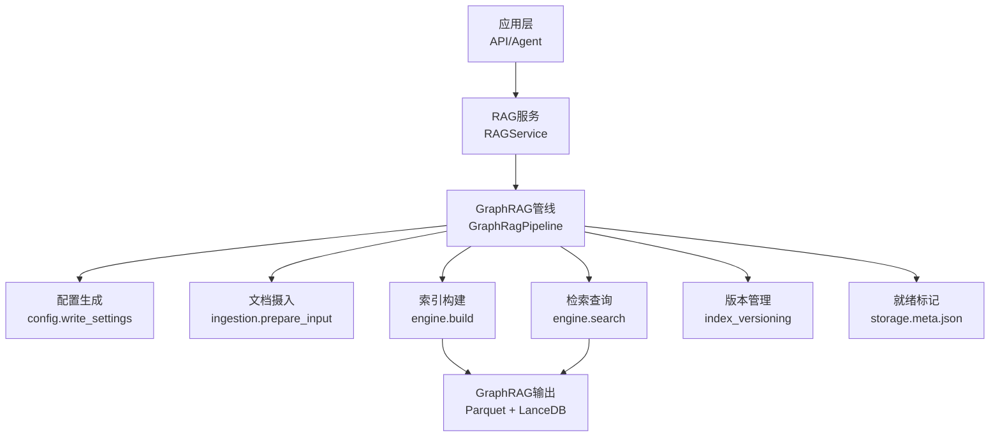
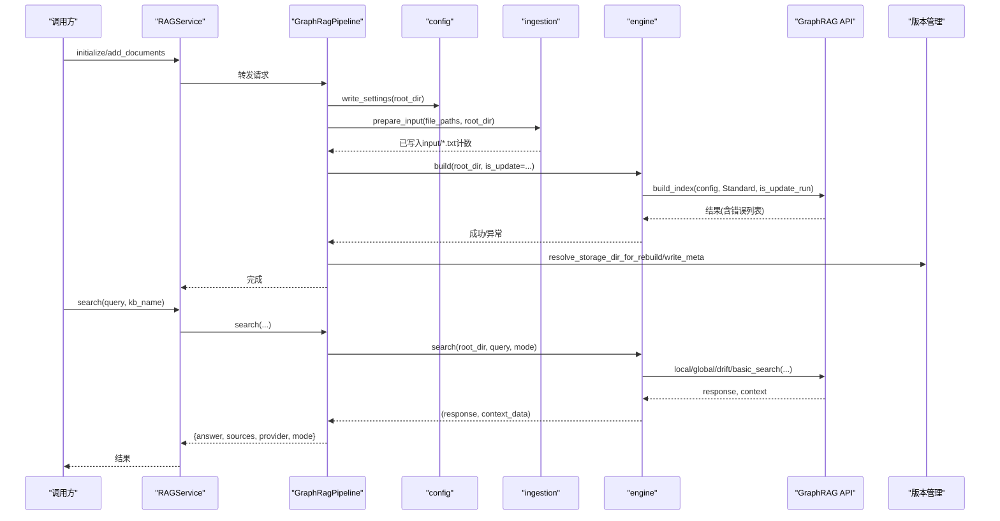
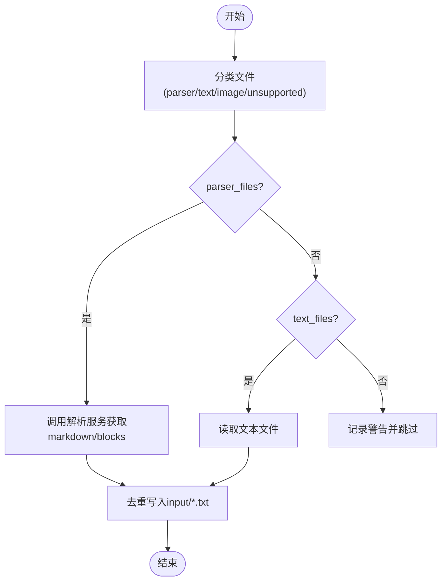
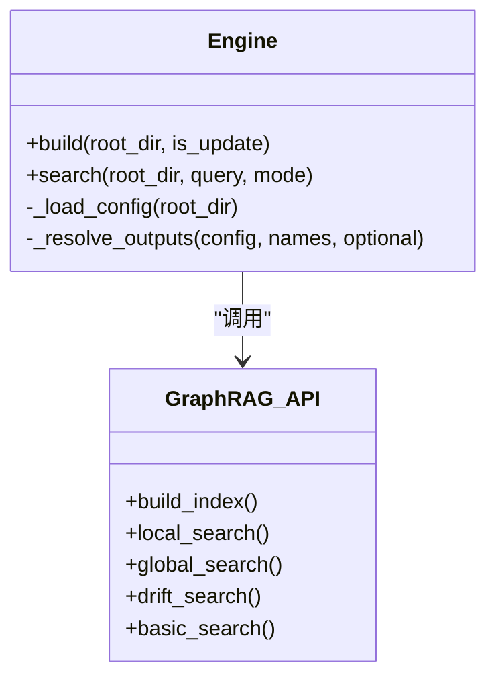
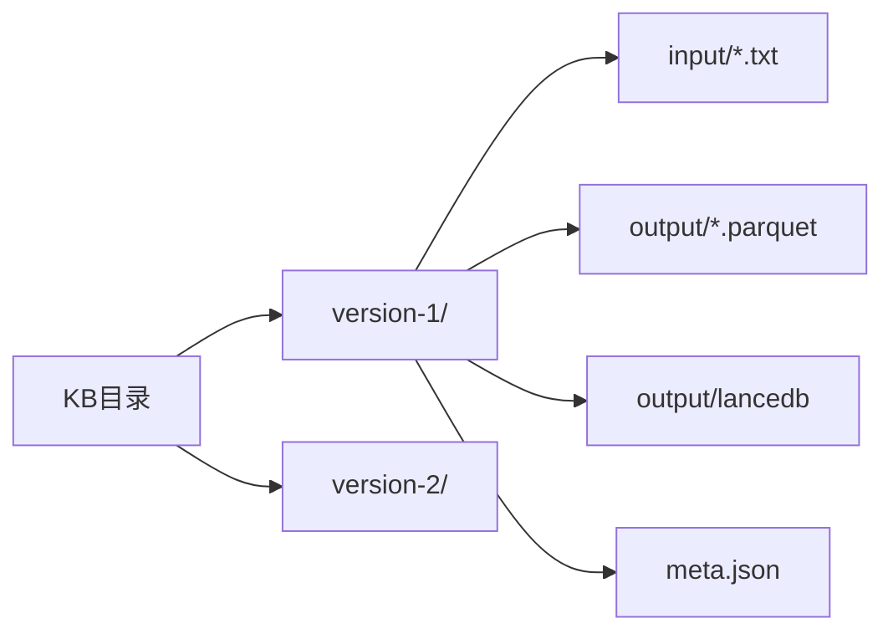
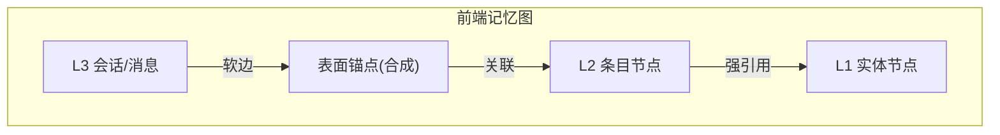
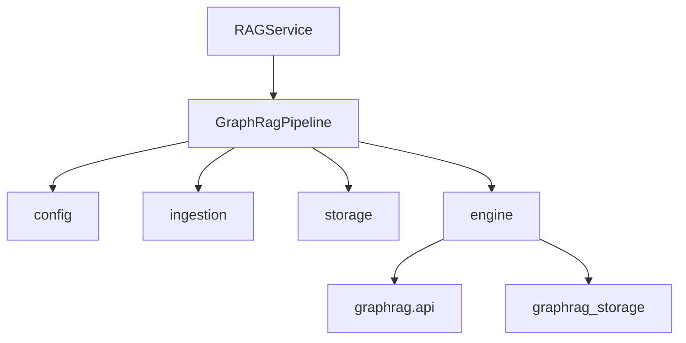

# GraphRAG引擎

<cite>
**本文引用的文件**
- [engine.py](file://deeptutor/services/rag/pipelines/graphrag/engine.py)
- [pipeline.py](file://deeptutor/services/rag/pipelines/graphrag/pipeline.py)
- [config.py](file://deeptutor/services/rag/pipelines/graphrag/config.py)
- [ingestion.py](file://deeptutor/services/rag/pipelines/graphrag/ingestion.py)
- [storage.py](file://deeptutor/services/rag/pipelines/graphrag/storage.py)
- [service.py](file://deeptutor/services/rag/service.py)
- [index_versioning.py](file://deeptutor/services/rag/index_versioning.py)
- [manager.py](file://deeptutor/knowledge/manager.py)
- [knowledge.py](file://deeptutor/api/routers/knowledge.py)
- [document_loader.py](file://deeptutor/services/rag/pipelines/llamaindex/document_loader.py)
- [memory-graph.ts](file://web/lib/memory-graph.ts)
</cite>

## 目录
1. [简介](#简介)
2. [项目结构](#项目结构)
3. [核心组件](#核心组件)
4. [架构总览](#架构总览)
5. [详细组件分析](#详细组件分析)
6. [依赖关系分析](#依赖关系分析)
7. [性能考虑](#性能考虑)
8. [故障排查指南](#故障排查指南)
9. [结论](#结论)
10. [附录](#附录)

## 简介
本文件面向DeepTutor中的GraphRAG检索引擎，系统性说明其知识图谱构建与图遍历检索的实现方式。内容涵盖：
- 文本解析、实体识别、关系抽取与图谱构建的端到端流程（由外部GraphRAG库完成，DeepTutor负责输入准备与配置）
- 图存储结构与索引策略（Parquet表、LanceDB向量存储、版本化目录布局）
- 查询模式与复杂查询优化（local/global/drift/basic四种模式，社区级别、响应类型等）
- 增量更新、版本管理与冲突规避（版本目录、元数据标记、失败清理）
- 可视化与分析工具对接（前端记忆图谱渲染）
- 性能优化建议（缓存、分区、索引、并发隔离）

## 项目结构
GraphRAG在DeepTutor中以“可选依赖”的方式集成，位于services/rag/pipelines/graphrag目录，围绕以下职责划分：
- 配置生成：将DeepTutor的LLM/Embedding配置转换为GraphRAG所需的settings.yaml
- 文档摄入：将多格式文档解析为纯文本，写入input/*.txt供GraphRAG消费
- 索引构建：调用GraphRAG API执行标准索引流程，输出Parquet与LanceDB
- 检索查询：按模式加载所需表并调用对应API返回答案与上下文
- 存储与版本：维护version-N扁平目录、meta.json就绪标记、输出表检测
- 服务编排：统一RAG服务路由到具体Provider（GraphRAG/LlamaIndex/LightRAG等）

**图表来源**
- [pipeline.py:73-133](file://deeptutor/services/rag/pipelines/graphrag/pipeline.py#L73-L133)
- [engine.py:84-107](file://deeptutor/services/rag/pipelines/graphrag/engine.py#L84-L107)
- [engine.py:128-195](file://deeptutor/services/rag/pipelines/graphrag/engine.py#L128-L195)
- [config.py:116-192](file://deeptutor/services/rag/pipelines/graphrag/config.py#L116-L192)
- [ingestion.py:60-99](file://deeptutor/services/rag/pipelines/graphrag/ingestion.py#L60-L99)
- [storage.py:47-85](file://deeptutor/services/rag/pipelines/graphrag/storage.py#L47-L85)
- [index_versioning.py:280-326](file://deeptutor/services/rag/index_versioning.py#L280-L326)

**章节来源**
- [pipeline.py:1-227](file://deeptutor/services/rag/pipelines/graphrag/pipeline.py#L1-L227)
- [engine.py:1-199](file://deeptutor/services/rag/pipelines/graphrag/engine.py#L1-L199)
- [config.py:1-223](file://deeptutor/services/rag/pipelines/graphrag/config.py#L1-L223)
- [ingestion.py:1-113](file://deeptutor/services/rag/pipelines/graphrag/ingestion.py#L1-L113)
- [storage.py:1-99](file://deeptutor/services/rag/pipelines/graphrag/storage.py#L1-L99)
- [index_versioning.py:1-327](file://deeptutor/services/rag/index_versioning.py#L1-L327)

## 核心组件
- GraphRagPipeline：对外暴露initialize/add_documents/search/delete，协调配置、摄入、构建与检索
- engine：封装GraphRAG API调用，支持本地事件循环隔离、模式选择、上下文格式化
- config：生成settings.yaml，注入模型、存储、缓存、向量维度等关键参数
- ingestion：将多格式文件解析为纯文本，去重写入input/*.txt
- storage：定义KB磁盘布局、输出表清单、就绪标记
- RAGService：统一入口，按KB绑定选择Provider并路由到GraphRagPipeline
- index_versioning：提供版本化目录读写、匹配最新可用版本、重建安全路径

**章节来源**
- [pipeline.py:36-133](file://deeptutor/services/rag/pipelines/graphrag/pipeline.py#L36-L133)
- [engine.py:48-107](file://deeptutor/services/rag/pipelines/graphrag/engine.py#L48-L107)
- [config.py:34-44](file://deeptutor/services/rag/pipelines/graphrag/config.py#L34-L44)
- [ingestion.py:27-99](file://deeptutor/services/rag/pipelines/graphrag/ingestion.py#L27-L99)
- [storage.py:30-85](file://deeptutor/services/rag/pipelines/graphrag/storage.py#L30-L85)
- [service.py:23-82](file://deeptutor/services/rag/service.py#L23-L82)
- [index_versioning.py:168-326](file://deeptutor/services/rag/index_versioning.py#L168-L326)

## 架构总览
GraphRAG在DeepTutor中作为可选Provider接入，整体数据流如下：
- 初始化/新增文档：解析→写input/*.txt→写settings.yaml→调用GraphRAG build_index→产出output/*.parquet与LanceDB→写meta.json标记就绪
- 检索：根据KB模式选择local/global/drift/basic→加载对应Parquet表→调用对应search API→格式化上下文→返回答案与来源

**图表来源**
- [service.py:68-110](file://deeptutor/services/rag/service.py#L68-L110)
- [pipeline.py:73-133](file://deeptutor/services/rag/pipelines/graphrag/pipeline.py#L73-L133)
- [engine.py:84-107](file://deeptutor/services/rag/pipelines/graphrag/engine.py#L84-L107)
- [engine.py:128-195](file://deeptutor/services/rag/pipelines/graphrag/engine.py#L128-L195)
- [index_versioning.py:300-326](file://deeptutor/services/rag/index_versioning.py#L300-L326)

## 详细组件分析

### 文档摄入与文本解析
- 目标：将多格式文件转为GraphRAG可消费的纯文本，避免引入额外解析器
- 流程：
  - 使用FileTypeRouter分类文件（parser_files/text_files/image_files/unsupported）
  - parser_files通过共享解析服务提取markdown或blocks拼接文本
  - text_files直接读取文本；image_files与unsupported记录警告并跳过
  - 去重写入target_dir/input/*.txt，空文档跳过
- 兼容性与容错：解析失败记录日志并跳过，不中断批次

**图表来源**
- [ingestion.py:60-99](file://deeptutor/services/rag/pipelines/graphrag/ingestion.py#L60-L99)
- [ingestion.py:39-57](file://deeptutor/services/rag/pipelines/graphrag/ingestion.py#L39-L57)

**章节来源**
- [ingestion.py:1-113](file://deeptutor/services/rag/pipelines/graphrag/ingestion.py#L1-L113)
- [document_loader.py:95-125](file://deeptutor/services/rag/pipelines/llamaindex/document_loader.py#L95-L125)

### 配置生成与模型注入
- 目标：将DeepTutor运行时LLM/Embedding配置转换为GraphRAG settings.yaml
- 关键点：
  - 命名默认模型ID，使工作流/搜索自动绑定
  - 通过LiteLLM以openai provider指向任意OpenAI兼容端点
  - 设置input类型为text，仅消费*.txt
  - 设置output_storage、cache、reporting、vector_store（lancedb+维度）
- 校验：缺失chat/embedding模型或未知维度时抛出未配置错误

**章节来源**
- [config.py:116-192](file://deeptutor/services/rag/pipelines/graphrag/config.py#L116-L192)
- [config.py:195-205](file://deeptutor/services/rag/pipelines/graphrag/config.py#L195-L205)

### 索引构建与图遍历算法
- 构建：调用GraphRAG build_index(Standard)，is_update_run控制是否增量
- 图遍历：由GraphRAG内部实现，DeepTutor通过不同search API触发：
  - local_search：实体为中心，结合社区报告、文本单元、关系
  - global_search：全局社区聚合，适合宏观问题
  - drift_search：结合时间漂移的检索增强
  - basic_search：仅基于文本单元的基础检索
- 上下文：统一通过reformat_context_data标准化reports/entities/relationships/sources等

**图表来源**
- [engine.py:84-107](file://deeptutor/services/rag/pipelines/graphrag/engine.py#L84-L107)
- [engine.py:128-195](file://deeptutor/services/rag/pipelines/graphrag/engine.py#L128-L195)

**章节来源**
- [engine.py:1-199](file://deeptutor/services/rag/pipelines/graphrag/engine.py#L1-L199)

### 图存储结构与索引策略
- 目录布局：
  - version-N/：GraphRAG项目根，包含settings.yaml、input/output/cache/logs/meta.json
  - output/*.parquet：entities、communities、community_reports、text_units、relationships
  - output/lancedb：向量存储，维度来自embedding配置
- 就绪判定：存在任一核心Parquet表即视为有输出；meta.json用于UI快速识别
- 版本管理：
  - 扁平version-N优先，兼容旧嵌套/root布局
  - 读路径：优先最新ready flat版本，否则回退legacy
  - 写路径：始终写入新flat版本，避免覆盖进行中索引

**图表来源**
- [storage.py:1-18](file://deeptutor/services/rag/pipelines/graphrag/storage.py#L1-L18)
- [storage.py:36-85](file://deeptutor/services/rag/pipelines/graphrag/storage.py#L36-L85)
- [index_versioning.py:168-326](file://deeptutor/services/rag/index_versioning.py#L168-L326)

**章节来源**
- [storage.py:1-99](file://deeptutor/services/rag/pipelines/graphrag/storage.py#L1-L99)
- [index_versioning.py:1-327](file://deeptutor/services/rag/index_versioning.py#L1-L327)

### 查询语言支持与复杂查询优化
- 查询模式：
  - local：默认，实体中心，兼顾社区与关系，成本较低
  - global：全局社区聚合，适合宏观综述
  - drift：结合时间漂移，适合时序敏感场景
  - basic：仅文本单元，最轻量
- 优化要点：
  - 通过OUTPUTS_BY_MODE按需加载Parquet表，减少IO
  - 社区级别与动态社区选择可调
  - 响应类型可配置，平衡可读性与信息密度
  - 事件循环隔离避免uvloop冲突，提升稳定性

**章节来源**
- [engine.py:30-42](file://deeptutor/services/rag/pipelines/graphrag/engine.py#L30-L42)
- [engine.py:137-195](file://deeptutor/services/rag/pipelines/graphrag/engine.py#L137-L195)
- [config.py:78-99](file://deeptutor/services/rag/pipelines/graphrag/config.py#L78-L99)

### 图谱更新机制：增量、版本与冲突解决
- 增量更新：is_update_run=True时复用现有版本目录，追加新文档
- 版本管理：每次全量重建创建新的version-N；read路径优先latest ready flat
- 冲突解决：
  - 失败重建会清理未完成版本目录，保留旧版本可诊断
  - 连接型KB（Obsidian/Linked）只读，禁止写入与重索引
  - 嵌入签名不一致时标记needs_reindex与embedding_mismatch，引导用户重建

**章节来源**
- [pipeline.py:97-133](file://deeptutor/services/rag/pipelines/graphrag/pipeline.py#L97-L133)
- [index_versioning.py:300-326](file://deeptutor/services/rag/index_versioning.py#L300-L326)
- [manager.py:128-241](file://deeptutor/knowledge/manager.py#L128-L241)
- [knowledge.py:695-720](file://deeptutor/api/routers/knowledge.py#L695-L720)

### 可视化与分析工具
- 前端记忆图谱：将L1实体、L2/L3条目组织为层级节点，建立强/软边关系，支持簇内布局与悬停高亮
- 与GraphRAG的关系：GraphRAG提供实体/关系/社区报告等上下文；前端将其映射为可视化的图结构

**图表来源**
- [memory-graph.ts:539-617](file://web/lib/memory-graph.ts#L539-L617)

**章节来源**
- [memory-graph.ts:539-617](file://web/lib/memory-graph.ts#L539-L617)

## 依赖关系分析
- 模块耦合：
  - pipeline依赖config/ingestion/storage/engine，解耦GraphRAG版本差异
  - engine仅在调用时导入graphrag，降低启动开销
  - service统一路由，屏蔽Provider差异
- 外部依赖：
  - graphrag（可选），graphrag_storage（Parquet/LanceDB）
  - LiteLLM通过openai provider访问任意兼容端点
- 潜在循环：无直接循环导入；所有重型依赖延迟加载

**图表来源**
- [pipeline.py:21-30](file://deeptutor/services/rag/pipelines/graphrag/pipeline.py#L21-L30)
- [engine.py:1-10](file://deeptutor/services/rag/pipelines/graphrag/engine.py#L1-L10)
- [service.py:17-18](file://deeptutor/services/rag/service.py#L17-L18)

**章节来源**
- [pipeline.py:1-227](file://deeptutor/services/rag/pipelines/graphrag/pipeline.py#L1-L227)
- [engine.py:1-199](file://deeptutor/services/rag/pipelines/graphrag/engine.py#L1-L199)
- [service.py:1-324](file://deeptutor/services/rag/service.py#L1-L324)

## 性能考虑
- 事件循环隔离：在独立线程中运行GraphRAG，避免uvloop冲突导致的崩溃
- 按需加载表：按模式仅加载必要Parquet表，减少IO与内存占用
- 向量维度对齐：确保vector_store.vector_size与实际embedding维度一致，避免静默失败
- 缓存与日志：启用json缓存与文件日志，便于定位慢查询与重复计算
- 版本化重建：新建version-N进行全量重建，失败不影响旧版本可用性
- 建议：
  - 对高频查询开启dynamic_community_selection与合适的community_level
  - 合理切分文档，避免过大chunk导致检索噪声
  - 使用basic/local模式做快速原型，再切换到global/drift做深度分析

[本节为通用性能指导，无需特定文件来源]

## 故障排查指南
- 未安装GraphRAG：调用前检查is_graphrag_available，提示安装extra
- 未配置模型：缺少chat/embedding模型或未知维度时抛出未配置错误
- 无索引可查：若root_dir不存在或无输出表，返回needs_reindex提示
- 解析失败：记录ParserError并跳过该文件，不影响批次
- 构建失败：收集workflow错误详情，清理未完成版本目录
- 连接型KB不可写：阻止对Obsidian/Linked KB的写入与重索引

**章节来源**
- [config.py:47-64](file://deeptutor/services/rag/pipelines/graphrag/config.py#L47-L64)
- [config.py:132-149](file://deeptutor/services/rag/pipelines/graphrag/config.py#L132-L149)
- [pipeline.py:45-50](file://deeptutor/services/rag/pipelines/graphrag/pipeline.py#L45-L50)
- [pipeline.py:137-164](file://deeptutor/services/rag/pipelines/graphrag/pipeline.py#L137-L164)
- [ingestion.py:39-57](file://deeptutor/services/rag/pipelines/graphrag/ingestion.py#L39-L57)
- [engine.py:93-107](file://deeptutor/services/rag/pipelines/graphrag/engine.py#L93-L107)
- [knowledge.py:695-720](file://deeptutor/api/routers/knowledge.py#L695-L720)

## 结论
DeepTutor的GraphRAG引擎以最小侵入方式集成微软GraphRAG，通过配置生成、文档摄入、版本化存储与统一服务编排，实现了稳定可扩展的知识图谱检索能力。其设计强调：
- 将图谱构建细节封装在engine层，保持上层清晰
- 以版本化目录与就绪标记保障可观测性与可恢复性
- 通过多种查询模式适配不同复杂度需求
- 借助前端记忆图实现直观的知识探索

## 附录
- 典型应用场景：
  - 企业知识库问答：local模式快速定位实体与关系
  - 学术文献综述：global模式聚合社区报告
  - 时序数据分析：drift模式结合时间漂移
  - 轻量检索：basic模式快速验证
- 最佳实践：
  - 明确文档切分策略，保证chunk语义完整
  - 选择合适的community_level与响应类型
  - 定期重建索引以适配模型/维度变更
  - 监控输出表与日志，及时定位瓶颈

[本节为概念性总结，无需特定文件来源]