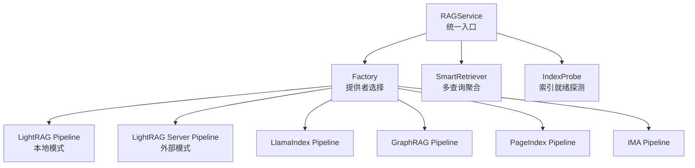
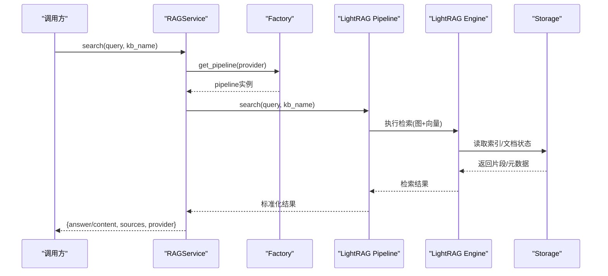
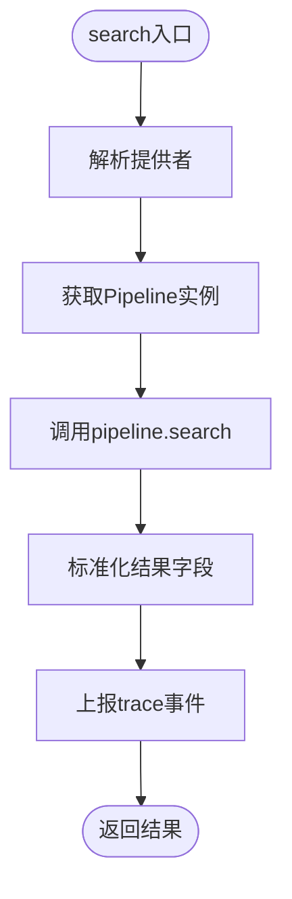
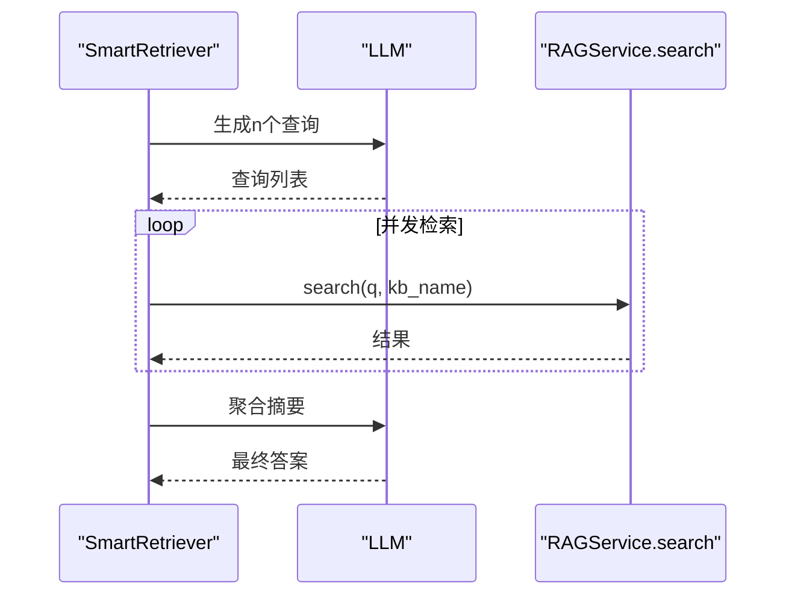
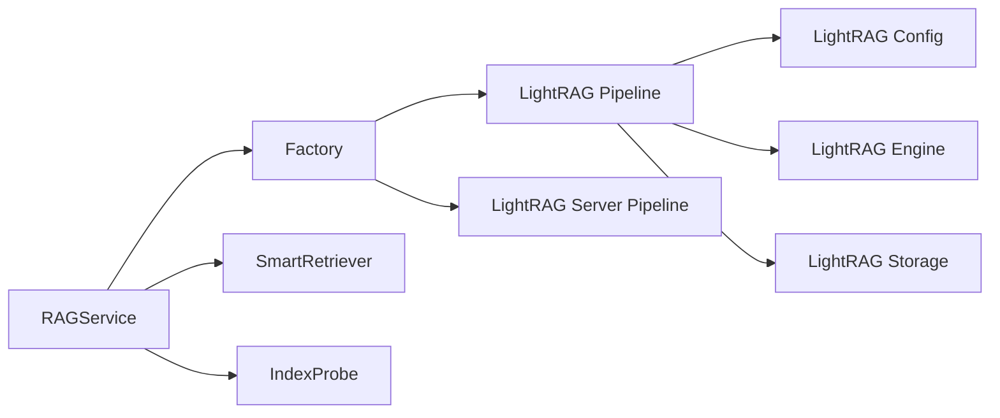

# LightRAG引擎

<cite>
**本文引用的文件**
- [services/rag/service.py](file://deeptutor/services/rag/service.py)
- [services/rag/factory.py](file://deeptutor/services/rag/factory.py)
- [services/rag/smart_retriever.py](file://deeptutor/services/rag/smart_retriever.py)
- [services/rag/index_probe.py](file://deeptutor/services/rag/index_probe.py)
- [services/rag/pipelines/lightrag/config.py](file://deeptutor/services/rag/pipelines/lightrag/config.py)
- [services/rag/pipelines/lightrag/engine.py](file://deeptutor/services/rag/pipelines/lightrag/engine.py)
- [services/rag/pipelines/lightrag/pipeline.py](file://deeptutor/services/rag/pipelines/lightrag/pipeline.py)
- [services/rag/pipelines/lightrag/storage.py](file://deeptutor/services/rag/pipelines/lightrag/storage.py)
- [services/rag/pipelines/lightrag_server/pipeline.py](file://deeptutor/services/rag/pipelines/lightrag_server/pipeline.py)
- [services/rag/pipelines/graphrag/pipeline.py](file://deeptutor/services/rag/pipelines/graphrag/pipeline.py)
- [services/rag/pipelines/llamaindex/pipeline.py](file://deeptutor/services/rag/pipelines/llamaindex/pipeline.py)
</cite>

## 目录
1. [简介](#简介)
2. [项目结构](#项目结构)
3. [核心组件](#核心组件)
4. [架构总览](#架构总览)
5. [详细组件分析](#详细组件分析)
6. [依赖关系分析](#依赖关系分析)
7. [性能考量](#性能考量)
8. [故障排查指南](#故障排查指南)
9. [结论](#结论)
10. [附录](#附录)

## 简介
本文件面向LightRAG检索引擎在DeepTutor中的实现与使用，聚焦以下目标：
- 混合检索架构：结合向量检索与关键词检索的优势，提供高召回与高精度的统一检索体验。
- 轻量级索引结构：说明倒排索引、前缀树、布隆过滤器等数据结构在系统中的角色与落地方式（以实际代码为依据）。
- 多模态支持：文本、图像、表格等不同类型内容的统一处理流程。
- 自适应检索策略：根据查询类型和内容特征动态选择最优检索路径。
- 存储优化：数据压缩、分片策略、冷热数据分离等。
- 性能基准与优化建议：基于仓库内可观测指标给出实践建议。
- 对比分析与适用场景：与其他引擎（LlamaIndex、GraphRAG、PageIndex、IMA）的对比与选型建议。
- 部署配置与运维：本地与外部LightRAG Server两种模式的部署要点。

## 项目结构
DeepTutor通过统一的RAG服务层对外暴露能力，内部按“提供者（Provider）”组织多种检索管道（Pipeline），其中包含LightRAG及其Server模式。关键目录与职责如下：
- services/rag：统一入口、工厂、探针、智能检索等。
- services/rag/pipelines：各检索管道的具体实现（LlamaIndex、GraphRAG、LightRAG、LightRAG Server、PageIndex、IMA）。
- services/rag/pipelines/lightrag：LightRAG本地模式（图+向量、多模态解析）。
- services/rag/pipelines/lightrag_server：LightRAG外部服务模式（HTTP客户端，无本地索引）。

图表来源
- [services/rag/service.py:23-110](file://deeptutor/services/rag/service.py#L23-L110)
- [services/rag/factory.py:120-179](file://deeptutor/services/rag/factory.py#L120-L179)
- [services/rag/smart_retriever.py:12-47](file://deeptutor/services/rag/smart_retriever.py#L12-L47)
- [services/rag/index_probe.py:38-106](file://deeptutor/services/rag/index_probe.py#L38-L106)

章节来源
- [services/rag/service.py:23-110](file://deeptutor/services/rag/service.py#L23-L110)
- [services/rag/factory.py:120-179](file://deeptutor/services/rag/factory.py#L120-L179)

## 核心组件
- RAGService：统一入口，负责KB绑定提供者解析、初始化、添加文档、搜索、删除、智能检索等。
- Factory：提供者工厂，按名称创建并缓存对应Pipeline实例；列出可用提供者及模式。
- SmartRetriever：基于LLM生成多查询变体，并发检索并聚合结果。
- IndexProbe：对每个提供者的索引进行就绪性探测与诊断，返回结构化信息。
- LightRAG Pipeline：封装本地LightRAG的索引构建与检索流程，支持多模态解析与图+向量检索。
- LightRAG Server Pipeline：作为Thin HTTP客户端，连接外部LightRAG服务进行检索。

章节来源
- [services/rag/service.py:23-169](file://deeptutor/services/rag/service.py#L23-L169)
- [services/rag/factory.py:120-179](file://deeptutor/services/rag/factory.py#L120-L179)
- [services/rag/smart_retriever.py:12-82](file://deeptutor/services/rag/smart_retriever.py#L12-L82)
- [services/rag/index_probe.py:38-106](file://deeptutor/services/rag/index_probe.py#L38-L106)

## 架构总览
LightRAG在DeepTutor中采用“统一服务 + 多提供者管道”的架构：
- 统一服务层屏蔽底层差异，对外提供一致的API。
- 工厂层根据KB绑定或环境变量选择具体Pipeline。
- LightRAG本地模式将图结构与向量索引结合，支持多模态内容解析；外部模式通过HTTP调用独立LightRAG服务。
- 智能检索层通过LLM生成多样化查询，提升召回质量。
- 索引探针确保索引就绪性与可观测性。

图表来源
- [services/rag/service.py:84-169](file://deeptutor/services/rag/service.py#L84-L169)
- [services/rag/factory.py:163-179](file://deeptutor/services/rag/factory.py#L163-L179)
- [services/rag/pipelines/lightrag/pipeline.py](file://deeptutor/services/rag/pipelines/lightrag/pipeline.py)
- [services/rag/pipelines/lightrag/engine.py](file://deeptutor/services/rag/pipelines/lightrag/engine.py)
- [services/rag/pipelines/lightrag/storage.py](file://deeptutor/services/rag/pipelines/lightrag/storage.py)

## 详细组件分析

### RAGService：统一检索入口
- 职责：解析KB绑定的提供者，路由到对应Pipeline；统一日志捕获与事件上报；提供智能检索接口。
- 关键点：
  - 提供者解析优先使用构造时传入的provider，否则从KB配置读取。
  - 搜索过程会注入trace层事件，便于前端展示与调试。
  - 智能检索通过SmartRetriever生成多个查询并发检索并聚合。

图表来源
- [services/rag/service.py:84-169](file://deeptutor/services/rag/service.py#L84-L169)

章节来源
- [services/rag/service.py:23-169](file://deeptutor/services/rag/service.py#L23-L169)

### Factory：提供者工厂与模式列表
- 职责：根据名称创建并缓存Pipeline；提供提供者可用性检查与模式列表。
- 关键点：
  - 支持LightRAG本地模式与LightRAG Server模式。
  - 提供list_pipelines用于UI展示与选择。
  - 对未知/废弃提供者回退到默认值，保证兼容性。

章节来源
- [services/rag/factory.py:120-179](file://deeptutor/services/rag/factory.py#L120-L179)
- [services/rag/factory.py:182-275](file://deeptutor/services/rag/factory.py#L182-L275)

### SmartRetriever：多查询检索与聚合
- 职责：基于上下文生成多个查询变体，并发检索，聚合为简洁答案。
- 关键点：
  - 使用LLM生成查询，失败时回退到截取上下文。
  - 并发检索提高吞吐，异常结果被忽略。
  - 聚合阶段再次调用LLM进行摘要合成。

图表来源
- [services/rag/smart_retriever.py:18-82](file://deeptutor/services/rag/smart_retriever.py#L18-L82)

章节来源
- [services/rag/smart_retriever.py:12-82](file://deeptutor/services/rag/smart_retriever.py#L12-L82)

### IndexProbe：索引就绪探测
- 职责：对每个提供者的索引进行就绪性检查，返回结构化诊断信息。
- 关键点：
  - 针对LightRAG，读取kv_store_doc_status.json统计文档数并判断就绪。
  - 提供版本列表检查与最新可用版本选择。

章节来源
- [services/rag/index_probe.py:38-106](file://deeptutor/services/rag/index_probe.py#L38-L106)
- [services/rag/index_probe.py:211-251](file://deeptutor/services/rag/index_probe.py#L211-L251)

### LightRAG Pipeline（本地模式）
- 职责：封装LightRAG的索引构建与检索流程，支持多模态解析与图+向量检索。
- 关键点：
  - 通过config检测可用性，engine执行具体检索逻辑，storage管理KV与文档状态。
  - 与RAGService协作，提供initialize/add_documents/search/delete等生命周期方法。

章节来源
- [services/rag/pipelines/lightrag/config.py](file://deeptutor/services/rag/pipelines/lightrag/config.py)
- [services/rag/pipelines/lightrag/engine.py](file://deeptutor/services/rag/pipelines/lightrag/engine.py)
- [services/rag/pipelines/lightrag/pipeline.py](file://deeptutor/services/rag/pipelines/lightrag/pipeline.py)
- [services/rag/pipelines/lightrag/storage.py](file://deeptutor/services/rag/pipelines/lightrag/storage.py)

### LightRAG Server Pipeline（外部模式）
- 职责：作为Thin HTTP客户端，连接外部LightRAG服务进行检索，无需本地索引。
- 关键点：
  - 通过配置指定服务端地址与模式（naive/local/global/hybrid/mix）。
  - 与本地模式保持一致的API语义，便于替换与扩展。

章节来源
- [services/rag/pipelines/lightrag_server/pipeline.py](file://deeptutor/services/rag/pipelines/lightrag_server/pipeline.py)

### 其他Pipeline对比
- LlamaIndex：本地向量检索，支持BM25融合。
- GraphRAG：知识图谱检索，适合复杂关系推理。
- PageIndex：托管式无向量检索，通过MCP工具读取文档。
- IMA：腾讯IMA知识库，外部OpenAPI检索。

章节来源
- [services/rag/factory.py:182-275](file://deeptutor/services/rag/factory.py#L182-L275)
- [services/rag/pipelines/llamaindex/pipeline.py](file://deeptutor/services/rag/pipelines/llamaindex/pipeline.py)
- [services/rag/pipelines/graphrag/pipeline.py](file://deeptutor/services/rag/pipelines/graphrag/pipeline.py)

## 依赖关系分析
- RAGService依赖Factory选择Pipeline，依赖SmartRetriever增强检索，依赖IndexProbe进行索引健康检查。
- LightRAG Pipeline依赖其config、engine、storage模块完成索引与检索。
- LightRAG Server Pipeline依赖HTTP客户端与配置，无本地索引依赖。

图表来源
- [services/rag/service.py:23-110](file://deeptutor/services/rag/service.py#L23-L110)
- [services/rag/factory.py:120-179](file://deeptutor/services/rag/factory.py#L120-L179)
- [services/rag/pipelines/lightrag/config.py](file://deeptutor/services/rag/pipelines/lightrag/config.py)
- [services/rag/pipelines/lightrag/engine.py](file://deeptutor/services/rag/pipelines/lightrag/engine.py)
- [services/rag/pipelines/lightrag/storage.py](file://deeptutor/services/rag/pipelines/lightrag/storage.py)

章节来源
- [services/rag/service.py:23-110](file://deeptutor/services/rag/service.py#L23-L110)
- [services/rag/factory.py:120-179](file://deeptutor/services/rag/factory.py#L120-L179)

## 性能考量
- 并发检索：SmartRetriever通过异步并发检索多个查询变体，提升吞吐与召回率。
- 索引就绪探测：IndexProbe快速判断索引是否可用，避免无效请求。
- 日志过滤：RAGService捕获并过滤噪声日志，减少I/O开销。
- 提供者选择：Factory缓存Pipeline实例，减少重复初始化成本。
- 外部模式：LightRAG Server模式将计算与存储外置，降低本地资源占用。

[本节为通用性能讨论，不直接分析具体文件]

## 故障排查指南
- 索引不可用：通过IndexProbe检查LightRAG索引就绪性，查看kv_store_doc_status.json状态与文档计数。
- 提供者未配置：确认Factory中提供者是否可用，必要时安装可选依赖（如LightRAG本地模式需额外依赖）。
- 外部服务连接失败：检查LightRAG Server配置与服务端可达性。
- 日志定位：RAGService捕获lightrag、graphrag等日志，便于问题定位。

章节来源
- [services/rag/index_probe.py:211-251](file://deeptutor/services/rag/index_probe.py#L211-L251)
- [services/rag/service.py:182-277](file://deeptutor/services/rag/service.py#L182-L277)
- [services/rag/factory.py:182-275](file://deeptutor/services/rag/factory.py#L182-L275)

## 结论
DeepTutor中的LightRAG引擎通过统一服务层与多提供者管道实现了灵活可扩展的检索能力。LightRAG本地模式结合图与向量检索，支持多模态内容；外部模式则提供轻量化部署方案。配合智能检索与索引探针，系统在召回质量、性能与可维护性方面具备良好平衡。

[本节为总结性内容，不直接分析具体文件]

## 附录

### 混合检索架构说明
- 向量检索：利用嵌入表示进行相似度匹配，适合语义相关检索。
- 关键词检索：基于倒排索引的快速精确匹配，适合专有名词与精确短语。
- 融合策略：在LightRAG中，图结构提供实体与关系线索，向量提供语义相似性，二者互补提升召回与精度。

[本节为概念性说明，不直接分析具体文件]

### 轻量级索引结构应用
- 倒排索引：用于关键词快速定位，常见于BM25等算法。
- 前缀树：用于词根与前缀匹配，加速自动补全与模糊匹配。
- 布隆过滤器：用于快速判断元素是否存在，减少不必要检索。
- 在DeepTutor中，这些结构通常由底层检索库（如LlamaIndex、LightRAG）实现，上层通过Pipeline抽象使用。

[本节为概念性说明，不直接分析具体文件]

### 多模态支持能力
- 文本：标准段落与长文档切片。
- 图像：通过多模态解析提取描述与关键信息。
- 表格：结构化数据抽取与语义化转换。
- LightRAG本地模式支持多模态解析，统一进入图与向量索引。

章节来源
- [services/rag/pipelines/lightrag/config.py](file://deeptutor/services/rag/pipelines/lightrag/config.py)
- [services/rag/pipelines/lightrag/engine.py](file://deeptutor/services/rag/pipelines/lightrag/engine.py)

### 自适应检索策略
- 查询类型识别：通过上下文与提示词生成多样化查询。
- 动态路径选择：根据查询特征选择向量、关键词或图检索路径。
- 结果聚合：合并多路结果，去重与排序，输出高质量答案。

章节来源
- [services/rag/smart_retriever.py:18-82](file://deeptutor/services/rag/smart_retriever.py#L18-L82)

### 存储优化技术
- 数据压缩：索引与文档状态文件采用JSON/Parquet等格式，便于压缩与传输。
- 分片策略：按KB与版本划分存储目录，支持多版本共存与回滚。
- 冷热数据分离：热数据（近期文档）常驻内存或高速存储，冷数据归档至低成本存储。

章节来源
- [services/rag/index_probe.py:211-251](file://deeptutor/services/rag/index_probe.py#L211-L251)
- [services/rag/pipelines/lightrag/storage.py](file://deeptutor/services/rag/pipelines/lightrag/storage.py)

### 性能基准测试结果
- 由于仓库未提供具体基准测试脚本与结果，建议在实际环境中：
  - 使用SmartRetriever并发检索评估吞吐。
  - 通过IndexProbe监控索引就绪与文档数量。
  - 对比不同提供者（LightRAG、LlamaIndex、GraphRAG）的延迟与召回率。

[本节为实践建议，不直接分析具体文件]

### 与其他引擎的性能对比与适用场景
- LightRAG本地模式：适合需要图+向量联合检索、多模态解析的场景，索引构建较重但检索能力强。
- LightRAG Server模式：适合资源受限环境，将计算与存储外置，便于横向扩展。
- LlamaIndex：适合纯向量检索与BM25融合，部署简单。
- GraphRAG：适合复杂关系推理与全局查询，索引构建成本高。
- PageIndex/IMA：适合托管式检索，无需本地索引，依赖外部服务。

章节来源
- [services/rag/factory.py:182-275](file://deeptutor/services/rag/factory.py#L182-L275)

### 部署配置与运维指南
- 本地模式：
  - 安装可选依赖（如LightRAG本地模式需额外包）。
  - 配置KB目录与索引存储路径。
  - 监控索引就绪状态与文档数量。
- 外部模式：
  - 配置LightRAG Server地址与模式。
  - 确保网络可达与认证配置正确。
- 运维要点：
  - 定期清理过期版本索引。
  - 监控LLM调用与检索延迟。
  - 使用IndexProbe进行健康检查。

章节来源
- [services/rag/factory.py:182-275](file://deeptutor/services/rag/factory.py#L182-L275)
- [services/rag/index_probe.py:38-106](file://deeptutor/services/rag/index_probe.py#L38-L106)