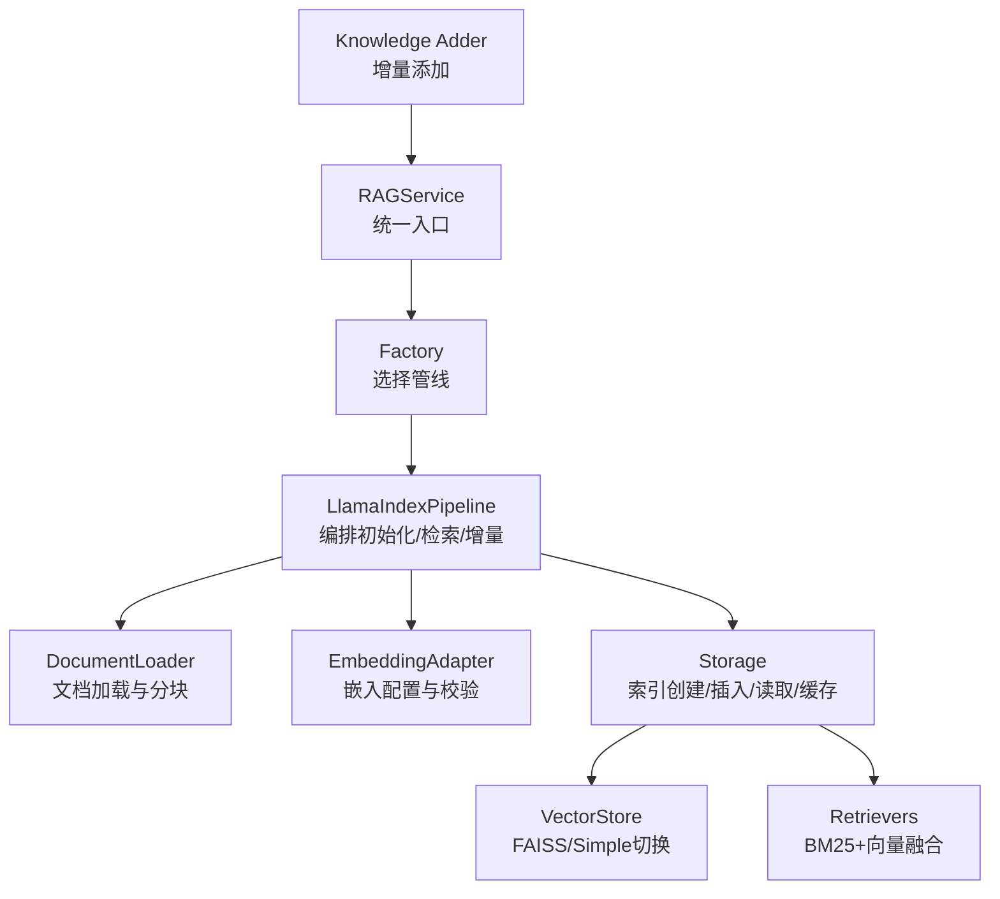
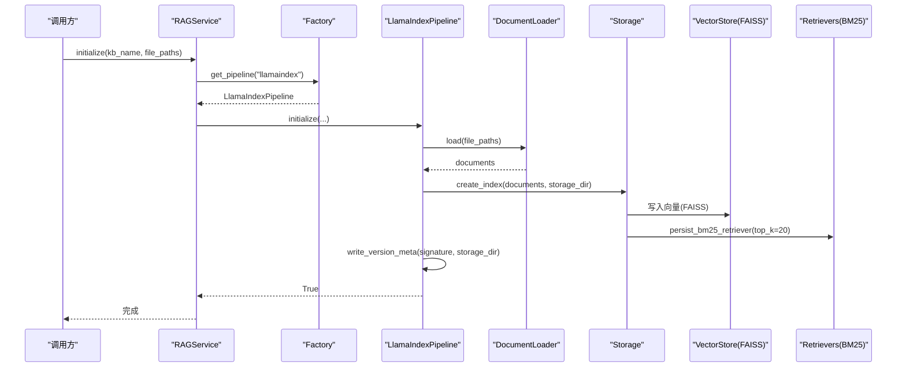
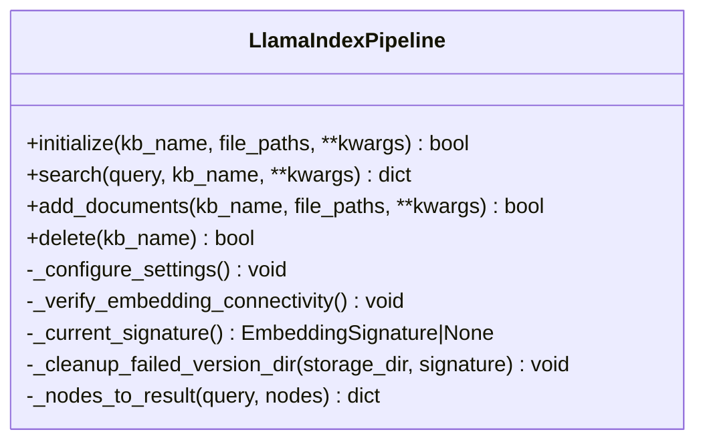
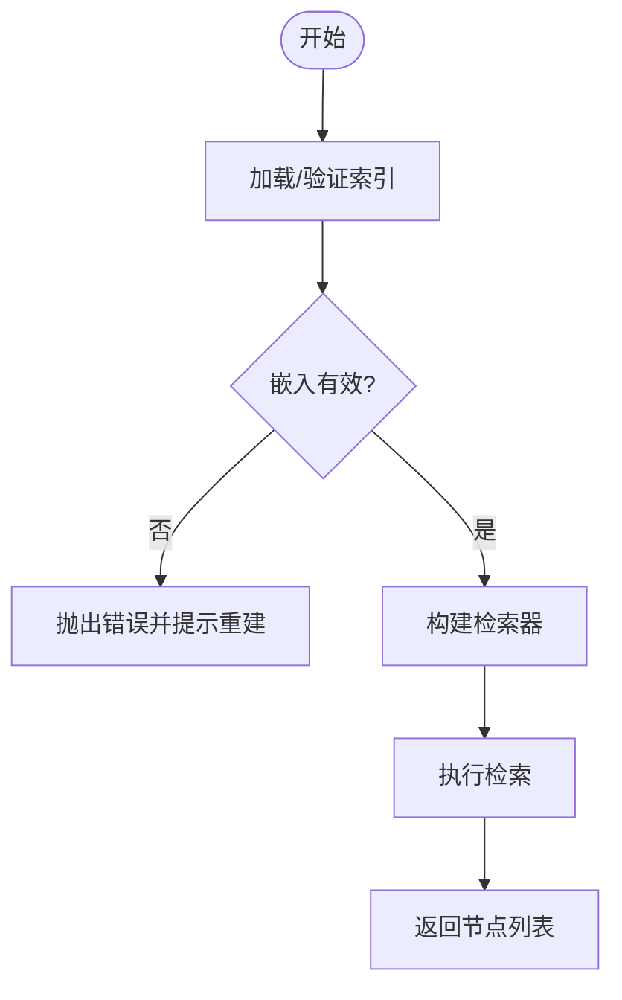
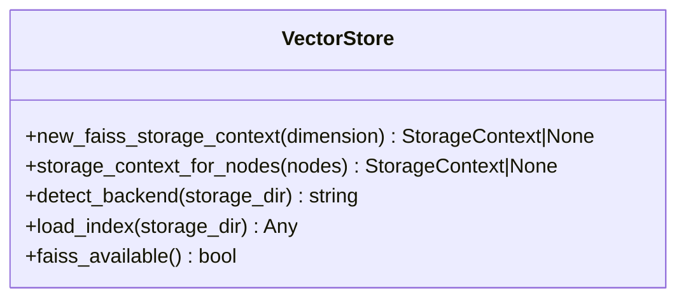
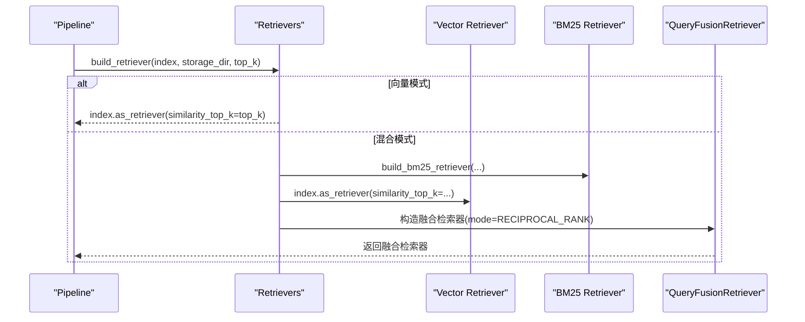
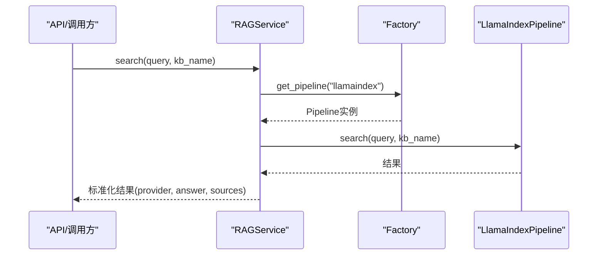
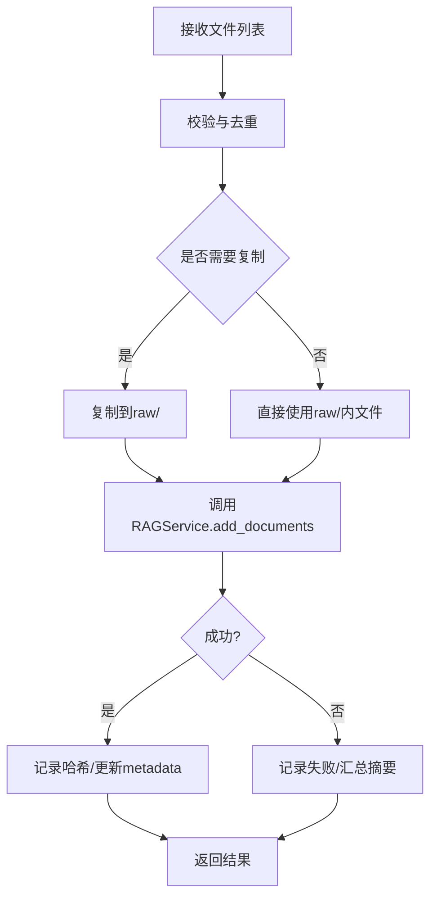
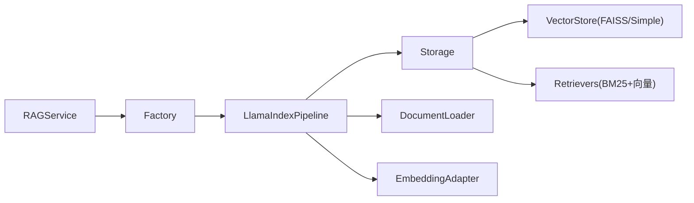

# LlamaIndex引擎

<cite>
**本文引用的文件**
- [deeptutor/services/rag/pipelines/llamaindex/pipeline.py](file://deeptutor/services/rag/pipelines/llamaindex/pipeline.py)
- [deeptutor/services/rag/pipelines/llamaindex/storage.py](file://deeptutor/services/rag/pipelines/llamaindex/storage.py)
- [deeptutor/services/rag/pipelines/llamaindex/vector_store.py](file://deeptutor/services/rag/pipelines/llamaindex/vector_store.py)
- [deeptutor/services/rag/pipelines/llamaindex/retrievers.py](file://deeptutor/services/rag/pipelines/llamaindex/retrievers.py)
- [deeptutor/services/rag/service.py](file://deeptutor/services/rag/service.py)
- [deeptutor/services/rag/factory.py](file://deeptutor/services/rag/factory.py)
- [deeptutor/knowledge/add_documents.py](file://deeptutor/knowledge/add_documents.py)
</cite>

## 目录
1. [简介](#简介)
2. [项目结构](#项目结构)
3. [核心组件](#核心组件)
4. [架构总览](#架构总览)
5. [详细组件分析](#详细组件分析)
6. [依赖关系分析](#依赖关系分析)
7. [性能考量](#性能考量)
8. [故障排查指南](#故障排查指南)
9. [结论](#结论)
10. [附录：使用示例与配置模板](#附录使用示例与配置模板)

## 简介
本文件面向DeepTutor中基于LlamaIndex的检索引擎，系统性说明其架构、数据流、关键组件与实现细节。重点覆盖：
- 文档加载器、嵌入适配器、向量存储与检索器的职责与协作
- 从文件解析到向量化存储的完整处理流程
- 支持的文档格式与预处理策略（PDF、Word、Markdown等）
- 向量存储配置（FAISS参数、索引大小优化、内存管理）
- 检索算法（相似度计算、结果排序、上下文窗口管理）
- 性能调优（批量处理、缓存策略、并发控制）
- 实际使用示例与常见问题解决方案

## 项目结构
围绕LlamaIndex的RAG管线位于services/rag/pipelines/llamaindex下，配合上层服务service.py与工厂factory.py进行统一调度；知识增量添加由knowledge/add_documents.py驱动。

图表来源
- [deeptutor/services/rag/service.py:23-110](file://deeptutor/services/rag/service.py#L23-L110)
- [deeptutor/services/rag/factory.py:120-179](file://deeptutor/services/rag/factory.py#L120-L179)
- [deeptutor/services/rag/pipelines/llamaindex/pipeline.py:38-121](file://deeptutor/services/rag/pipelines/llamaindex/pipeline.py#L38-L121)
- [deeptutor/services/rag/pipelines/llamaindex/storage.py:88-108](file://deeptutor/services/rag/pipelines/llamaindex/storage.py#L88-L108)
- [deeptutor/services/rag/pipelines/llamaindex/vector_store.py:185-212](file://deeptutor/services/rag/pipelines/llamaindex/vector_store.py#L185-L212)
- [deeptutor/services/rag/pipelines/llamaindex/retrievers.py:119-151](file://deeptutor/services/rag/pipelines/llamaindex/retrievers.py#L119-L151)
- [deeptutor/knowledge/add_documents.py:144-297](file://deeptutor/knowledge/add_documents.py#L144-L297)

章节来源
- [deeptutor/services/rag/service.py:23-110](file://deeptutor/services/rag/service.py#L23-L110)
- [deeptutor/services/rag/factory.py:120-179](file://deeptutor/services/rag/factory.py#L120-L179)
- [deeptutor/services/rag/pipelines/llamaindex/pipeline.py:38-121](file://deeptutor/services/rag/pipelines/llamaindex/pipeline.py#L38-L121)
- [deeptutor/services/rag/pipelines/llamaindex/storage.py:88-108](file://deeptutor/services/rag/pipelines/llamaindex/storage.py#L88-L108)
- [deeptutor/services/rag/pipelines/llamaindex/vector_store.py:185-212](file://deeptutor/services/rag/pipelines/llamaindex/vector_store.py#L185-L212)
- [deeptutor/services/rag/pipelines/llamaindex/retrievers.py:119-151](file://deeptutor/services/rag/pipelines/llamaindex/retrievers.py#L119-L151)
- [deeptutor/knowledge/add_documents.py:144-297](file://deeptutor/knowledge/add_documents.py#L144-L297)

## 核心组件
- RAGService：统一入口，按KB绑定选择具体管线，封装搜索、智能检索、日志捕获与事件上报。
- Factory：提供管线工厂，支持多提供者（默认LlamaIndex），并维护实例缓存。
- LlamaIndexPipeline：编排文档加载、嵌入、索引构建/增量、检索与删除。
- Storage：索引生命周期管理（创建、插入、持久化、验证、缓存）。
- VectorStore：后端抽象，优先使用FAISS（余弦相似度），回退SimpleVectorStore。
- Retrievers：组合向量检索与BM25检索，支持混合召回与持久化BM25侧索引。
- Knowledge Adder：增量添加文档，负责去重、暂存raw、调用RAGService完成索引。

章节来源
- [deeptutor/services/rag/service.py:23-110](file://deeptutor/services/rag/service.py#L23-L110)
- [deeptutor/services/rag/factory.py:120-179](file://deeptutor/services/rag/factory.py#L120-L179)
- [deeptutor/services/rag/pipelines/llamaindex/pipeline.py:38-121](file://deeptutor/services/rag/pipelines/llamaindex/pipeline.py#L38-L121)
- [deeptutor/services/rag/pipelines/llamaindex/storage.py:88-108](file://deeptutor/services/rag/pipelines/llamaindex/storage.py#L88-L108)
- [deeptutor/services/rag/pipelines/llamaindex/vector_store.py:185-212](file://deeptutor/services/rag/pipelines/llamaindex/vector_store.py#L185-L212)
- [deeptutor/services/rag/pipelines/llamaindex/retrievers.py:119-151](file://deeptutor/services/rag/pipelines/llamaindex/retrievers.py#L119-L151)
- [deeptutor/knowledge/add_documents.py:144-297](file://deeptutor/knowledge/add_documents.py#L144-L297)

## 架构总览
下图展示一次“初始化/重建索引”的端到端流程：从文件加载、分块、嵌入、写入FAISS、持久化BM25侧索引，到版本元数据落盘。

图表来源
- [deeptutor/services/rag/service.py:68-73](file://deeptutor/services/rag/service.py#L68-L73)
- [deeptutor/services/rag/factory.py:163-179](file://deeptutor/services/rag/factory.py#L163-L179)
- [deeptutor/services/rag/pipelines/llamaindex/pipeline.py:75-121](file://deeptutor/services/rag/pipelines/llamaindex/pipeline.py#L75-L121)
- [deeptutor/services/rag/pipelines/llamaindex/storage.py:88-93](file://deeptutor/services/rag/pipelines/llamaindex/storage.py#L88-L93)
- [deeptutor/services/rag/pipelines/llamaindex/vector_store.py:185-212](file://deeptutor/services/rag/pipelines/llamaindex/vector_store.py#L185-L212)
- [deeptutor/services/rag/pipelines/llamaindex/retrievers.py:86-116](file://deeptutor/services/rag/pipelines/llamaindex/retrievers.py#L86-L116)

## 详细组件分析

### LlamaIndexPipeline（编排层）
- 职责：协调文档加载、嵌入连通性校验、索引创建/增量、检索、删除；记录版本元数据；异常时清理失败版本目录。
- 关键点：
  - 通过signature_provider获取当前嵌入签名，用于版本化存储路径选择。
  - 初始化时异步执行索引构建，避免阻塞事件循环。
  - 检索时根据active embedding signature定位storage_dir，缺失则提示需要重建。
  - add_documents支持增量插入或新建索引，自动写版本元数据。

图表来源
- [deeptutor/services/rag/pipelines/llamaindex/pipeline.py:38-121](file://deeptutor/services/rag/pipelines/llamaindex/pipeline.py#L38-L121)
- [deeptutor/services/rag/pipelines/llamaindex/pipeline.py:123-177](file://deeptutor/services/rag/pipelines/llamaindex/pipeline.py#L123-L177)
- [deeptutor/services/rag/pipelines/llamaindex/pipeline.py:225-287](file://deeptutor/services/rag/pipelines/llamaindex/pipeline.py#L225-L287)

章节来源
- [deeptutor/services/rag/pipelines/llamaindex/pipeline.py:38-121](file://deeptutor/services/rag/pipelines/llamaindex/pipeline.py#L38-L121)
- [deeptutor/services/rag/pipelines/llamaindex/pipeline.py:123-177](file://deeptutor/services/rag/pipelines/llamaindex/pipeline.py#L123-L177)
- [deeptutor/services/rag/pipelines/llamaindex/pipeline.py:225-287](file://deeptutor/services/rag/pipelines/llamaindex/pipeline.py#L225-L287)

### Storage（索引与缓存）
- 职责：索引创建/插入、持久化、嵌入校验、索引缓存、检索节点提取。
- 关键点：
  - create_index：调用ingestion创建索引，随后持久化BM25侧索引。
  - insert_documents：加载已有索引，插入新文档，持久化并更新BM25侧索引。
  - _validate_persisted_embeddings：在加载前校验已持久化的嵌入是否有效，防止脏数据导致查询崩溃。
  - 索引缓存：按storage_dir与文件mtime生成新鲜度令牌，LRU缓存最近使用的索引，减少重复IO与校验。
  - retrieve_nodes：通过retrievers.build_retriever构建检索器并返回节点。

图表来源
- [deeptutor/services/rag/pipelines/llamaindex/storage.py:88-108](file://deeptutor/services/rag/pipelines/llamaindex/storage.py#L88-L108)
- [deeptutor/services/rag/pipelines/llamaindex/storage.py:179-197](file://deeptutor/services/rag/pipelines/llamaindex/storage.py#L179-L197)
- [deeptutor/services/rag/pipelines/llamaindex/storage.py:200-285](file://deeptutor/services/rag/pipelines/llamaindex/storage.py#L200-L285)

章节来源
- [deeptutor/services/rag/pipelines/llamaindex/storage.py:88-108](file://deeptutor/services/rag/pipelines/llamaindex/storage.py#L88-L108)
- [deeptutor/services/rag/pipelines/llamaindex/storage.py:179-197](file://deeptutor/services/rag/pipelines/llamaindex/storage.py#L179-L197)
- [deeptutor/services/rag/pipelines/llamaindex/storage.py:200-285](file://deeptutor/services/rag/pipelines/llamaindex/storage.py#L200-L285)

### VectorStore（FAISS与Simple切换）
- 职责：为LlamaIndex提供统一的向量存储后端，优先使用FAISS以加速检索，兼容旧版SimpleVectorStore。
- 关键点：
  - FAISS余弦相似度：对向量进行L2归一化，使内积等价于余弦相似度。
  - 读写封装：faiss_write_index/faiss_read_index绕过Windows路径问题，确保跨平台稳定。
  - 自动选择：当所有节点维度一致且FAISS可用时使用FAISS；否则回退SimpleVectorStore。
  - 检测后端：根据默认vector_store.json首字节判断FAISS或Simple。
  - load_index：根据后端类型加载对应索引。

图表来源
- [deeptutor/services/rag/pipelines/llamaindex/vector_store.py:185-212](file://deeptutor/services/rag/pipelines/llamaindex/vector_store.py#L185-L212)
- [deeptutor/services/rag/pipelines/llamaindex/vector_store.py:215-250](file://deeptutor/services/rag/pipelines/llamaindex/vector_store.py#L215-L250)
- [deeptutor/services/rag/pipelines/llamaindex/vector_store.py:68-164](file://deeptutor/services/rag/pipelines/llamaindex/vector_store.py#L68-L164)

章节来源
- [deeptutor/services/rag/pipelines/llamaindex/vector_store.py:68-164](file://deeptutor/services/rag/pipelines/llamaindex/vector_store.py#L68-L164)
- [deeptutor/services/rag/pipelines/llamaindex/vector_store.py:185-212](file://deeptutor/services/rag/pipelines/llamaindex/vector_store.py#L185-L212)
- [deeptutor/services/rag/pipelines/llamaindex/vector_store.py:215-250](file://deeptutor/services/rag/pipelines/llamaindex/vector_store.py#L215-L250)

### Retrievers（BM25与向量融合）
- 职责：构建检索器，支持纯向量、纯BM25或混合召回（Reciprocal Rank Fusion）。
- 关键点：
  - build_bm25_retriever：尝试从持久化目录加载BM25检索器，失败则动态构建；若不可用则降级为纯向量。
  - persist_bm25_retriever：将BM25侧索引持久化到bm25_retriever目录，提升后续检索速度。
  - build_retriever：根据配置选择模式；混合模式下同时构造向量检索器与BM25检索器，并通过QueryFusionRetriever融合。
  - top_k保护：当语料库较小，限制top_k不超过节点数，避免异常。

图表来源
- [deeptutor/services/rag/pipelines/llamaindex/retrievers.py:54-83](file://deeptutor/services/rag/pipelines/llamaindex/retrievers.py#L54-L83)
- [deeptutor/services/rag/pipelines/llamaindex/retrievers.py:86-116](file://deeptutor/services/rag/pipelines/llamaindex/retrievers.py#L86-L116)
- [deeptutor/services/rag/pipelines/llamaindex/retrievers.py:119-151](file://deeptutor/services/rag/pipelines/llamaindex/retrievers.py#L119-L151)

章节来源
- [deeptutor/services/rag/pipelines/llamaindex/retrievers.py:54-83](file://deeptutor/services/rag/pipelines/llamaindex/retrievers.py#L54-L83)
- [deeptutor/services/rag/pipelines/llamaindex/retrievers.py:86-116](file://deeptutor/services/rag/pipelines/llamaindex/retrievers.py#L86-L116)
- [deeptutor/services/rag/pipelines/llamaindex/retrievers.py:119-151](file://deeptutor/services/rag/pipelines/llamaindex/retrievers.py#L119-L151)

### RAGService与Factory（统一入口与管线选择）
- RAGService：
  - 统一接口：initialize、add_documents、search、smart_retrieve、delete。
  - 事件与日志：捕获底层日志并转发为工具事件，便于追踪。
  - 智能检索：基于SmartRetriever生成多查询并行检索并聚合。
- Factory：
  - 管线工厂：根据provider名称选择具体管线（默认llamaindex），并缓存实例。
  - 能力探测：list_pipelines暴露各提供者可用性信息。

图表来源
- [deeptutor/services/rag/service.py:84-169](file://deeptutor/services/rag/service.py#L84-L169)
- [deeptutor/services/rag/factory.py:163-179](file://deeptutor/services/rag/factory.py#L163-L179)
- [deeptutor/services/rag/pipelines/llamaindex/pipeline.py:123-177](file://deeptutor/services/rag/pipelines/llamaindex/pipeline.py#L123-L177)

章节来源
- [deeptutor/services/rag/service.py:84-169](file://deeptutor/services/rag/service.py#L84-L169)
- [deeptutor/services/rag/factory.py:163-179](file://deeptutor/services/rag/factory.py#L163-L179)
- [deeptutor/services/rag/pipelines/llamaindex/pipeline.py:123-177](file://deeptutor/services/rag/pipelines/llamaindex/pipeline.py#L123-L177)

### 增量添加（Knowledge Adder）
- 职责：校验与暂存文件、去重、调用RAGService完成增量索引，更新metadata。
- 关键点：
  - 去重：基于文件哈希与metadata中的file_hashes避免重复索引。
  - 暂存：将文件复制到raw/目录，保持上传目录结构。
  - 进度与状态：通过progress_tracker与manager更新KB状态。
  - 失败处理：记录失败文件并汇总摘要。

图表来源
- [deeptutor/knowledge/add_documents.py:144-297](file://deeptutor/knowledge/add_documents.py#L144-L297)
- [deeptutor/knowledge/add_documents.py:339-431](file://deeptutor/knowledge/add_documents.py#L339-L431)

章节来源
- [deeptutor/knowledge/add_documents.py:144-297](file://deeptutor/knowledge/add_documents.py#L144-L297)
- [deeptutor/knowledge/add_documents.py:339-431](file://deeptutor/knowledge/add_documents.py#L339-L431)

## 依赖关系分析
- 模块耦合：
  - pipeline依赖document_loader、embedding_adapter、storage、config与errors。
  - storage依赖vector_store与retrievers，以及index_versioning。
  - retrievers依赖config与LlamaIndex官方检索器。
  - service依赖factory与smart_retriever，并桥接日志与事件。
- 外部依赖：
  - LlamaIndex核心与可选扩展（BM25、FAISS）。
  - numpy用于向量归一化。
  - fsspec用于本地文件系统访问。

图表来源
- [deeptutor/services/rag/service.py:23-110](file://deeptutor/services/rag/service.py#L23-L110)
- [deeptutor/services/rag/factory.py:120-179](file://deeptutor/services/rag/factory.py#L120-L179)
- [deeptutor/services/rag/pipelines/llamaindex/pipeline.py:38-121](file://deeptutor/services/rag/pipelines/llamaindex/pipeline.py#L38-L121)
- [deeptutor/services/rag/pipelines/llamaindex/storage.py:88-108](file://deeptutor/services/rag/pipelines/llamaindex/storage.py#L88-L108)
- [deeptutor/services/rag/pipelines/llamaindex/vector_store.py:185-212](file://deeptutor/services/rag/pipelines/llamaindex/vector_store.py#L185-L212)
- [deeptutor/services/rag/pipelines/llamaindex/retrievers.py:119-151](file://deeptutor/services/rag/pipelines/llamaindex/retrievers.py#L119-L151)

章节来源
- [deeptutor/services/rag/service.py:23-110](file://deeptutor/services/rag/service.py#L23-L110)
- [deeptutor/services/rag/factory.py:120-179](file://deeptutor/services/rag/factory.py#L120-L179)
- [deeptutor/services/rag/pipelines/llamaindex/pipeline.py:38-121](file://deeptutor/services/rag/pipelines/llamaindex/pipeline.py#L38-L121)
- [deeptutor/services/rag/pipelines/llamaindex/storage.py:88-108](file://deeptutor/services/rag/pipelines/llamaindex/storage.py#L88-L108)
- [deeptutor/services/rag/pipelines/llamaindex/vector_store.py:185-212](file://deeptutor/services/rag/pipelines/llamaindex/vector_store.py#L185-L212)
- [deeptutor/services/rag/pipelines/llamaindex/retrievers.py:119-151](file://deeptutor/services/rag/pipelines/llamaindex/retrievers.py#L119-L151)

## 性能考量
- 向量存储优化：
  - 优先使用FAISS IndexFlatIP，结合L2归一化实现余弦相似度，显著降低查询耗时。
  - 仅当所有节点维度一致且FAISS可用时才启用FAISS，否则回退SimpleVectorStore保证兼容性。
- 检索优化：
  - 混合检索：向量检索与BM25检索通过Reciprocal Rank Fusion融合，兼顾语义与关键词匹配。
  - BM25侧索引持久化：首次构建后持久化，后续检索直接加载，减少构建开销。
  - top_k保护：在小语料库场景限制top_k不超过节点数，避免异常。
- 缓存策略：
  - 索引缓存：按storage_dir与文件mtime生成新鲜度令牌，LRU缓存最近使用的索引，减少重复IO与校验。
  - 空闲回收：超过空闲阈值（如10分钟）的索引将被清理，释放内存。
- 并发与I/O：
  - 索引构建与检索在executor中运行，避免阻塞事件循环。
  - 增量添加时，哈希计算与文件IO尽量在后台线程执行，减少对主循环的影响。
- 内存管理：
  - 避免一次性加载超大索引；通过版本化存储与按需加载控制内存占用。
  - 混合检索时合理设置候选top_k，避免过多中间结果占用内存。

[本节为通用性能指导，不直接分析具体文件]

## 故障排查指南
- 无法加载FAISS索引：
  - 现象：提示缺少faiss-cpu或未安装相关包。
  - 解决：安装faiss-cpu或重新索引知识库以回退到SimpleVectorStore。
- 嵌入维度不一致：
  - 现象：无法使用FAISS，回退到SimpleVectorStore。
  - 解决：确保所有文档使用相同嵌入模型；必要时重建索引。
- 检索结果为空或质量差：
  - 检查top_k与融合策略；适当增大候选数量或调整BM25权重。
  - 确认文档分块与嵌入质量；必要时调整分块策略或更换嵌入模型。
- 增量添加失败：
  - 查看失败摘要与日志；确认raw/目录权限与文件完整性。
  - 若KB处于错误状态，先修复后再重试。
- 版本不匹配：
  - 现象：提示需要重建索引或嵌入模型不匹配。
  - 解决：使用当前嵌入模型重建索引，或切换回之前使用的模型。

章节来源
- [deeptutor/services/rag/pipelines/llamaindex/vector_store.py:235-250](file://deeptutor/services/rag/pipelines/llamaindex/vector_store.py#L235-L250)
- [deeptutor/services/rag/pipelines/llamaindex/storage.py:179-197](file://deeptutor/services/rag/pipelines/llamaindex/storage.py#L179-L197)
- [deeptutor/services/rag/pipelines/llamaindex/pipeline.py:137-152](file://deeptutor/services/rag/pipelines/llamaindex/pipeline.py#L137-L152)
- [deeptutor/knowledge/add_documents.py:339-431](file://deeptutor/knowledge/add_documents.py#L339-L431)

## 结论
DeepTutor的LlamaIndex检索引擎通过清晰的层次划分与可插拔设计，实现了高性能、可扩展的知识检索能力。FAISS与BM25融合检索显著提升召回质量与速度；版本化存储与索引缓存保障稳定性与效率；增量添加机制满足持续更新的业务需求。通过合理的配置与调优，可在不同规模与场景下获得良好的检索体验。

[本节为总结性内容，不直接分析具体文件]

## 附录：使用示例与配置模板
- 初始化知识库
  - 调用RAGService.initialize，传入kb_name与文件路径列表。
  - 参考路径：[initialize:68-73](file://deeptutor/services/rag/service.py#L68-L73)
- 增量添加文档
  - 使用Knowledge Adder将文件暂存至raw/，再调用RAGService.add_documents。
  - 参考路径：[add_documents:216-256](file://deeptutor/knowledge/add_documents.py#L216-L256)、[process_new_documents:258-297](file://deeptutor/knowledge/add_documents.py#L258-L297)
- 执行检索
  - 调用RAGService.search，传入query与kb_name；可指定top_k。
  - 参考路径：[search:84-169](file://deeptutor/services/rag/service.py#L84-L169)
- 智能检索（多查询聚合）
  - 使用RAGService.smart_retrieve，自动生成多个查询并聚合结果。
  - 参考路径：[smart_retrieve:294-308](file://deeptutor/services/rag/service.py#L294-L308)
- 配置模板（建议）
  - 向量存储：优先FAISS，确保嵌入维度一致；若不可用则回退SimpleVectorStore。
  - 检索模式：小语料库建议使用混合检索；大语料库可根据场景调整BM25与向量权重。
  - top_k：默认值可通过配置获取；根据召回质量与延迟权衡调整。
  - 缓存：利用内置索引缓存；必要时手动清理或等待空闲回收。
  - 并发：索引构建与检索在executor中运行；避免在主循环执行重型任务。

[本节为使用指引，不直接分析具体文件]