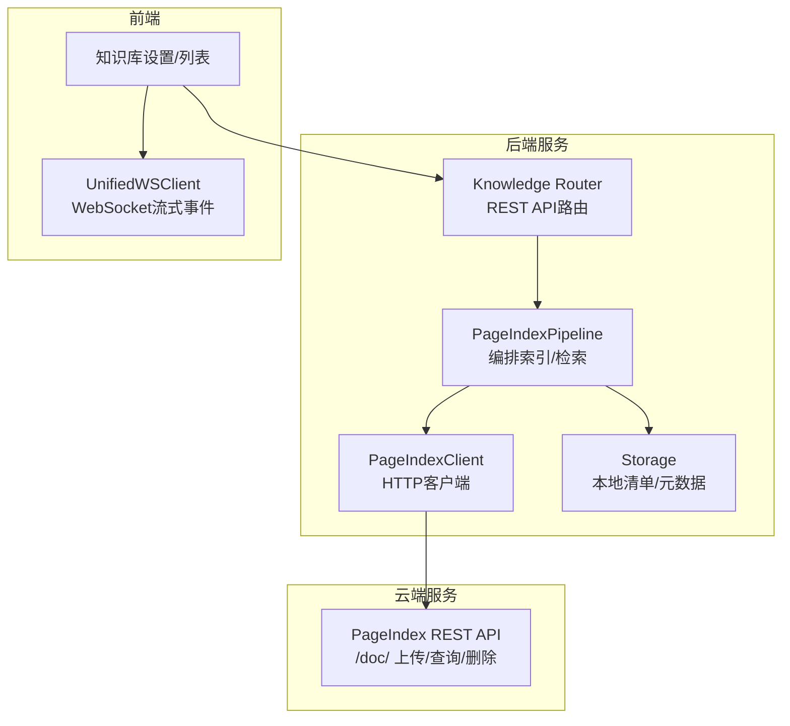
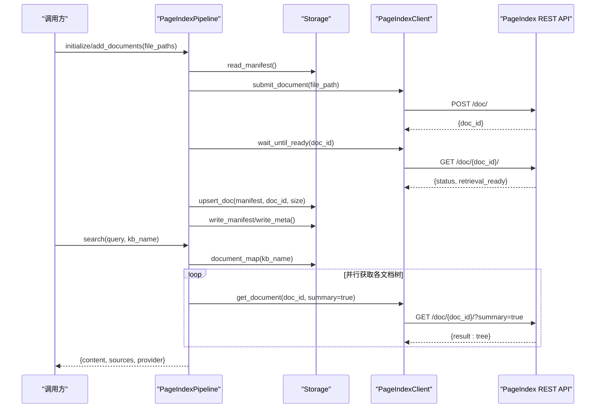
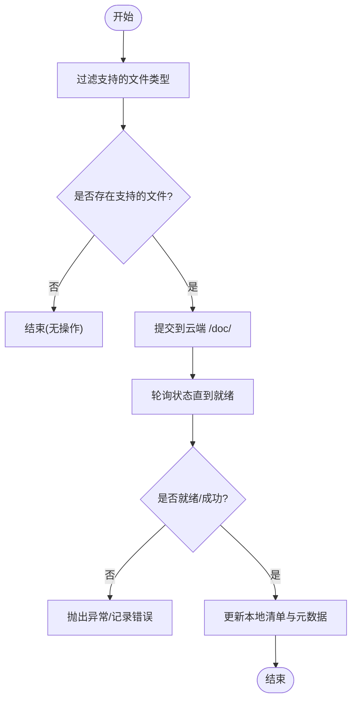
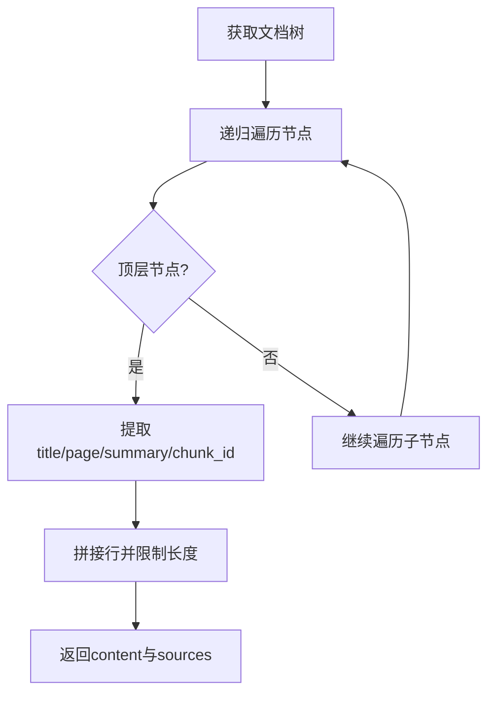
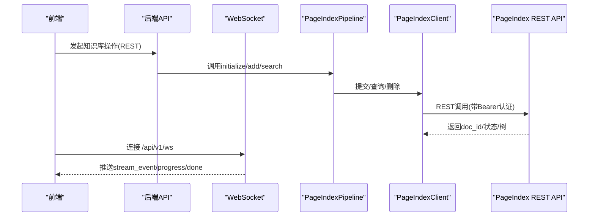
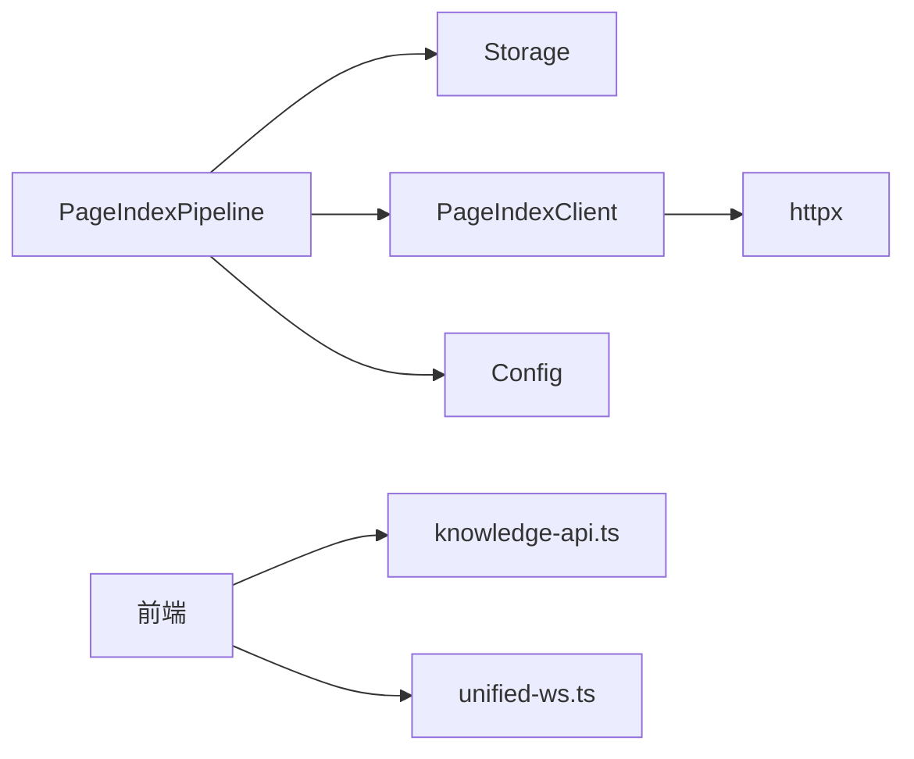
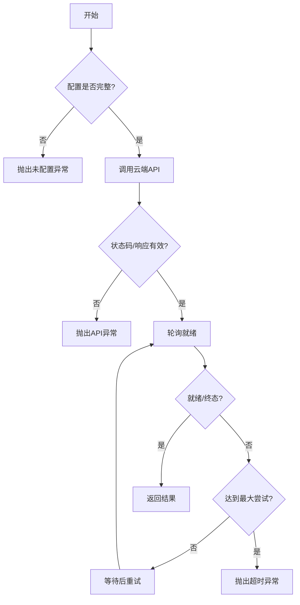

# PageIndex引擎

<cite>
**本文引用的文件**
- [pipeline.py](file://deeptutor/services/rag/pipelines/pageindex/pipeline.py)
- [client.py](file://deeptutor/services/rag/pipelines/pageindex/client.py)
- [storage.py](file://deeptutor/services/rag/pipelines/pageindex/storage.py)
- [config.py](file://deeptutor/services/rag/pipelines/pageindex/config.py)
- [knowledge.py](file://deeptutor/api/routers/knowledge.py)
- [test_pageindex_pipeline.py](file://tests/services/rag/test_pageindex_pipeline.py)
- [client-cache.ts](file://web/lib/client-cache.ts)
- [knowledge-api.ts](file://web/lib/knowledge-api.ts)
- [unified-ws.ts](file://web/lib/unified-ws.ts)
- [error_rate_tracker.py](file://deeptutor/utils/error_rate_tracker.py)
</cite>

## 目录
1. [简介](#简介)
2. [项目结构](#项目结构)
3. [核心组件](#核心组件)
4. [架构总览](#架构总览)
5. [详细组件分析](#详细组件分析)
6. [依赖关系分析](#依赖关系分析)
7. [性能与缓存策略](#性能与缓存策略)
8. [云服务集成配置指南](#云服务集成配置指南)
9. [故障处理与容错机制](#故障处理与容错机制)
10. [监控与调试工具](#监控与调试工具)
11. [结论](#结论)

## 简介
本文件面向DeepTutor中的PageIndex检索引擎，系统性说明其云端检索架构与服务化设计。该引擎将知识文档提交至托管的PageIndex服务进行页面级结构化索引（构建每篇文档的层级大纲），并通过REST API完成文档提交流程与状态轮询；深度检索由聊天Agent通过PageIndex MCP服务器完成，而程序化检索接口返回每篇文档的真实树形大纲作为上下文。本文同时覆盖客户端与服务端通信协议、远程索引管理、缓存策略、云服务集成配置、故障处理与容错、以及性能监控与调试方法。

## 项目结构
PageIndex相关代码位于RAG管道层，采用“管道+客户端+存储清单”的分层组织：
- 管道编排：负责初始化、增量添加、搜索、删除等生命周期操作
- HTTP客户端：封装对托管PageIndex REST API的调用（上传、状态轮询、获取文档树、删除）
- 本地清单：维护KB到云doc_id的映射及元信息，用于版本管理与就绪判断
- 配置：从运行时设置加载API Key与Base URL，提供可用性检查

图表来源
- [pipeline.py:57-154](file://deeptutor/services/rag/pipelines/pageindex/pipeline.py#L57-L154)
- [client.py:36-133](file://deeptutor/services/rag/pipelines/pageindex/client.py#L36-L133)
- [storage.py:1-115](file://deeptutor/services/rag/pipelines/pageindex/storage.py#L1-L115)
- [knowledge.py:1087-1115](file://deeptutor/api/routers/knowledge.py#L1087-L1115)
- [unified-ws.ts:157-242](file://web/lib/unified-ws.ts#L157-L242)

章节来源
- [pipeline.py:1-328](file://deeptutor/services/rag/pipelines/pageindex/pipeline.py#L1-L328)
- [client.py:1-133](file://deeptutor/services/rag/pipelines/pageindex/client.py#L1-L133)
- [storage.py:1-115](file://deeptutor/services/rag/pipelines/pageindex/storage.py#L1-L115)
- [config.py:1-60](file://deeptutor/services/rag/pipelines/pageindex/config.py#L1-L60)
- [knowledge.py:1087-1115](file://deeptutor/api/routers/knowledge.py#L1087-L1115)

## 核心组件
- PageIndexPipeline：实现RAG管道的统一契约，负责文件过滤、提交到云端、等待就绪、更新本地清单、并行拉取文档树并格式化输出，以及删除KB时清理云端资源。
- PageIndexClient：轻量异步HTTP客户端，封装POST /doc/、GET /doc/{id}/、DELETE /doc/{id}/，并提供wait_until_ready轮询逻辑。
- Storage：维护pageindex_docs.json清单与meta.json元数据，记录provider、doc_id映射、大小、提交时间等，支持原子写入。
- Config：从运行时设置读取api_key与api_base_url，提供配置校验与就绪检测。

章节来源
- [pipeline.py:57-154](file://deeptutor/services/rag/pipelines/pageindex/pipeline.py#L57-L154)
- [client.py:36-133](file://deeptutor/services/rag/pipelines/pageindex/client.py#L36-L133)
- [storage.py:23-115](file://deeptutor/services/rag/pipelines/pageindex/storage.py#L23-L115)
- [config.py:15-59](file://deeptutor/services/rag/pipelines/pageindex/config.py#L15-L59)

## 架构总览
PageIndex引擎采用“云端索引+本地清单+程序化检索”的混合模式：
- 索引阶段：本地文件经管道过滤后提交到云端，云端构建页面级层级大纲；本地仅保存doc_id映射与元信息。
- 检索阶段：程序化search()并行拉取所有文档的树形大纲，格式化为带页码与摘要的结构化文本，并附带来源定位（标题、页码、chunk_id）。
- 深度检索：聊天Agent通过PageIndex MCP服务器执行基于查询的深度检索，不在本管道内直接实现。

图表来源
- [pipeline.py:79-154](file://deeptutor/services/rag/pipelines/pageindex/pipeline.py#L79-L154)
- [pipeline.py:162-231](file://deeptutor/services/rag/pipelines/pageindex/pipeline.py#L162-L231)
- [client.py:77-120](file://deeptutor/services/rag/pipelines/pageindex/client.py#L77-L120)
- [storage.py:89-101](file://deeptutor/services/rag/pipelines/pageindex/storage.py#L89-L101)

## 详细组件分析

### 云端索引与文档分页
- 文件类型白名单：仅支持PDF、Markdown、TXT、Office文档、CSV等扩展名，不支持的文件会被跳过并记录警告。
- 提交与就绪：每个文件提交后通过轮询等待retrieval_ready或终态，确保云端已完成页面级结构化处理。
- 本地清单：为每个成功处理的文件记录doc_id、文件大小、提交时间，便于后续检索与清理。

图表来源
- [pipeline.py:130-154](file://deeptutor/services/rag/pipelines/pageindex/pipeline.py#L130-L154)
- [client.py:101-120](file://deeptutor/services/rag/pipelines/pageindex/client.py#L101-L120)
- [storage.py:89-101](file://deeptutor/services/rag/pipelines/pageindex/storage.py#L89-L101)

章节来源
- [pipeline.py:38-55](file://deeptutor/services/rag/pipelines/pageindex/pipeline.py#L38-L55)
- [pipeline.py:130-154](file://deeptutor/services/rag/pipelines/pageindex/pipeline.py#L130-L154)
- [client.py:77-120](file://deeptutor/services/rag/pipelines/pageindex/client.py#L77-L120)
- [storage.py:89-101](file://deeptutor/services/rag/pipelines/pageindex/storage.py#L89-L101)

### 引用定位与上下文保持
- 树形大纲渲染：按层级遍历云端返回的tree，生成缩进文本，并在顶层节点处提取来源信息（标题、页码、摘要、chunk_id）。
- 内容截断：单文档大纲长度限制，避免过大上下文影响下游模型。
- 来源聚合：sources数组包含每篇文档的顶层节段，便于前端高亮与跳转。

图表来源
- [pipeline.py:233-275](file://deeptutor/services/rag/pipelines/pageindex/pipeline.py#L233-L275)

章节来源
- [pipeline.py:233-275](file://deeptutor/services/rag/pipelines/pageindex/pipeline.py#L233-L275)

### 客户端与服务端通信协议
- REST API：
  - POST /doc/：上传文件，返回doc_id
  - GET /doc/{doc_id}/：查询处理状态与结果（可携带summary参数获取摘要）
  - DELETE /doc/{doc_id}/：删除云端文档（最佳努力）
- 认证：请求头携带Authorization: Bearer <api_key>
- 轮询：wait_until_ready以固定间隔轮询直至retrieval_ready或终态
- WebSocket与流式响应：
  - 前端使用UnifiedWSClient连接/api/v1/ws，接收stream_event等事件
  - 长耗时任务通过WebSocket维持会话，避免HTTP代理超时断开
  - 心跳ping/pong帧被前端忽略，不进入用户可见消息列表

图表来源
- [client.py:55-99](file://deeptutor/services/rag/pipelines/pageindex/client.py#L55-L99)
- [unified-ws.ts:157-242](file://web/lib/unified-ws.ts#L157-L242)
- [knowledge.py:1087-1115](file://deeptutor/api/routers/knowledge.py#L1087-L1115)

章节来源
- [client.py:55-120](file://deeptutor/services/rag/pipelines/pageindex/client.py#L55-L120)
- [unified-ws.ts:157-242](file://web/lib/unified-ws.ts#L157-L242)
- [knowledge.py:1087-1115](file://deeptutor/api/routers/knowledge.py#L1087-L1115)

### 远程索引管理（同步、版本控制、状态监控）
- 同步：add_documents在已有版本上追加新文档，更新manifest；initialize创建新版本并写入meta。
- 版本控制：使用version-N目录结构与meta.json标记ready，UI可通过签名与布局识别就绪状态。
- 状态监控：
  - 前端通过REST获取PageIndex配置状态（已配置/未配置）
  - 管道日志记录关键步骤与错误，便于排查
  - 错误率跟踪器可用于外部指标采集（可按需接入）

章节来源
- [pipeline.py:79-128](file://deeptutor/services/rag/pipelines/pageindex/pipeline.py#L79-L128)
- [storage.py:59-73](file://deeptutor/services/rag/pipelines/pageindex/storage.py#L59-L73)
- [knowledge-api.ts:228-269](file://web/lib/knowledge-api.ts#L228-L269)
- [error_rate_tracker.py:14-111](file://deeptutor/utils/error_rate_tracker.py#L14-L111)

### 缓存策略（本地缓存、分布式缓存、失效机制）
- 前端本地缓存：
  - withClientCache提供内存级缓存，支持TTL与强制刷新
  - invalidateClientCache可按前缀批量失效
- 服务端侧：
  - 当前PageIndex管道未实现服务端缓存，检索直接调用云端API
  - 可通过上层服务引入Redis等分布式缓存以提升吞吐（建议方案）
- 失效机制：
  - 前端在更新PageIndex配置后调用invalidateKnowledgeCaches刷新列表
  - 管道失败会清理临时版本目录，避免脏状态

章节来源
- [client-cache.ts:1-63](file://web/lib/client-cache.ts#L1-L63)
- [knowledge-api.ts:228-269](file://web/lib/knowledge-api.ts#L228-L269)
- [pipeline.py:315-324](file://deeptutor/services/rag/pipelines/pageindex/pipeline.py#L315-L324)

## 依赖关系分析
- PageIndexPipeline依赖：
  - storage：读写清单与元数据
  - client：HTTP访问云端API
  - config：读取运行时设置
- PageIndexClient依赖：
  - httpx：异步HTTP客户端
  - config：提供base_url与api_key
- 前端依赖：
  - knowledge-api.ts：调用REST接口获取/更新配置
  - unified-ws.ts：建立WebSocket连接并处理事件

图表来源
- [pipeline.py:20-31](file://deeptutor/services/rag/pipelines/pageindex/pipeline.py#L20-L31)
- [client.py:22-25](file://deeptutor/services/rag/pipelines/pageindex/client.py#L22-L25)
- [knowledge-api.ts:228-269](file://web/lib/knowledge-api.ts#L228-L269)
- [unified-ws.ts:157-242](file://web/lib/unified-ws.ts#L157-L242)

章节来源
- [pipeline.py:20-31](file://deeptutor/services/rag/pipelines/pageindex/pipeline.py#L20-L31)
- [client.py:22-25](file://deeptutor/services/rag/pipelines/pageindex/client.py#L22-L25)
- [knowledge-api.ts:228-269](file://web/lib/knowledge-api.ts#L228-L269)
- [unified-ws.ts:157-242](file://web/lib/unified-ws.ts#L157-L242)

## 性能与缓存策略
- 并行检索：search()使用asyncio.gather并发获取多文档树，降低端到端延迟
- 大纲截断：单文档大纲限制字符数，避免上下文溢出
- 前端缓存：withClientCache减少重复请求，提升交互流畅度
- 建议优化：
  - 在服务端引入分布式缓存（如Redis）缓存热门文档树，设置合理TTL与失效策略
  - 对wait_until_ready增加指数退避重试，降低云端压力
  - 对大文档分片检索，结合MCP工具按需拉取片段

[本节为通用性能建议，不直接分析具体文件]

## 云服务集成配置指南
- 认证授权：
  - 在运行时设置中配置api_key与api_base_url
  - 客户端请求自动附加Authorization: Bearer <api_key>
- 网络配置：
  - Base URL默认指向托管服务域名，可自定义
  - 超时时间默认120秒，可根据网络环境调整
- 负载均衡：
  - 前端通过REST与WebSocket与后端交互，后端可部署多实例并由网关负载均衡
  - WebSocket连接具备重连与心跳机制，提高稳定性

章节来源
- [config.py:15-59](file://deeptutor/services/rag/pipelines/pageindex/config.py#L15-L59)
- [client.py:55-61](file://deeptutor/services/rag/pipelines/pageindex/client.py#L55-L61)
- [unified-ws.ts:157-242](file://web/lib/unified-ws.ts#L157-L242)

## 故障处理与容错机制
- 配置缺失：未配置api_key时抛出明确异常，提示用户在界面补充
- 云端错误：HTTP状态码>=400或非JSON响应会转换为异常，便于上层捕获
- 轮询超时：超过最大尝试次数抛出异常，避免无限等待
- 删除最佳努力：删除云端文档失败不影响本地清理流程
- 前端重连：WebSocket断线自动重连，支持从上次序列恢复
- 错误率跟踪：可接入电路断路器，当错误率超阈值触发告警或降级

图表来源
- [config.py:25-42](file://deeptutor/services/rag/pipelines/pageindex/config.py#L25-L42)
- [client.py:63-120](file://deeptutor/services/rag/pipelines/pageindex/client.py#L63-L120)
- [pipeline.py:185-231](file://deeptutor/services/rag/pipelines/pageindex/pipeline.py#L185-L231)

章节来源
- [config.py:25-42](file://deeptutor/services/rag/pipelines/pageindex/config.py#L25-L42)
- [client.py:63-120](file://deeptutor/services/rag/pipelines/pageindex/client.py#L63-L120)
- [pipeline.py:185-231](file://deeptutor/services/rag/pipelines/pageindex/pipeline.py#L185-L231)
- [unified-ws.ts:157-242](file://web/lib/unified-ws.ts#L157-L242)
- [error_rate_tracker.py:14-111](file://deeptutor/utils/error_rate_tracker.py#L14-L111)

## 监控与调试工具
- 日志记录：
  - 管道在各阶段记录INFO/WARN/ERROR日志，包括文件跳过、提交进度、错误堆栈
  - 前端WebSocket事件可追踪连接、心跳、重连行为
- 配置检查：
  - 提供REST接口读取PageIndex配置状态（Key脱敏为布尔）
- 测试验证：
  - 单元测试模拟客户端，验证索引与检索流程、清单映射与来源定位
- 建议增强：
  - 接入指标采集（QPS、延迟、错误率）
  - 对wait_until_ready增加可观测性（轮询次数、耗时分布）

章节来源
- [pipeline.py:83-101](file://deeptutor/services/rag/pipelines/pageindex/pipeline.py#L83-L101)
- [pipeline.py:147-153](file://deeptutor/services/rag/pipelines/pageindex/pipeline.py#L147-L153)
- [knowledge.py:1087-1115](file://deeptutor/api/routers/knowledge.py#L1087-L1115)
- [test_pageindex_pipeline.py:1-153](file://tests/services/rag/test_pageindex_pipeline.py#L1-L153)
- [unified-ws.ts:157-242](file://web/lib/unified-ws.ts#L157-L242)

## 结论
PageIndex引擎通过云端页面级索引与本地清单管理，实现了高效、可追溯的知识检索。其设计将索引与检索解耦：索引由托管服务完成，检索既支持程序化的树形大纲返回，也支持Agent驱动的深层检索。配合前端缓存、WebSocket流式事件与完善的错误处理，整体具备良好的可用性与可维护性。建议在服务端引入分布式缓存与更细粒度的可观测性，以进一步提升性能与可运维性。