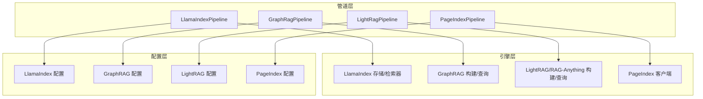
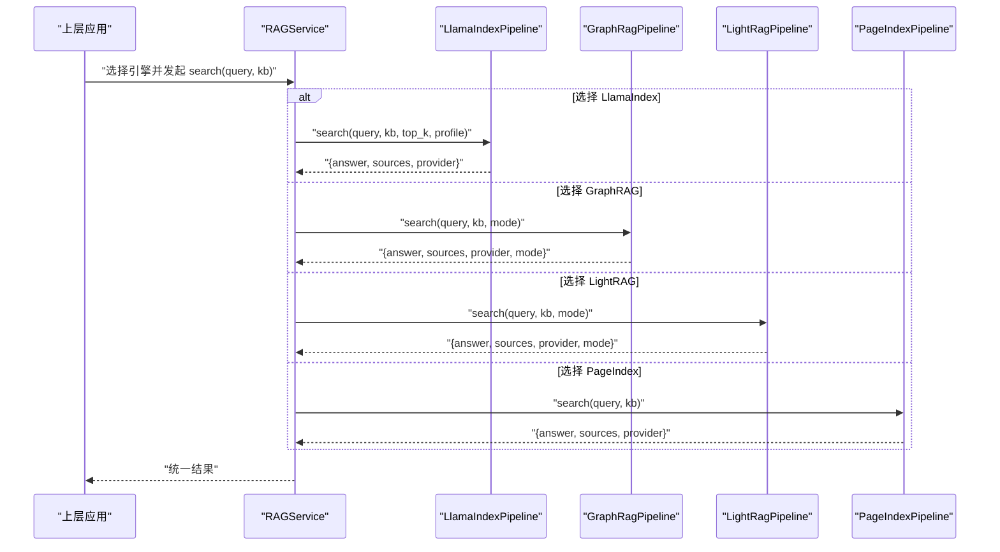
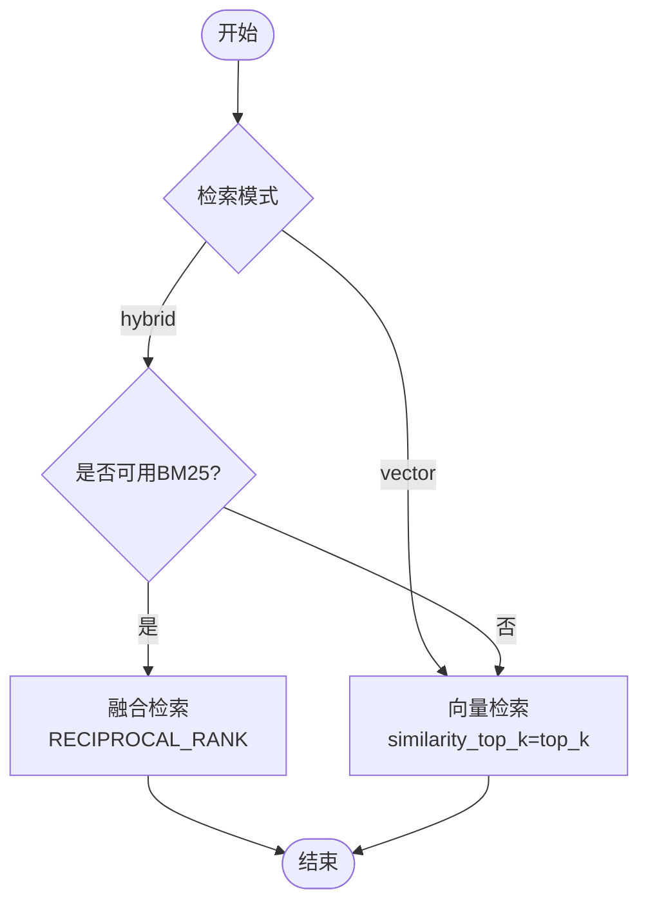
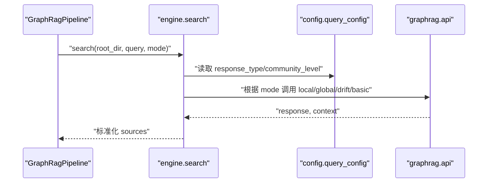
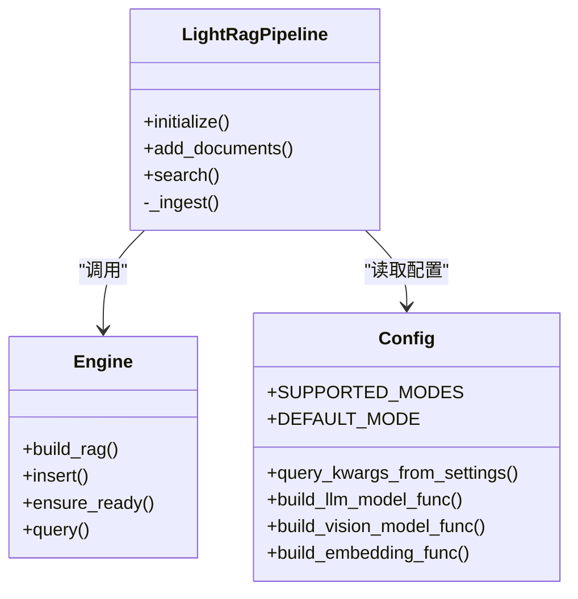
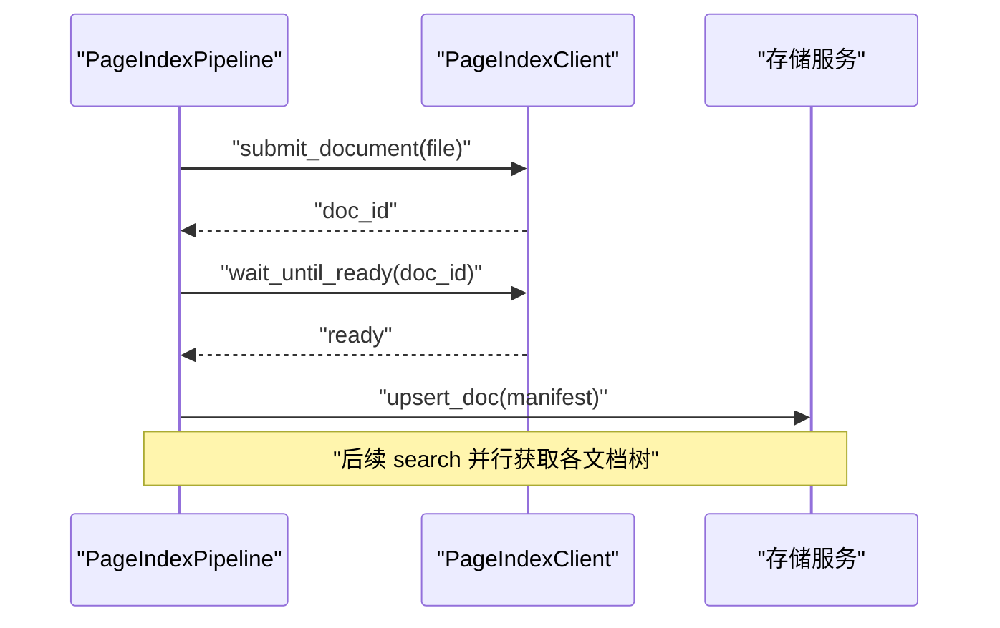
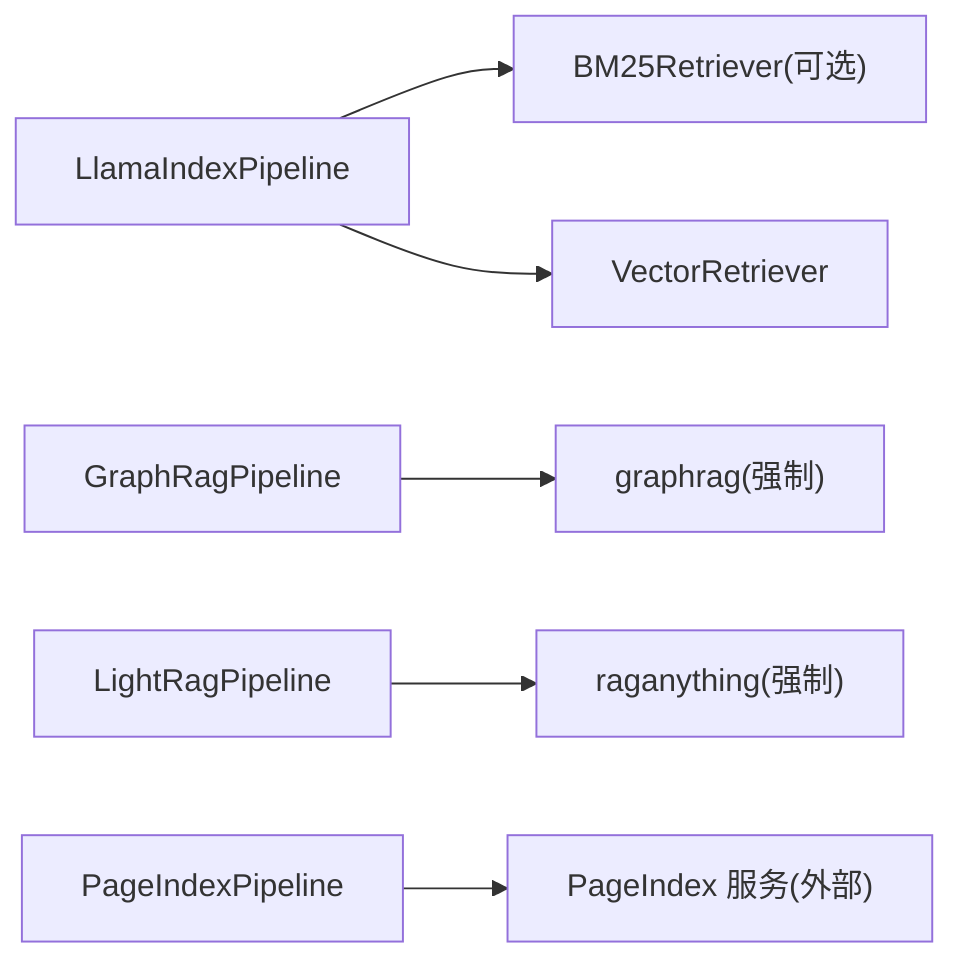
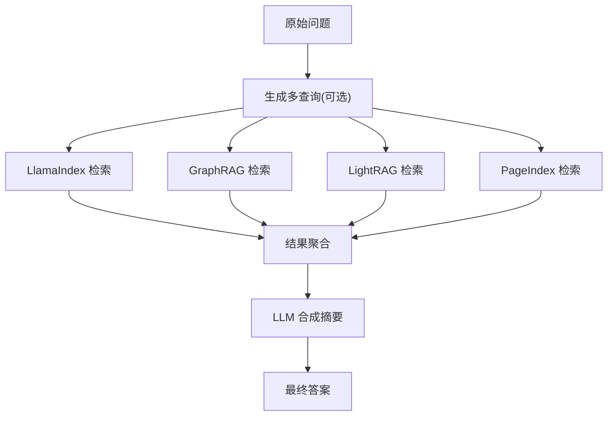

# 检索引擎实现

<cite>
**本文引用的文件**
- [deeptutor/services/rag/pipelines/llamaindex/pipeline.py](file://deeptutor/services/rag/pipelines/llamaindex/pipeline.py)
- [deeptutor/services/rag/pipelines/llamaindex/config.py](file://deeptutor/services/rag/pipelines/llamaindex/config.py)
- [deeptutor/services/rag/pipelines/llamaindex/retrievers.py](file://deeptutor/services/rag/pipelines/llamaindex/retrievers.py)
- [deeptutor/services/rag/pipelines/graphrag/pipeline.py](file://deeptutor/services/rag/pipelines/graphrag/pipeline.py)
- [deeptutor/services/rag/pipelines/graphrag/config.py](file://deeptutor/services/rag/pipelines/graphrag/config.py)
- [deeptutor/services/rag/pipelines/graphrag/engine.py](file://deeptutor/services/rag/pipelines/graphrag/engine.py)
- [deeptutor/services/rag/pipelines/lightrag/pipeline.py](file://deeptutor/services/rag/pipelines/lightrag/pipeline.py)
- [deeptutor/services/rag/pipelines/lightrag/config.py](file://deeptutor/services/rag/pipelines/lightrag/config.py)
- [deeptutor/services/rag/pipelines/lightrag/engine.py](file://deeptutor/services/rag/pipelines/lightrag/engine.py)
- [deeptutor/services/rag/pipelines/pageindex/pipeline.py](file://deeptutor/services/rag/pipelines/pageindex/pipeline.py)
- [deeptutor/services/rag/pipelines/pageindex/config.py](file://deeptutor/services/rag/pipelines/pageindex/config.py)
- [deeptutor/services/rag/smart_retriever.py](file://deeptutor/services/rag/smart_retriever.py)
</cite>

## 目录
1. [简介](#简介)
2. [项目结构](#项目结构)
3. [核心组件](#核心组件)
4. [架构总览](#架构总览)
5. [详细组件分析](#详细组件分析)
6. [依赖关系分析](#依赖关系分析)
7. [性能考量](#性能考量)
8. [故障排查指南](#故障排查指南)
9. [结论](#结论)
10. [附录：配置模板与选型建议](#附录：配置模板与选型建议)

## 简介
本文件系统性梳理 DeepTutor 的四种主要检索引擎实现：LlamaIndex、GraphRAG、LightRAG、PageIndex。内容涵盖各引擎的索引结构、检索算法（向量检索、关键词检索、图谱遍历等）、配置参数与优化选项（相似度阈值、检索数量、缓存策略等）、混合检索策略、引擎切换机制与性能对比，并提供面向不同业务场景的选型指南与配置模板。

## 项目结构
DeepTutor 将 RAG 能力按“管道（Pipeline）+ 引擎（Engine）+ 配置（Config）”分层组织：
- 管道层：对外暴露统一的 initialize/add_documents/search/delete 接口，屏蔽底层差异。
- 引擎层：封装具体第三方库调用（如 LlamaIndex、GraphRAG、LightRAG、PageIndex）。
- 配置层：提供运行时可调参数（top_k、模式、融合策略、社区层级等），并支持从持久化设置与环境变量加载。

图表来源
- [deeptutor/services/rag/pipelines/llamaindex/pipeline.py:38-122](file://deeptutor/services/rag/pipelines/llamaindex/pipeline.py#L38-L122)
- [deeptutor/services/rag/pipelines/graphrag/pipeline.py:36-134](file://deeptutor/services/rag/pipelines/graphrag/pipeline.py#L36-L134)
- [deeptutor/services/rag/pipelines/lightrag/pipeline.py:40-183](file://deeptutor/services/rag/pipelines/lightrag/pipeline.py#L40-L183)
- [deeptutor/services/rag/pipelines/pageindex/pipeline.py:57-154](file://deeptutor/services/rag/pipelines/pageindex/pipeline.py#L57-L154)

章节来源
- [deeptutor/services/rag/pipelines/llamaindex/pipeline.py:38-122](file://deeptutor/services/rag/pipelines/llamaindex/pipeline.py#L38-L122)
- [deeptutor/services/rag/pipelines/graphrag/pipeline.py:36-134](file://deeptutor/services/rag/pipelines/graphrag/pipeline.py#L36-L134)
- [deeptutor/services/rag/pipelines/lightrag/pipeline.py:40-183](file://deeptutor/services/rag/pipelines/lightrag/pipeline.py#L40-L183)
- [deeptutor/services/rag/pipelines/pageindex/pipeline.py:57-154](file://deeptutor/services/rag/pipelines/pageindex/pipeline.py#L57-L154)

## 核心组件
- LlamaIndexPipeline：基于 LlamaIndex 的向量与混合检索，支持 BM25 持久化与融合检索，提供 top_k、分块几何、检索配置文件等参数。
- GraphRagPipeline：基于 microsoft/graphrag 的图谱检索，支持 local/global/drift/basic 多种搜索模式，通过 settings.yaml 注入模型与存储布局。
- LightRagPipeline：基于 RAG-Anything/LightRAG 的文本/多模态知识图谱检索，支持 naive/local/global/hybrid/mix 模式，通过适配器桥接 LLM/Embedding。
- PageIndexPipeline：托管式文档树索引服务，search 返回文档大纲与摘要；深度检索由聊天代理通过 MCP 完成。

章节来源
- [deeptutor/services/rag/pipelines/llamaindex/pipeline.py:38-122](file://deeptutor/services/rag/pipelines/llamaindex/pipeline.py#L38-L122)
- [deeptutor/services/rag/pipelines/graphrag/pipeline.py:36-134](file://deeptutor/services/rag/pipelines/graphrag/pipeline.py#L36-L134)
- [deeptutor/services/rag/pipelines/lightrag/pipeline.py:40-183](file://deeptutor/services/rag/pipelines/lightrag/pipeline.py#L40-L183)
- [deeptutor/services/rag/pipelines/pageindex/pipeline.py:57-154](file://deeptutor/services/rag/pipelines/pageindex/pipeline.py#L57-L154)

## 架构总览
下图展示统一检索入口与各引擎的调用关系，以及配置与存储的交互。

图表来源
- [deeptutor/services/rag/pipelines/llamaindex/pipeline.py:123-177](file://deeptutor/services/rag/pipelines/llamaindex/pipeline.py#L123-L177)
- [deeptutor/services/rag/pipelines/graphrag/pipeline.py:137-173](file://deeptutor/services/rag/pipelines/graphrag/pipeline.py#L137-L173)
- [deeptutor/services/rag/pipelines/lightrag/pipeline.py:186-221](file://deeptutor/services/rag/pipelines/lightrag/pipeline.py#L186-L221)
- [deeptutor/services/rag/pipelines/pageindex/pipeline.py:162-231](file://deeptutor/services/rag/pipelines/pageindex/pipeline.py#L162-L231)

## 详细组件分析

### LlamaIndex 引擎
- 索引结构：向量索引 + 可选 BM25 词项索引（持久化到 bm25_retriever 目录）。
- 检索算法：
  - 向量检索：基于嵌入相似度的节点检索。
  - 关键词检索：BM25Retriever（可选依赖，未安装时自动回退为纯向量检索）。
  - 混合检索：QueryFusionRetriever 使用 RECIPROCAL_RANK 融合向量与 BM25 结果。
- 关键配置：
  - retrieval_profile：vector 或 hybrid（默认 hybrid）。
  - vector_top_k_multiplier / bm25_top_k_multiplier：候选召回倍数。
  - fusion_num_queries：融合阶段生成查询数（固定为 1）。
  - top_k：默认返回片段数（默认 5）。
  - chunk_size / chunk_overlap：分块大小与重叠（默认 512/50）。
- 错误处理：当无匹配索引或嵌入模型不匹配时，返回 needs_reindex 提示；异常统一包装为 search_error_result。

图表来源
- [deeptutor/services/rag/pipelines/llamaindex/retrievers.py:119-151](file://deeptutor/services/rag/pipelines/llamaindex/retrievers.py#L119-L151)
- [deeptutor/services/rag/pipelines/llamaindex/config.py:13-25](file://deeptutor/services/rag/pipelines/llamaindex/config.py#L13-L25)

章节来源
- [deeptutor/services/rag/pipelines/llamaindex/pipeline.py:38-177](file://deeptutor/services/rag/pipelines/llamaindex/pipeline.py#L38-L177)
- [deeptutor/services/rag/pipelines/llamaindex/retrievers.py:26-151](file://deeptutor/services/rag/pipelines/llamaindex/retrievers.py#L26-L151)
- [deeptutor/services/rag/pipelines/llamaindex/config.py:13-95](file://deeptutor/services/rag/pipelines/llamaindex/config.py#L13-L95)

### GraphRAG 引擎
- 索引结构：本地 GraphRAG 项目目录（input/output/cache/logs），settings.yaml 描述模型与存储布局；输出包含 entities、communities、community_reports、text_units、relationships 等表。
- 检索算法：
  - local：实体/社区/关系为中心，适合一般问答。
  - global：全局地图归约，适合跨文档总结。
  - drift：结合 text_units 的动态漂移检索。
  - basic：仅基于文本单元的基础检索。
- 关键配置：
  - search_mode：local/global/drift/basic（默认 local）。
  - response_type：响应风格（默认 Multiple Paragraphs）。
  - community_level：社区层级（默认 2）。
  - dynamic_community_selection：动态社区选择开关。
  - 模型与嵌入：通过 settings.yaml 注入 completion_models 与 embedding_models，并指定 LanceDB 维度。
- 错误处理：未安装 graphrag 或配置缺失时抛出明确异常；索引失败清理版本目录。

图表来源
- [deeptutor/services/rag/pipelines/graphrag/engine.py:128-195](file://deeptutor/services/rag/pipelines/graphrag/engine.py#L128-L195)
- [deeptutor/services/rag/pipelines/graphrag/config.py:78-99](file://deeptutor/services/rag/pipelines/graphrag/config.py#L78-L99)

章节来源
- [deeptutor/services/rag/pipelines/graphrag/pipeline.py:36-193](file://deeptutor/services/rag/pipelines/graphrag/pipeline.py#L36-L193)
- [deeptutor/services/rag/pipelines/graphrag/engine.py:84-195](file://deeptutor/services/rag/pipelines/graphrag/engine.py#L84-L195)
- [deeptutor/services/rag/pipelines/graphrag/config.py:34-205](file://deeptutor/services/rag/pipelines/graphrag/config.py#L34-L205)

### LightRAG 引擎
- 索引结构：RAG-Anything 工作目录，接收 MinerU 风格的 content_list（已解析的多模态内容），内部维护 LightRAG 实例。
- 检索算法：naive/local/global/hybrid/mix（默认 hybrid），通过 aquery 执行。
- 关键配置：
  - search_mode：naive/local/global/hybrid/mix（默认 hybrid）。
  - top_k / response_type：来自 lightrag.json 的设置，透传到 QueryParam。
  - 适配器：LLM、视觉模型、EmbeddingFunc（含维度与最大 token 限制）。
- 错误处理：未安装 raganything 或配置缺失时抛出明确异常；索引失败清理版本目录。

图表来源
- [deeptutor/services/rag/pipelines/lightrag/pipeline.py:40-245](file://deeptutor/services/rag/pipelines/lightrag/pipeline.py#L40-L245)
- [deeptutor/services/rag/pipelines/lightrag/engine.py:33-107](file://deeptutor/services/rag/pipelines/lightrag/engine.py#L33-L107)
- [deeptutor/services/rag/pipelines/lightrag/config.py:30-183](file://deeptutor/services/rag/pipelines/lightrag/config.py#L30-L183)

章节来源
- [deeptutor/services/rag/pipelines/lightrag/pipeline.py:40-245](file://deeptutor/services/rag/pipelines/lightrag/pipeline.py#L40-L245)
- [deeptutor/services/rag/pipelines/lightrag/engine.py:33-107](file://deeptutor/services/rag/pipelines/lightrag/engine.py#L33-L107)
- [deeptutor/services/rag/pipelines/lightrag/config.py:30-183](file://deeptutor/services/rag/pipelines/lightrag/config.py#L30-L183)

### PageIndex 引擎
- 索引结构：托管服务构建文档树（titles/pages/summaries），本地 manifest 记录 doc_id 映射。
- 检索算法：search 返回每篇文档的结构化大纲（标题、页码、摘要），深度检索由聊天代理通过 MCP 工具进行。
- 关键配置：
  - api_key / api_base_url：托管服务凭据。
  - 支持的文件类型：pdf/md/markdown/txt/docx/doc/pptx/ppt/xlsx/xls/csv。
- 错误处理：未配置 API key 时抛出 PageIndexNotConfiguredError；删除 KB 时尝试并发清理云端文档。

图表来源
- [deeptutor/services/rag/pipelines/pageindex/pipeline.py:79-154](file://deeptutor/services/rag/pipelines/pageindex/pipeline.py#L79-L154)
- [deeptutor/services/rag/pipelines/pageindex/config.py:15-42](file://deeptutor/services/rag/pipelines/pageindex/config.py#L15-L42)

章节来源
- [deeptutor/services/rag/pipelines/pageindex/pipeline.py:57-328](file://deeptutor/services/rag/pipelines/pageindex/pipeline.py#L57-L328)
- [deeptutor/services/rag/pipelines/pageindex/config.py:15-60](file://deeptutor/services/rag/pipelines/pageindex/config.py#L15-L60)

## 依赖关系分析
- LlamaIndex：可选 BM25 集成，未安装时自动降级为向量检索；融合检索使用 MockLLM 避免额外 LLM 开销。
- GraphRAG：强依赖 graphrag>=3,<4；通过 LiteLLM 接入 OpenAI 兼容端点；LanceDB 向量存储需指定维度。
- LightRAG：依赖 raganything（捆绑 LightRAG）；通过适配器复用 DeepTutor 的 LLM/Embedding。
- PageIndex：依赖托管服务；本地仅维护 manifest。

图表来源
- [deeptutor/services/rag/pipelines/llamaindex/retrievers.py:26-83](file://deeptutor/services/rag/pipelines/llamaindex/retrievers.py#L26-L83)
- [deeptutor/services/rag/pipelines/graphrag/config.py:55-64](file://deeptutor/services/rag/pipelines/graphrag/config.py#L55-L64)
- [deeptutor/services/rag/pipelines/lightrag/config.py:47-53](file://deeptutor/services/rag/pipelines/lightrag/config.py#L47-L53)
- [deeptutor/services/rag/pipelines/pageindex/config.py:25-42](file://deeptutor/services/rag/pipelines/pageindex/config.py#L25-L42)

章节来源
- [deeptutor/services/rag/pipelines/llamaindex/retrievers.py:26-151](file://deeptutor/services/rag/pipelines/llamaindex/retrievers.py#L26-L151)
- [deeptutor/services/rag/pipelines/graphrag/config.py:55-64](file://deeptutor/services/rag/pipelines/graphrag/config.py#L55-L64)
- [deeptutor/services/rag/pipelines/lightrag/config.py:47-53](file://deeptutor/services/rag/pipelines/lightrag/config.py#L47-L53)
- [deeptutor/services/rag/pipelines/pageindex/config.py:25-42](file://deeptutor/services/rag/pipelines/pageindex/config.py#L25-L42)

## 性能考量
- LlamaIndex：
  - 混合检索可提升召回率，但需安装 BM25 包；可通过 multiplier 调大候选集以改善融合效果。
  - top_k 与分块几何影响上下文质量与延迟；BM25 持久化减少重复构建成本。
- GraphRAG：
  - local 模式通常更经济且稳定；global/drift 更适合复杂推理但耗时更长。
  - 社区层级与动态选择影响答案粒度与速度。
- LightRAG：
  - hybrid/mix 模式兼顾知识与向量；top_k 与 response_type 可调节答案长度与信息密度。
  - 多模态插入无需重解析，利用上游解析结果提升吞吐。
- PageIndex：
  - search 返回结构化大纲，延迟取决于并发请求数；深度检索交由 MCP 代理按需拉取。

[本节为通用指导，不直接分析具体文件]

## 故障排查指南
- LlamaIndex：
  - 无索引或嵌入模型不匹配：返回 needs_reindex，需重建索引或切换回原模型。
  - BM25 不可用：日志提示并回退向量检索。
- GraphRAG：
  - 未安装 graphrag：抛出 GraphRagNotAvailableError，需安装对应 extra。
  - 缺少 LLM/Embedding 配置：抛出 GraphRagNotConfiguredError，需在设置中配置。
- LightRAG：
  - 未安装 raganything：抛出 LightRagNotAvailableError。
  - 缺少 Embedding 维度：抛出 LightRagNotConfiguredError。
- PageIndex：
  - 未配置 API key：抛出 PageIndexNotConfiguredError。
  - 删除 KB 时云端清理失败：记录警告但不阻塞本地删除。

章节来源
- [deeptutor/services/rag/pipelines/llamaindex/pipeline.py:154-177](file://deeptutor/services/rag/pipelines/llamaindex/pipeline.py#L154-L177)
- [deeptutor/services/rag/pipelines/graphrag/pipeline.py:45-50](file://deeptutor/services/rag/pipelines/graphrag/pipeline.py#L45-L50)
- [deeptutor/services/rag/pipelines/graphrag/config.py:47-53](file://deeptutor/services/rag/pipelines/graphrag/config.py#L47-L53)
- [deeptutor/services/rag/pipelines/lightrag/pipeline.py:49-54](file://deeptutor/services/rag/pipelines/lightrag/pipeline.py#L49-L54)
- [deeptutor/services/rag/pipelines/lightrag/config.py:39-44](file://deeptutor/services/rag/pipelines/lightrag/config.py#L39-L44)
- [deeptutor/services/rag/pipelines/pageindex/pipeline.py:191-222](file://deeptutor/services/rag/pipelines/pageindex/pipeline.py#L191-L222)
- [deeptutor/services/rag/pipelines/pageindex/config.py:25-42](file://deeptutor/services/rag/pipelines/pageindex/config.py#L25-L42)

## 结论
DeepTutor 通过统一的管道抽象整合了四种检索引擎，覆盖从向量/关键词到图谱遍历与托管文档树的多样化需求。LlamaIndex 适合通用 RAG 与混合检索；GraphRAG 适合需要社区级理解与全局推理的场景；LightRAG 适合多模态与知识图谱结合的复杂任务；PageIndex 适合结构化文档管理与代理驱动的深度检索。通过合理的配置与混合策略，可在召回率与准确率之间取得平衡。

[本节为总结性内容，不直接分析具体文件]

## 附录：配置模板与选型建议

- 选型建议
  - 通用问答与快速迭代：优先 LlamaIndex（hybrid），开启 BM25 持久化，top_k=5~10。
  - 复杂推理与跨文档总结：GraphRAG（global/drift），community_level=2，response_type=Multiple Paragraphs。
  - 多模态与知识图谱：LightRAG（hybrid/mix），top_k=60，response_type=Multiple Paragraphs。
  - 结构化文档与代理检索：PageIndex，确保 API key 配置，search 用于大纲上下文，深度检索走 MCP。

- 关键配置项速查
  - LlamaIndex
    - retrieval_profile：vector | hybrid（默认 hybrid）
    - vector_top_k_multiplier / bm25_top_k_multiplier：候选倍数（默认 2）
    - fusion_num_queries：融合查询数（默认 1）
    - top_k：默认返回片段数（默认 5）
    - chunk_size / chunk_overlap：分块参数（默认 512/50）
  - GraphRAG
    - search_mode：local | global | drift | basic（默认 local）
    - response_type：Multiple Paragraphs（默认）
    - community_level：2（默认）
    - dynamic_community_selection：False（默认）
  - LightRAG
    - search_mode：naive | local | global | hybrid | mix（默认 hybrid）
    - top_k：60（默认）
    - response_type：Multiple Paragraphs（默认）
  - PageIndex
    - api_key / api_base_url：托管服务凭据

- 混合检索策略
  - LlamaIndex 内建混合：向量 + BM25 融合（RECIPROCAL_RANK），通过 multiplier 扩大候选集以提升召回。
  - 跨引擎混合：SmartRetriever 可并行调用多个引擎，聚合结果后由 LLM 合成摘要，提高鲁棒性与覆盖率。

图表来源
- [deeptutor/services/rag/smart_retriever.py:12-82](file://deeptutor/services/rag/smart_retriever.py#L12-L82)

章节来源
- [deeptutor/services/rag/smart_retriever.py:12-82](file://deeptutor/services/rag/smart_retriever.py#L12-L82)