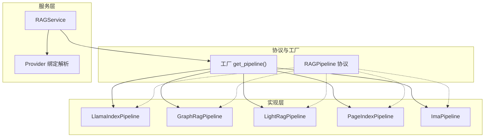
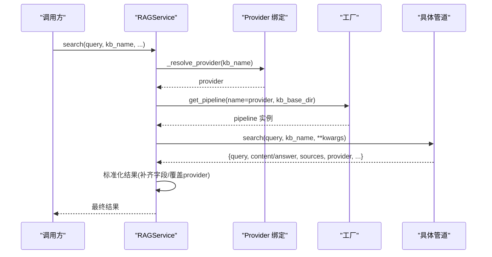
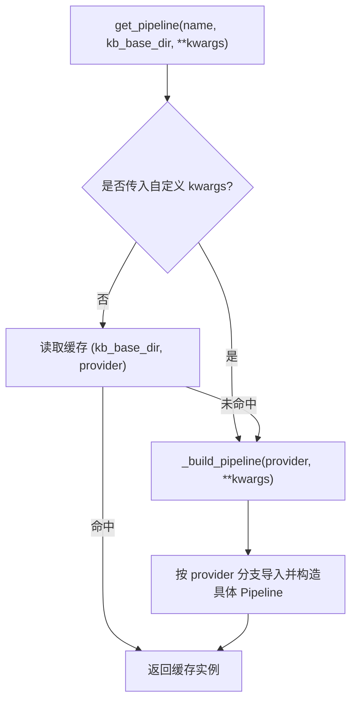
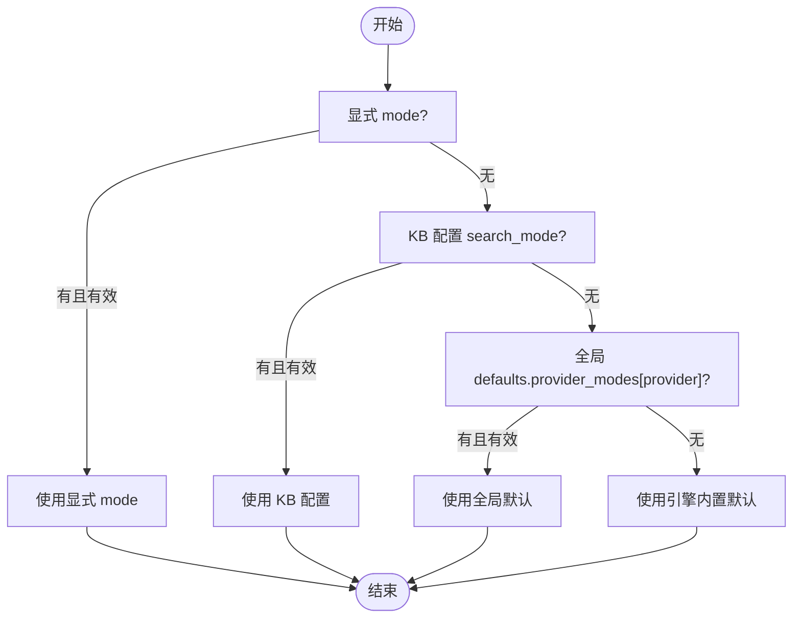
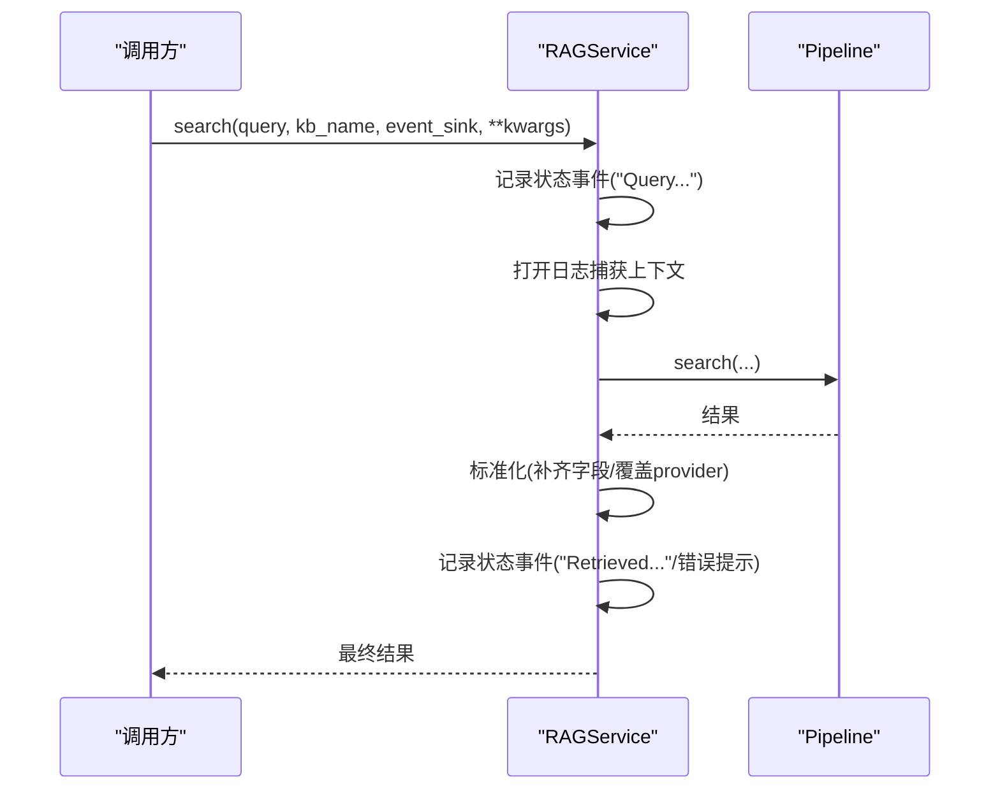
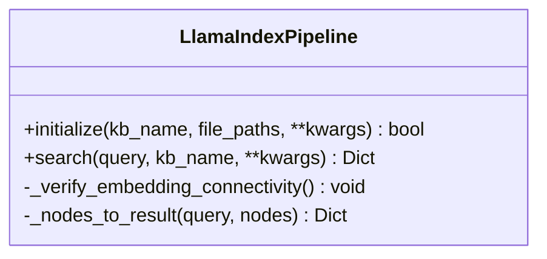
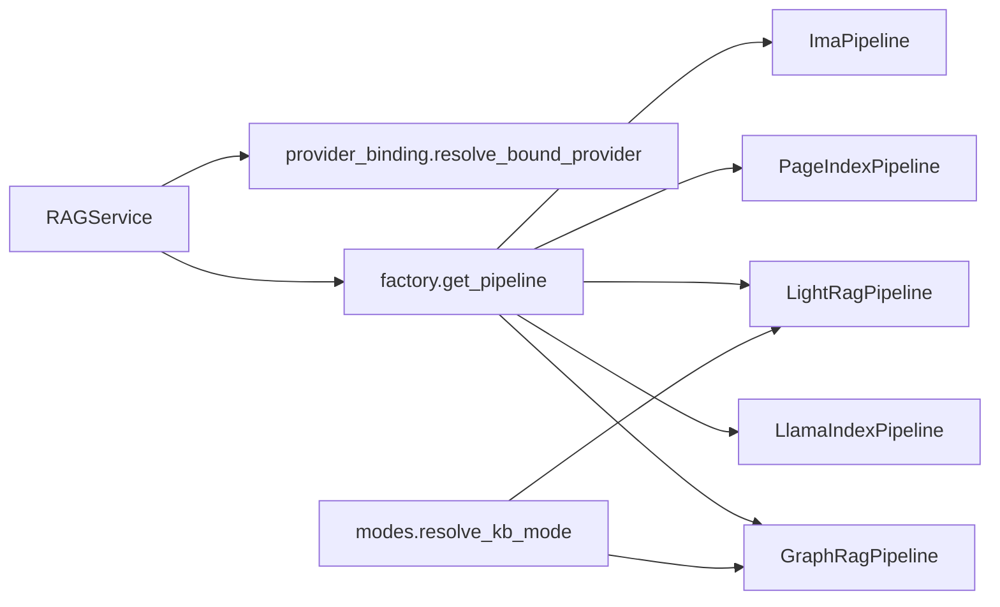

# 管道协议规范

<cite>
**本文引用的文件**
- [base.py](file://deeptutor/services/rag/pipelines/base.py)
- [factory.py](file://deeptutor/services/rag/factory.py)
- [service.py](file://deeptutor/services/rag/service.py)
- [provider_binding.py](file://deeptutor/services/rag/provider_binding.py)
- [pipeline.py](file://deeptutor/services/rag/pipelines/llamaindex/pipeline.py)
- [errors.py](file://deeptutor/services/rag/pipelines/llamaindex/errors.py)
- [modes.py](file://deeptutor/services/rag/pipelines/modes.py)
</cite>

## 目录
1. [简介](#简介)
2. [项目结构](#项目结构)
3. [核心组件](#核心组件)
4. [架构总览](#架构总览)
5. [详细组件分析](#详细组件分析)
6. [依赖关系分析](#依赖关系分析)
7. [性能考量](#性能考量)
8. [故障排查指南](#故障排查指南)
9. [结论](#结论)
10. [附录](#附录)

## 简介
本规范定义 DeepTutor 中 RAG（检索增强生成）管道的统一协议与实现机制，围绕“RAGPipeline”协议、工厂选择、服务编排、错误处理、模式切换与扩展点展开。目标是让新增引擎以最小成本接入，同时保证上层调用一致性与可观测性。

## 项目结构
RAG 子系统采用“协议 + 工厂 + 服务 + 多实现”的分层组织：
- 协议层：定义统一的 RAGPipeline 接口（initialize/add_documents/search/delete）。
- 工厂层：按 provider 名称动态加载具体管道实现，并提供能力探测与列表。
- 服务层：RAGService 作为统一入口，负责解析 KB 绑定、事件上报、日志捕获与结果规范化。
- 实现层：多种管道实现（如 LlamaIndex、GraphRAG、LightRAG、PageIndex、IMA 等），各自封装底层索引与检索逻辑。

图表来源
- [base.py:16-38](file://deeptutor/services/rag/pipelines/base.py#L16-L38)
- [factory.py:120-179](file://deeptutor/services/rag/factory.py#L120-L179)
- [service.py:23-66](file://deeptutor/services/rag/service.py#L23-L66)

章节来源
- [base.py:16-38](file://deeptutor/services/rag/pipelines/base.py#L16-L38)
- [factory.py:120-179](file://deeptutor/services/rag/factory.py#L120-L179)
- [service.py:23-66](file://deeptutor/services/rag/service.py#L23-L66)

## 核心组件
- RAGPipeline 协议：统一四个异步方法 initialize、add_documents、search、delete，要求 search 返回至少包含 query、content/answer、sources、provider 的字典。
- 工厂（Factory）：根据 provider 名称构建并缓存管道实例；支持未知 provider 回退到默认；提供 list_pipelines 用于 UI 展示可用能力。
- 服务（RAGService）：统一入口，解析 KB 绑定的 provider，转发调用至对应管道；对 search 结果进行标准化（补齐字段、覆盖 provider）；在搜索路径中注入事件与原始日志；删除时若管道未实现 delete 则回退为删除本地目录。
- Provider 绑定：从 kb_config.json 或旧版 metadata.json 解析 KB 绑定的 provider，确保检索与增量更新走同一引擎。

章节来源
- [base.py:16-38](file://deeptutor/services/rag/pipelines/base.py#L16-L38)
- [factory.py:54-179](file://deeptutor/services/rag/factory.py#L54-L179)
- [service.py:23-170](file://deeptutor/services/rag/service.py#L23-L170)
- [provider_binding.py:45-63](file://deeptutor/services/rag/provider_binding.py#L45-L63)

## 架构总览
下图展示了从调用方到具体管道的完整流程，包括 provider 解析、管道选择、搜索执行、结果标准化与事件上报。

图表来源
- [service.py:84-170](file://deeptutor/services/rag/service.py#L84-L170)
- [provider_binding.py:45-63](file://deeptutor/services/rag/provider_binding.py#L45-L63)
- [factory.py:163-179](file://deeptutor/services/rag/factory.py#L163-L179)

## 详细组件分析

### 协议与统一接口
- initialize(kb_name, file_paths, **kwargs) -> bool：为指定 KB 从头构建索引。
- add_documents(kb_name, file_paths, **kwargs) -> bool：增量追加文档到已有索引（可选）。
- search(query, kb_name, **kwargs) -> Dict[str, Any]：检索并返回结构化上下文，必须包含 query、content/answer、sources、provider。
- delete(kb_name, **kwargs) -> bool：删除 KB 及引擎侧资源（可选）。

设计要点
- 协议刻意保持最小化，便于新引擎快速接入。
- 服务层通过 hasattr 容忍部分实现缺失（例如无 add_documents 时回退到 initialize）。

章节来源
- [base.py:16-38](file://deeptutor/services/rag/pipelines/base.py#L16-L38)
- [service.py:74-82](file://deeptutor/services/rag/service.py#L74-L82)

### 工厂模式与运行时配置
- normalize_provider_name：将传入 provider 归一化，未知值回退到默认。
- get_pipeline：按 provider 构建并缓存实例；当传入自定义 kwargs 时跳过缓存以保证覆盖生效。
- list_pipelines：探测各引擎可用性并返回描述信息，供 UI 选择。
- 版本与签名：默认引擎使用嵌入签名管理索引版本；其他引擎使用合成签名避免误判过期。

图表来源
- [factory.py:163-179](file://deeptutor/services/rag/factory.py#L163-L179)
- [factory.py:120-160](file://deeptutor/services/rag/factory.py#L120-L160)

章节来源
- [factory.py:54-179](file://deeptutor/services/rag/factory.py#L54-L179)

### 管道模式的选择与切换
- 模式解析 resolve_kb_mode：优先级为显式 mode > KB 配置中的 search_mode > 全局 defaults.provider_modes[provider] > 引擎内置默认。
- 该机制适用于 LightRAG、GraphRAG 等具备多模式的引擎，允许在单次查询或 KB 级别灵活切换检索策略。

图表来源
- [modes.py:19-45](file://deeptutor/services/rag/pipelines/modes.py#L19-L45)

章节来源
- [modes.py:1-49](file://deeptutor/services/rag/pipelines/modes.py#L1-L49)

### 服务层：统一入口与事件/日志
- 统一入口：RAGService 对外暴露 initialize/add_documents/search/delete/smart_retrieve/list_providers/get_current_provider/has_provider。
- 事件上报：search 过程中向 event_sink 推送状态与摘要；必要时输出 raw_log。
- 原始日志捕获：在搜索期间捕获第三方库日志（如 lightrag/graphrag），过滤噪音后透传。
- 结果标准化：补齐 answer/content、强制覆盖 provider 为当前解析到的引擎。

图表来源
- [service.py:84-170](file://deeptutor/services/rag/service.py#L84-L170)
- [service.py:171-277](file://deeptutor/services/rag/service.py#L171-L277)

章节来源
- [service.py:23-170](file://deeptutor/services/rag/service.py#L23-L170)
- [service.py:171-277](file://deeptutor/services/rag/service.py#L171-L277)

### 典型实现：LlamaIndex 管道
- initialize：校验嵌入连通性、加载文档、创建向量索引、持久化存储、写入版本元数据。
- search：按嵌入签名定位存储目录，执行检索并转换为结果；若无匹配索引则返回 needs_reindex 提示。
- 错误处理：将底层异常分类为 invalid_embedding_provider_response、invalid_embedding_index 等，并附带 needs_reindex 标志。

图表来源
- [pipeline.py:38-121](file://deeptutor/services/rag/pipelines/llamaindex/pipeline.py#L38-L121)
- [pipeline.py:123-177](file://deeptutor/services/rag/pipelines/llamaindex/pipeline.py#L123-L177)
- [errors.py:8-59](file://deeptutor/services/rag/pipelines/llamaindex/errors.py#L8-L59)

章节来源
- [pipeline.py:38-177](file://deeptutor/services/rag/pipelines/llamaindex/pipeline.py#L38-L177)
- [errors.py:8-59](file://deeptutor/services/rag/pipelines/llamaindex/errors.py#L8-L59)

### 新增引擎开发指南
- 实现 RAGPipeline 协议：至少实现 initialize、search、delete；add_documents 可选。
- 注册到工厂：在 _build_pipeline 中添加分支，或在 list_pipelines 中声明能力与模式。
- 遵循结果契约：search 返回必须包含 query、content/answer、sources、provider；如需指示重新索引，设置 needs_reindex。
- 错误分类：参考 errors.py 的模式，将异常映射为带 error_type 的结构化结果，便于上层降级与重试。
- 测试建议：
  - 单元测试：验证 initialize/search/delete 的行为与边界条件。
  - 集成测试：模拟真实 KB 目录与外部依赖，验证端到端流程。
  - 兼容性测试：确保与 RAGService 的事件与日志捕获兼容。

章节来源
- [base.py:16-38](file://deeptutor/services/rag/pipelines/base.py#L16-L38)
- [factory.py:120-179](file://deeptutor/services/rag/factory.py#L120-L179)
- [errors.py:8-59](file://deeptutor/services/rag/pipelines/llamaindex/errors.py#L8-L59)

## 依赖关系分析
- RAGService 依赖 provider_binding 解析 KB 绑定，依赖 factory 获取管道实例。
- 工厂依赖各具体管道模块，按需延迟导入以减少启动开销。
- 模式解析 modes.py 被具备多模式的引擎共享，解耦了配置优先级。

图表来源
- [service.py:23-66](file://deeptutor/services/rag/service.py#L23-L66)
- [factory.py:120-179](file://deeptutor/services/rag/factory.py#L120-L179)
- [modes.py:19-45](file://deeptutor/services/rag/pipelines/modes.py#L19-L45)

章节来源
- [service.py:23-66](file://deeptutor/services/rag/service.py#L23-L66)
- [factory.py:120-179](file://deeptutor/services/rag/factory.py#L120-L179)
- [modes.py:19-45](file://deeptutor/services/rag/pipelines/modes.py#L19-L45)

## 性能考量
- 索引构建与检索：
  - 在 LlamaIndex 管道中，索引创建与节点检索通过线程池执行，避免阻塞事件循环。
  - 嵌入模型连接在初始化前校验，失败尽早返回，减少无效工作。
- 缓存与复用：
  - 工厂对无自定义参数的管道实例进行缓存，降低重复构建开销。
- 日志与事件：
  - 搜索路径中捕获并过滤噪音日志，仅上报必要 raw_log，降低额外开销。
- 指标建议（可在上层埋点）：
  - 响应时间：initialize/search 的起止时间差。
  - 吞吐量：单位时间内成功处理的请求数。
  - 资源利用率：CPU/内存峰值、I/O 等待时长。
  - 错误率：按 error_type 统计失败比例。
  - 重索引率：needs_reindex 占比。

[本节为通用指导，不直接分析具体文件]

## 故障排查指南
- 常见错误类型与处理：
  - invalid_embedding_provider_response：嵌入提供者返回无效向量，检查嵌入模型与密钥配置。
  - invalid_embedding_index：索引内嵌入向量损坏或不一致，需重新索引。
  - needs_reindex：当前嵌入签名与索引不匹配，提示重新索引。
- 排查步骤：
  - 确认 KB 绑定的 provider 是否正确（provider_binding）。
  - 检查嵌入连通性与模型配置（LlamaIndex 初始化阶段会校验）。
  - 查看搜索结果中的 error_type 与 log_message，定位根因。
  - 若管道未实现 delete，服务会回退删除本地目录，确认期望行为。
- 重试与降级：
  - 对 transient 错误（如网络抖动）可实施指数退避重试。
  - 对 needs_reindex 错误应触发重建索引流程。
  - 对不可恢复错误（如索引损坏）应提示用户并回退到备用引擎或离线答案。

章节来源
- [errors.py:8-59](file://deeptutor/services/rag/pipelines/llamaindex/errors.py#L8-L59)
- [service.py:279-292](file://deeptutor/services/rag/service.py#L279-L292)

## 结论
本规范通过明确的 RAGPipeline 协议、灵活的工厂选择、统一的服务编排与完善的错误处理，实现了多后端 RAG 引擎的可插拔与一致性体验。新增引擎只需实现协议并在工厂中注册，即可无缝融入现有生态。建议在实现中遵循结果契约、错误分类与模式解析约定，并结合上层埋点完善性能监控与可观测性。

## 附录
- 关键方法速查
  - RAGService.search：统一检索入口，负责事件上报与结果标准化。
  - factory.get_pipeline：按 provider 获取并缓存管道实例。
  - modes.resolve_kb_mode：解析检索模式优先级。
  - provider_binding.resolve_bound_provider：解析 KB 绑定的 provider。
- 最佳实践
  - 在 initialize 中校验外部依赖连通性，失败尽早返回。
  - 在 search 中捕获并分类异常，返回结构化错误以便上层处理。
  - 对耗时操作使用线程池或异步任务，避免阻塞事件循环。
  - 通过 list_pipelines 暴露能力与模式，便于前端动态渲染。

[本节为补充说明，不直接分析具体文件]