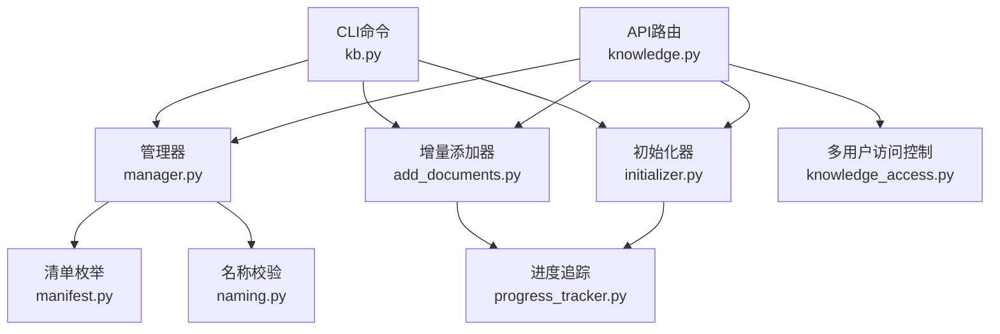
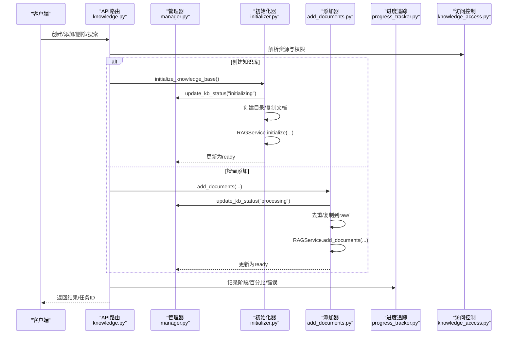
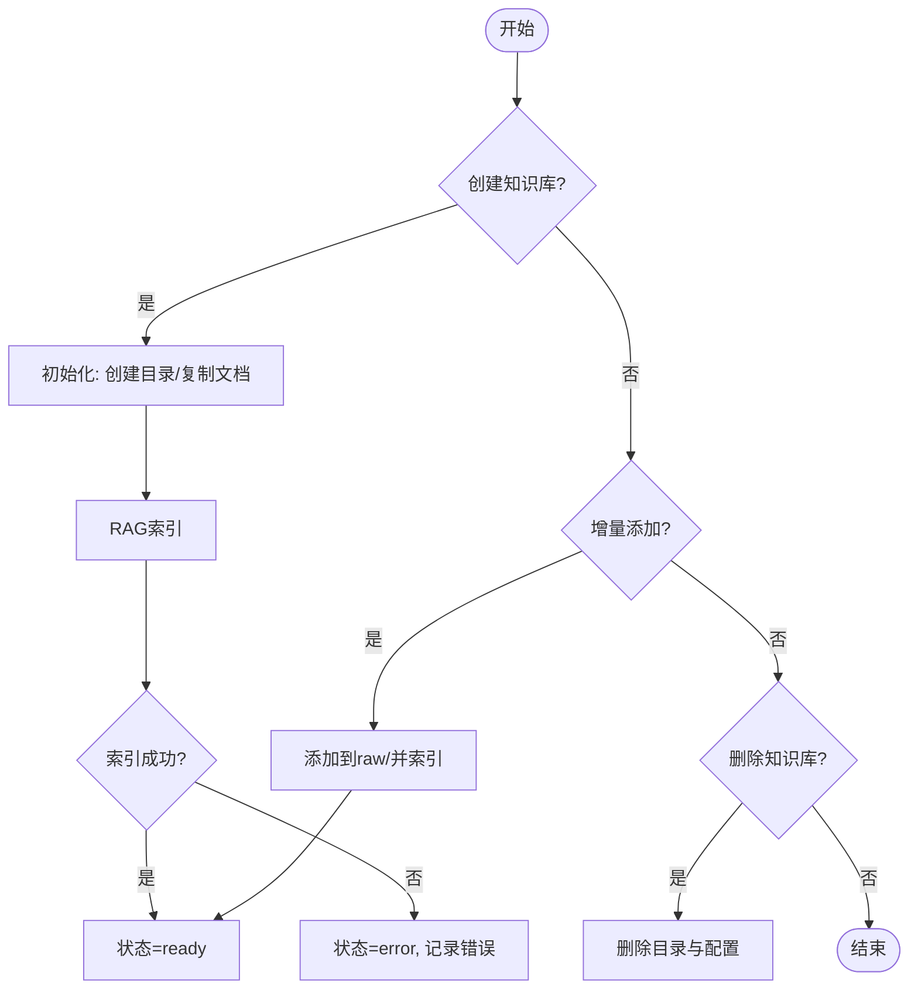
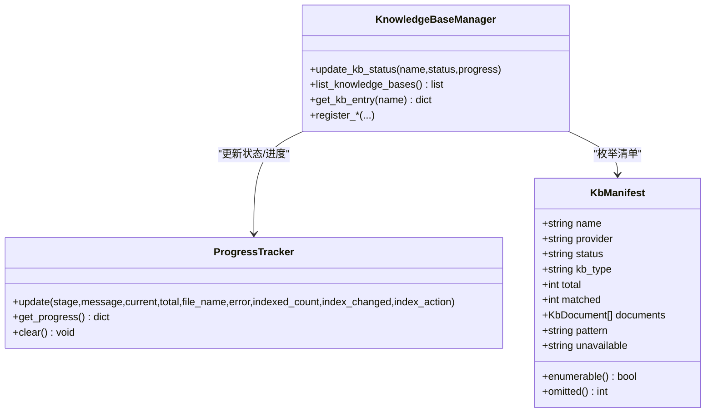
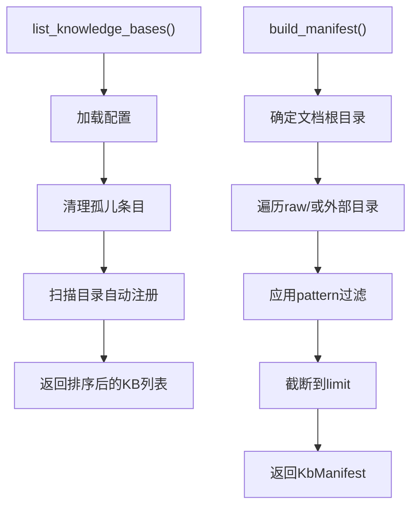
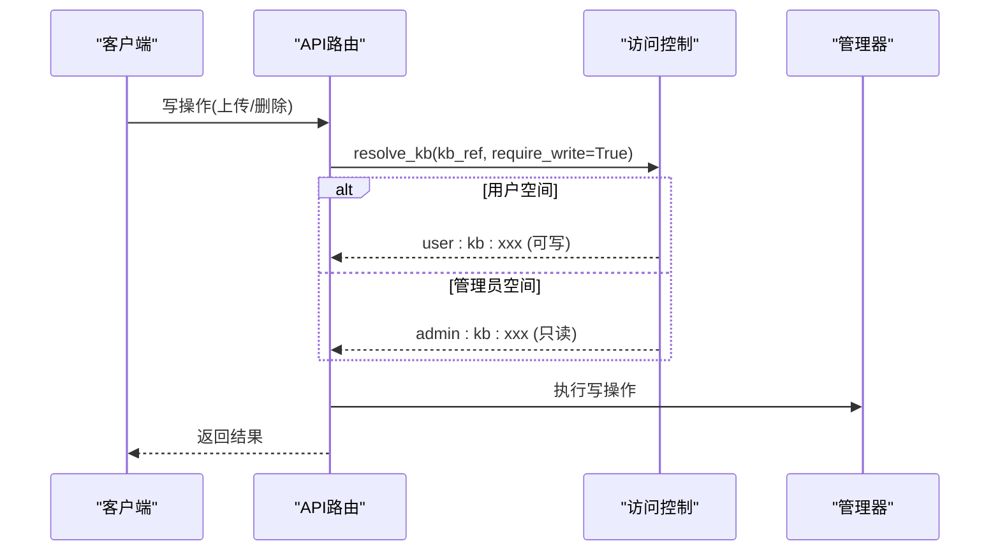
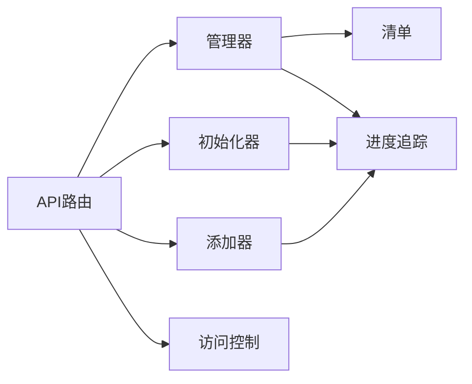

# 知识库管理

<cite>
**本文引用的文件**
- [manager.py](file://deeptutor/knowledge/manager.py)
- [manifest.py](file://deeptutor/knowledge/manifest.py)
- [naming.py](file://deeptutor/knowledge/naming.py)
- [initializer.py](file://deeptutor/knowledge/initializer.py)
- [add_documents.py](file://deeptutor/knowledge/add_documents.py)
- [progress_tracker.py](file://deeptutor/knowledge/progress_tracker.py)
- [knowledge_access.py](file://deeptutor/multi_user/knowledge_access.py)
- [knowledge.py](file://deeptutor/api/routers/knowledge.py)
- [kb.py](file://deeptutor_cli/kb.py)
</cite>

## 目录
1. [简介](#简介)
2. [项目结构](#项目结构)
3. [核心组件](#核心组件)
4. [架构总览](#架构总览)
5. [详细组件分析](#详细组件分析)
6. [依赖关系分析](#依赖关系分析)
7. [性能与扩展性](#性能与扩展性)
8. [故障排除指南](#故障排除指南)
9. [结论](#结论)
10. [附录：API与CLI参考](#附录api与cli参考)

## 简介
本文件面向DeepTutor的知识库（Knowledge Base）管理能力，覆盖生命周期管理、元数据管理、发现与枚举、权限控制、备份恢复策略、监控统计以及最佳实践与故障排除。内容基于代码仓库中的实现进行梳理，并提供可视化图示帮助理解。

## 项目结构
知识库相关能力主要分布在以下模块：
- 管理与配置：manager.py
- 文档清单与枚举：manifest.py
- 名称校验：naming.py
- 初始化流程：initializer.py
- 增量添加与删除：add_documents.py
- 进度追踪：progress_tracker.py
- 多用户访问控制：knowledge_access.py
- API路由：knowledge.py
- CLI命令：kb.py

图表来源
- [knowledge.py:1-120](file://deeptutor/api/routers/knowledge.py#L1-L120)
- [manager.py:244-341](file://deeptutor/knowledge/manager.py#L244-L341)
- [initializer.py:26-129](file://deeptutor/knowledge/initializer.py#L26-L129)
- [add_documents.py:144-337](file://deeptutor/knowledge/add_documents.py#L144-L337)
- [manifest.py:157-215](file://deeptutor/knowledge/manifest.py#L157-L215)
- [naming.py:13-40](file://deeptutor/knowledge/naming.py#L13-L40)
- [progress_tracker.py:34-211](file://deeptutor/knowledge/progress_tracker.py#L34-L211)
- [knowledge_access.py:69-151](file://deeptutor/multi_user/knowledge_access.py#L69-L151)
- [kb.py:61-287](file://deeptutor_cli/kb.py#L61-L287)

章节来源
- [knowledge.py:1-120](file://deeptutor/api/routers/knowledge.py#L1-L120)
- [manager.py:244-341](file://deeptutor/knowledge/manager.py#L244-L341)

## 核心组件
- KnowledgeBaseManager：负责知识库的注册、列表、状态更新、默认库设置、连接型知识库（Obsidian、Linked、Subagent）注册、嵌入指纹与索引版本对齐等。
- KnowledgeBaseInitializer：创建目录结构、复制文档、调用RAG服务完成索引、更新元数据与配置。
- DocumentAdder：增量添加文档到已就绪的知识库，维护去重哈希、更新metadata与进度。
- Manifest：按文件系统事实构建知识库文档清单，支持模式过滤与截断，提供本地化渲染。
- ProgressTracker：持久化并广播初始化/上传进度，映射阶段到状态，写入任务日志流。
- knowledge_access：多用户可见性与写保护，解析资源ID、列出可见知识库、读取受控清单。
- API路由：封装HTTP接口，处理上传、链接文件夹、初始化、搜索、状态查询等。
- CLI：提供list/info/create/add/delete/search等命令。

章节来源
- [manager.py:244-800](file://deeptutor/knowledge/manager.py#L244-L800)
- [initializer.py:26-223](file://deeptutor/knowledge/initializer.py#L26-L223)
- [add_documents.py:144-337](file://deeptutor/knowledge/add_documents.py#L144-L337)
- [manifest.py:157-215](file://deeptutor/knowledge/manifest.py#L157-L215)
- [progress_tracker.py:34-211](file://deeptutor/knowledge/progress_tracker.py#L34-L211)
- [knowledge_access.py:69-216](file://deeptutor/multi_user/knowledge_access.py#L69-L216)
- [knowledge.py:1-120](file://deeptutor/api/routers/knowledge.py#L1-L120)
- [kb.py:61-287](file://deeptutor_cli/kb.py#L61-L287)

## 架构总览
知识库的生命周期由API路由触发，经由管理器与初始化器/添加器协同完成；进度通过进度追踪器持久化并广播；清单枚举用于系统提示与工具输出；多用户层确保可见性与写保护。

图表来源
- [knowledge.py:752-800](file://deeptutor/api/routers/knowledge.py#L752-L800)
- [initializer.py:245-301](file://deeptutor/knowledge/initializer.py#L245-L301)
- [add_documents.py:339-431](file://deeptutor/knowledge/add_documents.py#L339-L431)
- [progress_tracker.py:133-211](file://deeptutor/knowledge/progress_tracker.py#L133-L211)
- [knowledge_access.py:69-151](file://deeptutor/multi_user/knowledge_access.py#L69-L151)

## 详细组件分析

### 生命周期管理：创建、初始化、更新、删除
- 创建与初始化
  - API路由接收请求后，调用初始化器创建目录结构、复制文档、执行RAG索引，并将状态从“initializing”推进到“ready”。
  - 初始化过程中持续更新进度，包含批次数、当前文件、错误信息等。
- 增量更新
  - 使用添加器将新文档加入raw/，通过RAG服务增量索引，更新metadata与最后索引时间/计数。
  - 若检测到旧版索引格式或需要重建，会拒绝增量操作并提示重建。
- 删除
  - 通过管理器删除知识库条目与目录，清理配置与索引。
- 连接型知识库
  - Obsidian Vault、Linked Index、Subagent连接类型不经过索引流水线，仅作为指针存在，读写行为受限。

图表来源
- [initializer.py:109-223](file://deeptutor/knowledge/initializer.py#L109-L223)
- [add_documents.py:216-337](file://deeptutor/knowledge/add_documents.py#L216-L337)
- [manager.py:674-800](file://deeptutor/knowledge/manager.py#L674-L800)

章节来源
- [initializer.py:26-223](file://deeptutor/knowledge/initializer.py#L26-L223)
- [add_documents.py:144-337](file://deeptutor/knowledge/add_documents.py#L144-L337)
- [manager.py:674-800](file://deeptutor/knowledge/manager.py#L674-L800)

### 元数据管理：名称规范、版本控制、状态跟踪
- 名称规范
  - 名称需通过校验器，禁止控制字符与路径/URL保留字符，限制最大长度，规范化Unicode。
- 版本控制
  - 每个知识库维护metadata.json，记录创建时间、描述、版本、RAG提供者、是否需要重建、最后更新时间/索引时间/计数/动作等。
  - 管理器在ready时记录嵌入模型指纹与签名，并刷新索引版本列表供UI展示。
- 状态跟踪
  - 状态包括initializing、processing、ready、error，配合进度对象（stage、message、percent、current、total、file_name、error、timestamp）。
  - 进度追踪器将阶段映射为状态，持久化到.kb_config.json与.progress.json，并通过任务流广播。

图表来源
- [manifest.py:69-109](file://deeptutor/knowledge/manifest.py#L69-L109)
- [progress_tracker.py:34-211](file://deeptutor/knowledge/progress_tracker.py#L34-L211)
- [manager.py:381-490](file://deeptutor/knowledge/manager.py#L381-L490)

章节来源
- [naming.py:13-40](file://deeptutor/knowledge/naming.py#L13-L40)
- [initializer.py:109-129](file://deeptutor/knowledge/initializer.py#L109-L129)
- [manager.py:381-490](file://deeptutor/knowledge/manager.py#L381-L490)
- [progress_tracker.py:34-211](file://deeptutor/knowledge/progress_tracker.py#L34-L211)

### 发现与枚举机制：条件筛选与排序
- 发现
  - 管理器在list时加载配置，清理孤儿条目（目录不存在且超过宽限期），扫描目录自动注册有效知识库。
  - 对连接型知识库（Obsidian、Linked、Subagent）特殊处理，不视为本地目录。
- 枚举
  - 清单模块按文件系统事实遍历raw/或外部目录，跳过隐藏项与符号链接目录，支持glob/子串过滤，限制输出数量避免上下文爆炸。
  - 非文档型知识库（远程服务器、智能体）标记为不可枚举，返回原因码。

图表来源
- [manager.py:515-600](file://deeptutor/knowledge/manager.py#L515-L600)
- [manifest.py:111-215](file://deeptutor/knowledge/manifest.py#L111-L215)

章节来源
- [manager.py:515-600](file://deeptutor/knowledge/manager.py#L515-L600)
- [manifest.py:111-215](file://deeptutor/knowledge/manifest.py#L111-L215)

### 权限控制与访问管理
- 资源解析
  - 支持user/admin前缀与默认别名，管理员可访问admin空间，普通用户只能访问其个人空间或被分配的只读admin知识库。
- 写保护
  - 写操作需resolve_kb(require_write=True)，分配的管理员知识库强制只读；连接型知识库也拒绝写入。
- 可见性
  - list_visible_knowledge_bases合并用户自身与管理员分配的知识库，标注来源、是否只读、可用性、是否需要管理员重建等。

图表来源
- [knowledge_access.py:69-151](file://deeptutor/multi_user/knowledge_access.py#L69-L151)
- [knowledge.py:695-721](file://deeptutor/api/routers/knowledge.py#L695-L721)

章节来源
- [knowledge_access.py:69-216](file://deeptutor/multi_user/knowledge_access.py#L69-L216)
- [knowledge.py:695-721](file://deeptutor/api/routers/knowledge.py#L695-L721)

### 备份与恢复策略：数据迁移与灾难恢复
- 数据位置
  - 知识库数据位于data/knowledge_bases/<kb_name>，包含raw/、llamaindex_storage/、metadata.json、.progress.json等。
- 备份建议
  - 直接备份整个data/knowledge_bases目录即可保留文档、索引与元数据；如需跨环境迁移，注意RAG提供者与嵌入模型一致性。
- 恢复建议
  - 将备份目录恢复到目标环境的相同路径；启动服务后管理器会自动加载配置并识别索引版本。
- 注意事项
  - 连接型知识库（Obsidian/Linked/Subagent）指向外部路径，恢复时需保证外部路径可达。
  - PocketBase同步为可选增强功能，不影响本地数据完整性。

章节来源
- [initializer.py:109-129](file://deeptutor/knowledge/initializer.py#L109-L129)
- [add_documents.py:144-194](file://deeptutor/knowledge/add_documents.py#L144-L194)
- [manager.py:247-261](file://deeptutor/knowledge/manager.py#L247-L261)

### 监控与统计：文档数量、索引状态、使用情况
- 文档数量
  - 清单模块统计raw/或外部目录的真实文件数，不受索引影响；支持匹配计数与省略计数。
- 索引状态
  - 管理器记录status、needs_reindex、embedding_mismatch、last_indexed_at/count/action等；进度追踪器记录阶段与百分比。
- 使用情况
  - 多用户层在访问分配的知识库时记录使用审计（如rag_query）；API路由支持任务日志流与进度广播。

章节来源
- [manifest.py:157-215](file://deeptutor/knowledge/manifest.py#L157-L215)
- [manager.py:381-490](file://deeptutor/knowledge/manager.py#L381-L490)
- [progress_tracker.py:133-211](file://deeptutor/knowledge/progress_tracker.py#L133-L211)
- [knowledge_access.py:223-231](file://deeptutor/multi_user/knowledge_access.py#L223-L231)

### 最佳实践与故障排除
- 最佳实践
  - 使用名称校验器确保KB名称安全；为大型知识库合理设置清单limit；避免连接型知识库误用写入接口。
  - 增量添加前先确认索引格式兼容；必要时先重建索引。
  - 利用进度追踪与任务日志流监控长耗时操作。
- 常见问题
  - 连接型知识库写入被拒：检查是否为Obsidian/Linked/Subagent类型。
  - 需要重建索引：当provider变更或嵌入指纹不一致时，管理器会标记needs_reindex。
  - 上传失败：检查文件大小、扩展名、ZIP解压安全；查看错误消息与任务日志。

章节来源
- [knowledge.py:695-721](file://deeptutor/api/routers/knowledge.py#L695-L721)
- [manager.py:128-241](file://deeptutor/knowledge/manager.py#L128-L241)
- [add_documents.py:216-337](file://deeptutor/knowledge/add_documents.py#L216-L337)

## 依赖关系分析
- 管理器依赖清单枚举、RAG工厂、索引探测、原子写入等；初始化器与添加器依赖RAG服务与文件路由；多用户层依赖管理器与清单模块；API路由聚合各组件。
- 耦合点
  - 管理器与进度追踪器：状态与进度双向同步。
  - 清单与多用户层：受控枚举入口。
  - API路由与访问控制：写保护与资源解析。

图表来源
- [knowledge.py:1-120](file://deeptutor/api/routers/knowledge.py#L1-L120)
- [manager.py:244-341](file://deeptutor/knowledge/manager.py#L244-L341)
- [initializer.py:26-129](file://deeptutor/knowledge/initializer.py#L26-L129)
- [add_documents.py:144-337](file://deeptutor/knowledge/add_documents.py#L144-L337)
- [knowledge_access.py:69-151](file://deeptutor/multi_user/knowledge_access.py#L69-L151)

章节来源
- [knowledge.py:1-120](file://deeptutor/api/routers/knowledge.py#L1-L120)
- [manager.py:244-341](file://deeptutor/knowledge/manager.py#L244-L341)

## 性能与扩展性
- 清单枚举采用深度优先+排序遍历，避免隐藏文件与符号链接循环，支持pattern过滤与截断，减少上下文占用。
- 上传与保存走线程执行，避免阻塞事件循环；ZIP解压与安全校验防止zip-bomb与路径穿越。
- 进度追踪持久化与广播，支持WebSocket与页面重载恢复。
- 可扩展点
  - 新增RAG提供者需在工厂中注册；连接型知识库类型可在管理器中扩展。
  - 清单渲染支持多语言，便于国际化。

章节来源
- [manifest.py:111-215](file://deeptutor/knowledge/manifest.py#L111-L215)
- [knowledge.py:461-487](file://deeptutor/api/routers/knowledge.py#L461-L487)
- [progress_tracker.py:133-211](file://deeptutor/knowledge/progress_tracker.py#L133-L211)

## 故障排除指南
- 无法枚举文档
  - 检查知识库类型是否为远程或智能体；确认raw/或外部目录存在且可读。
- 增量添加失败
  - 确认索引格式兼容；查看错误消息与任务日志；必要时重建索引。
- 连接型知识库写入被拒
  - 该类型为只读指针，需通过对应能力（如Obsidian）管理。
- 进度不更新
  - 检查任务ID与日志流；确认进度文件存在且可写。

章节来源
- [manifest.py:157-215](file://deeptutor/knowledge/manifest.py#L157-L215)
- [add_documents.py:216-337](file://deeptutor/knowledge/add_documents.py#L216-L337)
- [knowledge.py:695-721](file://deeptutor/api/routers/knowledge.py#L695-L721)
- [progress_tracker.py:133-211](file://deeptutor/knowledge/progress_tracker.py#L133-L211)

## 结论
DeepTutor的知识库管理提供了完整的生命周期能力，涵盖创建、初始化、增量更新、删除、发现枚举、权限控制、备份恢复、监控统计等。通过管理器、初始化器、添加器、清单、进度追踪与多用户访问控制的协作，实现了安全、可靠、可扩展的知识库管理。建议在生产环境中结合备份策略与监控告警，确保数据一致性与可用性。

## 附录：API与CLI参考

### API接口参考（摘要）
- 知识库列表与详情
  - 获取所有知识库、单个知识库信息、状态与进度。
- 创建与初始化
  - 创建知识库并处理文档，返回任务ID与进度。
- 增量添加
  - 向现有知识库添加文档，支持批量与ZIP解压。
- 链接外部文件夹
  - 将本地文件夹链接为只读知识库。
- 搜索
  - 对指定知识库执行检索，返回答案与来源。
- 删除
  - 删除知识库及其数据。

章节来源
- [knowledge.py:1-120](file://deeptutor/api/routers/knowledge.py#L1-L120)
- [knowledge.py:752-800](file://deeptutor/api/routers/knowledge.py#L752-L800)

### CLI命令说明（摘要）
- list：列出所有知识库，支持rich/json格式。
- info：显示指定知识库详细信息。
- set-default：设置默认知识库。
- create：从文档或目录创建知识库。
- add：向现有知识库添加文档。
- delete：删除知识库（可跳过确认）。
- search：对知识库执行检索。

章节来源
- [kb.py:61-287](file://deeptutor_cli/kb.py#L61-L287)