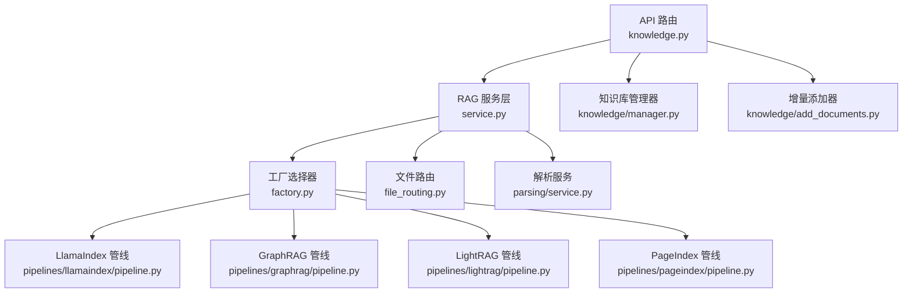
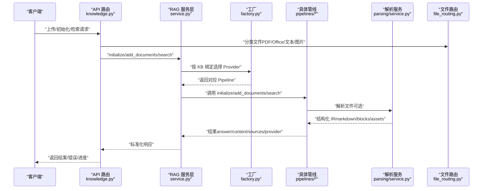
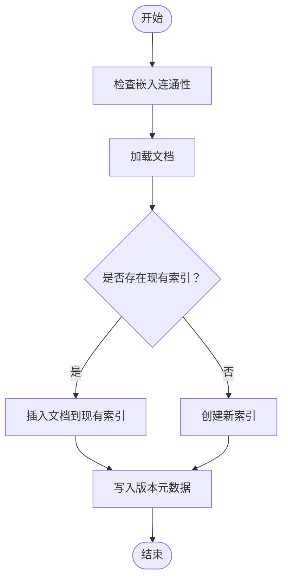
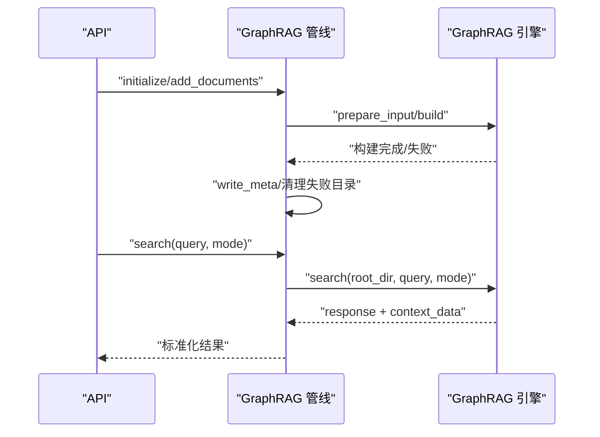
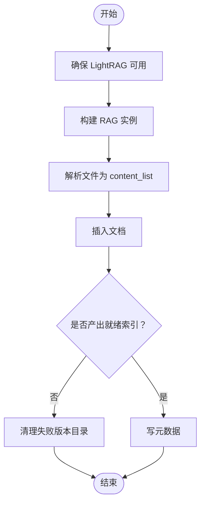
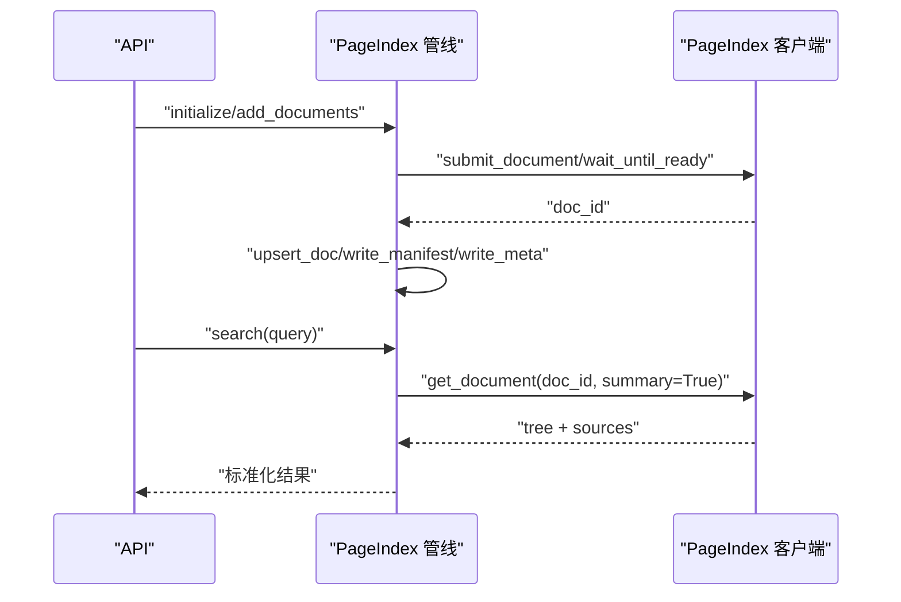
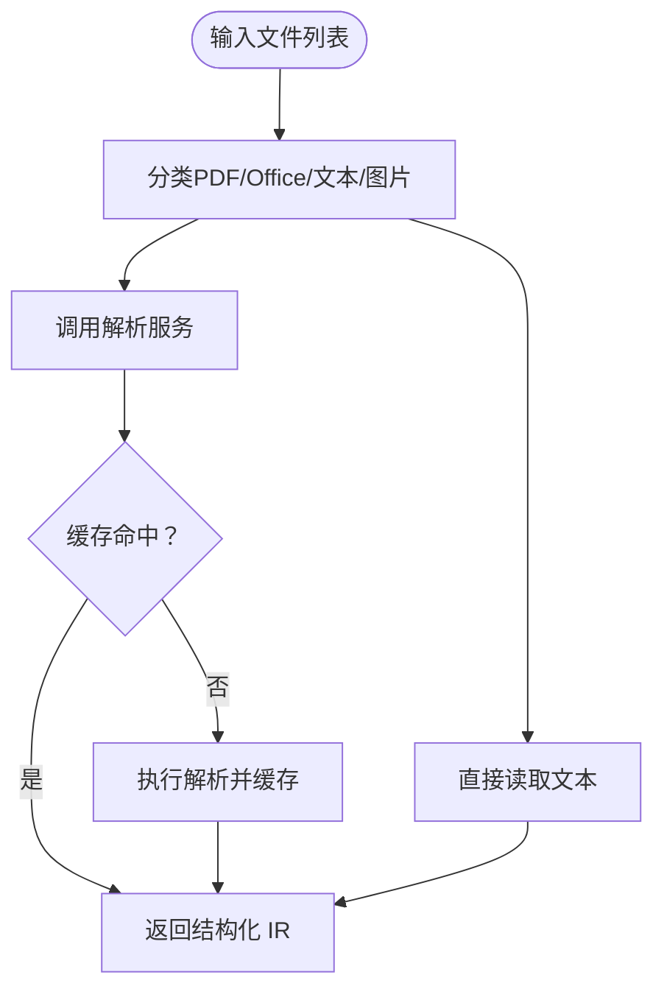
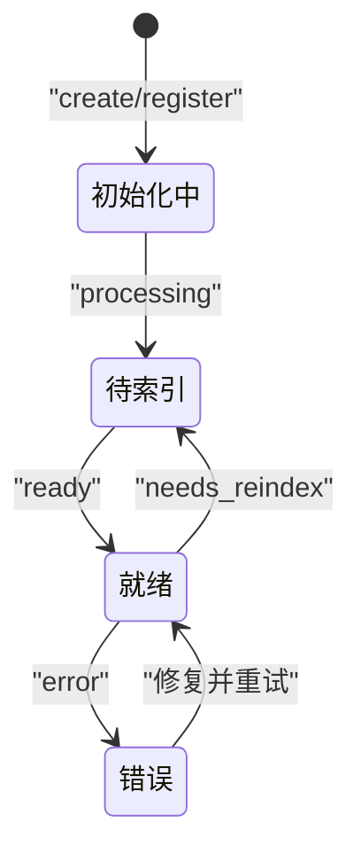
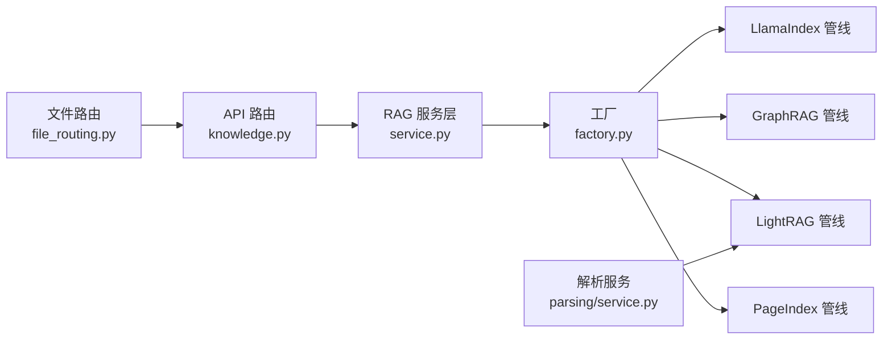

# 知识库系统

<cite>
**本文引用的文件**
- [manager.py](file://deeptutor/knowledge/manager.py)
- [add_documents.py](file://deeptutor/knowledge/add_documents.py)
- [knowledge.py](file://deeptutor/api/routers/knowledge.py)
- [factory.py](file://deeptutor/services/rag/factory.py)
- [service.py](file://deeptutor/services/rag/service.py)
- [file_routing.py](file://deeptutor/services/rag/file_routing.py)
- [pipeline.py（LlamaIndex）](file://deeptutor/services/rag/pipelines/llamaindex/pipeline.py)
- [pipeline.py（GraphRAG）](file://deeptutor/services/rag/pipelines/graphrag/pipeline.py)
- [pipeline.py（LightRAG）](file://deeptutor/services/rag/pipelines/lightrag/pipeline.py)
- [pipeline.py（PageIndex）](file://deeptutor/services/rag/pipelines/pageindex/pipeline.py)
- [service.py（解析服务）](file://deeptutor/services/parsing/service.py)
</cite>

## 目录
1. [简介](#简介)
2. [项目结构](#项目结构)
3. [核心组件](#核心组件)
4. [架构总览](#架构总览)
5. [详细组件分析](#详细组件分析)
6. [依赖关系分析](#依赖关系分析)
7. [性能考虑](#性能考虑)
8. [故障排除指南](#故障排除指南)
9. [结论](#结论)
10. [附录](#附录)

## 简介
本文件系统性地梳理 DeepTutor 知识库系统的 RAG（检索增强生成）能力与多引擎支持，覆盖文档处理管道、向量索引构建、检索优化策略、知识库生命周期管理（创建、更新、删除、版本控制）、文档解析器选择与配置、多模态内容处理（文本、图像、表格），以及性能调优与最佳实践。系统通过统一的 RAG 服务层将多种后端引擎（LlamaIndex、GraphRAG、LightRAG、PageIndex 等）抽象为一致的接口，使上层应用无需关心具体实现细节即可进行知识入库与检索。

## 项目结构
DeepTutor 的知识库与 RAG 相关代码主要分布在以下模块：
- 知识库管理：负责 KB 注册、状态维护、版本与嵌入指纹对齐、连接型 KB（Obsidian、Linked、Subagent）等
- RAG 服务层：统一入口，按 KB 绑定引擎路由到具体 Pipeline
- 引擎管线：各引擎的初始化、增量添加、检索、删除等实现
- 文件路由与解析：文件类型分类、编码检测、解析服务与缓存
- API 路由：KB 的创建、上传、初始化、查询、删除等 HTTP 接口

图表来源
- [knowledge.py:1-120](file://deeptutor/api/routers/knowledge.py#L1-L120)
- [service.py:23-120](file://deeptutor/services/rag/service.py#L23-L120)
- [factory.py:120-180](file://deeptutor/services/rag/factory.py#L120-L180)
- [pipeline.py（LlamaIndex）:75-120](file://deeptutor/services/rag/pipelines/llamaindex/pipeline.py#L75-L120)
- [pipeline.py（GraphRAG）:73-120](file://deeptutor/services/rag/pipelines/graphrag/pipeline.py#L73-L120)
- [pipeline.py（LightRAG）:115-145](file://deeptutor/services/rag/pipelines/lightrag/pipeline.py#L115-L145)
- [pipeline.py（PageIndex）:79-125](file://deeptutor/services/rag/pipelines/pageindex/pipeline.py#L79-L125)
- [file_routing.py:41-100](file://deeptutor/services/rag/file_routing.py#L41-L100)
- [service.py（解析服务）:28-90](file://deeptutor/services/parsing/service.py#L28-L90)
- [manager.py:244-340](file://deeptutor/knowledge/manager.py#L244-L340)
- [add_documents.py:144-220](file://deeptutor/knowledge/add_documents.py#L144-L220)

章节来源
- [knowledge.py:1-120](file://deeptutor/api/routers/knowledge.py#L1-L120)
- [service.py:23-120](file://deeptutor/services/rag/service.py#L23-L120)
- [factory.py:120-180](file://deeptutor/services/rag/factory.py#L120-L180)
- [file_routing.py:41-100](file://deeptutor/services/rag/file_routing.py#L41-L100)
- [service.py（解析服务）:28-90](file://deeptutor/services/parsing/service.py#L28-L90)
- [manager.py:244-340](file://deeptutor/knowledge/manager.py#L244-L340)
- [add_documents.py:144-220](file://deeptutor/knowledge/add_documents.py#L144-L220)

## 核心组件
- RAG 服务层（RAGService）：统一入口，按 KB 名称解析绑定的引擎，提供 initialize、add_documents、search、delete、smart_retrieve 等方法；在 search 过程中注入日志捕获与事件上报，并标准化返回字段。
- 工厂（Factory）：根据 provider 名称选择对应 Pipeline，并提供 list_pipelines 用于 UI 展示可用引擎及其就绪状态。
- 文件路由（FileTypeRouter）：对上传或批量文件进行分类，区分需解析的文件（PDF/Office/图片）与可直接读取的文本类文件，并支持编码回退与扩展名收集。
- 解析服务（ParseService）：可插拔的文档解析桥接层，基于活跃引擎或指定引擎解析文件，输出结构化 IR（markdown + blocks + assets），具备内容地址化缓存与就绪性检查。
- 知识库管理器（KnowledgeBaseManager）：管理 kb_config.json、清理孤儿条目、自动发现与注册、嵌入指纹与版本对齐、连接型 KB 指针管理等。
- 增量添加器（DocumentAdder）：校验与暂存文件至 raw/，调用 RAGService.add_documents 完成增量索引，记录哈希与元数据，支持失败汇总与进度追踪。
- API 路由（knowledge.py）：封装 KB 的 CRUD、文件上传、ZIP 解压、安全校验、任务进度广播、Provider 就绪性检查、连接型 KB 保护等。

章节来源
- [service.py:23-120](file://deeptutor/services/rag/service.py#L23-L120)
- [factory.py:120-180](file://deeptutor/services/rag/factory.py#L120-L180)
- [file_routing.py:41-100](file://deeptutor/services/rag/file_routing.py#L41-L100)
- [service.py（解析服务）:28-90](file://deeptutor/services/parsing/service.py#L28-L90)
- [manager.py:244-340](file://deeptutor/knowledge/manager.py#L244-L340)
- [add_documents.py:144-220](file://deeptutor/knowledge/add_documents.py#L144-L220)
- [knowledge.py:590-720](file://deeptutor/api/routers/knowledge.py#L590-L720)

## 架构总览
下图展示了从 API 请求到具体 RAG 引擎的完整流程，包括文件分类、解析、索引构建与检索。

图表来源
- [knowledge.py:752-800](file://deeptutor/api/routers/knowledge.py#L752-L800)
- [service.py:68-120](file://deeptutor/services/rag/service.py#L68-L120)
- [factory.py:120-180](file://deeptutor/services/rag/factory.py#L120-L180)
- [pipeline.py（LlamaIndex）:75-120](file://deeptutor/services/rag/pipelines/llamaindex/pipeline.py#L75-L120)
- [pipeline.py（GraphRAG）:73-120](file://deeptutor/services/rag/pipelines/graphrag/pipeline.py#L73-L120)
- [pipeline.py（LightRAG）:115-145](file://deeptutor/services/rag/pipelines/lightrag/pipeline.py#L115-L145)
- [pipeline.py（PageIndex）:79-125](file://deeptutor/services/rag/pipelines/pageindex/pipeline.py#L79-L125)
- [service.py（解析服务）:48-90](file://deeptutor/services/parsing/service.py#L48-L90)
- [file_routing.py:179-252](file://deeptutor/services/rag/file_routing.py#L179-L252)

## 详细组件分析

### LlamaIndex 管线
- 职责：本地向量检索，混合 BM25 与向量融合；支持版本化存储与嵌入签名匹配；提供 initialize、add_documents、search、delete。
- 关键行为：
  - initialize：验证嵌入连通性，加载文档，创建索引并持久化到 version-N 目录，写入版本元数据。
  - add_documents：若存在现有索引则插入新文档，否则新建索引；同样写入版本元数据。
  - search：按当前嵌入签名定位存储目录，检索节点并转换为标准结果；若无匹配索引则提示需要重建。
  - delete：删除 KB 目录。

图表来源
- [pipeline.py（LlamaIndex）:75-120](file://deeptutor/services/rag/pipelines/llamaindex/pipeline.py#L75-L120)
- [pipeline.py（LlamaIndex）:225-280](file://deeptutor/services/rag/pipelines/llamaindex/pipeline.py#L225-L280)

章节来源
- [pipeline.py（LlamaIndex）:75-120](file://deeptutor/services/rag/pipelines/llamaindex/pipeline.py#L75-L120)
- [pipeline.py（LlamaIndex）:123-178](file://deeptutor/services/rag/pipelines/llamaindex/pipeline.py#L123-L178)
- [pipeline.py（LlamaIndex）:225-287](file://deeptutor/services/rag/pipelines/llamaindex/pipeline.py#L225-L287)

### GraphRAG 管线
- 职责：本地知识图谱检索（microsoft/graphrag），支持 global/local/drift/basic 模式；索引阶段由 DeepTutor 先解析为文本，再交由 GraphRAG 构建。
- 关键行为：
  - initialize：准备输入、构建图、写元数据；无有效文档时清理失败版本目录。
  - add_documents：增量更新，刷新设置后重新构建。
  - search：按模式检索，返回答案与上下文源；未就绪或未安装时返回明确错误。
  - delete：删除 KB 目录。

图表来源
- [pipeline.py（GraphRAG）:73-120](file://deeptutor/services/rag/pipelines/graphrag/pipeline.py#L73-L120)
- [pipeline.py（GraphRAG）:137-173](file://deeptutor/services/rag/pipelines/graphrag/pipeline.py#L137-L173)

章节来源
- [pipeline.py（GraphRAG）:73-120](file://deeptutor/services/rag/pipelines/graphrag/pipeline.py#L73-L120)
- [pipeline.py（GraphRAG）:137-193](file://deeptutor/services/rag/pipelines/graphrag/pipeline.py#L137-L193)

### LightRAG 管线
- 职责：图+向量检索（HKUDS/LightRAG），通过共享解析层将多模态内容转为 content_list 后插入；支持 naive/local/global/hybrid/mix 模式。
- 关键行为：
  - initialize/add_documents：使用 ParseService 解析文件，构造 content_list 并插入；若未产出就绪索引则清理失败目录。
  - search：按模式查询，返回答案；未就绪或未安装时返回明确错误。
  - delete：删除 KB 目录。

图表来源
- [pipeline.py（LightRAG）:115-145](file://deeptutor/services/rag/pipelines/lightrag/pipeline.py#L115-L145)
- [pipeline.py（LightRAG）:146-182](file://deeptutor/services/rag/pipelines/lightrag/pipeline.py#L146-L182)
- [pipeline.py（LightRAG）:186-221](file://deeptutor/services/rag/pipelines/lightrag/pipeline.py#L186-L221)

章节来源
- [pipeline.py（LightRAG）:115-145](file://deeptutor/services/rag/pipelines/lightrag/pipeline.py#L115-L145)
- [pipeline.py（LightRAG）:146-182](file://deeptutor/services/rag/pipelines/lightrag/pipeline.py#L146-L182)
- [pipeline.py（LightRAG）:186-245](file://deeptutor/services/rag/pipelines/lightrag/pipeline.py#L186-L245)

### PageIndex 管线
- 职责：托管式检索（无本地向量），通过 REST/MCP 工具进行深度检索；search 返回文档树大纲作为程序化上下文。
- 关键行为：
  - initialize/add_documents：提交文档到云端，等待就绪，记录 manifest 与元数据。
  - search：并发获取文档树，格式化大纲与来源；未配置或未就绪时返回错误。
  - delete：尝试删除云端文档并清理本地目录。

图表来源
- [pipeline.py（PageIndex）:79-125](file://deeptutor/services/rag/pipelines/pageindex/pipeline.py#L79-L125)
- [pipeline.py（PageIndex）:130-154](file://deeptutor/services/rag/pipelines/pageindex/pipeline.py#L130-L154)
- [pipeline.py（PageIndex）:162-231](file://deeptutor/services/rag/pipelines/pageindex/pipeline.py#L162-L231)

章节来源
- [pipeline.py（PageIndex）:79-125](file://deeptutor/services/rag/pipelines/pageindex/pipeline.py#L79-L125)
- [pipeline.py（PageIndex）:162-231](file://deeptutor/services/rag/pipelines/pageindex/pipeline.py#L162-L231)

### 文件路由与解析
- 文件路由（FileTypeRouter）：
  - 分类 PDF/Office/文本/图片/未知，支持编码回退链（utf-8/gbk/gb2312/gb18030/latin-1/cp1252）。
  - 提供 collect_supported_files、get_glob_patterns、is_text_readable 等工具方法。
- 解析服务（ParseService）：
  - 基于活跃引擎或指定引擎解析文件，输出 markdown + blocks + assets。
  - 内容地址化缓存（source_hash + engine signature），就绪性检查与失败清理。

图表来源
- [file_routing.py:179-252](file://deeptutor/services/rag/file_routing.py#L179-L252)
- [service.py（解析服务）:48-90](file://deeptutor/services/parsing/service.py#L48-L90)

章节来源
- [file_routing.py:179-252](file://deeptutor/services/rag/file_routing.py#L179-L252)
- [service.py（解析服务）:48-90](file://deeptutor/services/parsing/service.py#L48-L90)

### 知识库生命周期管理
- 创建与注册：
  - KnowledgeBaseManager 支持普通 KB、Obsidian Vault、Linked Index、Subagent 连接型 KB 的注册与状态管理。
  - 自动发现与注册已有 KB，清理孤儿条目，兼容旧版 rag_storage 布局。
- 更新与增量索引：
  - DocumentAdder 校验与暂存文件，调用 RAGService.add_documents 完成增量索引，记录哈希与元数据。
  - 支持重复检测、文件名冲突处理、失败汇总与进度追踪。
- 删除：
  - 各管线实现 delete，删除本地版本目录；PageIndex 还尝试删除云端文档。
- 版本控制与嵌入指纹：
  - LlamaIndex 使用嵌入签名选择/读写 version-N 目录；其他引擎使用 provider 签名。
  - Manager 在启动时对齐嵌入指纹，标记 needs_reindex/embedding_mismatch，并在 ready 时记录 embedding_signature 与 index_versions。

图表来源
- [manager.py:244-340](file://deeptutor/knowledge/manager.py#L244-L340)
- [manager.py:515-600](file://deeptutor/knowledge/manager.py#L515-L600)
- [add_documents.py:216-337](file://deeptutor/knowledge/add_documents.py#L216-L337)
- [pipeline.py（LlamaIndex）:75-120](file://deeptutor/services/rag/pipelines/llamaindex/pipeline.py#L75-L120)

章节来源
- [manager.py:244-340](file://deeptutor/knowledge/manager.py#L244-L340)
- [manager.py:515-600](file://deeptutor/knowledge/manager.py#L515-L600)
- [add_documents.py:216-337](file://deeptutor/knowledge/add_documents.py#L216-L337)
- [pipeline.py（LlamaIndex）:75-120](file://deeptutor/services/rag/pipelines/llamaindex/pipeline.py#L75-L120)

## 依赖关系分析
- 工厂与管线：
  - factory.get_pipeline 根据 provider 名称动态导入并实例化对应 Pipeline；list_pipelines 暴露可用引擎及就绪状态。
- 服务与路由：
  - RAGService 统一入口，按 KB 名称解析绑定 provider；API 路由负责权限、校验、进度与错误处理。
- 解析与文件路由：
  - 解析服务与文件路由解耦，前者负责 IR 输出与缓存，后者负责分类与编码回退。
- 版本与嵌入：
  - LlamaIndex 使用嵌入签名；其他引擎使用 provider 签名；Manager 负责对齐与提示。

图表来源
- [factory.py:120-180](file://deeptutor/services/rag/factory.py#L120-L180)
- [service.py:23-120](file://deeptutor/services/rag/service.py#L23-L120)
- [knowledge.py:590-720](file://deeptutor/api/routers/knowledge.py#L590-L720)
- [service.py（解析服务）:28-90](file://deeptutor/services/parsing/service.py#L28-L90)
- [file_routing.py:41-100](file://deeptutor/services/rag/file_routing.py#L41-L100)

章节来源
- [factory.py:120-180](file://deeptutor/services/rag/factory.py#L120-L180)
- [service.py:23-120](file://deeptutor/services/rag/service.py#L23-L120)
- [knowledge.py:590-720](file://deeptutor/api/routers/knowledge.py#L590-L720)
- [service.py（解析服务）:28-90](file://deeptutor/services/parsing/service.py#L28-L90)
- [file_routing.py:41-100](file://deeptutor/services/rag/file_routing.py#L41-L100)

## 性能考虑
- 异步与线程池：
  - LlamaIndex 的索引创建与检索在 executor 中运行，避免阻塞事件循环。
  - API 上传保存走 asyncio.to_thread，减少长耗时阻塞。
- 缓存与去重：
  - 解析服务基于 source_hash + engine signature 缓存 IR，避免重复解析。
  - 增量添加通过 file_hashes 去重，避免重复索引。
- 并发与限制：
  - PageIndex 并发获取文档树，限制每文档大纲长度，防止过大上下文。
  - 文件上传大小限制与 ZIP 炸弹防护。
- 版本与嵌入：
  - LlamaIndex 按嵌入签名选择版本目录，避免模型不匹配导致的检索失败。
  - Manager 对齐嵌入指纹，提示重建，降低无效检索。

[本节为通用指导，不直接分析具体文件]

## 故障排除指南
- 常见错误与处理：
  - 未安装 GraphRAG/LightRAG：API 路由在创建前检查可用性，返回明确错误信息。
  - PageIndex 未配置：检查 API Key 配置，未配置时拒绝创建与检索。
  - 嵌入模型不匹配：LlamaIndex 搜索返回 needs_reindex，需重建索引或切换回原模型。
  - 解析失败：ParseService 抛出 ParserError，建议更换引擎或检查文件格式。
  - 增量添加失败：DocumentAdder 返回失败汇总，检查 raw/ 文件与提供者索引状态。
- 调试建议：
  - 查看任务日志与进度（task_id），确认阶段与错误消息。
  - 检查 kb_config.json 中的 status、progress、embedding_mismatch、needs_reindex。
  - 对于连接型 KB（Obsidian/Linked/Subagent），确认外部路径与权限。

章节来源
- [knowledge.py:602-669](file://deeptutor/api/routers/knowledge.py#L602-L669)
- [pipeline.py（GraphRAG）:137-183](file://deeptutor/services/rag/pipelines/graphrag/pipeline.py#L137-L183)
- [pipeline.py（LightRAG）:186-231](file://deeptutor/services/rag/pipelines/lightrag/pipeline.py#L186-L231)
- [pipeline.py（PageIndex）:162-231](file://deeptutor/services/rag/pipelines/pageindex/pipeline.py#L162-L231)
- [service.py（解析服务）:48-90](file://deeptutor/services/parsing/service.py#L48-L90)
- [add_documents.py:258-337](file://deeptutor/knowledge/add_documents.py#L258-L337)

## 结论
DeepTutor 知识库系统通过统一的服务层与工厂机制，将多种 RAG 引擎（LlamaIndex、GraphRAG、LightRAG、PageIndex）整合为一套一致的接口，支持文档解析、索引构建、增量更新、检索与生命周期管理。系统在性能上采用异步、缓存、并发与版本控制等策略，保障高吞吐与稳定性。通过明确的错误处理与调试指引，用户可快速定位并解决常见问题。

[本节为总结，不直接分析具体文件]

## 附录
- 配置示例（说明性）：
  - 在“设置 → 文档解析”中选择解析引擎（如 MinerU、MarkItDown、Docling、PyMuPDF4LLM）。
  - 在“知识库 → RAG 流水线设置”中配置 PageIndex API Key。
  - 在创建知识库时选择引擎（LlamaIndex/GraphRAG/LightRAG/PageIndex），并根据需求选择模式（GraphRAG/LightRAG）。
- 最佳实践：
  - 优先使用增量添加以减少重建成本。
  - 定期审查嵌入模型与版本，避免不匹配导致检索失败。
  - 对大文档进行分块与结构化处理，提升检索质量。
  - 使用连接型 KB（Obsidian/Linked）复用外部资源，避免重复索引。

[本节为补充说明，不直接分析具体文件]