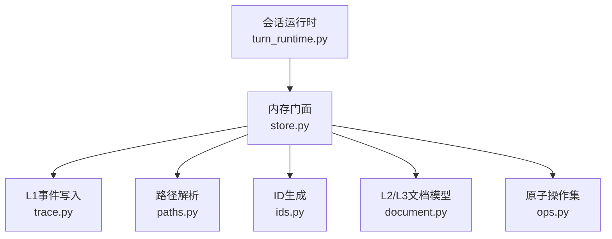
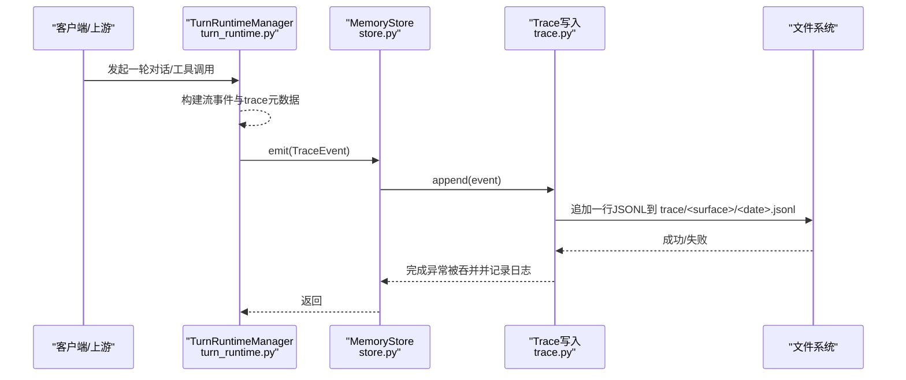
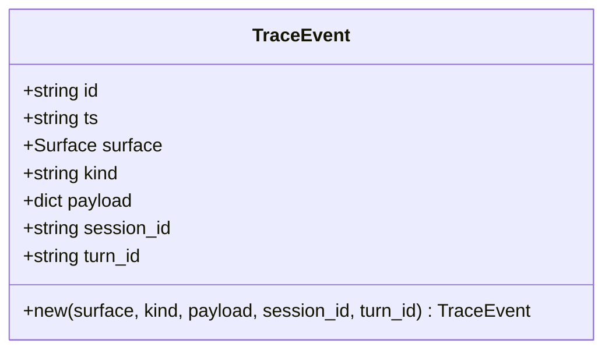
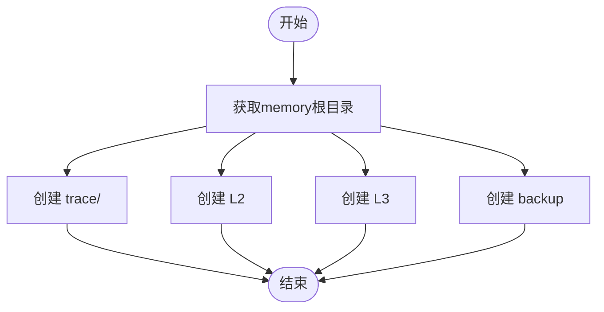
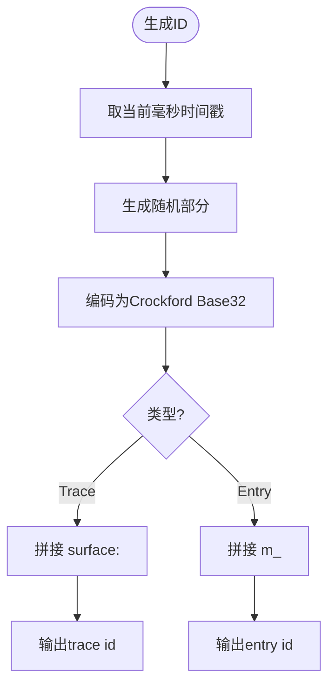
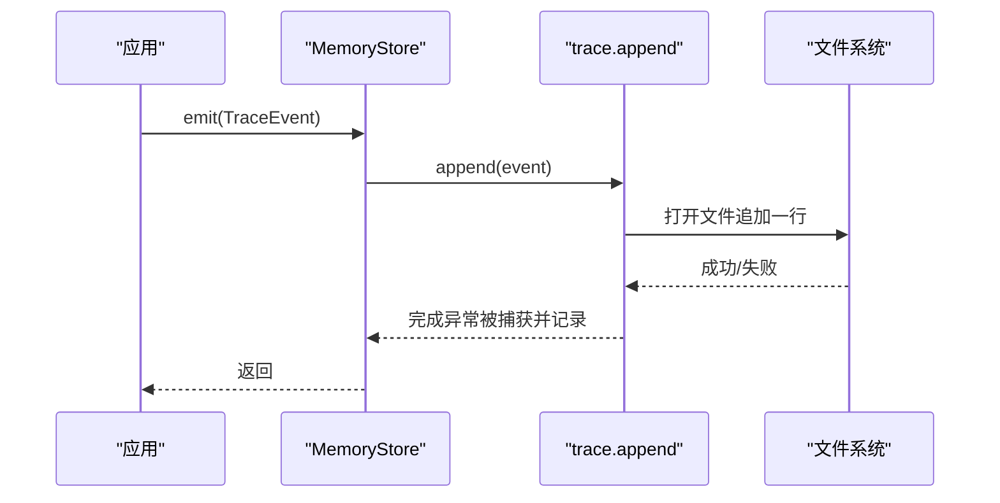
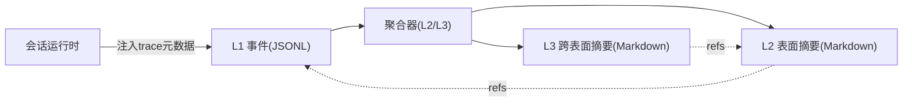
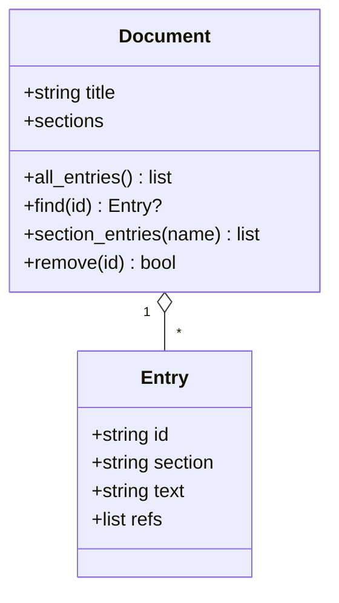
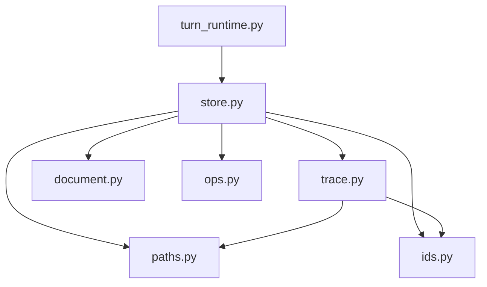

# L1痕迹层

<cite>
**本文引用的文件**
- [store.py](file://deeptutor/services/memory/store.py)
- [trace.py](file://deeptutor/services/memory/trace.py)
- [paths.py](file://deeptutor/services/memory/paths.py)
- [ids.py](file://deeptutor/services/memory/ids.py)
- [document.py](file://deeptutor/services/memory/document.py)
- [ops.py](file://deeptutor/services/memory/ops.py)
- [turn_runtime.py](file://deeptutor/services/session/turn_runtime.py)
</cite>

## 目录
1. [简介](#简介)
2. [项目结构](#项目结构)
3. [核心组件](#核心组件)
4. [架构总览](#架构总览)
5. [详细组件分析](#详细组件分析)
6. [依赖关系分析](#依赖关系分析)
7. [性能考量](#性能考量)
8. [故障排查指南](#故障排查指南)
9. [结论](#结论)
10. [附录](#附录)

## 简介
L1痕迹层是DeepTutor记忆系统的“原始事件记录层”，以追加式JSONL文件形式，按“表面（surface）+日期”组织，持久化消息、工具调用与系统事件等细粒度运行轨迹。它不修改上层摘要文档，仅负责高可靠、低侵入地捕获事件，供后续L2/L3聚合、审计与回溯使用。

## 项目结构
L1层位于 services/memory 下，围绕以下职责划分：
- 路径与布局：定义用户根目录下的 trace/<surface>/<YYYY-MM-DD>.jsonl 等目录结构
- ID生成：ULID风格时间有序ID，区分trace id与entry id
- 事件模型：TraceEvent数据类与append/迭代接口
- 门面与集成：MemoryStore统一对外暴露emit/read/更新能力
- 上层协作：会话运行时在流事件中注入trace元数据，驱动L1写入

图表来源
- [store.py:68-103](file://deeptutor/services/memory/store.py#L68-L103)
- [trace.py:35-86](file://deeptutor/services/memory/trace.py#L35-L86)
- [paths.py:62-104](file://deeptutor/services/memory/paths.py#L62-L104)
- [ids.py:47-80](file://deeptutor/services/memory/ids.py#L47-L80)
- [document.py:64-103](file://deeptutor/services/memory/document.py#L64-L103)
- [ops.py:23-150](file://deeptutor/services/memory/ops.py#L23-L150)

章节来源
- [paths.py:1-104](file://deeptutor/services/memory/paths.py#L1-L104)
- [store.py:1-460](file://deeptutor/services/memory/store.py#L1-L460)

## 核心组件
- TraceEvent：L1事件数据模型，包含id、时间戳、surface、kind、payload及可选session_id/turn_id
- append/iter_since/count_since/latest_ts：追加、遍历、计数与最新时间查询
- MemoryStore.emit：将TraceEvent写入当日对应surface的JSONL文件
- paths.trace_file/trace_dir：按surface和日期解析文件路径
- ids.new_trace_id/is_trace_id：生成并校验trace id
- document/ops：L2/L3文档结构与原子操作（与L1间接相关，用于后续聚合）

章节来源
- [trace.py:35-154](file://deeptutor/services/memory/trace.py#L35-L154)
- [store.py:68-103](file://deeptutor/services/memory/store.py#L68-L103)
- [paths.py:62-86](file://deeptutor/services/memory/paths.py#L62-L86)
- [ids.py:47-80](file://deeptutor/services/memory/ids.py#L47-L80)

## 架构总览
L1层作为不可变事件日志，被上层通过MemoryStore.emit写入；L2/L3聚合器随后消费这些事件生成可阅读的Markdown摘要。会话运行时在流事件中携带trace元数据，使前端与后端能对齐追踪视图。

图表来源
- [turn_runtime.py:33-49](file://deeptutor/services/session/turn_runtime.py#L33-L49)
- [store.py:74-78](file://deeptutor/services/memory/store.py#L74-L78)
- [trace.py:66-86](file://deeptutor/services/memory/trace.py#L66-L86)

## 详细组件分析

### L1事件模型与存储格式
- 事件模型：TraceEvent包含唯一id、UTC时间戳、surface、kind、payload以及可选的session_id/turn_id
- 存储格式：每个surface每天一个JSONL文件，每行一个事件对象，键值紧凑序列化
- 追加策略：按surface维度加锁，避免同进程并发写入交错；失败不抛异常，仅记录警告日志

图表来源
- [trace.py:35-63](file://deeptutor/services/memory/trace.py#L35-L63)

章节来源
- [trace.py:1-154](file://deeptutor/services/memory/trace.py#L1-L154)

### 路径管理与目录结构
- 根目录：通过PathService解析当前用户的memory根
- L1目录：trace/<surface>/<YYYY-MM-DD>.jsonl
- L2目录：L2/<surface>.md
- L3目录：L3/<recent|profile|scope|preferences>.md
- 备份目录：backup/<timestamp>/...（v1迁移归档）
- 提供ensure_dirs创建骨架目录

图表来源
- [paths.py:62-104](file://deeptutor/services/memory/paths.py#L62-L104)

章节来源
- [paths.py:1-104](file://deeptutor/services/memory/paths.py#L1-L104)

### ID生成机制
- Trace ID：形如“surface:ULID”，ULID前缀含毫秒级时间戳，保证全局时间有序
- Entry ID：形如“m_ULID”，用于L2/L3条目锚点
- 校验：提供is_trace_id/is_entry_id/is_valid_ref等校验函数

图表来源
- [ids.py:47-80](file://deeptutor/services/memory/ids.py#L47-L80)

章节来源
- [ids.py:1-81](file://deeptutor/services/memory/ids.py#L1-L81)

### 读写操作与完整性保证
- 写：MemoryStore.emit → trace.append → 按surface加锁 → 异步线程追加一行JSONL
- 读：trace.iter_since/count_since/latest_ts 支持按时间过滤与跨日遍历
- 完整性：
  - 追加失败不中断生产流程，仅记录警告
  - JSONL逐行容错解析，跳过损坏行
  - 原子写入（L2/L3）采用tmp替换策略，确保文件一致性

图表来源
- [store.py:74-78](file://deeptutor/services/memory/store.py#L74-L78)
- [trace.py:66-86](file://deeptutor/services/memory/trace.py#L66-L86)

章节来源
- [store.py:68-103](file://deeptutor/services/memory/store.py#L68-L103)
- [trace.py:66-154](file://deeptutor/services/memory/trace.py#L66-L154)

### 与其他记忆层次的关系与数据流转
- L1→L2/L3：consolidator消费L1事件生成L2/L3 Markdown摘要（本仓库中由store.update_l2/update_l3触发）
- L2/L3→L1：L2/L3条目通过refs引用trace id或snapshot ref，形成溯源链
- 会话运行时：在流事件中注入trace元数据，便于前端渲染与调试

图表来源
- [store.py:125-163](file://deeptutor/services/memory/store.py#L125-L163)
- [document.py:1-34](file://deeptutor/services/memory/document.py#L1-L34)
- [turn_runtime.py:33-49](file://deeptutor/services/session/turn_runtime.py#L33-L49)

章节来源
- [store.py:125-163](file://deeptutor/services/memory/store.py#L125-L163)
- [document.py:1-34](file://deeptutor/services/memory/document.py#L1-L34)
- [turn_runtime.py:33-49](file://deeptutor/services/session/turn_runtime.py#L33-L49)

### 数据模型与索引机制
- 事件模型：TraceEvent字段清晰，便于序列化和检索
- 索引方式：
  - 按surface+日期分片文件，天然按时间顺序
  - 提供iter_since支持since时间过滤
  - count_since统计增量，latest_ts获取最新时间
- 条目模型：Document/Entry用于L2/L3，配合ops进行原子批处理

图表来源
- [document.py:64-103](file://deeptutor/services/memory/document.py#L64-L103)

章节来源
- [document.py:1-236](file://deeptutor/services/memory/document.py#L1-L236)
- [ops.py:23-150](file://deeptutor/services/memory/ops.py#L23-L150)

### 配置选项、性能优化与扩展方法
- 配置项（来自路径服务）：memory根目录由PathService决定，支持多用户隔离与覆盖
- 性能优化：
  - 追加写入按surface加锁，避免竞争
  - 异步线程执行IO，不阻塞事件循环
  - JSONL逐行解析，容忍损坏行
  - L2/L3写入采用临时文件+replace原子替换
- 扩展方法：
  - 新增surface需在paths.SURFACES与ids短名白名单同步
  - 可通过自定义consolidator消费L1事件生成新的L2/L3视图
  - 可在turn_runtime中扩展trace元数据以增强前端展示

章节来源
- [paths.py:27-59](file://deeptutor/services/memory/paths.py#L27-L59)
- [trace.py:24-32](file://deeptutor/services/memory/trace.py#L24-L32)
- [store.py:455-460](file://deeptutor/services/memory/store.py#L455-L460)

### 导入导出与备份恢复
- 导出：读取trace.jsonl文件即可导出原始事件；也可通过iter_since按时间范围导出
- 导入：直接追加JSONL行至目标surface的当日文件（需遵循格式）
- 备份恢复：
  - v1迁移时自动将旧文件移动到backup/<timestamp>/
  - 可通过路径服务访问backup目录进行人工恢复

章节来源
- [paths.py:92-104](file://deeptutor/services/memory/paths.py#L92-L104)
- [store.py:330-356](file://deeptutor/services/memory/store.py#L330-L356)

### 会话分析与调试追踪
- 在会话运行时中，流事件携带trace元数据（如call_kind、trace_role、trace_group），便于前端渲染与问题定位
- 通过trace.iter_by_ids可按trace id集合反查事件，适合断点复现
- 结合L2/L3的refs，可从摘要回溯到具体L1事件，实现端到端可观测性

章节来源
- [turn_runtime.py:33-49](file://deeptutor/services/session/turn_runtime.py#L33-L49)
- [trace.py:115-133](file://deeptutor/services/memory/trace.py#L115-L133)

## 依赖关系分析
- store.py依赖trace.py、paths.py、ids.py、document.py、ops.py
- trace.py依赖paths.py、ids.py
- paths.py依赖PathService（外部路径服务）
- turn_runtime.py通过流事件与trace元数据间接影响L1写入

图表来源
- [store.py:1-26](file://deeptutor/services/memory/store.py#L1-L26)
- [trace.py:1-21](file://deeptutor/services/memory/trace.py#L1-L21)
- [paths.py:1-26](file://deeptutor/services/memory/paths.py#L1-L26)
- [turn_runtime.py:1-31](file://deeptutor/services/session/turn_runtime.py#L1-L31)

章节来源
- [store.py:1-460](file://deeptutor/services/memory/store.py#L1-L460)
- [trace.py:1-154](file://deeptutor/services/memory/trace.py#L1-L154)
- [paths.py:1-104](file://deeptutor/services/memory/paths.py#L1-L104)
- [turn_runtime.py:1-800](file://deeptutor/services/session/turn_runtime.py#L1-L800)

## 性能考量
- I/O分离：append使用asyncio.to_thread避免阻塞事件循环
- 并发控制：按surface维度加锁，防止同进程内多轮次写入交错
- 容错设计：JSONL解析跳过损坏行，append异常被捕获并记录日志
- 原子写入：L2/L3使用临时文件+replace确保一致性
- 可扩展性：新增surface与slot只需在paths与ids中声明

[本节为通用指导，无需特定文件来源]

## 故障排查指南
- 无法写入L1：检查surface是否存在于paths.SURFACES；确认目录权限与磁盘空间
- 事件丢失：查看trace.log中的警告日志；验证iter_since是否正确使用since参数
- L2/L3未更新：确认consolidator已触发；检查DocOverview.backlog是否为0
- 路径错误：确认PathService正确设置；必要时使用memory_path_service_override覆盖

章节来源
- [trace.py:66-86](file://deeptutor/services/memory/trace.py#L66-L86)
- [store.py:261-305](file://deeptutor/services/memory/store.py#L261-L305)
- [paths.py:27-44](file://deeptutor/services/memory/paths.py#L27-L44)

## 结论
L1痕迹层以简单可靠的JSONL追加模式，为DeepTutor提供了高保真的事件溯源能力。它与L2/L3形成清晰的读写边界，既不影响上层业务稳定性，又为审计、调试与回放提供了坚实基础。通过合理的ID生成、路径管理与并发控制，L1层在高吞吐场景下仍保持良好性能与可维护性。

[本节为总结性内容，无需特定文件来源]

## 附录
- 常用API速览：
  - MemoryStore.emit：写入L1事件
  - trace.append：追加事件到当日JSONL
  - trace.iter_since：按时间范围遍历事件
  - paths.trace_file/trace_dir：解析L1路径
  - ids.new_trace_id/is_trace_id：生成与校验trace id
- 典型工作流：
  - 会话运行时构造流事件并注入trace元数据
  - 通过MemoryStore.emit写入L1
  - 聚合器消费L1生成L2/L3
  - 通过refs从L2/L3回溯到L1事件

章节来源
- [store.py:68-103](file://deeptutor/services/memory/store.py#L68-L103)
- [trace.py:66-154](file://deeptutor/services/memory/trace.py#L66-L154)
- [paths.py:62-104](file://deeptutor/services/memory/paths.py#L62-L104)
- [ids.py:47-80](file://deeptutor/services/memory/ids.py#L47-L80)
- [turn_runtime.py:33-49](file://deeptutor/services/session/turn_runtime.py#L33-L49)