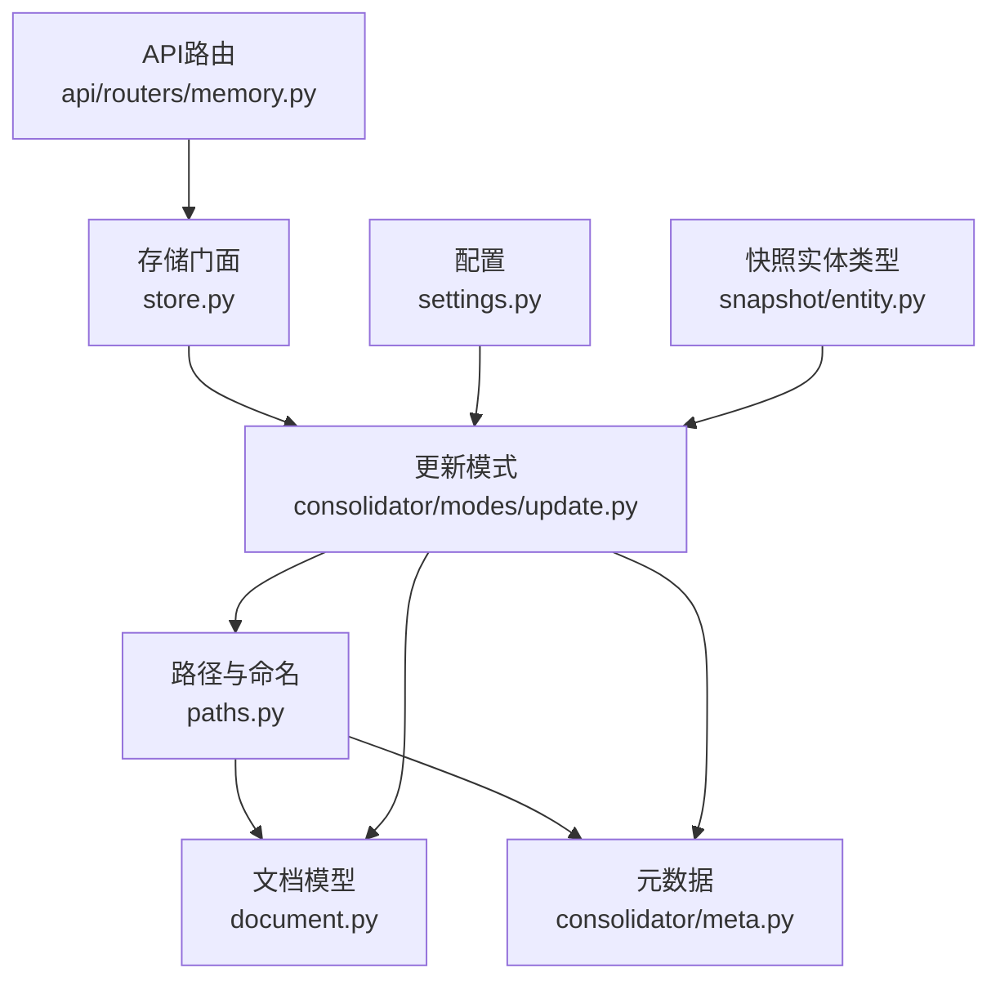
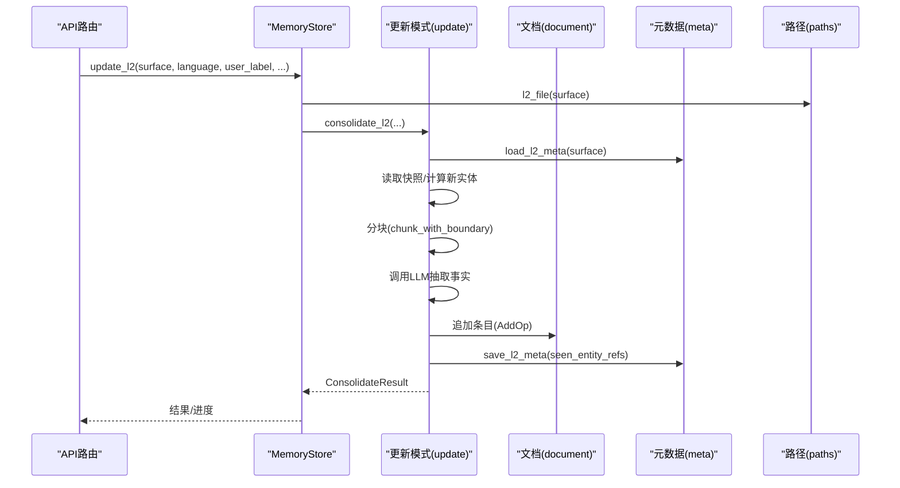
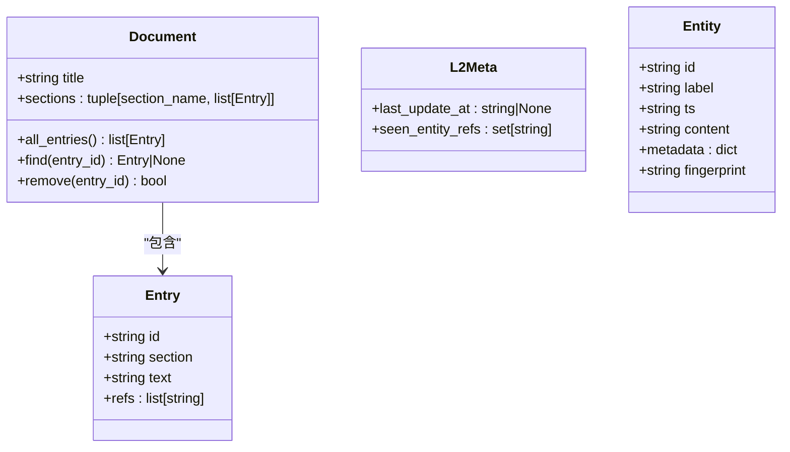
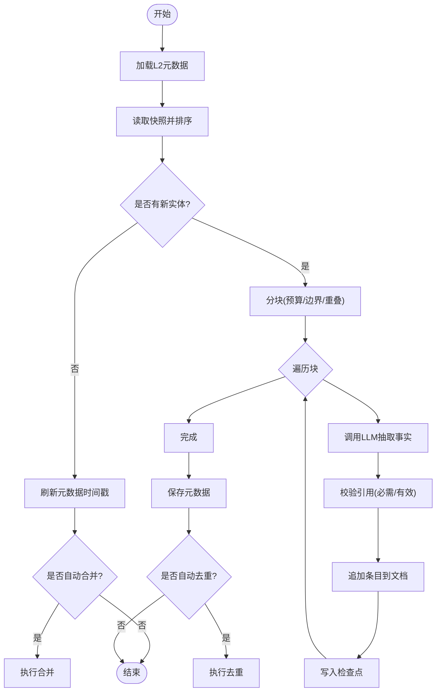
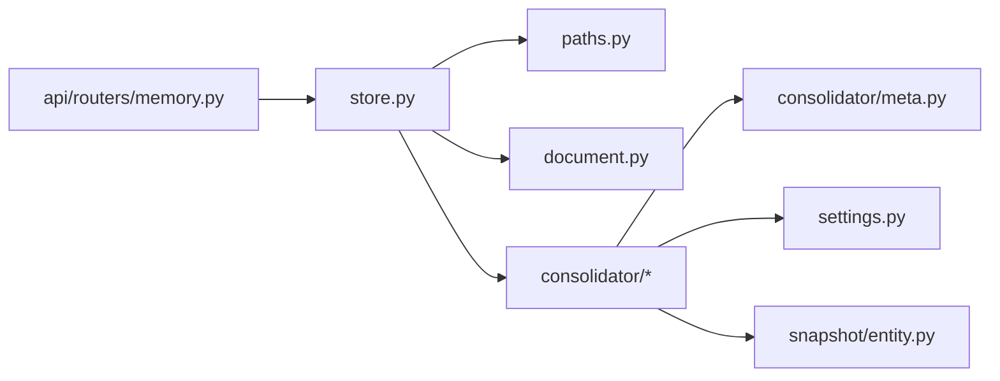

# L2表面层

<cite>
**本文引用的文件**
- [README.md](file://README.md)
- [store.py](file://deeptutor/services/memory/store.py)
- [paths.py](file://deeptutor/services/memory/paths.py)
- [document.py](file://deeptutor/services/memory/document.py)
- [meta.py](file://deeptutor/services/memory/consolidator/meta.py)
- [update.py](file://deeptutor/services/memory/consolidator/modes/update.py)
- [settings.py](file://deeptutor/services/memory/settings.py)
- [entity.py](file://deeptutor/services/memory/snapshot/entity.py)
- [memory.py](file://deeptutor/api/routers/memory.py)
</cite>

## 目录
1. [简介](#简介)
2. [项目结构](#项目结构)
3. [核心组件](#核心组件)
4. [架构总览](#架构总览)
5. [详细组件分析](#详细组件分析)
6. [依赖关系分析](#依赖关系分析)
7. [性能考量](#性能考量)
8. [故障排查指南](#故障排查指南)
9. [结论](#结论)
10. [附录](#附录)

## 简介
L2表面层是DeepTutor三层记忆体系中的“事实层”，负责将来自各工作面的原始事件（L1）增量抽取为可审计、可编辑的结构化事实，并以Markdown文档形式持久化。其设计目标包括：
- 事实提取：从L1事件流中按表面（surface）抽取关键事实，保留引用溯源。
- 关系构建：通过条目与脚注引用建立“事实→来源”的映射，支持跨条目的共享引用。
- 知识组织：按章节组织事实，便于人类审阅与机器检索。

L2面向“可解释、可审计”的个人化记忆，所有合成内容均可回溯到具体原始事件。

**章节来源**
- [README.md:609-616](file://README.md#L609-L616)

## 项目结构
L2表面层位于服务层的记忆子系统内，围绕以下文件协作：
- 路径与命名空间：定义表面集合、文件布局与解析。
- 文档模型：定义Markdown文档、条目、序列化/反序列化。
- 元数据：记录上次更新时已见的实体ID集合，用于增量计算。
- 更新模式：基于LLM的分块增量抽取、校验与落盘。
- 存储门面：对外暴露读/写、概览、迁移等能力。
- 配置：用户可调参数（预算、分块、去重、合并等）。

**图表来源**
- [paths.py:1-104](file://deeptutor/services/memory/paths.py#L1-L104)
- [document.py:1-236](file://deeptutor/services/memory/document.py#L1-L236)
- [meta.py:1-195](file://deeptutor/services/memory/consolidator/meta.py#L1-L195)
- [update.py:1-707](file://deeptutor/services/memory/consolidator/modes/update.py#L1-L707)
- [store.py:1-460](file://deeptutor/services/memory/store.py#L1-L460)
- [settings.py:1-199](file://deeptutor/services/memory/settings.py#L1-L199)
- [entity.py:1-46](file://deeptutor/services/memory/snapshot/entity.py#L1-L46)
- [memory.py:101-120](file://deeptutor/api/routers/memory.py#L101-L120)

**章节来源**
- [paths.py:1-104](file://deeptutor/services/memory/paths.py#L1-L104)
- [store.py:1-460](file://deeptutor/services/memory/store.py#L1-L460)

## 核心组件
- 路径与命名空间：定义表面集合（如chat、notebook、quiz、kb、book、partner、cowriter）、L2/L3文件位置与目录初始化。
- 文档模型：以Markdown表示L2/L3，条目包含id、section、text、refs；支持新旧格式兼容与幂等序列化。
- 元数据：保存每个表面或槽位上次更新时“已见”的实体ID集合，支撑增量更新。
- 更新模式：读取新实体、分块、调用LLM抽取事实、校验引用、追加到文档并原子落盘，可选触发去重与合并。
- 存储门面：提供read_doc/read_raw/overview/overwrite/delete_entry/update_l2/update_l3/apply_ops_payload/write_preference等接口，封装并发锁与原子写入。
- 配置：集中管理更新预算、分块策略、去重迭代次数、合并开关、引用校验策略等。

**章节来源**
- [paths.py:47-104](file://deeptutor/services/memory/paths.py#L47-L104)
- [document.py:64-236](file://deeptutor/services/memory/document.py#L64-L236)
- [meta.py:54-122](file://deeptutor/services/memory/consolidator/meta.py#L54-L122)
- [update.py:80-357](file://deeptutor/services/memory/consolidator/modes/update.py#L80-L357)
- [store.py:68-325](file://deeptutor/services/memory/store.py#L68-L325)
- [settings.py:21-69](file://deeptutor/services/memory/settings.py#L21-L69)

## 架构总览
L2表面层在三层记忆中的角色：
- L1：按表面/日期的追加型事件日志。
- L2：按表面的事实摘要，条目带引用标注，支持人工审阅与编辑。
- L3：跨表面综合（近期、画像、范围、偏好），不自动合并preferences。

**图表来源**
- [store.py:125-142](file://deeptutor/services/memory/store.py#L125-L142)
- [update.py:140-357](file://deeptutor/services/memory/consolidator/modes/update.py#L140-L357)
- [meta.py:64-82](file://deeptutor/services/memory/consolidator/meta.py#L64-L82)
- [paths.py:76-82](file://deeptutor/services/memory/paths.py#L76-L82)

**章节来源**
- [store.py:125-142](file://deeptutor/services/memory/store.py#L125-L142)
- [update.py:140-357](file://deeptutor/services/memory/consolidator/modes/update.py#L140-L357)

## 详细组件分析

### 数据结构与建模
- 文档与条目
  - Document：标题、章节列表（章节名→条目列表）。
  - Entry：唯一id、section、text、refs（引用列表）。
  - 序列化：统一为“正文+脚注”的新格式，重复引用合并为一个脚注项，条目id以HTML注释锚点保留。
- 元数据
  - L2Meta：last_update_at、seen_entity_refs（形如“surface:id”）。
  - L3Meta：last_update_at、seen_l2_entry_ids（按表面索引的条目id集合）。
- 快照实体
  - Entity：id、label、ts、content、metadata、fingerprint，用于描述非KB表面的单个实体单元。

**图表来源**
- [document.py:64-79](file://deeptutor/services/memory/document.py#L64-L79)
- [meta.py:54-58](file://deeptutor/services/memory/consolidator/meta.py#L54-L58)
- [entity.py:19-27](file://deeptutor/services/memory/snapshot/entity.py#L19-L27)

**章节来源**
- [document.py:64-236](file://deeptutor/services/memory/document.py#L64-L236)
- [meta.py:54-122](file://deeptutor/services/memory/consolidator/meta.py#L54-L122)
- [entity.py:1-46](file://deeptutor/services/memory/snapshot/entity.py#L1-L46)

### 更新机制（增量、冲突与版本控制）
- 增量更新
  - 通过L2Meta的seen_entity_refs与当前快照做集合差，得到“自上次更新以来的新实体”。
  - 将新实体文本拼接并按预算分块，逐块调用LLM抽取事实，过滤无效引用后追加到文档。
  - 每次有新增条目即写入检查点，最终原子保存文档并更新元数据。
- 冲突解决
  - 引用校验：根据chunk局部允许引用集与全局策略（必须引用、丢弃无效引用）进行过滤。
  - 去重与合并：可按配置在更新后自动执行去重与脚注合并，减少冗余与提升可读性。
- 版本控制
  - 元数据记录last_update_at与seen集合，确保幂等与可重放。
  - 原子写入：使用临时文件+替换保证文件一致性。
  - 迁移：支持v1→v2迁移与旧表面名tutorbot→partner的重命名与内容改写。

**图表来源**
- [update.py:140-357](file://deeptutor/services/memory/consolidator/modes/update.py#L140-L357)
- [meta.py:64-82](file://deeptutor/services/memory/consolidator/meta.py#L64-L82)
- [store.py:455-460](file://deeptutor/services/memory/store.py#L455-L460)

**章节来源**
- [update.py:140-357](file://deeptutor/services/memory/consolidator/modes/update.py#L140-L357)
- [store.py:329-425](file://deeptutor/services/memory/store.py#L329-L425)

### 查询接口与检索优化
- 读取接口
  - read_doc/read_raw：按层与键读取结构化文档或原始文本。
  - overview：返回各表面/槽位的存在状态、更新时间、条目数与待处理积压（L2 backlog）。
- 写入接口
  - overwrite_doc：工作区编辑器直接覆盖保存。
  - delete_entry：删除指定条目。
  - apply_ops_payload：对文档应用操作负载（预览→应用流程）。
  - write_preference：写入偏好信号（幂等防重）。
- 检索优化
  - 增量更新避免全量重算，仅处理新实体。
  - 分块策略控制上下文窗口与LLM调用成本。
  - 引用校验与合并减少噪声与重复。

**章节来源**
- [store.py:81-121](file://deeptutor/services/memory/store.py#L81-L121)
- [store.py:165-257](file://deeptutor/services/memory/store.py#L165-L257)
- [store.py:261-305](file://deeptutor/services/memory/store.py#L261-L305)

### 与L1的数据转换与一致性
- 转换流程
  - 从快照读取L1实体，按时间顺序拼接为新输入文本。
  - 分块后调用LLM抽取事实，并将引用限制在当前块的允许引用集。
  - 使用AddOp追加条目，保持文档不变式（id分配、验证、脚注重建）。
- 一致性保证
  - 原子写入与检查点：失败可回滚，避免部分写入。
  - 元数据幂等：seen_entity_refs确保重复运行不会重复添加。
  - 迁移保障：旧格式兼容与表面名迁移，保证历史数据可用。

**章节来源**
- [update.py:196-312](file://deeptutor/services/memory/consolidator/modes/update.py#L196-L312)
- [store.py:455-460](file://deeptutor/services/memory/store.py#L455-L460)
- [store.py:329-425](file://deeptutor/services/memory/store.py#L329-L425)

### 配置参数、性能调优与扩展点
- 配置项
  - 更新预算：L2/L3每轮最大块数。
  - 分块策略：重叠比例、边界（段落/句子）、最小/最大字符数。
  - 去重：迭代次数、更新后自动去重。
  - 合并：更新/审计/去重后自动合并脚注。
  - 引用：是否强制必需引用、是否丢弃无效引用。
- 性能调优
  - 调整budget与分块大小平衡吞吐与质量。
  - 开启自动合并减少渲染冗余。
  - 合理设置overlap_ratio避免信息丢失。
- 扩展点
  - 新增表面：在路径模块声明Surface字面量。
  - 自定义提示：在更新器加载对应语言提示。
  - 外部工具：通过on_event回调上报进度与中间结果。

**章节来源**
- [settings.py:21-69](file://deeptutor/services/memory/settings.py#L21-L69)
- [update.py:101-131](file://deeptutor/services/memory/consolidator/modes/update.py#L101-L131)
- [paths.py:47-59](file://deeptutor/services/memory/paths.py#L47-L59)

### 应用场景：个性化推荐与内容理解
- 个性化推荐
  - 通过L2的事实摘要与L3的综合（画像、偏好）驱动推荐策略，结合会话上下文实现连贯推荐。
- 内容理解
  - 将多来源材料（聊天、笔记、知识库、书籍）提炼为结构化事实，辅助问答、总结与可视化。

**章节来源**
- [README.md:609-616](file://README.md#L609-L616)

### 可视化与交互分析
- 概览视图
  - overview返回各表面/槽位的基本统计与积压数量，便于前端展示。
- 工作区编辑
  - overwrite_doc支持直接编辑L2/L3文档；delete_entry支持删除条目。
- 审计与追溯
  - 通过条目id与脚注引用链（L3→L2→L1）进行可审计追溯。

**章节来源**
- [store.py:261-305](file://deeptutor/services/memory/store.py#L261-L305)
- [store.py:106-121](file://deeptutor/services/memory/store.py#L106-L121)

## 依赖关系分析
- 模块耦合
  - store依赖paths、document、ops、consolidator、trace。
  - update依赖snapshot、chunker、meta、references、document、ops、settings。
  - meta依赖paths与json序列化。
  - document纯函数，无I/O，便于测试与复用。
- 外部集成
  - API路由通过store暴露能力，前端可通过设置页调整memory配置。
  - 多用户场景通过PathService隔离workspace根目录。

**图表来源**
- [store.py:1-26](file://deeptutor/services/memory/store.py#L1-L26)
- [update.py:25-59](file://deeptutor/services/memory/consolidator/modes/update.py#L25-L59)
- [meta.py:43-45](file://deeptutor/services/memory/consolidator/meta.py#L43-L45)
- [memory.py:101-120](file://deeptutor/api/routers/memory.py#L101-L120)

**章节来源**
- [store.py:1-26](file://deeptutor/services/memory/store.py#L1-L26)
- [update.py:25-59](file://deeptutor/services/memory/consolidator/modes/update.py#L25-L59)

## 性能考量
- 增量更新降低重复计算，仅处理新实体。
- 分块策略控制LLM调用次数与上下文长度，避免溢出。
- 原子写入与检查点提高可靠性，减少长事务风险。
- 自动合并与去重减少冗余，提升渲染与阅读效率。
- 预算与重叠比例可根据资源与质量需求调优。

[本节为通用指导，不直接分析具体文件]

## 故障排查指南
- 常见问题
  - 无新输入：检查元数据seen_entity_refs与快照一致性。
  - 引用被丢弃：确认chunk局部允许引用集与引用策略设置。
  - 写入失败：检查原子写入与权限，查看临时文件残留。
  - 迁移问题：确认v1→v2迁移与表面名重命名是否成功。
- 定位方法
  - 使用overview查看backlog与条目数变化。
  - 通过on_event回调观察分块、抽取、追加阶段。
  - 检查L2/L3元数据文件的last_update_at与seen集合。

**章节来源**
- [update.py:169-186](file://deeptutor/services/memory/consolidator/modes/update.py#L169-L186)
- [store.py:455-460](file://deeptutor/services/memory/store.py#L455-L460)
- [store.py:329-425](file://deeptutor/services/memory/store.py#L329-L425)

## 结论
L2表面层以“可审计、可编辑”的结构化事实为核心，通过增量更新、严格引用校验与原子落盘，实现了从L1事件到可理解知识的稳定转化。配合L3综合与前端可视化工具，可为个性化推荐与内容理解提供高质量的知识基础。

[本节为总结，不直接分析具体文件]

## 附录
- 术语
  - 表面（surface）：数据来源域，如聊天、笔记、测验、知识库、书籍、伙伴、协写。
  - 槽位（slot）：L3聚合维度，如近期、画像、范围、偏好。
  - 条目（entry）：L2/L3中的一个事实单元，带唯一id与引用。
- 相关文件
  - 路径与命名：paths.py
  - 文档模型：document.py
  - 元数据：consolidator/meta.py
  - 更新模式：consolidator/modes/update.py
  - 存储门面：store.py
  - 配置：settings.py
  - 快照实体：snapshot/entity.py
  - API路由：api/routers/memory.py

[本节为补充说明，不直接分析具体文件]