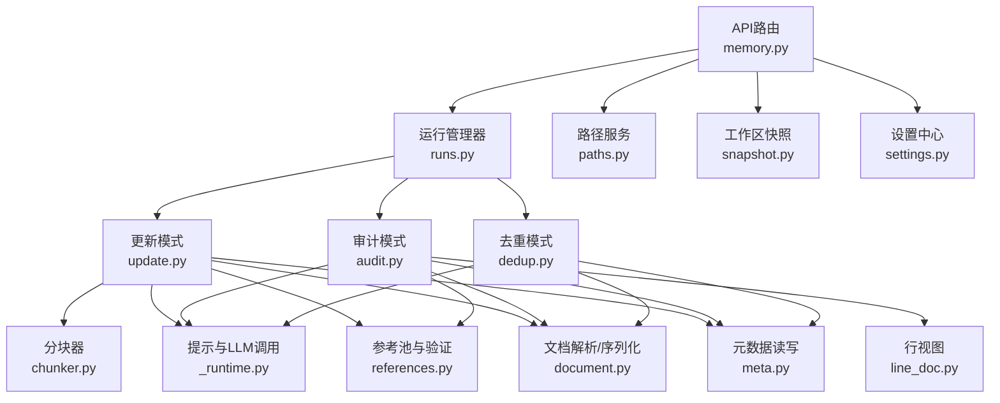
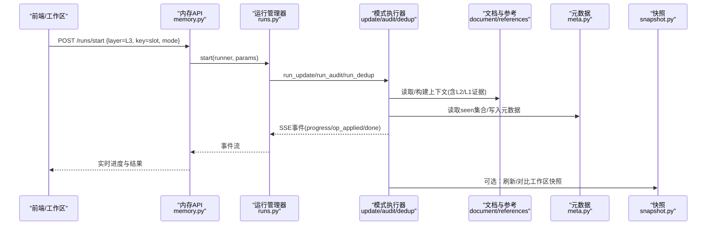
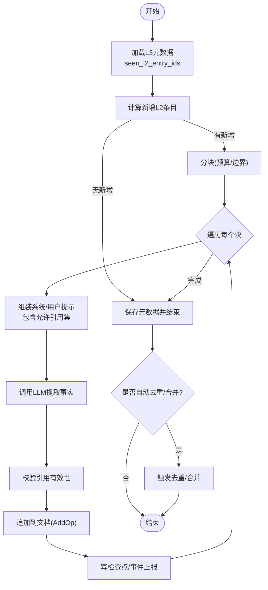
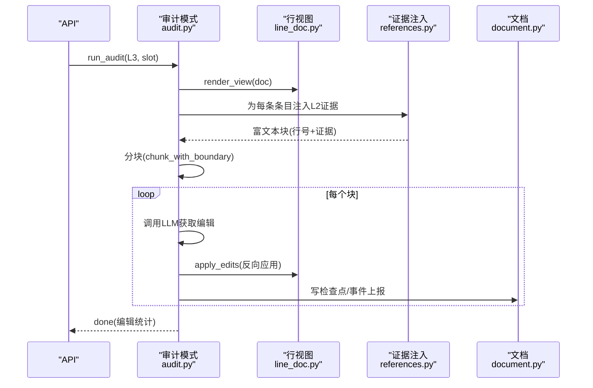
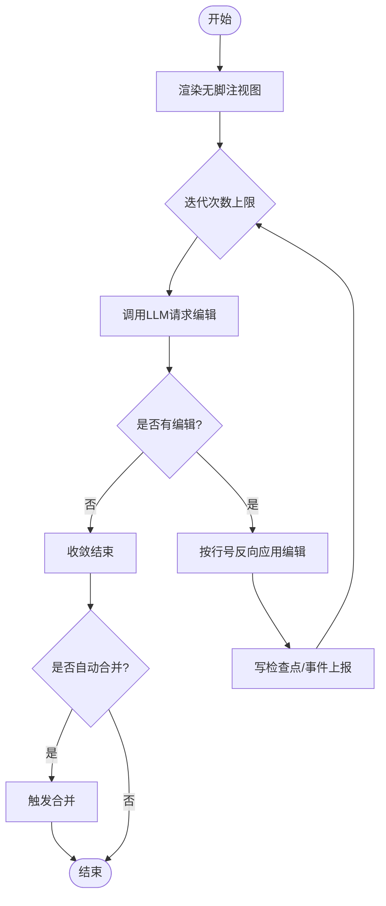
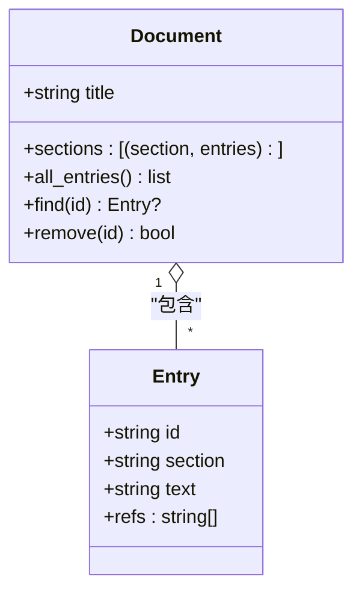
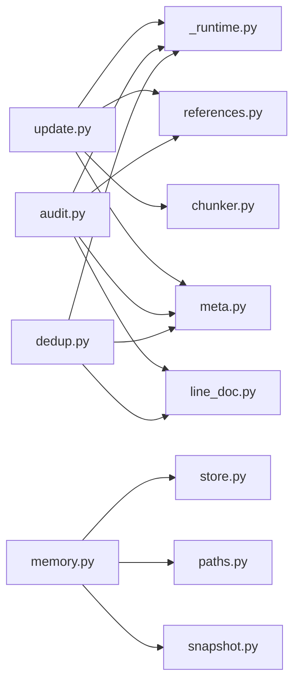

# L3综合层

<cite>
**本文引用的文件**
- [README.md](file://README.md)
- [memory.py](file://deeptutor/api/routers/memory.py)
- [paths.py](file://deeptutor/services/memory/paths.py)
- [document.py](file://deeptutor/services/memory/document.py)
- [update.py](file://deeptutor/services/memory/consolidator/modes/update.py)
- [audit.py](file://deeptutor/services/memory/consolidator/modes/audit.py)
- [dedup.py](file://deeptutor/services/memory/consolidator/modes/dedup.py)
- [_runtime.py](file://deeptutor/services/memory/consolidator/modes/_runtime.py)
- [references.py](file://deeptutor/services/memory/consolidator/references.py)
- [chunker.py](file://deeptutor/services/memory/consolidator/chunker.py)
- [line_doc.py](file://deeptutor/services/memory/consolidator/line_doc.py)
- [meta.py](file://deeptutor/services/memory/consolidator/meta.py)
- [store.py](file://deeptutor/services/memory/store.py)
- [snapshot.py](file://deeptutor/services/memory/snapshot.py)
- [settings.py](file://deeptutor/services/memory/settings.py)
</cite>

## 目录
1. [简介](#简介)
2. [项目结构](#项目结构)
3. [核心组件](#核心组件)
4. [架构总览](#架构总览)
5. [详细组件分析](#详细组件分析)
6. [依赖关系分析](#依赖关系分析)
7. [性能与配置](#性能与配置)
8. [故障排查指南](#故障排查指南)
9. [结论](#结论)
10. [附录](#附录)

## 简介
L3综合层是DeepTutor记忆系统的“高级认知层”，负责跨表面（chat、notebook、quiz、kb、book、partner、cowriter）的知识融合、推理增强与决策支持。它通过增量更新、审计校验与去重合并，将L1原始事件与L2按表面聚合的事实，进一步提炼为可追溯、可审计的跨域知识，支撑学习路径规划、能力评估与智能决策。

- 数据溯源：L3引用L2条目ID，L2引用L1原始事件，形成完整证据链。
- 质量控制：审计模式以原始证据逐行校验；去重模式迭代收敛，减少冗余与矛盾。
- 版本与快照：工作区快照与变更追踪保障一致性；运行期撤销与回滚确保可逆操作。
- 决策支持：profile/scope/preferences等L3槽位提供用户画像、范围与偏好，驱动个性化推理与推荐。

**章节来源**
- [README.md:609-616](file://README.md#L609-L616)

## 项目结构
L3位于三层记忆体系的最上层，围绕“文档+元数据+运行器”组织：
- 存储布局：L3/<recent|profile|scope|preferences>.md，配套*.meta.json记录已见集合。
- 处理管线：更新(update)、审计(audit)、去重(dedup)、合并(merge)。
- 工具与模型：分块(chunker)、行级视图(line_doc)、提示加载(_runtime)、参考验证(references)。
- API与工作区：REST路由暴露概览、读写、运行控制、快照与设置。

**图表来源**
- [memory.py:1-786](file://deeptutor/api/routers/memory.py#L1-L786)
- [update.py:1-707](file://deeptutor/services/memory/consolidator/modes/update.py#L1-L707)
- [audit.py:1-485](file://deeptutor/services/memory/consolidator/modes/audit.py#L1-L485)
- [dedup.py:1-229](file://deeptutor/services/memory/consolidator/modes/dedup.py#L1-L229)
- [chunker.py:1-200](file://deeptutor/services/memory/consolidator/chunker.py#L1-L200)
- [line_doc.py:1-200](file://deeptutor/services/memory/consolidator/line_doc.py#L1-L200)
- [_runtime.py:1-200](file://deeptutor/services/memory/consolidator/modes/_runtime.py#L1-L200)
- [references.py:1-200](file://deeptutor/services/memory/consolidator/references.py#L1-L200)
- [document.py:1-236](file://deeptutor/services/memory/document.py#L1-L236)
- [meta.py:1-200](file://deeptutor/services/memory/consolidator/meta.py#L1-L200)
- [paths.py:1-104](file://deeptutor/services/memory/paths.py#L1-L104)
- [snapshot.py:1-200](file://deeptutor/services/memory/snapshot.py#L1-L200)
- [settings.py:1-200](file://deeptutor/services/memory/settings.py#L1-L200)

**章节来源**
- [paths.py:1-104](file://deeptutor/services/memory/paths.py#L1-L104)
- [memory.py:1-786](file://deeptutor/api/routers/memory.py#L1-L786)

## 核心组件
- 文档模型：Document/Entry，支持新格式与旧格式的互转与幂等序列化。
- 路径与槽位：L3槽位包括recent/profile/scope/preferences，统一路径解析。
- 运行器：run_update/run_audit/run_dedup/run_merge，SSE流式事件上报。
- 参考系统：L3引用L2文件/表面名，审计时注入原始证据片段。
- 快照与设置：工作区快照差异追踪；设置项控制预算、自动触发策略。

**章节来源**
- [document.py:1-236](file://deeptutor/services/memory/document.py#L1-L236)
- [paths.py:1-104](file://deeptutor/services/memory/paths.py#L1-L104)
- [update.py:1-707](file://deeptutor/services/memory/consolidator/modes/update.py#L1-L707)
- [audit.py:1-485](file://deeptutor/services/memory/consolidator/modes/audit.py#L1-L485)
- [dedup.py:1-229](file://deeptutor/services/memory/consolidator/modes/dedup.py#L1-L229)
- [memory.py:1-786](file://deeptutor/api/routers/memory.py#L1-L786)

## 架构总览
L3作为跨表面合成层，接收来自L2的事实增量或全文，结合提示工程与LLM进行知识融合，产出结构化摘要与洞察，并通过审计与去重保证质量。

**图表来源**
- [memory.py:308-453](file://deeptutor/api/routers/memory.py#L308-L453)
- [update.py:80-135](file://deeptutor/services/memory/consolidator/modes/update.py#L80-L135)
- [audit.py:75-124](file://deeptutor/services/memory/consolidator/modes/audit.py#L75-L124)
- [dedup.py:52-85](file://deeptutor/services/memory/consolidator/modes/dedup.py#L52-L85)
- [snapshot.py:1-200](file://deeptutor/services/memory/snapshot.py#L1-L200)

## 详细组件分析

### L3更新流程（增量知识融合）
- 输入：L2新增条目（按表面分组），基于上次元数据的增量识别。
- 分块：按预算与边界切分文本，避免截断段落/句子。
- 提示与LLM：注入槽位焦点、允许引用集、现有内容，输出事实列表。
- 引用校验：仅保留在允许池中的引用，统计丢弃原因。
- 持久化：原子写入文档与元数据，支持自动触发去重/合并。

**图表来源**
- [update.py:363-586](file://deeptutor/services/memory/consolidator/modes/update.py#L363-L586)
- [chunker.py:1-200](file://deeptutor/services/memory/consolidator/chunker.py#L1-L200)
- [references.py:1-200](file://deeptutor/services/memory/consolidator/references.py#L1-L200)
- [meta.py:1-200](file://deeptutor/services/memory/consolidator/meta.py#L1-L200)

**章节来源**
- [update.py:363-586](file://deeptutor/services/memory/consolidator/modes/update.py#L363-L586)

### L3审计流程（证据对齐与矛盾检测）
- 渲染：生成带行号的文档视图，并为每条目附加原始证据片段。
- 分块：对“行号+证据”的富文本进行分块，保持预算可控。
- 校验：LLM返回替换/删除编辑，按行号反向应用，避免错位。
- 统计：记录应用与拒绝的编辑数量，支持自动合并。

**图表来源**
- [audit.py:267-401](file://deeptutor/services/memory/consolidator/modes/audit.py#L267-L401)
- [line_doc.py:1-200](file://deeptutor/services/memory/consolidator/line_doc.py#L1-L200)
- [references.py:1-200](file://deeptutor/services/memory/consolidator/references.py#L1-L200)

**章节来源**
- [audit.py:267-401](file://deeptutor/services/memory/consolidator/modes/audit.py#L267-L401)

### L3去重流程（迭代收敛与一致性）
- 视图：去除脚注的行号视图，便于LLM定位修改位置。
- 迭代：每次调用返回编辑列表（仅replace/delete），按行号反向应用。
- 收敛：若某轮无编辑则提前停止，节省成本。
- 自动合并：根据设置可在去重后触发合并。

**图表来源**
- [dedup.py:87-198](file://deeptutor/services/memory/consolidator/modes/dedup.py#L87-L198)

**章节来源**
- [dedup.py:87-198](file://deeptutor/services/memory/consolidator/modes/dedup.py#L87-L198)

### 文档模型与引用规范
- 文档结构：标题、分区、条目列表；条目携带文本、分区、引用列表与唯一ID。
- 注释引用：使用脚注编号映射到具体来源；支持新旧格式兼容。
- 幂等序列化：parse→serialize往返一致，保证稳定视图。

**图表来源**
- [document.py:64-103](file://deeptutor/services/memory/document.py#L64-L103)
- [document.py:105-236](file://deeptutor/services/memory/document.py#L105-L236)

**章节来源**
- [document.py:1-236](file://deeptutor/services/memory/document.py#L1-L236)

### 路径、槽位与快照
- 路径：L3文件按槽位命名，元数据同目录存放；支持多用户路径覆盖。
- 槽位：recent/profile/scope/preferences，分别承载近期摘要、用户画像、知识范围与偏好。
- 快照：工作区实体快照与变更追踪，用于审计与一致性校验。

**章节来源**
- [paths.py:1-104](file://deeptutor/services/memory/paths.py#L1-L104)
- [memory.py:725-786](file://deeptutor/api/routers/memory.py#L725-L786)

### API与工作区集成
- 运行控制：POST /runs/start启动更新/审计/去重/合并，SSE事件流推送进度。
- 文档操作：GET/PUT/DELETE文档与条目，支持重置与撤销。
- 设置：读取/保存memory子树配置，控制预算、自动触发策略等。

**章节来源**
- [memory.py:308-453](file://deeptutor/api/routers/memory.py#L308-L453)
- [memory.py:614-632](file://deeptutor/api/routers/memory.py#L614-L632)

## 依赖关系分析
- 低耦合：各模式通过统一的运行时接口(_runtime)加载提示与调用LLM，降低重复代码。
- 高内聚：文档解析、行视图、参考验证各自专注单一职责。
- 外部依赖：模型选择运行时、路径服务、快照服务，均通过函数/上下文变量注入，便于测试与多租户隔离。

**图表来源**
- [update.py:1-707](file://deeptutor/services/memory/consolidator/modes/update.py#L1-L707)
- [audit.py:1-485](file://deeptutor/services/memory/consolidator/modes/audit.py#L1-L485)
- [dedup.py:1-229](file://deeptutor/services/memory/consolidator/modes/dedup.py#L1-L229)
- [memory.py:1-786](file://deeptutor/api/routers/memory.py#L1-L786)

**章节来源**
- [update.py:1-707](file://deeptutor/services/memory/consolidator/modes/update.py#L1-L707)
- [audit.py:1-485](file://deeptutor/services/memory/consolidator/modes/audit.py#L1-L485)
- [dedup.py:1-229](file://deeptutor/services/memory/consolidator/modes/dedup.py#L1-L229)
- [memory.py:1-786](file://deeptutor/api/routers/memory.py#L1-L786)

## 性能与配置
- 预算控制：update/audit/l3_budget限制单次处理的token/字符规模，避免超限。
- 分块策略：overlap_ratio/min/max/boundary参数平衡上下文连贯性与吞吐。
- 自动触发：auto_after_update/auto_after_dedup/auto_after_audit联动流水线，减少人工干预。
- 迭代上限：dedup.iterations控制去重最大轮次，未达收敛即早停。
- 模型选择：llm_selection支持运行时切换模型/配置，提升稳定性与成本优化。

**章节来源**
- [update.py:80-135](file://deeptutor/services/memory/consolidator/modes/update.py#L80-L135)
- [audit.py:75-124](file://deeptutor/services/memory/consolidator/modes/audit.py#L75-L124)
- [dedup.py:52-85](file://deeptutor/services/memory/consolidator/modes/dedup.py#L52-L85)
- [memory.py:614-632](file://deeptutor/api/routers/memory.py#L614-L632)

## 故障排查指南
- 未知槽位/表面：API会返回404/400错误，检查key是否在L3_SLOTS/SURFACES中。
- 运行冲突：同一文档存在活跃运行时会阻止reset/apply等操作，先取消再重试。
- 偏好写入限制：preferences由write_memory工具直接写入，不接受update/audit/merge。
- 事件回放：通过/runs/{id}/events?since=N续接SSE流，确保客户端断线重连不丢进度。
- 快照差异：使用snapshot端点查看pending_changes，必要时refresh提交变更。

**章节来源**
- [memory.py:62-78](file://deeptutor/api/routers/memory.py#L62-L78)
- [memory.py:170-219](file://deeptutor/api/routers/memory.py#L170-L219)
- [memory.py:317-321](file://deeptutor/api/routers/memory.py#L317-L321)
- [memory.py:409-453](file://deeptutor/api/routers/memory.py#L409-L453)
- [memory.py:725-786](file://deeptutor/api/routers/memory.py#L725-L786)

## 结论
L3综合层通过“增量融合—审计校验—去重收敛”的闭环，实现了高质量、可追溯的跨域知识管理。其模块化设计、严格的引用约束与完善的API/快照机制，使其成为学习路径规划与能力评估的核心基础设施。配合灵活的配置与性能调优，L3能够在复杂推理任务与智能决策场景中持续提供稳定、可解释的知识支撑。

## 附录
- 典型应用场景
  - 学习路径规划：基于profile/scope生成个性化路径，结合recent动态调整。
  - 能力评估：依据L3洞察与L2证据，量化掌握度与薄弱点。
  - 智能决策：利用preferences与scope约束，生成策略建议与行动项。
- 可视化方法
  - 工作区快照差异：展示新增/删除/修改的实体清单。
  - 审计行号视图：对照原文与证据，快速定位问题条目。
  - 运行事件流：SSE实时反馈进度与中间结果，便于调试与监控。