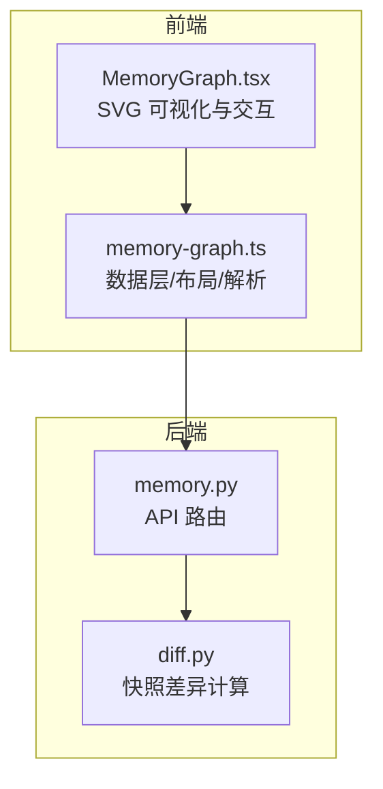
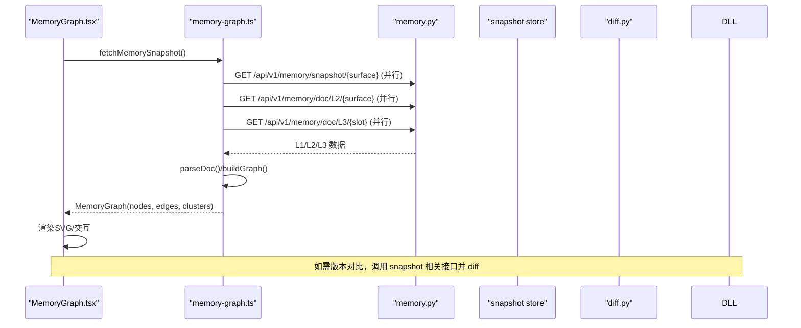
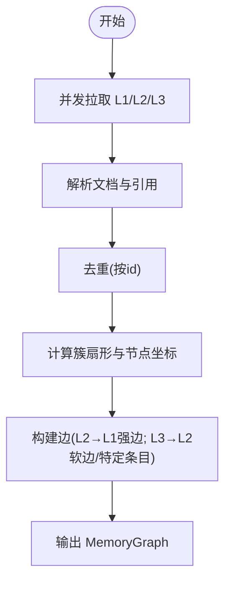
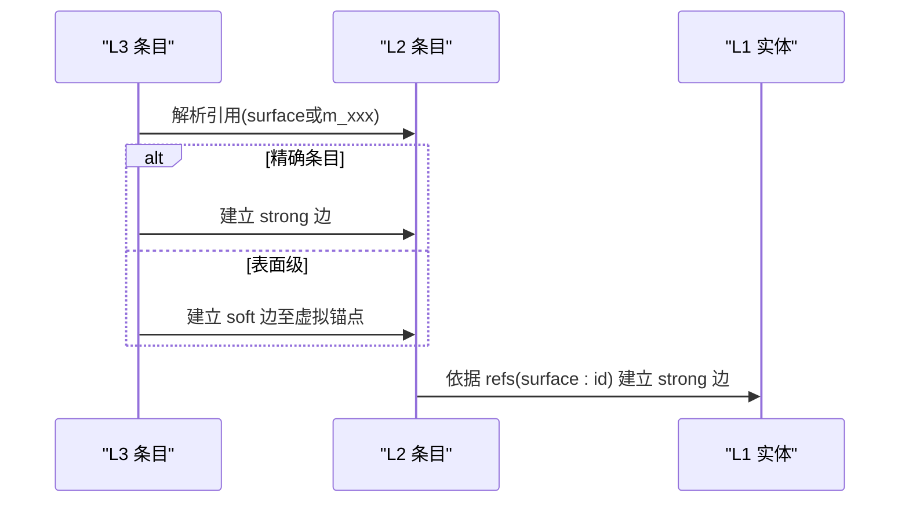
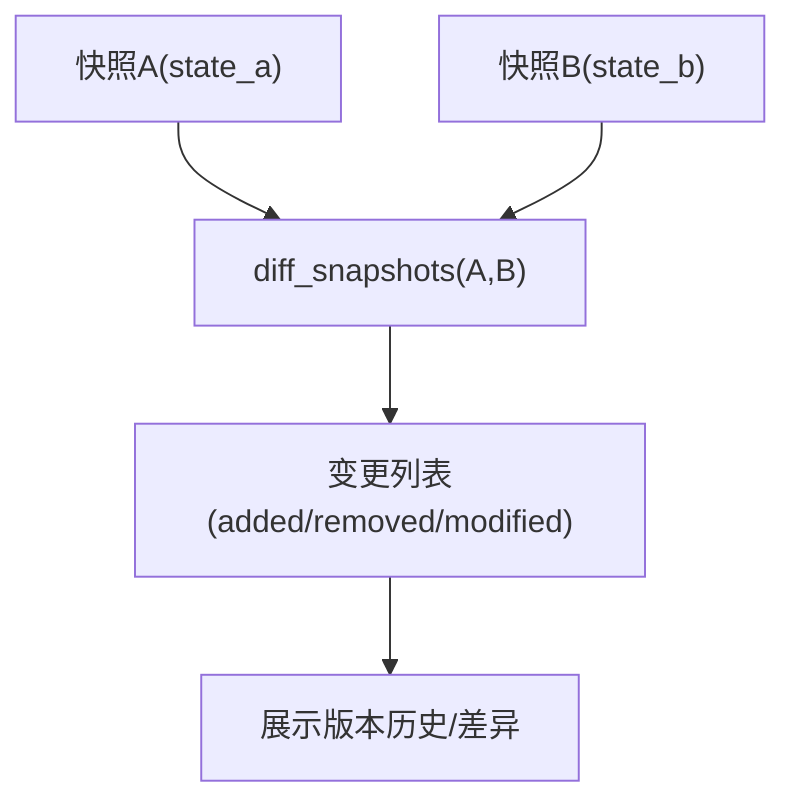
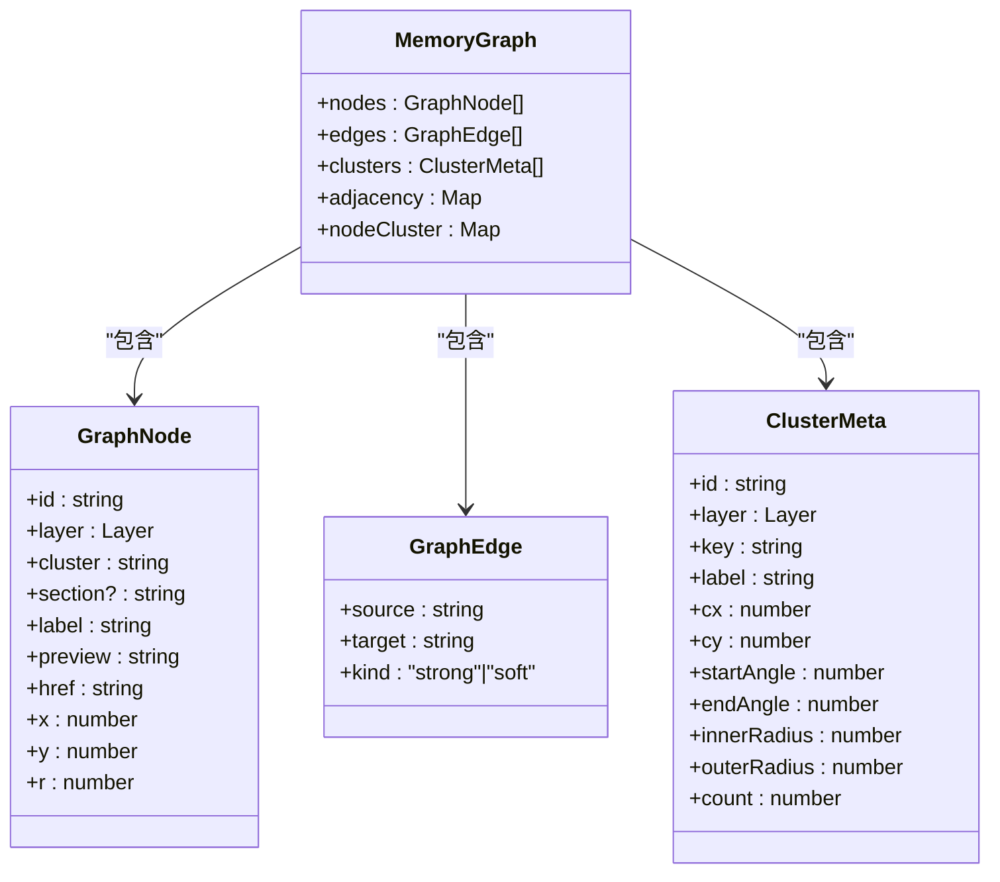
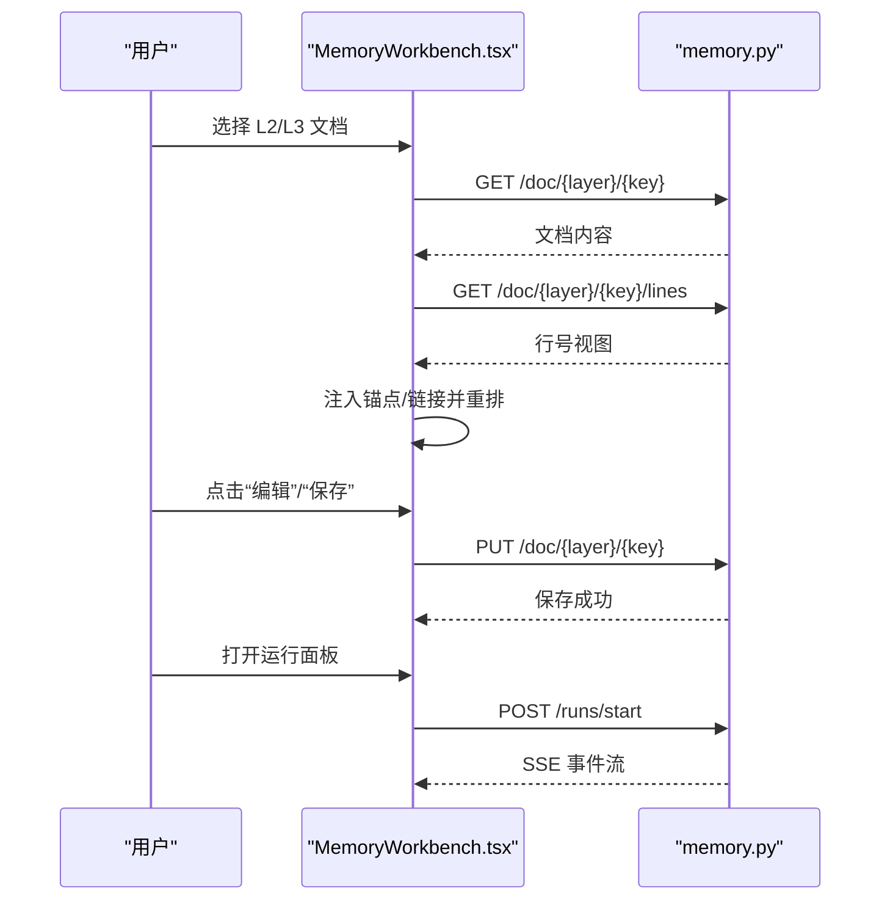
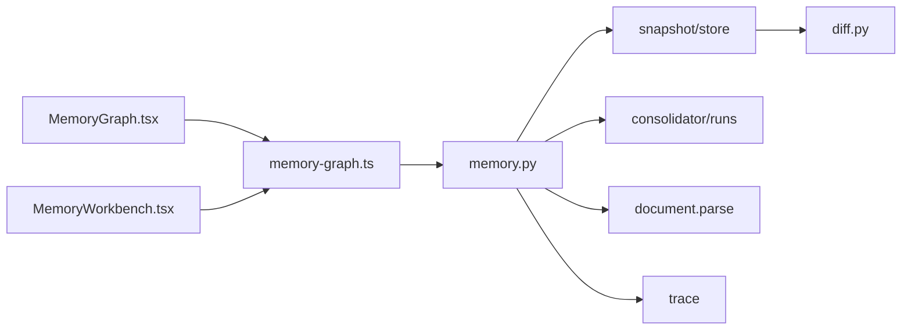

# 记忆可视化

<cite>
**本文引用的文件**
- [memory-graph.ts](file://web/lib/memory-graph.ts)
- [MemoryGraph.tsx](file://web/components/memory/MemoryGraph.tsx)
- [MemoryWorkbench.tsx](file://web/components/memory/MemoryWorkbench.tsx)
- [memory.py](file://deeptutor/api/routers/memory.py)
- [diff.py](file://deeptutor/services/memory/snapshot/diff.py)
</cite>

## 目录
1. [简介](#简介)
2. [项目结构](#项目结构)
3. [核心组件](#核心组件)
4. [架构总览](#架构总览)
5. [详细组件分析](#详细组件分析)
6. [依赖关系分析](#依赖关系分析)
7. [性能考虑](#性能考虑)
8. [故障排查指南](#故障排查指南)
9. [结论](#结论)
10. [附录](#附录)

## 简介
本文件系统性说明 DeepTutor 的“记忆可视化”能力，覆盖三层记忆图（L1/L2/L3）的结构设计、节点与边关系、证据追踪与引用链构建、记忆快照对比与版本历史、前端可视化交互（交互式图表、搜索过滤、状态管理）、记忆工作台界面与用户流程、可视化配置与主题设置，以及大数据量下的性能优化策略。目标是帮助开发者与使用者理解并高效使用记忆可视化进行知识探索与分析。

## 项目结构
记忆可视化由前后端协同实现：
- 前端数据层与渲染层位于 web/lib/memory-graph.ts 与 web/components/memory/MemoryGraph.tsx，负责拉取 L1/L2/L3 数据、解析文档、构建图模型、计算同心圆布局、渲染 SVG 可视化并提供交互。
- 后端 API 路由位于 deeptutor/api/routers/memory.py，提供工作区概览、文档读写、运行任务、轨迹浏览、快照与变更等接口。
- 快照差异计算位于 deeptutor/services/memory/snapshot/diff.py，用于生成两个快照之间的变更列表，支撑版本差异分析与历史查看。

**图示来源**
- [MemoryGraph.tsx:1-120](file://web/components/memory/MemoryGraph.tsx#L1-L120)
- [memory-graph.ts:1-120](file://web/lib/memory-graph.ts#L1-L120)
- [memory.py:1-120](file://deeptutor/api/routers/memory.py#L1-L120)
- [diff.py:1-68](file://deeptutor/services/memory/snapshot/diff.py#L1-L68)

**章节来源**
- [MemoryGraph.tsx:1-120](file://web/components/memory/MemoryGraph.tsx#L1-L120)
- [memory-graph.ts:1-120](file://web/lib/memory-graph.ts#L1-L120)
- [memory.py:1-120](file://deeptutor/api/routers/memory.py#L1-L120)
- [diff.py:1-68](file://deeptutor/services/memory/snapshot/diff.py#L1-L68)

## 核心组件
- 记忆图数据层（memory-graph.ts）
  - 定义 L1/L2/L3 数据结构、图节点与边、簇元信息、解析器、快照获取、同心圆布局算法与标签映射。
  - 关键职责：从后端拉取 L1/L2/L3 数据；解析 Markdown 引用与条目；去重；构建邻接表；计算簇扇形角度与节点坐标；输出 MemoryGraph。
- 可视化组件（MemoryGraph.tsx）
  - 基于 SVG 渲染三层同心环图；支持缩放、平移、悬停高亮、选择聚焦、图层开关、图例与工具栏。
  - 关键职责：加载快照并构建图；维护视图状态（缩放/平移）；计算邻居高亮；绘制簇光晕、引导线、边、节点；处理交互事件。
- 记忆工作台（MemoryWorkbench.tsx）
  - 提供 L2/L3 文档阅读、行号视图、原始编辑保存、导航面包屑、右侧运行面板入口。
  - 关键职责：加载文档与行号；注入锚点与链接重写；滚动定位到指定条目；切换视图模式；调用运行面板执行更新/审计/去重。
- 后端 API（memory.py）
  - 提供 /overview、/doc/{layer}/{key}、/doc/{layer}/{key}/lines、/snapshot/{surface}、/trace/{surface}、/runs/* 等接口。
  - 关键职责：读取/写入记忆文档；返回行号视图；暴露快照与变更；启动长时任务并通过 SSE 推送事件。
- 快照差异（diff.py）
  - 纯函数比较两个快照状态，生成添加/删除/修改的变更列表，附带时间戳与指纹，便于展示版本历史。

**章节来源**
- [memory-graph.ts:126-284](file://web/lib/memory-graph.ts#L126-L284)
- [MemoryGraph.tsx:69-291](file://web/components/memory/MemoryGraph.tsx#L69-L291)
- [MemoryWorkbench.tsx:81-123](file://web/components/memory/MemoryWorkbench.tsx#L81-L123)
- [memory.py:84-121](file://deeptutor/api/routers/memory.py#L84-L121)
- [diff.py:15-67](file://deeptutor/services/memory/snapshot/diff.py#L15-L67)

## 架构总览
记忆可视化采用“前端数据层 + 前端渲染 + 后端 API + 快照差异”的分层架构。前端通过 memory-graph.ts 并发请求 L1/L2/L3 数据，解析后构建图模型并进行同心圆布局；MemoryGraph.tsx 以 SVG 渲染并处理交互；MemoryWorkbench.tsx 提供文档级工作区；后端 memory.py 提供统一的数据与任务接口；diff.py 提供快照对比能力。

**图示来源**
- [memory-graph.ts:241-284](file://web/lib/memory-graph.ts#L241-L284)
- [memory.py:728-786](file://deeptutor/api/routers/memory.py#L728-L786)
- [diff.py:15-67](file://deeptutor/services/memory/snapshot/diff.py#L15-L67)

## 详细组件分析

### 记忆图结构与节点关系表示
- 三层结构
  - L1：实体轨迹（entities），按 surface 分组，作为最外层环。
  - L2：事实摘要（per-surface summaries），按 surface 分组，中层环。
  - L3：跨域综合（profile/recent/scope），内层环。
- 节点与边
  - GraphNode：包含 id、layer、cluster、section、label、preview、href、布局坐标 x/y/r。
  - GraphEdge：source/target 与 kind（strong/soft）。
  - 邻接表 adjacency 与 nodeCluster 映射用于快速高亮与簇关联。
- 解析与引用
  - parseDoc 支持新旧两种脚注格式，将条目与引用解耦，最终解析为 refs。
  - splitRef 将 “surface:id” 拆分为表面与实体标识，用于 L2→L1 强边连接。
- 布局算法
  - buildGraph 计算每个 surface/slot 的扇形角度（按数量加权），分配节点位置，避免重叠。
  - placeNodesInSlice 在扇区内用近似六边形网格+抖动放置节点，形成“星系”视觉效果。
  - 簇元信息 ClusterMeta 包含起止角、内外半径、中心点与计数，用于绘制簇光晕与软边。

**图示来源**
- [memory-graph.ts:126-214](file://web/lib/memory-graph.ts#L126-L214)
- [memory-graph.ts:322-656](file://web/lib/memory-graph.ts#L322-L656)

**章节来源**
- [memory-graph.ts:52-104](file://web/lib/memory-graph.ts#L52-L104)
- [memory-graph.ts:126-214](file://web/lib/memory-graph.ts#L126-L214)
- [memory-graph.ts:241-284](file://web/lib/memory-graph.ts#L241-L284)
- [memory-graph.ts:322-656](file://web/lib/memory-graph.ts#L322-L656)

### 证据追踪与引用链构建
- 数据来源标注
  - L1 实体来自工作区快照（/api/v1/memory/snapshot/{surface}），每条实体携带 id、label、content、时间戳。
  - L2/L3 文档通过 /api/v1/memory/doc/{layer}/{key} 获取，内容经 parseDoc 解析出条目与引用。
- 引用链构建
  - L2 → L1：根据 entry.refs 中的 “surface:id” 匹配 L1 实体节点，建立 strong 边。
  - L3 → L2：若引用指向具体 m_xxx 条目则建 strong 边；否则建 soft 边至该 surface 的虚拟锚点（簇中心），用于整面高亮。
  - 邻接表 adjacency 双向记录，用于 BFS 两跳高亮。

**图示来源**
- [memory-graph.ts:579-653](file://web/lib/memory-graph.ts#L579-L653)

**章节来源**
- [memory-graph.ts:216-223](file://web/lib/memory-graph.ts#L216-L223)
- [memory-graph.ts:579-653](file://web/lib/memory-graph.ts#L579-L653)

### 记忆快照对比与版本历史
- 快照接口
  - GET /api/v1/memory/snapshot/{surface}：返回当前实体列表与 pending_changes。
  - POST /api/v1/memory/snapshot/{surface}/refresh：刷新快照并记录差异。
  - GET /api/v1/memory/snapshot/{surface}/changes：分页读取变更记录。
- 差异计算
  - diff_snapshots(prev, curr, label_map) 比较两个快照状态，生成添加/删除/修改的 ChangeEntry 列表，包含时间戳、实体 id、标签、前后指纹。
- 用途
  - 前端可拉取不同时间点快照，调用 diff 生成变更日志，支持版本差异分析与历史查看。

**图示来源**
- [memory.py:728-786](file://deeptutor/api/routers/memory.py#L728-L786)
- [diff.py:15-67](file://deeptutor/services/memory/snapshot/diff.py#L15-L67)

**章节来源**
- [memory.py:728-786](file://deeptutor/api/routers/memory.py#L728-L786)
- [diff.py:15-67](file://deeptutor/services/memory/snapshot/diff.py#L15-L67)

### 前端可视化组件实现
- 交互与状态管理
  - ViewState：scale/tx/ty 控制缩放与平移；HoverState 管理悬停卡片；selected 管理选中节点。
  - 鼠标滚轮缩放、拖拽平移、点击节点选择、图层开关（L1/L2/L3）。
  - 高亮逻辑：BFS 两跳计算邻居集合，非邻居淡化，选中节点放大。
- 渲染细节
  - 同心环引导线、簇光晕路径、簇标签、L3 核心徽章。
  - 边绘制：二次贝塞尔曲线，控制点向画布中心偏移，区分 strong/soft 粗细与透明度。
  - 节点绘制：可见半径 r=0 的虚拟锚点不参与命中测试，仅用于连线。
- 搜索与过滤
  - 当前实现通过图层开关与悬停/选择高亮进行过滤；可扩展文本搜索（基于 label/preview）与按 surface/slot 筛选。
- 主题与配置
  - 颜色使用 CSS 变量（var(--primary)、var(--foreground)），适配深色模式。
  - 布局默认值 DEFAULT_LAYOUT 可通过传入 opts 自定义（半径、间隙、画布尺寸）。

**图示来源**
- [memory-graph.ts:52-104](file://web/lib/memory-graph.ts#L52-L104)

**章节来源**
- [MemoryGraph.tsx:69-291](file://web/components/memory/MemoryGraph.tsx#L69-L291)
- [MemoryGraph.tsx:341-659](file://web/components/memory/MemoryGraph.tsx#L341-L659)
- [memory-graph.ts:288-319](file://web/lib/memory-graph.ts#L288-L319)

### 记忆工作台界面与用户交互流程
- 界面布局
  - 左侧导航：L2（按 surface）与 L3（按 slot）列表，显示条目数。
  - 中间区域：渲染预览、行号视图、原始编辑器；支持切换视图模式。
  - 右侧面板：MemoryRunPanel，触发更新/审计/去重任务。
- 交互流程
  - 选择文档 → 加载内容与行号 → 渲染 Markdown（注入锚点与链接重写）→ 滚动定位到指定条目（如 ?focus=m_xxx）。
  - 编辑保存 → PUT /api/v1/memory/doc/{layer}/{key} → 刷新行号与概览。
  - 运行任务 → POST /api/v1/memory/runs/start → SSE 事件流 → 完成后刷新文档。

**图示来源**
- [MemoryWorkbench.tsx:183-339](file://web/components/memory/MemoryWorkbench.tsx#L183-L339)
- [memory.py:140-166](file://deeptutor/api/routers/memory.py#L140-L166)
- [memory.py:308-453](file://deeptutor/api/routers/memory.py#L308-L453)

**章节来源**
- [MemoryWorkbench.tsx:183-339](file://web/components/memory/MemoryWorkbench.tsx#L183-L339)
- [memory.py:574-608](file://deeptutor/api/routers/memory.py#L574-L608)

### 可视化配置的自定义选项与主题设置
- 布局配置
  - DEFAULT_LAYOUT 提供画布宽高、各层内外半径、簇间隙等；buildGraph 接受 opts 覆盖默认值。
  - 适合大屏/小屏自适应：前端首次渲染自动 fit 到容器尺寸。
- 主题设置
  - 颜色基于 CSS 变量，支持深色模式；层级颜色与环线颜色通过 color-mix 混合。
  - 簇光晕使用径向渐变，增强视觉层次。
- 扩展建议
  - 增加搜索框：基于 label/preview 过滤节点，结合 adjacency 高亮关联子图。
  - 导出图片/矢量：利用 SVG 序列化导出。
  - 多主题：通过主题上下文切换 var(--primary)/var(--foreground) 等变量。

**章节来源**
- [memory-graph.ts:288-319](file://web/lib/memory-graph.ts#L288-L319)
- [MemoryGraph.tsx:56-67](file://web/components/memory/MemoryGraph.tsx#L56-L67)
- [MemoryGraph.tsx:187-214](file://web/components/memory/MemoryGraph.tsx#L187-L214)

### 使用可视化进行记忆分析与知识探索
- 探索路径
  - 从 L3 综合出发，点击节点沿边回溯到 L2 事实，再跳转到 L1 原始轨迹，形成“综合→事实→证据”的溯源路径。
  - 使用悬停/选择高亮观察局部子图，识别密集 surface 与关键枢纽节点。
- 版本对比
  - 拉取不同时间点的快照，调用 diff 生成变更日志，查看新增/删除/修改的实体，评估知识演进。
- 工作区操作
  - 在 MemoryWorkbench 中编辑 L2/L3 文档，触发运行任务重新抽取/审计/去重，实时观察变化。

**章节来源**
- [memory-graph.ts:579-653](file://web/lib/memory-graph.ts#L579-L653)
- [memory.py:728-786](file://deeptutor/api/routers/memory.py#L728-L786)
- [diff.py:15-67](file://deeptutor/services/memory/snapshot/diff.py#L15-L67)

## 依赖关系分析
- 前端依赖
  - MemoryGraph.tsx 依赖 memory-graph.ts 提供的数据层与布局能力。
  - MemoryWorkbench.tsx 依赖 memory-graph.ts 的 URL 跳转约定与 Markdown 渲染。
- 后端依赖
  - memory.py 依赖 memory store、paths、consolidator runs、document 解析与 trace/snapshot 模块。
  - diff.py 依赖 entity.ChangeEntry 类型。
- 耦合与内聚
  - 数据层与渲染层解耦：memory-graph.ts 不感知 React，便于复用与测试。
  - API 路由集中管理，职责清晰；快照与差异逻辑独立，便于扩展。

**图示来源**
- [MemoryGraph.tsx:28-39](file://web/components/memory/MemoryGraph.tsx#L28-L39)
- [memory-graph.ts:5-6](file://web/lib/memory-graph.ts#L5-L6)
- [memory.py:43-49](file://deeptutor/api/routers/memory.py#L43-L49)
- [diff.py:12-13](file://deeptutor/services/memory/snapshot/diff.py#L12-L13)

**章节来源**
- [MemoryGraph.tsx:28-39](file://web/components/memory/MemoryGraph.tsx#L28-L39)
- [memory-graph.ts:5-6](file://web/lib/memory-graph.ts#L5-L6)
- [memory.py:43-49](file://deeptutor/api/routers/memory.py#L43-L49)
- [diff.py:12-13](file://deeptutor/services/memory/snapshot/diff.py#L12-L13)

## 性能考虑
- 并发请求
  - 使用 Promise.all 并发拉取 L1/L2/L3，减少首屏等待时间。
- 去重与索引
  - 构建前对 L1/L2/L3 按 id 去重，避免重复节点；使用 Map 建立 nodeIdx/adjacency，加速边绘制与高亮。
- 布局复杂度
  - placeNodesInSlice 按扇区面积估算行列数，近似 O(n) 放置；抖动哈希稳定且快速。
- 渲染优化
  - 虚拟锚点 r=0 不参与命中测试；边与节点按需过滤（图层开关）；使用 requestAnimationFrame 或节流提升交互流畅度。
- 大数据量策略
  - 分页加载：对 L1 实体列表采用分页接口（可在 memory.py 扩展 offset/limit）。
  - 懒加载：仅加载可视范围内的节点；结合视口裁剪减少 DOM/SVG 元素数量。
  - 聚合视图：当某 surface 节点过多时，提供折叠/聚合为簇中心的选项。
  - 增量更新：基于快照 changes 增量渲染变更节点，避免全量重建。

[本节为通用性能指导，无需特定文件来源]

## 故障排查指南
- 无法加载快照
  - 检查 /api/v1/memory/snapshot/{surface} 是否返回 entities；确认后端服务可用。
- 文档为空或解析失败
  - 检查 /api/v1/memory/doc/{layer}/{key} 返回 content；确认 Markdown 格式符合预期（标题、节、条目、脚注）。
- 运行任务无响应
  - 使用 /api/v1/memory/runs/{run_id}/events?since=N 拉取事件；确认 run_id 有效；必要时取消并重启。
- 版本对比异常
  - 确保 prev/curr 状态键一致；检查 label_map 是否正确映射实体 id 到可读标签。
- 前端交互卡顿
  - 减少同时渲染的节点数量；启用图层过滤；降低动画强度；检查浏览器控制台是否有内存泄漏。

**章节来源**
- [memory.py:728-786](file://deeptutor/api/routers/memory.py#L728-L786)
- [memory.py:308-453](file://deeptutor/api/routers/memory.py#L308-L453)
- [diff.py:15-67](file://deeptutor/services/memory/snapshot/diff.py#L15-L67)

## 结论
DeepTutor 的记忆可视化通过清晰的三层结构与严谨的引用链构建，实现了从综合到证据的可追溯知识探索。前端以轻量数据层与高性能 SVG 渲染提供流畅交互，后端以统一 API 与快照差异机制支撑版本管理与历史回溯。配合合理的布局配置与主题设置，用户可灵活定制可视化体验。针对大数据场景，建议采用分页、懒加载、增量更新与聚合视图等策略，进一步提升性能与可用性。

[本节为总结性内容，无需特定文件来源]

## 附录
- 常用 API 速查
  - 概览：GET /api/v1/memory/overview
  - 文档：GET /api/v1/memory/doc/{layer}/{key}
  - 行号视图：GET /api/v1/memory/doc/{layer}/{key}/lines
  - 快照：GET /api/v1/memory/snapshot/{surface}
  - 变更：GET /api/v1/memory/snapshot/{surface}/changes
  - 运行：POST /api/v1/memory/runs/start；GET /api/v1/memory/runs/{run_id}/events?since=N
- 前端配置要点
  - 布局：DEFAULT_LAYOUT 与 buildGraph(opts)
  - 主题：CSS 变量 var(--primary)/var(--foreground)
  - 交互：缩放/平移/图层开关/悬停高亮/选择聚焦

[本节为补充信息，无需特定文件来源]