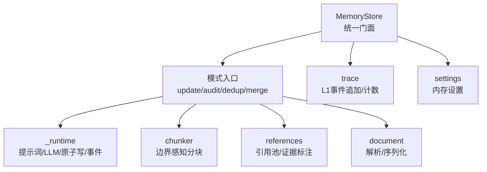
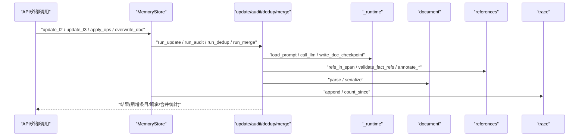
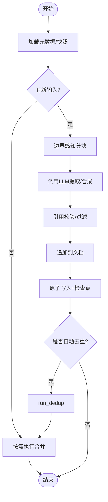
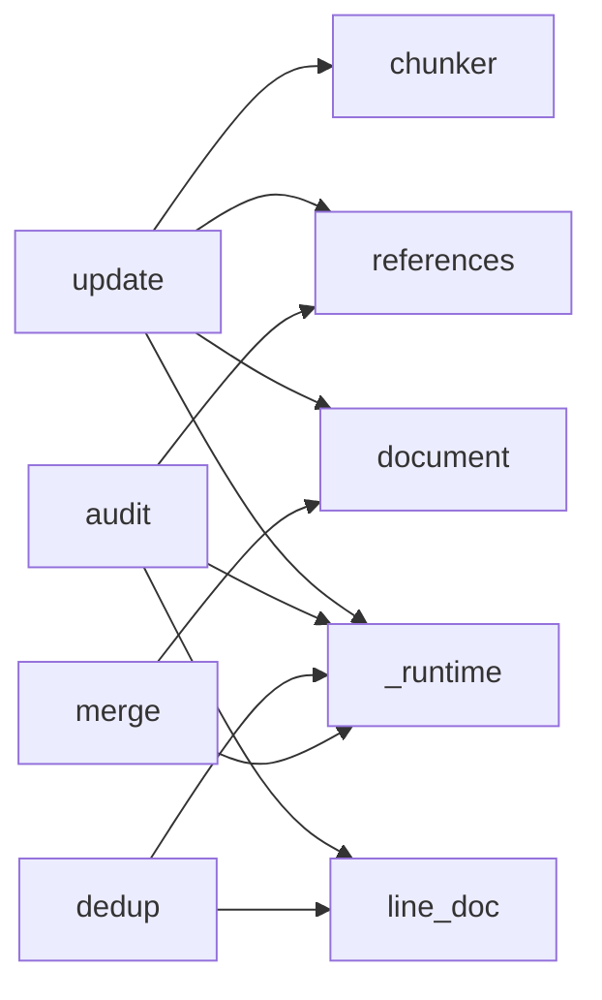

# 记忆整合器

<cite>
**本文引用的文件**
- [deeptutor/services/memory/consolidator/__init__.py](file://deeptutor/services/memory/consolidator/__init__.py)
- [deeptutor/services/memory/consolidator/modes/_runtime.py](file://deeptutor/services/memory/consolidator/modes/_runtime.py)
- [deeptutor/services/memory/consolidator/modes/update.py](file://deeptutor/services/memory/consolidator/modes/update.py)
- [deeptutor/services/memory/consolidator/modes/audit.py](file://deeptutor/services/memory/consolidator/modes/audit.py)
- [deeptutor/services/memory/consolidator/modes/dedup.py](file://deeptutor/services/memory/consolidator/modes/dedup.py)
- [deeptutor/services/memory/consolidator/modes/merge.py](file://deeptutor/services/memory/consolidator/modes/merge.py)
- [deeptutor/services/memory/consolidator/chunker.py](file://deeptutor/services/memory/consolidator/chunker.py)
- [deeptutor/services/memory/consolidator/references.py](file://deeptutor/services/memory/consolidator/references.py)
- [deeptutor/services/memory/document.py](file://deeptutor/services/memory/document.py)
- [deeptutor/services/memory/store.py](file://deeptutor/services/memory/store.py)
- [deeptutor/services/memory/settings.py](file://deeptutor/services/memory/settings.py)
- [deeptutor/services/memory/trace.py](file://deeptutor/services/memory/trace.py)
</cite>

## 目录
1. [简介](#简介)
2. [项目结构](#项目结构)
3. [核心组件](#核心组件)
4. [架构总览](#架构总览)
5. [详细组件分析](#详细组件分析)
6. [依赖关系分析](#依赖关系分析)
7. [性能考虑](#性能考虑)
8. [故障排除指南](#故障排除指南)
9. [结论](#结论)
10. [附录](#附录)

## 简介
本文件面向DeepTutor的“记忆整合器”，系统性说明其职责、数据流与处理管道，覆盖从L1原始事件到L2（按来源面聚合）再到L3（跨来源综合）的转换过程；解释运行模式（实时更新、批量处理、定时任务）、质量保证（验证、错误处理、重试策略）、参考管理机制与依赖跟踪、配置选项与性能调优、监控日志与调试工具、扩展能力与最佳实践。

## 项目结构
记忆整合器位于 services/memory 下，采用“门面 + 模式 + 运行时”的分层组织：
- 门面层：MemoryStore 提供对外统一接口（读/写/概览/迁移），屏蔽路径与并发细节。
- 模式层：update/audit/dedup/merge 四种工作模式，分别负责增量抽取、审计校验、去重合并、脚注归并。
- 运行时层：_runtime 提供提示词加载、LLM调用封装、原子写入、检查点与事件发射等通用能力。
- 支撑模块：chunker（分块）、references（引用池与证据标注）、document（文档解析/序列化）、settings（用户可配参数）、trace（L1事件追加与查询）。

图表来源
- [deeptutor/services/memory/store.py:68-163](file://deeptutor/services/memory/store.py#L68-L163)
- [deeptutor/services/memory/consolidator/__init__.py:33-62](file://deeptutor/services/memory/consolidator/__init__.py#L33-L62)
- [deeptutor/services/memory/consolidator/modes/_runtime.py:39-267](file://deeptutor/services/memory/consolidator/modes/_runtime.py#L39-L267)
- [deeptutor/services/memory/consolidator/chunker.py:43-109](file://deeptutor/services/memory/consolidator/chunker.py#L43-L109)
- [deeptutor/services/memory/consolidator/references.py:44-163](file://deeptutor/services/memory/consolidator/references.py#L44-L163)
- [deeptutor/services/memory/document.py:105-232](file://deeptutor/services/memory/document.py#L105-L232)
- [deeptutor/services/memory/trace.py:66-132](file://deeptutor/services/memory/trace.py#L66-L132)
- [deeptutor/services/memory/settings.py:72-97](file://deeptutor/services/memory/settings.py#L72-L97)

章节来源
- [deeptutor/services/memory/store.py:1-460](file://deeptutor/services/memory/store.py#L1-L460)
- [deeptutor/services/memory/consolidator/__init__.py:1-63](file://deeptutor/services/memory/consolidator/__init__.py#L1-L63)

## 核心组件
- MemoryStore：无状态门面，封装L2/L3读写、更新、应用操作、概览、迁移与并发锁。
- 模式集合：
  - update：基于分块的增量事实抽取（L1→L2，L2→L3）。
  - audit：行级编辑审计，对照原始证据修正L2/L3。
  - dedup：迭代式整篇去重合并。
  - merge：无LLM的脚注归并与格式规范化。
- _runtime：提示词缓存、LLM流式调用（含非流回退）、原子写入、检查点、事件发射。
- chunker：按段落/句子边界的字符级分块，支持重叠窗口。
- references：构建允许引用集、过滤/校验事实引用、为审计注入证据。
- document：Markdown文档解析/序列化，兼容新旧脚注格式。
- settings：用户可调参数（预算、分块、去重迭代、自动触发开关等）。
- trace：L1事件追加、计数、遍历，供概览与增量计算使用。

章节来源
- [deeptutor/services/memory/store.py:68-163](file://deeptutor/services/memory/store.py#L68-L163)
- [deeptutor/services/memory/consolidator/modes/update.py:80-135](file://deeptutor/services/memory/consolidator/modes/update.py#L80-L135)
- [deeptutor/services/memory/consolidator/modes/audit.py:75-124](file://deeptutor/services/memory/consolidator/modes/audit.py#L75-L124)
- [deeptutor/services/memory/consolidator/modes/dedup.py:52-84](file://deeptutor/services/memory/consolidator/modes/dedup.py#L52-L84)
- [deeptutor/services/memory/consolidator/modes/merge.py:62-151](file://deeptutor/services/memory/consolidator/modes/merge.py#L62-L151)
- [deeptutor/services/memory/consolidator/modes/_runtime.py:89-267](file://deeptutor/services/memory/consolidator/modes/_runtime.py#L89-L267)
- [deeptutor/services/memory/consolidator/chunker.py:43-109](file://deeptutor/services/memory/consolidator/chunker.py#L43-L109)
- [deeptutor/services/memory/consolidator/references.py:125-163](file://deeptutor/services/memory/consolidator/references.py#L125-L163)
- [deeptutor/services/memory/document.py:105-232](file://deeptutor/services/memory/document.py#L105-L232)
- [deeptutor/services/memory/settings.py:21-97](file://deeptutor/services/memory/settings.py#L21-L97)
- [deeptutor/services/memory/trace.py:66-132](file://deeptutor/services/memory/trace.py#L66-L132)

## 架构总览
记忆整合器的数据流遵循“L1事件 → L2聚合 → L3综合”的流水线，并在每个阶段进行质量控制与持久化。

图表来源
- [deeptutor/services/memory/store.py:125-192](file://deeptutor/services/memory/store.py#L125-L192)
- [deeptutor/services/memory/consolidator/modes/update.py:80-135](file://deeptutor/services/memory/consolidator/modes/update.py#L80-L135)
- [deeptutor/services/memory/consolidator/modes/_runtime.py:89-267](file://deeptutor/services/memory/consolidator/modes/_runtime.py#L89-L267)
- [deeptutor/services/memory/consolidator/references.py:44-163](file://deeptutor/services/memory/consolidator/references.py#L44-L163)
- [deeptutor/services/memory/document.py:105-232](file://deeptutor/services/memory/document.py#L105-L232)
- [deeptutor/services/memory/trace.py:66-132](file://deeptutor/services/memory/trace.py#L66-L132)

## 详细组件分析

### L1→L2 与 L2→L3 的数据转换与处理管道
- L1→L2（update模式）：
  - 通过快照与元数据计算“自上次更新以来”的新实体，拼接成时间线文本并按预算分块。
  - 对每块调用LLM提取事实，依据块内允许的引用集过滤与校验，追加到L2文档。
  - 原子写入并更新元数据；可按配置自动触发去重与脚注合并。
- L2→L3（update模式）：
  - 读取所有L2文档，按表面分组新条目，拼接为纯文本输入（不含L2脚注溯源）。
  - 分块后调用LLM合成L3内容，同样进行引用校验与追加，原子写入并更新元数据。
  - 可按配置自动触发去重与脚注合并。

图表来源
- [deeptutor/services/memory/consolidator/modes/update.py:140-357](file://deeptutor/services/memory/consolidator/modes/update.py#L140-L357)
- [deeptutor/services/memory/consolidator/modes/update.py:363-586](file://deeptutor/services/memory/consolidator/modes/update.py#L363-L586)
- [deeptutor/services/memory/consolidator/modes/dedup.py:87-198](file://deeptutor/services/memory/consolidator/modes/dedup.py#L87-L198)
- [deeptutor/services/memory/consolidator/modes/merge.py:62-151](file://deeptutor/services/memory/consolidator/modes/merge.py#L62-L151)

章节来源
- [deeptutor/services/memory/consolidator/modes/update.py:80-586](file://deeptutor/services/memory/consolidator/modes/update.py#L80-L586)

### 运行模式：实时更新、批量处理、定时任务
- 实时更新：通过API路由或工具调用触发 update_l2/update_l3，逐条或按批处理新事件。
- 批量处理：update模式以预算为单位将长文本切分为多块，逐块调用LLM，适合大批量历史回溯。
- 定时任务：可通过外部调度（如cron）周期性调用 run_update/run_audit/run_dedup/run_merge，结合 settings 中的 auto_after_* 开关实现自动化流水线。

章节来源
- [deeptutor/services/memory/store.py:125-163](file://deeptutor/services/memory/store.py#L125-L163)
- [deeptutor/services/memory/settings.py:21-97](file://deeptutor/services/memory/settings.py#L21-L97)

### 质量保证机制：数据验证、错误处理、重试策略
- 数据验证：
  - 引用校验：validate_fact_refs 根据允许引用集过滤非法或缺失引用，支持强制必填与丢弃无效项。
  - 文档结构：document.parse/serialize 保证解析/序列化一致性，兼容新旧脚注格式。
- 错误处理：
  - LLM调用失败时，先尝试流式回退到非流式调用；仍失败则记录警告并返回空响应，确保作业不中断。
  - 事件消费者异常被捕获并记录，避免阻塞主流程。
- 重试策略：
  - 代码未内置指数退避重试；建议在上层（调度/任务队列）实现重试与幂等控制。
  - 去重模式在单轮内若LLM返回零编辑则提前收敛，减少无效调用。

章节来源
- [deeptutor/services/memory/consolidator/references.py:125-163](file://deeptutor/services/memory/consolidator/references.py#L125-L163)
- [deeptutor/services/memory/consolidator/modes/_runtime.py:89-213](file://deeptutor/services/memory/consolidator/modes/_runtime.py#L89-L213)
- [deeptutor/services/memory/consolidator/modes/dedup.py:114-170](file://deeptutor/services/memory/consolidator/modes/dedup.py#L114-L170)
- [deeptutor/services/memory/document.py:105-232](file://deeptutor/services/memory/document.py#L105-L232)

### 参考管理机制与依赖跟踪
- 参考池：
  - L2：refs_in_span_l2 基于实体标记定位块内允许引用，确保事实仅能引用当前块内的原始事件。
  - L3：refs_in_span_l3 基于表面头匹配确定块内允许的表面名，L3不直接引用L2条目ID，保持“L3→L2 md→L1原始”的清晰链路。
- 依赖跟踪：
  - trace 模块按表面和日期追加L1事件，支持按时间范围遍历与计数，用于概览与增量计算。
  - 元数据（*.meta.json）记录已见实体/条目ID，避免重复处理。

章节来源
- [deeptutor/services/memory/consolidator/references.py:44-163](file://deeptutor/services/memory/consolidator/references.py#L44-L163)
- [deeptutor/services/memory/trace.py:66-132](file://deeptutor/services/memory/trace.py#L66-L132)
- [deeptutor/services/memory/consolidator/modes/update.py:150-172](file://deeptutor/services/memory/consolidator/modes/update.py#L150-L172)

### 配置选项与性能调优参数
- 更新预算：update.l2_budget / update.l3_budget 控制每轮最大块数。
- 审计预算：audit.l2_budget / audit.l3_budget 控制审计分块规模。
- 去重迭代：dedup.iterations 上限次数，auto_after_update/auto_after_audit/auto_after_dedup 控制自动触发。
- 分块策略：chunking.overlap_ratio、boundary（paragraph/sentence）、min/max_chunk_chars。
- 引用策略：reference.enforce_required、drop_invalid_refs。
- 合并策略：merge.auto_after_* 控制各阶段后自动合并。

章节来源
- [deeptutor/services/memory/settings.py:21-97](file://deeptutor/services/memory/settings.py#L21-L97)
- [deeptutor/services/memory/settings.py:113-184](file://deeptutor/services/memory/settings.py#L113-L184)

### 监控日志与调试工具使用方法
- 事件发射：_runtime.emit 在各阶段发射 stage 事件（如 llm_io_start/end、progress、facts_extracted、doc_updated），便于前端或日志系统消费。
- LLM追踪：call_llm 在流式与非流式路径均发射事件，包含模型标签、提示词片段与响应摘要。
- 文档变更：write_doc_checkpoint 记录每次原子写入的检查点深度，支持撤销与审计。
- 概览信息：MemoryStore.overview 提供存在性、更新时间、条目数与积压（L2 backlog）等指标。

章节来源
- [deeptutor/services/memory/consolidator/modes/_runtime.py:80-267](file://deeptutor/services/memory/consolidator/modes/_runtime.py#L80-L267)
- [deeptutor/services/memory/store.py:261-305](file://deeptutor/services/memory/store.py#L261-L305)

### 自定义整合规则与扩展处理能力
- 提示词扩展：在 consolidator/prompts/{en,zh} 下新增或修改 YAML，配合 load_prompt 的缓存机制生效。
- 模式扩展：参照 update/audit/dedup/merge 的模式结构，实现新的 mode，复用 _runtime 的LLM与写入能力。
- 文档结构扩展：如需新字段或节，需同步调整 document.parse/serialize 与 references 的渲染逻辑。
- 配置扩展：在 settings 中增加 dataclass 字段与约束，并通过 ConfigManager 持久化。

章节来源
- [deeptutor/services/memory/consolidator/modes/_runtime.py:39-63](file://deeptutor/services/memory/consolidator/modes/_runtime.py#L39-L63)
- [deeptutor/services/memory/document.py:105-232](file://deeptutor/services/memory/document.py#L105-L232)
- [deeptutor/services/memory/settings.py:72-97](file://deeptutor/services/memory/settings.py#L72-L97)

## 依赖关系分析
- 低耦合：模式之间通过统一的入口函数与事件协议交互，避免直接耦合。
- 关键依赖：
  - update 依赖 chunker、references、document、_runtime。
  - audit 依赖 line_doc（行级视图与编辑）、references、_runtime。
  - dedup 依赖 line_doc、_runtime。
  - merge 依赖 document.serialize 与路径服务。
- 外部依赖：LLM服务、模型选择运行时（可选的 scoped 配置）。

图表来源
- [deeptutor/services/memory/consolidator/modes/update.py:25-59](file://deeptutor/services/memory/consolidator/modes/update.py#L25-L59)
- [deeptutor/services/memory/consolidator/modes/audit.py:23-58](file://deeptutor/services/memory/consolidator/modes/audit.py#L23-L58)
- [deeptutor/services/memory/consolidator/modes/dedup.py:23-38](file://deeptutor/services/memory/consolidator/modes/dedup.py#L23-L38)
- [deeptutor/services/memory/consolidator/modes/merge.py:33-39](file://deeptutor/services/memory/consolidator/modes/merge.py#L33-L39)

章节来源
- [deeptutor/services/memory/consolidator/modes/update.py:25-59](file://deeptutor/services/memory/consolidator/modes/update.py#L25-L59)
- [deeptutor/services/memory/consolidator/modes/audit.py:23-58](file://deeptutor/services/memory/consolidator/modes/audit.py#L23-L58)
- [deeptutor/services/memory/consolidator/modes/dedup.py:23-38](file://deeptutor/services/memory/consolidator/modes/dedup.py#L23-L38)
- [deeptutor/services/memory/consolidator/modes/merge.py:33-39](file://deeptutor/services/memory/consolidator/modes/merge.py#L33-L39)

## 性能考虑
- 分块策略：合理设置 overlap_ratio 与 boundary，避免过度重叠导致冗余LLM调用；max_chunk_chars 防止极端文本膨胀。
- 预算控制：根据上下文长度与成本，调整 l2/l3 budget，平衡吞吐与质量。
- 早期收敛：dedup 在零编辑时立即停止，节省token。
- 原子写入：write_doc_atomic 使用临时文件+替换，降低并发写入风险。
- 提示词缓存：load_prompt 与 focus meta 缓存减少I/O开销。

[本节为通用指导，无需特定文件来源]

## 故障排除指南
- LLM调用失败：
  - 现象：llm_io_end 事件携带 error 字段。
  - 排查：检查模型配置与网络；确认流式回退是否生效。
- 引用被丢弃：
  - 现象：refs_dropped 事件出现，reason 可能为 missing refs 或 out-of-pool ref。
  - 排查：检查 chunk 的 allowed refs 与 enforce_required/drop_invalid_refs 设置。
- 文档未更新：
  - 现象：overview 显示 no_new_input 或 backlog 为0。
  - 排查：确认 trace 是否有新事件；检查元数据 seen_* 是否正确更新。
- 并发冲突：
  - 现象：写入竞争或损坏。
  - 排查：确认 MemoryStore._lock_for 是否生效；避免绕过门面直接写盘。

章节来源
- [deeptutor/services/memory/consolidator/modes/_runtime.py:164-213](file://deeptutor/services/memory/consolidator/modes/_runtime.py#L164-L213)
- [deeptutor/services/memory/consolidator/modes/update.py:264-283](file://deeptutor/services/memory/consolidator/modes/update.py#L264-L283)
- [deeptutor/services/memory/store.py:261-305](file://deeptutor/services/memory/store.py#L261-L305)

## 结论
记忆整合器通过清晰的三层结构与模块化设计，实现了从L1到L2、L2到L3的稳定、可观测、可扩展的记忆整合流水线。借助分块、引用校验、原子写入与检查点机制，系统在大规模场景下具备鲁棒性与可维护性。通过合理的配置与外部调度，可实现实时、批量与定时多种运行模式，满足多样化业务需求。

[本节为总结，无需特定文件来源]

## 附录
- 常用入口函数：
  - run_update(layer, key, ...)：增量抽取（L1→L2 或 L2→L3）。
  - run_audit(layer, key, ...)：行级审计与修正。
  - run_dedup(layer, key, ...)：迭代去重合并。
  - run_merge(layer, key, ...)：脚注归并与格式规范化。
- 关键数据结构：
  - ExtractedFact：LLM提取的事实（text、refs、section）。
  - Document/Entry：文档与条目模型，支持解析/序列化。
  - TraceEvent：L1事件，用于增量与审计。

章节来源
- [deeptutor/services/memory/consolidator/__init__.py:33-62](file://deeptutor/services/memory/consolidator/__init__.py#L33-L62)
- [deeptutor/services/memory/consolidator/references.py:35-42](file://deeptutor/services/memory/consolidator/references.py#L35-L42)
- [deeptutor/services/memory/document.py:64-78](file://deeptutor/services/memory/document.py#L64-L78)
- [deeptutor/services/memory/trace.py:35-63](file://deeptutor/services/memory/trace.py#L35-L63)