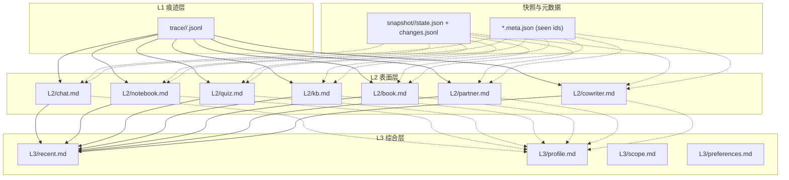
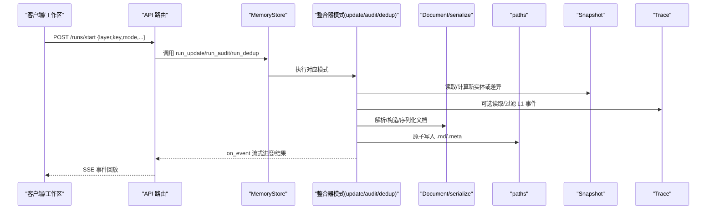
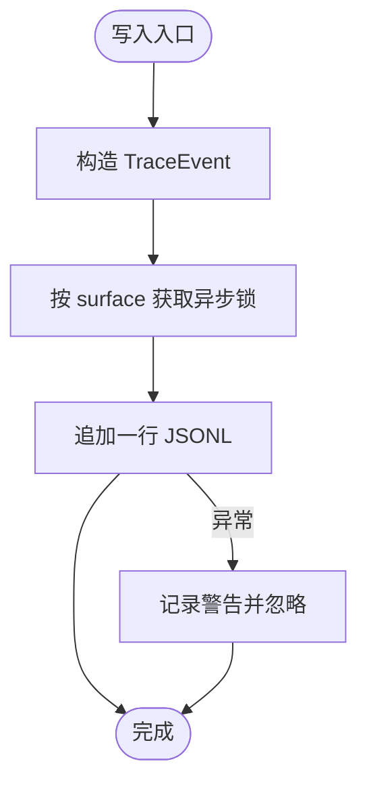
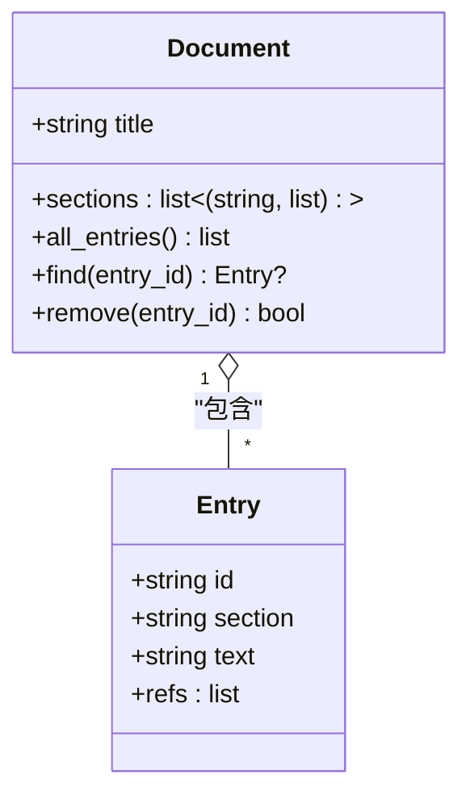
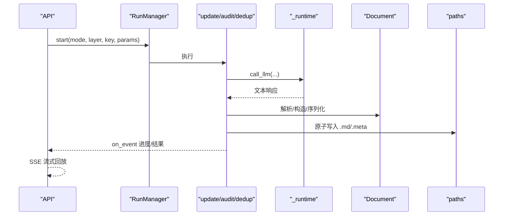
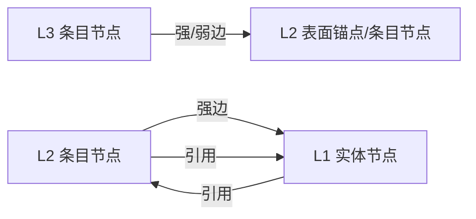
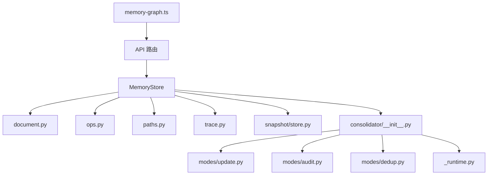

# 记忆系统

<cite>
**本文引用的文件**
- [deeptutor/services/memory/__init__.py](file://deeptutor/services/memory/__init__.py)
- [deeptutor/services/memory/store.py](file://deeptutor/services/memory/store.py)
- [deeptutor/services/memory/paths.py](file://deeptutor/services/memory/paths.py)
- [deeptutor/services/memory/document.py](file://deeptutor/services/memory/document.py)
- [deeptutor/services/memory/trace.py](file://deeptutor/services/memory/trace.py)
- [deeptutor/services/memory/settings.py](file://deeptutor/services/memory/settings.py)
- [deeptutor/services/memory/snapshot/store.py](file://deeptutor/services/memory/snapshot/store.py)
- [deeptutor/api/routers/memory.py](file://deeptutor/api/routers/memory.py)
- [deeptutor/services/memory/consolidator/__init__.py](file://deeptutor/services/memory/consolidator/__init__.py)
- [deeptutor/services/memory/consolidator/modes/update.py](file://deeptutor/services/memory/consolidator/modes/update.py)
- [deeptutor/services/memory/consolidator/modes/audit.py](file://deeptutor/services/memory/consolidator/modes/audit.py)
- [deeptutor/services/memory/consolidator/modes/dedup.py](file://deeptutor/services/memory/consolidator/modes/dedup.py)
- [deeptutor/services/memory/consolidator/modes/_runtime.py](file://deeptutor/services/memory/consolidator/modes/_runtime.py)
- [web/lib/memory-graph.ts](file://web/lib/memory-graph.ts)
</cite>

## 目录
1. [简介](#简介)
2. [项目结构](#项目结构)
3. [核心组件](#核心组件)
4. [架构总览](#架构总览)
5. [详细组件分析](#详细组件分析)
6. [依赖关系分析](#依赖关系分析)
7. [性能与优化](#性能与优化)
8. [故障排查指南](#故障排查指南)
9. [结论](#结论)
10. [附录](#附录)

## 简介
本文件系统化阐述 DeepTutor 的三层记忆系统：L1 痕迹层（原始事件）、L2 表面层（按来源聚合的记忆文档）、L3 综合层（跨来源的综合摘要、用户画像、知识范围与偏好）。文档覆盖设计理念、存储结构与文件组织、数据模型、记忆整合器（更新/去重/审计）工作流程、可视化与证据追踪、权限控制与访问策略、导入导出与备份恢复、配置与性能调优，以及如何使用记忆系统进行个性化学习与用户画像构建。

## 项目结构
记忆子系统位于 services/memory，对外通过 API 路由暴露统一接口；前端在 web/lib/memory-graph.ts 中实现图可视化。关键目录与职责：
- L1 痕迹层：按 surface 和 UTC 日切分追加式 JSONL 文件，记录原始交互事件。
- L2 表面层：每个来源（如 chat、notebook、quiz 等）一个 Markdown 文档，条目带引用脚注与唯一 entry id。
- L3 综合层：recent/profile/scope/preferences 四个槽位，聚合跨来源信息。
- 快照与变更日志：snapshot/<surface>/state.json 与 changes.jsonl，用于增量差异与回滚。
- 路径解析：paths.py 提供 per-user 根目录与子目录映射，支持多租户隔离与运行时覆盖。
- 设置：settings.py 集中管理更新/审计/去重/合并/分块/引用校验等参数。
- 整合器：consolidator/modes 下 update/audit/dedup/merge 四种模式，共享 _runtime 工具。
- API：api/routers/memory.py 暴露工作区操作、运行任务、设置、快照、追溯等端点。

**图示来源**
- [deeptutor/services/memory/paths.py:1-104](file://deeptutor/services/memory/paths.py#L1-L104)
- [deeptutor/services/memory/trace.py:1-154](file://deeptutor/services/memory/trace.py#L1-L154)
- [deeptutor/services/memory/snapshot/store.py:1-114](file://deeptutor/services/memory/snapshot/store.py#L1-L114)

**章节来源**
- [deeptutor/services/memory/paths.py:1-104](file://deeptutor/services/memory/paths.py#L1-L104)
- [deeptutor/services/memory/trace.py:1-154](file://deeptutor/services/memory/trace.py#L1-L154)
- [deeptutor/services/memory/snapshot/store.py:1-114](file://deeptutor/services/memory/snapshot/store.py#L1-L114)

## 核心组件
- MemoryStore：无状态门面，封装 L1 写入、L2/L3 读写、批量 ops 应用、概览统计、迁移与 v1 兼容。
- Document/Entry：Markdown 文档与条目的纯函数解析/序列化，支持新旧两种脚注格式，保证往返幂等。
- TraceEvent：L1 追加式事件，按 surface+UTC 日归档，线程安全追加。
- Consolidator modes：update/audit/dedup/merge，基于 chunker 与 prompt 驱动 LLM 生成编辑/新增事实，并原子落盘。
- Settings：可配置的预算、迭代次数、分块策略、引用校验开关等。
- Snapshot：实体快照与变更日志，支撑增量对比与 UI 展示。
- API Router：REST/SSE 接口，启动长任务、流式事件、撤销、设置、快照、追溯清理等。

**章节来源**
- [deeptutor/services/memory/store.py:1-460](file://deeptutor/services/memory/store.py#L1-L460)
- [deeptutor/services/memory/document.py:1-236](file://deeptutor/services/memory/document.py#L1-L236)
- [deeptutor/services/memory/trace.py:1-154](file://deeptutor/services/memory/trace.py#L1-L154)
- [deeptutor/services/memory/settings.py:1-199](file://deeptutor/services/memory/settings.py#L1-L199)
- [deeptutor/services/memory/snapshot/store.py:1-114](file://deeptutor/services/memory/snapshot/store.py#L1-L114)
- [deeptutor/api/routers/memory.py:1-786](file://deeptutor/api/routers/memory.py#L1-L786)

## 架构总览
记忆系统以“事件→文档→综合”的分层流水线为核心，结合“快照/元数据”进行增量识别与一致性维护，API 层负责编排长任务与 SSE 事件流，前端负责可视化与交互。

**图示来源**
- [deeptutor/api/routers/memory.py:308-453](file://deeptutor/api/routers/memory.py#L308-L453)
- [deeptutor/services/memory/store.py:125-192](file://deeptutor/services/memory/store.py#L125-L192)
- [deeptutor/services/memory/consolidator/modes/update.py:80-135](file://deeptutor/services/memory/consolidator/modes/update.py#L80-L135)
- [deeptutor/services/memory/consolidator/modes/_runtime.py:228-267](file://deeptutor/services/memory/consolidator/modes/_runtime.py#L228-L267)

## 详细组件分析

### L1 痕迹层：原始事件捕获与回溯
- 设计目标：为每条交互事件生成唯一 trace id，按 surface 与 UTC 日切分追加式 JSONL，确保高吞吐且不影响上游服务。
- 数据结构：TraceEvent(id, ts, surface, kind, payload, session_id, turn_id)。
- 写入策略：按 surface 加锁串行追加，异常吞掉并记录日志，避免影响生产流程。
- 查询能力：iter_since/count_since/latest_ts 支持时间过滤与计数；iter_by_ids 支持跨 surface 反查。
- 可视化与审计：API 提供 /trace/{surface} 分页浏览与按天删除，便于问题定位与合规审计。

**图示来源**
- [deeptutor/services/memory/trace.py:35-86](file://deeptutor/services/memory/trace.py#L35-L86)

**章节来源**
- [deeptutor/services/memory/trace.py:1-154](file://deeptutor/services/memory/trace.py#L1-L154)
- [deeptutor/api/routers/memory.py:680-722](file://deeptutor/api/routers/memory.py#L680-L722)

### L2 表面层：按来源聚合的记忆文档
- 设计目标：将同一来源（如聊天、笔记、测验等）的事件聚合成可读的 Markdown 文档，条目带引用脚注与唯一 entry id，支持行级编辑与审计。
- 数据模型：Document(title, sections[(section, entries[])])，Entry(id, section, text, refs[])。
- 解析/序列化：支持新旧两种脚注格式，保证 serialize(parse(x)) 幂等；保留 HTML 注释中的 entry id 用于删除与跳转。
- 文件组织：L2/<surface>.md，配合 *.meta.json 记录已见实体集合，用于增量识别。
- 权限与隔离：路径由 paths.memory_root() 解析，默认基于当前用户；可通过 memory_path_service_override 临时切换到其他用户上下文（例如伙伴场景）。

**图示来源**
- [deeptutor/services/memory/document.py:64-103](file://deeptutor/services/memory/document.py#L64-L103)

**章节来源**
- [deeptutor/services/memory/document.py:1-236](file://deeptutor/services/memory/document.py#L1-L236)
- [deeptutor/services/memory/paths.py:62-89](file://deeptutor/services/memory/paths.py#L62-L89)

### L3 综合层：跨来源综合摘要与画像
- 设计目标：聚合多个 L2 文档形成近期摘要、用户画像、知识范围与偏好，支撑个性化学习。
- 槽位定义：recent/profile/scope/preferences，preferences 不自动整合，仅由 write_memory 工具写入。
- 增量识别：通过 L3 meta 记录已见 L2 entry ids，仅处理新增条目。
- 文件组织：L3/<slot>.md，配合 *.meta.json。
- 权限与隔离：同 L2，路径解析遵循当前用户或运行时覆盖。

**章节来源**
- [deeptutor/services/memory/paths.py:47-59](file://deeptutor/services/memory/paths.py#L47-L59)
- [deeptutor/services/memory/store.py:144-163](file://deeptutor/services/memory/store.py#L144-L163)

### 记忆整合器：更新、去重与审计
- 更新（update）：从快照与 L1 事件中提取新事实，按预算分块，LLM 抽取事实并追加到 L2/L3，随后可选触发去重与合并。
- 审计（audit）：对现有文档进行行级审查，附加完整证据片段，LLM 返回替换/删除编辑，按行号逆序应用，保持后续 chunk 的行号稳定。
- 去重（dedup）：迭代地对全文进行行级合并/删除，若某轮无编辑则提前收敛，节省 token。
- 合并（merge）：非 LLM 的脚注合并，将重复引用折叠为单一脚注，提升可读性。
- 共享运行时：_runtime 提供提示词加载、SSE 事件发射、LLM 调用封装（含思考标签剥离）、原子写入与检查点注册。

**图示来源**
- [deeptutor/api/routers/memory.py:240-350](file://deeptutor/api/routers/memory.py#L240-L350)
- [deeptutor/services/memory/consolidator/modes/_runtime.py:89-213](file://deeptutor/services/memory/consolidator/modes/_runtime.py#L89-L213)
- [deeptutor/services/memory/consolidator/modes/update.py:140-357](file://deeptutor/services/memory/consolidator/modes/update.py#L140-L357)
- [deeptutor/services/memory/consolidator/modes/audit.py:129-261](file://deeptutor/services/memory/consolidator/modes/audit.py#L129-L261)
- [deeptutor/services/memory/consolidator/modes/dedup.py:87-198](file://deeptutor/services/memory/consolidator/modes/dedup.py#L87-L198)

**章节来源**
- [deeptutor/services/memory/consolidator/__init__.py:1-63](file://deeptutor/services/memory/consolidator/__init__.py#L1-L63)
- [deeptutor/services/memory/consolidator/modes/update.py:1-707](file://deeptutor/services/memory/consolidator/modes/update.py#L1-L707)
- [deeptutor/services/memory/consolidator/modes/audit.py:1-485](file://deeptutor/services/memory/consolidator/modes/audit.py#L1-L485)
- [deeptutor/services/memory/consolidator/modes/dedup.py:1-229](file://deeptutor/services/memory/consolidator/modes/dedup.py#L1-L229)
- [deeptutor/services/memory/consolidator/modes/_runtime.py:1-338](file://deeptutor/services/memory/consolidator/modes/_runtime.py#L1-L338)

### 可视化与证据追踪
- 数据拉取：前端通过 /snapshot/{surface} 与 /doc/{layer}/{key} 拉取 L1/L2/L3 数据。
- 解析与建图：memory-graph.ts 解析 Markdown 条目与脚注，构建节点与边，计算同心圆布局（L3 内环、L2 中环、L1 外环），并按 surface/slot 聚类。
- 边类型：强边（具体 entry 引用）与弱边（表面级引用指向簇中心锚点）。
- 证据追踪：L2 条目 refs 指向 L1 实体（如 chat:unified_xxx），L3 条目 refs 指向 L2 文件或特定 entry，形成 L3→L2→L1 的证据链。

**图示来源**
- [web/lib/memory-graph.ts:126-214](file://web/lib/memory-graph.ts#L126-L214)
- [web/lib/memory-graph.ts:241-284](file://web/lib/memory-graph.ts#L241-L284)
- [web/lib/memory-graph.ts:322-656](file://web/lib/memory-graph.ts#L322-L656)

**章节来源**
- [web/lib/memory-graph.ts:1-763](file://web/lib/memory-graph.ts#L1-L763)
- [deeptutor/api/routers/memory.py:728-785](file://deeptutor/api/routers/memory.py#L728-L785)

### 权限控制与访问控制策略
- 路径隔离：所有路径通过 paths.memory_root() 解析，默认绑定当前用户 workspace；支持 memory_path_service_override 临时切换至其他用户上下文（如伙伴代理）。
- 多租户：multi_user 模块提供身份、授权、资源隔离等能力，记忆子系统通过路径服务间接受益。
- 工具访问：write_memory 仅在特定上下文中允许写入 preferences，其他整合流程禁止直接修改 preferences。

**章节来源**
- [deeptutor/services/memory/paths.py:27-44](file://deeptutor/services/memory/paths.py#L27-L44)
- [deeptutor/api/routers/memory.py:317-321](file://deeptutor/api/routers/memory.py#L317-L321)
- [deeptutor/api/routers/memory.py:654-658](file://deeptutor/api/routers/memory.py#L654-L658)

### 导入导出与备份恢复
- 备份列表：/backup 列出历史迁移备份目录，便于回滚或人工核查。
- 重置文档：/doc/{layer}/{key}/reset 删除文档与元数据侧车，使下次更新重新全量摄入。
- 快照刷新：/snapshot/{surface}/refresh 计算当前工作区与持久化状态的差异，记录 pending_changes。
- 变更查看：/snapshot/{surface}/changes 分页查看变更日志。
- 追溯清理：/trace/{surface} 与 /trace/{surface}/day/{date} 支持按天或全部删除。

**章节来源**
- [deeptutor/api/routers/memory.py:124-134](file://deeptutor/api/routers/memory.py#L124-L134)
- [deeptutor/api/routers/memory.py:169-219](file://deeptutor/api/routers/memory.py#L169-L219)
- [deeptutor/api/routers/memory.py:750-785](file://deeptutor/api/routers/memory.py#L750-L785)
- [deeptutor/api/routers/memory.py:680-722](file://deeptutor/api/routers/memory.py#L680-L722)

### 配置选项与性能调优
- 更新预算：update.l2_budget/update.l3_budget 控制每轮最大分块数。
- 审计预算：audit.l2_budget/audit.l3_budget。
- 去重迭代：dedup.iterations 上限，auto_after_update 控制是否自动触发。
- 合并自动化：merge.auto_after_update/auto_after_audit/auto_after_dedup。
- 分块策略：chunking.overlap_ratio/boundary/min_chunk_chars/max_chunk_chars。
- 引用校验：reference.enforce_required/drop_invalid_refs。
- 模型选择：run_* 支持 llm_selection 指定 profile_id/model_id，运行时激活后贯穿整次任务。

**章节来源**
- [deeptutor/services/memory/settings.py:21-70](file://deeptutor/services/memory/settings.py#L21-L70)
- [deeptutor/services/memory/settings.py:102-184](file://deeptutor/services/memory/settings.py#L102-L184)
- [deeptutor/services/memory/consolidator/modes/update.py:101-135](file://deeptutor/services/memory/consolidator/modes/update.py#L101-L135)
- [deeptutor/services/memory/consolidator/modes/audit.py:90-123](file://deeptutor/services/memory/consolidator/modes/audit.py#L90-L123)
- [deeptutor/services/memory/consolidator/modes/dedup.py:67-84](file://deeptutor/services/memory/consolidator/modes/dedup.py#L67-L84)

### 个性化学习与用户画像构建
- 用户画像：L3/profile 聚合用户兴趣、能力、目标等信息，供推荐与自适应内容生成使用。
- 近期摘要：L3/recent 汇总最近学习轨迹，辅助会话上下文注入。
- 知识范围：L3/scope 限定领域边界，指导检索与生成。
- 偏好：L3/preferences 由 write_memory 工具写入，记录显式偏好（语言、风格、难度等）。
- 实践建议：定期运行 update→dedup→merge，确保画像与摘要新鲜且精简；结合审计修正偏差；利用图谱导航理解关联。

**章节来源**
- [deeptutor/services/memory/paths.py:47-59](file://deeptutor/services/memory/paths.py#L47-L59)
- [deeptutor/services/memory/store.py:194-257](file://deeptutor/services/memory/store.py#L194-L257)
- [web/lib/memory-graph.ts:748-762](file://web/lib/memory-graph.ts#L748-L762)

## 依赖关系分析
- API 路由依赖 store 与 consolidator 运行器；store 依赖 document、ops、paths、trace、snapshot。
- consolidator 各模式共享 _runtime（提示词、LLM、事件、原子写）与 settings。
- 前端 memory-graph.ts 依赖后端 snapshot/doc/trace 接口，解析 Markdown 并构建图。

**图示来源**
- [deeptutor/api/routers/memory.py:43-49](file://deeptutor/api/routers/memory.py#L43-L49)
- [deeptutor/services/memory/store.py:19-25](file://deeptutor/services/memory/store.py#L19-L25)
- [deeptutor/services/memory/consolidator/__init__.py:35-48](file://deeptutor/services/memory/consolidator/__init__.py#L35-L48)
- [web/lib/memory-graph.ts:241-284](file://web/lib/memory-graph.ts#L241-L284)

**章节来源**
- [deeptutor/api/routers/memory.py:1-786](file://deeptutor/api/routers/memory.py#L1-L786)
- [deeptutor/services/memory/store.py:1-460](file://deeptutor/services/memory/store.py#L1-L460)
- [deeptutor/services/memory/consolidator/__init__.py:1-63](file://deeptutor/services/memory/consolidator/__init__.py#L1-L63)
- [web/lib/memory-graph.ts:1-763](file://web/lib/memory-graph.ts#L1-L763)

## 性能与优化
- 分块策略：合理设置 overlap_ratio 与 boundary（paragraph/sentence），平衡上下文连贯性与 token 消耗。
- 预算控制：根据数据规模调整 l2/l3 budget，避免单次任务过长；必要时拆分多次运行。
- 去重收敛：iterations 作为上限，实际可能提前收敛；开启 auto_after_update 可减少人工干预。
- 原子写入：使用临时文件 + rename 保障并发安全；大文档建议分批写入并启用 checkpoint。
- 事件流：SSE 回放支持 since 游标，减少重连开销；前端应缓存 seq 并增量消费。
- 快照差异：优先使用 snapshot refresh 与 changes 分页，降低全量解析成本。

[本节为通用性能建议，不直接分析具体文件]

## 故障排查指南
- 追溯缺失：确认 trace append 未抛异常；检查 trace_dir 是否存在与权限；使用 /trace/{surface} 分页验证。
- 文档未更新：检查 overview.backlog 是否为 0；确认 meta 中 seen ids 是否正确；必要时 reset 文档后重试。
- 审计无效：检查 line_doc 渲染视图与证据标注；确认 LLM 返回的 edits 是否被正确解析与应用。
- 去重不收敛：提高 iterations 或调整 prompt；关注 op_applied/op_rejected 事件详情。
- 偏好写入失败：确认通过 write_memory 工具而非 consolidate；检查重复检测逻辑。

**章节来源**
- [deeptutor/services/memory/trace.py:66-86](file://deeptutor/services/memory/trace.py#L66-L86)
- [deeptutor/services/memory/store.py:261-305](file://deeptutor/services/memory/store.py#L261-L305)
- [deeptutor/services/memory/consolidator/modes/audit.py:165-233](file://deeptutor/services/memory/consolidator/modes/audit.py#L165-L233)
- [deeptutor/services/memory/consolidator/modes/dedup.py:114-179](file://deeptutor/services/memory/consolidator/modes/dedup.py#L114-L179)
- [deeptutor/services/memory/store.py:194-257](file://deeptutor/services/memory/store.py#L194-L257)

## 结论
DeepTutor 的三层记忆系统通过 L1 原始事件、L2 来源聚合、L3 综合摘要的清晰分层，结合快照与元数据的增量机制，实现了可扩展、可审计、可可视化的记忆体系。整合器提供更新、审计、去重与合并的全链路能力，API 与前端协作完成长任务编排与图可视化。通过合理的配置与性能调优，可在大规模交互场景下稳定运行，并为个性化学习与用户画像构建提供坚实基础。

## 附录
- 常用 API 参考：
  - 概览：GET /overview
  - 文档读写：GET/PUT/DELETE /doc/{layer}/{key}
  - 运行任务：POST /runs/start，GET /runs/{id}，SSE /runs/{id}/events
  - 设置：GET/PUT /settings
  - 快照：GET/POST /snapshot/{surface}，GET/DELETE /snapshot/{surface}/changes
  - 追溯：GET /trace/{surface}，DELETE /trace/{surface}/day/{date}

**章节来源**
- [deeptutor/api/routers/memory.py:84-92](file://deeptutor/api/routers/memory.py#L84-L92)
- [deeptutor/api/routers/memory.py:140-166](file://deeptutor/api/routers/memory.py#L140-L166)
- [deeptutor/api/routers/memory.py:308-453](file://deeptutor/api/routers/memory.py#L308-L453)
- [deeptutor/api/routers/memory.py:614-631](file://deeptutor/api/routers/memory.py#L614-L631)
- [deeptutor/api/routers/memory.py:728-785](file://deeptutor/api/routers/memory.py#L728-L785)
- [deeptutor/api/routers/memory.py:680-722](file://deeptutor/api/routers/memory.py#L680-L722)