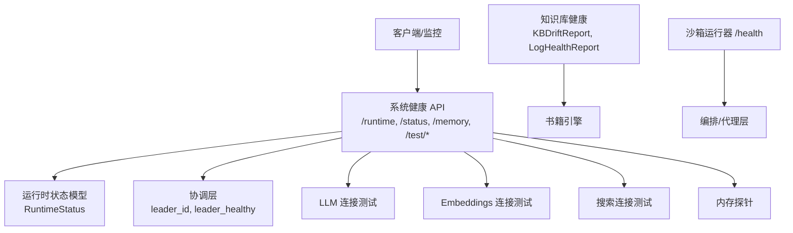
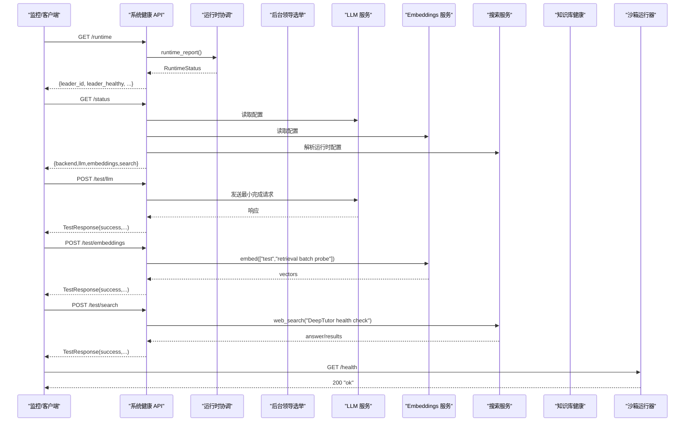
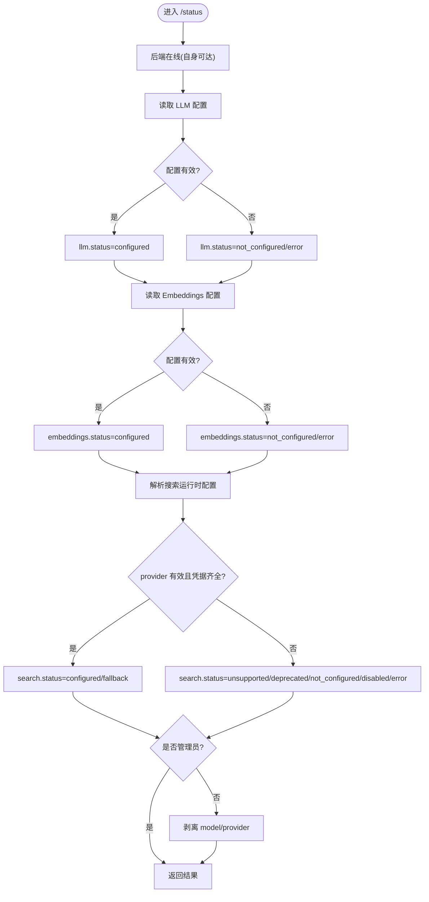
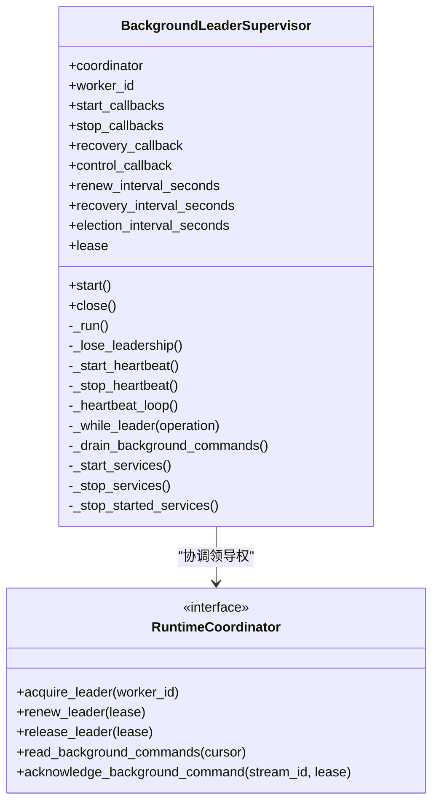
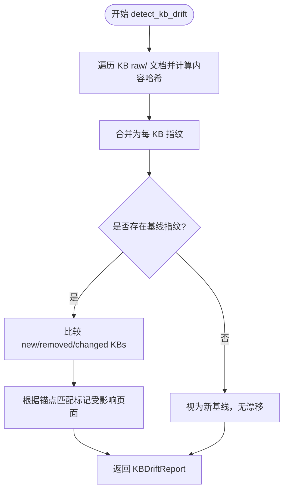
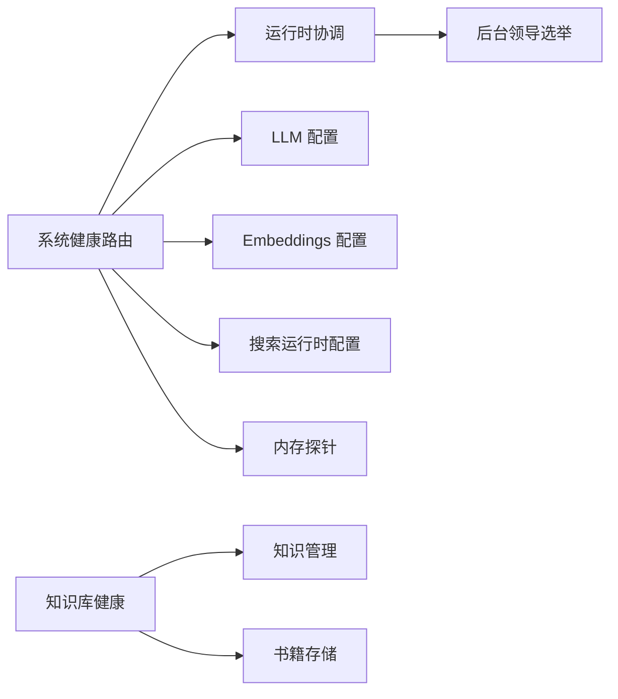

# 健康检查

<cite>
**本文引用的文件**   
- [system.py](file://deeptutor/api/routers/system.py)
- [turn_protocol.py](file://deeptutor/api/contracts/turn_protocol.py)
- [background_leader.py](file://deeptutor/runtime/background_leader.py)
- [kb_health.py](file://deeptutor/book/kb_health.py)
- [server.py](file://deeptutor/services/sandbox/runner/server.py)
</cite>

## 目录
1. [简介](#简介)
2. [项目结构](#项目结构)
3. [核心组件](#核心组件)
4. [架构总览](#架构总览)
5. [详细组件分析](#详细组件分析)
6. [依赖关系分析](#依赖关系分析)
7. [性能与可扩展性](#性能与可扩展性)
8. [告警与故障恢复](#告警与故障恢复)
9. [自定义健康检查规则编写指南](#自定义健康检查规则编写指南)
10. [运维自动化脚本建议](#运维自动化脚本建议)
11. [结论](#结论)

## 简介
本文件系统化说明 DeepTutor 的健康检查体系，覆盖以下方面：
- 服务健康状态检测机制：后端进程、LLM、Embeddings、搜索等依赖连通性与配置状态。
- 健康检查端点定义与响应格式：包括运行时协调状态、系统状态、内存使用、外部能力测试等。
- 后台进程领导选举与健康状态同步：基于租约的后台任务单例与心跳续租机制。
- 知识库健康与日志健康：文档指纹漂移检测与 log.md 错误聚合。
- 自定义健康检查扩展方法、告警配置思路、故障恢复流程与运维自动化建议。

## 项目结构
健康检查相关代码主要分布在以下模块：
- API 路由层：统一暴露健康检查与诊断接口。
- 协议与运行时状态模型：定义运行时状态、领导者字段与最小协议版本。
- 后台领导选举：实现多工作进程间的领导权获取、心跳续租与优雅释放。
- 知识库健康：对知识源变更进行指纹比对，标记受影响页面并生成维护报告。
- 沙箱运行器健康：轻量级 /health 探针，用于容器编排或代理层探测。

**图表来源**
- [system.py:116-138](file://deeptutor/api/routers/system.py#L116-L138)
- [system.py:318-402](file://deeptutor/api/routers/system.py#L318-L402)
- [system.py:405-456](file://deeptutor/api/routers/system.py#L405-L456)
- [system.py:459-524](file://deeptutor/api/routers/system.py#L459-L524)
- [system.py:527-581](file://deeptutor/api/routers/system.py#L527-L581)
- [system.py:584-633](file://deeptutor/api/routers/system.py#L584-L633)
- [turn_protocol.py:259-274](file://deeptutor/api/contracts/turn_protocol.py#L259-L274)
- [kb_health.py:151-174](file://deeptutor/book/kb_health.py#L151-L174)
- [kb_health.py:429-448](file://deeptutor/book/kb_health.py#L429-L448)
- [server.py:314-321](file://deeptutor/services/sandbox/runner/server.py#L314-L321)

**章节来源**
- [system.py:116-138](file://deeptutor/api/routers/system.py#L116-L138)
- [system.py:318-402](file://deeptutor/api/routers/system.py#L318-L402)
- [system.py:405-456](file://deeptutor/api/routers/system.py#L405-L456)
- [system.py:459-524](file://deeptutor/api/routers/system.py#L459-L524)
- [system.py:527-581](file://deeptutor/api/routers/system.py#L527-L581)
- [system.py:584-633](file://deeptutor/api/routers/system.py#L584-L633)
- [turn_protocol.py:259-274](file://deeptutor/api/contracts/turn_protocol.py#L259-L274)
- [kb_health.py:151-174](file://deeptutor/book/kb_health.py#L151-L174)
- [kb_health.py:429-448](file://deeptutor/book/kb_health.py#L429-L448)
- [server.py:314-321](file://deeptutor/services/sandbox/runner/server.py#L314-L321)

## 核心组件
- 系统健康 API（FastAPI Router）
  - /runtime：返回运行时协调状态，包含 worker_id、worker_count、coordination_mode、redis_configured、redis_status、leader_id、leader_healthy、owner_turn_count、recovery_backlog、lease_ttl_seconds、renew_interval_seconds、recovery_interval_seconds、protocol_version、minimum_web_protocol_version。
  - /status：返回后端、LLM、Embeddings、Search 的配置与状态摘要；非管理员会剥离敏感字段。
  - /memory：按角色汇总进程 RSS 内存，仅管理员可用。
  - /test/llm、/test/embeddings、/test/search：分别对 LLM、Embeddings、搜索进行连通性探测，返回 success、message、model/provider、response_time_ms、error。
- 运行时状态模型（Pydantic）
  - RuntimeStatus：标准化协调与工作者信息，供前端与监控系统消费。
- 后台领导选举（BackgroundLeaderSupervisor）
  - 通过协调器获取领导租约，周期性心跳续租，失去领导时停止服务并释放租约，支持恢复回调与控制命令流。
- 知识库健康（KBDriftReport、LogHealthReport）
  - 对 raw/ 文档计算内容哈希，比较基线指纹以检测新增、移除、变更的知识库与受影响的页面；扫描 log.md 统计失败条目与重复错误。
- 沙箱运行器健康（/health）
  - 提供极简文本健康探针，便于容器编排与反向代理探测。

**章节来源**
- [system.py:116-138](file://deeptutor/api/routers/system.py#L116-L138)
- [system.py:318-402](file://deeptutor/api/routers/system.py#L318-L402)
- [system.py:405-456](file://deeptutor/api/routers/system.py#L405-L456)
- [system.py:459-524](file://deeptutor/api/routers/system.py#L459-L524)
- [system.py:527-581](file://deeptutor/api/routers/system.py#L527-L581)
- [system.py:584-633](file://deeptutor/api/routers/system.py#L584-L633)
- [turn_protocol.py:259-274](file://deeptutor/api/contracts/turn_protocol.py#L259-L274)
- [background_leader.py:22-51](file://deeptutor/runtime/background_leader.py#L22-L51)
- [kb_health.py:151-174](file://deeptutor/book/kb_health.py#L151-L174)
- [kb_health.py:429-448](file://deeptutor/book/kb_health.py#L429-L448)
- [server.py:314-321](file://deeptutor/services/sandbox/runner/server.py#L314-L321)

## 架构总览
DeepTutor 健康检查由“API 层 + 运行时协调 + 后台领导选举 + 知识库健康 + 沙箱探针”组成。API 层对外暴露统一健康接口；运行时协调提供领导者信息与 Redis 可用性；后台领导选举确保后台任务在单个工作进程中运行；知识库健康保障书籍编译产物与源数据一致性；沙箱探针为编排层提供快速存活检测。

**图表来源**
- [system.py:116-138](file://deeptutor/api/routers/system.py#L116-L138)
- [system.py:318-402](file://deeptutor/api/routers/system.py#L318-L402)
- [system.py:459-524](file://deeptutor/api/routers/system.py#L459-L524)
- [system.py:527-581](file://deeptutor/api/routers/system.py#L527-L581)
- [system.py:584-633](file://deeptutor/api/routers/system.py#L584-L633)
- [server.py:314-321](file://deeptutor/services/sandbox/runner/server.py#L314-L321)

## 详细组件分析

### 系统健康 API 与响应格式
- /runtime
  - 功能：返回协调与工作者诊断信息，补充 leader_healthy 与协议版本。
  - 关键字段：worker_id、worker_count、coordination_mode、redis_configured、redis_status、leader_id、leader_healthy、owner_turn_count、recovery_backlog、lease_ttl_seconds、renew_interval_seconds、recovery_interval_seconds、protocol_version、minimum_web_protocol_version。
- /status
  - 功能：汇总后端、LLM、Embeddings、Search 的状态与可测试标志；非管理员剥离 model/provider 等敏感字段。
  - 关键字段：backend.status、llm.status/model/testable、embeddings.status/model/testable、search.status/provider/testable。
- /memory
  - 功能：按角色汇总进程 RSS 内存，仅管理员可用。
  - 关键字段：available、total_rss_bytes、limit_bytes、available_bytes、usage_ratio、processes[].label/count/rss_bytes。
- /test/llm、/test/embeddings、/test/search
  - 功能：对相应外部能力执行最小探测请求，返回 success、message、model/provider、response_time_ms、error。
  - 注意：搜索禁用、不支持或凭据缺失时会直接返回失败消息。

**图表来源**
- [system.py:318-402](file://deeptutor/api/routers/system.py#L318-L402)

**章节来源**
- [system.py:116-138](file://deeptutor/api/routers/system.py#L116-L138)
- [system.py:318-402](file://deeptutor/api/routers/system.py#L318-L402)
- [system.py:405-456](file://deeptutor/api/routers/system.py#L405-L456)
- [system.py:459-524](file://deeptutor/api/routers/system.py#L459-L524)
- [system.py:527-581](file://deeptutor/api/routers/system.py#L527-L581)
- [system.py:584-633](file://deeptutor/api/routers/system.py#L584-L633)

### 后台进程领导选举与健康状态同步
- BackgroundLeaderSupervisor
  - 职责：在多工作进程中通过协调器获取领导租约，周期性心跳续租；失去领导时停止已启动服务并释放租约；支持恢复回调与控制命令流。
  - 关键流程：acquire_leader → start heartbeat → while_leader(start services) → renew_leader → lose leadership → release_leader。
- 健康状态同步
  - /runtime 将 leader_id 与 leader_healthy 注入 RuntimeStatus，供前端与监控系统判断协调层健康。

**图表来源**
- [background_leader.py:22-51](file://deeptutor/runtime/background_leader.py#L22-L51)
- [background_leader.py:53-123](file://deeptutor/runtime/background_leader.py#L53-L123)
- [background_leader.py:125-155](file://deeptutor/runtime/background_leader.py#L125-L155)
- [background_leader.py:157-224](file://deeptutor/runtime/background_leader.py#L157-L224)

**章节来源**
- [background_leader.py:22-51](file://deeptutor/runtime/background_leader.py#L22-L51)
- [background_leader.py:53-123](file://deeptutor/runtime/background_leader.py#L53-L123)
- [background_leader.py:125-155](file://deeptutor/runtime/background_leader.py#L125-L155)
- [background_leader.py:157-224](file://deeptutor/runtime/background_leader.py#L157-L224)
- [system.py:116-138](file://deeptutor/api/routers/system.py#L116-L138)
- [turn_protocol.py:259-274](file://deeptutor/api/contracts/turn_protocol.py#L259-L274)

### 知识库健康与日志健康
- KBDriftReport
  - 字段：book_id、has_drift、new_kbs、removed_kbs、changed_kbs、changed_documents、current_fingerprints、stale_page_ids、fallback_stale_pages。
  - 用途：对比当前 raw/ 文档指纹与基线，标记受影响页面，辅助前端显示“书籍过时”横幅。
- LogHealthReport
  - 字段：book_id、total_entries、error_entries、block_failures、last_compile_at、last_error_at、repeated_failures。
  - 用途：解析 per-book log.md，统计失败条目与重复错误签名，便于维护面板展示。

**图表来源**
- [kb_health.py:92-108](file://deeptutor/book/kb_health.py#L92-L108)
- [kb_health.py:111-143](file://deeptutor/book/kb_health.py#L111-L143)
- [kb_health.py:177-309](file://deeptutor/book/kb_health.py#L177-L309)

**章节来源**
- [kb_health.py:151-174](file://deeptutor/book/kb_health.py#L151-L174)
- [kb_health.py:177-309](file://deeptutor/book/kb_health.py#L177-L309)
- [kb_health.py:429-448](file://deeptutor/book/kb_health.py#L429-L448)
- [kb_health.py:451-492](file://deeptutor/book/kb_health.py#L451-L492)

### 沙箱运行器健康探针
- /health
  - 行为：GET /health 或根路径返回 200 与文本 "ok"，Content-Type 为 text/plain。
  - 用途：容器编排、负载均衡器或反向代理的快速存活探测。

**章节来源**
- [server.py:314-321](file://deeptutor/services/sandbox/runner/server.py#L314-L321)

## 依赖关系分析
- API 路由层依赖
  - 运行时协调：获取 leader_id 与 worker 信息。
  - LLM/Embeddings/搜索配置与服务：读取配置并进行最小探测请求。
  - 内存探针：采集进程树 RSS 内存。
- 运行时协调依赖
  - 协调器实现（内存或 Redis）：提供 leader_id、租约续期与命令流。
- 后台领导选举依赖
  - 协调器：acquire/renew/release leader、读/确认背景命令。
- 知识库健康依赖
  - 知识管理：列出 KB、读取元数据、raw/ 目录遍历与哈希。
  - 书籍存储：加载 spine、页面列表与保存 book 元数据。

**图表来源**
- [system.py:116-138](file://deeptutor/api/routers/system.py#L116-L138)
- [system.py:318-402](file://deeptutor/api/routers/system.py#L318-L402)
- [system.py:405-456](file://deeptutor/api/routers/system.py#L405-L456)
- [background_leader.py:22-51](file://deeptutor/runtime/background_leader.py#L22-L51)
- [kb_health.py:111-143](file://deeptutor/book/kb_health.py#L111-L143)

**章节来源**
- [system.py:116-138](file://deeptutor/api/routers/system.py#L116-L138)
- [system.py:318-402](file://deeptutor/api/routers/system.py#L318-L402)
- [system.py:405-456](file://deeptutor/api/routers/system.py#L405-L456)
- [background_leader.py:22-51](file://deeptutor/runtime/background_leader.py#L22-L51)
- [kb_health.py:111-143](file://deeptutor/book/kb_health.py#L111-L143)

## 性能与可扩展性
- 健康检查开销
  - /status 会解析 LLM/Embeddings/Search 配置，适合低频轮询；/memory 更轻量，适合高频状态条轮询。
  - /test/* 会发起真实网络调用，应谨慎设置频率与超时。
- 知识库健康
  - 指纹计算按 raw/ 文档逐块哈希，避免二次全量遍历；对 kiwix 归档采用绑定标识而非内容哈希，降低大文件开销。
- 后台领导选举
  - 心跳续租间隔与选举间隔可调，避免频繁重选导致抖动；失去领导时立即停止服务并释放租约，保证幂等。

[本节为通用指导，不直接分析具体文件]

## 告警与故障恢复
- 告警指标建议
  - leader_healthy=false：协调层或领导选举异常。
  - redis_status!=ok：Redis 不可用或未配置。
  - llm.status=not_configured/error：LLM 配置错误或连接失败。
  - embeddings.status=not_configured/error：Embeddings 配置错误或连接失败。
  - search.status=unsupported/deprecated/not_configured/disabled/error：搜索配置问题。
  - repeated_failures 数量增长：log.md 中重复失败增多，需关注 block_error 与 compile 失败。
- 故障恢复流程
  - 领导丢失：BackgroundLeaderSupervisor 自动停止服务、释放租约并重新选举；必要时触发 recovery_callback。
  - 配置错误：/test/* 返回明确 error 与 message，提示用户修正配置（如 profile.api_key）。
  - 知识库漂移：mark_drift_on_book 更新 stale_page_ids 与 stale_detected_at；refresh_book_fingerprints 在强制模式下允许清除漂移标记。

**章节来源**
- [background_leader.py:113-123](file://deeptutor/runtime/background_leader.py#L113-L123)
- [background_leader.py:139-155](file://deeptutor/runtime/background_leader.py#L139-L155)
- [system.py:318-402](file://deeptutor/api/routers/system.py#L318-L402)
- [system.py:459-524](file://deeptutor/api/routers/system.py#L459-L524)
- [system.py:527-581](file://deeptutor/api/routers/system.py#L527-L581)
- [system.py:584-633](file://deeptutor/api/routers/system.py#L584-L633)
- [kb_health.py:375-418](file://deeptutor/book/kb_health.py#L375-L418)
- [kb_health.py:451-492](file://deeptutor/book/kb_health.py#L451-L492)

## 自定义健康检查规则编写指南
- 设计原则
  - 幂等与轻量：健康检查应避免副作用与昂贵 I/O；如需网络调用，设置合理超时与重试策略。
  - 结构化输出：遵循 TestResponse 风格（success、message、model/provider、response_time_ms、error），便于监控聚合。
  - 安全边界：对外部 URL 访问需做 SSRF 防护（例如 MCP 网络校验），避免内网与云元数据被利用。
- 集成步骤
  - 在系统健康路由中添加新的 /test/* 端点，复用 get_llm_config/get_embedding_config/resolve_search_runtime_config 等工具函数。
  - 对于外部服务连通性，先校验配置与凭据，再执行最小探测请求；捕获 ValueError 与通用异常，返回结构化错误。
  - 对于内部子系统（如知识库、索引、缓存），可参考 kb_health.py 的模式：计算指纹/状态快照，返回结构化报告对象。
- 示例模式（概念性）
  - 外部 API 连通性：读取配置 → 构造最小请求 → 解析响应 → 记录 response_time_ms → 返回 TestResponse。
  - 内部子系统健康：读取状态 → 计算指标 → 返回 {status, metrics, error}。

[本节为通用指导，不直接分析具体文件]

## 运维自动化脚本建议
- 健康检查脚本
  - 定期调用 /runtime、/status、/memory、/test/*，收集指标并写入时序数据库。
  - 阈值告警：leader_healthy=false、redis_status!=ok、llm/embeddings/search status!=configured、repeated_failures 增长。
- 故障自愈
  - 当 leader_healthy=false 时，尝试重启工作进程或触发协调层重建。
  - 当知识库出现漂移且存在未重新编译的页面时，触发增量编译或通知人工处理。
- 部署与编排
  - 使用沙箱运行器的 /health 作为存活探针；结合 /runtime 与 /status 作为就绪探针。
  - 在 Kubernetes 中配置 liveness/readiness 探针，分别指向 /health 与 /runtime。

[本节为通用指导，不直接分析具体文件]

## 结论
DeepTutor 的健康检查体系以 API 路由为核心，结合运行时协调、后台领导选举、知识库健康与沙箱探针，形成多层次、可扩展的诊断能力。通过标准化的响应模型与清晰的错误语义，监控与自动化系统可以可靠地感知服务状态、定位故障根因并执行恢复动作。建议在生产环境中启用结构化告警、限制高频探测、并对自定义健康检查实施安全与性能审查。