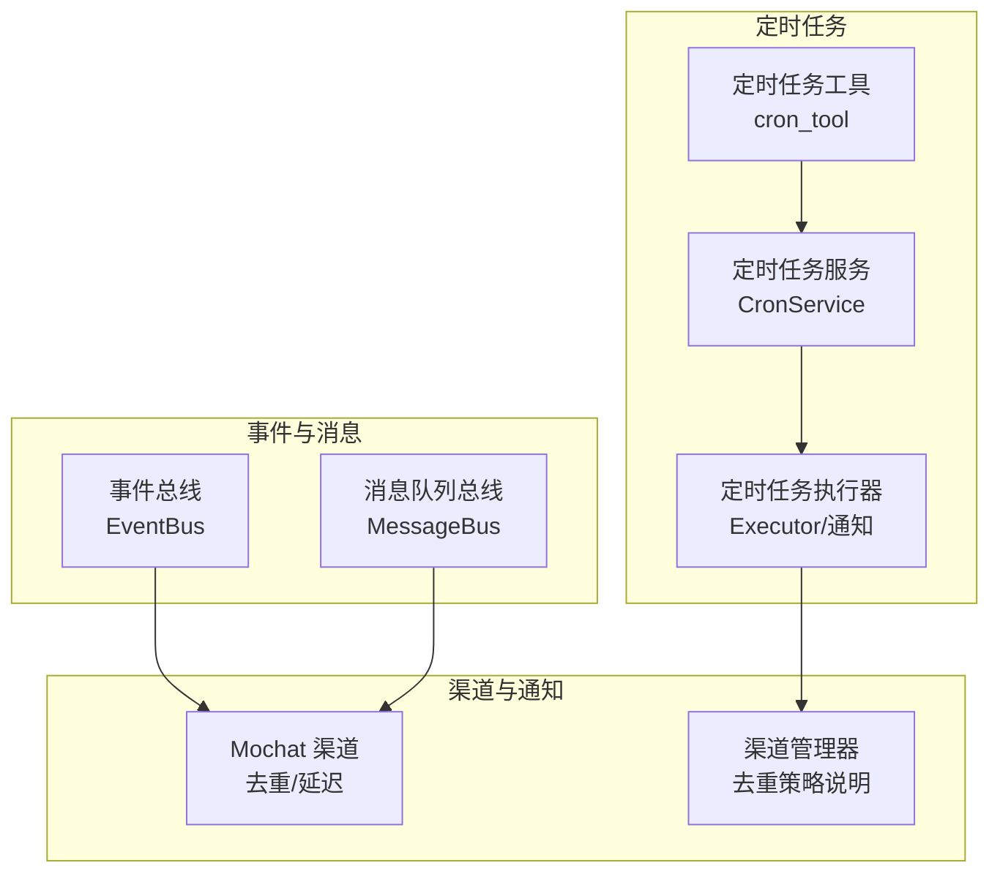
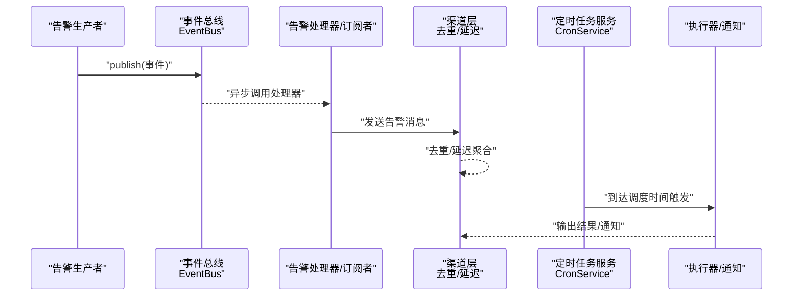
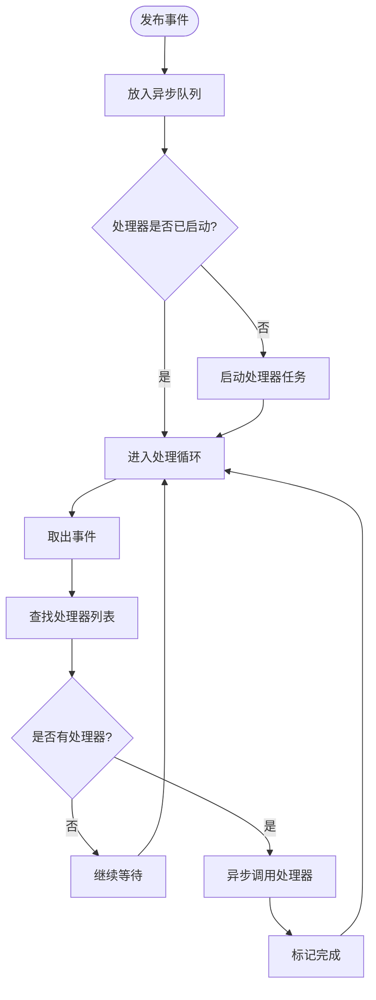
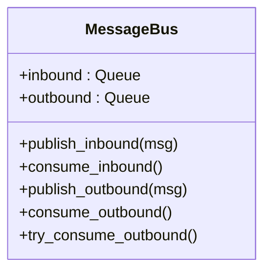
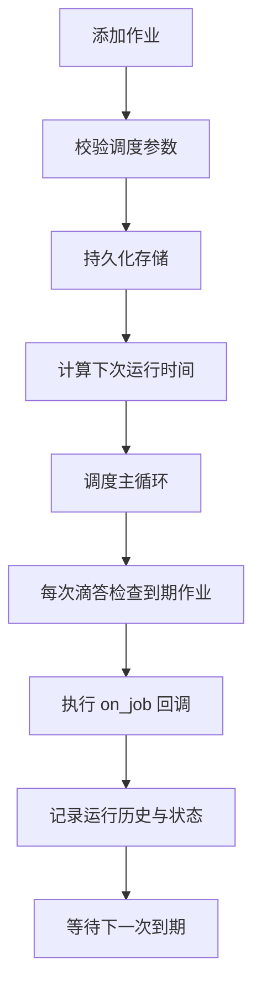
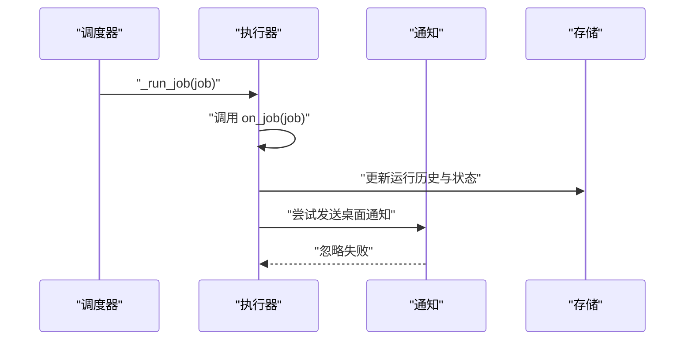
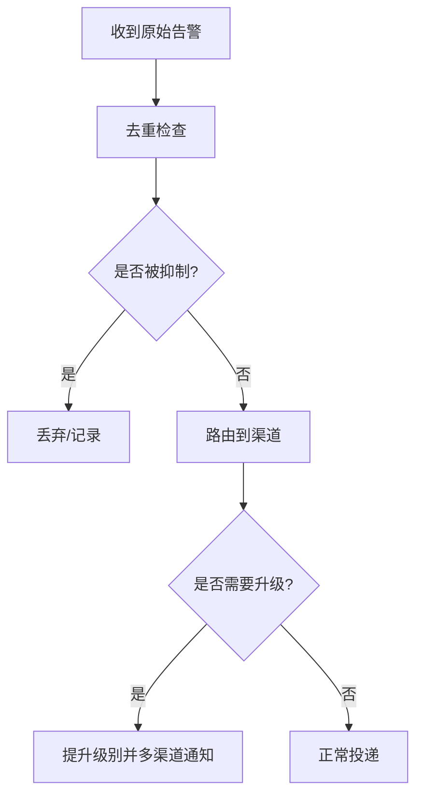
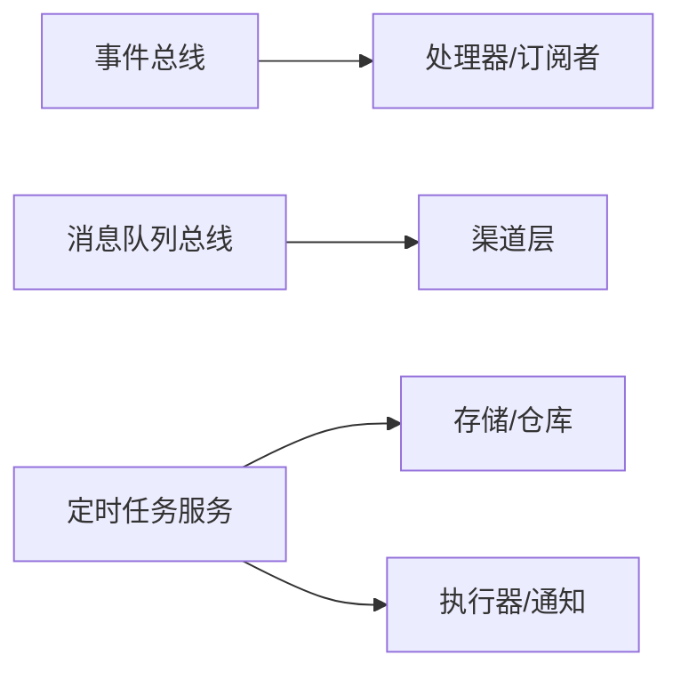

# 告警系统

<cite>
**本文引用的文件**   
- [事件总线实现](file://deeptutor/events/event_bus.py)
- [事件总线导出](file://deeptutor/events/__init__.py)
- [消息队列总线](file://deeptutor/partners/bus/queue.py)
- [定时任务服务](file://deeptutor/services/cron/service.py)
- [定时任务执行器与通知](file://deeptutor/services/cron/executor.py)
- [定时任务工具入口](file://deeptutor/tools/cron_tool.py)
- [Mochat 渠道去重与延迟处理](file://deeptutor/partners/channels/mochat.py)
- [合作伙伴通道管理器（去重说明）](file://deeptutor/partners/channels/manager.py)
</cite>

## 目录
1. [简介](#简介)
2. [项目结构](#项目结构)
3. [核心组件](#核心组件)
4. [架构总览](#架构总览)
5. [详细组件分析](#详细组件分析)
6. [依赖关系分析](#依赖关系分析)
7. [性能考虑](#性能考虑)
8. [故障排查指南](#故障排查指南)
9. [结论](#结论)
10. [附录](#附录)

## 简介
本文件面向 DeepTutor 的“告警系统”相关能力，围绕以下目标展开：
- 事件总线在告警分发中的作用与异步消息传递机制。
- 定时任务调度器的实现，包括 cron 表达式解析、任务执行调度与错误处理。
- 告警规则定义、触发条件与通知渠道配置方法。
- 告警抑制、去重与升级策略的配置与实践。
- 告警历史查询、统计分析与管理界面的使用要点。

需要特别说明的是：当前仓库中并未提供独立的“告警引擎”模块；告警能力通过通用事件总线、定时任务调度、渠道去重与通知等基础设施组合实现。因此，本文以这些基础设施为锚点，给出告警系统的整体设计与落地方式。

## 项目结构
与告警相关的代码主要分布在以下位置：
- 事件总线：deeptutor/events
- 渠道间解耦的消息总线：deeptutor/partners/bus
- 定时任务调度与执行：deeptutor/services/cron
- 定时任务工具入口：deeptutor/tools
- 渠道侧去重与延迟：deeptutor/partners/channels

图表来源
- [事件总线实现:22-205](file://deeptutor/events/event_bus.py#L22-L205)
- [消息队列总线:9-44](file://deeptutor/partners/bus/queue.py#L9-L44)
- [定时任务服务:181-391](file://deeptutor/services/cron/service.py#L181-L391)
- [定时任务执行器与通知:32-122](file://deeptutor/services/cron/executor.py#L32-L122)
- [Mochat 渠道去重与延迟处理:794-875](file://deeptutor/partners/channels/mochat.py#L794-L875)
- [合作伙伴通道管理器（去重说明）:202-202](file://deeptutor/partners/channels/manager.py#L202-L202)

章节来源
- [事件总线实现:22-205](file://deeptutor/events/event_bus.py#L22-L205)
- [消息队列总线:9-44](file://deeptutor/partners/bus/queue.py#L9-L44)
- [定时任务服务:181-391](file://deeptutor/services/cron/service.py#L181-L391)
- [定时任务执行器与通知:32-122](file://deeptutor/services/cron/executor.py#L32-L122)
- [Mochat 渠道去重与延迟处理:794-875](file://deeptutor/partners/channels/mochat.py#L794-L875)
- [合作伙伴通道管理器（去重说明）:202-202](file://deeptutor/partners/channels/manager.py#L202-L202)

## 核心组件
- 事件总线 EventBus：单例、异步、非阻塞的事件发布订阅机制，用于跨模块通信与告警分发。
- 消息队列总线 MessageBus：解耦渠道与 Agent 核心的入站/出站消息队列，支持延迟与元数据注入。
- 定时任务服务 CronService：统一的作业存储与进程内调度器，支持 at/every/cron 三种调度类型，具备持久化、变更监听与运行历史。
- 定时任务执行器与通知：封装作业执行结果、错误记录与桌面通知投递。
- 渠道去重与延迟：针对具体渠道（如 Mochat）的消息去重与延迟合并策略，避免告警风暴。

章节来源
- [事件总线实现:61-185](file://deeptutor/events/event_bus.py#L61-L185)
- [消息队列总线:9-44](file://deeptutor/partners/bus/queue.py#L9-L44)
- [定时任务服务:181-391](file://deeptutor/services/cron/service.py#L181-L391)
- [定时任务执行器与通知:32-122](file://deeptutor/services/cron/executor.py#L32-L122)
- [Mochat 渠道去重与延迟处理:794-875](file://deeptutor/partners/channels/mochat.py#L794-L875)

## 架构总览
下图展示告警从产生到分发的关键路径：事件总线负责将告警事件异步投递给订阅者；渠道层对入站消息进行去重与延迟聚合；定时任务按调度计划触发告警检查或周期性巡检，并通过执行器产出结果与通知。

图表来源
- [事件总线实现:101-151](file://deeptutor/events/event_bus.py#L101-L151)
- [Mochat 渠道去重与延迟处理:794-875](file://deeptutor/partners/channels/mochat.py#L794-L875)
- [定时任务服务:304-391](file://deeptutor/services/cron/service.py#L304-L391)
- [定时任务执行器与通知:32-122](file://deeptutor/services/cron/executor.py#L32-L122)

## 详细组件分析

### 事件总线在告警分发中的作用
- 职责
  - 提供单例 EventBus，维护事件类型到处理器列表的映射。
  - 通过异步队列将事件交给后台任务处理，发布者无需等待。
  - 支持启动、停止、刷新与重置生命周期管理。
- 关键流程
  - publish 将事件放入队列并自动启动处理器任务。
  - _process_events 循环取出事件，查找对应处理器并发出异步调用。
  - flush 等待队列清空，stop 安全终止处理器任务。
- 告警应用建议
  - 将告警事件作为 EventType 的一种扩展（或在现有类型上承载告警语义）。
  - 订阅者在处理器中完成告警路由、抑制、去重与渠道投递。

图表来源
- [事件总线实现:101-151](file://deeptutor/events/event_bus.py#L101-L151)
- [事件总线实现:108-151](file://deeptutor/events/event_bus.py#L108-L151)

章节来源
- [事件总线实现:61-185](file://deeptutor/events/event_bus.py#L61-L185)
- [事件总线导出:1-15](file://deeptutor/events/__init__.py#L1-L15)

### 消息队列总线与渠道解耦
- 职责
  - 提供 inbound/outbound 两个异步队列，解耦渠道与 Agent 核心。
  - outbound 写入时注入入队时间戳，便于下游统计投递延迟。
- 告警应用建议
  - 将渠道收到的告警入队，由消费端统一处理告警逻辑。
  - 利用 metadata 携带告警上下文（如告警级别、来源、关联任务 ID）。

图表来源
- [消息队列总线:9-44](file://deeptutor/partners/bus/queue.py#L9-L44)

章节来源
- [消息队列总线:9-44](file://deeptutor/partners/bus/queue.py#L9-L44)

### 定时任务调度器：cron 表达式解析、执行与错误处理
- 调度类型
  - at：一次性定时任务，需指定未来时间。
  - every：固定间隔周期任务，最小间隔限制。
  - cron：标准 cron 表达式，支持时区校验与不可触发表达式拒绝。
- 生命周期
  - add_job/list_jobs/toggle/delete_owner 等接口管理作业。
  - start/stop 控制调度器主循环，_loop/_tick/_run_job 驱动调度。
  - 变更监听：repository.revision 变化唤醒调度器重新加载。
- 错误处理
  - on_job 回调异常被捕获并记录状态与错误信息。
  - run_history 保留最近若干次运行记录，便于审计与分析。

图表来源
- [定时任务服务:154-178](file://deeptutor/services/cron/service.py#L154-L178)
- [定时任务服务:235-264](file://deeptutor/services/cron/service.py#L235-L264)
- [定时任务服务:304-391](file://deeptutor/services/cron/service.py#L304-L391)

章节来源
- [定时任务服务:148-178](file://deeptutor/services/cron/service.py#L148-L178)
- [定时任务服务:181-391](file://deeptutor/services/cron/service.py#L181-L391)
- [定时任务工具入口:106-139](file://deeptutor/tools/cron_tool.py#L106-L139)

### 定时任务执行器与通知
- 执行结果
  - 记录 last_run_at_ms、last_status、last_error 与 run_history。
- 通知
  - 尝试本地桌面通知（macOS），失败不影响主流程。
  - 文本内容截断以避免过长。

图表来源
- [定时任务执行器与通知:32-122](file://deeptutor/services/cron/executor.py#L32-L122)
- [定时任务服务:370-391](file://deeptutor/services/cron/service.py#L370-L391)

章节来源
- [定时任务执行器与通知:32-122](file://deeptutor/services/cron/executor.py#L32-L122)
- [定时任务服务:370-391](file://deeptutor/services/cron/service.py#L370-L391)

### 告警规则定义、触发条件与通知渠道配置
- 规则定义
  - 通过定时任务服务创建作业，message 字段可描述告警规则与触发条件。
  - schedule 支持 at/every/cron，结合业务指标阈值或外部事件源判断是否触发。
- 触发条件
  - 在 on_job 回调中读取业务数据，根据阈值/模式判定是否生成告警。
  - 若满足条件，通过事件总线或渠道 API 发出告警。
- 通知渠道
  - 可通过 partners 渠道体系（如邮件、IM 等）投递告警。
  - 渠道层自带去重与延迟聚合，降低告警风暴风险。

章节来源
- [定时任务服务:235-264](file://deeptutor/services/cron/service.py#L235-L264)
- [定时任务工具入口:106-139](file://deeptutor/tools/cron_tool.py#L106-L139)
- [合作伙伴通道管理器（去重说明）:202-202](file://deeptutor/partners/channels/manager.py#L202-L202)

### 告警抑制、去重与升级策略
- 抑制
  - 在 on_job 回调中根据时间段、静默窗口或上游状态决定是否跳过告警。
  - 结合渠道层的延迟聚合，避免短时间内重复告警。
- 去重
  - 渠道层对入站消息基于 message_id 去重（例如 Mochat）。
  - 对于出站告警，可在消息体中携带唯一键，由下游做幂等处理。
- 升级
  - 在 on_job 中根据连续失败次数或严重等级提升告警级别。
  - 将升级后的告警通过不同渠道（如 IM+邮件）并行或串行通知。

图表来源
- [Mochat 渠道去重与延迟处理:794-875](file://deeptutor/partners/channels/mochat.py#L794-L875)
- [合作伙伴通道管理器（去重说明）:202-202](file://deeptutor/partners/channels/manager.py#L202-L202)

章节来源
- [Mochat 渠道去重与延迟处理:794-875](file://deeptutor/partners/channels/mochat.py#L794-L875)
- [合作伙伴通道管理器（去重说明）:202-202](file://deeptutor/partners/channels/manager.py#L202-L202)

### 告警历史查询、统计分析与管理界面
- 历史与统计
  - 定时任务的 run_history 保留最近若干次运行记录，包含运行时间、状态、耗时与错误信息。
  - 可通过 list_jobs 获取作业列表，结合运行历史进行统计（成功率、平均耗时、错误分布）。
- 管理界面
  - 当前仓库未提供专门的“告警管理界面”。
  - 可使用定时任务工具入口提供的 CLI/工具能力进行作业增删改查，并结合日志与运行历史进行分析。

章节来源
- [定时任务服务:370-391](file://deeptutor/services/cron/service.py#L370-L391)
- [定时任务工具入口:106-139](file://deeptutor/tools/cron_tool.py#L106-L139)

## 依赖关系分析
- 低耦合
  - 事件总线与渠道层通过异步队列解耦，发布者不感知消费者实现。
  - 定时任务服务与执行器分离，调度与执行职责清晰。
- 关键依赖
  - 定时任务服务依赖 repository 进行持久化与变更监听。
  - 渠道层依赖消息队列总线进行入站/出站消息流转。
- 潜在风险
  - 事件处理器长时间阻塞会影响后续事件处理，应确保处理器快速返回。
  - 渠道去重窗口过大可能导致必要告警被误抑制，需合理设置窗口大小。

图表来源
- [事件总线实现:61-185](file://deeptutor/events/event_bus.py#L61-L185)
- [消息队列总线:9-44](file://deeptutor/partners/bus/queue.py#L9-L44)
- [定时任务服务:181-391](file://deeptutor/services/cron/service.py#L181-L391)
- [定时任务执行器与通知:32-122](file://deeptutor/services/cron/executor.py#L32-L122)

## 性能考虑
- 事件总线
  - 使用异步队列与后台任务处理，避免阻塞发布者。
  - 建议在处理器中仅做轻量路由与快速失败重试，复杂逻辑下沉到独立服务。
- 渠道去重
  - 合理设置去重窗口与延迟聚合时长，平衡实时性与告警量。
- 定时任务
  - 避免频繁 tick，调度器内部已优化睡眠策略。
  - 对 on_job 回调进行超时保护与限流，防止长任务拖垮调度器。

## 故障排查指南
- 事件总线
  - 现象：事件未送达或处理器未执行。
  - 排查：确认 EventBus 已启动；检查处理器是否正确订阅；观察 flush/stop 是否过早调用导致队列未清空。
- 渠道去重
  - 现象：告警被误抑制或重复。
  - 排查：检查 message_id 是否稳定；调整去重窗口与延迟聚合策略。
- 定时任务
  - 现象：任务未按预期触发或反复失败。
  - 排查：校验 cron 表达式与时区；查看 run_history 中的 last_status 与 last_error；确认 on_job 回调未抛出未捕获异常。

章节来源
- [事件总线实现:153-185](file://deeptutor/events/event_bus.py#L153-L185)
- [Mochat 渠道去重与延迟处理:794-875](file://deeptutor/partners/channels/mochat.py#L794-L875)
- [定时任务服务:370-391](file://deeptutor/services/cron/service.py#L370-L391)

## 结论
DeepTutor 的告警系统以事件总线与定时任务调度为核心，结合渠道层的去重与延迟聚合，形成可扩展、可观测且低耦合的告警分发体系。通过合理的规则定义、抑制与升级策略，可以在保证及时性的同时有效抑制告警风暴，并提供必要的历史与统计能力用于运维分析与持续改进。

## 附录
- 最佳实践
  - 为每条告警分配稳定标识，便于去重与追踪。
  - 在 on_job 中实现幂等与重试，结合 run_history 进行审计。
  - 对高频告警采用延迟聚合与分级通知，减少干扰。
- 参考实现路径
  - 事件总线：[事件总线实现](file://deeptutor/events/event_bus.py)
  - 消息队列总线：[消息队列总线](file://deeptutor/partners/bus/queue.py)
  - 定时任务服务：[定时任务服务](file://deeptutor/services/cron/service.py)
  - 定时任务执行器与通知：[定时任务执行器与通知](file://deeptutor/services/cron/executor.py)
  - 渠道去重与延迟：[Mochat 渠道去重与延迟处理](file://deeptutor/partners/channels/mochat.py)