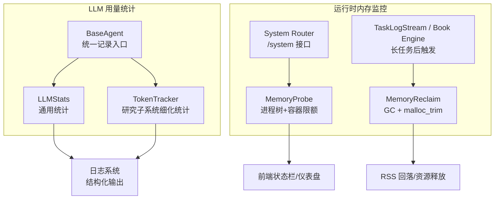
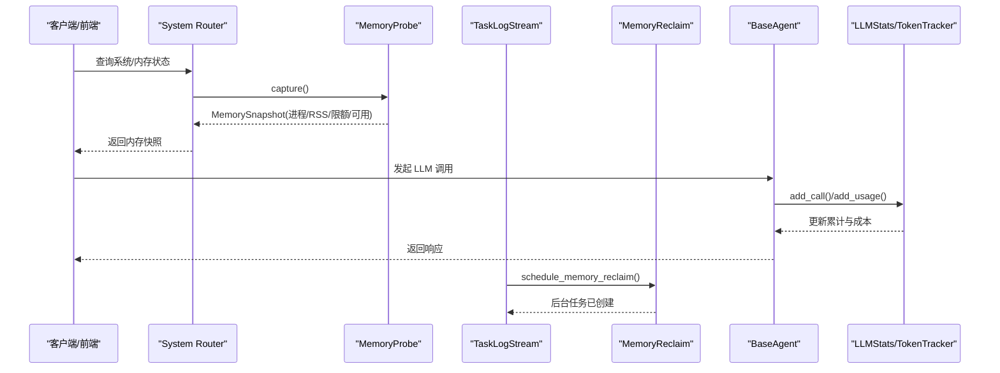
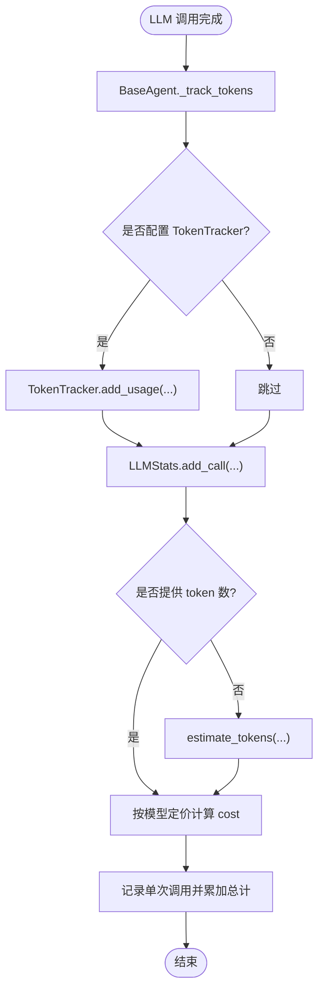
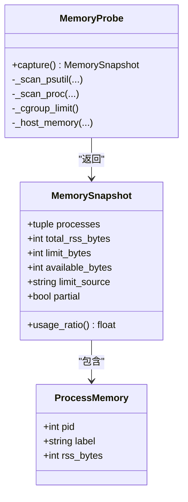
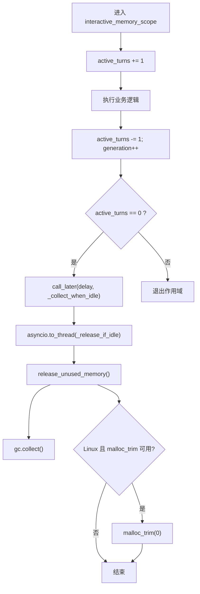
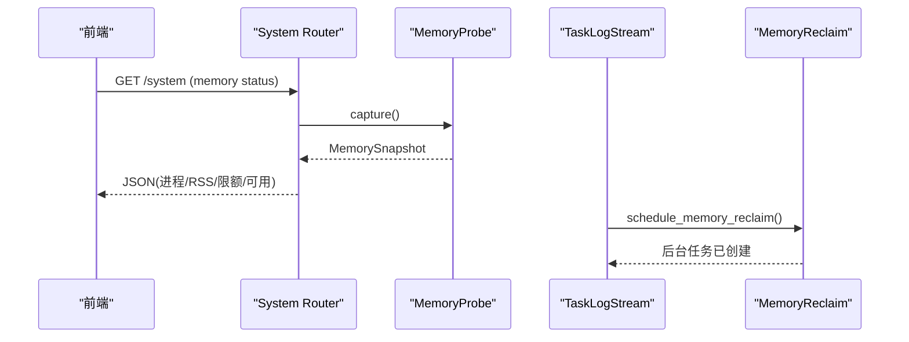
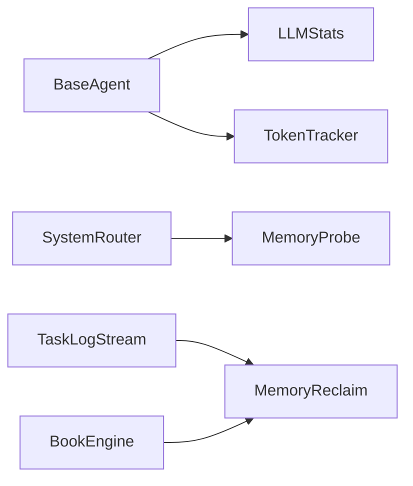

# 性能监控

<cite>
**本文引用的文件**   
- [deeptutor/logging/stats/llm_stats.py](file://deeptutor/logging/stats/llm_stats.py)
- [deeptutor/logging/stats/__init__.py](file://deeptutor/logging/stats/__init__.py)
- [deeptutor/agents/base_agent.py](file://deeptutor/agents/base_agent.py)
- [deeptutor/agents/research/utils/token_tracker.py](file://deeptutor/agents/research/utils/token_tracker.py)
- [deeptutor/runtime/memory_probe.py](file://deeptutor/runtime/memory_probe.py)
- [deeptutor/runtime/memory_reclaim.py](file://deeptutor/runtime/memory_reclaim.py)
- [deeptutor/api/routers/system.py](file://deeptutor/api/routers/system.py)
- [deeptutor/api/utils/task_log_stream.py](file://deeptutor/api/utils/task_log_stream.py)
- [deeptutor/book/engine.py](file://deeptutor/book/engine.py)
</cite>

## 目录
1. [引言](#引言)
2. [项目结构](#项目结构)
3. [核心组件](#核心组件)
4. [架构总览](#架构总览)
5. [详细组件分析](#详细组件分析)
6. [依赖关系分析](#依赖关系分析)
7. [性能考量](#性能考量)
8. [故障排查指南](#故障排查指南)
9. [结论](#结论)
10. [附录](#附录)

## 引言
本文件面向 DeepTutor 的性能监控与可观测性，聚焦以下目标：
- LLM 使用统计指标的采集与分析方法，包括请求次数、token 消耗、成本估算等。
- 内存监控的实现机制，包括进程树内存快照、cgroup/宿主机内存上限识别、内存回收策略与资源清理流程。
- 性能指标采集方式、存储格式与可视化展示方案。
- 性能瓶颈识别、容量规划与扩展性评估指导。
- 监控数据的导出、分析与报告生成方法。

## 项目结构
DeepTutor 在“LLM 用量统计”和“运行时内存监控”两条主线分别实现：
- LLM 用量统计
  - 通用统计模块：deeptutor/logging/stats/llm_stats.py
  - Agent 层统一接入点：deeptutor/agents/base_agent.py
  - 研究子系统的 TokenTracker（更细粒度）：deeptutor/agents/research/utils/token_tracker.py
- 运行时内存监控
  - 内存探针（只读快照）：deeptutor/runtime/memory_probe.py
  - 内存回收（主动释放）：deeptutor/runtime/memory_reclaim.py
  - API 暴露与调度：deeptutor/api/routers/system.py、deeptutor/api/utils/task_log_stream.py
  - 长任务场景下的回收触发：deeptutor/book/engine.py

**图表来源**
- [deeptutor/agents/base_agent.py:282-346](file://deeptutor/agents/base_agent.py#L282-L346)
- [deeptutor/logging/stats/llm_stats.py:75-201](file://deeptutor/logging/stats/llm_stats.py#L75-L201)
- [deeptutor/agents/research/utils/token_tracker.py:115-258](file://deeptutor/agents/research/utils/token_tracker.py#L115-L258)
- [deeptutor/runtime/memory_probe.py:311-343](file://deeptutor/runtime/memory_probe.py#L311-L343)
- [deeptutor/runtime/memory_reclaim.py:97-150](file://deeptutor/runtime/memory_reclaim.py#L97-L150)
- [deeptutor/api/routers/system.py:420-437](file://deeptutor/api/routers/system.py#L420-L437)
- [deeptutor/api/utils/task_log_stream.py:83-83](file://deeptutor/api/utils/task_log_stream.py#L83-L83)
- [deeptutor/book/engine.py:1456-1458](file://deeptutor/book/engine.py#L1456-L1458)

**章节来源**
- [deeptutor/logging/stats/llm_stats.py:1-201](file://deeptutor/logging/stats/llm_stats.py#L1-L201)
- [deeptutor/agents/base_agent.py:282-346](file://deeptutor/agents/base_agent.py#L282-L346)
- [deeptutor/agents/research/utils/token_tracker.py:115-258](file://deeptutor/agents/research/utils/token_tracker.py#L115-L258)
- [deeptutor/runtime/memory_probe.py:1-353](file://deeptutor/runtime/memory_probe.py#L1-L353)
- [deeptutor/runtime/memory_reclaim.py:1-159](file://deeptutor/runtime/memory_reclaim.py#L1-L159)
- [deeptutor/api/routers/system.py:420-437](file://deeptutor/api/routers/system.py#L420-L437)
- [deeptutor/api/utils/task_log_stream.py:83-83](file://deeptutor/api/utils/task_log_stream.py#L83-L83)
- [deeptutor/book/engine.py:1456-1458](file://deeptutor/book/engine.py#L1456-L1458)

## 核心组件
- LLM 用量统计
  - LLMStats：按模型累计 prompt/completion token、估算成本、输出摘要。
  - BaseAgent：统一在每次 LLM 调用后记录用量；支持可选的外部 TokenTracker。
  - TokenTracker（研究子系统）：提供更细粒度的 by_agent/by_model/by_method 汇总，并支持 tiktoken/litellm 计数或估算。
- 内存监控
  - MemoryProbe：跨平台扫描进程树（psutil 优先，Linux 下 /proc 回退），聚合 RSS，识别 cgroup 或宿主机的内存上限与可用量。
  - MemoryReclaim：后台空闲时执行完整 GC，并在 Linux 上尝试调用 glibc malloc_trim 以归还堆页；提供交互式作用域与延迟合并调度。
- API 集成
  - System Router：通过异步线程调用 MemoryProbe.capture，返回进程级与总量信息，供前端状态栏/仪表盘展示。
  - TaskLogStream / Book Engine：在长任务结束后触发 schedule_memory_reclaim，避免阻塞主循环。

**章节来源**
- [deeptutor/logging/stats/llm_stats.py:75-201](file://deeptutor/logging/stats/llm_stats.py#L75-L201)
- [deeptutor/agents/base_agent.py:282-346](file://deeptutor/agents/base_agent.py#L282-L346)
- [deeptutor/agents/research/utils/token_tracker.py:115-258](file://deeptutor/agents/research/utils/token_tracker.py#L115-L258)
- [deeptutor/runtime/memory_probe.py:311-343](file://deeptutor/runtime/memory_probe.py#L311-L343)
- [deeptutor/runtime/memory_reclaim.py:97-150](file://deeptutor/runtime/memory_reclaim.py#L97-L150)
- [deeptutor/api/routers/system.py:420-437](file://deeptutor/api/routers/system.py#L420-L437)
- [deeptutor/api/utils/task_log_stream.py:83-83](file://deeptutor/api/utils/task_log_stream.py#L83-L83)
- [deeptutor/book/engine.py:1456-1458](file://deeptutor/book/engine.py#L1456-L1458)

## 架构总览
下图展示了从 Agent 调用到统计落盘、再到内存监控与回收的端到端链路。

**图表来源**
- [deeptutor/api/routers/system.py:420-437](file://deeptutor/api/routers/system.py#L420-L437)
- [deeptutor/runtime/memory_probe.py:311-343](file://deeptutor/runtime/memory_probe.py#L311-L343)
- [deeptutor/api/utils/task_log_stream.py:83-83](file://deeptutor/api/utils/task_log_stream.py#L83-L83)
- [deeptutor/runtime/memory_reclaim.py:124-150](file://deeptutor/runtime/memory_reclaim.py#L124-L150)
- [deeptutor/agents/base_agent.py:282-346](file://deeptutor/agents/base_agent.py#L282-L346)

## 详细组件分析

### LLM 用量统计与成本估算
- 关键指标
  - 请求次数：calls
  - Prompt/Completion Token：prompt_tokens、completion_tokens、total_tokens
  - 成本估算：cost_usd（基于 MODEL_PRICING）
  - 主要模型：model_used
- 采集路径
  - BaseAgent._track_tokens：每次 LLM 调用后，优先走外部 TokenTracker（若配置），再写入共享 LLMStats。
  - LLMStats.add_call：若未提供 token 数，则根据文本估算；按模型定价计算 cost。
  - TokenTracker.add_usage：支持 tiktoken/litellm 精确计数或估算，并按 agent/model/method 维度汇总。
- 输出与存储
  - LLMStats.log_summary：通过 Python logging 输出结构化摘要。
  - TokenTracker.get_summary：返回字典，便于导出为 JSON/CSV 或写入日志后端。

**图表来源**
- [deeptutor/agents/base_agent.py:282-346](file://deeptutor/agents/base_agent.py#L282-L346)
- [deeptutor/logging/stats/llm_stats.py:95-147](file://deeptutor/logging/stats/llm_stats.py#L95-L147)
- [deeptutor/agents/research/utils/token_tracker.py:120-174](file://deeptutor/agents/research/utils/token_tracker.py#L120-L174)

**章节来源**
- [deeptutor/logging/stats/llm_stats.py:29-61](file://deeptutor/logging/stats/llm_stats.py#L29-L61)
- [deeptutor/logging/stats/llm_stats.py:75-201](file://deeptutor/logging/stats/llm_stats.py#L75-L201)
- [deeptutor/agents/base_agent.py:282-346](file://deeptutor/agents/base_agent.py#L282-L346)
- [deeptutor/agents/research/utils/token_tracker.py:115-258](file://deeptutor/agents/research/utils/token_tracker.py#L115-L258)

### 内存探针与进程树快照
- 能力概述
  - 扫描 DeepTutor 进程树，聚合各进程的 RSS。
  - 识别容器 cgroup 限制（v1/v2）或宿主物理内存作为上限。
  - 返回 MemorySnapshot：包含 processes、total_rss_bytes、limit_bytes、available_bytes、limit_source、partial。
- 实现要点
  - psutil 优先；Linux 下提供 /proc 回退路径。
  - 通过 SUPERVISOR_PID_ENV 锚定 launcher 进程，避免误计入父 shell。
  - 对敏感命令行进行角色分类，仅输出固定标签（backend/web/sandbox/pocketbase 等）。
  - 将进程按 RSS 降序排序，并限制上报数量，多余折叠为 other。

**图表来源**
- [deeptutor/runtime/memory_probe.py:51-74](file://deeptutor/runtime/memory_probe.py#L51-L74)
- [deeptutor/runtime/memory_probe.py:311-343](file://deeptutor/runtime/memory_probe.py#L311-L343)

**章节来源**
- [deeptutor/runtime/memory_probe.py:1-353](file://deeptutor/runtime/memory_probe.py#L1-L353)

### 内存回收策略与资源清理
- 触发时机
  - interactive_memory_scope：交互型任务结束后，等待一段空闲时间再执行完整 GC。
  - schedule_memory_reclaim：长任务完成后，后台异步触发一次 release_unused_memory。
- 回收动作
  - gc.collect()：强制完整垃圾回收。
  - Linux 下调用 glibc malloc_trim(0)：尝试归还空闲堆页给操作系统，降低 RSS。
- 并发与节流
  - 使用活动计数与 generation 防止重复回收。
  - 最小空闲间隔与最近回收时间控制频率，避免频繁 GC 影响吞吐。

**图表来源**
- [deeptutor/runtime/memory_reclaim.py:64-95](file://deeptutor/runtime/memory_reclaim.py#L64-L95)
- [deeptutor/runtime/memory_reclaim.py:97-121](file://deeptutor/runtime/memory_reclaim.py#L97-L121)
- [deeptutor/runtime/memory_reclaim.py:124-150](file://deeptutor/runtime/memory_reclaim.py#L124-L150)

**章节来源**
- [deeptutor/runtime/memory_reclaim.py:1-159](file://deeptutor/runtime/memory_reclaim.py#L1-L159)

### API 暴露与可视化展示
- System Router
  - 通过 asyncio.to_thread(memory_probe.capture) 获取内存快照，并以 JSON 形式返回进程列表、总量、限额与可用量。
  - 限制上报进程数量，超出部分折叠为 other，避免 UI 过载。
- TaskLogStream
  - 在流式任务处理中调用 schedule_memory_reclaim，避免阻塞事件循环。
- Book Engine
  - 在文档编译等长任务后调用 schedule_memory_reclaim，促使 RSS 回落。

**图表来源**
- [deeptutor/api/routers/system.py:420-437](file://deeptutor/api/routers/system.py#L420-L437)
- [deeptutor/api/utils/task_log_stream.py:83-83](file://deeptutor/api/utils/task_log_stream.py#L83-L83)
- [deeptutor/book/engine.py:1456-1458](file://deeptutor/book/engine.py#L1456-L1458)

**章节来源**
- [deeptutor/api/routers/system.py:420-437](file://deeptutor/api/routers/system.py#L420-L437)
- [deeptutor/api/utils/task_log_stream.py:83-83](file://deeptutor/api/utils/task_log_stream.py#L83-L83)
- [deeptutor/book/engine.py:1456-1458](file://deeptutor/book/engine.py#L1456-L1458)

## 依赖关系分析
- 组件耦合
  - BaseAgent 同时依赖 LLMStats 与可选 TokenTracker，解耦了统计实现。
  - System Router 仅依赖 MemoryProbe 的公共接口 capture，屏蔽底层实现差异。
  - TaskLogStream 与 Book Engine 仅依赖 MemoryReclaim 的调度接口，不感知具体回收细节。
- 外部依赖
  - psutil（可选）：用于跨平台进程树扫描；不可用时回退到 /proc。
  - glibc malloc_trim（Linux）：仅在 Linux 下尝试释放堆页。
  - Python logging：用于 LLMStats 的结构化输出。

**图表来源**
- [deeptutor/agents/base_agent.py:282-346](file://deeptutor/agents/base_agent.py#L282-L346)
- [deeptutor/logging/stats/llm_stats.py:75-201](file://deeptutor/logging/stats/llm_stats.py#L75-L201)
- [deeptutor/agents/research/utils/token_tracker.py:115-258](file://deeptutor/agents/research/utils/token_tracker.py#L115-L258)
- [deeptutor/api/routers/system.py:420-437](file://deeptutor/api/routers/system.py#L420-L437)
- [deeptutor/runtime/memory_probe.py:311-343](file://deeptutor/runtime/memory_probe.py#L311-L343)
- [deeptutor/runtime/memory_reclaim.py:124-150](file://deeptutor/runtime/memory_reclaim.py#L124-L150)
- [deeptutor/api/utils/task_log_stream.py:83-83](file://deeptutor/api/utils/task_log_stream.py#L83-L83)
- [deeptutor/book/engine.py:1456-1458](file://deeptutor/book/engine.py#L1456-L1458)

**章节来源**
- [deeptutor/agents/base_agent.py:282-346](file://deeptutor/agents/base_agent.py#L282-L346)
- [deeptutor/logging/stats/llm_stats.py:75-201](file://deeptutor/logging/stats/llm_stats.py#L75-L201)
- [deeptutor/agents/research/utils/token_tracker.py:115-258](file://deeptutor/agents/research/utils/token_tracker.py#L115-L258)
- [deeptutor/api/routers/system.py:420-437](file://deeptutor/api/routers/system.py#L420-L437)
- [deeptutor/runtime/memory_probe.py:311-343](file://deeptutor/runtime/memory_probe.py#L311-L343)
- [deeptutor/runtime/memory_reclaim.py:124-150](file://deeptutor/runtime/memory_reclaim.py#L124-L150)
- [deeptutor/api/utils/task_log_stream.py:83-83](file://deeptutor/api/utils/task_log_stream.py#L83-L83)
- [deeptutor/book/engine.py:1456-1458](file://deeptutor/book/engine.py#L1456-L1458)

## 性能考量
- LLM 调用
  - 建议优先使用 Provider 返回的真实 token 数；若无，则使用 estimate_tokens 估算，注意误差。
  - 在高并发场景下，避免在热路径中进行昂贵的 token 计数；必要时采用 TokenTracker 的 tiktoken/litellm 模式。
- 内存占用
  - 长任务后务必调用 schedule_memory_reclaim，促使 RSS 回落。
  - 在 Linux 环境下，malloc_trim 能显著降低长期驻留的 RSS，但可能带来短暂 CPU 抖动。
  - 合理设置 idle 收集间隔，避免过于频繁的 GC 影响响应延迟。
- 可观测性
  - 将 LLMStats.log_summary 的输出接入集中式日志系统（如 ELK/Loki），便于聚合分析。
  - 前端状态栏/仪表盘定期轮询 /system 接口，展示内存使用趋势与告警阈值。

[本节为通用指导，不涉及具体文件分析]

## 故障排查指南
- LLM 用量异常
  - 检查 BaseAgent._track_tokens 是否被正确调用；确认 TokenTracker 是否启用。
  - 核对 MODEL_PRICING 与实际模型名匹配情况，必要时扩展 get_pricing 模糊匹配规则。
- 内存快照为空或不准确
  - 确认 SUPERVISOR_PID_ENV 是否正确注入；检查 psutil 权限与 /proc 可读性。
  - 在受限环境（HarmonyOS、容器无权限）下，MemoryProbe 会回退到单进程模式，partial 标记为 True。
- 内存未回落
  - 确认长任务后是否调用了 schedule_memory_reclaim。
  - 检查 Linux 下 malloc_trim 是否可用；若不可用，仍会执行 gc.collect()。

**章节来源**
- [deeptutor/agents/base_agent.py:282-346](file://deeptutor/agents/base_agent.py#L282-L346)
- [deeptutor/logging/stats/llm_stats.py:43-61](file://deeptutor/logging/stats/llm_stats.py#L43-L61)
- [deeptutor/runtime/memory_probe.py:98-106](file://deeptutor/runtime/memory_probe.py#L98-L106)
- [deeptutor/runtime/memory_probe.py:137-190](file://deeptutor/runtime/memory_probe.py#L137-L190)
- [deeptutor/runtime/memory_reclaim.py:97-121](file://deeptutor/runtime/memory_reclaim.py#L97-L121)

## 结论
DeepTutor 在 LLM 用量统计与运行时内存监控方面形成了清晰的职责分离与可扩展架构：
- LLM 用量统计通过 BaseAgent 统一接入，结合 LLMStats 与 TokenTracker 提供多粒度、可导出的指标。
- 内存监控通过 MemoryProbe 提供跨平台的进程树快照与限额识别，并通过 MemoryReclaim 在空闲期执行 GC 与堆页回收。
- API 层将上述能力暴露给前端，支撑状态栏与仪表盘的可视化展示。
建议在后续迭代中：
- 引入更精细的请求耗时与错误率指标（例如在 BaseAgent 中记录 call_duration 与错误码）。
- 将 LLMStats 与 TokenTracker 的摘要数据持久化至时序数据库，便于趋势分析与容量规划。
- 完善告警规则，针对 RSS 持续高位、LLM 成本突增、请求延迟上升等场景进行自动告警。

[本节为总结性内容，不涉及具体文件分析]

## 附录

### 指标定义与采集位置
- LLM 指标
  - calls、prompt_tokens、completion_tokens、total_tokens、cost_usd、model_used
  - 采集位置：BaseAgent._track_tokens → LLMStats.add_call；或 TokenTracker.add_usage
- 内存指标
  - total_rss_bytes、limit_bytes、available_bytes、limit_source、processes[]
  - 采集位置：MemoryProbe.capture；暴露于 System Router

**章节来源**
- [deeptutor/logging/stats/llm_stats.py:95-158](file://deeptutor/logging/stats/llm_stats.py#L95-L158)
- [deeptutor/agents/research/utils/token_tracker.py:176-228](file://deeptutor/agents/research/utils/token_tracker.py#L176-L228)
- [deeptutor/runtime/memory_probe.py:60-74](file://deeptutor/runtime/memory_probe.py#L60-L74)
- [deeptutor/runtime/memory_probe.py:311-343](file://deeptutor/runtime/memory_probe.py#L311-L343)

### 数据导出与分析建议
- 导出格式
  - LLMStats.get_summary：JSON 对象，适合写入日志文件或推送至监控系统。
  - TokenTracker.get_summary：包含 by_agent/by_model/by_method 多维聚合，适合生成报表。
- 分析工具
  - 使用 ELK/Loki 聚合日志，Prometheus/Grafana 可视化趋势。
  - 对 MemorySnapshot 做历史对比，识别峰值与泄漏迹象。

**章节来源**
- [deeptutor/logging/stats/llm_stats.py:148-158](file://deeptutor/logging/stats/llm_stats.py#L148-L158)
- [deeptutor/agents/research/utils/token_tracker.py:176-228](file://deeptutor/agents/research/utils/token_tracker.py#L176-L228)