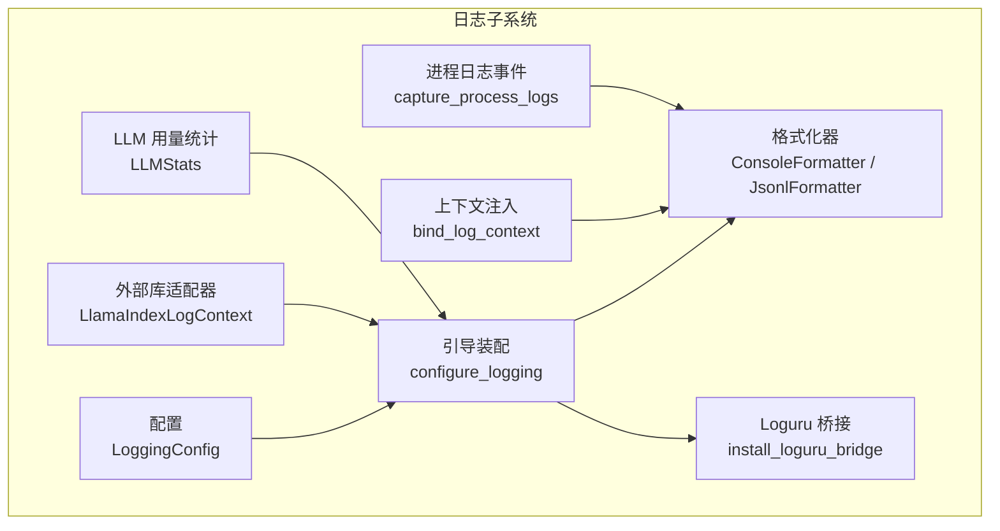
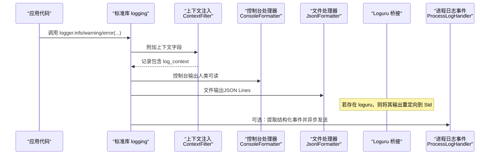
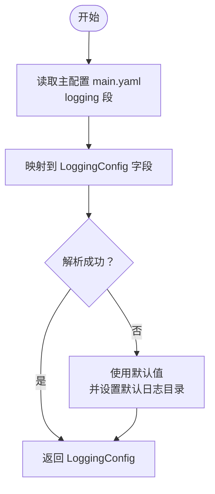
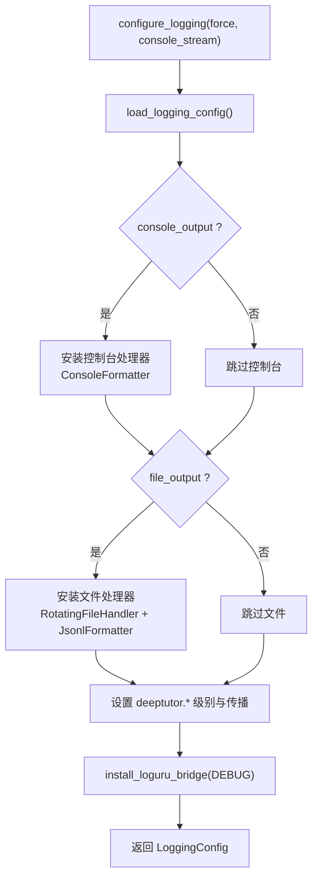
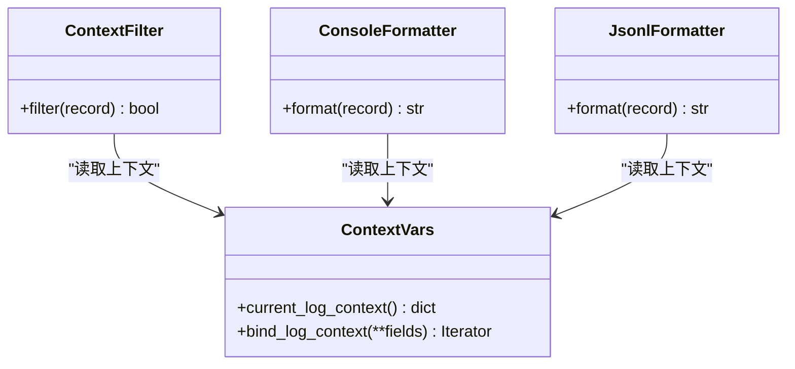
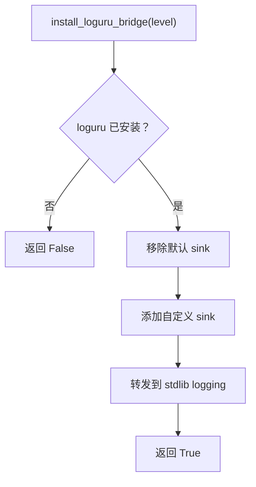
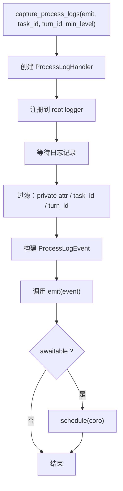
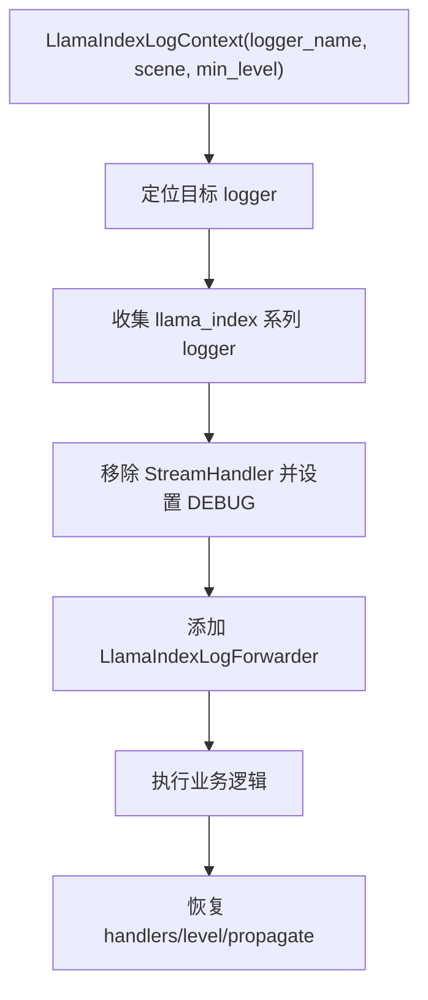
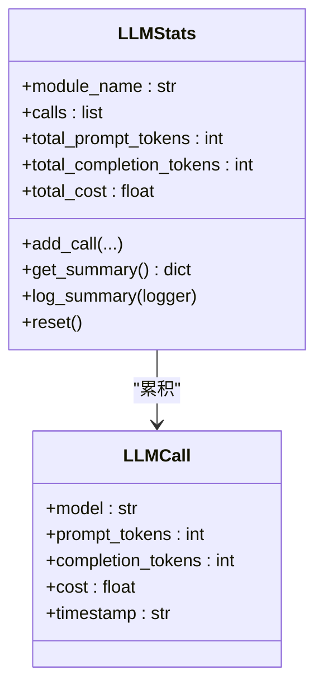
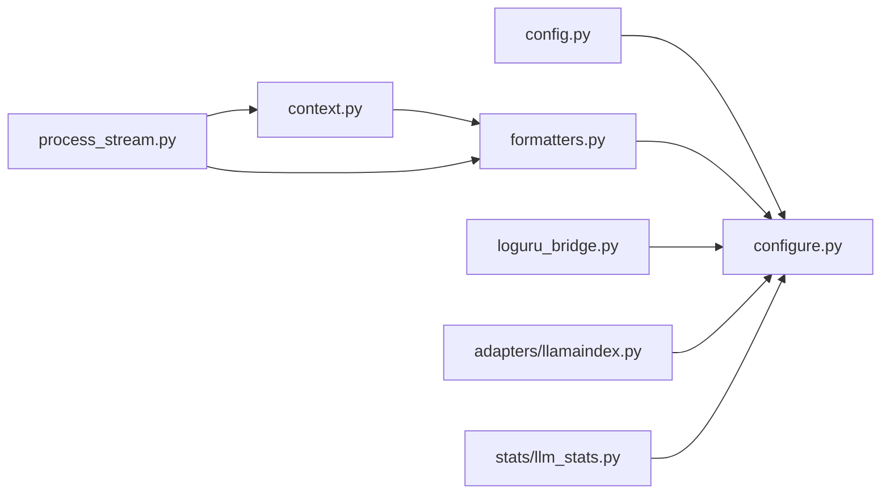

# 日志管理

<cite>
**本文引用的文件**   
- [deeptutor/logging/__init__.py](file://deeptutor/logging/__init__.py)
- [deeptutor/logging/config.py](file://deeptutor/logging/config.py)
- [deeptutor/logging/configure.py](file://deeptutor/logging/configure.py)
- [deeptutor/logging/context.py](file://deeptutor/logging/context.py)
- [deeptutor/logging/formatters.py](file://deeptutor/logging/formatters.py)
- [deeptutor/logging/loguru_bridge.py](file://deeptutor/logging/loguru_bridge.py)
- [deeptutor/logging/process_stream.py](file://deeptutor/logging/process_stream.py)
- [deeptutor/logging/adapters/llamaindex.py](file://deeptutor/logging/adapters/llamaindex.py)
- [deeptutor/logging/stats/llm_stats.py](file://deeptutor/logging/stats/llm_stats.py)
</cite>

## 目录
1. [引言](#引言)
2. [项目结构](#项目结构)
3. [核心组件](#核心组件)
4. [架构总览](#架构总览)
5. [详细组件分析](#详细组件分析)
6. [依赖关系分析](#依赖关系分析)
7. [性能与可扩展性](#性能与可扩展性)
8. [日志查询、过滤与分析最佳实践](#日志查询过滤与分析最佳实践)
9. [分布式环境下的日志聚合方案](#分布式环境下的日志聚合方案)
10. [故障排查指南](#故障排查指南)
11. [结论](#结论)

## 引言
本文件面向 DeepTutor 的日志子系统，系统性说明其架构设计、配置模型、输出目标（控制台与文件）、日志格式化与上下文注入机制、Loguru 桥接器实现原理、日志轮转与备份策略，以及日志查询、过滤、分析与分布式聚合的实践建议。文档同时覆盖进程级结构化事件捕获与 LLM 用量统计等扩展能力，帮助开发者在本地调试与生产环境中稳定、可观测地运行 DeepTutor。

## 项目结构
DeepTutor 的日志子系统位于 `deeptutor/logging` 包中，采用“标准库 logging 为核心 + 可选第三方集成”的分层设计：
- 配置加载与默认值：`config.py`
- 启动引导与处理器装配：`configure.py`
- 请求级上下文注入：`context.py`
- 格式化器与过滤器：`formatters.py`
- Loguru 桥接：`loguru_bridge.py`
- 进程日志事件捕获：`process_stream.py`
- 外部库适配器：`adapters/`
- LLM 用量统计：`stats/`

图表来源
- [deeptutor/logging/config.py:9-49](file://deeptutor/logging/config.py#L9-L49)
- [deeptutor/logging/configure.py:40-86](file://deeptutor/logging/configure.py#L40-L86)
- [deeptutor/logging/context.py:10-39](file://deeptutor/logging/context.py#L10-L39)
- [deeptutor/logging/formatters.py:13-54](file://deeptutor/logging/formatters.py#L13-L54)
- [deeptutor/logging/loguru_bridge.py:9-28](file://deeptutor/logging/loguru_bridge.py#L9-L28)
- [deeptutor/logging/process_stream.py:19-137](file://deeptutor/logging/process_stream.py#L19-L137)
- [deeptutor/logging/adapters/llamaindex.py:11-75](file://deeptutor/logging/adapters/llamaindex.py#L11-L75)
- [deeptutor/logging/stats/llm_stats.py:64-201](file://deeptutor/logging/stats/llm_stats.py#L64-L201)

章节来源
- [deeptutor/logging/__init__.py:1-27](file://deeptutor/logging/__init__.py#L1-L27)

## 核心组件
- LoggingConfig：不可变数据类，集中描述日志级别、控制台/文件开关、日志目录、文件大小限制与备份数量。
- configure_logging：进程级入口，负责加载配置、安装控制台与文件处理器、设置根日志器级别、启用 Loguru 桥接。
- ContextFilter + LOG_CONTEXT_FIELDS：将请求级上下文字段注入到每个日志记录，供格式化器统一消费。
- ConsoleFormatter / JsonlFormatter：分别用于人类可读控制台输出与 JSON Lines 结构化文件输出。
- install_loguru_bridge：将 loguru 的输出转发到标准库 logging，保持统一处理链路。
- capture_process_logs / ProcessLogHandler：从标准库日志中提取结构化事件，支持按 task_id/turn_id 过滤，并安全调度异步 emit。
- LlamaIndexLogContext：临时将 LlamaIndex 内部日志转发到指定 logger，避免噪声干扰。
- LLMStats：统计 LLM 调用次数、Token 数与成本，并通过统一日志系统输出摘要。

章节来源
- [deeptutor/logging/config.py:9-49](file://deeptutor/logging/config.py#L9-L49)
- [deeptutor/logging/configure.py:40-86](file://deeptutor/logging/configure.py#L40-L86)
- [deeptutor/logging/context.py:10-39](file://deeptutor/logging/context.py#L10-L39)
- [deeptutor/logging/formatters.py:13-54](file://deeptutor/logging/formatters.py#L13-L54)
- [deeptutor/logging/loguru_bridge.py:9-28](file://deeptutor/logging/loguru_bridge.py#L9-L28)
- [deeptutor/logging/process_stream.py:19-137](file://deeptutor/logging/process_stream.py#L19-L137)
- [deeptutor/logging/adapters/llamaindex.py:11-75](file://deeptutor/logging/adapters/llamaindex.py#L11-L75)
- [deeptutor/logging/stats/llm_stats.py:64-201](file://deeptutor/logging/stats/llm_stats.py#L64-L201)

## 架构总览
DeepTutor 日志系统以 Python 标准库 logging 为骨干，通过统一的 Handler 链完成格式化、过滤与输出；同时提供可选的 Loguru 桥接与外部库适配器，确保第三方库日志也能进入统一管道。

图表来源
- [deeptutor/logging/configure.py:57-84](file://deeptutor/logging/configure.py#L57-L84)
- [deeptutor/logging/formatters.py:13-54](file://deeptutor/logging/formatters.py#L13-L54)
- [deeptutor/logging/loguru_bridge.py:9-28](file://deeptutor/logging/loguru_bridge.py#L9-L28)
- [deeptutor/logging/process_stream.py:54-113](file://deeptutor/logging/process_stream.py#L54-L113)

## 详细组件分析

### 配置模型与加载：LoggingConfig
- 字段含义
  - level：全局日志级别字符串，如 INFO、DEBUG。
  - console_output：是否启用控制台输出。
  - file_output：是否启用文件输出。
  - log_dir：日志目录路径；未显式配置时回退到默认日志目录。
  - max_bytes：单个日志文件最大字节数，超过后触发轮转。
  - backup_count：保留的旧日志文件数量。
- 加载流程
  - 从主配置文件读取 logging 段，映射到 LoggingConfig。
  - 若解析失败或配置缺失，使用默认值并设置默认日志目录。
- 默认日志目录
  - 通过路径服务获取用户日志目录，保证跨平台一致性与权限隔离。

图表来源
- [deeptutor/logging/config.py:25-49](file://deeptutor/logging/config.py#L25-L49)
- [deeptutor/logging/config.py:19-22](file://deeptutor/logging/config.py#L19-L22)

章节来源
- [deeptutor/logging/config.py:9-49](file://deeptutor/logging/config.py#L9-L49)

### 日志引导与输出目标：configure_logging
- 幂等与强制重装
  - 首次调用初始化；重复调用直接返回已加载配置。
  - force=True 会移除之前由 DeepTutor 管理的处理器并重新装配。
- 控制台输出
  - 使用 StreamHandler 输出到 stdout 或自定义流。
  - 使用 ConsoleFormatter 生成人类可读格式，包含阶段与任务标识。
- 文件输出
  - 使用 RotatingFileHandler 输出到 JSON Lines 文件。
  - 自动创建私有目录与文件，确保权限安全。
  - 基于 max_bytes 与 backup_count 控制轮转与备份。
- 子模块日志
  - 将 deeptutor.* 日志级别设为 DEBUG 且允许传播，便于细粒度调试。
- Loguru 桥接
  - 安装桥接器，将 loguru 输出转发到标准库 logging。

图表来源
- [deeptutor/logging/configure.py:40-86](file://deeptutor/logging/configure.py#L40-L86)

章节来源
- [deeptutor/logging/configure.py:21-86](file://deeptutor/logging/configure.py#L21-L86)

### 日志格式化与上下文注入
- 上下文字段
  - 预定义字段包括 request_id、turn_id、session_id、task_id、capability、stage、sink。
  - 通过 bind_log_context 在协程/线程上下文中绑定，所有日志自动携带。
- ContextFilter
  - 合并记录上的显式字段与当前上下文，写入 record.log_context。
- ConsoleFormatter
  - 输出人类可读行，包含级别、logger、stage、task_id 与异常堆栈。
- JsonlFormatter
  - 每行一个 JSON 对象，包含时间戳、级别、logger、消息与 context，异常信息单独字段。

图表来源
- [deeptutor/logging/context.py:10-39](file://deeptutor/logging/context.py#L10-L39)
- [deeptutor/logging/formatters.py:13-54](file://deeptutor/logging/formatters.py#L13-L54)

章节来源
- [deeptutor/logging/context.py:10-39](file://deeptutor/logging/context.py#L10-L39)
- [deeptutor/logging/formatters.py:13-54](file://deeptutor/logging/formatters.py#L13-L54)

### Loguru 桥接器：install_loguru_bridge
- 作用
  - 检测 loguru 是否可用；若存在，移除默认 sink，添加自定义 sink 将每条 loguru 记录转发到标准库 logging。
- 转发细节
  - 使用记录中的 name、level.no、message、exception 构造标准库记录。
  - 通过 extra={"loguru": True} 标记来源，便于后续过滤。
- 安装时机
  - 在 configure_logging 末尾调用，确保所有日志进入统一管道。

图表来源
- [deeptutor/logging/loguru_bridge.py:9-28](file://deeptutor/logging/loguru_bridge.py#L9-L28)
- [deeptutor/logging/configure.py:84-84](file://deeptutor/logging/configure.py#L84-L84)

章节来源
- [deeptutor/logging/loguru_bridge.py:9-28](file://deeptutor/logging/loguru_bridge.py#L9-L28)
- [deeptutor/logging/configure.py:84-84](file://deeptutor/logging/configure.py#L84-L84)

### 进程日志事件捕获：capture_process_logs
- 目的
  - 将标准库日志转换为结构化 ProcessLogEvent，便于上层 UI 或遥测系统消费。
- 关键特性
  - 支持按 task_id/turn_id 过滤，仅转发相关事件。
  - 自动附加上下文字段，兼容现有 ContextFilter。
  - 对异步 emit 进行安全调度：优先使用当前事件循环，否则尝试 run_coroutine_threadsafe，避免丢失日志。
  - 通过 PROCESS_LOG_PRIVATE_ATTR 防止递归捕获自身产生的日志。
- 生命周期
  - 使用上下文管理器注册/注销处理器，确保资源释放。

图表来源
- [deeptutor/logging/process_stream.py:19-137](file://deeptutor/logging/process_stream.py#L19-L137)

章节来源
- [deeptutor/logging/process_stream.py:19-137](file://deeptutor/logging/process_stream.py#L19-L137)

### 外部库适配器：LlamaIndexLogContext
- 作用
  - 在特定作用域内，将 LlamaIndex 的内部日志转发到 DeepTutor 的命名 logger，避免控制台噪声。
- 行为
  - 临时调整 LlamaIndex 相关 logger 的 handlers、级别与 propagate。
  - 退出作用域后恢复原始状态，确保不影响其他模块。

图表来源
- [deeptutor/logging/adapters/llamaindex.py:11-75](file://deeptutor/logging/adapters/llamaindex.py#L11-L75)

章节来源
- [deeptutor/logging/adapters/llamaindex.py:11-75](file://deeptutor/logging/adapters/llamaindex.py#L11-L75)

### LLM 用量统计：LLMStats
- 功能
  - 记录每次 LLM 调用的模型、输入/输出 Token 数与成本。
  - 支持根据文本估算 Token 数。
  - 汇总并输出摘要到统一日志系统。
- 定价模型
  - 内置常见模型的输入/输出单价表，支持模糊匹配。

图表来源
- [deeptutor/logging/stats/llm_stats.py:64-201](file://deeptutor/logging/stats/llm_stats.py#L64-L201)

章节来源
- [deeptutor/logging/stats/llm_stats.py:64-201](file://deeptutor/logging/stats/llm_stats.py#L64-L201)

## 依赖关系分析
- 配置依赖
  - LoggingConfig 依赖路径服务获取默认日志目录。
- 引导依赖
  - configure_logging 依赖 config、formatters、loguru_bridge。
- 格式化依赖
  - formatters 依赖 context 提供的上下文变量。
- 事件捕获依赖
  - process_stream 依赖 context 与 formatters 的 ContextFilter。
- 适配器依赖
  - adapters.llamaindex 独立于核心，仅在需要时启用。
- 统计依赖
  - stats.llm_stats 通过标准库 logging 输出摘要，不耦合具体 Handler。

图表来源
- [deeptutor/logging/config.py:19-22](file://deeptutor/logging/config.py#L19-L22)
- [deeptutor/logging/configure.py:13-15](file://deeptutor/logging/configure.py#L13-L15)
- [deeptutor/logging/formatters.py:10-10](file://deeptutor/logging/formatters.py#L10-L10)
- [deeptutor/logging/process_stream.py:13-14](file://deeptutor/logging/process_stream.py#L13-L14)
- [deeptutor/logging/adapters/llamaindex.py:11-75](file://deeptutor/logging/adapters/llamaindex.py#L11-L75)
- [deeptutor/logging/stats/llm_stats.py:160-184](file://deeptutor/logging/stats/llm_stats.py#L160-L184)

章节来源
- [deeptutor/logging/config.py:19-22](file://deeptutor/logging/config.py#L19-L22)
- [deeptutor/logging/configure.py:13-15](file://deeptutor/logging/configure.py#L13-L15)
- [deeptutor/logging/formatters.py:10-10](file://deeptutor/logging/formatters.py#L10-L10)
- [deeptutor/logging/process_stream.py:13-14](file://deeptutor/logging/process_stream.py#L13-L14)
- [deeptutor/logging/adapters/llamaindex.py:11-75](file://deeptutor/logging/adapters/llamaindex.py#L11-L75)
- [deeptutor/logging/stats/llm_stats.py:160-184](file://deeptutor/logging/stats/llm_stats.py#L160-L184)

## 性能与可扩展性
- 日志级别控制
  - 根日志器设置为 DEBUG，但各 Handler 可独立设置级别，避免不必要的 IO。
- 异步事件调度
  - ProcessLogHandler 对异步 emit 进行安全调度，避免跨线程丢失事件。
- 文件轮转与备份
  - 使用 RotatingFileHandler，按大小轮转并保留固定数量的历史文件，降低磁盘压力。
- 上下文开销
  - 上下文字段仅在绑定时生效，避免无谓的字典拷贝。
- 第三方库日志
  - LlamaIndexLogContext 临时接管内部 logger，减少控制台噪声，提高可读性。
- 扩展点
  - 可通过新增 Formatter/Handler 接入新的输出目标（例如远程日志服务）。
  - 通过 LLMStats 扩展成本统计维度（如延迟、重试次数）。

[本节为通用指导，不直接分析具体文件]

## 日志查询、过滤与分析最佳实践
- 结构化查询
  - 文件输出为 JSON Lines，建议使用 JSON 解析工具逐行读取并按字段过滤（如 level、logger、context.task_id）。
- 上下文字段利用
  - 使用 request_id、turn_id、session_id、task_id、capability、stage、sink 进行关联分析。
- 控制台调试
  - 开发环境开启控制台输出，结合 stage 与 task_id 快速定位问题。
- 生产环境
  - 关闭控制台输出，仅保留文件输出；合理设置 max_bytes 与 backup_count，配合日志采集器（如 Filebeat、Fluent Bit）进行聚合。
- 异常追踪
  - JsonlFormatter 会将异常信息作为单独字段输出，便于检索与告警。
- 进程日志事件
  - 使用 capture_process_logs 捕获结构化事件，结合前端或监控面板展示实时操作日志。

[本节为通用指导，不直接分析具体文件]

## 分布式环境下的日志聚合方案
- 单节点日志
  - 使用 RotatingFileHandler 输出到本地 JSON Lines 文件，按大小轮转并保留若干备份。
- 多节点聚合
  - 在各节点部署日志采集器，将 JSON Lines 推送到中央日志系统（如 Elasticsearch、OpenSearch、ClickHouse）。
  - 利用 context 字段（request_id、task_id、session_id）进行跨节点关联。
- 性能优化
  - 在生产环境关闭控制台输出，减少无用 IO。
  - 调整日志级别，仅在必要时开启 DEBUG。
  - 使用批量写入与异步采集，降低对主流程的影响。
- 安全与权限
  - 日志目录与文件应设置为私有权限，避免敏感信息泄露。

[本节为通用指导，不直接分析具体文件]

## 故障排查指南
- 日志未输出到文件
  - 检查 file_output 是否为真，确认 log_dir 是否存在且可写。
  - 确认 RotatingFileHandler 已成功安装且级别不低于记录级别。
- 控制台缺少异常堆栈
  - ConsoleFormatter 会在存在 exc_info 时追加异常信息，确保记录时传入 exc_info。
- Loguru 日志未进入统一管道
  - 确认已调用 install_loguru_bridge，且 loguru 已安装。
- 进程日志事件丢失
  - 检查是否在异步线程中调用 emit，确保使用 capture_process_logs 的安全调度机制。
- LlamaIndex 日志过多
  - 使用 LlamaIndexLogContext 限定作用域，避免全局影响。

章节来源
- [deeptutor/logging/configure.py:57-80](file://deeptutor/logging/configure.py#L57-L80)
- [deeptutor/logging/formatters.py:42-54](file://deeptutor/logging/formatters.py#L42-L54)
- [deeptutor/logging/loguru_bridge.py:9-28](file://deeptutor/logging/loguru_bridge.py#L9-L28)
- [deeptutor/logging/process_stream.py:78-98](file://deeptutor/logging/process_stream.py#L78-L98)
- [deeptutor/logging/adapters/llamaindex.py:25-75](file://deeptutor/logging/adapters/llamaindex.py#L25-L75)

## 结论
DeepTutor 的日志子系统以标准库 logging 为核心，提供稳定的配置模型、灵活的输出目标、强大的上下文注入与格式化能力，并通过 Loguru 桥接与外部库适配器实现生态兼容。进程日志事件捕获与 LLM 用量统计进一步增强了可观测性与运营价值。在生产环境中，建议结合 JSON Lines 结构与上下文字段，配合日志采集系统进行聚合与分析，以实现高效、可靠的分布式日志体系。

[本节为总结性内容，不直接分析具体文件]