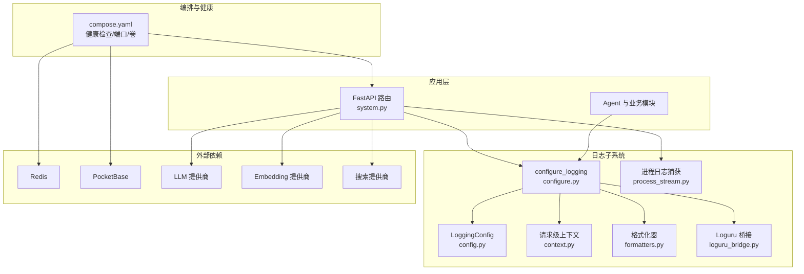
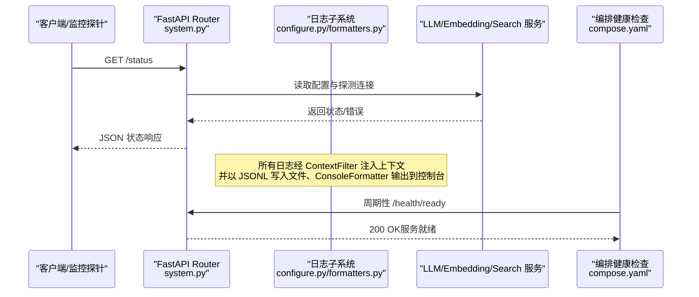
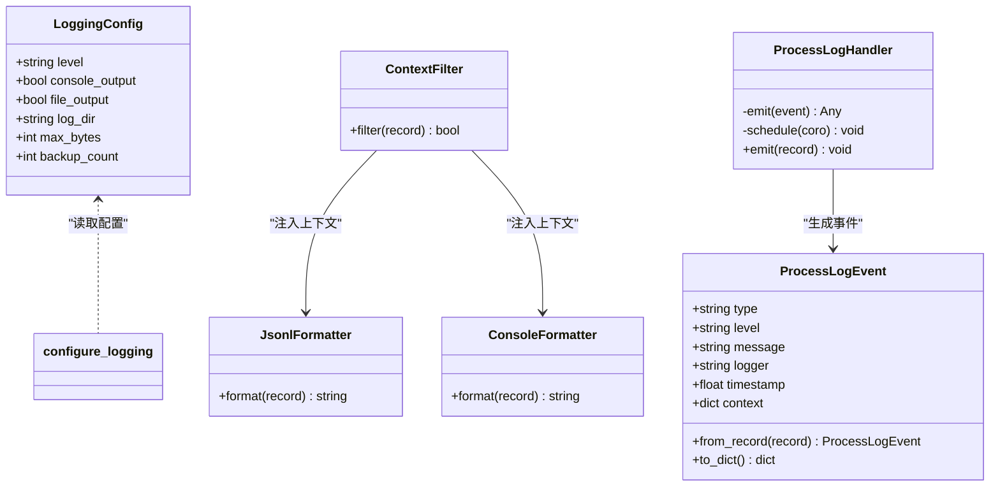
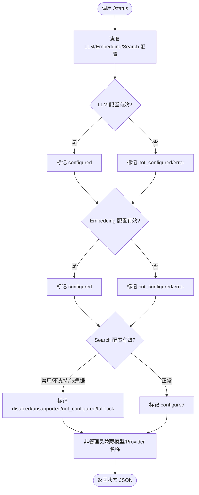
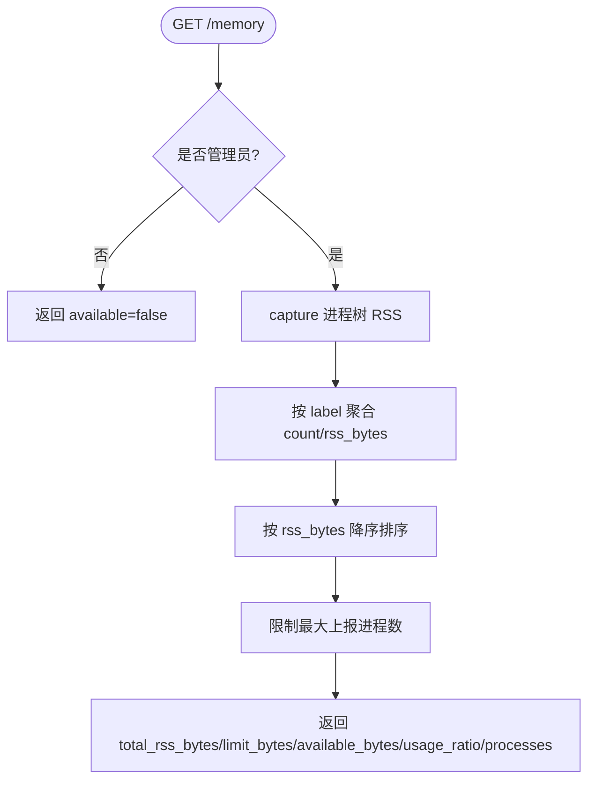
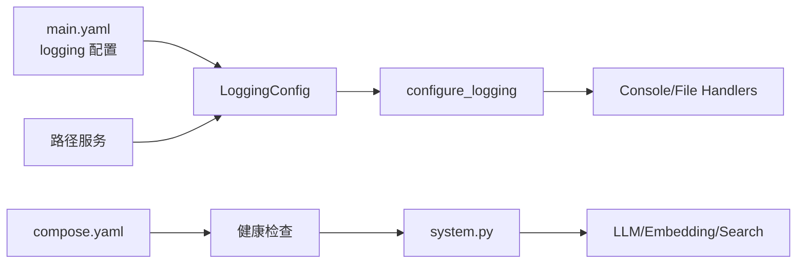

# 运维监控

<cite>
**本文引用的文件**   
- [config.py](file://deeptutor/logging/config.py)
- [configure.py](file://deeptutor/logging/configure.py)
- [context.py](file://deeptutor/logging/context.py)
- [formatters.py](file://deeptutor/logging/formatters.py)
- [process_stream.py](file://deeptutor/logging/process_stream.py)
- [loguru_bridge.py](file://deeptutor/logging/loguru_bridge.py)
- [system.py](file://deeptutor/api/routers/system.py)
- [compose.yaml](file://compose.yaml)
</cite>

## 目录
1. [引言](#引言)
2. [项目结构](#项目结构)
3. [核心组件](#核心组件)
4. [架构总览](#架构总览)
5. [详细组件分析](#详细组件分析)
6. [依赖关系分析](#依赖关系分析)
7. [性能与容量规划](#性能与容量规划)
8. [故障排查指南](#故障排查指南)
9. [结论](#结论)
10. [附录：指标、告警与自动化清单](#附录指标告警与自动化清单)

## 引言
本文件面向 DeepTutor 的运维与 SRE 团队，系统化说明日志系统、监控指标、健康检查、错误追踪、分布式链路追踪、资源监控、容量规划、告警与通知、审计合规以及自动化运维实践。文档以代码仓库中的日志子系统、系统状态接口和容器编排配置为依据，给出可落地的运维方案与最佳实践。

## 项目结构
DeepTutor 的运维监控相关能力主要分布在以下位置：
- 日志子系统：deeptutor/logging/*，负责日志采集、结构化输出、上下文注入、进程日志事件捕获，以及与 loguru 的桥接。
- 系统健康与诊断接口：deeptutor/api/routers/system.py，提供运行时状态、内存使用、LLM/Embedding/Search 连通性测试等。
- 容器编排与健康检查：compose.yaml，定义 Redis、PocketBase、DeepTutor 服务及其健康检查策略。

图示来源
- [system.py:116-138](file://deeptutor/api/routers/system.py#L116-L138)
- [system.py:318-402](file://deeptutor/api/routers/system.py#L318-L402)
- [system.py:405-456](file://deeptutor/api/routers/system.py#L405-L456)
- [system.py:459-524](file://deeptutor/api/routers/system.py#L459-L524)
- [system.py:527-581](file://deeptutor/api/routers/system.py#L527-L581)
- [system.py:584-633](file://deeptutor/api/routers/system.py#L584-L633)
- [configure.py:40-86](file://deeptutor/logging/configure.py#L40-L86)
- [config.py:9-49](file://deeptutor/logging/config.py#L9-L49)
- [compose.yaml:67-206](file://compose.yaml#L67-L206)

章节来源
- [config.py:9-49](file://deeptutor/logging/config.py#L9-L49)
- [configure.py:40-86](file://deeptutor/logging/configure.py#L40-L86)
- [system.py:116-138](file://deeptutor/api/routers/system.py#L116-L138)
- [compose.yaml:67-206](file://compose.yaml#L67-L206)

## 核心组件
- 日志配置与启动：从运行时设置加载日志级别、控制台/文件输出开关、日志目录、轮转大小与备份数量；统一安装标准库 logging 处理器，并桥接可选的 loguru 输出。
- 结构化日志与上下文：通过 ContextFilter 将 request_id、turn_id、session_id、task_id、capability、stage、sink 等字段注入每条日志；JSONL 格式用于聚合分析，控制台格式便于本地调试。
- 进程日志事件：ProcessLogHandler 将匹配的 stdlib 日志转换为 ProcessLogEvent，支持异步 emit，并在不同线程/事件循环下安全调度。
- 系统健康与诊断：/runtime、/status、/memory、/test/llm、/test/embeddings、/test/search 等接口暴露运行态、模型连通性与内存使用情况。
- 编排与健康检查：compose.yaml 为 Redis、PocketBase、DeepTutor 定义健康检查、端口映射、只读根文件系统与数据卷挂载。

章节来源
- [configure.py:40-86](file://deeptutor/logging/configure.py#L40-L86)
- [formatters.py:13-54](file://deeptutor/logging/formatters.py#L13-L54)
- [process_stream.py:19-51](file://deeptutor/logging/process_stream.py#L19-L51)
- [process_stream.py:54-137](file://deeptutor/logging/process_stream.py#L54-L137)
- [system.py:116-138](file://deeptutor/api/routers/system.py#L116-L138)
- [system.py:318-402](file://deeptutor/api/routers/system.py#L318-L402)
- [system.py:405-456](file://deeptutor/api/routers/system.py#L405-L456)
- [compose.yaml:67-206](file://compose.yaml#L67-L206)

## 架构总览
下图展示请求进入 FastAPI 后，如何触发业务逻辑、产生结构化日志、并通过系统接口暴露健康与诊断信息。

图示来源
- [system.py:318-402](file://deeptutor/api/routers/system.py#L318-L402)
- [configure.py:40-86](file://deeptutor/logging/configure.py#L40-L86)
- [formatters.py:26-54](file://deeptutor/logging/formatters.py#L26-L54)
- [compose.yaml:190-199](file://compose.yaml#L190-L199)

## 详细组件分析

### 日志子系统设计与实现
- 配置加载：LoggingConfig 封装日志级别、输出目标、日志目录、轮转参数；load_logging_config 从 main.yaml 中读取 logging 段，失败时回退默认目录。
- 启动引导：configure_logging 初始化 root logger，按配置添加 ConsoleHandler 与 RotatingFileHandler，设置 deeptutor 命名空间日志级别，并安装 loguru 桥接。
- 上下文注入：ContextFilter 将当前 contextvars 中的字段合并到每条日志记录；JsonlFormatter 输出单行 JSON，包含时间戳、级别、logger、消息与上下文；ConsoleFormatter 输出人类可读文本，保留异常堆栈。
- 进程日志事件：ProcessLogHandler 过滤匹配 task_id/turn_id 的日志，构造 ProcessLogEvent 并通过 emit 回调发送；对异步 emit 进行事件循环感知调度，避免在 worker 线程丢失事件。
- Loguru 桥接：install_loguru_bridge 将 loguru 记录转发到标准库 logger，保持统一的输出管道。

图示来源
- [config.py:9-49](file://deeptutor/logging/config.py#L9-L49)
- [configure.py:40-86](file://deeptutor/logging/configure.py#L40-L86)
- [formatters.py:13-54](file://deeptutor/logging/formatters.py#L13-L54)
- [process_stream.py:19-51](file://deeptutor/logging/process_stream.py#L19-L51)
- [process_stream.py:54-137](file://deeptutor/logging/process_stream.py#L54-L137)

章节来源
- [config.py:9-49](file://deeptutor/logging/config.py#L9-L49)
- [configure.py:40-86](file://deeptutor/logging/configure.py#L40-L86)
- [formatters.py:13-54](file://deeptutor/logging/formatters.py#L13-L54)
- [process_stream.py:19-51](file://deeptutor/logging/process_stream.py#L19-L51)
- [process_stream.py:54-137](file://deeptutor/logging/process_stream.py#L54-L137)
- [loguru_bridge.py:9-28](file://deeptutor/logging/loguru_bridge.py#L9-L28)

### 健康检查与系统诊断
- /runtime：返回运行时协调与 Worker 诊断，包含协议版本、领导者健康标志等。
- /status：汇总后端、LLM、Embedding、Search 的配置与连通性状态；非管理员会隐藏敏感字段。
- /memory：仅管理员可用，返回进程树 RSS 统计、限制与使用率，并按角色分组排序。
- /test/llm、/test/embeddings、/test/search：分别向对应服务发起最小探测请求，返回成功与否、耗时与错误信息。

图示来源
- [system.py:318-402](file://deeptutor/api/routers/system.py#L318-L402)

章节来源
- [system.py:116-138](file://deeptutor/api/routers/system.py#L116-L138)
- [system.py:318-402](file://deeptutor/api/routers/system.py#L318-L402)
- [system.py:405-456](file://deeptutor/api/routers/system.py#L405-L456)
- [system.py:459-524](file://deeptutor/api/routers/system.py#L459-L524)
- [system.py:527-581](file://deeptutor/api/routers/system.py#L527-L581)
- [system.py:584-633](file://deeptutor/api/routers/system.py#L584-L633)

### 资源监控与内存快照
- /memory 端点通过 memory_probe.capture 获取进程树 RSS 快照，按角色聚合并限制上报条目数，同时返回总量、限制、剩余与使用率。
- compose.yaml 定义了只读根文件系统、tmpfs 临时目录与数据卷挂载，确保日志与数据持久化且隔离。

图示来源
- [system.py:405-456](file://deeptutor/api/routers/system.py#L405-L456)
- [compose.yaml:137-177](file://compose.yaml#L137-L177)

章节来源
- [system.py:405-456](file://deeptutor/api/routers/system.py#L405-L456)
- [compose.yaml:137-177](file://compose.yaml#L137-L177)

### 分布式链路追踪与事务监控
- 日志上下文字段 request_id、turn_id、session_id、task_id、capability、stage、sink 可用于跨服务关联同一用户会话或任务。
- 建议在网关/代理层生成 request_id，并在进入 FastAPI 后绑定到日志上下文；下游 LLM/Embedding/Search 调用可通过工具链或 SDK 透传 trace_id。
- 对于分布式事务（如更新作业、多步骤 Agent 流程），建议以 turn_id/task_id 作为事务标识，结合 ProcessLogEvent 的上下文字段进行端到端追踪。

章节来源
- [context.py:10-40](file://deeptutor/logging/context.py#L10-L40)
- [process_stream.py:19-51](file://deeptutor/logging/process_stream.py#L19-L51)

### 日志聚合、分析与审计合规
- 日志输出：控制台（开发调试）+ JSONL（生产聚合）。JSONL 每行一个对象，适合被 Fluent Bit/Filebeat/Vector 等采集器抓取并发送到 Elasticsearch/OpenSearch/Loki。
- 审计合规：结合 multi_user 模块的审计能力（不在本节直接分析），将 user_id、action、resource、result 等纳入审计日志；建议对敏感字段脱敏后再输出。
- 查询与分析：基于 timestamp、level、logger、context.request_id/turn_id/session_id 构建索引，支持按会话/任务维度检索与回溯。

章节来源
- [formatters.py:26-54](file://deeptutor/logging/formatters.py#L26-L54)
- [process_stream.py:19-51](file://deeptutor/logging/process_stream.py#L19-L51)

## 依赖关系分析
- 日志子系统依赖运行时配置（main.yaml）与路径服务（确定日志目录）。
- 系统接口依赖 LLM/Embedding/Search 配置与服务，以及运行时设置服务。
- 编排层通过 healthcheck 探测后端就绪状态，依赖 Redis/PocketBase 的健康状态。

图示来源
- [config.py:19-49](file://deeptutor/logging/config.py#L19-L49)
- [configure.py:40-86](file://deeptutor/logging/configure.py#L40-L86)
- [system.py:318-402](file://deeptutor/api/routers/system.py#L318-L402)
- [compose.yaml:190-199](file://compose.yaml#L190-L199)

章节来源
- [config.py:19-49](file://deeptutor/logging/config.py#L19-L49)
- [configure.py:40-86](file://deeptutor/logging/configure.py#L40-L86)
- [system.py:318-402](file://deeptutor/api/routers/system.py#L318-L402)
- [compose.yaml:190-199](file://compose.yaml#L190-L199)

## 性能与容量规划
- 日志吞吐：JSONL 文件采用 RotatingFileHandler，按 max_bytes 轮转，backup_count 控制保留份数。建议根据 QPS 与平均日志体积估算磁盘占用，预留 2-3 倍冗余。
- 内存使用：/memory 暴露 RSS 与使用率，建议设定 cgroup 内存上限并结合 OOM 策略；在高并发 Agent 场景下关注 sandbox 子进程数量与内存峰值。
- I/O 与网络：LLM/Embedding/Search 探测接口会发起外部网络请求，需评估超时与重试策略，避免阻塞主事件循环。
- 容器资源：compose.yaml 注释提供了 pids_limit/mem_limit/cpus 示例，可按负载压测结果调整。

章节来源
- [configure.py:65-80](file://deeptutor/logging/configure.py#L65-L80)
- [system.py:405-456](file://deeptutor/api/routers/system.py#L405-L456)
- [compose.yaml:216-220](file://compose.yaml#L216-L220)

## 故障排查指南
- 日志不可见：确认 configure_logging 已执行，console_output/file_output 开关正确；检查日志目录权限与轮转策略。
- 上下文缺失：确认在请求入口绑定了 request_id/turn_id/session_id/task_id；检查 ContextFilter 是否生效。
- 异步日志丢失：ProcessLogHandler 已在不同线程/事件循环下做调度保护；若仍丢失，检查 emit 回调是否抛出异常或被过早关闭。
- 健康检查失败：/health/ready 由编排层探测；/status 与 /test/* 接口可辅助定位 LLM/Embedding/Search 配置或连通性问题。
- 内存飙升：通过 /memory 观察进程树 RSS 分布，定位异常子进程；必要时重启或回收沙箱。

章节来源
- [configure.py:40-86](file://deeptutor/logging/configure.py#L40-L86)
- [formatters.py:13-54](file://deeptutor/logging/formatters.py#L13-L54)
- [process_stream.py:78-113](file://deeptutor/logging/process_stream.py#L78-L113)
- [system.py:318-402](file://deeptutor/api/routers/system.py#L318-L402)
- [system.py:405-456](file://deeptutor/api/routers/system.py#L405-L456)

## 结论
DeepTutor 的运维监控体系以结构化日志为核心，结合系统健康接口与容器编排健康检查，形成“采集—聚合—可视化—告警—处置”的闭环。通过上下文字段串联分布式链路，配合 /memory 与 /test/* 接口，能够快速定位配置、连通性与资源问题。建议在生产环境完善日志采集与可视化平台，建立告警规则与自动化处置流程，持续提升稳定性与可观测性。

## 附录：指标、告警与自动化清单

### 关键监控指标
- 系统可用性：/health/ready、/runtime、/status 的成功率与延迟。
- 外部依赖连通性：/test/llm、/test/embeddings、/test/search 的成功率与响应时间。
- 资源使用：/memory 的 total_rss_bytes、usage_ratio、进程数与 RSS 分布。
- 日志质量：JSONL 行数、错误级别占比、上下文字段填充率。

### 告警规则建议
- 健康检查连续失败超过阈值（例如 3 次）→ P1 告警。
- /test/* 接口失败或响应时间超过阈值 → P2 告警。
- usage_ratio 持续高于阈值（例如 80%）→ P2 告警；接近 limit_bytes → P1 告警。
- 日志错误级别占比突增 → P2 告警；JSONL 写入失败 → P1 告警。

### 通知渠道
- 企业微信/钉钉/Slack 机器人
- PagerDuty/OpsGenie
- 邮件与短信（P1 事件）

### 自动化运维
- 自动扩容：基于 /memory 与队列深度触发水平扩展。
- 自动降级：当 LLM/Embedding/Search 不可用时，切换至缓存或降级策略。
- 自动恢复：健康检查失败后自动重启容器或服务。
- 日志清理：按 backup_count 与保留天数清理旧日志。

### 分布式事务与链路追踪
- 在网关层生成 request_id，并在 FastAPI 中间件绑定到日志上下文。
- 下游调用通过 header 或 SDK 透传 trace_id。
- 使用 turn_id/task_id 关联多步骤任务，结合 ProcessLogEvent 上下文进行端到端追踪。