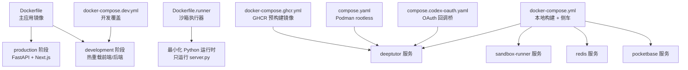
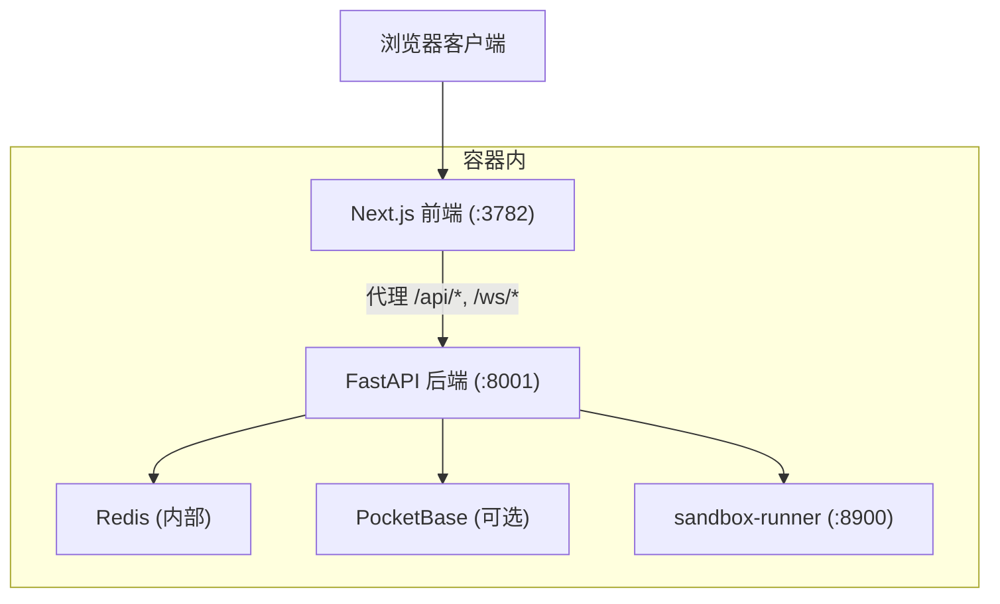
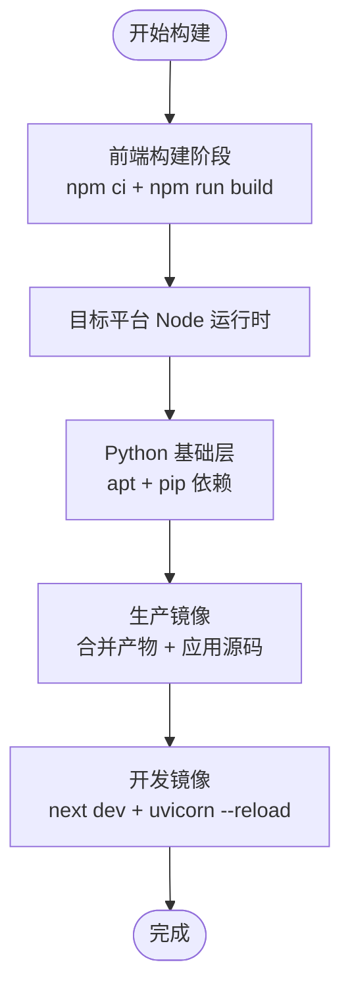
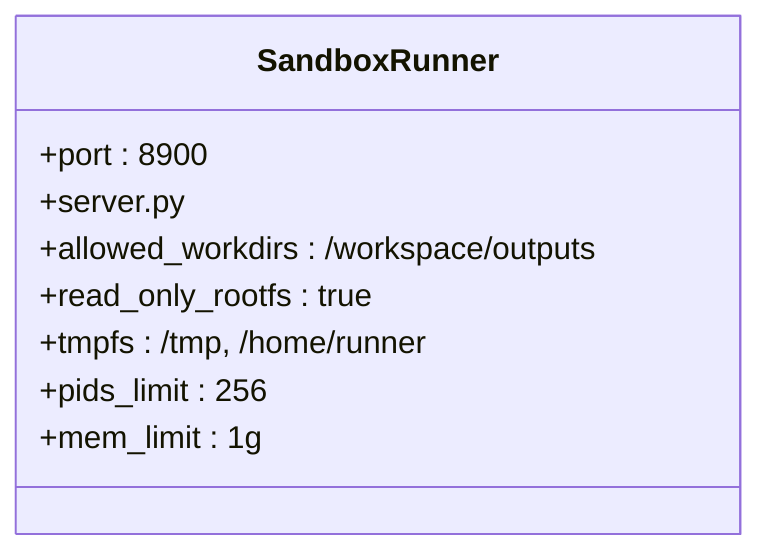
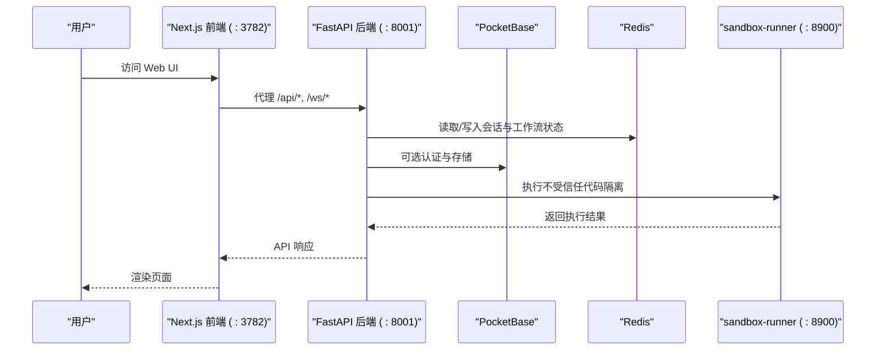
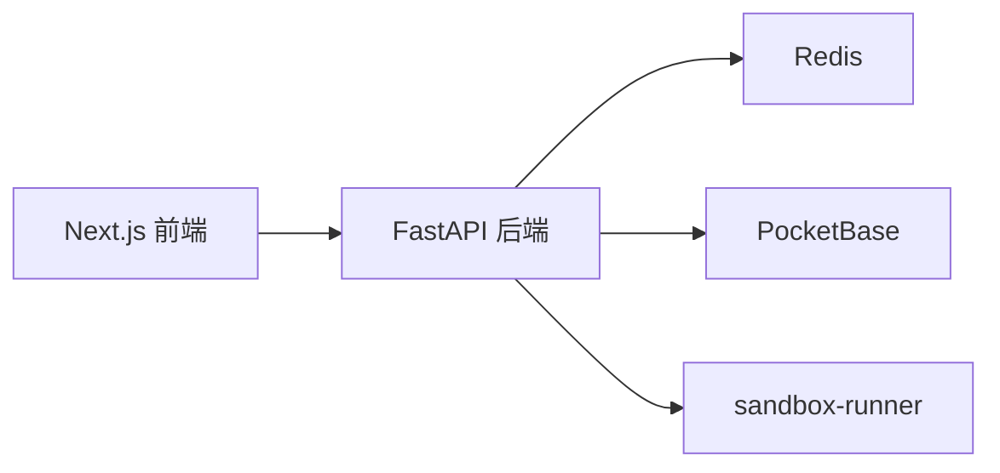

# Docker 容器化部署

<cite>
**本文引用的文件**   
- [Dockerfile](file://Dockerfile)
- [Dockerfile.runner](file://Dockerfile.runner)
- [compose.yaml](file://compose.yaml)
- [docker-compose.yml](file://docker-compose.yml)
- [docker-compose.dev.yml](file://docker-compose.dev.yml)
- [docker-compose.ghcr.yml](file://docker-compose.ghcr.yml)
- [compose.codex-oauth.yaml](file://compose.codex-oauth.yaml)
- [CONTAINERIZATION.md](file://docs-for-dev/CONTAINERIZATION.md)
</cite>

## 目录
1. [简介](#简介)
2. [项目结构](#项目结构)
3. [核心组件](#核心组件)
4. [架构总览](#架构总览)
5. [详细组件分析](#详细组件分析)
6. [依赖关系分析](#依赖关系分析)
7. [性能与资源限制](#性能与资源限制)
8. [监控、日志与故障诊断](#监控日志与故障诊断)
9. [安全最佳实践](#安全最佳实践)
10. [结论](#结论)
11. [附录：常用命令与排错清单](#附录常用命令与排错清单)

## 简介
本指南面向 DeepTutor 的 Docker 容器化部署，覆盖镜像构建、多阶段优化、服务编排、网络与数据卷管理、开发/生产差异、容器间通信、环境变量注入、监控日志、故障诊断以及安全与资源限制。文档严格基于仓库中的 Dockerfile、Runner 侧车镜像、Compose 配置及官方容器化说明进行整理，确保可重复、可扩展且具备生产可用性。

## 项目结构
DeepTutor 的容器化相关资产集中在根目录的几个关键文件中：
- 镜像定义：Dockerfile（主应用）、Dockerfile.runner（沙箱执行器）
- 编排配置：docker-compose.yml（本地构建 + 侧车）、docker-compose.ghcr.yml（直接使用 GHCR 预构建镜像）、compose.yaml（Podman rootless 加固形态）、docker-compose.dev.yml（开发覆盖）、compose.codex-oauth.yaml（临时 OAuth 回调桥接）
- 官方容器化说明：docs-for-dev/CONTAINERIZATION.md

图示来源
- [Dockerfile:104-224](file://Dockerfile#L104-L224)
- [Dockerfile.runner:1-110](file://Dockerfile.runner#L1-L110)
- [docker-compose.yml:26-217](file://docker-compose.yml#L26-L217)
- [docker-compose.ghcr.yml:41-119](file://docker-compose.ghcr.yml#L41-L119)
- [compose.yaml:65-231](file://compose.yaml#L65-L231)
- [docker-compose.dev.yml:1-55](file://docker-compose.dev.yml#L1-L55)
- [compose.codex-oauth.yaml:1-10](file://compose.codex-oauth.yaml#L1-L10)

章节来源
- [Dockerfile:1-624](file://Dockerfile#L1-L624)
- [Dockerfile.runner:1-110](file://Dockerfile.runner#L1-L110)
- [docker-compose.yml:1-217](file://docker-compose.yml#L1-L217)
- [docker-compose.ghcr.yml:1-119](file://docker-compose.ghcr.yml#L1-L119)
- [compose.yaml:1-231](file://compose.yaml#L1-L231)
- [docker-compose.dev.yml:1-55](file://docker-compose.dev.yml#L1-L55)
- [compose.codex-oauth.yaml:1-10](file://compose.codex-oauth.yaml#L1-L10)
- [CONTAINERIZATION.md:1-556](file://docs-for-dev/CONTAINERIZATION.md#L1-L556)

## 核心组件
- 主应用镜像（Dockerfile）
  - 多阶段构建：前端构建器、Node 运行时、Python 基础层、生产镜像、开发镜像
  - 使用 supervisord 同时启动 FastAPI 后端与 Next.js 前端
  - 入口脚本负责初始化数据目录、权限映射、加载 JSON 运行时设置并导出环境变量
  - 暴露端口 8001（后端）和 3782（前端），内置健康检查
- 沙箱执行器镜像（Dockerfile.runner）
  - 最小化 Python 镜像，仅包含 HTTP server.py 与常见 CLI 工具
  - 通过 DEEPTUTOR_SANDBOX_RUNNER_URL 被主应用调用，隔离执行不受信任代码
- 编排配置
  - docker-compose.yml：本地构建主镜像 + sandbox-runner + redis + pocketbase
  - docker-compose.ghcr.yml：直接拉取 GHCR 预构建镜像，简化部署
  - compose.yaml：Podman rootless + read-only rootfs + keep-id 加固形态
  - docker-compose.dev.yml：开发模式覆盖，挂载源码并启用热重载
  - compose.codex-oauth.yaml：临时为 OpenAI Codex OAuth 回调桥接端口

章节来源
- [Dockerfile:17-624](file://Dockerfile#L17-L624)
- [Dockerfile.runner:1-110](file://Dockerfile.runner#L1-L110)
- [docker-compose.yml:26-217](file://docker-compose.yml#L26-L217)
- [docker-compose.ghcr.yml:41-119](file://docker-compose.ghcr.yml#L41-L119)
- [compose.yaml:65-231](file://compose.yaml#L65-L231)
- [docker-compose.dev.yml:12-55](file://docker-compose.dev.yml#L12-L55)
- [compose.codex-oauth.yaml:1-10](file://compose.codex-oauth.yaml#L1-L10)

## 架构总览
DeepTutor 在单个容器中运行后端与前端，并通过 Next.js 中间件将 /api/* 与 /ws/* 转发到后端；可选 PocketBase 提供认证与存储；Redis 用于多工作进程协调；sandbox-runner 作为独立侧车隔离执行不受信任的代码。

图示来源
- [Dockerfile:250-335](file://Dockerfile#L250-L335)
- [docker-compose.yml:26-217](file://docker-compose.yml#L26-L217)
- [CONTAINERIZATION.md:129-155](file://docs-for-dev/CONTAINERIZATION.md#L129-L155)

## 详细组件分析

### Dockerfile 构建过程与多阶段优化
- 前端构建阶段（frontend-builder）
  - 使用 node:22.22-slim 构建 Next.js 静态产物，输出 standalone 模式以支持运行时环境变量注入
  - 复制 web/package.json 与 lock 文件优先缓存依赖安装
- Node 运行时阶段（node-runtime）
  - 为目标平台获取匹配的 Node 二进制，避免跨平台 QEMU 编译
- Python 基础阶段（python-base）
  - 安装系统依赖（OpenCV、Rust 等），安装 Python 依赖
- 生产阶段（production）
  - 合并 Node 运行时、Python 包、前端静态产物与应用源码
  - 创建非 root 用户 deeptutor，使用 supervisord 管理后端与前端
  - 入口脚本处理 PUID/PGID 映射、数据目录初始化、JSON 运行时设置加载与环境变量导出
  - 暴露 8001/3782，内置健康检查
- 开发阶段（development）
  - 继承 production，复制完整 web 源码，启用 next dev 与 uvicorn --reload

图示来源
- [Dockerfile:17-624](file://Dockerfile#L17-L624)

章节来源
- [Dockerfile:17-624](file://Dockerfile#L17-L624)

### Dockerfile.runner 沙箱执行器
- 最小化 Python 镜像，仅包含 server.py 与必要 CLI 工具
- 通过 DEEPTUTOR_SANDBOX_RUNNER_URL 被主应用调用，隔离执行不受信任代码
- 默认以非 root 用户 runner 运行，限制读写路径，仅允许写入 /workspace/outputs

图示来源
- [Dockerfile.runner:1-110](file://Dockerfile.runner#L1-L110)

章节来源
- [Dockerfile.runner:1-110](file://Dockerfile.runner#L1-L110)

### Compose 服务编排与差异
- docker-compose.yml
  - 服务：redis、pocketbase、deeptutor、sandbox-runner
  - deeptutor 从本地 Dockerfile 构建 target=production
  - 通过 DEEPTUTOR_SANDBOX_RUNNER_URL 指向 sandbox-runner
  - 数据卷：./data:/app/data，/workspace 稳定路径
- docker-compose.ghcr.yml
  - 直接使用 ghcr.io/hkuds/deeptutor:latest 镜像
  - 不构建本地镜像，适合快速部署
  - 同样挂载 ./data 与 /workspace
- compose.yaml（Podman rootless）
  - 所有服务 read_only: true，使用 tmpfs 提供可写表面
  - userns_mode: keep-id，绑定主机 UID/GID
  - 端口绑定仅限 127.0.0.1
  - 不包含 sandbox-runner，主应用回退到 bwrap 或受限子进程
- docker-compose.dev.yml
  - 覆盖 deeptutor 构建 target=development
  - 挂载后端与前端源码以实现热重载
  - 挂载 data/user、data/memory、data/knowledge_bases 以便开发调试
- compose.codex-oauth.yaml
  - 临时为 OpenAI Codex OAuth 回调桥接 1455/1457 端口

图示来源
- [docker-compose.yml:26-217](file://docker-compose.yml#L26-L217)
- [docker-compose.ghcr.yml:41-119](file://docker-compose.ghcr.yml#L41-L119)
- [compose.yaml:65-231](file://compose.yaml#L65-L231)
- [docker-compose.dev.yml:12-55](file://docker-compose.dev.yml#L12-L55)
- [compose.codex-oauth.yaml:1-10](file://compose.codex-oauth.yaml#L1-L10)

章节来源
- [docker-compose.yml:26-217](file://docker-compose.yml#L26-L217)
- [docker-compose.ghcr.yml:41-119](file://docker-compose.ghcr.yml#L41-L119)
- [compose.yaml:65-231](file://compose.yaml#L65-L231)
- [docker-compose.dev.yml:12-55](file://docker-compose.dev.yml#L12-L55)
- [compose.codex-oauth.yaml:1-10](file://compose.codex-oauth.yaml#L1-L10)

## 依赖关系分析
- 主应用依赖
  - Redis：内部协调状态，AOF 持久化
  - PocketBase：可选认证与存储
  - sandbox-runner：隔离执行不受信任代码
- 网络
  - 统一 bridge 网络 deeptutor-network（或 Podman 下的 deeptutor 网络）
  - 端口映射：后端 8001、前端 3782、sandbox-runner 8900（内部）
- 数据卷
  - ./data:/app/data：运行时设置、知识库、记忆、日志等
  - /workspace：内容工作区，sandbox-runner 仅读 + outputs 可写

图示来源
- [docker-compose.yml:26-217](file://docker-compose.yml#L26-L217)
- [compose.yaml:65-231](file://compose.yaml#L65-L231)

章节来源
- [docker-compose.yml:26-217](file://docker-compose.yml#L26-L217)
- [compose.yaml:65-231](file://compose.yaml#L65-L231)

## 性能与资源限制
- 内存与进程限制
  - sandbox-runner 明确设置 pids_limit 与 mem_limit，防止资源滥用
  - 主应用可通过环境变量调整后端 workers 与超时参数
- 缓存与依赖安装
  - PIP_CACHE_DIR 指向 /app/data/.cache/pip，复用下载缓存
  - apt 包安装失败不会致命，保证特性降级而非整体崩溃
- 前端代理与连接保持
  - uvicorn 的 timeout-keep-alive 与前端代理保持一致，避免空闲连接竞争关闭导致的错误

章节来源
- [docker-compose.yml:182-199](file://docker-compose.yml#L182-L199)
- [Dockerfile:441-479](file://Dockerfile#L441-L479)
- [Dockerfile:283-335](file://Dockerfile#L283-L335)

## 监控、日志与故障诊断
- 健康检查
  - 主应用：curl http://localhost:8001/health/ready
  - Redis：redis-cli ping
  - PocketBase：wget spider http://localhost:8090/api/health
  - sandbox-runner：HTTP /health 端点
- 日志收集
  - supervisord 子程序输出到 stdout/stderr，便于 docker logs 捕获
  - 应用日志写入 data/user/logs/ai_tutor_*.log
- 常见问题
  - “Backend unreachable”：检查后端是否启动成功，确认 DEEPTUTOR_API_BASE_URL 配置
  - PID 文件写入失败：当前镜像已将 pidfile 移至 /tmp/supervisord.pid
  - 权限问题：Unraid/NAS 下设置 PUID/PGID，不要以 root 运行
  - 首次 JSON 写入权限拒绝：使用 bind mount 或 :U 选项

章节来源
- [docker-compose.yml:126-140](file://docker-compose.yml#L126-L140)
- [docker-compose.yml:200-206](file://docker-compose.yml#L200-L206)
- [compose.yaml:79-83](file://compose.yaml#L79-L83)
- [compose.yaml:116-127](file://compose.yaml#L116-L127)
- [CONTAINERIZATION.md:473-513](file://docs-for-dev/CONTAINERIZATION.md#L473-L513)

## 安全最佳实践
- 非 root 运行
  - 主应用通过 supervisord 将后端与前端降权至 deeptutor 用户
  - sandbox-runner 以 runner 用户运行，最小权限
- 只读根文件系统
  - compose.yaml 对所有服务启用 read_only: true，仅 tmpfs 与数据卷可写
- 用户命名空间
  - Podman rootless 使用 userns_mode: keep-id，容器内 UID 映射到宿主 UID
- 沙箱隔离
  - sandbox-runner 仅允许写入 /workspace/outputs，其他路径只读
  - 主应用通过 DEEPTUTOR_SANDBOX_RUNNER_URL 调用，避免在主进程中执行不受信任代码
- 认证与 CORS
  - auth_enabled 控制 API 访问，CORS 使用前端 origins 精确配置

章节来源
- [Dockerfile:207-224](file://Dockerfile#L207-L224)
- [Dockerfile.runner:85-110](file://Dockerfile.runner#L85-L110)
- [compose.yaml:29-48](file://compose.yaml#L29-L48)
- [docker-compose.yml:144-199](file://docker-compose.yml#L144-L199)
- [CONTAINERIZATION.md:516-546](file://docs-for-dev/CONTAINERIZATION.md#L516-L546)

## 结论
DeepTutor 的容器化方案提供了从简单单容器到 Podman rootless 加固形态的多层次部署能力。通过多阶段构建、supervisord 双进程管理、可选侧车隔离与丰富的 Compose 配置，既满足开发体验又兼顾生产安全与可维护性。建议在生产环境优先采用 compose.yaml 的 rootless + read-only 形态，并结合 sandbox-runner 实现最强的代码执行隔离。

## 附录：常用命令与排错清单
- 本地构建与启动
  - python scripts/docker_compose.py up -d
  - python scripts/docker_compose.py build
- 使用预构建镜像
  - python scripts/docker_compose.py -f docker-compose.ghcr.yml up -d
- Podman rootless
  - podman compose -f compose.yaml up -d
- 查看日志
  - docker logs -f deeptutor
  - podman logs -f deeptutor
- 临时 OAuth 回调桥接
  - python scripts/docker_compose.py -f docker-compose.yml -f compose.codex-oauth.yaml up -d --force-recreate deeptutor

章节来源
- [docker-compose.yml:1-24](file://docker-compose.yml#L1-L24)
- [docker-compose.ghcr.yml:1-24](file://docker-compose.ghcr.yml#L1-L24)
- [compose.yaml:13-26](file://compose.yaml#L13-L26)
- [compose.codex-oauth.yaml:1-10](file://compose.codex-oauth.yaml#L1-L10)
- [CONTAINERIZATION.md:157-198](file://docs-for-dev/CONTAINERIZATION.md#L157-L198)