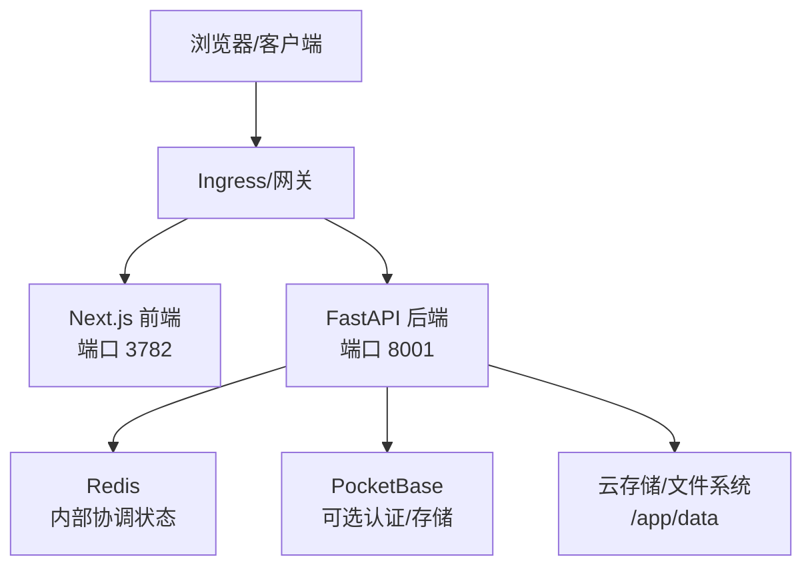
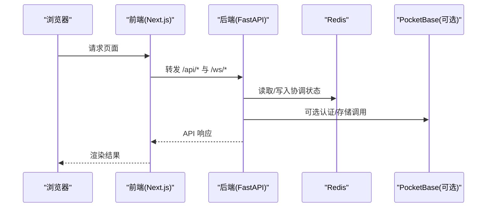
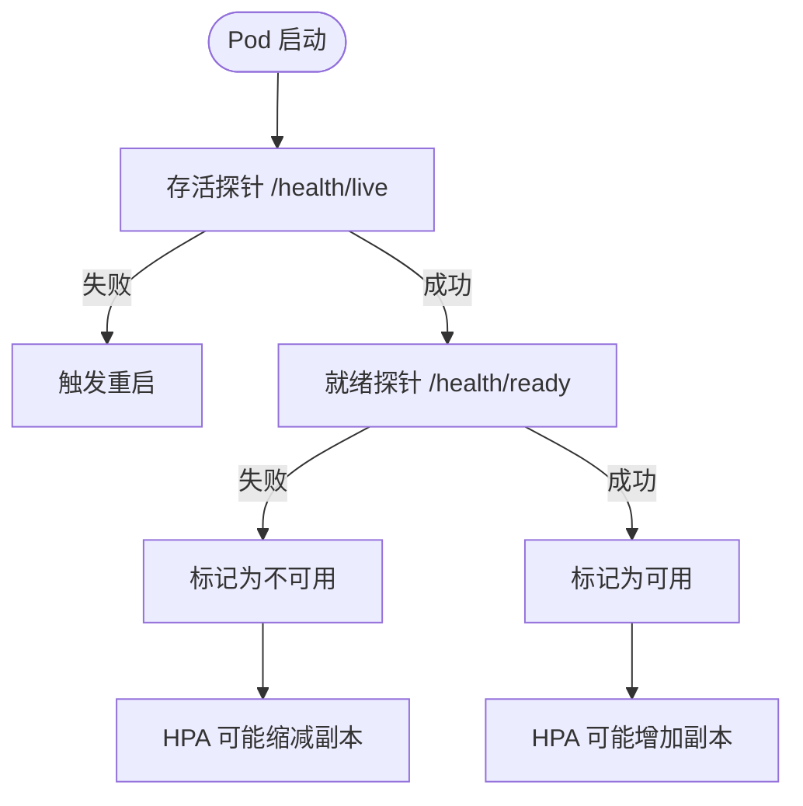

# 云原生部署

<cite>
**本文引用的文件**   
- [Dockerfile](file://Dockerfile)
- [docker-compose.yml](file://docker-compose.yml)
- [docker-compose.ghcr.yml](file://docker-compose.ghcr.yml)
- [scripts/docker_compose.py](file://scripts/docker_compose.py)
- [deeptutor/api/main.py](file://deeptutor/api/main.py)
</cite>

## 目录
1. [引言](#引言)
2. [项目结构与运行模型](#项目结构与运行模型)
3. [核心组件与依赖](#核心组件与依赖)
4. [Kubernetes 部署参考](#kubernetes-部署参考)
5. [Helm Chart 模板与值文件建议](#helm-chart-模板与值文件建议)
6. [云平台特定部署方式](#云平台特定部署方式)
7. [自动扩缩容、健康检查与就绪探针](#自动扩缩容健康检查与就绪探针)
8. [云存储、负载均衡与域名绑定](#云存储负载均衡与域名绑定)
9. [监控、日志与成本优化](#监控日志与成本优化)
10. [高可用性与弹性伸缩实践](#高可用性与弹性伸缩实践)
11. [故障排查指南](#故障排查指南)
12. [结论](#结论)

## 引言
本指南面向在 Kubernetes 和主流云平台中生产级部署 DeepTutor 的工程团队。DeepTutor 是一个包含 FastAPI 后端与 Next.js 前端的多阶段容器应用，默认通过 Supervisor 同时启动后端与前端进程，并通过 Redis 进行内部协调，可选集成 PocketBase 作为认证与存储侧车。仓库未提供现成的 Kubernetes YAML 或 Helm Chart，因此本指南基于现有镜像构建与 Compose 配置，给出可直接落地的云原生部署方案。

## 项目结构与运行模型
DeepTutor 的运行时由以下关键部分组成：
- 多阶段 Docker 镜像：前端静态资源与 Node 运行时、Python 依赖、Supervisor 管理的前后端进程、入口脚本负责初始化数据目录、加载 JSON 运行时设置并导出环境变量。
- 服务端口：后端默认 8001，前端默认 3782；可通过环境变量覆盖。
- 外部依赖：Redis（内部事件/命令流）、PocketBase（可选认证与存储）。
- 工作区与数据卷：`/app/data` 为持久化根目录，包含用户设置、工作区、知识库、内存等；沙箱 Runner 仅挂载受限路径。
- 健康端点：后端暴露 `/health/live` 与 `/health/ready`，后者在应用生命周期完成且协调器健康后返回 200。

**图表来源**
- [Dockerfile:104-180](file://Dockerfile#L104-L180)
- [Dockerfile:250-335](file://Dockerfile#L250-L335)
- [Dockerfile:337-551](file://Dockerfile#L337-L551)
- [docker-compose.yml:26-142](file://docker-compose.yml#L26-L142)
- [deeptutor/api/main.py:520-541](file://deeptutor/api/main.py#L520-L541)

**章节来源**
- [Dockerfile:104-180](file://Dockerfile#L104-L180)
- [Dockerfile:250-335](file://Dockerfile#L250-L335)
- [Dockerfile:337-551](file://Dockerfile#L337-L551)
- [docker-compose.yml:26-142](file://docker-compose.yml#L26-L142)
- [deeptutor/api/main.py:520-541](file://deeptutor/api/main.py#L520-L541)

## 核心组件与依赖
- 后端服务：FastAPI + Uvicorn，启用 CORS、访问日志过滤、错误边界、路由懒加载、模块挂载。
- 前端服务：Next.js Standalone Server，通过代理将 `/api/*` 与 `/ws/*` 转发到后端。
- 协调与缓存：Redis 用于多 Worker 协作与事件流；AOF 模式保证重启后部分状态不丢失。
- 可选认证存储：PocketBase，提供账户、权限、审计等能力；若未配置则回退 SQLite。
- 沙箱执行器：sandbox-runner 以只读根文件系统、最小权限运行不受信代码，仅允许写入输出目录。

**图表来源**
- [docker-compose.yml:26-142](file://docker-compose.yml#L26-L142)
- [docker-compose.yml:144-209](file://docker-compose.yml#L144-L209)
- [deeptutor/api/main.py:77-105](file://deeptutor/api/main.py#L77-L105)

**章节来源**
- [docker-compose.yml:26-142](file://docker-compose.yml#L26-L142)
- [docker-compose.yml:144-209](file://docker-compose.yml#L144-L209)
- [deeptutor/api/main.py:77-105](file://deeptutor/api/main.py#L77-L105)

## Kubernetes 部署参考
以下为 Kubernetes 资源定义建议。请根据实际命名空间、版本与平台策略调整。

- Namespace
  - `deep-tutor`

- ConfigMap
  - `deep-tutor-config`
    - 键名示例：`system.json`、`integrations.json`、`model_catalog.json`、`main.yaml`、`agents.yaml`
    - 用途：注入运行时 JSON/YAML 配置，避免硬编码敏感信息。

- Secret
  - `deep-tutor-secrets`
    - 键名示例：`auth.username`、`auth.password_hash`、`pocketbase.admin.email`、`pocketbase.admin.password`、`provider.api_keys.*`
    - 用途：承载认证凭据、第三方 Provider Key。

- PersistentVolumeClaim
  - `deep-tutor-data`
    - 容量：按知识库与工作区规模评估，建议初始 50Gi~200Gi。
    - 存储类：使用云厂商高性能 SSD 或归档分层存储（冷数据）。

- Deployment
  - `deep-tutor-deployment`
    - 副本数：至少 2 副本以实现滚动更新与高可用。
    - 容器：
      - `backend`: 端口 8001，健康检查 `/health/live`，就绪检查 `/health/ready`。
      - `frontend`: 端口 3782，健康检查可复用后端就绪逻辑或通过反向代理统一探测。
    - 环境变量：从 ConfigMap/Secret 注入，如 `DEEPTUTOR_API_BASE_URL`、`CORS_ORIGIN(S)`、`AUTH_ENABLED`、`POCKETBASE_*`。
    - 卷挂载：`/app/data` 挂载 PVC；必要时挂载 `/workspace` 子树。
    - 资源限制：CPU/Memory 根据 LLM 调用与并发估算；建议设置 requests=limits 以保证调度稳定性。

- Service
  - `deep-tutor-backend-svc`
    - 类型：ClusterIP
    - 端口：8001 → 后端容器端口
  - `deep-tutor-frontend-svc`
    - 类型：ClusterIP
    - 端口：3782 → 前端容器端口

- Ingress
  - `deep-tutor-ingress`
    - 规则：
      - `/api/*`、`/ws/*` → 后端 Service
      - `/`、`/static/*` → 前端 Service
    - TLS：启用 HTTPS，证书由 Ingress Controller 管理。
    - 会话亲和性：WebSocket 场景建议开启会话亲和或粘性 Cookie。

- HorizontalPodAutoscaler
  - 目标：Deployment
  - 指标：CPU 利用率、自定义指标（如 QPS、LLM 调用延迟）
  - 范围：min=2，max=10（按负载曲线调优）

- PodDisruptionBudget
  - minAvailable=1，确保滚动更新时始终有可用副本。

- NetworkPolicy
  - 仅允许 Ingress Controller 与必要 Sidecar 访问后端/前端端口。
  - Redis/PocketBase 仅允许 DeepTutor Pod 访问。

**章节来源**
- [Dockerfile:104-180](file://Dockerfile#L104-L180)
- [Dockerfile:250-335](file://Dockerfile#L250-L335)
- [Dockerfile:337-551](file://Dockerfile#L337-L551)
- [docker-compose.yml:26-142](file://docker-compose.yml#L26-L142)
- [deeptutor/api/main.py:520-541](file://deeptutor/api/main.py#L520-L541)

## Helm Chart 模板与值文件建议
由于仓库未提供 Helm Chart，建议采用如下结构组织模板与值文件：

- Chart.yaml
  - name: deeptutor
  - version: 1.x.x
  - appVersion: 对应镜像 tag

- values.yaml
  - image.repository、image.tag、image.pullPolicy
  - replicaCount
  - resources.requests/limits
  - ingress.enabled、hosts、tls
  - persistence.size、storageClass
  - config.system_json、config.integrations_json、config.model_catalog_json
  - secrets.auth_username、secrets.auth_password_hash、secrets.pocketbase_admin_email/password
  - autoscaling.enabled、minReplicas、maxReplicas、targetCPUUtilizationPercentage
  - service.backend.type/port、service.frontend.type/port

- templates/deployment.yaml
  - 挂载 ConfigMap 与 Secret 到 `/app/data/user/settings` 与 `/app/data/system`
  - 注入环境变量：`DEEPTUTOR_API_BASE_URL`、`CORS_ORIGIN(S)`、`AUTH_ENABLED`、`POCKETBASE_*`
  - 健康检查与就绪探针映射到 `/health/live` 与 `/health/ready`

- templates/service.yaml
  - backend ClusterIP Service
  - frontend ClusterIP Service

- templates/ingress.yaml
  - 规则转发 `/api/*`、`/ws/*` 到后端，其余到前端
  - 支持 TLS 与 Host 白名单

- templates/hpa.yaml
  - 基于 CPU 与自定义指标的 HPA

- templates/pdb.yaml
  - PDB 确保滚动更新可用性

- templates/configmap-secret.yaml
  - 将 JSON/YAML 配置与敏感信息注入为 ConfigMap/Secret

**章节来源**
- [Dockerfile:337-551](file://Dockerfile#L337-L551)
- [docker-compose.yml:26-142](file://docker-compose.yml#L26-L142)
- [deeptutor/api/main.py:520-541](file://deeptutor/api/main.py#L520-L541)

## 云平台特定部署方式
- AWS ECS
  - 任务定义：两个容器（backend/frontend），共享 EFS 或 EBS 卷挂载 `/app/data`。
  - 服务编排：Fargate 或 EC2 Launch Type；使用 Application Load Balancer 分发流量。
  - 配置管理：Parameter Store/Secrets Manager 注入环境变量；S3 作为对象存储后端（需配置 provider keys）。
  - 扩缩容：Application Auto Scaling 基于 CPU/请求数；ALB 健康检查指向 `/health/ready`。

- Google Cloud Run
  - 单容器部署：将前端与后端合并为单一入口（例如通过 Nginx/Envoy 反代），或使用 Cloud Run Services 分别托管前后端。
  - 配置：Cloud Run Secrets 注入敏感信息；Cloud SQL/AlloyDB 替代 PocketBase（如需强一致关系型存储）。
  - 扩缩容：自动扩缩至 0，基于请求量与并发阈值；设置最大实例数控制成本。
  - 域名：Cloud Run Domain Mapping 绑定自定义域名与 TLS。

- Azure Container Instances
  - 容器组：前后端容器同组，共享卷挂载 `/app/data`。
  - 网络：分配公网 IP 或使用 Azure Front Door/Application Gateway 做反向代理。
  - 配置：Key Vault 注入密钥；Blob Storage 作为对象存储后端。
  - 扩缩容：ACI 不支持水平扩缩，建议使用 AKS 或 Container Apps 实现弹性伸缩。

**章节来源**
- [Dockerfile:104-180](file://Dockerfile#L104-L180)
- [docker-compose.yml:26-142](file://docker-compose.yml#L26-L142)
- [deeptutor/api/main.py:520-541](file://deeptutor/api/main.py#L520-L541)

## 自动扩缩容、健康检查与就绪探针
- 健康检查
  - 存活探针：`/health/live`，快速失败检测进程是否存活。
  - 就绪探针：`/health/ready`，确保应用生命周期完成、协调器健康、依赖可用。
- 探针参数建议
  - initialDelaySeconds：后端 30~60，前端 10~30
  - periodSeconds：10~30
  - timeoutSeconds：5~10
  - failureThreshold：3~5
- 自动扩缩容
  - HPA：基于 CPU 与自定义指标（QPS、LLM 调用延迟、队列长度）
  - 集群级别：Node Pool 自动扩容，预留节点池应对突发负载
  - 滚动更新：PDB 确保最小可用副本

**图表来源**
- [deeptutor/api/main.py:525-541](file://deeptutor/api/main.py#L525-L541)
- [Dockerfile:526-548](file://Dockerfile#L526-L548)

**章节来源**
- [deeptutor/api/main.py:525-541](file://deeptutor/api/main.py#L525-L541)
- [Dockerfile:526-548](file://Dockerfile#L526-L548)

## 云存储、负载均衡与域名绑定
- 云存储集成
  - 对象存储：S3/Blob/GCS 作为知识库与附件存储；Provider Keys 通过 Secret 注入。
  - 文件系统：EFS/Azure Files/Cloud Filestore 挂载 `/app/data`，支持多副本与高吞吐。
  - 数据库：PostgreSQL/MySQL 替代 PocketBase（如需强一致关系型存储）。
- 负载均衡器
  - ALB/AGW/Cloud Load Balancer 配置 TLS 终止与 HTTP/2。
  - WebSocket 支持：启用 Sticky Session 或基于 Cookie 的亲和性。
- 域名绑定
  - Ingress/Domain Mapping 绑定自定义域名，启用强制 HTTPS。
  - CDN 加速静态资源，缓存策略针对 `/static/*` 与 `/assets/*`。

**章节来源**
- [docker-compose.yml:88-98](file://docker-compose.yml#L88-L98)
- [Dockerfile:190-205](file://Dockerfile#L190-L205)
- [deeptutor/api/main.py:77-105](file://deeptutor/api/main.py#L77-L105)

## 监控、日志与成本优化
- 监控集成
  - Prometheus：暴露应用指标（QPS、延迟、错误率、LLM 调用次数）。
  - Grafana：可视化 Dashboard，告警规则基于 SLO。
  - APM：OpenTelemetry 采集链路追踪，关联 LLM 调用与工具执行。
- 日志聚合
  - 结构化日志：JSON 格式输出到 stdout/stderr，由 Fluent Bit/Filebeat 收集到 Elasticsearch/Cloud Logging。
  - 访问日志：后端中间件记录非 200 请求，便于问题定位。
- 成本优化
  - 右侧缩放：HPA 基于低水位阈值触发缩容，夜间/周末降低副本数。
  - 存储分层：热数据 SSD，冷数据归档存储。
  - LLM 调用优化：缓存常用结果，批量处理，降级策略（超时重试、熔断）。

**章节来源**
- [deeptutor/api/main.py:429-492](file://deeptutor/api/main.py#L429-L492)
- [Dockerfile:250-335](file://Dockerfile#L250-L335)

## 高可用性与弹性伸缩实践
- 多副本部署：至少 2 副本，跨可用区分布。
- 滚动更新：PDB 确保最小可用副本，蓝绿/金丝雀发布。
- 依赖高可用：Redis 主从/哨兵，PocketBase 多实例或替换为托管数据库。
- 弹性伸缩：HPA 基于 CPU/QPS/自定义指标，集群自动扩容节点池。
- 故障恢复：健康探针失败自动重启，异常捕获与优雅关闭。

**章节来源**
- [docker-compose.yml:26-142](file://docker-compose.yml#L26-L142)
- [deeptutor/api/main.py:108-360](file://deeptutor/api/main.py#L108-L360)

## 故障排查指南
- 启动失败
  - 检查 `/app/data` 权限与 PUID/PGID 映射。
  - 验证 ConfigMap/Secret 是否正确注入。
  - 查看 Supervisor 日志与后端启动脚本输出。
- 健康检查失败
  - 确认 `/health/ready` 返回 200，协调器健康。
  - 检查 Redis/PocketBase 连接与端口。
- 性能问题
  - 分析 LLM 调用延迟与错误率，调整 Worker 数量与资源限制。
  - 检查 WebSocket 连接数与消息大小限制。
- 存储问题
  - 验证云存储挂载点与权限。
  - 检查对象存储 Provider Keys 与配额。

**章节来源**
- [Dockerfile:337-551](file://Dockerfile#L337-L551)
- [docker-compose.yml:126-142](file://docker-compose.yml#L126-L142)
- [deeptutor/api/main.py:525-541](file://deeptutor/api/main.py#L525-L541)

## 结论
DeepTutor 的云原生部署应围绕多阶段镜像、Supervisor 管理的前后端进程、Redis 协调与可选 PocketBase 展开。通过 Kubernetes 的 Deployment、Service、ConfigMap、Secret、Ingress、HPA 与 PDB，结合云平台特定的存储、负载均衡与域名绑定，可实现高可用与弹性伸缩。监控与日志聚合保障可观测性，成本优化策略确保经济高效运行。