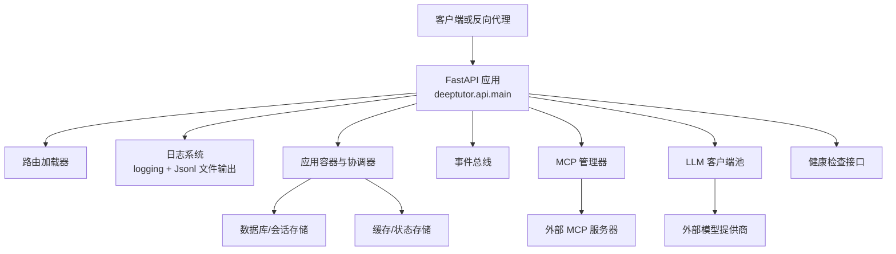
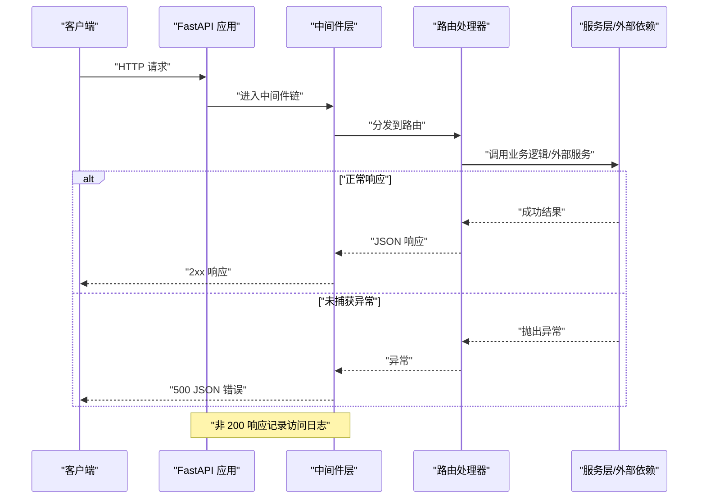

# 故障排除指南

<cite>
**本文引用的文件**   
- [main.py](file://deeptutor/api/main.py)
- [configure.py](file://deeptutor/logging/configure.py)
- [memory_probe.py](file://deeptutor/runtime/memory_probe.py)
- [system.py](file://deeptutor/api/routers/system.py)
- [mcp_settings.py](file://deeptutor/api/routers/mcp_settings.py)
- [manager.py](file://deeptutor/services/mcp/manager.py)
- [config.py](file://deeptutor/services/mcp/config.py)
- [sqlite_store.py](file://deeptutor/services/session/sqlite_store.py)
- [question.py](file://deeptutor/api/routers/question.py)
</cite>

## 目录
1. [引言](#引言)
2. [项目结构与部署边界](#项目结构与部署边界)
3. [核心组件与运行期依赖](#核心组件与运行期依赖)
4. [架构总览与请求生命周期](#架构总览与请求生命周期)
5. [常见部署问题与排查步骤](#常见部署问题与排查步骤)
6. [日志分析方法与错误信息解读](#日志分析方法与错误信息解读)
7. [数据库、缓存与外部服务故障处理](#数据库缓存与外部服务故障处理)
8. [性能瓶颈、内存泄漏与进程崩溃](#性能瓶颈内存泄漏与进程崩溃)
9. [健康检查与自动化监控](#健康检查与自动化监控)
10. [运维排障清单与最佳实践](#运维排障清单与最佳实践)
11. [结论](#结论)

## 引言
本指南面向 DeepTutor 的运维人员，聚焦部署阶段的故障定位与恢复。内容覆盖环境配置错误、依赖冲突、端口占用、服务启动失败、日志分析、错误信息解读、性能瓶颈定位、数据库连接异常、缓存服务异常、外部 API 调用失败、资源不足、内存泄漏和进程崩溃等场景。文档同时给出可操作的健康检查接口、诊断流程和安全注意事项，帮助快速恢复服务并降低重复故障概率。

## 项目结构与部署边界
DeepTutor 后端以 FastAPI 应用为核心入口，负责：
- 初始化运行时设置与日志系统
- 加载路由、模块、后台任务、事件总线、MCP 管理器等依赖
- 提供健康检查、CORS、访问日志、统一错误边界
- 在启动阶段校验工具注册一致性、迁移数据、探测 PocketBase 等外部依赖

**图示来源**
- [main.py:108-359](file://deeptutor/api/main.py#L108-L359)
- [main.py:364-541](file://deeptutor/api/main.py#L364-L541)

**章节来源**
- [main.py:1-25](file://deeptutor/api/main.py#L1-L25)
- [main.py:108-359](file://deeptutor/api/main.py#L108-L359)
- [main.py:364-541](file://deeptutor/api/main.py#L364-L541)

## 核心组件与运行期依赖
- 应用入口与生命周期：FastAPI lifespan 负责启动时初始化容器、事件总线、后台任务、MCP、LLM 客户端；关闭时释放连接池、停止事件总线、关闭 MCP 连接。
- 日志系统：支持控制台与 JSONL 文件输出，按大小轮转，包含上下文过滤与 Loguru 桥接。
- 健康检查：`/health/live` 表示进程存活，`/health/ready` 表示应用就绪且协调器可用。
- 外部依赖：PocketBase、LLM 提供商、MCP 服务器、搜索服务等。
- 安全与 CORS：根据认证开关动态调整跨域策略，避免反向代理下的协议降级。

**章节来源**
- [main.py:108-359](file://deeptutor/api/main.py#L108-L359)
- [main.py:364-541](file://deeptutor/api/main.py#L364-L541)
- [configure.py:40-86](file://deeptutor/logging/configure.py#L40-L86)

## 架构总览与请求生命周期
以下序列图展示一次典型 HTTP 请求从进入 FastAPI 到返回响应的关键路径，包括错误边界、访问日志、CORS 中间件以及健康检查。

**图示来源**
- [main.py:392-420](file://deeptutor/api/main.py#L392-L420)
- [main.py:452-475](file://deeptutor/api/main.py#L452-L475)

**章节来源**
- [main.py:392-420](file://deeptutor/api/main.py#L392-L420)
- [main.py:452-475](file://deeptutor/api/main.py#L452-L475)

## 常见部署问题与排查步骤

### 环境配置错误
常见问题：
- 能力工具引用未在运行时工具注册表中注册，导致启动时报配置漂移错误。
- 前端端口、CORS 源、认证开关配置不一致，导致跨域或登录回调失败。
- 用户目录初始化失败，导致静态资源或输出路径不可写。

诊断步骤：
1. 查看启动日志中是否出现“配置漂移”相关错误，确认能力清单中的工具名称与实际注册一致。
2. 检查 `frontend_port`、`cors_origin(s)`、认证开关是否正确，尤其是 Docker 或反向代理部署场景。
3. 确认用户目录存在且可写，若初始化失败会回退创建主目录。

解决建议：
- 修正能力清单中的工具名或补充缺失的工具注册。
- 明确配置 CORS 允许的来源，启用认证后需显式配置跨域白名单。
- 确保运行用户对输出目录有写入权限。

**章节来源**
- [main.py:40-74](file://deeptutor/api/main.py#L40-L74)
- [main.py:77-105](file://deeptutor/api/main.py#L77-L105)
- [main.py:494-503](file://deeptutor/api/main.py#L494-L503)

### 依赖冲突
常见问题：
- 能力清单引用了未注册的工具，引发启动失败。
- 第三方库版本不兼容，导致导入或运行时行为异常。

诊断步骤：
1. 启动时观察工具一致性校验是否抛出运行时异常。
2. 检查依赖安装脚本与 requirements 文件，确认必要包已安装。
3. 使用最小化环境复现，逐步添加依赖定位冲突。

解决建议：
- 清理能力清单中的无效工具引用。
- 固定依赖版本，使用虚拟环境隔离部署。
- 对可选依赖（如 psutil）采用懒加载，避免硬依赖导致启动失败。

**章节来源**
- [main.py:47-74](file://deeptutor/api/main.py#L47-L74)
- [memory_probe.py:82-88](file://deeptutor/runtime/memory_probe.py#L82-L88)

### 端口占用与服务启动失败
常见问题：
- Uvicorn 或 FastAPI 无法绑定端口，提示端口被占用。
- 反向代理转发规则不正确，导致 HTTPS 降级为 HTTP。

诊断步骤：
1. 检查系统端口占用情况，确认目标端口未被其他进程监听。
2. 检查反向代理配置，确保不触发 FastAPI 的自动重定向。
3. 查看应用日志中是否有启动失败或中间件加载异常。

解决建议：
- 释放被占用的端口或更换端口。
- 禁用 FastAPI 的尾斜杠重定向，避免 HTTPS 降级。
- 在反向代理中正确透传协议与 Host 头。

**章节来源**
- [main.py:364-373](file://deeptutor/api/main.py#L364-L373)

### 启动阶段外部服务不可用
常见问题：
- PocketBase 启动检查失败，但服务仍可继续启动。
- LLM 客户端初始化失败，仅记录警告，不影响基础功能。
- 事件总线启动失败，仅记录警告。

诊断步骤：
1. 查看启动日志中的警告信息，确认具体是哪个外部服务不可达。
2. 检查网络连通性与凭据配置。
3. 对于 PocketBase，确认其服务地址与端口可达。

解决建议：
- 修复外部服务的网络或凭据配置。
- 若外部服务暂时不可用，可在重启前等待其恢复。
- 对关键依赖增加重试与超时控制。

**章节来源**
- [main.py:170-187](file://deeptutor/api/main.py#L170-L187)
- [main.py:272-278](file://deeptutor/api/main.py#L272-L278)

## 日志分析方法与错误信息解读

### 日志配置与输出位置
- 控制台输出：由标准库 logging 驱动，默认级别受配置影响。
- 文件输出：JSONL 格式，默认位于 `data/user/logs/deeptutor.jsonl`，支持按大小轮转与备份数量限制。
- 访问日志：仅记录非 200 响应，便于快速定位异常请求。
- Loguru 桥接：将 Loguru 日志桥接到标准库 logger，便于统一收集。

诊断步骤：
1. 确认日志目录存在且可写。
2. 查看控制台输出与 JSONL 文件，关注 ERROR、WARNING 级别日志。
3. 对高频访问路径，结合访问日志分析异常请求来源。

优化建议：
- 生产环境建议开启文件输出，并配置合理的轮转策略。
- 对敏感信息做脱敏处理，避免泄露凭据。
- 使用结构化日志（JSONL）便于集中采集与分析。

**章节来源**
- [configure.py:40-86](file://deeptutor/logging/configure.py#L40-L86)
- [main.py:429-449](file://deeptutor/api/main.py#L429-L449)

### 错误边界与统一错误响应
- 所有未捕获异常会被中间件捕获，返回统一的 JSON 错误体，避免浏览器看到纯文本 500。
- 访问日志只记录非 200 响应，减少噪音。
- 特定异常类型（如权限错误、模块不可用）会返回更精确的状态码与详情。

诊断步骤：
1. 查看 JSON 错误体中的 `type` 与 `detail` 字段，定位异常类型与消息。
2. 结合堆栈日志分析异常发生位置。
3. 对频繁出现的错误进行分类，区分配置错误、外部依赖失败与内部逻辑错误。

**章节来源**
- [main.py:392-420](file://deeptutor/api/main.py#L392-L420)
- [main.py:452-475](file://deeptutor/api/main.py#L452-L475)

### 业务路由中的详细错误日志
部分路由会在异常分支中记录详细上下文，例如题目生成失败时记录结果类型与键值，便于定位数据结构问题。

诊断步骤：
1. 搜索日志中的业务关键字，如“Question generation error”。
2. 查看附加上下文，确认输入参数与中间结果。
3. 对反复出现的错误，补充单元测试或输入校验。

**章节来源**
- [question.py:525-544](file://deeptutor/api/routers/question.py#L525-L544)

## 数据库、缓存与外部服务故障处理

### 数据库连接问题
常见问题：
- 会话存储初始化失败，导致聊天历史、笔记条目等数据无法读写。
- SQLite 文件权限不足或路径不存在。

诊断步骤：
1. 检查数据库文件路径是否存在且可写。
2. 查看启动日志中是否有数据库连接或建表失败的错误。
3. 对高并发场景，评估 SQLite 的锁竞争与性能瓶颈。

解决建议：
- 确保运行用户对数据库目录有读写权限。
- 对高负载场景考虑迁移到更合适的持久化后端。
- 定期备份数据库文件，防止数据丢失。

**章节来源**
- [sqlite_store.py:398-417](file://deeptutor/services/session/sqlite_store.py#L398-L417)

### 缓存服务异常
常见问题：
- MCP 服务器配置解析失败，导致工具列表不完整。
- 外部 MCP 服务器连接失败，工具始终显示“未连接”。

诊断步骤：
1. 检查 MCP 配置文件是否存在且格式正确。
2. 使用测试接口验证 MCP 服务器的连通性。
3. 查看 MCP 管理器日志，确认连接状态与重试行为。

解决建议：
- 修正 MCP 服务器名称与 URL，确保符合命名规范。
- 对临时不可用的服务器，等待自动重试或手动重载配置。
- 对敏感凭据，确保存储在安全的秘密文件中。

**章节来源**
- [config.py:101-132](file://deeptutor/services/mcp/config.py#L101-L132)
- [mcp_settings.py:121-133](file://deeptutor/api/routers/mcp_settings.py#L121-L133)
- [manager.py:336-387](file://deeptutor/services/mcp/manager.py#L336-L387)

### 外部 API 调用失败
常见问题：
- LLM 提供商调用失败，仅记录警告，不影响基础功能。
- 搜索服务缺少凭据或被标记为弃用。
- PocketBase 启动检查失败，但服务仍可继续启动。

诊断步骤：
1. 查看启动日志中的警告信息，确认具体外部服务。
2. 检查凭据配置与网络连通性。
3. 对搜索服务，确认 provider 是否仍受支持。

解决建议：
- 更新凭据或切换到受支持的 provider。
- 对外部服务增加重试与熔断机制。
- 对关键依赖进行健康检查与告警。

**章节来源**
- [main.py:170-187](file://deeptutor/api/main.py#L170-L187)
- [system.py:370-381](file://deeptutor/api/routers/system.py#L370-L381)
- [main.py:272-278](file://deeptutor/api/main.py#L272-L278)

## 性能瓶颈、内存泄漏与进程崩溃

### 内存快照与资源监控
DeepTutor 提供进程树内存快照能力，支持：
- 通过 psutil 或 /proc 扫描子进程 RSS。
- 读取 cgroup v1/v2 限制与当前使用量。
- 分类进程角色（backend、web、pocketbase、sandbox 等）。
- 报告总量、限制来源、可用内存与是否部分扫描。

诊断步骤：
1. 调用内存快照接口，查看各进程内存占用。
2. 对比 cgroup 限制与宿主内存，判断是否接近上限。
3. 对异常增长的进程，结合日志定位热点路径。

优化建议：
- 合理设置容器内存限制，避免 OOM。
- 对长任务使用异步与流式处理，减少峰值内存。
- 定期清理临时文件与缓存。

**章节来源**
- [memory_probe.py:1-23](file://deeptutor/runtime/memory_probe.py#L1-L23)
- [memory_probe.py:311-343](file://deeptutor/runtime/memory_probe.py#L311-L343)

### 进程崩溃与资源回收
常见问题：
- 子进程或沙箱进程未正确关闭，导致资源泄漏。
- LLM 客户端连接池未释放，导致连接数增长。
- MCP 连接未关闭，stdio 服务器可能泄漏子进程。

诊断步骤：
1. 检查应用关闭日志，确认后台任务、容器、MCP、LLM 池是否正常关闭。
2. 使用进程树工具观察是否有孤儿进程。
3. 对频繁崩溃的场景，收集 core dump 与堆栈信息。

解决建议：
- 确保在应用关闭钩子中释放所有外部连接。
- 对长时间运行的任务，增加超时与取消机制。
- 对关键资源使用上下文管理器或显式 close。

**章节来源**
- [main.py:303-359](file://deeptutor/api/main.py#L303-L359)

## 健康检查与自动化监控

### 健康检查接口
- `/health/live`：返回进程存活状态。
- `/health/ready`：返回应用就绪状态，若协调器不可用则返回 503。
- 其他模块健康接口：如书籍、笔记本等模块提供自身健康检查。

监控建议：
- 使用 `/health/live` 检测进程存活。
- 使用 `/health/ready` 检测服务可用性。
- 对关键模块增加独立健康检查，便于快速定位故障范围。

**章节来源**
- [main.py:520-541](file://deeptutor/api/main.py#L520-L541)

### 自动化监控配置
- 定期调用健康检查接口，记录响应时间与状态码。
- 对非 200 响应触发告警，并结合访问日志分析原因。
- 对内存快照接口进行周期性采样，观察趋势变化。
- 对外部依赖（PocketBase、LLM、MCP）增加连通性检查与重试。

**章节来源**
- [main.py:452-475](file://deeptutor/api/main.py#L452-L475)
- [memory_probe.py:311-343](file://deeptutor/runtime/memory_probe.py#L311-L343)

## 运维排障清单与最佳实践

### 排障清单
- 启动阶段：
  - 检查工具一致性校验是否通过。
  - 确认用户目录初始化成功。
  - 查看外部服务（PocketBase、LLM、EventBus）初始化日志。
- 运行阶段：
  - 监控 `/health/live` 与 `/health/ready`。
  - 关注非 200 访问日志。
  - 定期检查 JSONL 日志中的 ERROR 与 WARNING。
- 外部依赖：
  - 验证 MCP 配置与连通性。
  - 检查 LLM 提供商凭据与配额。
  - 确认搜索服务 provider 受支持。
- 资源与性能：
  - 使用内存快照观察进程树占用。
  - 对比 cgroup 限制与宿主内存。
  - 对长任务增加超时与取消。

### 最佳实践
- 使用结构化日志（JSONL）集中采集与分析。
- 对关键依赖增加健康检查与告警。
- 固定依赖版本，使用虚拟环境隔离部署。
- 对敏感信息做脱敏处理，避免泄露凭据。
- 对高并发场景评估数据库与缓存的性能瓶颈。

## 结论
DeepTutor 的部署排障应围绕应用生命周期、日志系统、健康检查与外部依赖展开。通过标准化的健康检查接口、结构化日志与内存快照能力，运维人员可以快速定位环境配置、依赖冲突、端口占用、外部服务不可用、数据库连接异常、缓存服务异常、外部 API 调用失败、资源不足、内存泄漏与进程崩溃等问题。建议在生产环境中启用文件日志、配置合理的轮转策略、建立自动化监控与告警机制，并对关键依赖进行连通性检查与重试，从而提升系统的稳定性与可观测性。