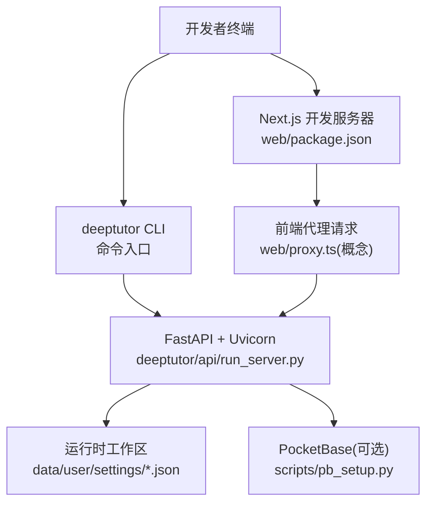
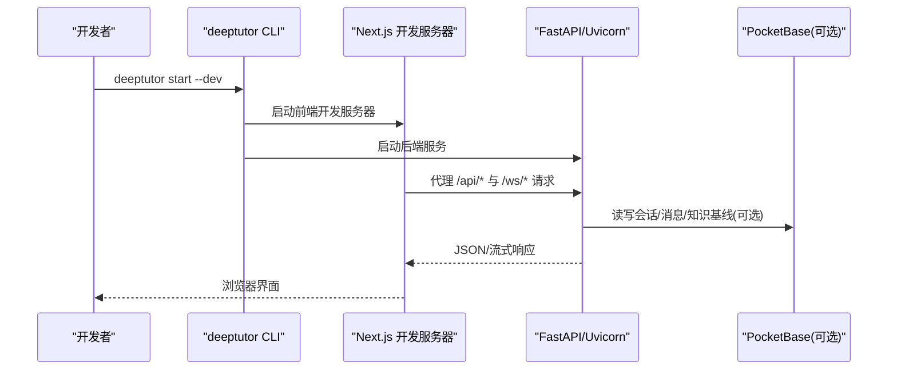
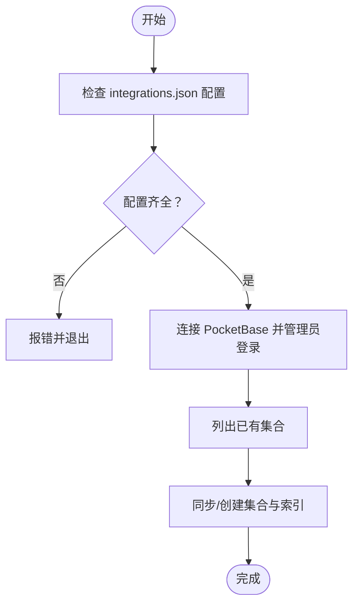
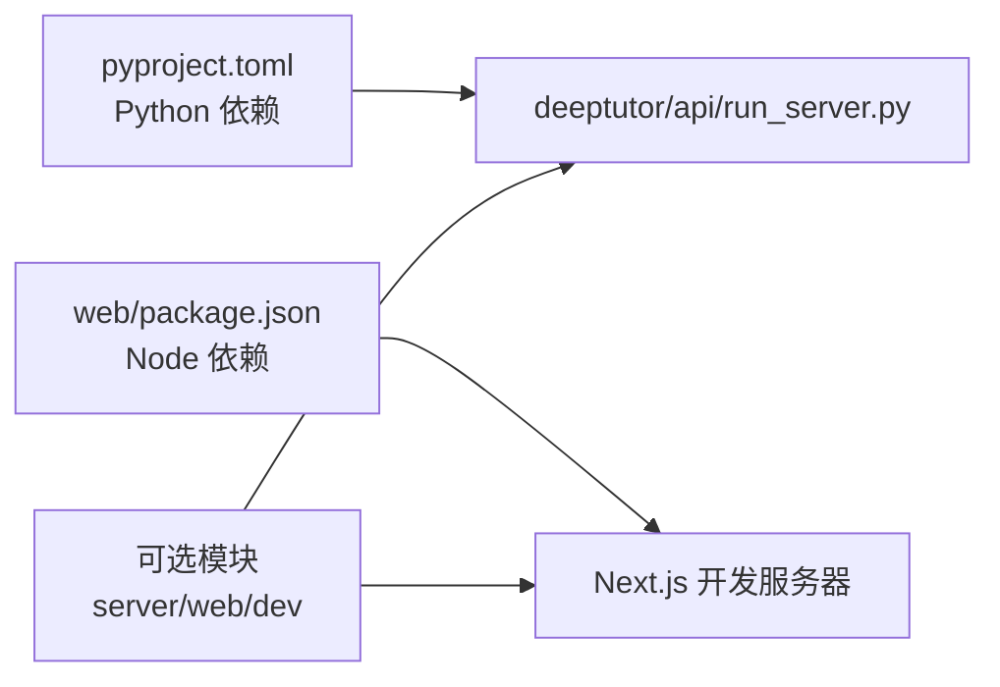

# 本地开发环境

<cite>
**本文引用的文件**   
- [pyproject.toml](file://pyproject.toml)
- [requirements.txt](file://requirements.txt)
- [deeptutor/api/run_server.py](file://deeptutor/api/run_server.py)
- [web/package.json](file://web/package.json)
- [scripts/start_web.py](file://scripts/start_web.py)
- [deeptutor_cli/main.py](file://deeptutor_cli/main.py)
- [deeptutor/runtime/home.py](file://deeptutor/runtime/home.py)
- [scripts/pb_setup.py](file://scripts/pb_setup.py)
- [compose.yaml](file://compose.yaml)
</cite>

## 目录
1. [简介](#简介)
2. [项目结构](#项目结构)
3. [核心组件](#核心组件)
4. [架构总览](#架构总览)
5. [详细组件分析](#详细组件分析)
6. [依赖关系分析](#依赖关系分析)
7. [性能与调试](#性能与调试)
8. [故障排查指南](#故障排查指南)
9. [结论](#结论)
10. [附录：环境变量清单](#附录环境变量清单)

## 简介
本指南面向希望在本地快速搭建 DeepTutor 开发环境的开发者，覆盖 Python 与 Node.js 环境准备、后端服务启动、前端开发服务器运行、数据库初始化、环境变量配置、调试技巧与常见问题排查。目标是让你在最短的时间内完成从代码克隆到功能测试的全流程。

## 项目结构
DeepTutor 采用前后端分离的仓库组织方式：
- Python 后端位于 deeptutor 包，API 入口由 FastAPI + Uvicorn 提供，CLI 入口为 deeptutor_cli。
- 前端基于 Next.js，位于 web 目录，通过 npm scripts 管理开发与构建。
- 运行时工作区（用户数据、设置、日志等）默认位于当前目录下的 data 树；可通过环境变量或 CLI 参数指定。
- 可选的外部存储/认证侧车 PocketBase 可通过 compose 启动并初始化集合。

**图表来源**
- [web/package.json:5-34](file://web/package.json#L5-L34)
- [deeptutor/api/run_server.py:30-95](file://deeptutor/api/run_server.py#L30-L95)
- [scripts/pb_setup.py:1-13](file://scripts/pb_setup.py#L1-L13)
- [deeptutor/runtime/home.py:28-43](file://deeptutor/runtime/home.py#L28-L43)

**章节来源**
- [pyproject.toml:8-47](file://pyproject.toml#L8-L47)
- [web/package.json:1-35](file://web/package.json#L1-L35)
- [deeptutor/api/run_server.py:1-100](file://deeptutor/api/run_server.py#L1-L100)
- [scripts/pb_setup.py:1-13](file://scripts/pb_setup.py#L1-L13)
- [deeptutor/runtime/home.py:1-59](file://deeptutor/runtime/home.py#L1-L59)

## 核心组件
- Python 后端
  - API 应用与启动脚本：FastAPI 应用由 Uvicorn 启动，支持开发热重载与多 worker 模式。
  - CLI 命令：统一入口 deeptutor，支持 start、serve、stop 等命令，自动拉起后端与前端。
- 前端
  - Next.js 开发服务器：npm run dev 启动，支持 Turbopack 加速。
- 运行时工作区
  - 通过 DEEPTUTOR_HOME 或命令行参数指定，默认使用当前目录作为根。
- 可选外部存储
  - PocketBase：用于会话、消息、知识基线等数据的持久化，提供初始化脚本。

**章节来源**
- [deeptutor_cli/main.py:123-149](file://deeptutor_cli/main.py#L123-L149)
- [deeptutor_cli/main.py:163-223](file://deeptutor_cli/main.py#L163-L223)
- [deeptutor/api/run_server.py:30-95](file://deeptutor/api/run_server.py#L30-L95)
- [web/package.json:5-34](file://web/package.json#L5-L34)
- [deeptutor/runtime/home.py:28-43](file://deeptutor/runtime/home.py#L28-L43)
- [scripts/pb_setup.py:1-13](file://scripts/pb_setup.py#L1-L13)

## 架构总览
下图展示本地开发时各组件的交互关系：开发者通过 CLI 或脚本启动后端与前端，前端通过代理访问后端 API，可选地连接 PocketBase 进行数据持久化。

**图表来源**
- [deeptutor_cli/main.py:123-149](file://deeptutor_cli/main.py#L123-L149)
- [web/package.json:5-34](file://web/package.json#L5-L34)
- [deeptutor/api/run_server.py:30-95](file://deeptutor/api/run_server.py#L30-L95)
- [scripts/pb_setup.py:141-298](file://scripts/pb_setup.py#L141-L298)

## 详细组件分析

### Python 环境与依赖安装
- Python 版本要求：>=3.11,<3.15。
- 推荐在虚拟环境中安装依赖，避免污染系统环境。
- 基础依赖定义在 pyproject.toml 中；完整 profile 通过 requirements.txt 引用 requirements/full.txt。
- 可选模块通过 pyproject.toml 的 optional-dependencies 分组安装，例如 server、web、dev 等。

建议步骤
1. 创建并激活虚拟环境。
2. 安装基础依赖：pip install -r requirements.txt。
3. 如需开发后端与前端能力，安装可选组：pip install -e ".[server,web,dev]"。
4. 若需要 PocketBase 客户端工具，按需安装 pocketbase 包。

**章节来源**
- [pyproject.toml:8-16](file://pyproject.toml#L8-L16)
- [pyproject.toml:52-94](file://pyproject.toml#L52-L94)
- [requirements.txt:1-3](file://requirements.txt#L1-L3)

### Node.js 环境与前端依赖
- 前端基于 Next.js，使用 npm scripts 管理开发、构建与测试。
- 开发命令：npm run dev；TurboPack 加速：npm run dev:turbo。
- 构建命令：npm run build；类型检查：npm run typecheck。
- 单元测试：npm run test:unit；端到端测试：npm run test:e2e:*。

建议步骤
1. 安装 Node.js（建议使用 LTS）。
2. 进入 web 目录，执行 npm ci 或 npm install。
3. 启动开发服务器：npm run dev。

**章节来源**
- [web/package.json:5-34](file://web/package.json#L5-L34)
- [web/package.json:36-96](file://web/package.json#L36-L96)

### 后端服务启动
- 通过 CLI 启动后端：deeptutor serve。
- 通过模块入口启动：python -m deeptutor.api.run_server。
- 开发模式热重载：设置环境变量 DEEPTUTOR_DEV_RELOAD=1 后重启后端，或使用 deeptutor serve --reload。
- 端口与工作进程数：端口由 get_backend_port() 读取系统设置；workers 由 system.json 中的 backend_workers 控制。

注意事项
- Windows 平台会自动切换到 ProactorEventLoop 以支持子进程调用。
- 开发模式下 reload 与多 worker 互斥，需将 backend_workers 设为 1。

**章节来源**
- [deeptutor_cli/main.py:163-223](file://deeptutor_cli/main.py#L163-L223)
- [deeptutor/api/run_server.py:14-27](file://deeptutor/api/run_server.py#L14-L27)
- [deeptutor/api/run_server.py:30-95](file://deeptutor/api/run_server.py#L30-L95)

### 前端开发服务器运行
- 直接运行：cd web && npm run dev。
- TurboPack 加速：cd web && npm run dev:turbo。
- 生产构建：cd web && npm run build。
- 前端通过代理转发 /api/* 与 /ws/* 到后端（具体代理逻辑见 web/proxy.ts，概念性说明）。

**章节来源**
- [web/package.json:5-34](file://web/package.json#L5-L34)

### 运行时工作区与环境变量
- 运行时根目录优先级：显式 home 参数 > DEEPTUTOR_HOME 环境变量 > 当前工作目录。
- 数据目录结构：<runtime-home>/data，包含 user/settings、user/workspace、system、logs 等。
- 容器化部署时，可通过 DEEPTUTOR_WORKSPACE_ROOT 与 DEEPTUTOR_WORKSPACE_ALLOWED_ROOTS 限制可写路径。

建议
- 本地开发建议在仓库根目录运行，使 data 树位于仓库同级，便于备份与清理。
- 如需隔离不同环境，设置 DEEPTUTOR_HOME=/path/to/workspace。

**章节来源**
- [deeptutor/runtime/home.py:8-43](file://deeptutor/runtime/home.py#L8-L43)
- [compose.yaml:174-182](file://compose.yaml#L174-L182)

### 数据库初始化（PocketBase）
- 首次启动 PocketBase 后，运行 python scripts/pb_setup.py 初始化集合（sessions、messages、turns、turn_events、knowledge_bases）。
- 需要在 data/user/settings/integrations.json 中配置 pocketbase_url、pocketbase_admin_email、pocketbase_admin_password。
- 该脚本幂等：重复运行会增量同步字段与索引，不会破坏已有数据。

**图表来源**
- [scripts/pb_setup.py:141-298](file://scripts/pb_setup.py#L141-L298)

**章节来源**
- [scripts/pb_setup.py:1-13](file://scripts/pb_setup.py#L1-L13)
- [scripts/pb_setup.py:32-56](file://scripts/pb_setup.py#L32-L56)
- [scripts/pb_setup.py:141-298](file://scripts/pb_setup.py#L141-L298)

### 一键启动后端+前端
- 使用 CLI 的 start 命令：deeptutor start --dev。
- 兼容脚本：python scripts/start_web.py --dev。
- 该命令会确保 server 与 web 模块可用，并调用 launcher.start 同时拉起后端与前端。

**章节来源**
- [deeptutor_cli/main.py:123-149](file://deeptutor_cli/main.py#L123-L149)
- [scripts/start_web.py:17-39](file://scripts/start_web.py#L17-L39)

## 依赖关系分析
- Python 后端依赖 FastAPI、Uvicorn、Pydantic、OpenAI SDK、LLM 相关库等，详见 pyproject.toml。
- 前端依赖 Next.js、React、Tailwind、Mermaid、PDF.js 等，详见 web/package.json。
- 可选集成如 PocketBase 客户端、解析器插件、视频渲染器等通过 optional-dependencies 分组管理。

**图表来源**
- [pyproject.toml:8-47](file://pyproject.toml#L8-L47)
- [web/package.json:36-96](file://web/package.json#L36-L96)
- [deeptutor/api/run_server.py:30-95](file://deeptutor/api/run_server.py#L30-L95)

**章节来源**
- [pyproject.toml:52-94](file://pyproject.toml#L52-L94)
- [web/package.json:36-96](file://web/package.json#L36-L96)

## 性能与调试
- 后端热重载
  - 设置 DEEPTUTOR_DEV_RELOAD=1 后重启后端，或在 CLI 中使用 deeptutor serve --reload。
  - 注意：reload 与 backend_workers > 1 互斥，请将 backend_workers 设为 1。
- 日志查看
  - 后端输出已设置为非缓冲 UTF-8，便于实时查看。
  - 日志文件通常位于 <runtime-home>/data/logs（由运行时工作区决定）。
- 性能分析
  - 前端可使用 npm run perf:check 与 npm run build:perf 进行路由预算检查。
  - 前端单测与 E2E 测试：npm run test:unit、npm run test:e2e:*。
- 调试技巧
  - 使用 VS Code 调试器附加 uvicorn 进程，或在前端启用 React DevTools。
  - 通过浏览器网络面板观察 /api/* 与 /ws/* 的请求与 WebSocket 帧大小。

**章节来源**
- [deeptutor/api/run_server.py:68-95](file://deeptutor/api/run_server.py#L68-L95)
- [web/package.json:19-34](file://web/package.json#L19-L34)

## 故障排查指南
- 端口冲突
  - 现象：后端无法启动或端口被占用。
  - 处理：检查 system.json 中的后端端口配置，或修改 get_backend_port() 返回的端口。
- 热重载无效
  - 现象：修改代码未触发重载。
  - 处理：确认 DEEPTUTOR_DEV_RELOAD=1 且 backend_workers=1；检查 reload_excludes 是否排除了目标目录。
- 前端代理失败
  - 现象：浏览器请求 /api/* 返回 404 或跨域错误。
  - 处理：确认前端开发服务器已启动，且代理规则指向正确的后端地址。
- PocketBase 初始化失败
  - 现象：pb_setup.py 报错缺少配置或连接失败。
  - 处理：检查 integrations.json 中 pocketbase_url、admin_email、admin_password；确认 PocketBase 已启动并可访问。
- 权限问题
  - 现象：写入 data 目录失败。
  - 处理：确保 data 目录属于当前用户；容器化部署时使用 bind mount 并确保 UID 映射正确。

**章节来源**
- [deeptutor/api/run_server.py:49-79](file://deeptutor/api/run_server.py#L49-L79)
- [scripts/pb_setup.py:32-56](file://scripts/pb_setup.py#L32-L56)
- [compose.yaml:164-182](file://compose.yaml#L164-L182)

## 结论
按照本指南完成 Python 与 Node.js 环境准备、依赖安装、后端与前端启动、以及可选的 PocketBase 初始化后，即可在本地进行完整的 DeepTutor 功能测试。结合热重载、日志查看与性能检查工具，可以高效定位问题并优化开发体验。

## 附录：环境变量清单
- DEEPTUTOR_HOME
  - 作用：指定运行时工作区根目录。
  - 优先级高于当前工作目录。
- DEEPTUTOR_DEV_RELOAD
  - 作用：开启后端开发热重载。
  - 值：1/true/yes/on 任一均可。
- DEEPTUTOR_WORKSPACE_ROOT
  - 作用：容器化部署时指定内容工作区根路径。
- DEEPTUTOR_WORKSPACE_ALLOWED_ROOTS
  - 作用：允许的工作区根白名单。
- POCKETBASE_URL / POCKETBASE_EXTERNAL_URL
  - 作用：容器化部署时暴露 PocketBase 的内部与外部 URL。

**章节来源**
- [deeptutor/runtime/home.py:8-43](file://deeptutor/runtime/home.py#L8-L43)
- [deeptutor/api/run_server.py:68-79](file://deeptutor/api/run_server.py#L68-L79)
- [compose.yaml:178-189](file://compose.yaml#L178-L189)