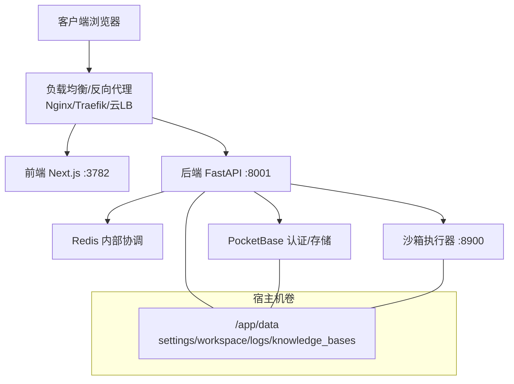
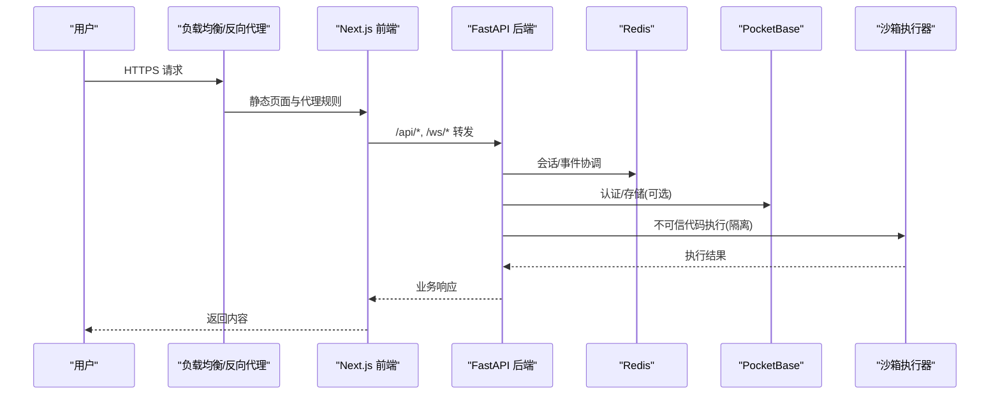
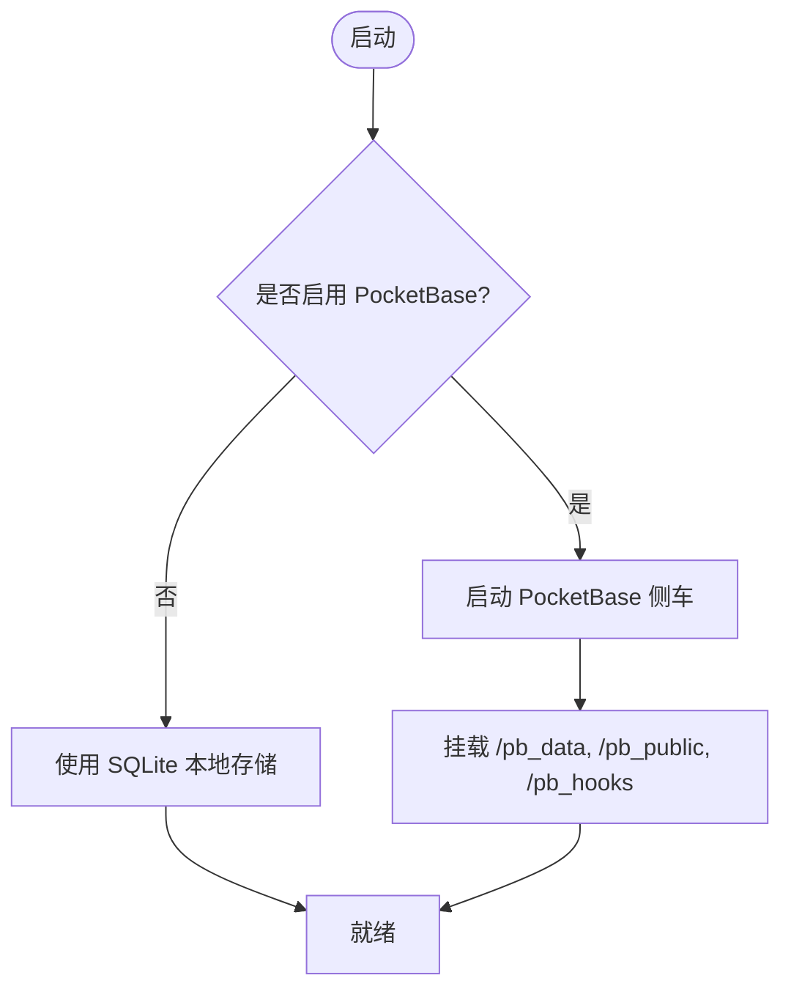
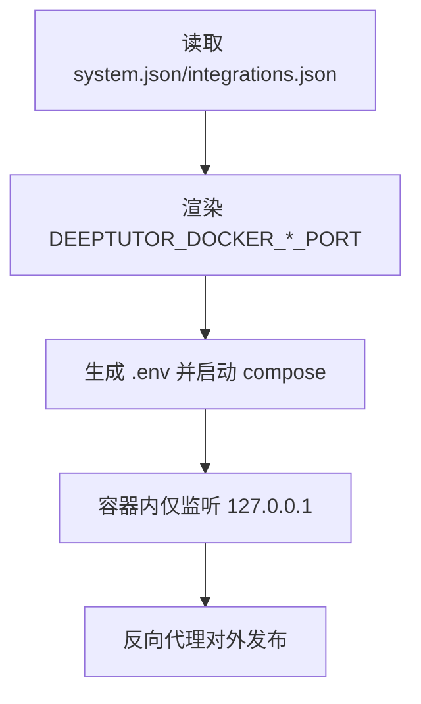
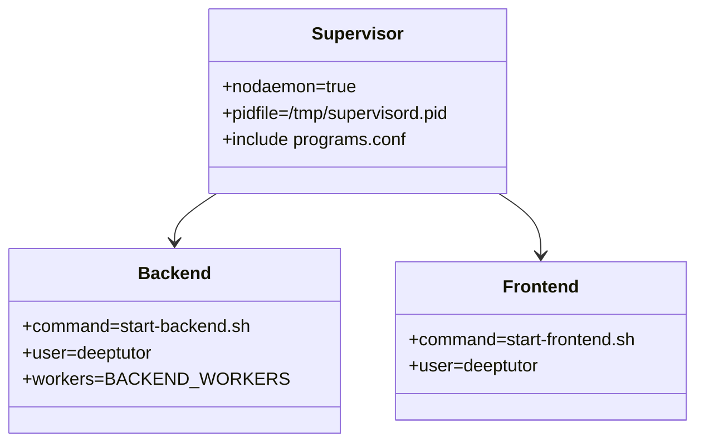
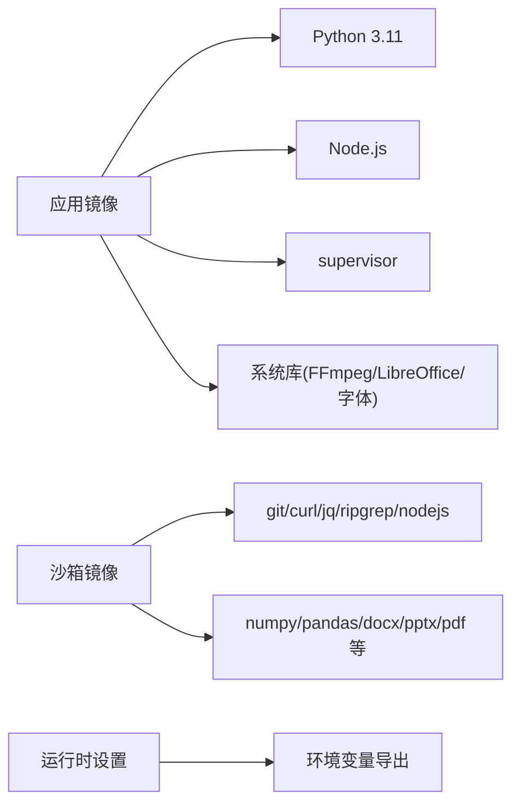
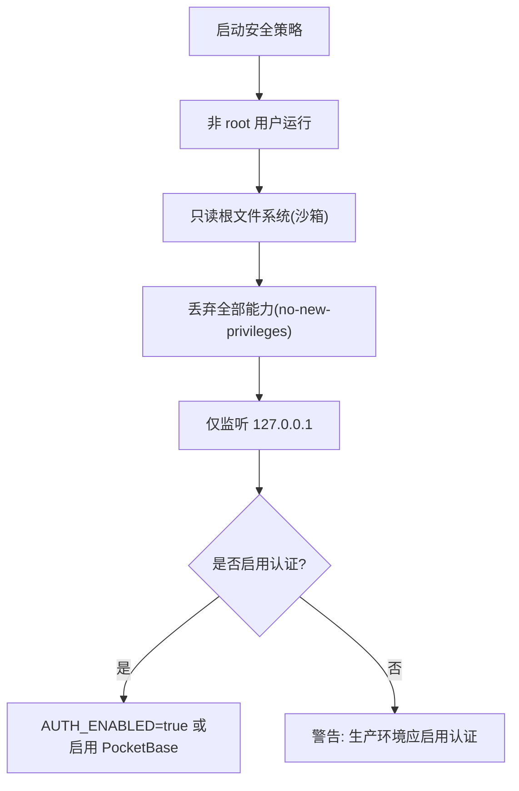

# 生产环境部署

<cite>
**本文引用的文件**   
- [compose.yaml](file://compose.yaml)
- [docker-compose.yml](file://docker-compose.yml)
- [Dockerfile](file://Dockerfile)
- [Dockerfile.runner](file://Dockerfile.runner)
- [scripts/docker_compose.py](file://scripts/docker_compose.py)
- [deeptutor/services/config/runtime_settings.py](file://deeptutor/services/config/runtime_settings.py)
- [deeptutor/api/routers/auth.py](file://deeptutor/api/routers/auth.py)
</cite>

## 目录
1. [简介](#简介)
2. [项目结构](#项目结构)
3. [核心组件](#核心组件)
4. [架构总览](#架构总览)
5. [详细组件分析](#详细组件分析)
6. [依赖关系分析](#依赖关系分析)
7. [性能与容量规划](#性能与容量规划)
8. [安全加固与访问控制](#安全加固与访问控制)
9. [备份、恢复与灾难恢复](#备份恢复与灾难恢复)
10. [监控与告警](#监控与告警)
11. [故障排查指南](#故障排查指南)
12. [结论](#结论)

## 简介
本指南面向 DeepTutor 的生产环境部署，覆盖系统要求、硬件配置、网络架构、数据库与缓存集成、外部依赖服务、负载均衡与反向代理、SSL 证书、性能调优、内存与进程池、安全加固、备份恢复、灾难恢复以及监控告警。文档基于仓库中的容器编排与镜像构建定义，结合运行时设置加载机制，给出可落地的生产实践建议。

## 项目结构
DeepTutor 生产部署以容器为核心：
- 应用镜像包含 FastAPI 后端与 Next.js 前端，由 supervisord 管理进程。
- 可选 PocketBase 作为认证与存储侧车。
- Redis 用于内部事件/会话协调状态。
- 沙箱执行器（sandbox-runner）隔离不可信代码执行。
- 所有持久化数据统一挂载到宿主目录，便于备份与迁移。

**图示来源**
- [compose.yaml:67-224](file://compose.yaml#L67-L224)
- [docker-compose.yml:26-217](file://docker-compose.yml#L26-L217)
- [Dockerfile:237-278](file://Dockerfile#L237-L278)

**章节来源**
- [compose.yaml:1-63](file://compose.yaml#L1-L63)
- [docker-compose.yml:1-25](file://docker-compose.yml#L1-L25)
- [Dockerfile:103-128](file://Dockerfile#L103-L128)

## 核心组件
- 应用镜像（backend + frontend）
  - 通过 supervisord 启动后端与前端两个子进程，均以非 root 用户运行。
  - 入口脚本从 data/user/settings/*.json 加载运行时配置并导出环境变量。
- 缓存与协调服务
  - Redis 启用 AOF 持久化，提供内部事件流与会话协调能力。
- 认证与存储
  - 可选 PocketBase；未启用时回退至 SQLite（单用户/邀请模式）。
- 沙箱执行器
  - 最小化镜像，仅暴露 HTTP 接口，限制文件系统与资源上限。
- 编排与端口渲染
  - docker-compose.yml 通过脚本将 system.json/integrations.json 的端口渲染为 Compose 变量。

**章节来源**
- [Dockerfile:237-278](file://Dockerfile#L237-L278)
- [Dockerfile:282-335](file://Dockerfile#L282-L335)
- [Dockerfile:337-521](file://Dockerfile#L337-L521)
- [compose.yaml:67-224](file://compose.yaml#L67-L224)
- [docker-compose.yml:26-217](file://docker-compose.yml#L26-L217)
- [scripts/docker_compose.py:45-77](file://scripts/docker_compose.py#L45-L77)

## 架构总览
生产环境推荐拓扑：
- 外部流量经负载均衡/反向代理进入，统一处理 TLS、限流、鉴权转发。
- 前端静态资源与代理规则由 Next.js standalone 提供，同时代理 /api/* 与 /ws/* 到后端。
- 后端连接 Redis、PocketBase 与沙箱执行器。
- 所有数据落盘于宿主目录，集中备份。

**图示来源**
- [compose.yaml:129-206](file://compose.yaml#L129-L206)
- [docker-compose.yml:74-142](file://docker-compose.yml#L74-L142)
- [Dockerfile:282-335](file://Dockerfile#L282-L335)

## 详细组件分析

### 系统与硬件要求
- 操作系统
  - Linux 发行版（支持 cgroup v2），或 Podman 5.x 无根运行环境。
- 容器运行时
  - Docker 或 Podman（rootless keep-id）。
- CPU/内存/磁盘
  - 根据并发与模型调用规模规划；建议至少 4C/8G 起步，SSD 存储。
  - 沙箱执行器默认限制 1G 内存与 256 PID，避免失控。
- 网络
  - 仅监听回环地址（127.0.0.1）在容器内暴露，再由反向代理对外发布。

**章节来源**
- [compose.yaml:1-63](file://compose.yaml#L1-L63)
- [docker-compose.yml:144-209](file://docker-compose.yml#L144-L209)

### 数据库与缓存
- 缓存
  - Redis 7.4-alpine，启用 AOF 与每秒 fsync，保证命令流不丢失。
  - 健康检查使用 redis-cli ping。
- 数据库
  - 未启用 PocketBase 时，使用 SQLite（单用户/邀请模式）。
  - 启用 PocketBase 后，作为认证与存储侧车，数据目录挂载到宿主。

**图示来源**
- [compose.yaml:85-127](file://compose.yaml#L85-L127)
- [docker-compose.yml:45-73](file://docker-compose.yml#L45-L73)

**章节来源**
- [compose.yaml:67-127](file://compose.yaml#L67-L127)
- [docker-compose.yml:26-73](file://docker-compose.yml#L26-L73)

### 外部依赖服务
- PocketBase
  - 通过 integrations.pocketbase_url 激活；端口可通过 integrations.json 渲染。
- 本地 LLM 服务
  - 在 model_catalog.json 中配置 base_url；Podman 下建议使用 host.containers.internal。
- 沙箱执行器
  - 通过 DEEPTUTOR_SANDBOX_RUNNER_URL 指向内部地址，不对外暴露。

**章节来源**
- [compose.yaml:178-189](file://compose.yaml#L178-L189)
- [docker-compose.yml:100-118](file://docker-compose.yml#L100-L118)
- [docker-compose.yml:144-209](file://docker-compose.yml#L144-L209)

### 负载均衡与反向代理
- 端口映射
  - 后端 :8001，前端 :3782，均绑定 127.0.0.1，仅本机可达。
- 代理建议
  - 使用 Nginx/Traefik/云厂商 LB 统一终止 TLS，并将 /api/* 与 /ws/* 转发到后端。
  - 对静态资源与前端路由进行缓存与压缩。
- 端口渲染
  - 使用 scripts/docker_compose.py 从 system.json/integrations.json 渲染 Compose 环境变量，避免硬编码。

**图示来源**
- [scripts/docker_compose.py:45-77](file://scripts/docker_compose.py#L45-L77)
- [compose.yaml:161-163](file://compose.yaml#L161-L163)
- [docker-compose.yml:84-87](file://docker-compose.yml#L84-L87)

**章节来源**
- [scripts/docker_compose.py:45-77](file://scripts/docker_compose.py#L45-L77)
- [compose.yaml:161-163](file://compose.yaml#L161-L163)
- [docker-compose.yml:84-87](file://docker-compose.yml#L84-L87)

### SSL 证书配置
- 建议在反向代理层终止 TLS，集中管理证书与域名。
- 如需禁用后端自签名校验，可在运行时设置中关闭 SSL 验证开关（谨慎使用）。

**章节来源**
- [Dockerfile:337-376](file://Dockerfile#L337-L376)

### 进程管理与多工作进程
- supervisord 管理 backend/frontend 两个子进程，自动重启。
- 后端 uvicorn 工作进程数由 BACKEND_WORKERS 控制，默认 1；可按 CPU 核数与负载调整。
- 前端 Node 进程独立运行，无需额外进程池。

**图示来源**
- [Dockerfile:237-278](file://Dockerfile#L237-L278)
- [Dockerfile:282-335](file://Dockerfile#L282-L335)

**章节来源**
- [Dockerfile:237-278](file://Dockerfile#L237-L278)
- [Dockerfile:282-335](file://Dockerfile#L282-L335)

## 依赖关系分析
- 应用镜像依赖 Python 3.11、Node.js、supervisor、FFmpeg、LibreOffice 等系统库。
- 沙箱执行器镜像仅包含必要工具链与 Python 包，最小化攻击面。
- 运行时设置通过 runtime_settings.py 加载 JSON 配置，并在入口脚本中导出为环境变量。

**图示来源**
- [Dockerfile:131-159](file://Dockerfile#L131-L159)
- [Dockerfile.runner:21-75](file://Dockerfile.runner#L21-L75)
- [Dockerfile:481-514](file://Dockerfile#L481-L514)

**章节来源**
- [Dockerfile:131-159](file://Dockerfile#L131-L159)
- [Dockerfile.runner:21-75](file://Dockerfile.runner#L21-L75)
- [deeptutor/services/config/runtime_settings.py:539-652](file://deeptutor/services/config/runtime_settings.py#L539-L652)

## 性能与容量规划
- 后端工作进程
  - 根据 CPU 核数与并发设置 BACKEND_WORKERS；大附件场景需提高 ws-max-size。
- 内存管理
  - 已设置 MALLOC_ARENA_MAX 与 MALLOC_TRIM_THRESHOLD_ 优化 jemalloc 行为。
  - 沙箱执行器限制 mem_limit=1g、pids_limit=256，防止资源耗尽。
- 连接与超时
  - uvicorn 的 timeout-keep-alive 与前端代理空闲回收保持一致，减少 ECONNRESET。
- 磁盘与 I/O
  - Redis AOF everysec；应用日志与 workspace 输出分离，便于清理与扩容。
- 扩展性
  - 水平扩展后端实例，共享 Redis/PocketBase；前端静态资源可由 CDN 加速。

**章节来源**
- [Dockerfile:112-119](file://Dockerfile#L112-L119)
- [Dockerfile:282-313](file://Dockerfile#L282-L313)
- [docker-compose.yml:182-199](file://docker-compose.yml#L182-L199)

## 安全加固与访问控制
- 容器安全
  - 应用与沙箱均以非 root 用户运行；沙箱镜像 read_only、cap_drop ALL、no-new-privileges。
  - 沙箱仅挂载只读 workspace 与 outputs 写目录，禁止访问敏感数据。
- 认证与授权
  - 可通过 AUTH_ENABLED 开启内置认证；或启用 PocketBase 作为身份源。
  - 当 AUTH_ENABLED=false 时，部分路由按“匿名管理员”模式降级，生产环境务必开启认证。
- 网络隔离
  - 所有服务仅监听 127.0.0.1，由反向代理统一对外。
- 密钥与敏感信息
  - 运行时设置集中于 data/user/settings/*.json，避免环境变量泄露；日志中对通道密钥进行掩码处理。

**图示来源**
- [Dockerfile.runner:85-109](file://Dockerfile.runner#L85-L109)
- [docker-compose.yml:182-199](file://docker-compose.yml#L182-L199)
- [deeptutor/api/routers/auth.py:439-482](file://deeptutor/api/routers/auth.py#L439-L482)

**章节来源**
- [Dockerfile.runner:85-109](file://Dockerfile.runner#L85-L109)
- [docker-compose.yml:182-199](file://docker-compose.yml#L182-L199)
- [deeptutor/api/routers/auth.py:439-482](file://deeptutor/api/routers/auth.py#L439-L482)

## 备份恢复与灾难恢复
- 备份范围
  - 统一备份 ./data 目录，包含 settings、workspace、logs、knowledge_bases、memory、partners、system 等。
  - PocketBase 数据目录 /pb_data、/pb_public、/pb_hooks 一并纳入备份。
  - Redis AOF 文件位于 ./data/redis。
- 恢复步骤
  - 停止服务，替换数据目录，重新启动容器；入口脚本会初始化缺失目录并校验写入权限。
- 灾难恢复
  - 多副本部署：后端无状态可水平扩展；Redis/PocketBase 采用高可用方案（如托管服务或主从复制）。
  - 定期演练恢复流程，确保 RPO/RTO 满足业务目标。

**章节来源**
- [compose.yaml:164-177](file://compose.yaml#L164-L177)
- [docker-compose.yml:88-98](file://docker-compose.yml#L88-L98)
- [docker-compose.yml:56-64](file://docker-compose.yml#L56-L64)
- [Dockerfile:412-439](file://Dockerfile#L412-L439)

## 监控与告警
- 健康检查
  - 后端 /health/ready、PocketBase /api/health、Redis ping、沙箱执行器 /health。
- 指标与日志
  - 应用日志输出到 stdout/stderr 与 data/user/logs；建议接入集中式日志平台。
  - 对关键端点（登录、模型调用、RAG 检索）增加业务埋点与错误率追踪。
- 告警策略
  - 服务存活、延迟、错误率、内存/CPU/磁盘使用率阈值告警。
  - 沙箱执行器异常退出、Redis 断连、PocketBase 不可用即时告警。

**章节来源**
- [compose.yaml:79-83](file://compose.yaml#L79-L83)
- [compose.yaml:116-127](file://compose.yaml#L116-L127)
- [compose.yaml:190-199](file://compose.yaml#L190-L199)
- [docker-compose.yml:37-43](file://docker-compose.yml#L37-L43)
- [docker-compose.yml:67-72](file://docker-compose.yml#L67-L72)
- [docker-compose.yml:126-131](file://docker-compose.yml#L126-L131)
- [docker-compose.yml:200-206](file://docker-compose.yml#L200-L206)

## 故障排查指南
- 无法写入数据目录
  - 检查 PUID/PGID 与宿主目录所有者一致；入口脚本会在 rootful 模式下尝试 chown，NFS/Unraid 可能拒绝。
- 端口冲突
  - 使用 scripts/docker_compose.py 渲染端口，避免手动修改 Compose 导致不一致。
- 认证相关
  - 确认 AUTH_ENABLED 与 integrations.pocketbase_url 配置正确；未启用认证时，部分路由行为不同。
- 沙箱执行失败
  - 检查沙箱执行器健康检查与允许的工作目录；确认 workspace/outputs 可写且未被其他进程占用。

**章节来源**
- [Dockerfile:378-439](file://Dockerfile#L378-L439)
- [scripts/docker_compose.py:45-77](file://scripts/docker_compose.py#L45-L77)
- [deeptutor/api/routers/auth.py:439-482](file://deeptutor/api/routers/auth.py#L439-L482)
- [docker-compose.yml:182-206](file://docker-compose.yml#L182-L206)

## 结论
通过容器化编排、只读根文件系统、非 root 运行、最小化沙箱镜像与集中式运行时设置，DeepTutor 在生产环境中具备高安全性与可维护性。配合反向代理统一 TLS、Redis 与 PocketBase 的高可用部署、完善的备份与监控告警，可满足企业级稳定性与合规要求。建议在生产前完成容量评估、安全基线核查与恢复演练，持续优化性能参数与资源配额。