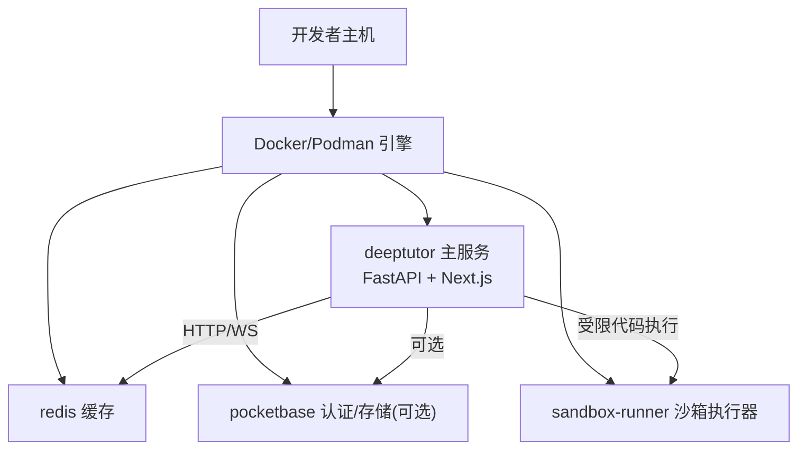
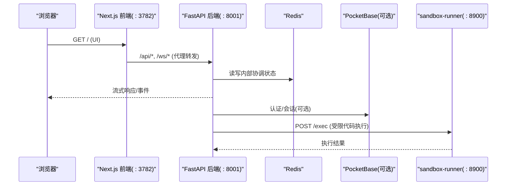
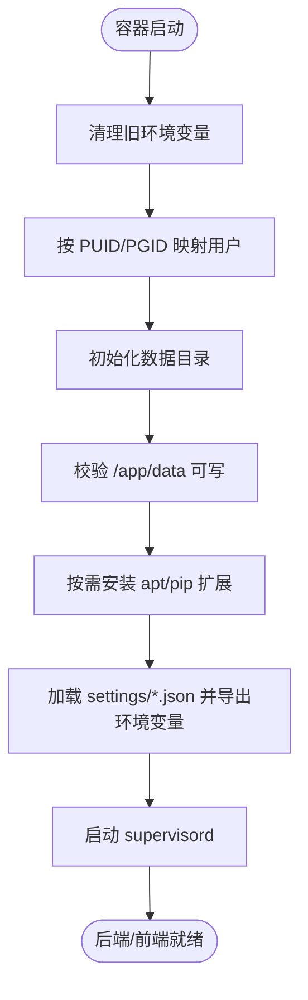
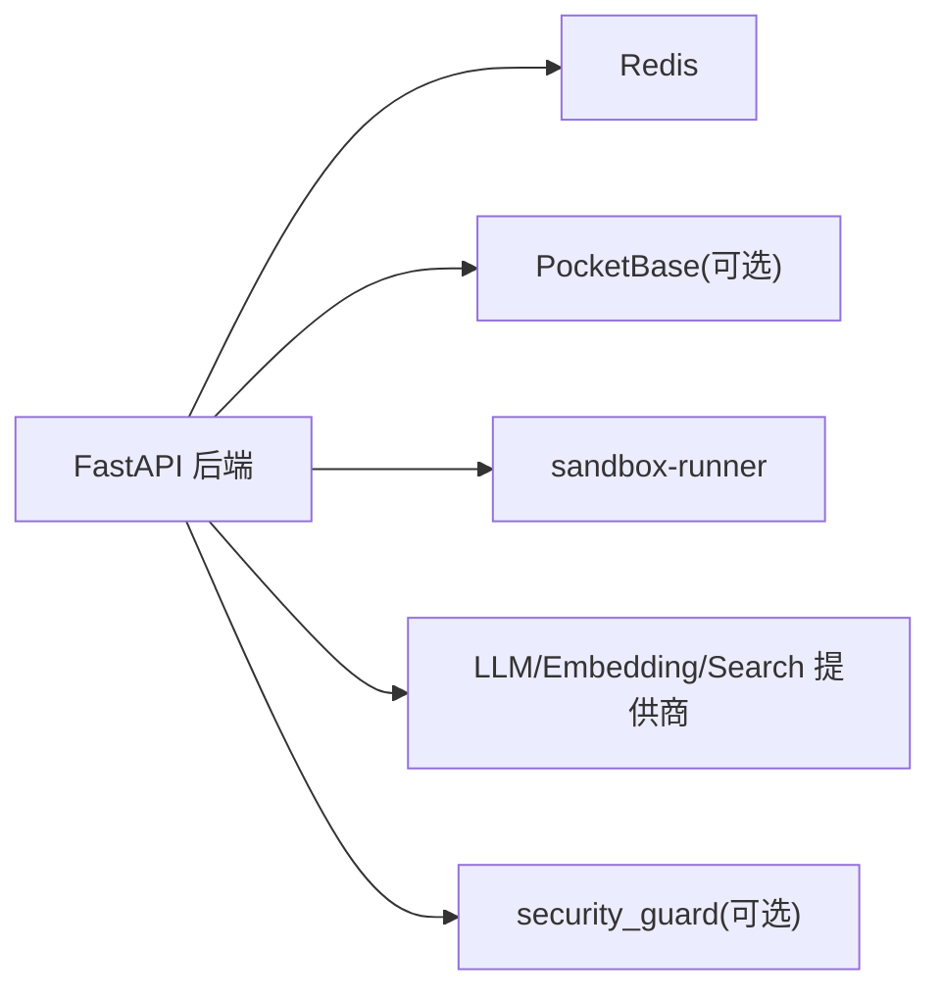

# 部署指南

<cite>
**本文引用的文件**   
- [compose.yaml](file://compose.yaml)
- [docker-compose.yml](file://docker-compose.yml)
- [docker-compose.dev.yml](file://docker-compose.dev.yml)
- [Dockerfile](file://Dockerfile)
- [Dockerfile.runner](file://Dockerfile.runner)
- [scripts/docker_compose.py](file://scripts/docker_compose.py)
- [docs-for-dev/CONTAINERIZATION.md](file://docs-for-dev/CONTAINERIZATION.md)
- [pyproject.toml](file://pyproject.toml)
- [deeptutor/api/main.py](file://deeptutor/api/main.py)
- [deeptutor/services/config/runtime_settings.py](file://deeptutor/services/config/runtime_settings.py)
- [deeptutor/services/sandbox/backends.py](file://deeptutor/services/sandbox/backends.py)
- [deeptutor/services/sandbox/runner/server.py](file://deeptutor/services/sandbox/runner/server.py)
</cite>

## 目录
1. [简介](#简介)
2. [项目结构](#项目结构)
3. [核心组件](#核心组件)
4. [架构总览](#架构总览)
5. [详细组件分析](#详细组件分析)
6. [依赖关系分析](#依赖关系分析)
7. [性能与容量规划](#性能与容量规划)
8. [安全加固](#安全加固)
9. [监控与告警](#监控与告警)
10. [故障排除](#故障排除)
11. [备份恢复与灾难恢复](#备份恢复与灾难恢复)
12. [结论](#结论)

## 简介
本指南面向 DeepTutor 的本地开发、容器化部署和生产环境部署，覆盖 Docker Compose、Podman rootless 模式、Kubernetes 部署清单思路以及云服务部署要点。文档同时说明数据库初始化、缓存配置、外部服务集成、性能调优、安全加固、监控告警、故障排除、资源需求与容量规划、备份恢复与灾难恢复策略，确保部署过程可重复、可维护。

DeepTutor 镜像包含 FastAPI 后端与 Next.js 前端，统一由 supervisord 管理；可选 PocketBase 作为认证与存储侧车；Redis 用于内部协调状态；sandbox-runner 侧车隔离执行不受信任的代码。运行时配置以 JSON/YAML 为主，位于持久化的数据目录中。

## 项目结构
DeepTutor 提供多套编排与构建产物：
- 生产镜像构建：Dockerfile（含 production 与 development 阶段）
- 沙箱执行器镜像：Dockerfile.runner
- Docker Compose 编排：docker-compose.yml（含 sandbox-runner 侧车）
- Podman rootless 编排：compose.yaml（只读根文件系统、keep-id）
- 开发覆盖：docker-compose.dev.yml（源码热重载）
- Compose 端口渲染脚本：scripts/docker_compose.py
- 容器化手册：docs-for-dev/CONTAINERIZATION.md
- Python 工程与可选依赖：pyproject.toml

图表来源
- [Dockerfile:104-220](file://Dockerfile#L104-L220)
- [docker-compose.yml:26-142](file://docker-compose.yml#L26-L142)
- [compose.yaml:67-206](file://compose.yaml#L67-L206)

章节来源
- [Dockerfile:1-624](file://Dockerfile#L1-L624)
- [docker-compose.yml:1-217](file://docker-compose.yml#L1-L217)
- [compose.yaml:1-231](file://compose.yaml#L1-L231)
- [docker-compose.dev.yml:1-55](file://docker-compose.dev.yml#L1-L55)
- [scripts/docker_compose.py:1-133](file://scripts/docker_compose.py#L1-L133)
- [docs-for-dev/CONTAINERIZATION.md:1-556](file://docs-for-dev/CONTAINERIZATION.md#L1-L556)

## 核心组件
- deeptutor 主服务
  - 后端：FastAPI，默认监听 8001
  - 前端：Next.js standalone，默认监听 3782
  - 进程管理：supervisord，子进程以非 root 用户运行
  - 健康检查：/health/ready
- redis
  - 内部协调状态，AOF 开启
- pocketbase
  - 可选认证与存储侧车，默认 8090
- sandbox-runner
  - 最小化镜像，仅暴露 /health 与 /exec，隔离执行不受信任命令

章节来源
- [Dockerfile:250-335](file://Dockerfile#L250-L335)
- [Dockerfile:526-548](file://Dockerfile#L526-L548)
- [docker-compose.yml:26-142](file://docker-compose.yml#L26-L142)
- [docker-compose.yml:144-209](file://docker-compose.yml#L144-L209)
- [compose.yaml:67-206](file://compose.yaml#L67-L206)

## 架构总览
下图展示典型容器化部署中的请求路径与组件交互：浏览器访问前端，前端通过内联代理转发 API/WS 到后端；后端使用 Redis 做内部协调，可选连接 PocketBase；模型生成的代码在 sandbox-runner 中隔离执行。

图表来源
- [Dockerfile:282-335](file://Dockerfile#L282-L335)
- [docker-compose.yml:74-142](file://docker-compose.yml#L74-L142)
- [docker-compose.yml:144-209](file://docker-compose.yml#L144-L209)
- [deeptutor/services/sandbox/runner/server.py:299-315](file://deeptutor/services/sandbox/runner/server.py#L299-L315)

## 详细组件分析

### 容器镜像与启动流程
- 多阶段构建
  - 前端构建阶段：Node 22 构建 Next.js 静态站点与 standalone 输出
  - Python 基础阶段：安装系统依赖与 Python 包
  - 生产阶段：合并 Node 运行时、Python 包、前端产物与应用代码，配置 supervisord 程序
  - 开发阶段：覆盖 programs.conf，启用 uvicorn --reload 与 next dev
- 入口脚本
  - 清理可能干扰的旧环境变量
  - 根据 PUID/PGID 调整运行时用户
  - 初始化数据目录并校验可写性
  - 按需安装 DEEPTUTOR_APT_PACKAGES 与 DEEPTUTOR_EXTRAS
  - 从 data/user/settings/*.json 导出运行时环境变量
  - 启动 supervisord

图表来源
- [Dockerfile:337-524](file://Dockerfile#L337-L524)

章节来源
- [Dockerfile:18-52](file://Dockerfile#L18-L52)
- [Dockerfile:62-101](file://Dockerfile#L62-L101)
- [Dockerfile:104-220](file://Dockerfile#L104-L220)
- [Dockerfile:250-335](file://Dockerfile#L250-L335)
- [Dockerfile:337-524](file://Dockerfile#L337-L524)
- [Dockerfile:553-624](file://Dockerfile#L553-L624)

### Docker Compose 编排（rootful）
- 服务
  - redis：AOF 开启，持久化命令流
  - pocketbase：可选认证/存储侧车
  - deeptutor：后端+前端
  - sandbox-runner：隔离执行不受信任命令
- 端口与环境
  - 后端/前端端口可通过 system.json/integrations.json 渲染为 compose 变量
  - workspace 挂载至 /workspace，sandbox-runner 仅对 outputs 可写
- 健康检查
  - 后端：/health/ready
  - sandbox-runner：/health

章节来源
- [docker-compose.yml:26-142](file://docker-compose.yml#L26-L142)
- [docker-compose.yml:144-209](file://docker-compose.yml#L144-L209)
- [scripts/docker_compose.py:46-78](file://scripts/docker_compose.py#L46-L78)

### Podman rootless 编排（只读根文件系统）
- 关键特性
  - userns_mode: keep-id，保持宿主 UID 映射
  - read_only: true，tmpfs 提供必要可写路径
  - 端口绑定默认仅 127.0.0.1
  - 不内置 sandbox-runner，回退到 bwrap 或受限子进程
- 数据卷
  - 使用 bind mount ./data，避免命名卷 UID 错配问题

章节来源
- [compose.yaml:1-63](file://compose.yaml#L1-L63)
- [compose.yaml:67-206](file://compose.yaml#L67-L206)
- [compose.yaml:222-231](file://compose.yaml#L222-L231)

### 开发模式
- 覆盖目标为 development，挂载后端/前端源码以实现热重载
- 数据目录挂载到本地 ./data，便于调试

章节来源
- [docker-compose.dev.yml:1-55](file://docker-compose.dev.yml#L1-L55)
- [Dockerfile:553-624](file://Dockerfile#L553-L624)

### 沙箱执行器镜像
- 最小化镜像，仅包含 server.py 与常用 CLI 工具
- 非 root 用户 runner 执行
- 暴露 /health 与 /exec

章节来源
- [Dockerfile.runner:1-110](file://Dockerfile.runner#L1-L110)
- [deeptutor/services/sandbox/runner/server.py:299-315](file://deeptutor/services/sandbox/runner/server.py#L299-L315)

### 运行时配置与 URL 转发
- 运行时设置集中存放于 data/user/settings/*.json
- 入口脚本在每次启动时从 JSON 导出环境变量，包括 DEEPTUTOR_API_BASE_URL 与 DEEPTUTOR_AUTH_ENABLED
- 前端通过 web/proxy.ts 在请求时重写 /api/* 与 /ws/* 到后端

章节来源
- [Dockerfile:481-514](file://Dockerfile#L481-L514)
- [deeptutor/services/config/runtime_settings.py:775-803](file://deeptutor/services/config/runtime_settings.py#L775-L803)
- [docs-for-dev/CONTAINERIZATION.md:412-447](file://docs-for-dev/CONTAINERIZATION.md#L412-L447)

## 依赖关系分析
- 主服务依赖
  - Redis：内部协调状态
  - PocketBase：可选认证/存储
  - sandbox-runner：受限代码执行
- 外部依赖
  - LLM/Embedding/Search 提供商：通过 model_catalog.json 配置
  - 可选 security_guard：通过 DEEPTUTOR_EXTRAS=guard 启用

图表来源
- [docker-compose.yml:26-142](file://docker-compose.yml#L26-L142)
- [docker-compose.yml:144-209](file://docker-compose.yml#L144-L209)
- [pyproject.toml:52-94](file://pyproject.toml#L52-L94)

章节来源
- [docker-compose.yml:26-209](file://docker-compose.yml#L26-L209)
- [pyproject.toml:52-94](file://pyproject.toml#L52-L94)

## 性能与容量规划
- 后端工作进程
  - 可通过 BACKEND_WORKERS 或 DEEPTUTOR_BACKEND_WORKERS 控制 uvicorn workers
  - 建议结合 CPU 核数与并发负载逐步调优
- WebSocket 帧大小
  - 根据附件策略动态计算 ws-max-size，避免大附件被截断
- Keep-Alive 超时
  - 与前端代理保持一致，减少空闲连接竞争导致的断开
- 内存限制
  - sandbox-runner 已设置 pids_limit 与 mem_limit，防止失控任务影响主服务
- 磁盘空间
  - 数据目录 /app/data 与 workspace 需预留足够空间，尤其是知识库、日志与媒体生成产物

章节来源
- [Dockerfile:282-312](file://Dockerfile#L282-L312)
- [docker-compose.yml:182-199](file://docker-compose.yml#L182-L199)
- [docs-for-dev/CONTAINERIZATION.md:129-134](file://docs-for-dev/CONTAINERIZATION.md#L129-L134)

## 安全加固
- 非 root 运行
  - supervisord 子进程以 deeptutor 用户运行；PUID/PGID 支持 Unraid/NAS
- 只读根文件系统（Podman）
  - read_only: true + tmpfs 限定可写路径
- 沙箱隔离
  - sandbox-runner 最小权限，仅允许 outputs 写入
- 认证与 CORS
  - auth_enabled 控制登录；cors_origins 指定前端来源
- 请求防护
  - 可选 security_guard，通过 DEEPTUTOR_EXTRAS=guard 启用

章节来源
- [Dockerfile:207-220](file://Dockerfile#L207-L220)
- [Dockerfile:378-410](file://Dockerfile#L378-L410)
- [compose.yaml:28-63](file://compose.yaml#L28-L63)
- [docker-compose.yml:182-199](file://docker-compose.yml#L182-L199)
- [docs-for-dev/CONTAINERIZATION.md:516-546](file://docs-for-dev/CONTAINERIZATION.md#L516-L546)

## 监控与告警
- 健康检查
  - 后端：/health/ready
  - sandbox-runner：/health
  - PocketBase：/api/health
- 日志采集
  - supervisord 子进程输出到 stdout/stderr，便于容器日志收集
- 指标与追踪
  - 建议在反向代理层采集访问指标；应用层可按需接入结构化日志与链路追踪

章节来源
- [Dockerfile:526-548](file://Dockerfile#L526-L548)
- [docker-compose.yml:126-131](file://docker-compose.yml#L126-L131)
- [docker-compose.yml:200-206](file://docker-compose.yml#L200-L206)
- [deeptutor/api/main.py:525-531](file://deeptutor/api/main.py#L525-L531)

## 故障排除
- 后端不可达但页面能打开
  - 通常是后端未启动或 DEEPTUTOR_API_BASE_URL 配置错误；检查容器日志与健康端点
- 首次 JSON 写入权限拒绝
  - Podman 命名卷 UID 错配；改用 bind mount 或 :U 选项
- Unraid/NAS 数据目录不可写
  - 设置 PUID/PGID 为宿主机目录所有者，不要以 root 运行
- 无法连接 Docker/Podman 守护进程
  - 确认 socket 路径或 DOCKER_HOST 指向 podman socket
- 设置页无法接受 API Base URL
  - 直接编辑 host 上的 system.json，设置 next_public_api_base_external

章节来源
- [docs-for-dev/CONTAINERIZATION.md:473-513](file://docs-for-dev/CONTAINERIZATION.md#L473-L513)
- [compose.yaml:226-231](file://compose.yaml#L226-L231)
- [Dockerfile:421-439](file://Dockerfile#L421-L439)

## 备份恢复与灾难恢复
- 备份范围
  - 完整数据目录：./data（包含 user/settings、users、partners、system、knowledge_bases、memory、logs 等）
  - PocketBase 数据：./data/pocketbase（pb_data、pb_public、pb_hooks）
  - Redis 数据：./data/redis（AOF）
- 备份策略
  - 定期快照或增量备份；确保一致性（先停止写入或关闭相关服务）
- 恢复步骤
  - 停止服务，替换数据目录，重启容器
  - 若迁移到新的主机，注意 PUID/PGID 与 SELinux/AppArmor 上下文
- 灾难恢复计划
  - 定义 RPO/RTO；准备异地副本；演练恢复流程

章节来源
- [docker-compose.yml:88-98](file://docker-compose.yml#L88-L98)
- [docker-compose.yml:56-66](file://docker-compose.yml#L56-L66)
- [docker-compose.yml:30-43](file://docker-compose.yml#L30-L43)
- [compose.yaml:75-78](file://compose.yaml#L75-L78)
- [compose.yaml:104-113](file://compose.yaml#L104-L113)

## 结论
DeepTutor 提供了从单机到生产的多形态部署能力：Docker Compose 适合快速上手与本地开发；Podman rootless 编排提供更强的默认安全基线；sandbox-runner 侧车将不受信任代码的执行边界与主应用解耦。运行时配置集中于 JSON/YAML，便于版本化与自动化；健康检查与日志输出便于运维观测。在生产环境中，建议结合反向代理、TLS、CORS、认证与可选的请求防护模块，配合监控与告警体系，实现稳定、安全、可观测的部署。