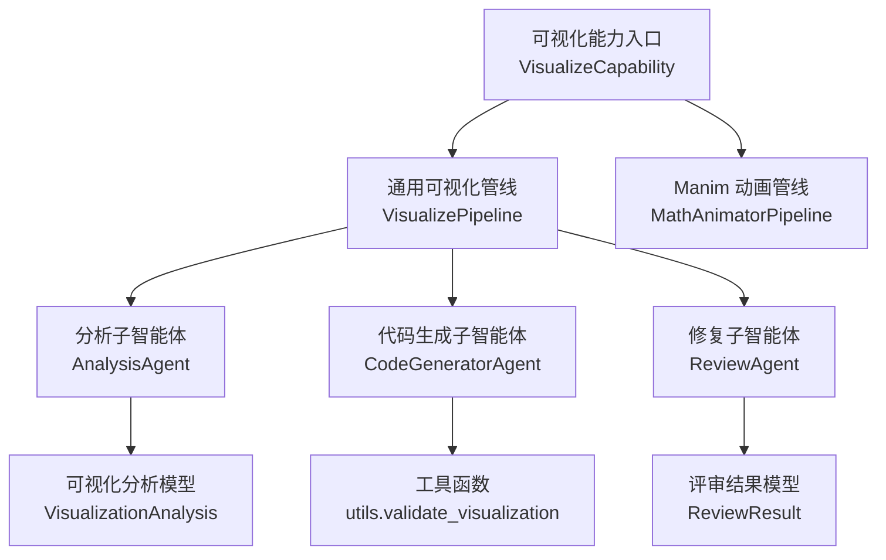
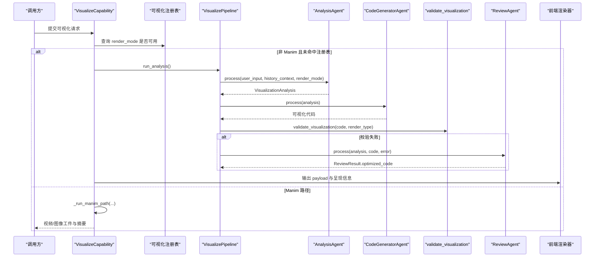
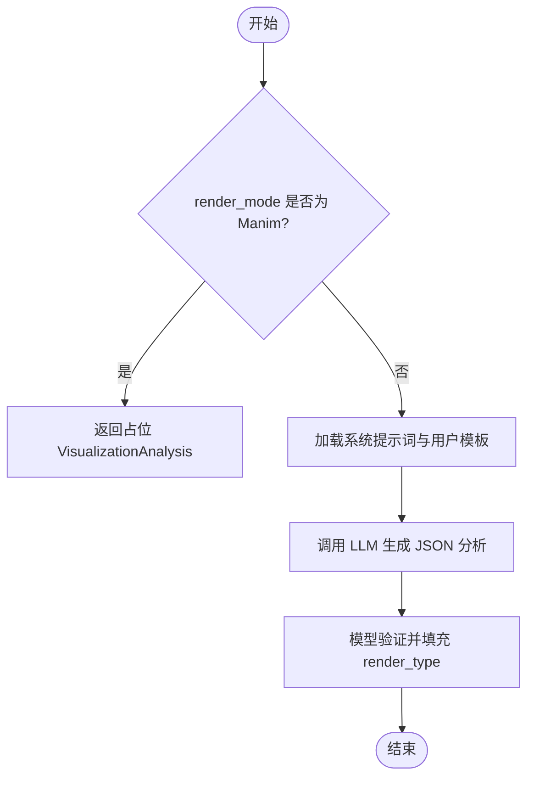
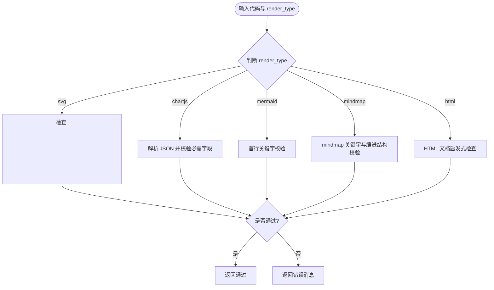
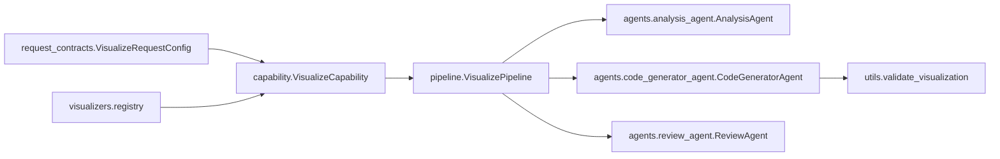

# 可视化智能体配置

<cite>
**本文引用的文件**   
- [capability.py](file://deeptutor/agents/visualize/capability.py)
- [pipeline.py](file://deeptutor/agents/visualize/pipeline.py)
- [models.py](file://deeptutor/agents/visualize/models.py)
- [utils.py](file://deeptutor/agents/visualize/utils.py)
- [analysis_agent.py](file://deeptutor/agents/visualize/agents/analysis_agent.py)
- [code_generator_agent.py](file://deeptutor/agents/visualize/agents/code_generator_agent.py)
- [review_agent.py](file://deeptutor/agents/visualize/agents/review_agent.py)
- [request_contracts.py](file://deeptutor/runtime/request_contracts.py)
</cite>

## 目录
1. [简介](#简介)
2. [项目结构](#项目结构)
3. [核心组件](#核心组件)
4. [架构总览](#架构总览)
5. [详细组件分析](#详细组件分析)
6. [依赖关系分析](#依赖关系分析)
7. [性能与缓存策略](#性能与缓存策略)
8. [故障排查指南](#故障排查指南)
9. [结论](#结论)
10. [附录：可视化输出格式与渲染器选择](#附录可视化输出格式与渲染器选择)

## 简介
本文件面向“可视化智能体”的配置与实现，覆盖以下目标：
- 可视化核心配置参数：图表类型、样式主题、交互功能等。
- 可视化管道配置：数据解析、图表生成、渲染优化各阶段。
- 子智能体协作配置：不同类型图表的专门处理逻辑。
- 可视化输出格式：静态图片与交互式图表的设置。
- 性能优化与缓存策略：降低 LLM 调用成本、提升稳定性与可观测性。

该能力通过两条路径工作：
- 通用可视化路径：由“分析→代码生成→本地校验→可选修复→可视化插件渲染”组成，支持 SVG、Chart.js、Mermaid、思维导图与 HTML 交互页面。
- Manim 动画路径：当用户明确要求数学动画或分镜图时，走 MathAnimatorPipeline，产出视频或图像工件。

## 项目结构
可视化智能体位于 `deeptutor/agents/visualize`，核心组织如下：
- capability.py：能力入口，负责请求配置校验、渲染模式分发、Manim 子管线调度、结果封装与流式事件。
- pipeline.py：三阶段可视化编排（分析、代码生成、修复）。
- models.py：分析结果与评审结果的 Pydantic 模型，定义 render_type、visual_genre 等枚举与容错降级。
- utils.py：代码块提取、HTML/SVG/Mermaid/mindmap 轻量校验与回退 HTML 构建。
- agents/：三个子智能体分别负责分析、代码生成与修复。
- prompts/：多语言提示词模板，约束分析决策与代码生成规则。

**图示来源**
- [capability.py:89-234](file://deeptutor/agents/visualize/capability.py#L89-L234)
- [pipeline.py:13-91](file://deeptutor/agents/visualize/pipeline.py#L13-L91)
- [models.py:35-121](file://deeptutor/agents/visualize/models.py#L35-L121)
- [utils.py:112-201](file://deeptutor/agents/visualize/utils.py#L112-L201)

**章节来源**
- [capability.py:89-234](file://deeptutor/agents/visualize/capability.py#L89-L234)
- [pipeline.py:13-91](file://deeptutor/agents/visualize/pipeline.py#L13-L91)

## 核心组件
- 可视化能力入口 VisualizeCapability
  - 接收并校验请求配置，决定走通用可视化还是 Manim 动画路径。
  - 对非 Manim 路径，注入上下文元数据，限制内置工具白名单，构造 AgenticChatPipeline 执行循环。
  - 将最终 payload 序列化为 Markdown 代码块，并通过 emit_capability_result 输出。
- 可视化管线 VisualizePipeline
  - 组合 AnalysisAgent、CodeGeneratorAgent、ReviewAgent，提供 run_analysis / run_code_generation / run_repair 接口。
- 子智能体
  - AnalysisAgent：根据用户意图与历史上下文，输出结构化 VisualizationAnalysis。
  - CodeGeneratorAgent：按 render_type 拼装系统提示词，生成对应格式的可视化代码。
  - ReviewAgent：在本地校验失败后，进行定向修复。
- 数据模型
  - VisualizationAnalysis：包含 render_type、chart_type、visual_elements、visual_genre 等字段，并对未知枚举值做降级。
  - ReviewResult：包含 optimized_code、changed、review_notes。
- 工具函数
  - validate_visualization：对 SVG、Chart.js、Mermaid、mindmap、HTML 做快速确定性校验，返回错误消息驱动修复。
  - extract_code_block / is_valid_html_document / build_fallback_html：辅助抽取与回退展示。

**章节来源**
- [capability.py:89-234](file://deeptutor/agents/visualize/capability.py#L89-L234)
- [pipeline.py:13-91](file://deeptutor/agents/visualize/pipeline.py#L13-L91)
- [models.py:35-121](file://deeptutor/agents/visualize/models.py#L35-L121)
- [utils.py:35-211](file://deeptutor/agents/visualize/utils.py#L35-L211)
- [analysis_agent.py:13-102](file://deeptutor/agents/visualize/agents/analysis_agent.py#L13-L102)
- [code_generator_agent.py:14-118](file://deeptutor/agents/visualize/agents/code_generator_agent.py#L14-L118)
- [review_agent.py:14-76](file://deeptutor/agents/visualize/agents/review_agent.py#L14-L76)

## 架构总览
可视化智能体的运行时流程分为两类：

- 通用可视化路径（SVG / Chart.js / Mermaid / mindmap / HTML）
  - 入口校验 render_mode，若为已安装的可视化插件 id，则交由注册表渲染；否则进入 Chat Engine 循环。
  - 分析阶段：AnalysisAgent 输出 VisualizationAnalysis。
  - 生成阶段：CodeGeneratorAgent 生成目标格式代码。
  - 校验阶段：utils.validate_visualization 做快速检查，失败则触发 ReviewAgent 修复。
  - 输出阶段：将 payload 序列化并交给前端可视化渲染器。

- Manim 动画路径（manim_video / manim_image）
  - 直接走 MathAnimatorPipeline，依次执行概念分析、概念设计、代码生成、渲染与重试、总结。
  - 输出视频或图像工件，附带源码、质量、重试历史等信息。

**图示来源**
- [capability.py:92-234](file://deeptutor/agents/visualize/capability.py#L92-L234)
- [pipeline.py:47-88](file://deeptutor/agents/visualize/pipeline.py#L47-L88)
- [analysis_agent.py:30-102](file://deeptutor/agents/visualize/agents/analysis_agent.py#L30-L102)
- [code_generator_agent.py:31-118](file://deeptutor/agents/visualize/agents/code_generator_agent.py#L31-L118)
- [utils.py:112-201](file://deeptutor/agents/visualize/utils.py#L112-L201)
- [review_agent.py:31-76](file://deeptutor/agents/visualize/agents/review_agent.py#L31-L76)

## 详细组件分析

### 可视化请求配置
- 公共请求契约 VisualizeRequestConfig
  - render_mode：默认 auto，允许传入具体可视化插件 id；长度与语法受正则约束。
  - quality：仅对 Manim 路径有效，取值 low / medium / high。
  - style_hint：风格提示字符串。
  - enable_visual_review：开启 Manim 帧级视觉评审，会增加模型调用与渲染时间。
- 能力层读取 visualize_params（temperature、max_tokens），用于控制 Chat Engine 循环。

建议配置要点：
- 明确 render_mode 以跳过自动分析，减少一次 LLM 调用。
- 对 Manim 任务设置合适的 quality，避免高开销。
- 仅在需要时启用 enable_visual_review。

**章节来源**
- [request_contracts.py:57-83](file://deeptutor/runtime/request_contracts.py#L57-L83)
- [capability.py:168-186](file://deeptutor/agents/visualize/capability.py#L168-L186)

### 分析阶段：AnalysisAgent
职责：
- 根据用户输入与对话历史，选择最佳渲染方式，输出结构化 brief。
- 支持固定 render_mode（svg/chartjs/mermaid/mindmap/html）、受限 figure 模式与自动模式。
- 对 Manim 模式短路，直接返回占位分析对象，交由上层调度。

关键行为：
- 使用 JSON 响应格式，确保下游稳定解析。
- 对 figure 模式强制限定 svg/chartjs/mermaid，防止误选 html。

**图示来源**
- [analysis_agent.py:30-102](file://deeptutor/agents/visualize/agents/analysis_agent.py#L30-L102)

**章节来源**
- [analysis_agent.py:13-102](file://deeptutor/agents/visualize/agents/analysis_agent.py#L13-L102)

### 代码生成阶段：CodeGeneratorAgent
职责：
- 基于 analysis.render_type 动态拼装系统提示词（基础 + 通用规则 + 特定格式规则）。
- 生成 SVG、Chart.js、Mermaid、mindmap 或 HTML 代码。
- 对 HTML 文档进行兜底识别，即使无围栏标记也能接受。
- 对 SVG/HTML 做根标签裁剪，保证渲染器拿到干净内容。

关键点：
- 不同 render_type 对应不同语言提示（svg/mermaid/html/javascript）。
- 对 HTML 输出，若无围栏，会尝试从原始文本中识别完整文档。

**章节来源**
- [code_generator_agent.py:14-118](file://deeptutor/agents/visualize/agents/code_generator_agent.py#L14-L118)

### 校验与修复阶段：utils.validate_visualization 与 ReviewAgent
职责：
- validate_visualization 对 SVG、Chart.js、Mermaid、mindmap、HTML 做快速、确定性的本地校验。
- 失败时返回短小、可操作的错误消息，驱动 ReviewAgent 进行定向修复。
- ReviewAgent 仅做一次修复调用，避免开放式评审带来的额外成本。

校验规则概览：
- SVG：必须包含 <svg> 根元素，XML 合法，且存在 viewBox 属性。
- Chart.js：必须是严格 JSON，包含 type 与 data 字段。
- Mermaid：首行必须以合法关键字开头，或包含 front-matter/init 指令。
- mindmap：必须以 mindmap 关键字开头，且至少有一个根节点与子分支。
- HTML：需看起来像可渲染的 HTML 文档。

**图示来源**
- [utils.py:112-201](file://deeptutor/agents/visualize/utils.py#L112-L201)

**章节来源**
- [utils.py:112-201](file://deeptutor/agents/visualize/utils.py#L112-L201)
- [review_agent.py:31-76](file://deeptutor/agents/visualize/agents/review_agent.py#L31-L76)

### Manim 动画路径
职责：
- 当 render_mode 为 manim_video 或 manim_image 时，直接走 MathAnimatorPipeline。
- 依次执行概念分析、概念设计、代码生成、渲染与重试、总结。
- 输出视频或图像工件，附带源码、质量、重试历史、可视评审结果等。

关键配置：
- output_mode：image 或 video。
- quality：low / medium / high。
- style_hint：风格提示。
- enable_visual_review：是否开启帧级视觉评审。

**章节来源**
- [capability.py:260-491](file://deeptutor/agents/visualize/capability.py#L260-L491)

### 可视化管道编排：VisualizePipeline
职责：
- 统一封装 AnalysisAgent、CodeGeneratorAgent、ReviewAgent。
- 暴露 run_analysis、run_code_generation、run_repair 方法，便于外部调用。
- 支持 trace_callback，便于追踪各阶段状态。

**章节来源**
- [pipeline.py:13-91](file://deeptutor/agents/visualize/pipeline.py#L13-L91)

## 依赖关系分析
- capability.py 依赖 request_contracts.py 中的 VisualizeRequestConfig 进行请求校验。
- capability.py 依赖可视化注册表 get_visualizer_registry 与 store，用于插件化渲染。
- pipeline.py 依赖 agents 下的三个子智能体与 models 下的数据结构。
- utils.py 被 code_generator_agent.py 与 review_agent.py 间接使用，承担代码抽取与校验。

**图示来源**
- [request_contracts.py:57-83](file://deeptutor/runtime/request_contracts.py#L57-L83)
- [capability.py:92-234](file://deeptutor/agents/visualize/capability.py#L92-L234)
- [pipeline.py:13-91](file://deeptutor/agents/visualize/pipeline.py#L13-L91)
- [utils.py:112-201](file://deeptutor/agents/visualize/utils.py#L112-L201)

**章节来源**
- [request_contracts.py:57-83](file://deeptutor/runtime/request_contracts.py#L57-L83)
- [capability.py:92-234](file://deeptutor/agents/visualize/capability.py#L92-L234)
- [pipeline.py:13-91](file://deeptutor/agents/visualize/pipeline.py#L13-L91)
- [utils.py:112-201](file://deeptutor/agents/visualize/utils.py#L112-L201)

## 性能与缓存策略
- 减少 LLM 调用次数
  - 明确 render_mode：若已知目标可视化插件 id，直接传入，避免自动分析。
  - 使用 figure 模式：Book 等场景仅需静态图，限制 LLM 在三类静态渲染中选择。
  - 优先静态渲染：svg/chartjs/mermaid 更快更便宜，仅在确需交互时使用 html。
- 本地校验先行
  - validate_visualization 在 LLM 修复前进行快速检查，避免不必要的模型调用。
- 可控的 Manim 开销
  - 合理设置 quality，避免高开销渲染。
  - 仅在必要时启用 enable_visual_review。
- 可观测性与诊断
  - 能力层检测 tool_calling_disabled_for，提前给出诊断信息，避免整轮失败后才报错。
  - 通过 stream.stage 与 trace 回调，记录各阶段耗时与状态。

[本节为通用指导，不直接分析具体文件]

## 故障排查指南
常见问题与定位建议：
- 没有画布负载（no valid canvas payload）
  - 可能原因：tool calling 被禁用，导致模型无法调用 submit_visualization。
  - 解决：在语言模型设置中启用工具调用，或使用支持工具调用的后端。
- 生成的 SVG 无效
  - 现象：缺少 <svg> 根元素、XML 不合法或缺少 viewBox。
  - 解决：让 ReviewAgent 修复，或调整提示词强调 viewBox 与根标签。
- Chart.js 配置非法
  - 现象：JSON 不合法或缺少 type/data 字段。
  - 解决：确保输出严格 JSON，不含注释与尾逗号。
- Mermaid 或 mindmap 不被识别
  - 现象：首行关键字缺失或缩进结构不正确。
  - 解决：修正 DSL 关键字与层级缩进。
- HTML 不可渲染
  - 现象：未返回可渲染的 HTML 文档。
  - 解决：确保输出包含 <!doctype> 或 <html> 标签，或使用回退 HTML。

**章节来源**
- [capability.py:133-198](file://deeptutor/agents/visualize/capability.py#L133-L198)
- [utils.py:112-201](file://deeptutor/agents/visualize/utils.py#L112-L201)

## 结论
可视化智能体通过“分析→生成→校验→修复”的流水线，结合插件化的可视化渲染器，灵活支持多种图表与交互形式。Manim 路径满足明确的动画与分镜需求。通过请求配置、本地校验与可控的 Manim 开销，可在保证质量的同时优化性能与稳定性。建议在业务侧明确 render_mode、quality 与 visual_review 开关，以获得更可预测的输出与成本。

[本节为总结性内容，不直接分析具体文件]

## 附录：可视化输出格式与渲染器选择
- 渲染类型与适用场景
  - svg：自定义插图、示意图或自由图形，需要坐标级控制。
  - chartjs：标准定量图表（柱状图、折线图、饼图、环形图、雷达图等）。
  - mermaid：结构化图形（流程图、序列图、类图、状态图、ERD、甘特图、思维导图等）。
  - mindmap：Mermaid 思维导图 DSL。
  - html：自包含交互学习页，适合拖拽演示、带控件的动画、分步讲解、点击练习。
  - manim_video / manim_image：数学动画视频或分镜图像。
- 教学导向的子类型 visual_genre
  - flowchart / structural：参考地图与结构说明。
  - illustrative：直觉型空间隐喻。
  - stepper：循环或分步讲解。
  - chart：定量数据。
  - interactive / mockup / art：匹配 HTML/SVG 体验。
- 输出格式
  - 通用路径：payload.data 为字符串或对象，会被序列化为 Markdown 代码块，语言标签由可视化插件 manifest.language_tag 决定。
  - Manim 路径：输出 artifacts（视频或图像）、源码、质量、重试历史、可视评审结果等。

**章节来源**
- [models.py:12-32](file://deeptutor/agents/visualize/models.py#L12-L32)
- [models.py:35-104](file://deeptutor/agents/visualize/models.py#L35-L104)
- [capability.py:200-228](file://deeptutor/agents/visualize/capability.py#L200-L228)
- [capability.py:465-491](file://deeptutor/agents/visualize/capability.py#L465-L491)