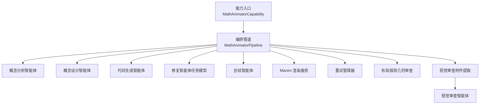
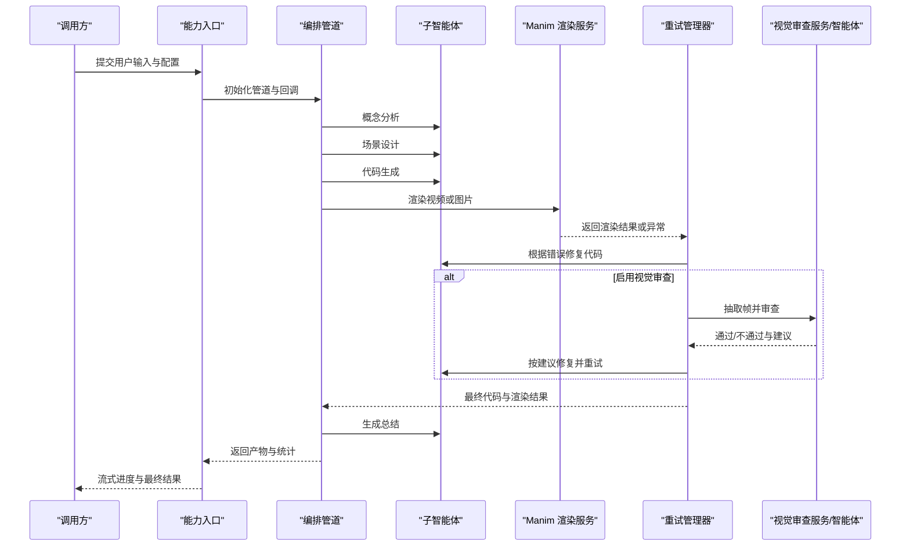
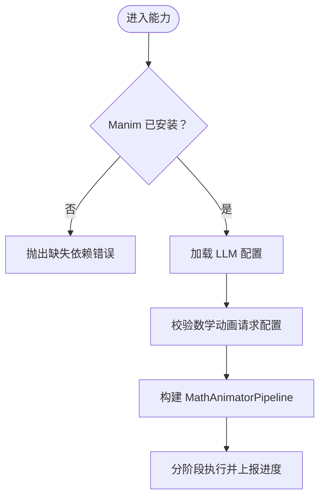
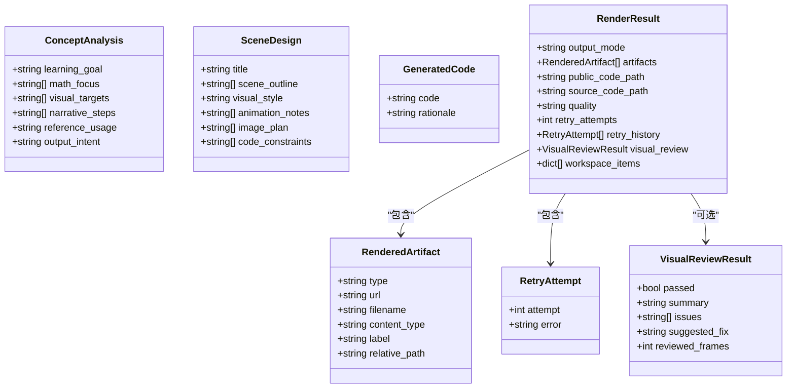
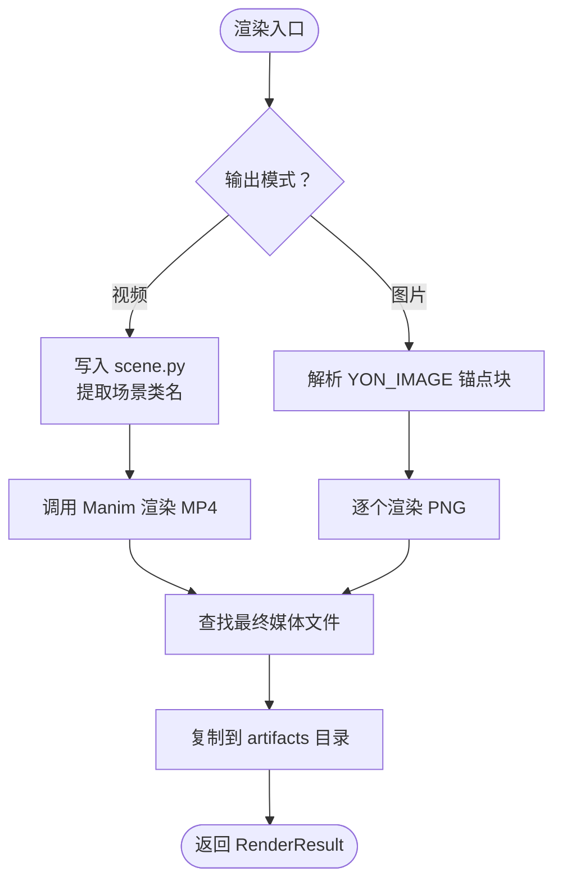
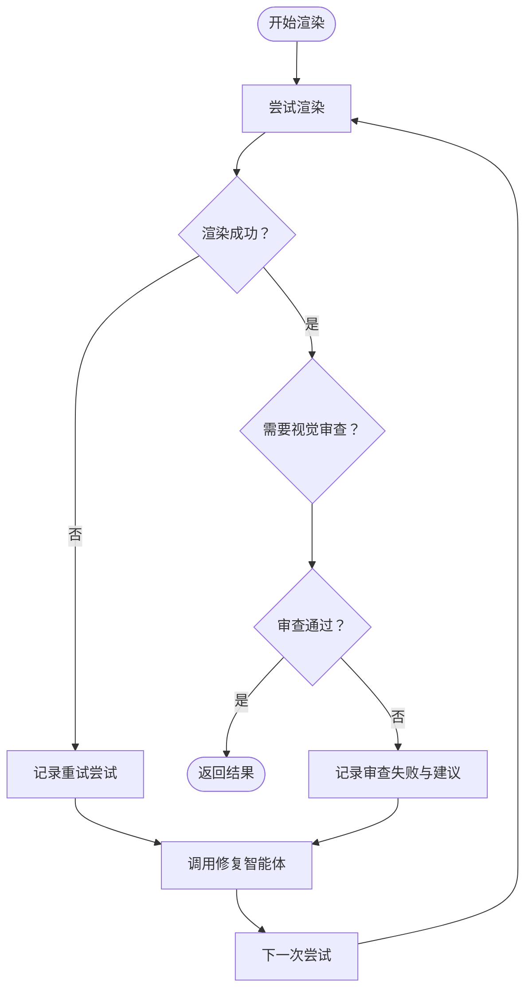
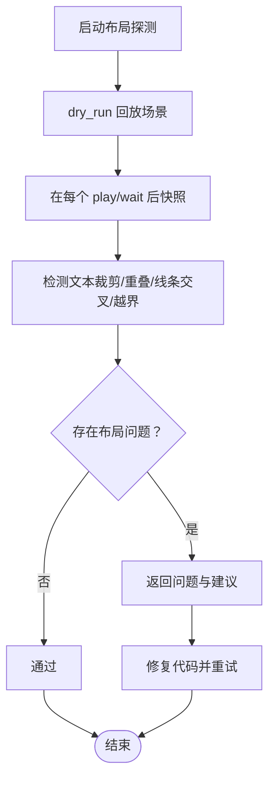
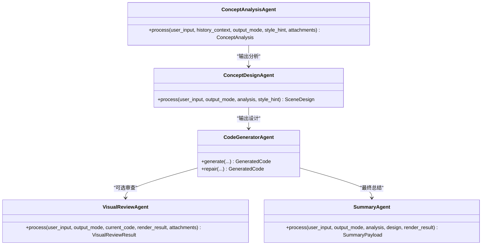
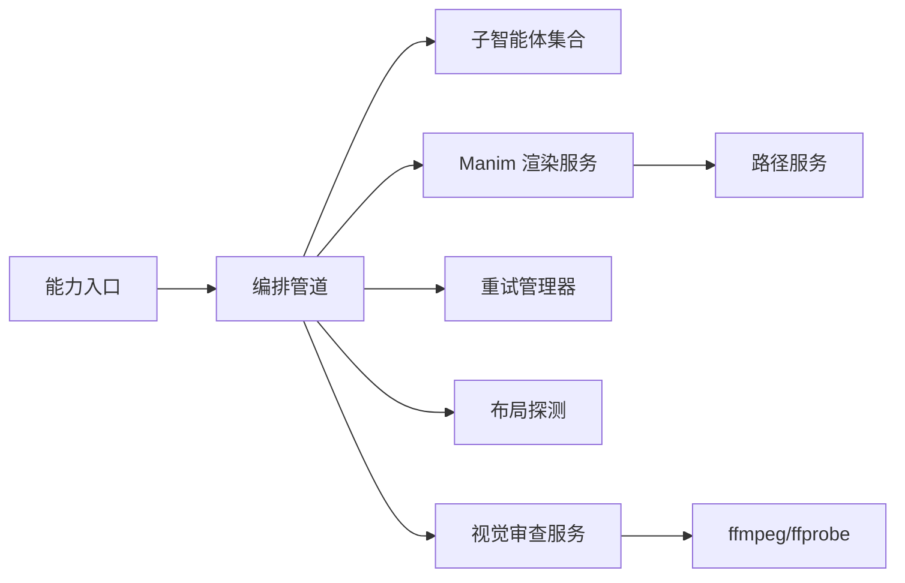
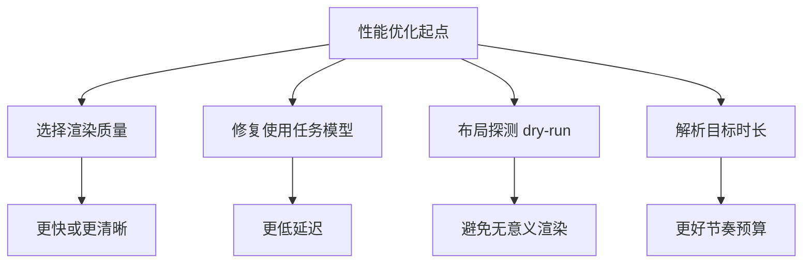

# 数学动画智能体配置

<cite>
**本文引用的文件**   
- [capability.py](file://deeptutor/agents/math_animator/capability.py)
- [pipeline.py](file://deeptutor/agents/math_animator/pipeline.py)
- [request_config.py](file://deeptutor/agents/math_animator/request_config.py)
- [models.py](file://deeptutor/agents/math_animator/models.py)
- [renderer.py](file://deeptutor/agents/math_animator/renderer.py)
- [retry_manager.py](file://deeptutor/agents/math_animator/retry_manager.py)
- [layout_probe.py](file://deeptutor/agents/math_animator/layout_probe.py)
- [visual_review.py](file://deeptutor/agents/math_animator/visual_review.py)
- [duration_utils.py](file://deeptutor/agents/math_animator/duration_utils.py)
- [utils.py](file://deeptutor/agents/math_animator/utils.py)
- [code_generator_agent.py](file://deeptutor/agents/math_animator/agents/code_generator_agent.py)
- [concept_analysis_agent.py](file://deeptutor/agents/math_animator/agents/concept_analysis_agent.py)
- [concept_design_agent.py](file://deeptutor/agents/math_animator/agents/concept_design_agent.py)
- [summary_agent.py](file://deeptutor/agents/math_animator/agents/summary_agent.py)
- [visual_review_agent.py](file://deeptutor/agents/math_animator/agents/visual_review_agent.py)
</cite>

## 目录
1. [简介](#简介)
2. [项目结构](#项目结构)
3. [核心组件](#核心组件)
4. [架构总览](#架构总览)
5. [详细组件分析](#详细组件分析)
6. [依赖关系分析](#依赖关系分析)
7. [性能与缓存策略](#性能与缓存策略)
8. [故障排查指南](#故障排查指南)
9. [结论](#结论)

## 简介
本文件面向“数学动画智能体”的配置与实现，聚焦以下目标：
- 明确数学动画生成的核心配置参数：输出模式、渲染质量、视觉审查开关、风格提示等。
- 记录请求级重试机制、超时设置和资源限制。
- 说明动画布局探测、视觉审查流程与渲染器参数。
- 描述多子智能体的协作方式与编排流程。
- 给出性能优化建议与缓存策略。

该能力通过 Manim 渲染 Python 脚本生成视频或图片，并结合大模型完成概念分析、场景设计、代码生成、修复与总结；可选地启用视觉审查对帧进行质量检查并驱动自动修复。

## 项目结构
数学动画智能体位于 `deeptutor/agents/math_animator`，主要模块如下：
- 入口与能力注册：`capability.py`
- 编排管道：`pipeline.py`
- 请求配置校验：`request_config.py`
- 数据模型：`models.py`
- 渲染服务：`renderer.py`
- 重试管理：`retry_manager.py`
- 布局探测（几何审查）：`layout_probe.py`
- 视觉审查附件提取：`visual_review.py`
- 时长解析工具：`duration_utils.py`
- 通用工具：`utils.py`
- 子智能体：`agents/*`

**图示来源**
- [capability.py:22-50](file://deeptutor/agents/math_animator/capability.py#L22-L50)
- [pipeline.py:30-90](file://deeptutor/agents/math_animator/pipeline.py#L30-L90)
- [pipeline.py:157-261](file://deeptutor/agents/math_animator/pipeline.py#L157-L261)
- [renderer.py:36-81](file://deeptutor/agents/math_animator/renderer.py#L36-L81)
- [retry_manager.py:21-43](file://deeptutor/agents/math_animator/retry_manager.py#L21-L43)
- [layout_probe.py:187-237](file://deeptutor/agents/math_animator/layout_probe.py#L187-L237)
- [visual_review.py:17-57](file://deeptutor/agents/math_animator/visual_review.py#L17-L57)
- [visual_review_agent.py:16-97](file://deeptutor/agents/math_animator/agents/visual_review_agent.py#L16-L97)

**章节来源**
- [capability.py:22-50](file://deeptutor/agents/math_animator/capability.py#L22-L50)
- [pipeline.py:30-90](file://deeptutor/agents/math_animator/pipeline.py#L30-L90)

## 核心组件
- 能力入口：负责加载可选依赖、构造 LLM 配置、创建管道实例、分发阶段事件与结果。
- 编排管道：串联概念分析、场景设计、代码生成、渲染与总结，并协调重试与视觉审查。
- 请求配置：定义输出模式、质量等级、风格提示与视觉审查开关。
- 渲染服务：调用 Manim 执行 Python 场景，产出视频或图片资源。
- 重试管理器：封装渲染失败与视觉审查失败的自动修复循环。
- 布局探测：在不绘制帧的情况下回放场景，检测文本遮挡、越界与线条交叉。
- 视觉审查：从视频中抽取关键帧，交给视觉模型评估画面质量。
- 子智能体：分别承担概念分析、场景设计、代码生成、修复与总结职责。

**章节来源**
- [capability.py:22-50](file://deeptutor/agents/math_animator/capability.py#L22-L50)
- [pipeline.py:30-90](file://deeptutor/agents/math_animator/pipeline.py#L30-L90)
- [request_config.py:10-20](file://deeptutor/agents/math_animator/request_config.py#L10-L20)
- [renderer.py:36-81](file://deeptutor/agents/math_animator/renderer.py#L36-L81)
- [retry_manager.py:21-43](file://deeptutor/agents/math_animator/retry_manager.py#L21-L43)
- [layout_probe.py:187-237](file://deeptutor/agents/math_animator/layout_probe.py#L187-L237)
- [visual_review.py:17-57](file://deeptutor/agents/math_animator/visual_review.py#L17-L57)

## 架构总览
数学动画智能体采用“分析-设计-生成-渲染-总结”的流水线，并在渲染阶段引入“自动修复+可选视觉审查”。

**图示来源**
- [capability.py:66-185](file://deeptutor/agents/math_animator/capability.py#L66-L185)
- [pipeline.py:306-370](file://deeptutor/agents/math_animator/pipeline.py#L306-L370)
- [retry_manager.py:44-158](file://deeptutor/agents/math_animator/retry_manager.py#L44-L158)
- [visual_review.py:36-57](file://deeptutor/agents/math_animator/visual_review.py#L36-L57)
- [visual_review_agent.py:33-97](file://deeptutor/agents/math_animator/agents/visual_review_agent.py#L33-L97)

## 详细组件分析

### 请求配置与能力入口
- 输出模式：支持视频与图片两种模式。
- 渲染质量：低、中、高三档，映射到 Manim 的质量参数。
- 风格提示：用于引导生成代码的视觉风格，长度上限为 500。
- 视觉审查开关：开启后增加模型调用与渲染时间，用于检查重叠、可读性与构图。
- 能力入口会校验 Manim 是否安装，并从上下文读取 LLM 配置与工作区路径。

**图示来源**
- [capability.py:22-50](file://deeptutor/agents/math_animator/capability.py#L22-L50)
- [capability.py:66-185](file://deeptutor/agents/math_animator/capability.py#L66-L185)
- [request_config.py:10-36](file://deeptutor/agents/math_animator/request_config.py#L10-L36)

**章节来源**
- [capability.py:22-50](file://deeptutor/agents/math_animator/capability.py#L22-L50)
- [capability.py:66-185](file://deeptutor/agents/math_animator/capability.py#L66-L185)
- [request_config.py:10-36](file://deeptutor/agents/math_animator/request_config.py#L10-L36)

### 数据模型
- 概念分析：学习目标、数学焦点、视觉目标、叙事步骤、参考使用、输出意图。
- 场景设计：标题、场景大纲、视觉风格、动画备注、图像计划、代码约束。
- 生成代码：代码字符串与理由。
- 渲染产物：类型、URL、文件名、内容类型、标签、相对路径。
- 重试尝试：尝试序号与错误信息。
- 视觉审查结果：是否通过、摘要、问题列表、建议修复、已审查帧数。
- 渲染结果：输出模式、产物列表、源码路径、质量、重试次数与历史、视觉审查结果、工作区条目。

**图示来源**
- [models.py:8-85](file://deeptutor/agents/math_animator/models.py#L8-L85)

**章节来源**
- [models.py:8-85](file://deeptutor/agents/math_animator/models.py#L8-L85)

### 渲染器与质量参数
- 质量映射：低/中/高对应 Manim 的 `-ql`/`-qm`/`-qh`。
- 输出模式：
  - 视频：写入 `scene.py`，运行 Manim 导出 MP4。
  - 图片：要求代码中包含 YON_IMAGE 锚点块，逐个渲染 PNG。
- 进程管理：使用子进程运行 Manim，线程读取 stdout/stderr，异步队列转发日志，支持 Windows 兼容与进程树清理。
- 超时控制：Manim 进程默认 300 秒超时。
- 产物定位：优先排除中间片段目录，取最新生成的最终文件。

**图示来源**
- [renderer.py:61-81](file://deeptutor/agents/math_animator/renderer.py#L61-L81)
- [renderer.py:83-134](file://deeptutor/agents/math_animator/renderer.py#L83-L134)
- [renderer.py:136-229](file://deeptutor/agents/math_animator/renderer.py#L136-L229)
- [renderer.py:236-281](file://deeptutor/agents/math_animator/renderer.py#L236-L281)

**章节来源**
- [renderer.py:61-81](file://deeptutor/agents/math_animator/renderer.py#L61-L81)
- [renderer.py:83-134](file://deeptutor/agents/math_animator/renderer.py#L83-L134)
- [renderer.py:136-229](file://deeptutor/agents/math_animator/renderer.py#L136-L229)
- [renderer.py:236-281](file://deeptutor/agents/math_animator/renderer.py#L236-L281)

### 重试管理与超时
- 最大重试次数：默认 4 次。
- 修复超时：每次代码修复最多 180 秒。
- 视觉审查超时：每次审查最多 120 秒。
- 非可重试环境错误：当检测到本地 LaTeX 缺失时直接报错，避免无效重试。
- 重试触发条件：
  - Manim 渲染异常。
  - 视觉审查未通过。
- 状态回调：向调用方报告当前尝试、修复与重渲染状态。

**图示来源**
- [retry_manager.py:21-43](file://deeptutor/agents/math_animator/retry_manager.py#L21-L43)
- [retry_manager.py:44-158](file://deeptutor/agents/math_animator/retry_manager.py#L44-L158)

**章节来源**
- [retry_manager.py:21-43](file://deeptutor/agents/math_animator/retry_manager.py#L21-L43)
- [retry_manager.py:44-158](file://deeptutor/agents/math_animator/retry_manager.py#L44-L158)

### 布局探测与视觉审查
- 布局探测（几何审查）：
  - 在不开启视觉模型时，对视频场景进行 dry-run 回放，检测文本被裁剪、文本重叠、线条穿过文本、形状越界等问题。
  - 最多允许 3 轮预检，每轮约几秒，失败则触发修复。
  - 超时保护：探测过程最长 90 秒。
- 视觉审查：
  - 若启用视觉审查，则从视频中抽取 1-3 个关键帧，交给视觉模型评估画面质量。
  - 若模型不支持视觉能力，则跳过审查并标记已通过。
  - 审查失败会提供建议修复，驱动代码修复与重渲染。

**图示来源**
- [layout_probe.py:27-179](file://deeptutor/agents/math_animator/layout_probe.py#L27-L179)
- [layout_probe.py:187-237](file://deeptutor/agents/math_animator/layout_probe.py#L187-L237)
- [visual_review.py:36-57](file://deeptutor/agents/math_animator/visual_review.py#L36-L57)
- [visual_review_agent.py:33-97](file://deeptutor/agents/math_animator/agents/visual_review_agent.py#L33-L97)

**章节来源**
- [layout_probe.py:27-179](file://deeptutor/agents/math_animator/layout_probe.py#L27-L179)
- [layout_probe.py:187-237](file://deeptutor/agents/math_animator/layout_probe.py#L187-L237)
- [visual_review.py:36-57](file://deeptutor/agents/math_animator/visual_review.py#L36-L57)
- [visual_review_agent.py:33-97](file://deeptutor/agents/math_animator/agents/visual_review_agent.py#L33-L97)

### 子智能体协作
- 概念分析智能体：从用户输入、历史上下文与附件中提取学习目标、数学焦点与视觉目标。
- 概念设计智能体：基于分析结果生成场景大纲、视觉风格与代码约束。
- 代码生成智能体：根据分析与设计生成 Manim 代码，支持结构化 JSON 输出与截断重试。
- 修复智能体：优先使用任务模型进行快速修复，回退到代码生成智能体。
- 视觉审查智能体：在具备视觉能力的模型下对帧进行质量评估。
- 总结智能体：汇总分析、设计与渲染结果，生成最终文本摘要。

**图示来源**
- [concept_analysis_agent.py:14-97](file://deeptutor/agents/math_animator/agents/concept_analysis_agent.py#L14-L97)
- [concept_design_agent.py:14-76](file://deeptutor/agents/math_animator/agents/concept_design_agent.py#L14-L76)
- [code_generator_agent.py:31-268](file://deeptutor/agents/math_animator/agents/code_generator_agent.py#L31-L268)
- [visual_review_agent.py:16-100](file://deeptutor/agents/math_animator/agents/visual_review_agent.py#L16-L100)
- [summary_agent.py:14-78](file://deeptutor/agents/math_animator/agents/summary_agent.py#L14-L78)

**章节来源**
- [concept_analysis_agent.py:14-97](file://deeptutor/agents/math_animator/agents/concept_analysis_agent.py#L14-L97)
- [concept_design_agent.py:14-76](file://deeptutor/agents/math_animator/agents/concept_design_agent.py#L14-L76)
- [code_generator_agent.py:31-268](file://deeptutor/agents/math_animator/agents/code_generator_agent.py#L31-L268)
- [visual_review_agent.py:16-100](file://deeptutor/agents/math_animator/agents/visual_review_agent.py#L16-L100)
- [summary_agent.py:14-78](file://deeptutor/agents/math_animator/agents/summary_agent.py#L14-L78)

## 依赖关系分析
- 外部依赖：
  - Manim：必须安装，否则能力入口直接报错。
  - ffmpeg/ffprobe：视觉审查抽取帧与探测视频时长时使用。
  - LaTeX：若代码中使用 MathTex/Tex，需安装 LaTeX 工具链，否则会触发非可重试错误。
- 内部依赖：
  - 能力入口依赖管道与请求配置。
  - 管道依赖各子智能体、渲染器、重试管理器、布局探测与视觉审查服务。
  - 渲染器依赖路径服务与工作区根路径。
  - 重试管理器依赖渲染器与修复回调。

**图示来源**
- [capability.py:22-50](file://deeptutor/agents/math_animator/capability.py#L22-L50)
- [pipeline.py:30-90](file://deeptutor/agents/math_animator/pipeline.py#L30-L90)
- [renderer.py:14-58](file://deeptutor/agents/math_animator/renderer.py#L14-L58)
- [visual_review.py:59-123](file://deeptutor/agents/math_animator/visual_review.py#L59-L123)

**章节来源**
- [capability.py:22-50](file://deeptutor/agents/math_animator/capability.py#L22-L50)
- [pipeline.py:30-90](file://deeptutor/agents/math_animator/pipeline.py#L30-L90)
- [renderer.py:14-58](file://deeptutor/agents/math_animator/renderer.py#L14-L58)
- [visual_review.py:59-123](file://deeptutor/agents/math_animator/visual_review.py#L59-L123)

## 性能与缓存策略
- 渲染性能：
  - 质量参数影响渲染时间与文件大小：低质量更快但清晰度较低。
  - 视频模式下，Manim 进程默认 300 秒超时，避免长时间阻塞。
- 模型调用性能：
  - 修复智能体优先使用任务模型，以秒级响应替代推理模型的分钟级耗时。
  - 代码生成阶段对截断输出进行预算增长与降低推理努力，减少重复失败。
- 布局探测性能：
  - dry-run 回放不绘制帧，单次探测约几秒，最多 3 轮，避免无意义渲染。
- 缓存策略：
  - 渲染器禁用 Manim 缓存以提升探测稳定性（布局探测）。
  - 工作区产物通过相对路径或 URL 暴露给上层展示层，便于复用。
- 时长控制：
  - 支持从用户输入中解析目标时长（秒或分钟），指导代码节奏预算。

**图示来源**
- [renderer.py:136-229](file://deeptutor/agents/math_animator/renderer.py#L136-L229)
- [pipeline.py:68-73](file://deeptutor/agents/math_animator/pipeline.py#L68-L73)
- [layout_probe.py:27-37](file://deeptutor/agents/math_animator/layout_probe.py#L27-L37)
- [duration_utils.py:20-39](file://deeptutor/agents/math_animator/duration_utils.py#L20-L39)
- [code_generator_agent.py:171-244](file://deeptutor/agents/math_animator/agents/code_generator_agent.py#L171-L244)

**章节来源**
- [renderer.py:136-229](file://deeptutor/agents/math_animator/renderer.py#L136-L229)
- [pipeline.py:68-73](file://deeptutor/agents/math_animator/pipeline.py#L68-L73)
- [layout_probe.py:27-37](file://deeptutor/agents/math_animator/layout_probe.py#L27-L37)
- [duration_utils.py:20-39](file://deeptutor/agents/math_animator/duration_utils.py#L20-L39)
- [code_generator_agent.py:171-244](file://deeptutor/agents/math_animator/agents/code_generator_agent.py#L171-L244)

## 故障排查指南
- Manim 未安装：
  - 现象：能力入口抛出缺失依赖错误。
  - 处理：安装 `deeptutor[math-animator]` 或 `requirements/math-animator.txt`。
- LaTeX 缺失：
  - 现象：渲染时报错找不到 latex，且被识别为非可重试环境错误。
  - 处理：安装 LaTeX 发行版，或在代码中避免使用 MathTex/Tex。
- 视频帧抽取失败：
  - 现象：视觉审查无法提取帧或探测时长失败。
  - 处理：确保系统安装 ffmpeg/ffprobe，并检查视频文件完整性。
- 代码生成无可用 JSON：
  - 现象：模型返回空响应、纯推理或未闭合 JSON。
  - 处理：查看最后失败原因，必要时提高 max_tokens 或选择推理较少的模型。
- 布局问题反复出现：
  - 现象：多次修复后仍存在文本重叠或越界。
  - 处理：根据建议调整 mobject 位置、缩放或使用缓冲与排列函数。

**章节来源**
- [capability.py:22-28](file://deeptutor/agents/math_animator/capability.py#L22-L28)
- [retry_manager.py:12-18](file://deeptutor/agents/math_animator/retry_manager.py#L12-L18)
- [renderer.py:217-229](file://deeptutor/agents/math_animator/renderer.py#L217-L229)
- [visual_review.py:59-123](file://deeptutor/agents/math_animator/visual_review.py#L59-L123)
- [code_generator_agent.py:171-244](file://deeptutor/agents/math_animator/agents/code_generator_agent.py#L171-L244)
- [layout_probe.py:187-237](file://deeptutor/agents/math_animator/layout_probe.py#L187-L237)

## 结论
数学动画智能体通过清晰的配置项与稳健的编排流程，将“概念分析-场景设计-代码生成-渲染-总结”串联起来，并在渲染阶段提供自动修复与可选视觉审查。其关键配置包括输出模式、渲染质量、风格提示与视觉审查开关；关键机制包括重试管理、超时控制、布局探测与时长解析。合理设置质量与审查开关、确保外部依赖完整，可获得稳定且高质量的数学动画输出。