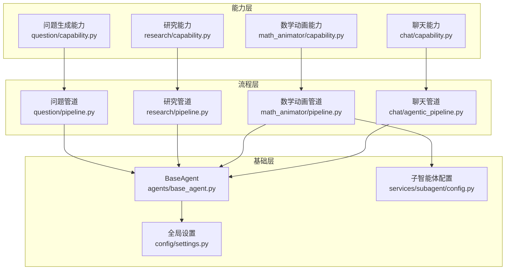
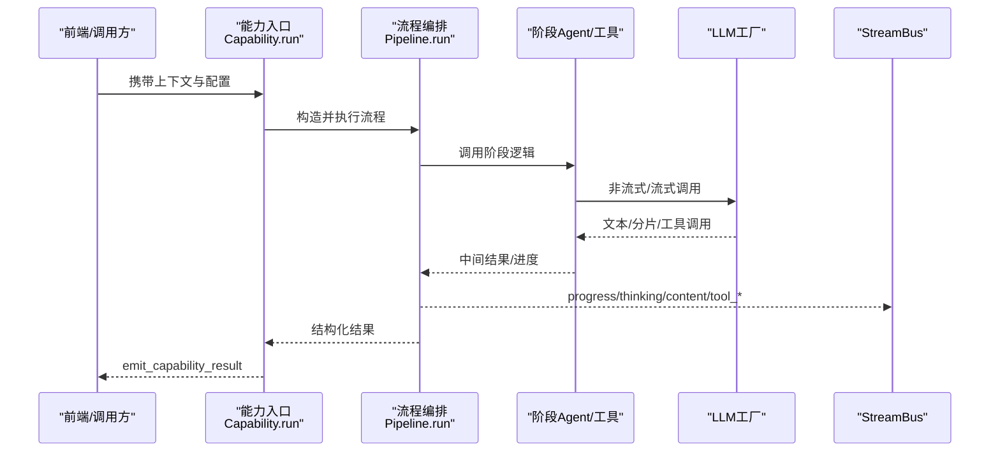
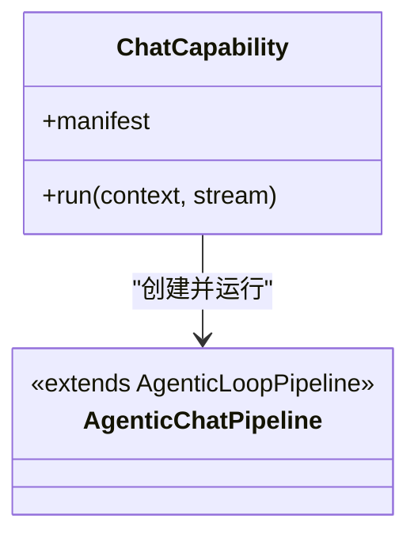
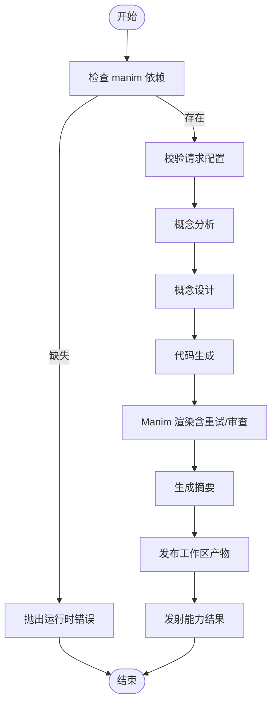
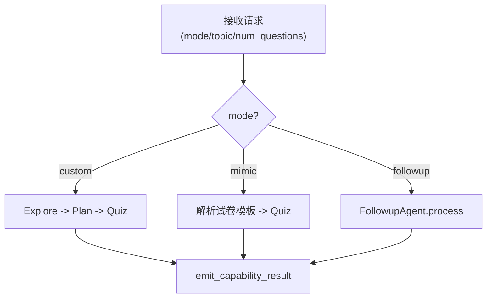
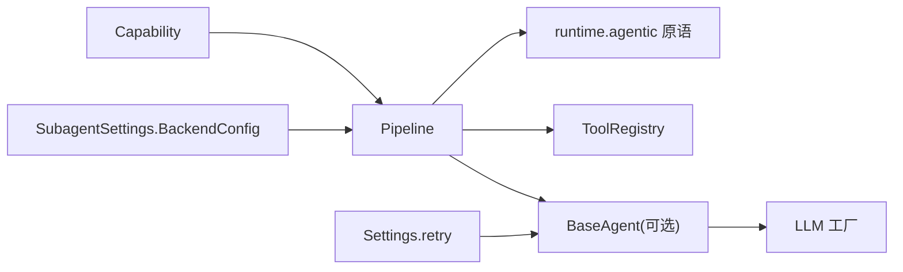

# 智能体配置

<cite>
**本文引用的文件**   
- [base_agent.py](file://deeptutor/agents/base_agent.py)
- [capability.py（聊天）](file://deeptutor/agents/chat/capability.py)
- [agentic_pipeline.py（聊天）](file://deeptutor/agents/chat/agentic_pipeline.py)
- [capability.py（数学动画）](file://deeptutor/agents/math_animator/capability.py)
- [pipeline.py（数学动画）](file://deeptutor/agents/math_animator/pipeline.py)
- [capability.py（研究）](file://deeptutor/agents/research/capability.py)
- [pipeline.py（研究）](file://deeptutor/agents/research/pipeline.py)
- [capability.py（问题生成器）](file://deeptutor/agents/question/capability.py)
- [pipeline.py（问题生成器）](file://deeptutor/agents/question/pipeline.py)
- [settings.py（全局设置）](file://deeptutor/config/settings.py)
- [config.py（子智能体配置）](file://deeptutor/services/subagent/config.py)
</cite>

## 目录
1. [简介](#简介)
2. [项目结构](#项目结构)
3. [核心组件](#核心组件)
4. [架构总览](#架构总览)
5. [详细组件分析](#详细组件分析)
6. [依赖关系分析](#依赖关系分析)
7. [性能与资源调优](#性能与资源调优)
8. [故障排查指南](#故障排查指南)
9. [结论](#结论)
10. [附录：自定义智能体开发指南与模板](#附录自定义智能体开发指南与模板)

## 简介
本文件面向 DeepTutor 的智能体配置与编排，覆盖以下能力：
- 聊天智能体、数学动画智能体、研究智能体、问题生成器的配置结构与运行流程。
- 智能体的能力注册机制、配置继承与优先级规则。
- 生命周期管理、启动参数、资源限制与超时策略。
- 自定义智能体的开发指南与配置模板。
- 智能体间的通信协议与数据交换格式。
- 性能调优参数、错误处理与可观测性。

## 项目结构
DeepTutor 将“能力”作为一等公民进行注册与调度，每个领域模块提供：
- capability：能力入口，负责请求校验、上下文装配、结果发射。
- pipeline：具体业务流程编排，调用内部 Agent 或运行时原语。
- agents：阶段级 Agent（如概念分析、代码生成等）。
- request_config：请求参数校验与默认值。
- prompts：多语言提示词。



图表来源
- [capability.py（聊天）:1-18](file://deeptutor/agents/chat/capability.py#L1-L18)
- [agentic_pipeline.py（聊天）:1-49](file://deeptutor/agents/chat/agentic_pipeline.py#L1-L49)
- [capability.py（数学动画）:1-303](file://deeptutor/agents/math_animator/capability.py#L1-L303)
- [pipeline.py（数学动画）:1-374](file://deeptutor/agents/math_animator/pipeline.py#L1-L374)
- [capability.py（研究）:1-93](file://deeptutor/agents/research/capability.py#L1-L93)
- [pipeline.py（研究）:1-800](file://deeptutor/agents/research/pipeline.py#L1-L800)
- [capability.py（问题生成器）:1-469](file://deeptutor/agents/question/capability.py#L1-L469)
- [pipeline.py（问题生成器）:1-800](file://deeptutor/agents/question/pipeline.py#L1-L800)
- [base_agent.py:1-793](file://deeptutor/agents/base_agent.py#L1-L793)
- [settings.py（全局设置）:1-51](file://deeptutor/config/settings.py#L1-L51)
- [config.py（子智能体配置）:139-189](file://deeptutor/services/subagent/config.py#L139-L189)

章节来源
- [capability.py（聊天）:1-18](file://deeptutor/agents/chat/capability.py#L1-L18)
- [capability.py（数学动画）:1-303](file://deeptutor/agents/math_animator/capability.py#L1-L303)
- [capability.py（研究）:1-93](file://deeptutor/agents/research/capability.py#L1-L93)
- [capability.py（问题生成器）:1-469](file://deeptutor/agents/question/capability.py#L1-L469)

## 核心组件
- BaseAgent：统一基类，封装 LLM 配置加载、参数获取、提示词加载、非流式/流式调用、Token 统计、追踪回调、状态开关等。
- 各能力 Capability：声明 manifest、接收 UnifiedContext 与 StreamBus，完成参数校验、构建 Pipeline、发射结果。
- 各 Pipeline：实现领域流程编排，组合多个 Agent 或运行时原语，驱动 LLM 与工具调用，产出结构化结果。
- 全局设置 Settings：集中定义重试等系统级参数，支持环境变量注入。
- 子智能体配置 SubagentConfig：定义后端模型、权限、沙箱、网络、空闲超时等运行时约束。

章节来源
- [base_agent.py:33-793](file://deeptutor/agents/base_agent.py#L33-L793)
- [settings.py（全局设置）:19-51](file://deeptutor/config/settings.py#L19-L51)
- [config.py（子智能体配置）:139-189](file://deeptutor/services/subagent/config.py#L139-L189)

## 架构总览
下图展示从能力入口到流程编排再到 LLM 调用的整体路径，以及事件流与结果发射。



图表来源
- [capability.py（聊天）:12-18](file://deeptutor/agents/chat/capability.py#L12-L18)
- [capability.py（数学动画）:19-220](file://deeptutor/agents/math_animator/capability.py#L19-L220)
- [capability.py（研究）:37-93](file://deeptutor/agents/research/capability.py#L37-L93)
- [capability.py（问题生成器）:29-160](file://deeptutor/agents/question/capability.py#L29-L160)
- [base_agent.py:349-517](file://deeptutor/agents/base_agent.py#L349-L517)
- [base_agent.py:519-693](file://deeptutor/agents/base_agent.py#L519-L693)

## 详细组件分析

### 聊天智能体（Agentic Chat）
- 能力入口：ChatCapability 使用内置 manifest，实例化 AgenticChatPipeline 并运行。
- 管道：AgenticChatPipeline 复用通用探索循环协议，暴露可选工具白名单与排除列表。
- 典型流程：用户消息进入后，由统一 agentic loop 决定工具调用与思考步骤，最终通过 StreamBus 输出内容、工具调用与结果。



图表来源
- [capability.py（聊天）:12-18](file://deeptutor/agents/chat/capability.py#L12-L18)
- [agentic_pipeline.py（聊天）:36-49](file://deeptutor/agents/chat/agentic_pipeline.py#L36-L49)

章节来源
- [capability.py（聊天）:1-18](file://deeptutor/agents/chat/capability.py#L1-L18)
- [agentic_pipeline.py（聊天）:1-49](file://deeptutor/agents/chat/agentic_pipeline.py#L1-L49)

### 数学动画智能体（Math Animator）
- 能力入口：MathAnimatorCapability 检查可选依赖 manim，校验请求配置，构建 MathAnimatorPipeline，并通过 StreamBus 广播阶段进度与结果。
- 管道：MathAnimatorPipeline 串联概念分析、概念设计、代码生成、渲染（含重试与视觉审查）、总结等阶段，并将工作区产物发布到统一呈现层。
- 关键特性：
  - 可视化审查：可选启用视觉审查 Agent；未启用时视频模式走几何布局预检。
  - 渲染重试：CodeRetryManager 控制最多重试次数，结合 repair_agent 自动修复代码。
  - 工作区集成：将 Manim 产物快照到 workspace，返回 URL 供前端展示。



图表来源
- [capability.py（数学动画）:19-220](file://deeptutor/agents/math_animator/capability.py#L19-L220)
- [pipeline.py（数学动画）:30-374](file://deeptutor/agents/math_animator/pipeline.py#L30-L374)

章节来源
- [capability.py（数学动画）:1-303](file://deeptutor/agents/math_animator/capability.py#L1-L303)
- [pipeline.py（数学动画）:1-374](file://deeptutor/agents/math_animator/pipeline.py#L1-L374)

### 研究智能体（Deep Research）
- 能力入口：DeepResearchCapability 校验请求配置，组装运行时配置，构建 ResearchPipeline，支持大纲预览两阶段交互。
- 管道：ResearchPipeline 实现四阶段流程：
  - Phase 1 Rephrase：仅允许 ask_user 的 mini loop，用于澄清主题。
  - Phase 2 Decompose：生成子主题大纲，若未确认则返回预览。
  - Phase 3 Research Blocks：动态队列并行/串行推进，支持 APPEND 扩展队列。
  - Phase 4 Reporting：按大纲顺序生成引言、章节与结论，注入引用。
- 工具策略：复用 chat 的工具组合策略，块级研究只读 Obsidian 工具，其他工具受 allowlist 控制。

```mermaid
sequenceDiagram
participant Cap as "DeepResearchCapability"
participant Pipe as "ResearchPipeline"
participant Loop as "Agentic Loop / Labeled Step"
participant Tools as "工具集"
participant Bus as "StreamBus"
Cap->>Pipe : run(context, topic, confirmed_outline)
alt 未确认大纲
Pipe->>Loop : Rephrase(ask_user)
Pipe->>Loop : Decompose(OUTLINE)
Pipe-->>Cap : outline_preview
else 已确认大纲
Pipe->>Loop : Block Loop(THINK/TOOL/APPEND/FINISH)
Pipe->>Tools : 检索/搜索/读取
Pipe->>Loop : Reporting(INTRO/SECTION/CONCLUSION)
Pipe-->>Bus : progress/content
Pipe-->>Cap : result
end
```

图表来源
- [capability.py（研究）:37-93](file://deeptutor/agents/research/capability.py#L37-L93)
- [pipeline.py（研究）:341-721](file://deeptutor/agents/research/pipeline.py#L341-L721)

章节来源
- [capability.py（研究）:1-93](file://deeptutor/agents/research/capability.py#L1-L93)
- [pipeline.py（研究）:1-800](file://deeptutor/agents/research/pipeline.py#L1-L800)

### 问题生成器（Deep Question）
- 能力入口：DeepQuestionCapability 根据 mode 路由：
  - followup：单轮 FollowupAgent 回答历史问题。
  - custom：QuestionPipeline 的 explore → plan → per-question 循环。
  - mimic：先解析试卷为模板，再跳过 explore/plan 直接进入 quiz。
- 管道：QuestionPipeline 三阶段：
  - Explore：基于工具链探索背景，输出用户可见的 preface 与 trace。
  - Plan：一次性 PLAN 标签输出 JSON 计划。
  - Quiz：对每个模板执行 THINK/TOOL/FINISH，严格 JSON 校验与一次修复。
- 输入规范：支持 question_types 白名单与 per_type_counts 分布，自动归一化与校验。



图表来源
- [capability.py（问题生成器）:29-160](file://deeptutor/agents/question/capability.py#L29-L160)
- [pipeline.py（问题生成器）:369-614](file://deeptutor/agents/question/pipeline.py#L369-L614)

章节来源
- [capability.py（问题生成器）:1-469](file://deeptutor/agents/question/capability.py#L1-L469)
- [pipeline.py（问题生成器）:1-800](file://deeptutor/agents/question/pipeline.py#L1-L800)

## 依赖关系分析
- 能力与管道：每个 capability 仅做轻量装配与校验，复杂流程下沉至 pipeline。
- 管道与基础层：pipeline 通过 runtime.agentic 原语（run_agentic_loop、run_labeled_step、dispatch_tool_calls）与工具注册表协作。
- BaseAgent：为需要直接调用 LLM 的阶段 Agent 提供统一接口，屏蔽 provider 差异。
- 配置来源：
  - 全局重试：Settings.retry（环境变量前缀 LLM_）。
  - 子智能体后端：SubagentSettings.BackendConfig（enabled/model/effort/system_prompt/permission_mode/sandbox/approval/network_access/ephemeral/auto_approve/thinking/forward_images/extra_args/base_url/api_key_env/profile/idle_timeout_seconds）。



图表来源
- [base_agent.py:349-517](file://deeptutor/agents/base_agent.py#L349-L517)
- [settings.py（全局设置）:19-51](file://deeptutor/config/settings.py#L19-L51)
- [config.py（子智能体配置）:139-189](file://deeptutor/services/subagent/config.py#L139-L189)

章节来源
- [base_agent.py:33-793](file://deeptutor/agents/base_agent.py#L33-L793)
- [settings.py（全局设置）:19-51](file://deeptutor/config/settings.py#L19-L51)
- [config.py（子智能体配置）:139-189](file://deeptutor/services/subagent/config.py#L139-L189)

## 性能与资源调优
- 模型与参数优先级（BaseAgent.get_model/get_temperature/get_max_tokens）：
  - 模型：agent_config.model > llm_config.model > instance.model > 环境变量。
  - temperature/max_tokens：来自统一 agents.yaml（通过 get_agent_params 获取），可在能力参数中覆盖。
- 重试与退避（Settings.retry）：
  - max_retries、base_delay、exponential_backoff 通过环境变量 LLM_RETRY__* 注入。
- 工具超时与并发（研究管道）：
  - tool_timeout、tool_max_retries、max_parallel_topics、execution_mode 由运行时配置 controlling research 行为。
- 数学动画渲染：
  - CodeRetryManager 最大重试次数固定为 4；无视觉审查时视频模式启用几何布局预检，最多 MAX_LAYOUT_ROUNDS=3 轮。
- Token 预算与思维深度：
  - 各 pipeline 通过 get_capability_params 获取阶段预算；必要时使用 reasoning_effort 调整思维深度以释放答案预算。

章节来源
- [base_agent.py:152-207](file://deeptutor/agents/base_agent.py#L152-L207)
- [settings.py（全局设置）:19-51](file://deeptutor/config/settings.py#L19-L51)
- [pipeline.py（研究）:443-473](file://deeptutor/agents/research/pipeline.py#L443-L473)
- [pipeline.py（数学动画）:26-28](file://deeptutor/agents/math_animator/pipeline.py#L26-L28)
- [pipeline.py（数学动画）:239-258](file://deeptutor/agents/math_animator/pipeline.py#L239-L258)

## 故障排查指南
- 依赖缺失（数学动画）：
  - 现象：运行时抛出缺少 manim 的错误。
  - 处理：安装可选依赖 deeptutor[math-animator] 或 requirements/math-animator.txt。
- 主题缺失（问题生成器 mimic/custom）：
  - 现象：topic_required 错误。
  - 处理：确保传入 topic 或在 mimic 模式下提供 PDF/解析目录。
- 渲染失败（数学动画）：
  - 现象：ManimRenderError 或布局检查失败。
  - 处理：查看 on_retry/on_render_progress 日志；必要时启用视觉审查或调整 quality/output_mode。
- 研究部分未完成：
  - 现象：partial=true 且 failed_block_titles 非空。
  - 处理：检查工具可用性、RAG/搜索服务状态；适当提高 tool_timeout 或减少并行度。
- LLM 调用失败：
  - 现象：trace 事件 state=error。
  - 处理：检查 API Key/Base URL/Model 配置；调整 retry.max_retries 与 base_delay。

章节来源
- [capability.py（数学动画）:22-28](file://deeptutor/agents/math_animator/capability.py#L22-L28)
- [capability.py（问题生成器）:40-56](file://deeptutor/agents/question/capability.py#L40-L56)
- [pipeline.py（数学动画）:202-237](file://deeptutor/agents/math_animator/pipeline.py#L202-L237)
- [pipeline.py（研究）:666-688](file://deeptutor/agents/research/pipeline.py#L666-L688)
- [base_agent.py:473-482](file://deeptutor/agents/base_agent.py#L473-L482)

## 结论
DeepTutor 的智能体体系以“能力+管道”为核心，配合统一的 BaseAgent 与运行时原语，实现了跨领域的稳定编排与可观测性。通过 Settings 与 SubagentSettings 提供的集中式配置，系统可在不同部署环境中灵活调整重试、超时、并发与资源限制。各能力在保持各自业务特性的同时，共享工具组合策略与提示词管理机制，便于扩展与维护。

## 附录：自定义智能体开发指南与模板

### 能力注册与清单
- 新建一个 capability 类，继承 TurnCapability，声明 manifest 并使用 builtin_capability_manifest("your_feature")。
- 在 run(context, stream) 中完成参数校验、Pipeline 构造与结果发射。

章节来源
- [capability.py（聊天）:12-18](file://deeptutor/agents/chat/capability.py#L12-L18)
- [capability.py（数学动画）:19-220](file://deeptutor/agents/math_animator/capability.py#L19-L220)
- [capability.py（研究）:37-93](file://deeptutor/agents/research/capability.py#L37-L93)
- [capability.py（问题生成器）:29-160](file://deeptutor/agents/question/capability.py#L29-L160)

### 流程编排与阶段 Agent
- 新建 Pipeline 类，拆分阶段方法（如 analysis/design/code/render/summary 或 explore/plan/quiz）。
- 使用 runtime.agentic 原语驱动 LLM 与工具调用，通过 StreamBus 输出进度、思考内容与工具事件。
- 如需直接调用 LLM，优先继承 BaseAgent，复用其 call_llm/stream_llm、提示词加载与 Token 统计。

章节来源
- [pipeline.py（数学动画）:30-374](file://deeptutor/agents/math_animator/pipeline.py#L30-L374)
- [pipeline.py（问题生成器）:369-614](file://deeptutor/agents/question/pipeline.py#L369-L614)
- [base_agent.py:349-517](file://deeptutor/agents/base_agent.py#L349-L517)
- [base_agent.py:519-693](file://deeptutor/agents/base_agent.py#L519-L693)

### 配置项与优先级
- 模型选择优先级：agent_config.model > llm_config.model > instance.model > 环境变量。
- 温度与 Token：优先使用 agents.yaml 中的统一参数，可通过 get_agent_params 获取。
- 子智能体后端：
  - enabled：是否启用
  - model/effort/system_prompt：模型与指令
  - permission_mode/sandbox/approval：权限与沙箱
  - network_access/ephemeral/auto_approve/thinking/forward_images：运行环境
  - extra_args/base_url/api_key_env/profile/idle_timeout_seconds：连接与生命周期

章节来源
- [base_agent.py:152-207](file://deeptutor/agents/base_agent.py#L152-L207)
- [config.py（子智能体配置）:139-189](file://deeptutor/services/subagent/config.py#L139-L189)

### 通信协议与数据交换
- 事件总线：所有能力通过 StreamBus 发送 progress/thinking/content/tool_call/tool_result/error/result 等事件。
- 能力结果：统一通过 emit_capability_result 发射结构化结果，附带 usage 统计。
- 追踪元数据：使用 build_trace_metadata/merge_trace_metadata/new_call_id 生成可观测的子追踪。

章节来源
- [capability.py（数学动画）:195-220](file://deeptutor/agents/math_animator/capability.py#L195-L220)
- [capability.py（问题生成器）:98-100](file://deeptutor/agents/question/capability.py#L98-L100)
- [pipeline.py（研究）:707-721](file://deeptutor/agents/research/pipeline.py#L707-L721)

### 启动参数与生命周期
- 能力入口：由运行时框架实例化并调用 run(context, stream)。
- 生命周期：
  - 初始化：校验依赖、加载配置、构建 Pipeline。
  - 运行：阶段编排、LLM/工具调用、结果发射。
  - 清理：无需显式销毁，依赖 Python GC；如需持久化产物，写入 workspace 或 storage。

章节来源
- [capability.py（数学动画）:19-50](file://deeptutor/agents/math_animator/capability.py#L19-L50)
- [capability.py（问题生成器）:57-67](file://deeptutor/agents/question/capability.py#L57-L67)

### 性能调优建议
- 合理设置 tool_timeout 与 tool_max_retries，避免慢工具阻塞流水线。
- 对长耗时任务（如 RAG/搜索）提高超时上限，降低并行度以避免雪崩。
- 使用 reasoning_effort 在规划/思考阶段节省预算，保证最终答案质量。
- 数学动画渲染开启视觉审查或几何布局预检，减少无效渲染。

章节来源
- [pipeline.py（研究）:443-473](file://deeptutor/agents/research/pipeline.py#L443-L473)
- [pipeline.py（数学动画）:202-237](file://deeptutor/agents/math_animator/pipeline.py#L202-L237)