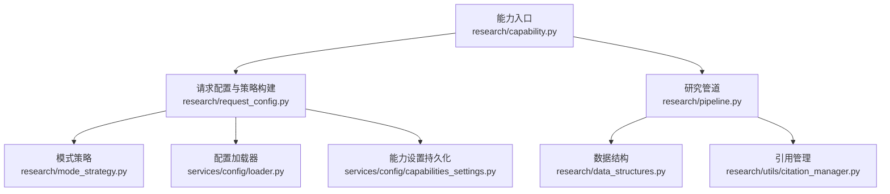
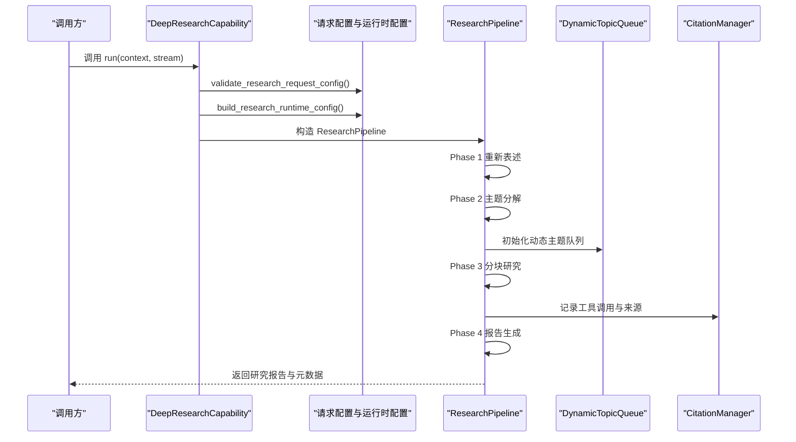
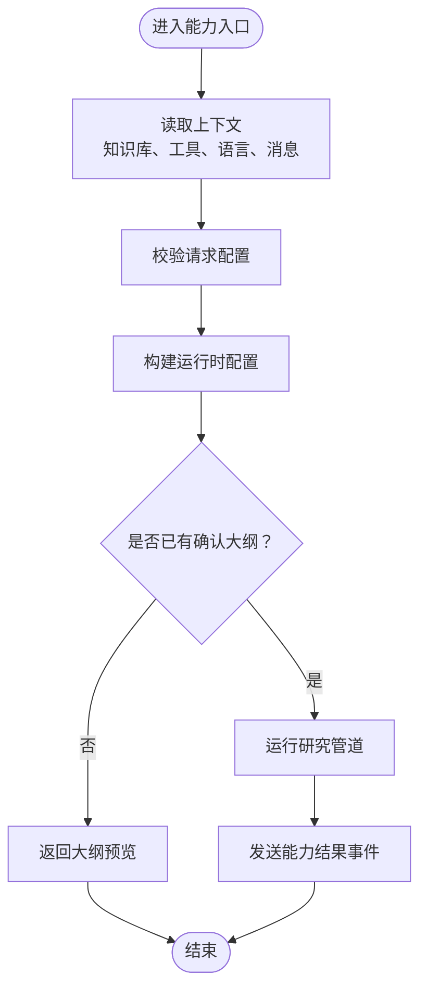
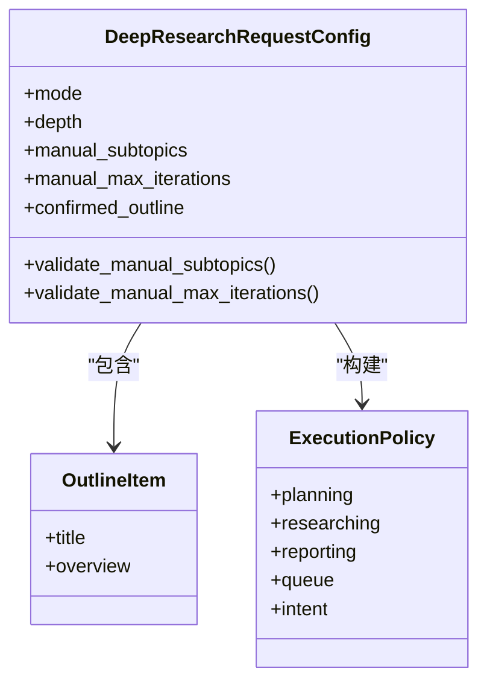
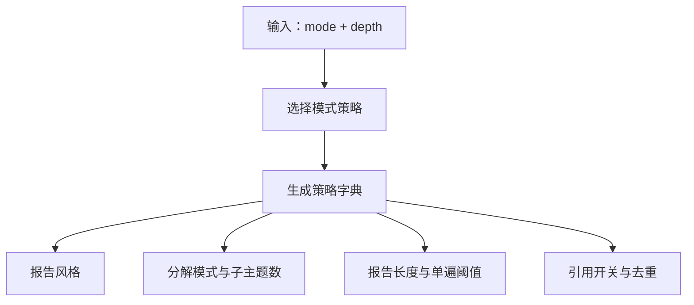
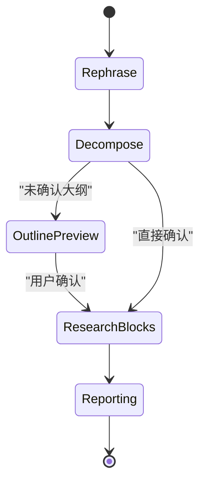
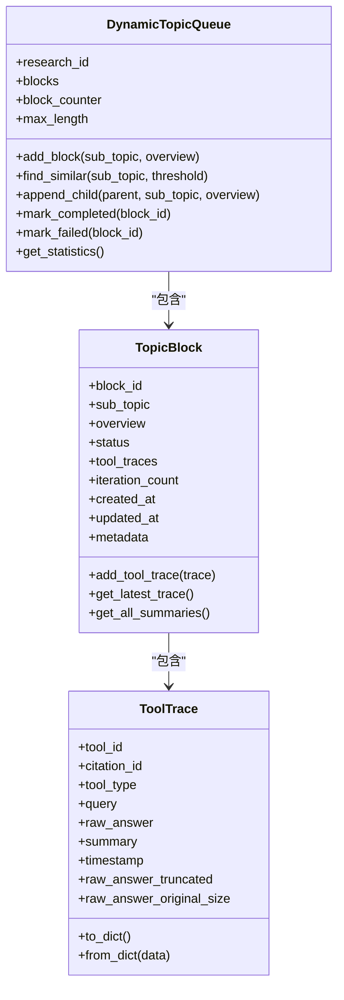
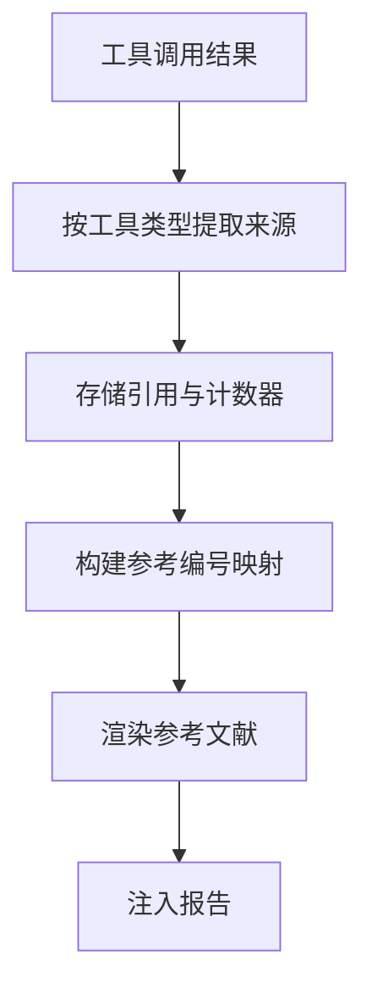
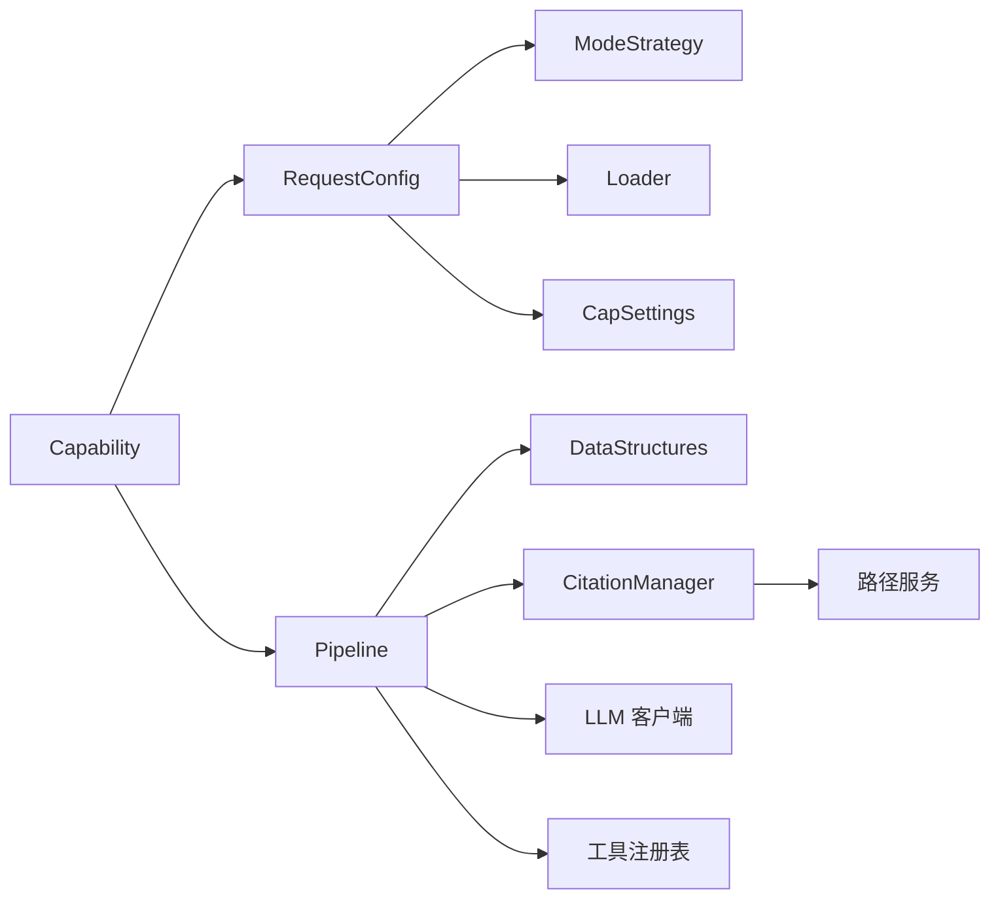

# 研究智能体配置

<cite>
**本文引用的文件**   
- [capability.py](file://deeptutor/agents/research/capability.py)
- [request_config.py](file://deeptutor/agents/research/request_config.py)
- [mode_strategy.py](file://deeptutor/agents/research/mode_strategy.py)
- [pipeline.py](file://deeptutor/agents/research/pipeline.py)
- [data_structures.py](file://deeptutor/agents/research/data_structures.py)
- [citation_manager.py](file://deeptutor/agents/research/utils/citation_manager.py)
- [capabilities_settings.py](file://deeptutor/services/config/capabilities_settings.py)
- [loader.py](file://deeptutor/services/config/loader.py)
</cite>

## 目录
1. [简介](#简介)
2. [项目结构](#项目结构)
3. [核心配置参数](#核心配置参数)
4. [架构总览](#架构总览)
5. [详细组件分析](#详细组件分析)
6. [依赖关系分析](#依赖关系分析)
7. [性能与资源控制](#性能与资源控制)
8. [外部工具集成](#外部工具集成)
9. [结果格式化与导出](#结果格式化与导出)
10. [故障排查指南](#故障排查指南)
11. [结论](#结论)

## 简介
本文面向需要配置和使用 DeepTutor “研究智能体”（Deep Research）的开发者与高级用户，系统性说明以下能力：
- 研究模式、搜索深度、引用管理等核心配置项。
- 研究管道的四个阶段：信息收集、主题分解、分块研究、报告生成。
- 不同研究模式的策略差异与适配参数。
- 外部工具集成点，包括论文搜索、网页搜索、RAG 知识库、代码执行等。
- 研究结果的格式、引用标注、去重与导出路径。

研究智能体的实现位于 `deeptutor/agents/research`，由能力入口、请求配置、模式策略、管道编排、数据结构与引用管理共同组成；运行时行为还受全局配置加载器与服务层默认值影响。

## 项目结构
研究智能体相关代码集中在以下模块：
- 能力入口：`capability.py`
- 请求校验与策略构建：`request_config.py`
- 模式策略定义：`mode_strategy.py`
- 管道编排与阶段控制：`pipeline.py`
- 队列、区块与工具追踪数据模型：`data_structures.py`
- 引用管理与参考文献渲染：`utils/citation_manager.py`
- 服务层默认参数与能力设置持久化：`services/config/loader.py`、`services/config/capabilities_settings.py`

**图表来源**
- [capability.py:37-93](file://deeptutor/agents/research/capability.py#L37-L93)
- [request_config.py:25-187](file://deeptutor/agents/research/request_config.py#L25-L187)
- [mode_strategy.py:24-140](file://deeptutor/agents/research/mode_strategy.py#L24-L140)
- [pipeline.py:341-721](file://deeptutor/agents/research/pipeline.py#L341-L721)
- [data_structures.py:44-571](file://deeptutor/agents/research/data_structures.py#L44-L571)
- [citation_manager.py:62-800](file://deeptutor/agents/research/utils/citation_manager.py#L62-L800)
- [loader.py:324-375](file://deeptutor/services/config/loader.py#L324-L375)
- [capabilities_settings.py:68-91](file://deeptutor/services/config/capabilities_settings.py#L68-L91)

**章节来源**
- [capability.py:1-93](file://deeptutor/agents/research/capability.py#L1-L93)
- [request_config.py:1-250](file://deeptutor/agents/research/request_config.py#L1-L250)
- [mode_strategy.py:1-148](file://deeptutor/agents/research/mode_strategy.py#L1-L148)
- [pipeline.py:1-800](file://deeptutor/agents/research/pipeline.py#L1-L800)
- [data_structures.py:1-571](file://deeptutor/agents/research/data_structures.py#L1-L571)
- [citation_manager.py:1-800](file://deeptutor/agents/research/utils/citation_manager.py#L1-L800)
- [loader.py:320-399](file://deeptutor/services/config/loader.py#L320-L399)
- [capabilities_settings.py:61-455](file://deeptutor/services/config/capabilities_settings.py#L61-L455)

## 核心配置参数
研究智能体的配置分为三层：
1. **请求级配置**：由前端或调用方传入，决定研究模式、深度、手动子主题数量、最大迭代次数、是否确认大纲等。
2. **运行时配置**：由 `build_research_runtime_config` 将请求配置与主配置合并，产出 `planning`、`researching`、`reporting`、`queue`、`rag`、`intent` 等运行时子树。
3. **服务层默认参数**：由 `DEFAULT_RESEARCH_PARAMS` 和 `_MAIN_YAML_RUNTIME_DEFAULTS["research"]` 提供 LLM 预算与工具超时等默认值。

### 请求级配置字段
| 字段 | 类型 | 必填 | 默认值 | 说明 |
|---|---|---:|---|---|
| `mode` | 枚举 | 是 | 无 | 研究模式：`notes`、`report`、`comparison`、`learning_path` |
| `depth` | 枚举 | 是 | 无 | 搜索深度：`quick`、`standard`、`deep`、`manual` |
| `manual_subtopics` | 整数或空 | 否 | 空 | 手动模式下初始子主题数量，限制在 1 到 10 |
| `manual_max_iterations` | 整数或空 | 否 | 空 | 手动模式下最大迭代次数，限制在 1 到 10 |
| `confirmed_outline` | 对象数组或空 | 否 | 空 | 用户确认后的大纲条目，每个条目包含标题与可选概述 |

### 运行时配置关键字段
| 配置路径 | 关键字段 | 含义 |
|---|---|---|
| `planning.rephrase.enabled` | 布尔 | 是否启用“重新表述”阶段，用于通过提问澄清研究主题 |
| `planning.rephrase.max_iterations` | 整数 | 重新表述阶段的内部循环上限 |
| `planning.decompose.mode` | 字符串 | 分解模式：`auto` 或 `manual` |
| `planning.decompose.initial_subtopics` | 整数 | 手动分解时的初始子主题数 |
| `planning.decompose.auto_max_subtopics` | 整数或空 | 自动分解时的最大子主题数 |
| `researching.max_iterations` | 整数 | 每个研究块的最大迭代次数 |
| `researching.iteration_mode` | 字符串 | 迭代模式：`fixed` 或 `flexible` |
| `researching.execution_mode` | 字符串 | 执行模式：`series` 或 `parallel` |
| `researching.max_parallel_topics` | 整数 | 并行研究的子主题数量上限 |
| `researching.tool_timeout` | 整数 | 工具调用超时秒数，默认 240 |
| `researching.tool_max_retries` | 整数 | 工具失败重试次数，默认 0 |
| `researching.note_agent_mode` | 字符串 | 笔记摘要代理模式，默认 `auto` |
| `researching.paper_search_years_limit` | 整数 | 论文搜索年份限制，默认 5 |
| `reporting.min_section_length` | 整数 | 报告段落最小长度阈值 |
| `reporting.report_single_pass_threshold` | 整数 | 单次生成报告的单次通过阈值 |
| `reporting.enable_citation_list` | 布尔 | 是否启用文末引用列表 |
| `reporting.enable_inline_citations` | 布尔 | 是否启用正文内引用标记 |
| `reporting.deduplicate_enabled` | 布尔 | 是否启用引用去重 |
| `reporting.style` | 字符串 | 报告风格，由模式策略决定 |
| `reporting.mode` | 字符串 | 当前研究模式 |
| `reporting.depth` | 字符串 | 当前搜索深度 |
| `queue.max_length` | 整数 | 动态主题队列最大长度 |
| `rag.kb_name` | 字符串或空 | 关联的知识库名称 |
| `system.output_base_dir` | 字符串 | 研究输出根目录 |
| `system.reports_dir` | 字符串 | 研究报告输出目录 |

### 服务层默认参数
- LLM 每阶段最大 token 数由 `DEFAULT_RESEARCH_PARAMS` 定义，覆盖 `note`、`block`、`outline`、`report_outline`、`report_intro`、`report_section`、`report_conclusion`。
- 运行时行为默认值由 `_MAIN_YAML_RUNTIME_DEFAULTS["research"]` 定义，包括 `note_agent_mode`、`tool_timeout`、`tool_max_retries`、`paper_search_years_limit`。

**章节来源**
- [request_config.py:16-48](file://deeptutor/agents/research/request_config.py#L16-L48)
- [request_config.py:66-187](file://deeptutor/agents/research/request_config.py#L66-L187)
- [loader.py:324-375](file://deeptutor/services/config/loader.py#L324-L375)
- [capabilities_settings.py:68-91](file://deeptutor/services/config/capabilities_settings.py#L68-L91)

## 架构总览
研究智能体采用“能力入口 + 管道编排 + 策略驱动”的架构：
- 能力入口负责读取上下文、校验请求配置、组装运行时配置并调用管道。
- 管道负责四阶段流程：重新表述、主题分解、分块研究、报告生成。
- 模式策略根据 `mode` 与 `depth` 生成报告风格、引用开关、单遍生成阈值等策略。
- 数据结构维护动态主题队列、区块状态、工具调用追踪。
- 引用管理器负责从工具结果中提取来源、生成引用 ID、映射参考编号、渲染参考文献。

**图表来源**
- [capability.py:40-93](file://deeptutor/agents/research/capability.py#L40-L93)
- [request_config.py:51-187](file://deeptutor/agents/research/request_config.py#L51-L187)
- [pipeline.py:527-721](file://deeptutor/agents/research/pipeline.py#L527-L721)
- [data_structures.py:240-571](file://deeptutor/agents/research/data_structures.py#L240-L571)
- [citation_manager.py:62-800](file://deeptutor/agents/research/utils/citation_manager.py#L62-L800)

## 详细组件分析

### 能力入口：DeepResearchCapability
能力入口承担以下职责：
- 从上下文中提取知识库名称、启用工具、语言、用户消息。
- 校验请求配置并构建运行时配置。
- 处理“大纲预览”两阶段流程：首次调用返回可编辑大纲，二次调用携带已确认大纲继续执行。
- 将研究配置回传给前端，以便后续确认时复用。

**图表来源**
- [capability.py:37-93](file://deeptutor/agents/research/capability.py#L37-L93)

**章节来源**
- [capability.py:1-93](file://deeptutor/agents/research/capability.py#L1-L93)

### 请求配置与策略构建：DeepResearchRequestConfig
该模块负责：
- 定义研究模式与深度的字面量类型。
- 校验并约束手动子主题数量与最大迭代次数。
- 将请求配置转换为执行策略，包括规划、研究、报告、队列等子树。
- 将请求意图写入 `intent`，供下游使用。

**图表来源**
- [request_config.py:20-48](file://deeptutor/agents/research/request_config.py#L20-L48)
- [request_config.py:66-119](file://deeptutor/agents/research/request_config.py#L66-L119)

**章节来源**
- [request_config.py:16-119](file://deeptutor/agents/research/request_config.py#L16-L119)

### 模式策略：ModeStrategy
模式策略为四种研究模式提供统一的行为表：
- `notes`：学习卡片风格，要求定义框与关键要点。
- `report`：标准报告风格，支持自动分解与较短单遍阈值。
- `comparison`：对比表格风格，强制手动分解并至少两个比较维度。
- `learning_path`：学习路径风格，要求检查点标记。

策略输出包括：
- 是否启用重新表述。
- 重新表述迭代次数。
- 分解模式与初始/最大子主题数。
- 报告最小段落长度。
- 单遍生成阈值。
- 引用列表与正文引用开关。
- 去重开关。
- 报告风格。

**图表来源**
- [mode_strategy.py:24-73](file://deeptutor/agents/research/mode_strategy.py#L24-L73)
- [mode_strategy.py:97-140](file://deeptutor/agents/research/mode_strategy.py#L97-L140)

**章节来源**
- [mode_strategy.py:1-148](file://deeptutor/agents/research/mode_strategy.py#L1-L148)

### 研究管道：ResearchPipeline
管道是研究智能体的核心编排器，按阶段驱动 LLM 与工具：
- **Phase 1 重新表述**：仅暴露 `ask_user`，最多三轮问答，最终收敛为精炼主题。
- **Phase 2 主题分解**：一次性输出子主题大纲；若未确认则返回预览。
- **Phase 3 分块研究**：对每个主题块执行 THINK / TOOL / APPEND / FINISH 循环，动态扩展队列。
- **Phase 4 报告生成**：依次生成报告大纲、引言、各节、结论，并注入引用锚点。

**图表来源**
- [pipeline.py:152-229](file://deeptutor/agents/research/pipeline.py#L152-L229)
- [pipeline.py:527-721](file://deeptutor/agents/research/pipeline.py#L527-L721)

**章节来源**
- [pipeline.py:1-800](file://deeptutor/agents/research/pipeline.py#L1-L800)

### 数据结构：动态主题队列与工具追踪
- `TopicBlock`：最小调度单元，包含子主题、概述、状态、工具追踪、迭代计数等。
- `ToolTrace`：记录单次工具调用的查询、原始答案、摘要、时间戳及截断信息。
- `DynamicTopicQueue`：维护待研究、研究中、已完成、失败的主题块，支持模糊相似去重、父子关系、统计与持久化。

**图表来源**
- [data_structures.py:66-237](file://deeptutor/agents/research/data_structures.py#L66-L237)
- [data_structures.py:240-571](file://deeptutor/agents/research/data_structures.py#L240-L571)

**章节来源**
- [data_structures.py:1-571](file://deeptutor/agents/research/data_structures.py#L1-L571)

### 引用管理：CitationManager
引用管理器负责：
- 为规划阶段与研究阶段生成唯一引用 ID。
- 从 RAG、网页搜索、论文搜索、代码执行等工具结果中提取结构化来源。
- 维护引用到参考编号的映射，支持论文去重。
- 验证正文中的引用标记，修复无效引用。
- 渲染参考文献列表，支持 APA 风格与网页链接。

**图表来源**
- [citation_manager.py:62-333](file://deeptutor/agents/research/utils/citation_manager.py#L62-L333)
- [citation_manager.py:558-800](file://deeptutor/agents/research/utils/citation_manager.py#L558-L800)

**章节来源**
- [citation_manager.py:1-800](file://deeptutor/agents/research/utils/citation_manager.py#L1-L800)

## 依赖关系分析
研究智能体的依赖关系如下：
- 能力入口依赖请求配置与管道。
- 请求配置依赖模式策略与服务层默认参数。
- 管道依赖数据结构、引用管理、LLM 客户端、工具注册表与流式总线。
- 引用管理依赖路径服务与 JSON 解析工具。
- 服务层默认参数由配置加载器与能力设置持久化共同维护。

**图表来源**
- [capability.py:37-93](file://deeptutor/agents/research/capability.py#L37-L93)
- [request_config.py:66-187](file://deeptutor/agents/research/request_config.py#L66-L187)
- [pipeline.py:341-505](file://deeptutor/agents/research/pipeline.py#L341-L505)
- [citation_manager.py:62-92](file://deeptutor/agents/research/utils/citation_manager.py#L62-L92)
- [loader.py:347-375](file://deeptutor/services/config/loader.py#L347-L375)
- [capabilities_settings.py:424-446](file://deeptutor/services/config/capabilities_settings.py#L424-L446)

**章节来源**
- [capability.py:1-93](file://deeptutor/agents/research/capability.py#L1-L93)
- [request_config.py:1-250](file://deeptutor/agents/research/request_config.py#L1-L250)
- [pipeline.py:1-800](file://deeptutor/agents/research/pipeline.py#L1-L800)
- [citation_manager.py:1-800](file://deeptutor/agents/research/utils/citation_manager.py#L1-L800)
- [loader.py:320-399](file://deeptutor/services/config/loader.py#L320-L399)
- [capabilities_settings.py:61-455](file://deeptutor/services/config/capabilities_settings.py#L61-L455)

## 性能与资源控制
研究智能体的性能控制主要来自以下配置：
- **LLM 预算**：由 `DEFAULT_RESEARCH_PARAMS` 定义各阶段最大 token 数，避免过长输出导致截断。
- **工具超时与重试**：默认 240 秒超时、0 次重试，防止慢工具阻塞整个研究流程。
- **并行度**：`execution_mode` 与 `max_parallel_topics` 控制分块研究的并发程度。
- **队列长度**：`queue.max_length` 限制动态主题队列规模，防止无限扩展。
- **单遍生成阈值**：`report_single_pass_threshold` 控制报告生成的迭代倾向。

建议：
- 对于快速研究，使用 `quick` 深度与 `series` 执行模式。
- 对于深度研究，使用 `deep` 深度与 `parallel` 执行模式，但需评估 LLM 成本与延迟。
- 若工具不稳定，可适当提高 `tool_max_retries`，但需注意重复调用成本。
- 若知识库较大，优先调整 `paper_search_years_limit` 与 RAG 检索策略，而非盲目增加迭代次数。

**章节来源**
- [loader.py:324-375](file://deeptutor/services/config/loader.py#L324-L375)
- [capabilities_settings.py:68-91](file://deeptutor/services/config/capabilities_settings.py#L68-L91)
- [request_config.py:190-231](file://deeptutor/agents/research/request_config.py#L190-L231)
- [pipeline.py:443-473](file://deeptutor/agents/research/pipeline.py#L443-L473)

## 外部工具集成
研究管道允许的工具集合由共享工具组合策略决定，并在分块研究阶段进一步收窄为“可产生证据”的工具白名单。

### 可用工具
| 工具类别 | 工具名 | 用途 |
|---|---|---|
| 知识库检索 | `rag` | 从连接的知识库中检索文档片段 |
| 网页搜索 | `web_search` | 搜索网页并提取标题、链接、摘要 |
| 论文搜索 | `paper_search` | 搜索学术论文，提取作者、年份、标题、DOI、arXiv ID |
| 预印本 | `preprint` | 获取预印本相关信息 |
| 研究审计 | `research_audit` | 辅助研究质量评估 |
| 文献整理 | `research_lit` | 辅助文献整理 |
| 代码执行 | `exec` | 执行代码并记录输出 |
| 工作区操作 | `workspace_list`、`workspace_read`、`workspace_search`、`workspace_present` | 在工作区中列出、读取、搜索、展示文件 |
| Obsidian 只读 | `obsidian_search`、`obsidian_read`、`obsidian_list` | 当知识库为 Obsidian 仓库时，只读访问笔记 |

### 可引用工具
以下工具的结果会被记录到引用管理器，用于生成正文引用与参考文献：
- `rag`
- `web_search`
- `paper_search`
- `exec`
- Obsidian 只读工具

### 工具组合策略
- 分块研究阶段使用与聊天相同的工具组合策略，用户启用的工具会生效。
- 若附加知识库，`rag` 会自动挂载。
- 不暴露 `ask_user` 给分块研究阶段，避免在证据收集过程中再次交互。

**章节来源**
- [pipeline.py:109-138](file://deeptutor/agents/research/pipeline.py#L109-L138)
- [pipeline.py:231-247](file://deeptutor/agents/research/pipeline.py#L231-L247)
- [capability.py:14-18](file://deeptutor/agents/research/capability.py#L14-L18)

## 结果格式化与导出
研究结果包含两部分：
1. **研究报告文本**：由管道第四阶段生成，包含引言、章节、结论。
2. **元数据**：包含模式、主题、区块数量、引用数量、是否部分完成、失败区块标题等。

### 引用格式
- 正文引用使用 `[[CIT-X-XX]]` 或 `[[PLAN-XX]]` 形式。
- 文末参考文献由 `CitationManager.format_citation_for_report` 渲染。
- 论文搜索引用支持 APA 风格，缺失字段时跳过而不留多余标点。
- 网页搜索引用包含可点击链接。
- RAG 引用显示查询、知识库名称与前三条来源标题。

### 输出路径
- 研究输出根目录由 `system.output_base_dir` 决定，默认位于用户工作区的 `chat/deep_research`。
- 研究报告目录由 `system.reports_dir` 决定，默认位于 `chat/deep_research/reports`。
- 引用文件保存在任务工作区的 `citations.json`。

### 导出选项
- 当前实现以 HTML 渲染参考文献，便于前端直接嵌入页面。
- 如需其他格式，可在引用渲染层扩展，例如添加 Markdown、BibTeX、JSON 导出。
- 前端可通过能力结果事件获取研究报告与元数据，并自行保存为文件或触发下载。

**章节来源**
- [pipeline.py:690-721](file://deeptutor/agents/research/pipeline.py#L690-L721)
- [citation_manager.py:570-800](file://deeptutor/agents/research/utils/citation_manager.py#L570-L800)
- [request_config.py:175-187](file://deeptutor/agents/research/request_config.py#L175-L187)

## 故障排查指南
常见问题与定位方法：
- **研究结果不完整**：检查是否有区块未完成，管道会在日志中记录失败区块标题，并通过进度事件提示“部分结果”。
- **引用失效**：使用 `validate_citation_references` 检查正文中的引用标记，必要时调用 `fix_invalid_citations` 清理无效引用。
- **工具超时**：默认 240 秒超时，若工具较慢，可调整 `researching.tool_timeout`，但需谨慎避免掩盖后端问题。
- **并行失败**：并行模式下多个区块可能同时失败，查看 `failed_block_titles` 与日志中的警告信息。
- **知识库未挂载**：确认 `rag.kb_name` 是否正确，以及知识库是否为有效类型。
- **Obsidian 不可写**：研究阶段只读访问 Obsidian，不会修改仓库；如需写入，应使用其他能力或工具。

**章节来源**
- [pipeline.py:660-688](file://deeptutor/agents/research/pipeline.py#L660-L688)
- [pipeline.py:723-761](file://deeptutor/agents/research/pipeline.py#L723-L761)
- [citation_manager.py:219-276](file://deeptutor/agents/research/utils/citation_manager.py#L219-L276)

## 结论
研究智能体通过清晰的配置分层、稳定的管道编排与完善的引用管理，实现了从主题澄清、知识检索、分块研究到报告生成的完整闭环。其核心优势在于：
- 配置透明：请求级、运行时、服务层三层配置职责清晰。
- 策略驱动：不同研究模式有明确的行为表与输出契约。
- 工具可控：白名单机制确保研究阶段只使用能产生证据的工具。
- 引用可靠：统一的引用 ID、参考编号映射与多源来源提取保证报告可追溯。

在实际使用中，建议先确定研究模式与深度，再根据需要调整并行度、超时、重试与输出路径；若需要自定义引用格式或导出方式，可在引用管理层扩展，而无需改动管道核心逻辑。