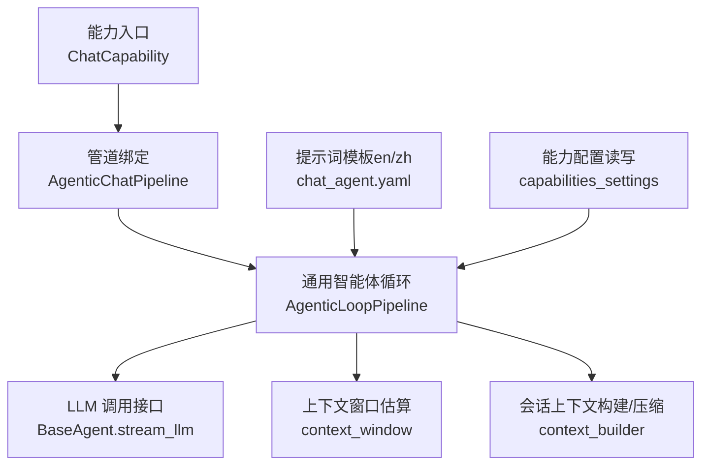
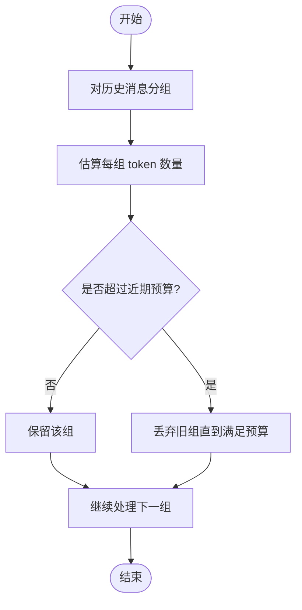
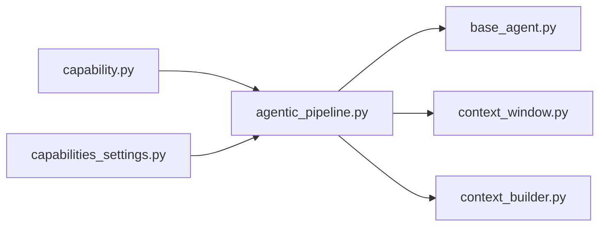

# 聊天智能体配置

<cite>
**本文引用的文件**   
- [capability.py](file://deeptutor/agents/chat/capability.py)
- [agentic_pipeline.py](file://deeptutor/agents/chat/agentic_pipeline.py)
- [chat_agent.yaml（英文）](file://deeptutor/agents/chat/prompts/en/chat_agent.yaml)
- [chat_agent.yaml（中文）](file://deeptutor/agents/chat/prompts/zh/chat_agent.yaml)
- [context_window.py](file://deeptutor/services/llm/context_window.py)
- [capabilities_settings.py](file://deeptutor/services/config/capabilities_settings.py)
- [base_agent.py](file://deeptutor/agents/base_agent.py)
- [context_builder.py](file://deeptutor/services/session/context_builder.py)
</cite>

## 目录
1. [简介](#简介)
2. [项目结构](#项目结构)
3. [核心组件](#核心组件)
4. [架构总览](#架构总览)
5. [详细组件分析](#详细组件分析)
6. [依赖关系分析](#依赖关系分析)
7. [性能考量](#性能考量)
8. [故障排查指南](#故障排查指南)
9. [结论](#结论)
10. [附录](#附录)

## 简介
本文件面向 DeepTutor 的“聊天智能体”能力，系统化说明其配置项与运行机制，覆盖以下方面：
- 模型选择、上下文窗口大小、温度等推理参数
- 提示词模板（系统提示、用户提示、历史格式、参考上下文模板）
- 会话管理（历史消息限制、上下文预算控制、记忆机制）
- 流式响应、错误重试策略与超时设置
- 多语言支持与国际化配置

## 项目结构
聊天智能体的实现以“能力 + 管道 + 提示词”的方式组织：
- 能力入口：注册并启动聊天能力
- 管道绑定：将聊天能力绑定到通用的探索型智能体循环
- 提示词模板：按语言提供系统提示、用户提示、历史格式与参考上下文模板
- 服务层：上下文窗口估算、会话上下文构建与压缩、能力配置读写



图示来源
- [capability.py:12-17](file://deeptutor/agents/chat/capability.py#L12-L17)
- [agentic_pipeline.py:36-37](file://deeptutor/agents/chat/agentic_pipeline.py#L36-L37)
- [base_agent.py:527-556](file://deeptutor/agents/base_agent.py#L527-L556)
- [context_window.py:1-28](file://deeptutor/services/llm/context_window.py#L1-L28)
- [context_builder.py:351-389](file://deeptutor/services/session/context_builder.py#L351-L389)
- [capabilities_settings.py:327-353](file://deeptutor/services/config/capabilities_settings.py#L327-L353)

章节来源
- [capability.py:12-17](file://deeptutor/agents/chat/capability.py#L12-L17)
- [agentic_pipeline.py:1-49](file://deeptutor/agents/chat/agentic_pipeline.py#L1-L49)

## 核心组件
- 聊天能力入口：负责创建管道并传入当前语言，驱动一次对话回合。
- 聊天管道：继承通用智能体循环，复用默认协议、工具集与提示包。
- 提示词模板：按语言提供 system、user_template、history_format、context_template。
- 上下文窗口：根据模型名或显式配置估算上下文容量，用于预算控制。
- 会话上下文构建：对历史消息分组、估算 token、裁剪与摘要，维持上下文预算。
- 能力配置：读写 chat 能力的 temperature、max_rounds、阶段 max_tokens 等参数。

章节来源
- [capability.py:12-17](file://deeptutor/agents/chat/capability.py#L12-L17)
- [agentic_pipeline.py:36-37](file://deeptutor/agents/chat/agentic_pipeline.py#L36-L37)
- [chat_agent.yaml（英文）:1-36](file://deeptutor/agents/chat/prompts/en/chat_agent.yaml#L1-L36)
- [chat_agent.yaml（中文）:1-36](file://deeptutor/agents/chat/prompts/zh/chat_agent.yaml#L1-L36)
- [context_window.py:1-28](file://deeptutor/services/llm/context_window.py#L1-L28)
- [context_builder.py:351-389](file://deeptutor/services/session/context_builder.py#L351-L389)
- [capabilities_settings.py:327-353](file://deeptutor/services/config/capabilities_settings.py#L327-L353)

## 架构总览
聊天智能体在一次回合中的关键流程如下：

```mermaid
sequenceDiagram
participant U as "用户"
participant Cap as "聊天能力 ChatCapability"
participant Pipe as "聊天管道 AgenticChatPipeline"
participant Loop as "通用循环 AgenticLoopPipeline"
participant LLM as "LLM 调用 BaseAgent.stream_llm"
participant Ctx as "上下文构建 context_builder"
participant Win as "上下文窗口 context_window"
U->>Cap : 发起对话请求
Cap->>Pipe : 创建管道(携带 language)
Pipe->>Loop : 进入探索循环
Loop->>Win : 解析/估算上下文窗口
Loop->>Ctx : 构建/裁剪会话上下文
Loop->>LLM : 流式生成(temperature, model, max_tokens)
LLM-->>Loop : 流式文本/工具调用
Loop-->>U : 逐步输出结果
```

图示来源
- [capability.py:12-17](file://deeptutor/agents/chat/capability.py#L12-L17)
- [agentic_pipeline.py:36-37](file://deeptutor/agents/chat/agentic_pipeline.py#L36-L37)
- [base_agent.py:527-556](file://deeptutor/agents/base_agent.py#L527-L556)
- [context_window.py:1-28](file://deeptutor/services/llm/context_window.py#L1-L28)
- [context_builder.py:351-389](file://deeptutor/services/session/context_builder.py#L351-L389)

## 详细组件分析

### 模型选择与推理参数
- 模型选择：由上层运行时与提供者注册表决定；聊天管道通过通用循环发起 LLM 调用。
- 温度 temperature：在聊天能力配置中可写，写入 agents.yaml 的 capabilities.chat.temperature。
- 最大轮次 max_rounds：在聊天能力配置中可写，范围 1–50。
- 阶段级 max_tokens：可对不同阶段分别设置上限，范围 1–200,000。

建议
- 若需要更稳定/确定性输出，降低 temperature；若需要更多创造性，提高 temperature。
- 长对话场景下，优先通过阶段级 max_tokens 控制各步输出长度，避免一次性过长导致截断。

章节来源
- [capabilities_settings.py:327-353](file://deeptutor/services/config/capabilities_settings.py#L327-L353)
- [base_agent.py:527-556](file://deeptutor/agents/base_agent.py#L527-L556)

### 上下文窗口大小
- 支持显式传入 context_window，或通过模型名自动估算。
- 内置已知模型的上下文窗口映射，未知模型会回退为估计值。
- 大上下文模型标记（如 gpt-4o、claude、gemini、qwen、deepseek 等）会影响默认窗口估算。

建议
- 部署时尽量提供准确的 provider 元数据；若不确定，使用估算模式并在日志中关注 window_estimated 标志。
- 超长上下文任务应结合会话压缩与分段预算，避免单次请求过大。

章节来源
- [context_window.py:1-28](file://deeptutor/services/llm/context_window.py#L1-L28)

### 提示词模板配置
聊天智能体使用 YAML 模板定义提示词，按语言区分：
- system：系统角色提示，定义智能体身份、能力与行为准则
- user_template：用户消息模板
- history_format：历史对话拼接格式
- context_template：RAG/参考上下文的插入模板

多语言
- en：英文模板
- zh：中文模板

建议
- 保持 system 简洁明确，避免注入过多运行时信息
- 当启用 RAG 时，确保 context_template 清晰标注引用来源
- 在多语言环境中，根据当前 language 选择对应模板

章节来源
- [chat_agent.yaml（英文）:1-36](file://deeptutor/agents/chat/prompts/en/chat_agent.yaml#L1-L36)
- [chat_agent.yaml（中文）:1-36](file://deeptutor/agents/chat/prompts/zh/chat_agent.yaml#L1-L36)

### 会话管理与记忆机制
- 历史消息分组与裁剪：按“轮次”分组，保留最近若干轮，保证不超过 recent_budget。
- Token 估算：优先使用 tiktoken，否则回退为字符数估算。
- 摘要与清理：对摘要进行清理，去除泄露的“思考草稿”，避免重复计费与预算浪费。
- 预算控制：结合上下文窗口与阶段级 max_tokens，动态裁剪历史与输出长度。



图示来源
- [context_builder.py:351-389](file://deeptutor/services/session/context_builder.py#L351-L389)

章节来源
- [context_builder.py:80-115](file://deeptutor/services/session/context_builder.py#L80-L115)
- [context_builder.py:351-389](file://deeptutor/services/session/context_builder.py#L351-L389)

### 流式响应、错误重试与超时
- 流式响应：通过统一接口 BaseAgent.stream_llm 返回增量内容，便于前端逐步渲染。
- 错误重试与超时：具体策略由底层 LLM 客户端/提供者实现；聊天管道复用通用循环，不在此处硬编码。
- 使用建议：
  - 前端监听流式事件，及时展示中间结果
  - 对网络不稳定环境，建议在网关/代理层增加重试与超时保护
  - 记录每次调用的 reason/usage，便于定位截断与配额问题

章节来源
- [base_agent.py:527-556](file://deeptutor/agents/base_agent.py#L527-L556)

### 多语言支持与国际化
- 提示词模板按语言提供（en/zh），由能力入口传入的 language 决定加载哪套模板。
- 建议在应用层维护语言偏好，并在创建聊天管道时传递当前语言。

章节来源
- [capability.py:12-17](file://deeptutor/agents/chat/capability.py#L12-L17)
- [chat_agent.yaml（英文）:1-36](file://deeptutor/agents/chat/prompts/en/chat_agent.yaml#L1-L36)
- [chat_agent.yaml（中文）:1-36](file://deeptutor/agents/chat/prompts/zh/chat_agent.yaml#L1-L36)

## 依赖关系分析
聊天智能体依赖的关键模块与职责：
- capability.py：注册并运行聊天能力
- agentic_pipeline.py：绑定通用智能体循环
- base_agent.py：统一的 LLM 流式调用接口
- context_window.py：上下文窗口估算
- context_builder.py：会话上下文构建、裁剪与摘要
- capabilities_settings.py：聊天能力配置的读写



图示来源
- [capability.py:12-17](file://deeptutor/agents/chat/capability.py#L12-L17)
- [agentic_pipeline.py:36-37](file://deeptutor/agents/chat/agentic_pipeline.py#L36-L37)
- [base_agent.py:527-556](file://deeptutor/agents/base_agent.py#L527-L556)
- [context_window.py:1-28](file://deeptutor/services/llm/context_window.py#L1-L28)
- [context_builder.py:351-389](file://deeptutor/services/session/context_builder.py#L351-L389)
- [capabilities_settings.py:327-353](file://deeptutor/services/config/capabilities_settings.py#L327-L353)

## 性能考量
- 上下文窗口估算：未知模型会走估算路径，可能带来额外开销；生产环境建议提供准确模型元数据。
- 会话裁剪：按轮次分组与二分查找最近可用后缀，避免二次复杂度；图像 URL 不计入文本 token，减少误估。
- 摘要清理：移除泄露的“思考草稿”，防止摘要被污染导致后续轮次重复付费。
- 阶段级 max_tokens：合理拆分长回答，提升可控性与可观测性。

[本节为通用指导，无需列出具体文件来源]

## 故障排查指南
常见问题与定位要点：
- 输出被截断：检查阶段级 max_tokens 与上下文窗口估算；查看 LLM 返回的 reason/usage。
- 上下文膨胀：确认会话裁剪逻辑是否生效，检查 recent_budget 与历史分组策略。
- 多语言错配：确认传入 language 与模板目录一致。
- 流式卡顿：检查网络与上游代理的重试/超时策略；确认前端是否正确消费流式事件。

章节来源
- [base_agent.py:527-556](file://deeptutor/agents/base_agent.py#L527-L556)
- [context_builder.py:351-389](file://deeptutor/services/session/context_builder.py#L351-L389)

## 结论
聊天智能体通过“能力 + 管道 + 模板”的分层设计，将模型调用、上下文预算、提示词与多语言支持解耦。推荐在生产环境中：
- 明确模型元数据与上下文窗口
- 精细配置 temperature、max_rounds 与阶段级 max_tokens
- 启用会话裁剪与摘要清理，控制上下文预算
- 在前端消费流式响应，提升交互体验
- 按语言加载对应提示词模板，保持一致的用户体验

[本节为总结性内容，无需列出具体文件来源]

## 附录
- 配置键速览（聊天能力）
  - temperature：浮点数，控制随机性
  - max_rounds：整数，1–50，控制最大轮次
  - stage.max_tokens：整数，1–200,000，分阶段控制输出长度
- 提示词模板字段
  - system：系统提示
  - user_template：用户消息模板
  - history_format：历史对话格式
  - context_template：参考上下文模板

章节来源
- [capabilities_settings.py:327-353](file://deeptutor/services/config/capabilities_settings.py#L327-L353)
- [chat_agent.yaml（英文）:1-36](file://deeptutor/agents/chat/prompts/en/chat_agent.yaml#L1-L36)
- [chat_agent.yaml（中文）:1-36](file://deeptutor/agents/chat/prompts/zh/chat_agent.yaml#L1-L36)