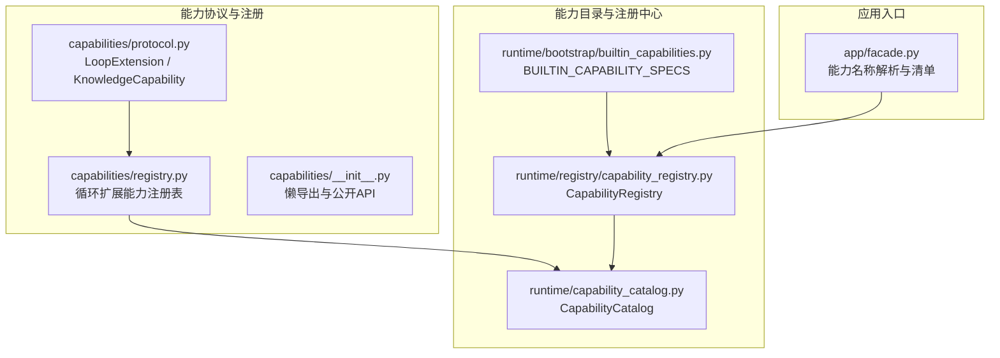
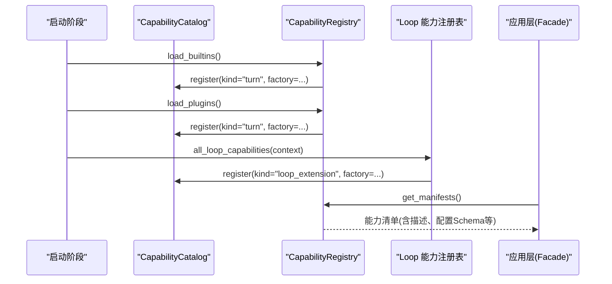
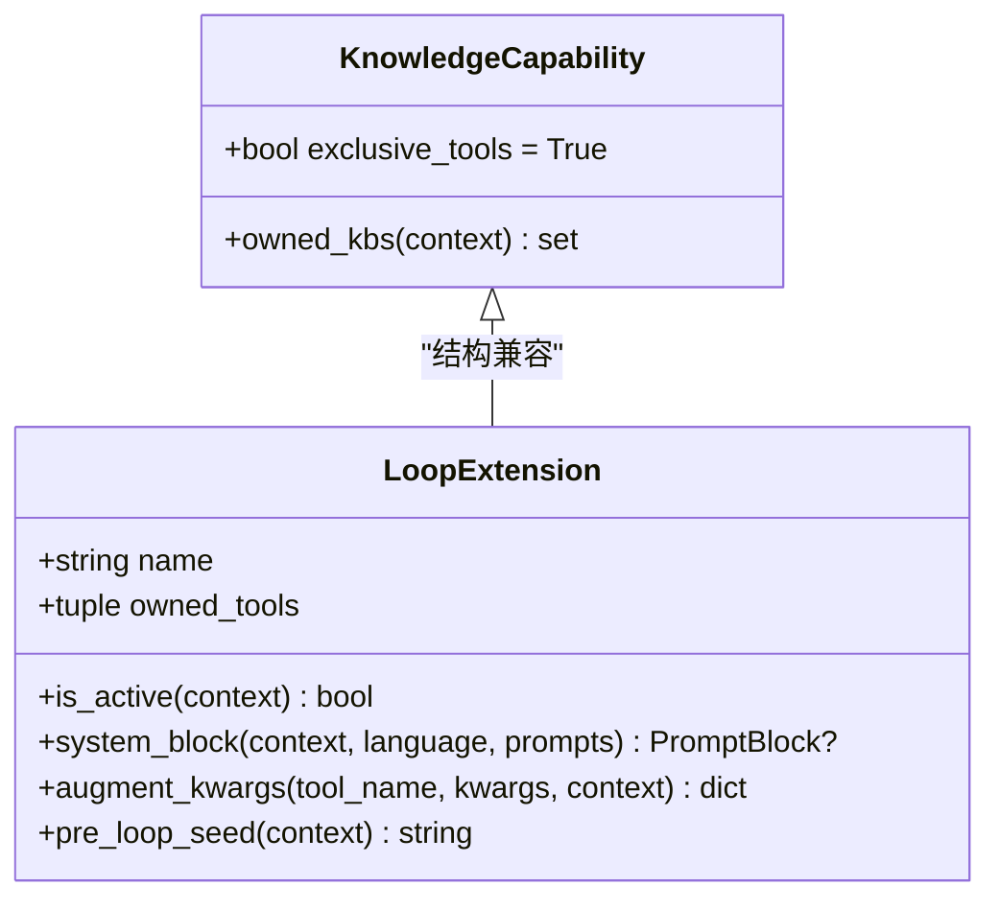
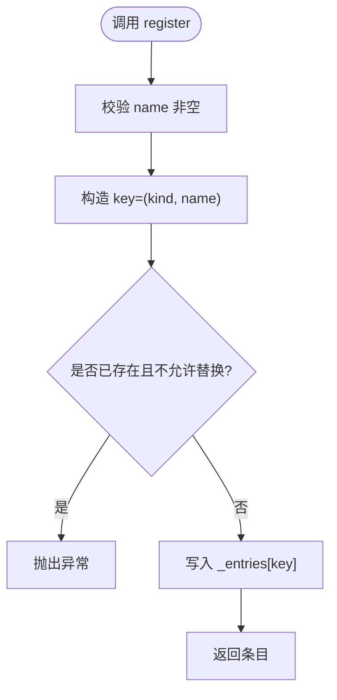
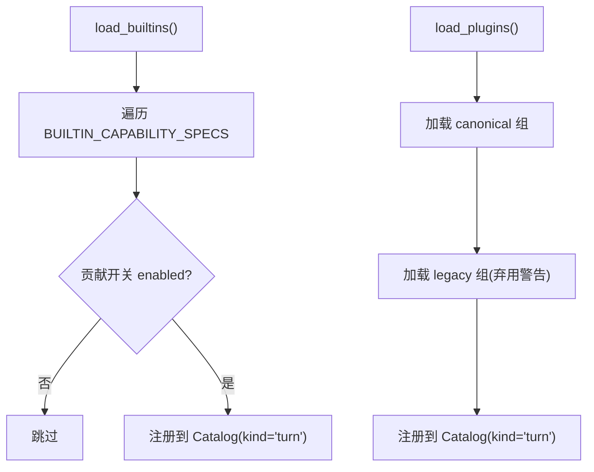
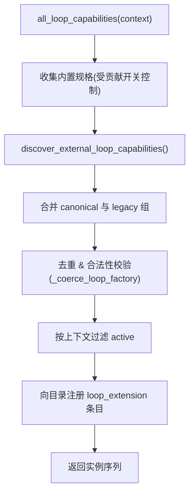
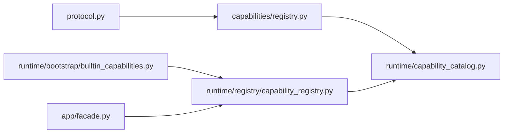

# 能力注册机制

<cite>
**本文引用的文件**   
- [capabilities/registry.py](file://deeptutor/capabilities/registry.py)
- [capabilities/protocol.py](file://deeptutor/capabilities/protocol.py)
- [capabilities/__init__.py](file://deeptutor/capabilities/__init__.py)
- [runtime/capability_catalog.py](file://deeptutor/runtime/capability_catalog.py)
- [runtime/registry/capability_registry.py](file://deeptutor/runtime/registry/capability_registry.py)
- [runtime/bootstrap/builtin_capabilities.py](file://deeptutor/runtime/bootstrap/builtin_capabilities.py)
- [app/facade.py](file://deeptutor/app/facade.py)
</cite>

## 目录
1. [引言](#引言)
2. [项目结构](#项目结构)
3. [核心组件](#核心组件)
4. [架构总览](#架构总览)
5. [详细组件分析](#详细组件分析)
6. [依赖关系分析](#依赖关系分析)
7. [性能与可扩展性](#性能与可扩展性)
8. [故障排查指南](#故障排查指南)
9. [结论](#结论)
10. [附录：自定义能力开发指南](#附录自定义能力开发指南)

## 引言
本文件系统性说明 DeepTutor 的能力注册机制，覆盖以下主题：
- 能力的发现、加载与初始化流程
- 能力注册表的实现原理（元数据存储与查询）
- 能力的生命周期管理（启动、运行、销毁）
- 自定义能力的接口规范、实现与测试方法
- 依赖管理与版本兼容性处理
- 动态加载与热更新机制

该机制将“对话轮次级能力”和“聊天循环扩展能力”统一纳入可插拔的注册体系，既支持内置能力，也支持外部插件。

## 项目结构
围绕能力注册的核心代码主要分布在以下模块：
- capabilities：定义协议与循环扩展能力的注册表
- runtime.capability_catalog：统一的工厂型能力目录
- runtime.registry.capability_registry：面向“轮次能力”的兼容视图与加载器
- runtime.bootstrap.builtin_capabilities：从模块清单中构建内置能力规格
- app.facade：对外暴露能力解析与清单能力

**图表来源**
- [capabilities/protocol.py:38-174](file://deeptutor/capabilities/protocol.py#L38-L174)
- [capabilities/registry.py:28-187](file://deeptutor/capabilities/registry.py#L28-L187)
- [runtime/capability_catalog.py:21-79](file://deeptutor/runtime/capability_catalog.py#L21-L79)
- [runtime/registry/capability_registry.py:58-103](file://deeptutor/runtime/registry/capability_registry.py#L58-L103)
- [runtime/bootstrap/builtin_capabilities.py:11-30](file://deeptutor/runtime/bootstrap/builtin_capabilities.py#L11-L30)
- [app/facade.py:84-94](file://deeptutor/app/facade.py#L84-L94)

**章节来源**
- [capabilities/protocol.py:38-174](file://deeptutor/capabilities/protocol.py#L38-L174)
- [capabilities/registry.py:28-187](file://deeptutor/capabilities/registry.py#L28-L187)
- [runtime/capability_catalog.py:21-79](file://deeptutor/runtime/capability_catalog.py#L21-L79)
- [runtime/registry/capability_registry.py:58-103](file://deeptutor/runtime/registry/capability_registry.py#L58-L103)
- [runtime/bootstrap/builtin_capabilities.py:11-30](file://deeptutor/runtime/bootstrap/builtin_capabilities.py#L11-L30)
- [app/facade.py:84-94](file://deeptutor/app/facade.py#L84-L94)

## 核心组件
- LoopExtension 与 KnowledgeCapability：定义循环扩展能力与知识类能力的协议与行为约定
- CapabilityCatalog：统一的工厂型目录，负责按 kind:name 存储与创建能力实例
- CapabilityRegistry：面向“轮次能力”的兼容视图，负责内置能力与插件的发现、注册与清单生成
- Loop 能力注册表：针对聊天循环扩展能力的发现、去重、激活过滤与工具归属映射
- 内置能力规格：从模块清单中构建无需导入的规格描述，延迟实例化

**章节来源**
- [capabilities/protocol.py:38-174](file://deeptutor/capabilities/protocol.py#L38-L174)
- [runtime/capability_catalog.py:21-79](file://deeptutor/runtime/capability_catalog.py#L21-L79)
- [runtime/registry/capability_registry.py:58-103](file://deeptutor/runtime/registry/capability_registry.py#L58-L103)
- [capabilities/registry.py:28-187](file://deeptutor/capabilities/registry.py#L28-L187)
- [runtime/bootstrap/builtin_capabilities.py:11-30](file://deeptutor/runtime/bootstrap/builtin_capabilities.py#L11-L30)

## 架构总览
下图展示能力注册的整体流程：从模块清单与插件入口点发现能力，到注册到目录，再到运行时按需创建实例并参与对话轮次。

**图表来源**
- [runtime/registry/capability_registry.py:85-103](file://deeptutor/runtime/registry/capability_registry.py#L85-L103)
- [runtime/registry/capability_registry.py:105-146](file://deeptutor/runtime/registry/capability_registry.py#L105-L146)
- [capabilities/registry.py:159-187](file://deeptutor/capabilities/registry.py#L159-L187)
- [app/facade.py:84-94](file://deeptutor/app/facade.py#L84-L94)

## 详细组件分析

### 能力协议与类型
- LoopExtension：定义循环扩展能力的最小契约，包括 name、owned_tools、is_active、system_block、augment_kwargs、pre_loop_seed 等可选钩子；支持 exclusive_tools 以独占工具集。
- KnowledgeCapability：继承自协议语义的知识类能力基类，标记 exclusive_tools=True，表示当该能力激活时，会替换而非增强工具集。

**图表来源**
- [capabilities/protocol.py:38-174](file://deeptutor/capabilities/protocol.py#L38-L174)

**章节来源**
- [capabilities/protocol.py:38-174](file://deeptutor/capabilities/protocol.py#L38-L174)

### 能力目录 CapabilityCatalog
- 职责：以 (kind, name) 为键存储 CapabilityCatalogEntry，提供 register/get/create/entries/clear 等方法。
- 设计要点：
  - 使用 frozen dataclass 存储条目，保证不可变性与高效比较
  - EmptyConfig 作为默认无参配置模型，拒绝未知字段
  - create 通过工厂函数延迟实例化，避免不必要的导入开销

**图表来源**
- [runtime/capability_catalog.py:33-63](file://deeptutor/runtime/capability_catalog.py#L33-L63)

**章节来源**
- [runtime/capability_catalog.py:15-79](file://deeptutor/runtime/capability_catalog.py#L15-L79)

### 轮次能力注册中心 CapabilityRegistry
- 职责：面向“轮次能力”的兼容视图，负责：
  - 从模块清单加载内置能力规格，注册到目录
  - 从插件入口点加载外部能力
  - 提供 get/list_capabilities/get_manifests 等查询接口
- 关键点：
  - 每个 get(name) 都会创建新实例（惰性创建）
  - 清单输出包含 i18n 描述、阶段、工具、CLI 别名与请求 Schema
  - 对插件进行权限过滤（_plugin_allowed）

**图表来源**
- [runtime/registry/capability_registry.py:85-103](file://deeptutor/runtime/registry/capability_registry.py#L85-L103)
- [runtime/registry/capability_registry.py:105-146](file://deeptutor/runtime/registry/capability_registry.py#L105-L146)

**章节来源**
- [runtime/registry/capability_registry.py:58-103](file://deeptutor/runtime/registry/capability_registry.py#L58-L103)
- [runtime/registry/capability_registry.py:105-146](file://deeptutor/runtime/registry/capability_registry.py#L105-L146)
- [runtime/registry/capability_registry.py:178-224](file://deeptutor/runtime/registry/capability_registry.py#L178-L224)

### 循环扩展能力注册表
- 职责：
  - 从模块清单构建内置 Loop 能力规格（无需导入）
  - 从插件入口点发现外部 Loop 能力，并进行去重与合法性校验
  - 在 all_loop_capabilities 中按上下文激活过滤，并将能力注册到目录
  - 维护工具归属映射 capability_tool_owners
- 关键流程：
  - _coerce_loop_factory：兼容类、工厂或实例三种形式
  - discover_external_loop_capabilities：合并 canonical 与 legacy 组，并发出弃用警告
  - all_loop_capabilities：结合上下文缓存 instances，向目录注册 loop_extension 条目

**图表来源**
- [capabilities/registry.py:50-65](file://deeptutor/capabilities/registry.py#L50-L65)
- [capabilities/registry.py:86-112](file://deeptutor/capabilities/registry.py#L86-L112)
- [capabilities/registry.py:115-152](file://deeptutor/capabilities/registry.py#L115-L152)
- [capabilities/registry.py:159-187](file://deeptutor/capabilities/registry.py#L159-L187)

**章节来源**
- [capabilities/registry.py:28-187](file://deeptutor/capabilities/registry.py#L28-L187)

### 内置能力规格与清单
- builtin_capabilities：从 manifests() 聚合模块中的 capabilities 与 loops 声明，生成无需导入的规格对象
- facade：对外提供 resolve_capability 与 get_capability_contracts，用于名称解析与清单消费

**章节来源**
- [runtime/bootstrap/builtin_capabilities.py:11-30](file://deeptutor/runtime/bootstrap/builtin_capabilities.py#L11-L30)
- [app/facade.py:84-94](file://deeptutor/app/facade.py#L84-L94)

## 依赖关系分析
- 低耦合：协议与注册逻辑分离，Catalog 作为通用容器，Registry 与 Loop 注册表分别面向不同能力层级
- 延迟导入：内置规格不直接导入具体类，仅在需要时通过 class_path 反射创建
- 插件兼容：同时支持新的 canonical 组与旧的 legacy 组，并提供弃用警告
- 上下文感知：Loop 能力激活状态由 is_active(context) 决定，并在 all_loop_capabilities 中结合上下文缓存实例

**图表来源**
- [capabilities/protocol.py:38-174](file://deeptutor/capabilities/protocol.py#L38-L174)
- [capabilities/registry.py:28-187](file://deeptutor/capabilities/registry.py#L28-L187)
- [runtime/capability_catalog.py:21-79](file://deeptutor/runtime/capability_catalog.py#L21-L79)
- [runtime/registry/capability_registry.py:58-103](file://deeptutor/runtime/registry/capability_registry.py#L58-L103)
- [runtime/bootstrap/builtin_capabilities.py:11-30](file://deeptutor/runtime/bootstrap/builtin_capabilities.py#L11-L30)
- [app/facade.py:84-94](file://deeptutor/app/facade.py#L84-L94)

**章节来源**
- [capabilities/registry.py:28-187](file://deeptutor/capabilities/registry.py#L28-L187)
- [runtime/registry/capability_registry.py:58-103](file://deeptutor/runtime/registry/capability_registry.py#L58-L103)
- [runtime/capability_catalog.py:21-79](file://deeptutor/runtime/capability_catalog.py#L21-L79)

## 性能与可扩展性
- 延迟实例化：通过工厂函数与 class_path 反射，避免启动期大量导入
- 缓存策略：
  - Loop 能力实例在上下文 runtime.loop_extensions 中缓存，减少重复创建
  - 外部能力发现结果通过 @cache 缓存，避免重复扫描入口点
- 去重与冲突处理：
  - 外部能力与内置能力同名时，后者优先，前者被忽略并记录警告
  - 目录注册支持 replace 参数，允许覆盖旧条目
- 可扩展性：
  - 新增能力只需在模块清单中声明，或通过插件入口点注册
  - 支持 exclusive_tools 切换工具集模式，满足知识类能力的独占场景

[本节为通用指导，不涉及具体文件分析]

## 故障排查指南
- 能力未生效
  - 检查贡献开关是否启用（contribution_enabled）
  - 确认 is_active(context) 返回 True
  - 核对能力名称是否与清单一致
- 外部能力被忽略
  - 查看日志中关于“invalid class or factory”或“shadowed by built-in”的警告
  - 确保 entry point 返回的对象满足 LoopExtension/TurnCapability 契约
- 重复注册错误
  - 若未设置 replace=True，重复注册同名能力会抛异常
- 插件弃用警告
  - 旧版插件组名会触发 DeprecationWarning，建议迁移至新的 canonical 组

**章节来源**
- [capabilities/registry.py:115-152](file://deeptutor/capabilities/registry.py#L115-L152)
- [runtime/registry/capability_registry.py:105-146](file://deeptutor/runtime/registry/capability_registry.py#L105-L146)
- [runtime/capability_catalog.py:39-63](file://deeptutor/runtime/capability_catalog.py#L39-L63)

## 结论
DeepTutor 的能力注册机制通过协议抽象、目录容器与分层注册表，实现了内置与外部能力的统一发现、加载与生命周期管理。其设计强调延迟导入、上下文感知、去重与兼容过渡，既保证了系统性能，也为扩展与演进提供了清晰路径。

[本节为总结性内容，不涉及具体文件分析]

## 附录：自定义能力开发指南

### 接口定义与实现规范
- 轮次能力（TurnCapability）
  - 实现 TurnCapability 协议，提供 manifest、stages、tools_used、cli_aliases 等元数据
  - 通过 CapabilityRegistry.register 或模块清单声明进行注册
- 循环扩展能力（LoopExtension）
  - 实现 LoopExtension 协议，至少提供 name、owned_tools、is_active
  - 可选实现 system_block、augment_kwargs、pre_loop_seed 等钩子
  - 如需独占工具集，可实现 KnowledgeCapability 基类

**章节来源**
- [capabilities/protocol.py:38-174](file://deeptutor/capabilities/protocol.py#L38-L174)
- [runtime/registry/capability_registry.py:58-103](file://deeptutor/runtime/registry/capability_registry.py#L58-L103)

### 注册方式
- 内置能力
  - 在模块清单中添加 capabilities 或 loops 条目，指定 class_path 与 manifest
- 外部插件
  - 通过入口点组 deeptutor.extensions 注册 Loop 或 Turn 能力
  - 旧版 deeptutor.plugins 仍兼容但会发出弃用警告

**章节来源**
- [runtime/bootstrap/builtin_capabilities.py:11-30](file://deeptutor/runtime/bootstrap/builtin_capabilities.py#L11-L30)
- [capabilities/registry.py:115-152](file://deeptutor/capabilities/registry.py#L115-L152)
- [runtime/registry/capability_registry.py:105-146](file://deeptutor/runtime/registry/capability_registry.py#L105-L146)

### 测试方法
- 单元测试
  - 验证 is_active(context) 在不同上下文下的行为
  - 验证 owned_tools 与 tool 归属映射 capability_tool_owners
  - 验证清单输出 get_manifests 的结构与 i18n 字段
- 集成测试
  - 模拟插件入口点注册，验证发现与去重逻辑
  - 验证目录注册与实例创建流程

[本节为通用指导，不涉及具体文件分析]

### 依赖管理与版本兼容性
- 依赖注入
  - 通过 augment_kwargs 注入服务器端私有参数
  - 通过 pre_loop_seed 注入前置上下文
- 版本兼容
  - LoopCapability 已弃用，建议使用 LoopExtension
  - 旧版插件组名会触发弃用警告，应迁移至新组名

**章节来源**
- [capabilities/protocol.py:177-187](file://deeptutor/capabilities/protocol.py#L177-L187)
- [capabilities/registry.py:115-152](file://deeptutor/capabilities/registry.py#L115-L152)

### 动态加载与热更新
- 动态加载
  - 外部能力通过入口点动态发现，无需重启服务
  - Loop 能力实例在上下文级别缓存，避免重复创建
- 热更新
  - 可通过 discover_external_loop_capabilities.cache_clear 清理发现缓存
  - 目录注册支持 replace=True，允许运行时覆盖旧条目

**章节来源**
- [capabilities/registry.py:115-157](file://deeptutor/capabilities/registry.py#L115-L157)
- [runtime/capability_catalog.py:39-63](file://deeptutor/runtime/capability_catalog.py#L39-L63)