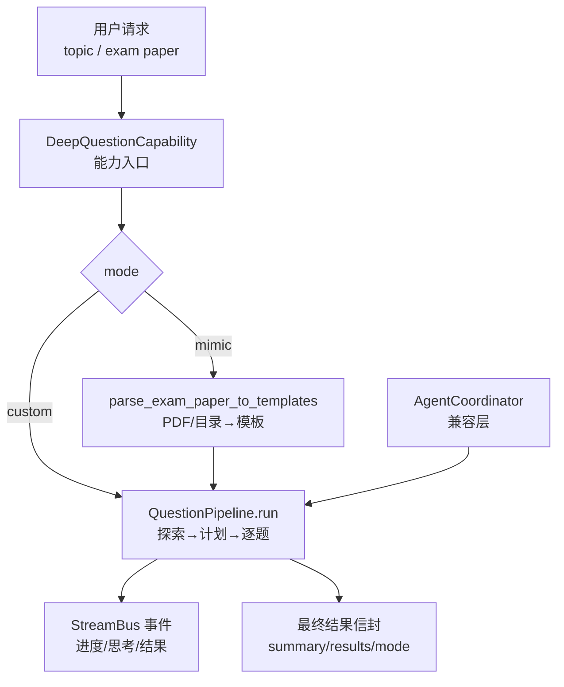
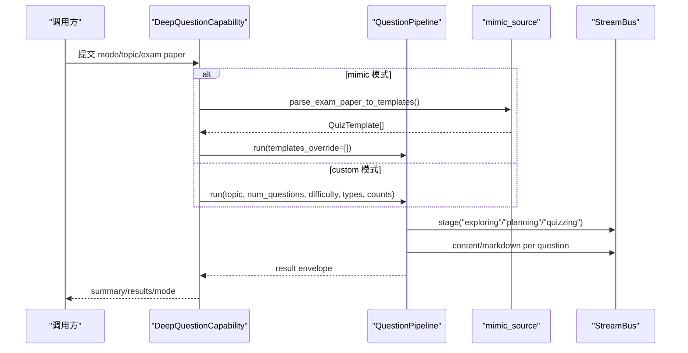
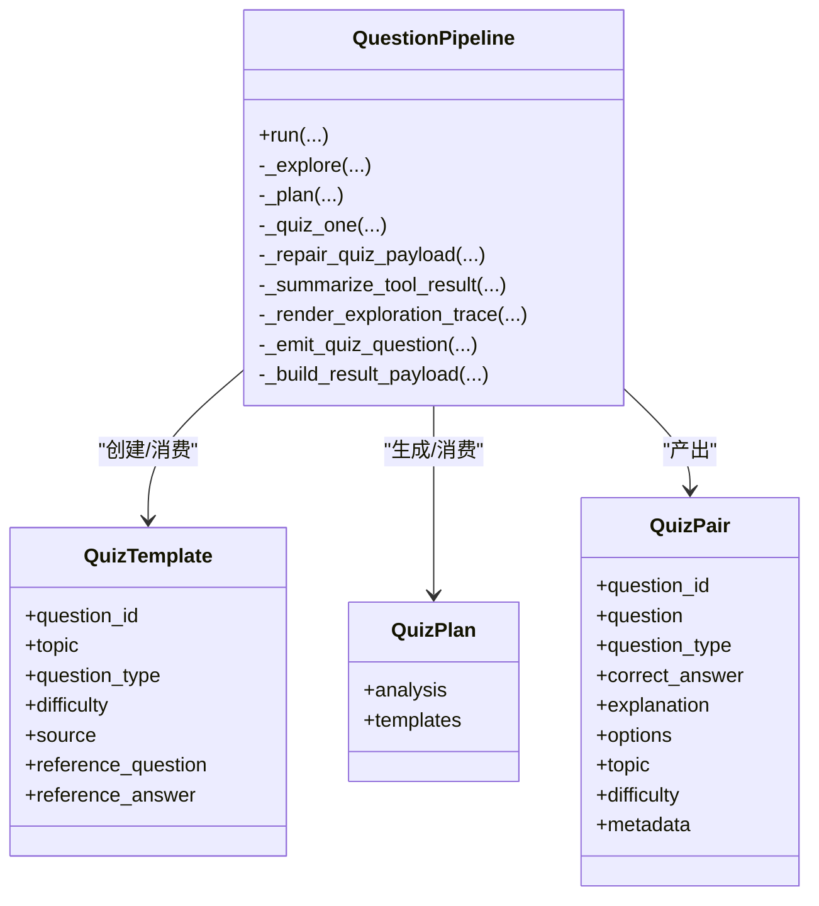
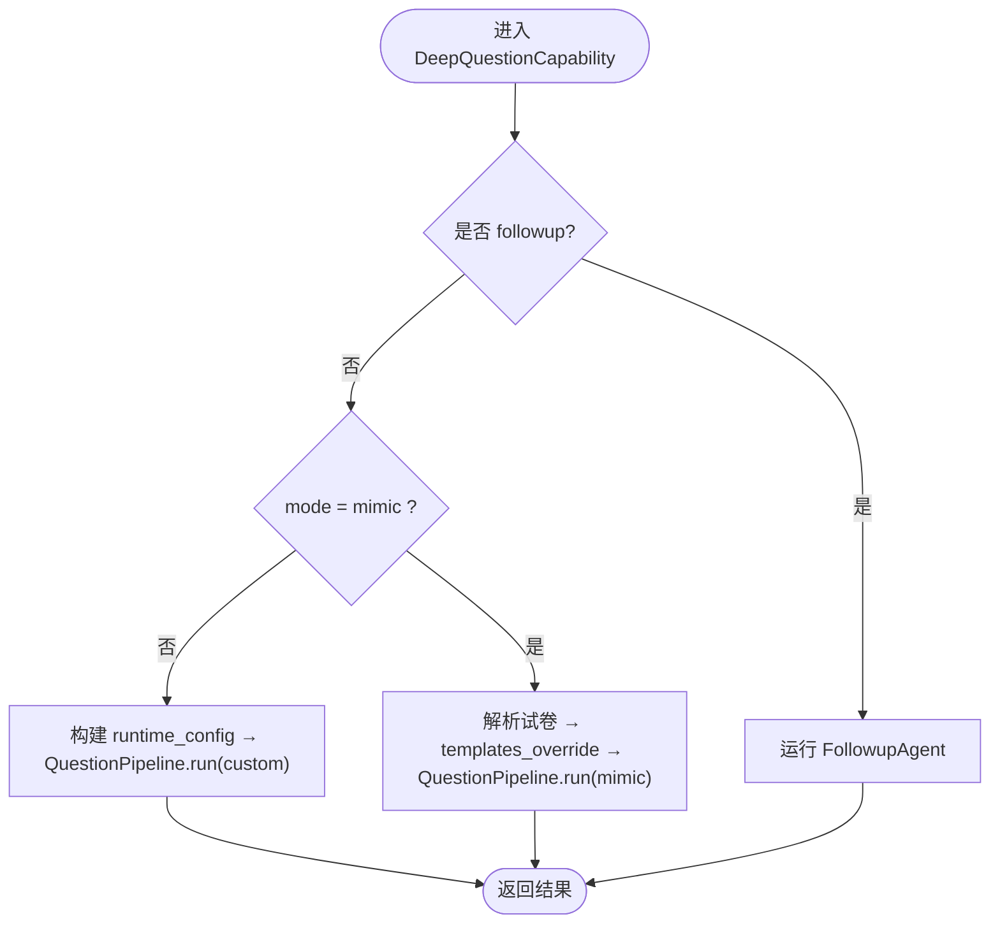
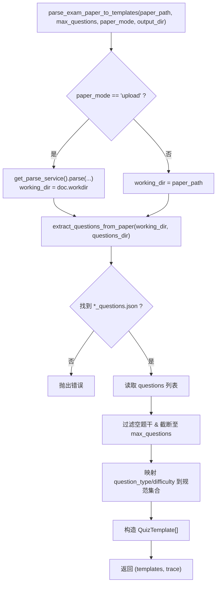
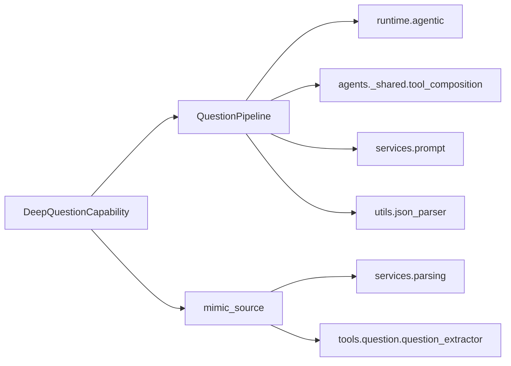

# 问题生成智能体配置

<cite>
**本文引用的文件**   
- [pipeline.py](file://deeptutor/agents/question/pipeline.py)
- [capability.py](file://deeptutor/agents/question/capability.py)
- [coordinator.py](file://deeptutor/agents/question/coordinator.py)
- [mimic_source.py](file://deeptutor/agents/question/mimic_source.py)
- [request_config.py](file://deeptutor/agents/question/request_config.py)
- [question.py](file://deeptutor/api/routers/question.py)
</cite>

## 目录
1. [简介](#简介)
2. [项目结构](#项目结构)
3. [核心组件](#核心组件)
4. [架构总览](#架构总览)
5. [详细组件分析](#详细组件分析)
6. [依赖关系分析](#依赖关系分析)
7. [性能与预算控制](#性能与预算控制)
8. [故障排查指南](#故障排查指南)
9. [结论](#结论)
10. [附录：配置参数清单](#附录配置参数清单)

## 简介
本文面向“问题生成智能体”的配置与使用，覆盖以下目标：
- 题目难度、题型分布、知识点覆盖等核心生成参数的含义与约束。
- 问题生成管道的阶段划分与数据流转：探索、计划、逐题生成与修复。
- 题目模仿源配置：从上传试卷或已解析目录提取模板，适配考试风格和学习材料。
- 质量控制配置：答案字段校验、题型一致性检查、自动修复与失败标记。
- 题目库管理与批量生成：通过能力层和 API 路由进行批控与结果汇总。

## 项目结构
问题生成智能体位于 `deeptutor/agents/question`，主要文件职责如下：
- `pipeline.py`：问题生成主流程（三阶段编排）、数据结构定义、JSON 解析与修复、工具调用与流式事件。
- `capability.py`：能力入口，负责模式分发（followup / custom / mimic）与参数解析。
- `coordinator.py`：兼容旧接口的适配器，封装 `QuestionPipeline` 并处理遗留输出格式。
- `mimic_source.py`：将 PDF/已解析目录转换为 `QuizTemplate` 列表，供模仿模式使用。
- `request_config.py`：从系统配置中构建 pipeline 运行时配置（如探索迭代上限、工具摘要器开关）。
- `api/routers/question.py`：API 路由示例，展示批量生成与 WebSocket 汇总上报。

**图表来源**
- [capability.py:32-174](file://deeptutor/agents/question/capability.py#L32-L174)
- [pipeline.py:457-614](file://deeptutor/agents/question/pipeline.py#L457-L614)
- [mimic_source.py:58-157](file://deeptutor/agents/question/mimic_source.py#L58-L157)
- [coordinator.py:31-149](file://deeptutor/agents/question/coordinator.py#L31-L149)

**章节来源**
- [capability.py:1-174](file://deeptutor/agents/question/capability.py#L1-L174)
- [pipeline.py:1-109](file://deeptutor/agents/question/pipeline.py#L1-L109)
- [mimic_source.py:1-15](file://deeptutor/agents/question/mimic_source.py#L1-L15)
- [coordinator.py:1-37](file://deeptutor/agents/question/coordinator.py#L1-L37)

## 核心组件
- `DeepQuestionCapability`：统一入口，根据 `mode` 选择 followup、custom 或 mimic 路径；解析 `num_questions`、`difficulty`、`question_types`、`per_type_counts`、`paper_path`、`max_questions` 等参数。
- `QuestionPipeline`：三阶段编排器，负责探索（Explore）、计划（Plan）、逐题生成（Quiz），以及 JSON 解析、规范化、问题校验与修复。
- `AgentCoordinator`：兼容旧接口，内部委托 `QuestionPipeline`，并提供 `generate_from_topic` 与 `generate_from_exam`。
- `parse_exam_paper_to_templates`：将 PDF 或已解析目录转换为 `QuizTemplate` 列表，支持 `upload` 与 `parsed` 两种模式。
- `build_question_runtime_config`：从 `main.yaml` 的 `capabilities.deep_question.exploring` 读取运行时参数，注入到 pipeline。

**章节来源**
- [capability.py:29-174](file://deeptutor/agents/question/capability.py#L29-L174)
- [pipeline.py:369-453](file://deeptutor/agents/question/pipeline.py#L369-L453)
- [coordinator.py:31-149](file://deeptutor/agents/question/coordinator.py#L31-L149)
- [mimic_source.py:58-157](file://deeptutor/agents/question/mimic_source.py#L58-L157)
- [request_config.py:39-74](file://deeptutor/agents/question/request_config.py#L39-L74)

## 架构总览
问题生成采用“能力入口 + 管道编排 + 工具集成 + 流式事件”的分层架构：
- 能力层负责参数校验、模式分支、会话历史加载、输出目录准备。
- 管道层负责三阶段控制流、提示词组装、LLM 调用、工具调度、结果封装。
- 工具层复用 chat 的工具组合策略，支持知识库检索、笔记本、题目库等可选工具。
- 流式层通过 `StreamBus` 推送阶段状态、思考片段、工具调用、题目卡片与最终结果。

**图表来源**
- [capability.py:32-174](file://deeptutor/agents/question/capability.py#L32-L174)
- [pipeline.py:457-614](file://deeptutor/agents/question/pipeline.py#L457-L614)
- [mimic_source.py:58-157](file://deeptutor/agents/question/mimic_source.py#L58-L157)

**章节来源**
- [capability.py:32-174](file://deeptutor/agents/question/capability.py#L32-L174)
- [pipeline.py:457-614](file://deeptutor/agents/question/pipeline.py#L457-L614)

## 详细组件分析

### 问题生成管道（QuestionPipeline）
- 三阶段：
  - Explore：基于用户消息、附件、会话历史与工具调用，产出“探索轨迹”，并生成面向用户的简短前言。
  - Plan：依据探索轨迹与参数，输出 JSON 计划，包含每道题的 `question_id`、`topic`、`question_type`、`difficulty`。
  - Quiz：对每个模板执行一次 agentic loop，产出结构化题目 JSON，并进行规范化与校验；若存在问题则触发修复轮次。
- 关键数据结构：
  - `QuizTemplate`：模板元信息（id、topic、type、difficulty、source、reference_*）。
  - `QuizPlan`：计划分析文本与模板列表。
  - `QuizPair`：最终题目对象（question、correct_answer、explanation、options、topic、difficulty、metadata）。
- 输入参数：
  - `num_questions`：期望题目数量。
  - `difficulty`：全局难度（easy/medium/hard），为空时由计划阶段决定。
  - `question_types`：允许题型白名单（空表示任意）。
  - `per_type_counts`：各题型数量目标（需与总数一致，由调用方保证）。
  - `conversation_context`、`attachments`、`quiz_history`、`templates_override`。

**图表来源**
- [pipeline.py:314-362](file://deeptutor/agents/question/pipeline.py#L314-L362)
- [pipeline.py:369-453](file://deeptutor/agents/question/pipeline.py#L369-L453)
- [pipeline.py:457-614](file://deeptutor/agents/question/pipeline.py#L457-L614)

**章节来源**
- [pipeline.py:314-362](file://deeptutor/agents/question/pipeline.py#L314-L362)
- [pipeline.py:369-453](file://deeptutor/agents/question/pipeline.py#L369-L453)
- [pipeline.py:457-614](file://deeptutor/agents/question/pipeline.py#L457-L614)

### 能力入口（DeepQuestionCapability）
- 模式分发：
  - followup：针对单道历史题目的追问回复。
  - custom：走完整三阶段管道。
  - mimic：先解析试卷为模板，再跳过 explore/plan，直接 quiz。
- 参数解析：
  - `mode`、`topic`、`num_questions`、`difficulty`、`question_types`、`per_type_counts`、`paper_path`、`max_questions`。
- 输出目录与会话历史：
  - 在运行时工作区下创建 `question_generation` 目录用于持久化。
  - 加载会话内历史题目，避免重复并定位薄弱点。

**图表来源**
- [capability.py:32-174](file://deeptutor/agents/question/capability.py#L32-L174)
- [capability.py:176-350](file://deeptutor/agents/question/capability.py#L176-L350)

**章节来源**
- [capability.py:29-174](file://deeptutor/agents/question/capability.py#L29-L174)
- [capability.py:176-350](file://deeptutor/agents/question/capability.py#L176-L350)

### 题目模仿源（mimic_source）
- 输入：
  - `paper_path`：PDF 路径或已解析目录。
  - `paper_mode`：`upload`（上传 PDF）或 `parsed`（已有解析产物）。
  - `max_questions`：限制提取的题目数量。
  - `output_dir`：输出目录（questions JSON 写入 session output，不污染解析缓存）。
- 处理流程：
  - 若为 `upload`，调用解析服务 MinerU，并将进度回调桥接到 StreamBus。
  - 若为 `parsed`，直接使用已有工作目录。
  - 从 `_questions.json` 读取题目，按 `question_type` 与 `difficulty` 映射到规范类型。
  - 构造 `QuizTemplate` 列表，保留原始题干与答案作为参考。

**图表来源**
- [mimic_source.py:58-157](file://deeptutor/agents/question/mimic_source.py#L58-L157)

**章节来源**
- [mimic_source.py:1-15](file://deeptutor/agents/question/mimic_source.py#L1-L15)
- [mimic_source.py:58-157](file://deeptutor/agents/question/mimic_source.py#L58-L157)

### 兼容适配器（AgentCoordinator）
- 提供两个方法：
  - `generate_from_topic`：主题生成，委托 `QuestionPipeline.run`。
  - `generate_from_exam`：试卷模仿，先解析再传入 `templates_override`。
- 输出包装：
  - 将 pipeline 的结果转换为遗留摘要格式，补充 `success`、`completed`、`failed`、`results` 等字段。

**章节来源**
- [coordinator.py:31-149](file://deeptutor/agents/question/coordinator.py#L31-L149)

### 运行时配置（request_config）
- 从 `main.yaml` 的 `capabilities.deep_question.exploring` 读取：
  - `max_iterations`：探索阶段最大迭代次数（默认 8）。
  - `tool_summarizer.enabled`：是否启用工具结果摘要器（默认 True）。
  - `tool_summarizer.max_tokens`：摘要器单次最大 token（默认 800）。
- 返回值注入到 `runtime_config["exploring"]`，供 `QuestionPipeline` 构造时使用。

**章节来源**
- [request_config.py:1-18](file://deeptutor/agents/question/request_config.py#L1-L18)
- [request_config.py:39-74](file://deeptutor/agents/question/request_config.py#L39-L74)

## 依赖关系分析
- 能力层依赖：
  - `services.llm.get_llm_config`：获取模型绑定、API Key、Base URL 等。
  - `services.config.load_config_with_main`：加载 main.yaml 配置。
  - `services.parsing.get_parse_service`：MinerU 解析服务。
  - `tools.question.question_extractor.extract_questions_from_paper`：从解析产物中提取题目。
- 管道层依赖：
  - `runtime.agentic`：agentic loop、labeled step、usage tracker。
  - `agents._shared.tool_composition`：工具挂载策略（知识库、笔记本、题目库等）。
  - `services.prompt`：多语言提示词管理。
  - `utils.json_parser`：健壮 JSON 解析。

**图表来源**
- [capability.py:32-174](file://deeptutor/agents/question/capability.py#L32-L174)
- [pipeline.py:37-87](file://deeptutor/agents/question/pipeline.py#L37-L87)
- [mimic_source.py:25-31](file://deeptutor/agents/question/mimic_source.py#L25-L31)

**章节来源**
- [capability.py:32-174](file://deeptutor/agents/question/capability.py#L32-L174)
- [pipeline.py:37-87](file://deeptutor/agents/question/pipeline.py#L37-L87)
- [mimic_source.py:25-31](file://deeptutor/agents/question/mimic_source.py#L25-L31)

## 性能与预算控制
- 探索阶段：
  - 最大迭代次数由 `runtime_config["exploring"]["max_iterations"]` 控制，默认 8。
  - 工具结果摘要器在每个 tool_result 后进行一次压缩，减少下游上下文长度，但增加一次 LLM 调用成本。
- 计划阶段：
  - 使用 `budgets["planning"]["max_tokens"]` 控制最大 token。
  - 若模型仅输出思考内容而无 PLAN，会降推理强度重试一次。
- 逐题生成：
  - 每道题最多迭代 `max_quiz_iterations_per_question` 次（默认 5）。
  - 若 JSON 解析失败或字段校验失败，触发修复轮次（FINISH-only protocol），再次尝试降低推理强度。
- 强制结束：
  - 达到最大迭代后，注入强制完成提示，最多尝试有限次数以收敛 FINISH。

**章节来源**
- [pipeline.py:139-153](file://deeptutor/agents/question/pipeline.py#L139-L153)
- [pipeline.py:708-806](file://deeptutor/agents/question/pipeline.py#L708-L806)
- [pipeline.py:876-967](file://deeptutor/agents/question/pipeline.py#L876-L967)
- [pipeline.py:1529-1591](file://deeptutor/agents/question/pipeline.py#L1529-L1591)

## 故障排查指南
- 常见错误与处理：
  - 自定义模式缺少 topic：能力层直接返回可重试错误。
  - 模仿模式缺少试卷：返回明确错误，要求上传 PDF 或提供已解析目录。
  - 计划阶段无模板：抛出不可用错误，避免零题输出。
  - 逐题 JSON 解析失败：尝试修复轮次；若仍失败，记录 issues 并在结果中标记。
  - 工具摘要器失败：降级为原始工具结果，不影响后续流程。
- 调试建议：
  - 查看 StreamBus 的阶段事件与思考片段，确认探索轨迹与工具调用。
  - 检查 `summary.results[].metadata.issues`，定位具体校验失败原因。
  - 调整 `max_iterations`、`tool_summarizer.enabled/max_tokens` 以平衡质量与成本。

**章节来源**
- [capability.py:40-56](file://deeptutor/agents/question/capability.py#L40-L56)
- [capability.py:343-349](file://deeptutor/agents/question/capability.py#L343-L349)
- [pipeline.py:786-806](file://deeptutor/agents/question/pipeline.py#L786-L806)
- [pipeline.py:940-967](file://deeptutor/agents/question/pipeline.py#L940-L967)
- [pipeline.py:1142-1159](file://deeptutor/agents/question/pipeline.py#L1142-L1159)

## 结论
问题生成智能体通过清晰的能力入口与三阶段管道，实现了从主题到高质量题目的可控生成。其配置体系涵盖：
- 生成参数：难度、题型、数量、分布。
- 管道配置：探索迭代、工具摘要器开关与 token 上限。
- 模仿源：支持上传 PDF 与已解析目录，保持原卷风格与难度。
- 质量控制：字段校验、题型一致性、自动修复与失败标记。
- 批量与题目库：通过能力层与 API 路由实现批控与结果汇总。

在实际部署中，建议结合业务场景调整 `max_iterations`、`tool_summarizer` 与预算参数，并通过 StreamBus 事件监控生成过程，确保质量与效率的平衡。

## 附录：配置参数清单

### 生成参数（能力层与管道）
- `mode`：`custom` / `mimic` / `followup`
- `topic`：自定义模式的主题描述
- `num_questions`：期望题目数量
- `difficulty`：`easy` / `medium` / `hard` / 空（自动）
- `question_types`：允许题型白名单（空表示任意）
- `per_type_counts`：各题型数量目标（键为题型名，值为正整数）
- `paper_path`：模仿模式的试卷路径或目录
- `max_questions`：模仿模式的最大题目数

**章节来源**
- [capability.py:40-114](file://deeptutor/agents/question/capability.py#L40-L114)
- [capability.py:213-214](file://deeptutor/agents/question/capability.py#L213-L214)
- [pipeline.py:457-509](file://deeptutor/agents/question/pipeline.py#L457-L509)

### 运行时配置（request_config）
- `capabilities.deep_question.exploring.max_iterations`：探索阶段最大迭代次数（默认 8）
- `capabilities.deep_question.exploring.tool_summarizer.enabled`：工具结果摘要器开关（默认 True）
- `capabilities.deep_question.exploring.tool_summarizer.max_tokens`：摘要器单次最大 token（默认 800）

**章节来源**
- [request_config.py:1-18](file://deeptutor/agents/question/request_config.py#L1-L18)
- [request_config.py:39-74](file://deeptutor/agents/question/request_config.py#L39-L74)

### 题目类型与难度
- 题型枚举：`choice` / `concept` / `fill_in_blank` / `short_answer` / `written` / `coding`
- 难度枚举：`easy` / `medium` / `hard`

**章节来源**
- [pipeline.py:156-173](file://deeptutor/agents/question/pipeline.py#L156-L173)

### 批量生成与题目库
- API 路由示例展示了批量生成与 WebSocket 汇总上报，调用 `coordinator.generate_from_topic` 并发送 `batch_summary`。
- 题目库管理通过工具组合策略启用，可在探索与逐题阶段调用题目库工具进行去重与质量评估。

**章节来源**
- [question.py:475-503](file://deeptutor/api/routers/question.py#L475-L503)
- [pipeline.py:37-45](file://deeptutor/agents/question/pipeline.py#L37-L45)