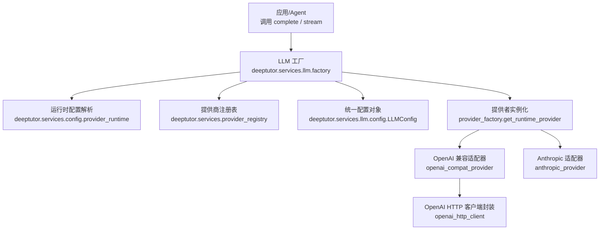
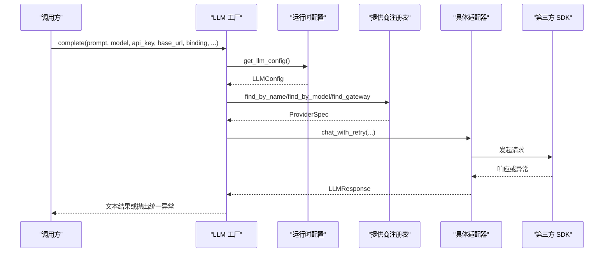
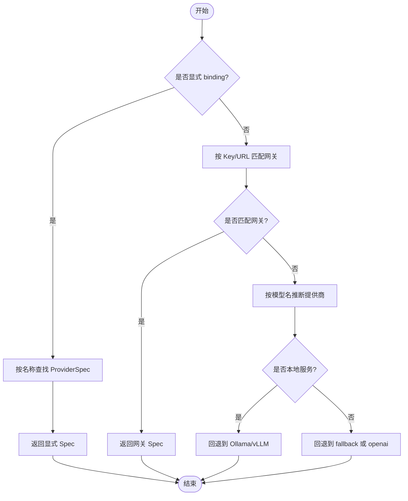
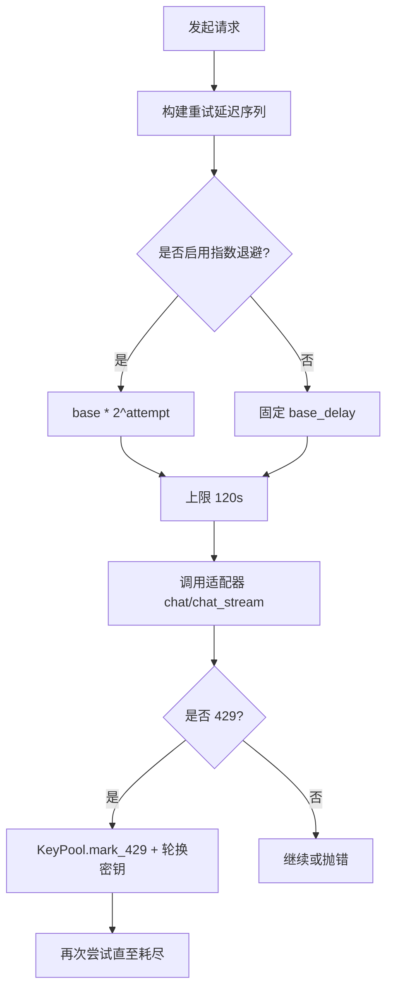
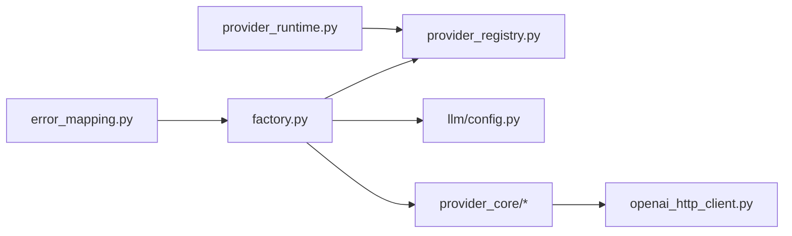

# LLM 提供商配置

<cite>
**本文引用的文件**   
- [factory.py](file://deeptutor/services/llm/factory.py)
- [config.py](file://deeptutor/services/llm/config.py)
- [__init__.py](file://deeptutor/services/llm/__init__.py)
- [openai_http_client.py](file://deeptutor/services/llm/openai_http_client.py)
- [provider_registry.py](file://deeptutor/services/provider_registry.py)
- [provider_runtime.py](file://deeptutor/services/config/provider_runtime.py)
- [openai_compat_provider.py](file://deeptutor/services/llm/provider_core/openai_compat_provider.py)
- [anthropic_provider.py](file://deeptutor/services/llm/provider_core/anthropic_provider.py)
- [error_mapping.py](file://deeptutor/services/llm/error_mapping.py)
</cite>

## 目录
1. [简介](#简介)
2. [项目结构](#项目结构)
3. [核心组件](#核心组件)
4. [架构总览](#架构总览)
5. [详细组件分析](#详细组件分析)
6. [依赖关系分析](#依赖关系分析)
7. [性能与成本优化](#性能与成本优化)
8. [故障排查指南](#故障排查指南)
9. [结论](#结论)
10. [附录：配置清单与示例](#附录配置清单与示例)

## 简介
本文面向 DeepTutor 的 LLM 提供商配置，覆盖 OpenAI、Anthropic、Azure OpenAI、GitHub Copilot、CodeBuddy、Claude Code、各类网关（OpenRouter、SiliconFlow、Volcengine Ark 等）以及本地模型（Ollama、vLLM、LM Studio 等）。文档说明如何完成以下目标：
- 选择并路由到合适的提供商与模型
- 管理 API 密钥、环境变量与认证方式
- 配置请求限流、重试与退避策略
- 实现多模型路由、负载均衡与故障转移
- 进行成本优化与性能调优
- 处理不同提供商的参数映射与错误

## 项目结构
DeepTutor 的 LLM 能力集中在 services/llm 层，通过统一的工厂函数对外暴露 complete/stream 接口；底层由 provider_core 中的具体 SDK 适配器实现。提供商元数据与路由规则集中在 provider_registry，运行时配置在 services/config/provider_runtime 中解析。

图表来源
- [factory.py:1-36](file://deeptutor/services/llm/factory.py#L1-L36)
- [provider_runtime.py:672-691](file://deeptutor/services/config/provider_runtime.py#L672-L691)
- [provider_registry.py:18-127](file://deeptutor/services/provider_registry.py#L18-L127)
- [config.py:110-158](file://deeptutor/services/llm/config.py#L110-L158)
- [openai_compat_provider.py:192-259](file://deeptutor/services/llm/provider_core/openai_compat_provider.py#L192-L259)
- [anthropic_provider.py:38-75](file://deeptutor/services/llm/provider_core/anthropic_provider.py#L38-L75)
- [openai_http_client.py:117-158](file://deeptutor/services/llm/openai_http_client.py#L117-L158)

章节来源
- [__init__.py:1-51](file://deeptutor/services/llm/__init__.py#L1-L51)
- [factory.py:1-36](file://deeptutor/services/llm/factory.py#L1-L36)

## 核心组件
- LLM 工厂：提供 complete/stream 统一入口，负责参数清洗、重试延迟计算、消息组装、图像多模态注入、能力检测与供应商绑定。
- 运行时配置：从系统设置与用户目录加载模型、提供商、API Key、Base URL、协议格式等，生成 ResolvedLLMConfig。
- 提供商注册表：集中定义所有提供商元数据、默认端点、鉴权方式、是否网关/本地、模型族覆盖规则、思考模式与 Web Search 原生支持等。
- 适配器：OpenAI 兼容适配器使用 openai.AsyncOpenAI；Anthropic 适配器使用 anthropic.AsyncAnthropic。
- HTTP 客户端封装：为 OpenAI SDK 构造 httpx 客户端，处理 TLS 校验开关、OpenRouter 归属头、会话亲和性、SDK 重试预算等。
- 错误映射：将各 SDK 异常统一映射为 LLMError 子类，包括鉴权失败、速率限制、超时、上下文窗口超限等。

章节来源
- [factory.py:66-112](file://deeptutor/services/llm/factory.py#L66-L112)
- [provider_runtime.py:672-691](file://deeptutor/services/config/provider_runtime.py#L672-L691)
- [provider_registry.py:208-734](file://deeptutor/services/provider_registry.py#L208-L734)
- [openai_compat_provider.py:192-259](file://deeptutor/services/llm/provider_core/openai_compat_provider.py#L192-L259)
- [anthropic_provider.py:38-75](file://deeptutor/services/llm/provider_core/anthropic_provider.py#L38-L75)
- [openai_http_client.py:97-158](file://deeptutor/services/llm/openai_http_client.py#L97-L158)
- [error_mapping.py:122-175](file://deeptutor/services/llm/error_mapping.py#L122-L175)

## 架构总览
下图展示一次完整请求的生命周期：从工厂解析配置，到选择提供商与后端，再到具体 SDK 调用与错误统一。

图表来源
- [factory.py:157-254](file://deeptutor/services/llm/factory.py#L157-L254)
- [provider_runtime.py:672-691](file://deeptutor/services/config/provider_runtime.py#L672-L691)
- [provider_registry.py:761-791](file://deeptutor/services/provider_registry.py#L761-L791)
- [openai_compat_provider.py:267-286](file://deeptutor/services/llm/provider_core/openai_compat_provider.py#L267-L286)

## 详细组件分析

### 提供商选择与多模型路由
- 显式绑定优先：若传入 binding，先按名称查找 ProviderSpec。
- 网关匹配：根据 API Key 前缀或 Base URL 关键字识别网关（如 OpenRouter、SiliconFlow、Volcengine Ark 等），并返回对应 spec。
- 模型名推断：若未显式绑定且非网关，则按模型名前缀匹配（如 gpt-* -> openai，claude-* -> anthropic）。
- 本地服务检测：当 base_url 指向本地端口（如 11434）时，回退到 ollama/vllm。
- 最终回退：fallback 指定提供商或默认 openai。

图表来源
- [factory.py:81-112](file://deeptutor/services/llm/factory.py#L81-L112)
- [provider_registry.py:208-734](file://deeptutor/services/provider_registry.py#L208-L734)

章节来源
- [factory.py:81-112](file://deeptutor/services/llm/factory.py#L81-L112)
- [provider_registry.py:208-734](file://deeptutor/services/provider_registry.py#L208-L734)

### API 密钥管理与环境变量
- 密钥池与主密钥：LLMConfig.api_key 可为字符串或列表；primary_api_key 用于取主密钥。
- OpenAI 兼容环境注入：当绑定为 OpenAI 兼容后端时，模块导入阶段会设置 OPENAI_API_KEY 与 OPENAI_BASE_URL，确保下游 SDK 能读取。
- 启动初始化：initialize_environment 可在应用启动时对齐环境变量。
- 适配器内部 env 注入：OpenAICompatProvider._setup_env 会根据 ProviderSpec.env_key 写入环境变量，并支持 {api_key}/{api_base} 占位符。

章节来源
- [config.py:66-107](file://deeptutor/services/llm/config.py#L66-L107)
- [config.py:177-190](file://deeptutor/services/llm/config.py#L177-L190)
- [openai_compat_provider.py:288-303](file://deeptutor/services/llm/provider_core/openai_compat_provider.py#L288-L303)

### 请求限流、重试与退避
- 重试延迟构建：_build_retry_delays 支持固定间隔与指数退避，单次最大延迟上限为 120 秒。
- 工厂默认值：DEFAULT_MAX_RETRIES、DEFAULT_RETRY_DELAY、DEFAULT_EXPONENTIAL_BACKOFF 来自 settings.retry。
- 键轮换与 429：OpenAICompatProvider._create_with_key_rotation 对 429 状态码触发 KeyPool 标记与轮转。
- 错误分类：error_mapping.map_error 将超时、鉴权失败、速率限制、上下文窗口超限等统一映射为 LLMError 子类，并保留 Retry-After 提示。

图表来源
- [factory.py:66-78](file://deeptutor/services/llm/factory.py#L66-L78)
- [openai_compat_provider.py:267-286](file://deeptutor/services/llm/provider_core/openai_compat_provider.py#L267-L286)
- [error_mapping.py:59-119](file://deeptutor/services/llm/error_mapping.py#L59-L119)

章节来源
- [factory.py:31-36](file://deeptutor/services/llm/factory.py#L31-L36)
- [factory.py:66-78](file://deeptutor/services/llm/factory.py#L66-L78)
- [openai_compat_provider.py:267-286](file://deeptutor/services/llm/provider_core/openai_compat_provider.py#L267-L286)
- [error_mapping.py:122-175](file://deeptutor/services/llm/error_mapping.py#L122-L175)

### 多提供商适配与参数映射
- OpenAI 兼容适配器：
  - 自动选择 Responses 或 Chat Completions 协议（wire_api/auto）。
  - 针对推理模型（gpt-5/o1/o3/o4）禁用 temperature，并使用 max_completion_tokens。
  - 支持 prompt cache 断点（ephemeral）与工具缓存控制。
  - 对 Responses API 的错误进行降级重试（移除 prompt_cache_options、input item status 等）。
- Anthropic 适配器：
  - 将 OpenAI 消息格式转换为 Anthropic Messages API。
  - 支持 thinking 模式（adaptive/enabled+budget_tokens），并根据模型家族决定是否发送 temperature。
  - 支持 prompt cache 断点，限制最多 4 个断点。
  - 流式事件处理区分 text_delta 与 thinking_delta。

章节来源
- [openai_compat_provider.py:488-555](file://deeptutor/services/llm/provider_core/openai_compat_provider.py#L488-L555)
- [openai_compat_provider.py:557-630](file://deeptutor/services/llm/provider_core/openai_compat_provider.py#L557-L630)
- [openai_compat_provider.py:735-769](file://deeptutor/services/llm/provider_core/openai_compat_provider.py#L735-L769)
- [anthropic_provider.py:377-453](file://deeptutor/services/llm/provider_core/anthropic_provider.py#L377-L453)
- [anthropic_provider.py:551-618](file://deeptutor/services/llm/provider_core/anthropic_provider.py#L551-L618)

### 安全与传输层
- TLS 校验开关：DISABLE_SSL_VERIFY 在非生产环境允许关闭，生产环境强制拒绝；同时清理无效的 SSL_CERT_FILE/SSL_CERT_DIR。
- OpenRouter 归属头：当 endpoint 属于 OpenRouter 时，自动附加 HTTP-Referer 与 X-OpenRouter-Title。
- 会话亲和性：为 OpenAI SDK 客户端添加 x-session-affinity 头，提升负载均衡稳定性。

章节来源
- [openai_http_client.py:32-46](file://deeptutor/services/llm/openai_http_client.py#L32-L46)
- [openai_http_client.py:61-108](file://deeptutor/services/llm/openai_http_client.py#L61-L108)
- [openai_http_client.py:117-158](file://deeptutor/services/llm/openai_http_client.py#L117-L158)

## 依赖关系分析
- factory 依赖 provider_registry 获取 ProviderSpec，依赖 config 获取 LLMConfig，依赖 provider_factory 创建具体适配器实例。
- provider_registry 是所有提供商元数据的单一事实来源，决定默认端点、鉴权方式、是否网关/本地、模型覆盖规则等。
- provider_runtime 将用户配置与系统设置合并为 ResolvedLLMConfig，供上层消费。
- openai_compat_provider 与 anthropic_provider 分别封装官方 SDK，向上暴露统一接口。
- error_mapping 统一异常类型，便于上层捕获与告警。

图表来源
- [factory.py:1-36](file://deeptutor/services/llm/factory.py#L1-L36)
- [provider_registry.py:18-127](file://deeptutor/services/provider_registry.py#L18-L127)
- [provider_runtime.py:672-691](file://deeptutor/services/config/provider_runtime.py#L672-L691)
- [openai_http_client.py:117-158](file://deeptutor/services/llm/openai_http_client.py#L117-L158)
- [error_mapping.py:122-175](file://deeptutor/services/llm/error_mapping.py#L122-L175)

章节来源
- [factory.py:1-36](file://deeptutor/services/llm/factory.py#L1-L36)
- [provider_registry.py:18-127](file://deeptutor/services/provider_registry.py#L18-L127)
- [provider_runtime.py:672-691](file://deeptutor/services/config/provider_runtime.py#L672-L691)
- [error_mapping.py:122-175](file://deeptutor/services/llm/error_mapping.py#L122-L175)

## 性能与成本优化
- 模型选择策略：
  - 优先使用显式 binding 或网关匹配，避免误判。
  - 对推理模型（o1/o3/gpt-5 系列）使用 Responses 协议与专用参数。
  - 对 Anthropic 新家族（Opus/Sonnet/Haiku/Fable/Mythos 5）采用 adaptive thinking，不传 temperature。
- 成本优化：
  - 合理设置 max_tokens/max_completion_tokens，避免过长输出。
  - 使用 prompt cache 断点减少重复系统/历史块的成本。
  - 对本地模型（Ollama/vLLM/LM Studio）降低云端费用。
- 性能调优：
  - 调整 DEFAULT_MAX_RETRIES、DEFAULT_RETRY_DELAY、DEFAULT_EXPONENTIAL_BACKOFF。
  - 开启流式输出，结合 stream_coalesce_chars/seconds 控制前端渲染体验。
  - 使用会话亲和性与 OpenRouter 归属头提高网关稳定性。

[本节为通用指导，不直接分析具体文件]

## 故障排查指南
- 鉴权失败：
  - 检查 OPENAI_API_KEY/ANTHROPIC_API_KEY 或其他 ProviderSpec.env_key 是否已设置。
  - 确认 ProviderSpec.is_oauth 场景是否走 OAuth 流程（如 GitHub Copilot、CodeBuddy、Claude Code）。
- 速率限制：
  - 捕获 LLMRateLimitError，读取 retry_after 字段并按建议等待。
  - 启用 KeyPool 轮换以缓解单密钥限流。
- 上下文窗口超限：
  - 捕获 ProviderContextWindowError，缩短输入或拆分任务。
- 本地服务不可达：
  - 检查 base_url 是否正确（如 Ollama 11434、LM Studio 1234、vLLM 8000）。
  - 确认 is_local_llm_server 判定逻辑与端口匹配。
- TLS 问题：
  - 若非生产环境可临时设置 DISABLE_SSL_VERIFY，但需警惕安全风险。
  - 清理无效的 SSL_CERT_FILE/SSL_CERT_DIR 环境变量。

章节来源
- [error_mapping.py:122-175](file://deeptutor/services/llm/error_mapping.py#L122-L175)
- [openai_http_client.py:32-46](file://deeptutor/services/llm/openai_http_client.py#L32-L46)
- [openai_http_client.py:61-108](file://deeptutor/services/llm/openai_http_client.py#L61-L108)
- [provider_registry.py:647-704](file://deeptutor/services/provider_registry.py#L647-L704)

## 结论
DeepTutor 的 LLM 提供商配置以 provider_registry 为中心，配合运行时配置解析与统一工厂，实现对多提供商的统一接入。通过重试与退避、键轮换、错误映射、prompt cache 与流式输出等机制，系统在可用性、性能与成本之间取得平衡。推荐在生产环境中严格配置鉴权与 TLS，并结合业务需求选择合适的模型与提供商组合。

[本节为总结，不直接分析具体文件]

## 附录：配置清单与示例

### 关键配置项
- 模型与提供商
  - model：模型 ID（如 gpt-4o、claude-sonnet-4、deepseek-v4-pro）
  - binding：提供商别名（openai、anthropic、azure_openai、custom、ollama、vllm、lm_studio 等）
  - provider_name：实际解析到的提供商名称
  - provider_mode：standard/oauth/direct/local/gateway
- 连接与鉴权
  - api_key：字符串或列表（KeyPool）
  - base_url/effective_url：API 基础地址
  - api_version：API 版本（部分提供商需要）
  - extra_headers：自定义请求头
- 行为与性能
  - wire_api：auto/responses/chat_completions
  - api_format：auto/openai_chat/openai_responses/anthropic
  - reasoning_effort：none/minimal/minimum/low/medium/high（影响 thinking 模式）
  - max_tokens/max_completion_tokens：输出长度限制
  - temperature：采样温度（部分推理模型禁用）
  - max_concurrency/requests_per_minute：并发与限流（LLMConfig 字段）
  - traffic_controller：流量控制器（可选）

章节来源
- [config.py:110-158](file://deeptutor/services/llm/config.py#L110-L158)
- [provider_runtime.py:672-691](file://deeptutor/services/config/provider_runtime.py#L672-L691)
- [provider_registry.py:18-127](file://deeptutor/services/provider_registry.py#L18-L127)

### 常见配置场景
- OpenAI
  - 设置 OPENAI_API_KEY，binding=openai，model=gpt-4o 或 o1/o3 系列。
  - 推理模型使用 Responses 协议与 max_completion_tokens。
- Anthropic
  - 设置 ANTHROPIC_API_KEY，binding=anthropic，model=claude-sonnet-4 或 opus/haiku/fable/mythos 5 系列。
  - 新家族使用 adaptive thinking，不传 temperature。
- Azure OpenAI
  - 使用 azure_openai 后端，配置部署名与 base_url。
- GitHub Copilot / CodeBuddy / Claude Code
  - OAuth 模式，无需手动设置 API Key。
- 网关（OpenRouter、SiliconFlow、Volcengine Ark 等）
  - 设置对应 ENV KEY（如 OPENROUTER_API_KEY、SILICONFLOW_API_KEY、OPENAI_API_KEY for Volcengine）。
  - 或通过 base_url 关键字自动匹配。
- 本地模型（Ollama、vLLM、LM Studio）
  - 设置 base_url 为本地端口（11434/8000/1234），binding=ollama/vllm/lm_studio。

章节来源
- [provider_registry.py:208-734](file://deeptutor/services/provider_registry.py#L208-L734)
- [openai_compat_provider.py:288-303](file://deeptutor/services/llm/provider_core/openai_compat_provider.py#L288-L303)
- [anthropic_provider.py:377-453](file://deeptutor/services/llm/provider_core/anthropic_provider.py#L377-L453)