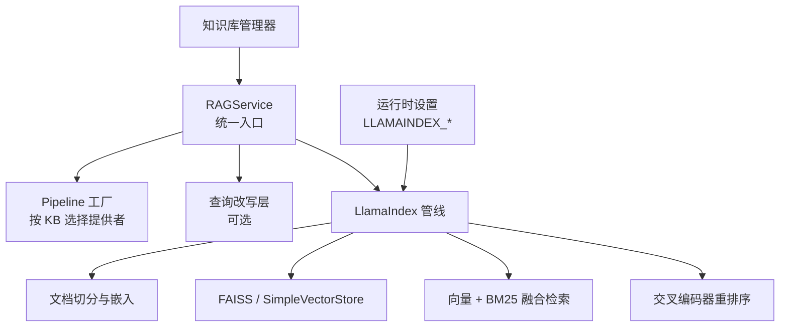
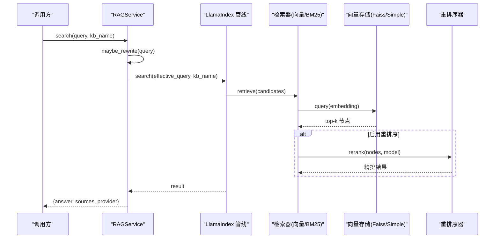
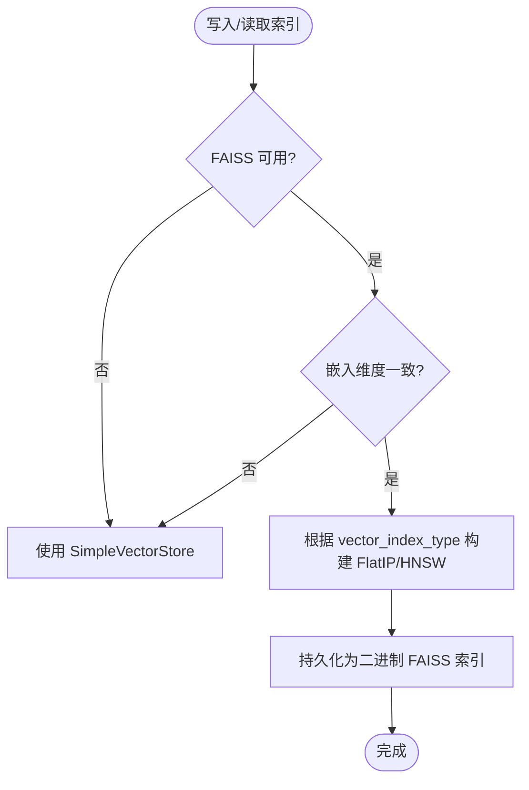
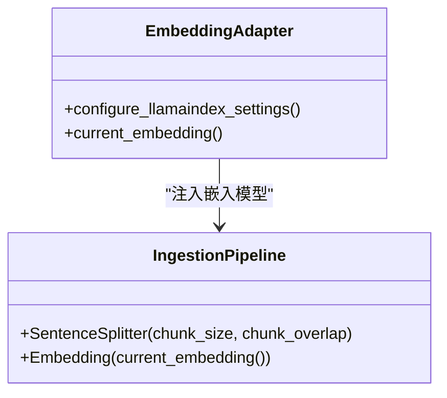
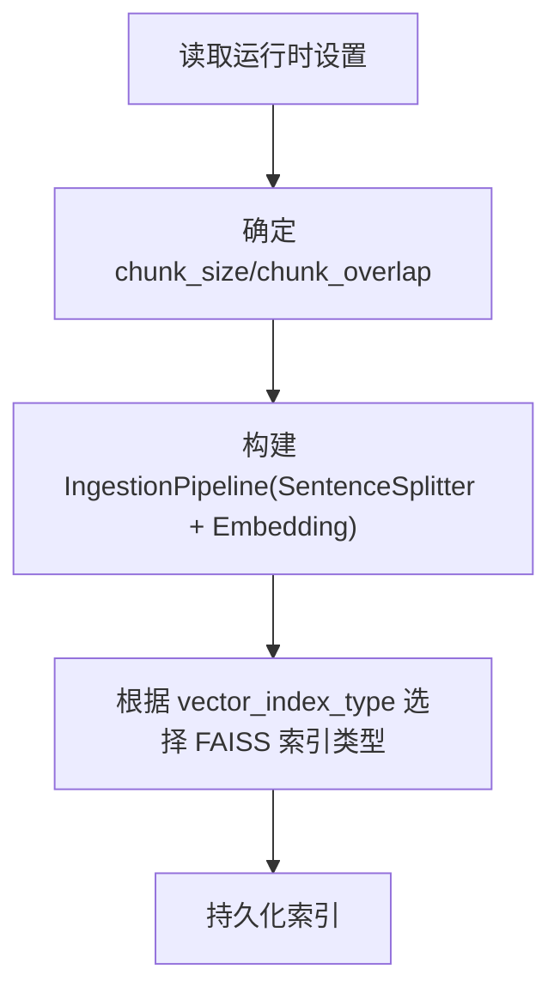
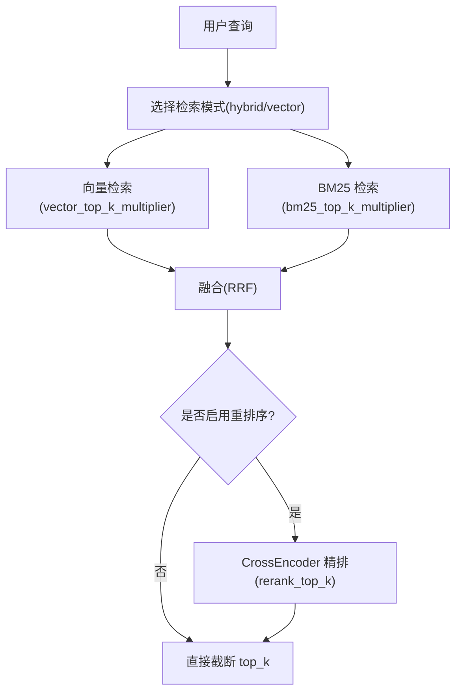
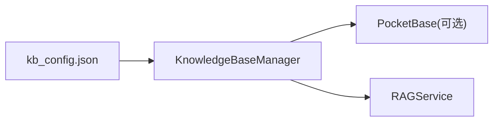
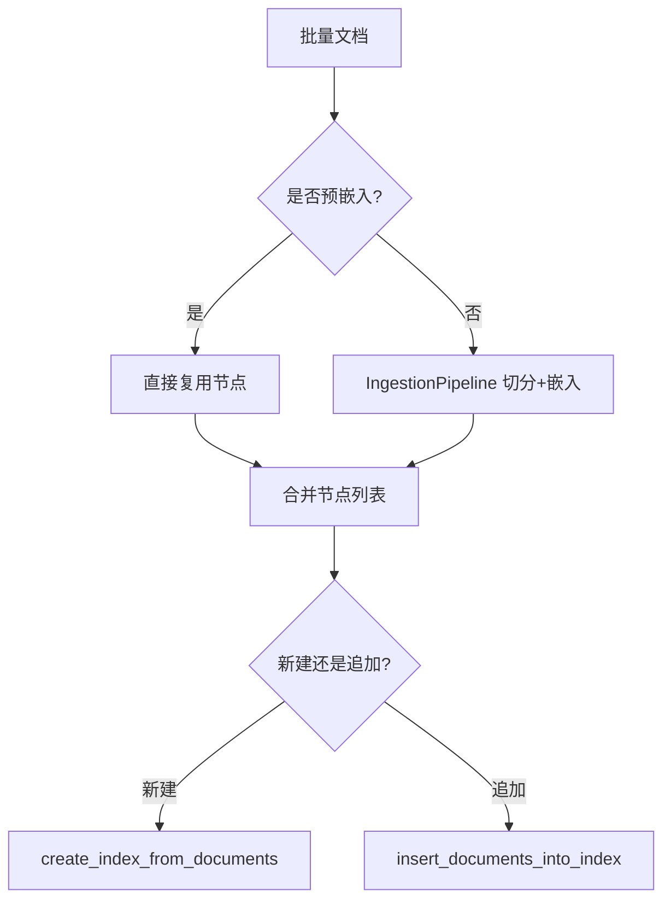
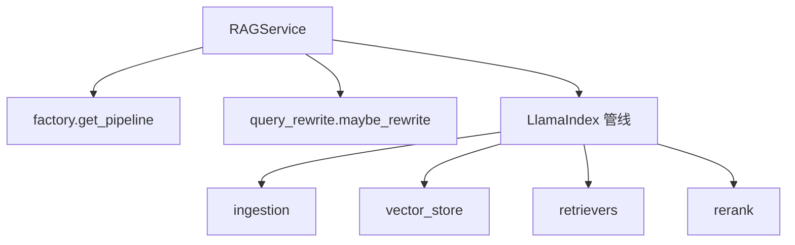

# RAG 引擎配置

<cite>
**本文引用的文件**   
- [deeptutor/services/rag/service.py](file://deeptutor/services/rag/service.py)
- [deeptutor/services/rag/pipelines/llamaindex/config.py](file://deeptutor/services/rag/pipelines/llamaindex/config.py)
- [deeptutor/services/rag/pipelines/llamaindex/vector_store.py](file://deeptutor/services/rag/pipelines/llamaindex/vector_store.py)
- [deeptutor/services/rag/pipelines/llamaindex/retrievers.py](file://deeptutor/services/rag/pipelines/llamaindex/retrievers.py)
- [deeptutor/services/rag/pipelines/llamaindex/rerank.py](file://deeptutor/services/rag/pipelines/llamaindex/rerank.py)
- [deeptutor/services/rag/pipelines/llamaindex/ingestion.py](file://deeptutor/services/rag/pipelines/llamaindex/ingestion.py)
- [deeptutor/services/config/runtime_settings.py](file://deeptutor/services/config/runtime_settings.py)
- [deeptutor/knowledge/manager.py](file://deeptutor/knowledge/manager.py)
</cite>

## 目录
1. [简介](#简介)
2. [项目结构](#项目结构)
3. [核心组件](#核心组件)
4. [架构总览](#架构总览)
5. [详细组件分析](#详细组件分析)
6. [依赖关系分析](#依赖关系分析)
7. [性能与调优](#性能与调优)
8. [故障排查指南](#故障排查指南)
9. [结论](#结论)
10. [附录：配置项速查](#附录配置项速查)

## 简介
本文面向 DeepTutor 的检索增强生成（RAG）引擎，聚焦“如何配置”和“如何调优”。当前仓库中的默认 LlamaIndex RAG 管线使用本地 FAISS 作为向量存储后端；Chroma、Pinecone 等外部向量数据库并未在代码中实现。文档将明确说明已实现的 FAISS 配置、嵌入模型接入方式、分块策略、索引优化参数、检索算法与重排序设置，并补充多知识库管理、权限控制、数据同步、缓存与批量操作、以及监控与可观测性建议。

## 项目结构
RAG 相关能力集中在 `deeptutor/services/rag` 下，其中 LlamaIndex 管线位于 `services/rag/pipelines/llamaindex`；运行时持久化设置由 `services/config/runtime_settings.py` 提供；知识库生命周期由 `knowledge/manager.py` 管理；统一入口为 `services/rag/service.py`。

**图表来源**
- [deeptutor/services/rag/service.py:22-65](file://deeptutor/services/rag/service.py#L22-L65)
- [deeptutor/services/rag/pipelines/llamaindex/ingestion.py:22-38](file://deeptutor/services/rag/pipelines/llamaindex/ingestion.py#L22-L38)
- [deeptutor/services/rag/pipelines/llamaindex/vector_store.py:1-26](file://deeptutor/services/rag/pipelines/llamaindex/vector_store.py#L1-L26)
- [deeptutor/services/rag/pipelines/llamaindex/retrievers.py:192-232](file://deeptutor/services/rag/pipelines/llamaindex/retrievers.py#L192-L232)
- [deeptutor/services/rag/pipelines/llamaindex/rerank.py:84-127](file://deeptutor/services/rag/pipelines/llamaindex/rerank.py#L84-L127)
- [deeptutor/services/config/runtime_settings.py:327-373](file://deeptutor/services/config/runtime_settings.py#L327-L373)

**章节来源**
- [deeptutor/services/rag/service.py:22-65](file://deeptutor/services/rag/service.py#L22-L65)
- [deeptutor/services/config/runtime_settings.py:327-373](file://deeptutor/services/config/runtime_settings.py#L327-L373)

## 核心组件
- RAGService：统一编排知识库初始化、增量添加、搜索、删除与智能检索，负责解析知识库绑定的提供者、查询改写、事件与日志透传。
- LlamaIndex 管线：封装文档切分、嵌入、索引构建与检索；默认使用 FAISS 加速向量检索，支持 BM25 混合检索与可选重排序。
- 向量存储后端：优先 FAISS（FlatIP 或 HNSW），不可用时回退到 SimpleVectorStore。
- 检索器：向量检索 + BM25 召回融合，支持候选放大倍数与融合查询数。
- 重排序：可选 SentenceTransformers 交叉编码器，对候选进行二次精排。
- 运行时设置：集中定义检索模式、top_k、HNSW 参数、分块几何、图像描述并发与超时等。
- 知识库管理：注册、发现、状态同步、嵌入指纹匹配与重建提示。

**章节来源**
- [deeptutor/services/rag/service.py:22-65](file://deeptutor/services/rag/service.py#L22-L65)
- [deeptutor/services/rag/pipelines/llamaindex/config.py:30-62](file://deeptutor/services/rag/pipelines/llamaindex/config.py#L30-L62)
- [deeptutor/services/rag/pipelines/llamaindex/vector_store.py:14-25](file://deeptutor/services/rag/pipelines/llamaindex/vector_store.py#L14-L25)
- [deeptutor/services/rag/pipelines/llamaindex/retrievers.py:192-232](file://deeptutor/services/rag/pipelines/llamaindex/retrievers.py#L192-L232)
- [deeptutor/services/rag/pipelines/llamaindex/rerank.py:84-127](file://deeptutor/services/rag/pipelines/llamaindex/rerank.py#L84-L127)
- [deeptutor/services/config/runtime_settings.py:327-373](file://deeptutor/services/config/runtime_settings.py#L327-L373)
- [deeptutor/knowledge/manager.py:322-339](file://deeptutor/knowledge/manager.py#L322-L339)

## 架构总览
下图展示一次典型搜索请求从 API 到检索与重排序的调用链。

**图表来源**
- [deeptutor/services/rag/service.py:126-200](file://deeptutor/services/rag/service.py#L126-L200)
- [deeptutor/services/rag/pipelines/llamaindex/retrievers.py:192-232](file://deeptutor/services/rag/pipelines/llamaindex/retrievers.py#L192-L232)
- [deeptutor/services/rag/pipelines/llamaindex/rerank.py:84-127](file://deeptutor/services/rag/pipelines/llamaindex/rerank.py#L84-L127)

## 详细组件分析

### 向量数据库配置（FAISS 为主）
- 后端选择：
  - 首选 FAISS：通过自定义子类实现余弦相似度（L2 归一化后内积等价于余弦）。
  - 兼容旧版 SimpleVectorStore：首次加载自动识别，无需破坏已有索引；重新索引会转为 FAISS。
- 索引类型：
  - flat：精确内积（默认），保证召回稳定。
  - hnsw：近似最近邻，适合大规模语料，需调整 m、efConstruction、efSearch。
- 维度一致性：仅当所有节点嵌入维度一致时才启用 FAISS；否则回退 SimpleVectorStore。
- 路径安全：FAISS 序列化/反序列化通过 Python 字节流绕过 Windows 窄路径问题。

**图表来源**
- [deeptutor/services/rag/pipelines/llamaindex/vector_store.py:188-217](file://deeptutor/services/rag/pipelines/llamaindex/vector_store.py#L188-L217)
- [deeptutor/services/rag/pipelines/llamaindex/vector_store.py:220-235](file://deeptutor/services/rag/pipelines/llamaindex/vector_store.py#L220-L235)
- [deeptutor/services/rag/pipelines/llamaindex/vector_store.py:238-274](file://deeptutor/services/rag/pipelines/llamaindex/vector_store.py#L238-L274)

**章节来源**
- [deeptutor/services/rag/pipelines/llamaindex/vector_store.py:1-26](file://deeptutor/services/rag/pipelines/llamaindex/vector_store.py#L1-L26)
- [deeptutor/services/rag/pipelines/llamaindex/vector_store.py:114-167](file://deeptutor/services/rag/pipelines/llamaindex/vector_store.py#L114-L167)
- [deeptutor/services/rag/pipelines/llamaindex/vector_store.py:188-235](file://deeptutor/services/rag/pipelines/llamaindex/vector_store.py#L188-L235)
- [deeptutor/services/rag/pipelines/llamaindex/vector_store.py:238-274](file://deeptutor/services/rag/pipelines/llamaindex/vector_store.py#L238-L274)

### 嵌入模型配置
- 嵌入服务接入点：LlamaIndex 管线通过 Settings.embed_model 调用 DeepTutor 配置的嵌入服务，而非本地模型。
- 嵌入指纹：知识库状态会记录当前嵌入模型名与维度，用于检测是否需要重建索引。
- 多模态图片描述：支持并发与超时限制，避免大图集导致索引阻塞。

**图表来源**
- [deeptutor/services/rag/pipelines/llamaindex/ingestion.py:22-38](file://deeptutor/services/rag/pipelines/llamaindex/ingestion.py#L22-L38)
- [deeptutor/knowledge/manager.py:147-155](file://deeptutor/knowledge/manager.py#L147-L155)

**章节来源**
- [deeptutor/services/rag/pipelines/llamaindex/ingestion.py:22-38](file://deeptutor/services/rag/pipelines/llamaindex/ingestion.py#L22-L38)
- [deeptutor/knowledge/manager.py:147-155](file://deeptutor/knowledge/manager.py#L147-L155)
- [deeptutor/services/config/runtime_settings.py:356-373](file://deeptutor/services/config/runtime_settings.py#L356-L373)

### 分块策略与索引优化
- 分块几何：chunk_size、chunk_overlap 来自运行时设置，影响下一次（重新）索引。
- 向量索引类型：flat（默认）或 hnsw；HNSW 可调 m、efConstruction、efSearch。
- 候选放大倍数：vector_top_k_multiplier、bm25_top_k_multiplier 控制子检索器候选数量。
- 融合查询数：fusion_num_queries 固定为 1（因融合检索使用 MockLLM）。

**图表来源**
- [deeptutor/services/rag/pipelines/llamaindex/config.py:150-160](file://deeptutor/services/rag/pipelines/llamaindex/config.py#L150-L160)
- [deeptutor/services/rag/pipelines/llamaindex/config.py:128-139](file://deeptutor/services/rag/pipelines/llamaindex/config.py#L128-L139)
- [deeptutor/services/rag/pipelines/llamaindex/ingestion.py:22-38](file://deeptutor/services/rag/pipelines/llamaindex/ingestion.py#L22-L38)

**章节来源**
- [deeptutor/services/rag/pipelines/llamaindex/config.py:54-62](file://deeptutor/services/rag/pipelines/llamaindex/config.py#L54-L62)
- [deeptutor/services/rag/pipelines/llamaindex/config.py:128-160](file://deeptutor/services/rag/pipelines/llamaindex/config.py#L128-L160)
- [deeptutor/services/rag/pipelines/llamaindex/ingestion.py:22-38](file://deeptutor/services/rag/pipelines/llamaindex/ingestion.py#L22-L38)

### 检索算法配置、相似度阈值与重排序
- 检索模式：
  - hybrid：向量 + BM25 召回融合（若 BM25 依赖缺失则降级为 vector-only）。
  - vector：纯向量检索。
- 候选数量：
  - top_k：最终返回条数。
  - vector_top_k_multiplier、bm25_top_k_multiplier：子检索器候选放大倍数。
- 融合策略：Reciprocal Rank Fusion，num_queries=1。
- 重排序：
  - 可选 SentenceTransformers CrossEncoder。
  - reranker_model 为空时禁用；rerank_top_k 限制候选上限（最大 100）。
  - 失败时非致命，回退到第一阶段排序。

**图表来源**
- [deeptutor/services/rag/pipelines/llamaindex/retrievers.py:88-97](file://deeptutor/services/rag/pipelines/llamaindex/retrievers.py#L88-L97)
- [deeptutor/services/rag/pipelines/llamaindex/retrievers.py:192-232](file://deeptutor/services/rag/pipelines/llamaindex/retrievers.py#L192-L232)
- [deeptutor/services/rag/pipelines/llamaindex/rerank.py:84-127](file://deeptutor/services/rag/pipelines/llamaindex/rerank.py#L84-L127)

**章节来源**
- [deeptutor/services/rag/pipelines/llamaindex/retrievers.py:88-97](file://deeptutor/services/rag/pipelines/llamaindex/retrievers.py#L88-L97)
- [deeptutor/services/rag/pipelines/llamaindex/retrievers.py:192-232](file://deeptutor/services/rag/pipelines/llamaindex/retrievers.py#L192-L232)
- [deeptutor/services/rag/pipelines/llamaindex/rerank.py:84-127](file://deeptutor/services/rag/pipelines/llamaindex/rerank.py#L84-L127)

### 多知识库管理、权限控制与数据同步
- 多知识库：
  - KnowledgeBaseManager 维护 kb_config.json，支持创建、列出、自动发现、状态更新与清理孤儿条目。
  - 每个知识库可绑定不同 RAG 提供者（provider），RAGService 按知识库解析提供者。
- 权限控制：
  - 知识库元数据包含 rag_provider、status、needs_reindex 等字段；结合多用户上下文可实现资源隔离（具体权限策略由上层多用户模块决定）。
- 数据同步：
  - 当启用 PocketBase 时，知识库元数据会镜像到远程集合（best-effort）。
  - 知识库状态变更会记录 last_completed_at、last_indexed_at、last_indexed_count 等指标。

**图表来源**
- [deeptutor/knowledge/manager.py:322-339](file://deeptutor/knowledge/manager.py#L322-L339)
- [deeptutor/knowledge/manager.py:471-499](file://deeptutor/knowledge/manager.py#L471-L499)
- [deeptutor/services/rag/service.py:22-65](file://deeptutor/services/rag/service.py#L22-L65)

**章节来源**
- [deeptutor/knowledge/manager.py:322-339](file://deeptutor/knowledge/manager.py#L322-L339)
- [deeptutor/knowledge/manager.py:471-499](file://deeptutor/knowledge/manager.py#L471-L499)
- [deeptutor/services/rag/service.py:22-65](file://deeptutor/services/rag/service.py#L22-L65)

### 缓存策略与批量操作
- 重排序模型缓存：
  - 进程内有序字典缓存最多 2 个 CrossEncoder 模型，线程安全，支持清空缓存。
- BM25 检索器持久化：
  - 将 BM25 检索器侧边索引持久化到 storage_dir/bm25_retriever，提升混合检索启动速度。
- 批量文档处理：
  - documents_to_nodes 区分预嵌入节点与文本节点，批量走 IngestionPipeline。
  - create_index_from_documents 与 insert_documents_into_index 分别用于新建与追加索引。

**图表来源**
- [deeptutor/services/rag/pipelines/llamaindex/rerank.py:15-24](file://deeptutor/services/rag/pipelines/llamaindex/rerank.py#L15-L24)
- [deeptutor/services/rag/pipelines/llamaindex/retrievers.py:154-189](file://deeptutor/services/rag/pipelines/llamaindex/retrievers.py#L154-L189)
- [deeptutor/services/rag/pipelines/llamaindex/ingestion.py:65-121](file://deeptutor/services/rag/pipelines/llamaindex/ingestion.py#L65-L121)

**章节来源**
- [deeptutor/services/rag/pipelines/llamaindex/rerank.py:15-24](file://deeptutor/services/rag/pipelines/llamaindex/rerank.py#L15-L24)
- [deeptutor/services/rag/pipelines/llamaindex/retrievers.py:154-189](file://deeptutor/services/rag/pipelines/llamaindex/retrievers.py#L154-L189)
- [deeptutor/services/rag/pipelines/llamaindex/ingestion.py:65-121](file://deeptutor/services/rag/pipelines/llamaindex/ingestion.py#L65-L121)

## 依赖关系分析
- RAGService 依赖：
  - factory.get_pipeline：按知识库绑定获取对应管线。
  - embedding_binding.with_kb_embedding：确保每次索引/搜索使用正确的嵌入配置。
  - query_rewrite.maybe_rewrite：可选查询改写层。
- LlamaIndex 管线依赖：
  - ingestion：SentenceSplitter + current_embedding。
  - vector_store：FAISS 或 SimpleVectorStore。
  - retrievers：BM25（可选）+ 向量融合。
  - rerank：SentenceTransformers CrossEncoder（可选）。

**图表来源**
- [deeptutor/services/rag/service.py:15-17](file://deeptutor/services/rag/service.py#L15-L17)
- [deeptutor/services/rag/service.py:152-159](file://deeptutor/services/rag/service.py#L152-L159)
- [deeptutor/services/rag/pipelines/llamaindex/ingestion.py:22-38](file://deeptutor/services/rag/pipelines/llamaindex/ingestion.py#L22-L38)
- [deeptutor/services/rag/pipelines/llamaindex/vector_store.py:1-26](file://deeptutor/services/rag/pipelines/llamaindex/vector_store.py#L1-L26)
- [deeptutor/services/rag/pipelines/llamaindex/retrievers.py:192-232](file://deeptutor/services/rag/pipelines/llamaindex/retrievers.py#L192-L232)
- [deeptutor/services/rag/pipelines/llamaindex/rerank.py:84-127](file://deeptutor/services/rag/pipelines/llamaindex/rerank.py#L84-L127)

**章节来源**
- [deeptutor/services/rag/service.py:15-17](file://deeptutor/services/rag/service.py#L15-L17)
- [deeptutor/services/rag/service.py:152-159](file://deeptutor/services/rag/service.py#L152-L159)

## 性能与调优
- 向量索引类型：
  - 小规模/追求稳定召回：使用 flat。
  - 大规模语料：启用 hnsw，适当增大 efConstruction 与 efSearch 以提升召回，同时权衡构建与查询延迟。
- 检索候选放大倍数：
  - 提高 vector_top_k_multiplier 与 bm25_top_k_multiplier 可增加候选池，但会增加融合与重排序开销。
- 重排序：
  - 仅在需要更高精度时启用 reranker_model；注意 sentence-transformers 依赖与模型加载成本。
- 分块几何：
  - 增大 chunk_size 可减少索引体积，但可能降低局部相关性；合理设置 chunk_overlap 保留上下文衔接。
- BM25 持久化：
  - 启用 BM25 后可持久化检索器，减少重复构建时间。
- 图像描述并发：
  - image_description_concurrency 与 image_description_timeout_seconds 控制多图索引时的并发与超时，避免阻塞。

[本节为通用指导，不直接分析具体文件]

## 故障排查指南
- 索引无效或嵌入维度不一致：
  - 现象：检索报错或返回异常。
  - 原因：嵌入模型变化或混合维度向量无法放入固定宽度 FAISS 索引。
  - 处理：重新索引知识库；确保当前嵌入配置与历史版本一致。
- FAISS 包缺失：
  - 现象：已用 FAISS 索引的知识库无法加载。
  - 处理：安装 faiss-cpu 或重新索引为 SimpleVectorStore。
- BM25 依赖缺失：
  - 现象：hybrid 模式降级为 vector-only。
  - 处理：安装 llama-index-retrievers-bm25 或切换检索模式为 vector。
- 重排序模型加载失败：
  - 现象：启用 reranker_model 但无效果。
  - 处理：检查 sentence-transformers 依赖与模型名称；必要时禁用重排序。

**章节来源**
- [deeptutor/services/rag/pipelines/llamaindex/vector_store.py:259-274](file://deeptutor/services/rag/pipelines/llamaindex/vector_store.py#L259-L274)
- [deeptutor/services/rag/pipelines/llamaindex/retrievers.py:118-151](file://deeptutor/services/rag/pipelines/llamaindex/retrievers.py#L118-L151)
- [deeptutor/services/rag/pipelines/llamaindex/rerank.py:43-65](file://deeptutor/services/rag/pipelines/llamaindex/rerank.py#L43-L65)

## 结论
DeepTutor 的 RAG 引擎以 LlamaIndex 为基础，默认使用 FAISS 作为向量存储后端，并提供 hybrid 混合检索与可选重排序。运行时设置集中管理检索模式、候选放大倍数、HNSW 参数、分块几何与图像描述并发等关键调优点。知识库管理支持多知识库、状态同步与嵌入指纹校验。对于 Chroma、Pinecone 等外部向量数据库，当前代码未实现；如需扩展，可在 vector_store 抽象处新增后端适配。

[本节为总结性内容，不直接分析具体文件]

## 附录：配置项速查
- 检索模式与候选
  - retrieval_profile：hybrid 或 vector。
  - top_k：默认返回条数。
  - vector_top_k_multiplier：向量子检索器候选放大倍数。
  - bm25_top_k_multiplier：BM25 子检索器候选放大倍数。
  - fusion_num_queries：融合查询数（固定为 1）。
- 重排序
  - reranker_model：CrossEncoder 模型标识（空表示禁用）。
  - rerank_top_k：重排序候选上限（最大 100）。
- 向量索引（FAISS）
  - vector_index_type：flat 或 hnsw。
  - hnsw_m：HNSW 连接度。
  - hnsw_ef_construction：HNSW 构建参数。
  - hnsw_ef_search：HNSW 搜索参数。
- 分块与图像描述
  - chunk_size：分块大小。
  - chunk_overlap：分块重叠。
  - image_description_concurrency：图像描述并发。
  - image_description_batch_size：每批图像描述请求数。
  - image_description_timeout_seconds：图像描述超时。

**章节来源**
- [deeptutor/services/config/runtime_settings.py:327-373](file://deeptutor/services/config/runtime_settings.py#L327-L373)
- [deeptutor/services/rag/pipelines/llamaindex/config.py:30-62](file://deeptutor/services/rag/pipelines/llamaindex/config.py#L30-L62)
- [deeptutor/services/rag/pipelines/llamaindex/config.py:128-179](file://deeptutor/services/rag/pipelines/llamaindex/config.py#L128-L179)