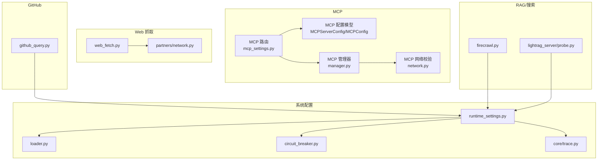
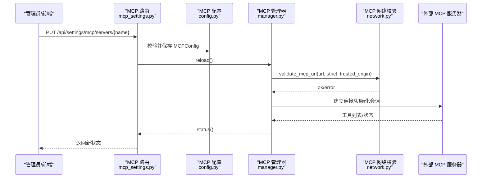
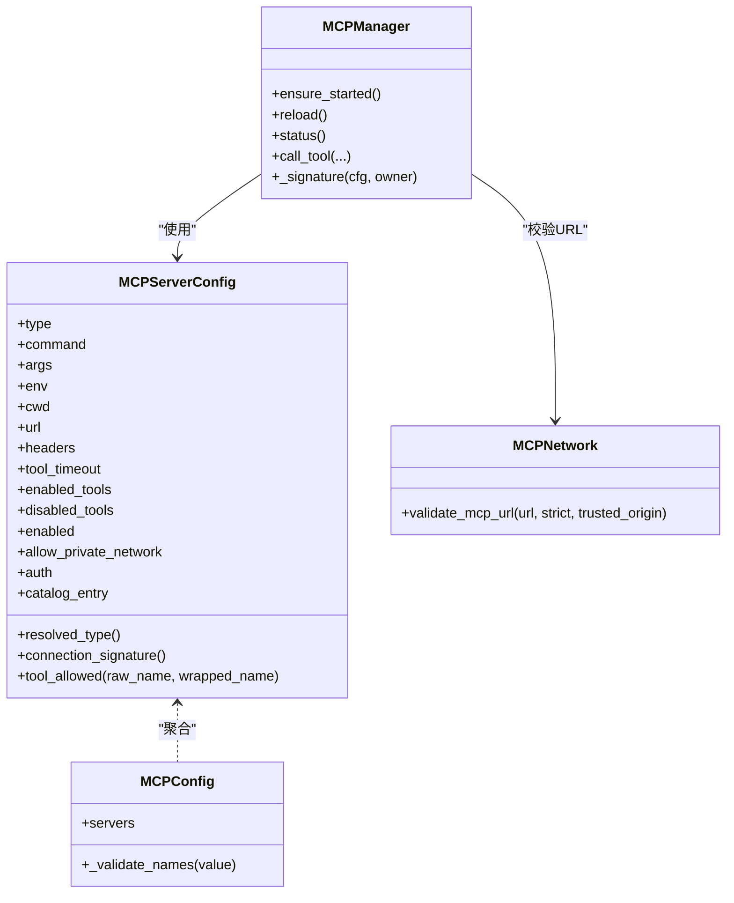
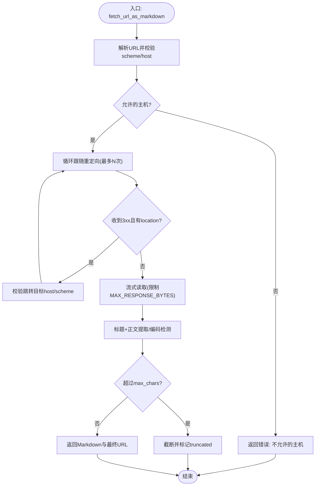
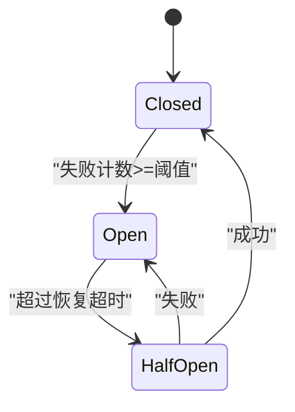
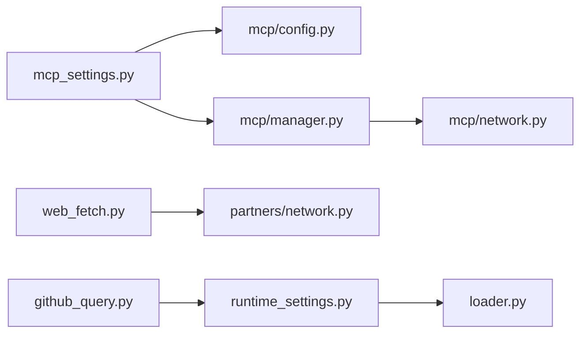

# 外部服务配置

<cite>
**本文引用的文件**   
- [deeptutor/services/mcp/config.py](file://deeptutor/services/mcp/config.py)
- [deeptutor/api/routers/mcp_settings.py](file://deeptutor/api/routers/mcp_settings.py)
- [deeptutor/services/mcp/manager.py](file://deeptutor/services/mcp/manager.py)
- [deeptutor/services/mcp/network.py](file://deeptutor/services/mcp/network.py)
- [deeptutor/tools/web_fetch.py](file://deeptutor/tools/web_fetch.py)
- [deeptutor/tools/github_query.py](file://deeptutor/tools/github_query.py)
- [deeptutor/core/trace.py](file://deeptutor/core/trace.py)
- [deeptutor/utils/network/circuit_breaker.py](file://deeptutor/utils/network/circuit_breaker.py)
- [deeptutor/services/config/runtime_settings.py](file://deeptutor/services/config/runtime_settings.py)
- [deeptutor/services/config/loader.py](file://deeptutor/services/config/loader.py)
- [deeptutor/services/search/providers/firecrawl.py](file://deeptutor/services/search/providers/firecrawl.py)
- [deeptutor/services/rag/pipelines/lightrag_server/probe.py](file://deeptutor/services/rag/pipelines/lightrag_server/probe.py)
- [deeptutor/partners/network.py](file://deeptutor/partners/network.py)
- [tests/api/test_mcp_settings_auth.py](file://tests/api/test_mcp_settings_auth.py)
</cite>

## 目录
1. [简介](#简介)
2. [项目结构](#项目结构)
3. [核心组件](#核心组件)
4. [架构总览](#架构总览)
5. [详细组件分析](#详细组件分析)
6. [依赖关系分析](#依赖关系分析)
7. [性能与限流](#性能与限流)
8. [故障排除指南](#故障排除指南)
9. [结论](#结论)
10. [附录：常见集成配置示例](#附录常见集成配置示例)

## 简介
本文面向运维与平台工程师，系统性说明本仓库中与“外部服务”相关的配置与实现，重点覆盖：
- MCP（Model Context Protocol）服务器注册、认证、工具白名单、连接探测与重载。
- Web 爬虫（网页抓取）的安全策略、代理、SSL、超时与内容截断。
- GitHub API 集成（通过 gh CLI 的只读查询）。
- 第三方服务认证、API 限流、错误处理、代理设置、SSL 证书与网络超时。
- 服务发现、健康检查与熔断器。
- 外部服务监控、日志收集与性能追踪。
- 常见外部服务集成的配置要点与排错建议。

## 项目结构
围绕外部服务的关键代码分布在以下模块：
- MCP 配置与运行时管理：services/mcp/*、api/routers/mcp_settings.py
- Web 抓取与安全校验：tools/web_fetch.py、partners/network.py
- GitHub 查询工具：tools/github_query.py
- 通用重试与熔断：config/settings.py、utils/network/circuit_breaker.py
- 运行时系统设置与注入：services/config/runtime_settings.py、services/config/loader.py
- 搜索与 RAG 健康探测：services/search/providers/firecrawl.py、services/rag/pipelines/lightrag_server/probe.py
- 追踪元数据：core/trace.py

图表来源
- [deeptutor/services/mcp/config.py:31-114](file://deeptutor/services/mcp/config.py#L31-L114)
- [deeptutor/api/routers/mcp_settings.py:37-78](file://deeptutor/api/routers/mcp_settings.py#L37-L78)
- [deeptutor/services/mcp/manager.py:336-388](file://deeptutor/services/mcp/manager.py#L336-L388)
- [deeptutor/services/mcp/network.py:75-109](file://deeptutor/services/mcp/network.py#L75-L109)
- [deeptutor/tools/web_fetch.py:74-162](file://deeptutor/tools/web_fetch.py#L74-L162)
- [deeptutor/partners/network.py:59-101](file://deeptutor/partners/network.py#L59-L101)
- [deeptutor/tools/github_query.py:66-144](file://deeptutor/tools/github_query.py#L66-L144)
- [deeptutor/services/config/runtime_settings.py:16-89](file://deeptutor/services/config/runtime_settings.py#L16-L89)
- [deeptutor/services/config/loader.py:23-78](file://deeptutor/services/config/loader.py#L23-L78)
- [deeptutor/utils/network/circuit_breaker.py:13-68](file://deeptutor/utils/network/circuit_breaker.py#L13-L68)
- [deeptutor/core/trace.py:44-90](file://deeptutor/core/trace.py#L44-L90)
- [deeptutor/services/search/providers/firecrawl.py:46-80](file://deeptutor/services/search/providers/firecrawl.py#L46-L80)
- [deeptutor/services/rag/pipelines/lightrag_server/probe.py:76-102](file://deeptutor/services/rag/pipelines/lightrag_server/probe.py#L76-L102)

章节来源
- [deeptutor/services/mcp/config.py:1-164](file://deeptutor/services/mcp/config.py#L1-L164)
- [deeptutor/api/routers/mcp_settings.py:37-133](file://deeptutor/api/routers/mcp_settings.py#L37-L133)
- [deeptutor/services/mcp/manager.py:336-388](file://deeptutor/services/mcp/manager.py#L336-L388)
- [deeptutor/services/mcp/network.py:75-109](file://deeptutor/services/mcp/network.py#L75-L109)
- [deeptutor/tools/web_fetch.py:1-162](file://deeptutor/tools/web_fetch.py#L1-L162)
- [deeptutor/partners/network.py:59-101](file://deeptutor/partners/network.py#L59-L101)
- [deeptutor/tools/github_query.py:1-144](file://deeptutor/tools/github_query.py#L1-L144)
- [deeptutor/services/config/runtime_settings.py:16-89](file://deeptutor/services/config/runtime_settings.py#L16-L89)
- [deeptutor/services/config/loader.py:23-78](file://deeptutor/services/config/loader.py#L23-L78)
- [deeptutor/utils/network/circuit_breaker.py:13-68](file://deeptutor/utils/network/circuit_breaker.py#L13-L68)
- [deeptutor/core/trace.py:44-90](file://deeptutor/core/trace.py#L44-L90)
- [deeptutor/services/search/providers/firecrawl.py:46-80](file://deeptutor/services/search/providers/firecrawl.py#L46-L80)
- [deeptutor/services/rag/pipelines/lightrag_server/probe.py:76-102](file://deeptutor/services/rag/pipelines/lightrag_server/probe.py#L76-L102)

## 核心组件
- MCP 服务器配置模型与持久化
  - MCPServerConfig：定义传输类型（stdio/sse/streamableHttp）、命令与环境变量、HTTP URL、请求头、工具白/黑名单、超时、启用状态、私有网络访问控制、OAuth 标记、目录来源等。
  - MCPConfig：服务器字典 + 名称正则校验。
  - mcp.json 原子写入与加载，失败回退为空配置，避免部署级全量断开。
- MCP 路由与管理器
  - 提供获取/更新/删除 MCP 服务器配置的 REST 接口，并在保存后触发管理器重载。
  - 管理器负责连接池、空闲回收、失败重试、签名指纹与凭据轮换检测、URL 安全校验、OAuth 流程与非交互令牌刷新。
- Web 抓取
  - fetch_url_as_markdown：仅允许 http/https；严格校验重定向链中的每个主机；限制最大响应字节数与输出字符数；内置编码检测与可读文本提取。
  - 默认超时、User-Agent、最大重定向次数可配置或注入。
- GitHub 查询
  - 基于 gh CLI 的只读查询封装，支持 pr/issue/run/repo/api 五种模板，强制 GET，输出长度限制与超时保护。
- 系统配置与运行时注入
  - runtime_settings.py 集中定义系统、认证、集成、文档解析、RAG、LightRAG Server 等默认值与规范化逻辑，并支持进程环境变量覆盖。
  - loader.py 提供 YAML 配置加载、路径注入与语言解析。
- 熔断器与重试
  - circuit_breaker.py 提供简单熔断器（closed/open/half-open），配合全局实例记录成功/失败。
  - settings.py 暴露 LLM 重试参数（max_retries/base_delay/exponential_backoff）。
- 服务健康探测
  - LightRAG Server probe：探测可达性、版本、鉴权是否必需、API Key 验证结果。
  - Firecrawl 搜索：按 provider 配置 base_url、timeout 等。

章节来源
- [deeptutor/services/mcp/config.py:31-114](file://deeptutor/services/mcp/config.py#L31-L114)
- [deeptutor/api/routers/mcp_settings.py:37-133](file://deeptutor/api/routers/mcp_settings.py#L37-L133)
- [deeptutor/services/mcp/manager.py:336-388](file://deeptutor/services/mcp/manager.py#L336-L388)
- [deeptutor/tools/web_fetch.py:74-162](file://deeptutor/tools/web_fetch.py#L74-L162)
- [deeptutor/tools/github_query.py:66-144](file://deeptutor/tools/github_query.py#L66-L144)
- [deeptutor/services/config/runtime_settings.py:16-89](file://deeptutor/services/config/runtime_settings.py#L16-L89)
- [deeptutor/services/config/loader.py:23-78](file://deeptutor/services/config/loader.py#L23-L78)
- [deeptutor/utils/network/circuit_breaker.py:13-68](file://deeptutor/utils/network/circuit_breaker.py#L13-L68)
- [deeptutor/config/settings.py:19-29](file://deeptutor/config/settings.py#L19-L29)
- [deeptutor/services/rag/pipelines/lightrag_server/probe.py:76-102](file://deeptutor/services/rag/pipelines/lightrag_server/probe.py#L76-L102)
- [deeptutor/services/search/providers/firecrawl.py:46-80](file://deeptutor/services/search/providers/firecrawl.py#L46-L80)

## 架构总览
下图展示外部服务在系统中的调用链与关键配置点：

图表来源
- [deeptutor/api/routers/mcp_settings.py:68-78](file://deeptutor/api/routers/mcp_settings.py#L68-L78)
- [deeptutor/services/mcp/config.py:102-114](file://deeptutor/services/mcp/config.py#L102-L114)
- [deeptutor/services/mcp/manager.py:336-388](file://deeptutor/services/mcp/manager.py#L336-L388)
- [deeptutor/services/mcp/network.py:75-109](file://deeptutor/services/mcp/network.py#L75-L109)

## 详细组件分析

### MCP 服务器配置与生命周期
- 配置模型
  - 传输类型自动推断：未指定 type 时，command → stdio；url 以 /sse 结尾 → sse；否则 → streamableHttp。
  - 行为开关：tool_timeout、enabled_tools/disabled_tools、enabled、allow_private_network。
  - 认证：auth 可为空或 oauth；静态凭据通过 headers 传递。
  - 名称校验：服务器名必须匹配正则，非法名称将被拒绝。
- 持久化
  - mcp.json 位于管理员工作区 settings 目录；加载失败回退为空配置；保存使用原子写入（临时文件 + fsync + replace）。
- 路由与测试
  - GET/PUT/DELETE 服务器配置；PUT 会校验 resolved_type 与 URL；POST /test 对单个服务器进行连通性与工具列表探测。
- 管理器
  - 连接池、空闲回收、失败重试、签名指纹（含已解析凭据摘要）用于检测凭据轮换；非交互 OAuth 刷新；URL 安全校验（含私有网络策略）。

图表来源
- [deeptutor/services/mcp/config.py:31-114](file://deeptutor/services/mcp/config.py#L31-L114)
- [deeptutor/services/mcp/manager.py:577-598](file://deeptutor/services/mcp/manager.py#L577-L598)
- [deeptutor/services/mcp/network.py:75-109](file://deeptutor/services/mcp/network.py#L75-L109)

章节来源
- [deeptutor/services/mcp/config.py:31-114](file://deeptutor/services/mcp/config.py#L31-L114)
- [deeptutor/api/routers/mcp_settings.py:37-133](file://deeptutor/api/routers/mcp_settings.py#L37-L133)
- [deeptutor/services/mcp/manager.py:336-388](file://deeptutor/services/mcp/manager.py#L336-L388)
- [tests/api/test_mcp_settings_auth.py:121-127](file://tests/api/test_mcp_settings_auth.py#L121-L127)

### Web 爬虫（网页抓取）
- 安全策略
  - 仅允许 http/https；禁止私有/环回/链路本地地址；重定向链中每跳都进行主机校验。
  - 响应体大小上限（默认 4MB），输出字符截断（默认 50k）。
- 网络与超时
  - 默认超时秒数、User-Agent、最大重定向次数可配置；可通过 client_factory 注入 httpx.AsyncClient。
- 编码与内容提取
  - 优先 BOM，其次 Content-Type charset，再 meta charset，最后 UTF-8；尝试结构化文章提取，失败回退为纯文本清洗。

图表来源
- [deeptutor/tools/web_fetch.py:74-162](file://deeptutor/tools/web_fetch.py#L74-L162)
- [deeptutor/tools/web_fetch.py:178-221](file://deeptutor/tools/web_fetch.py#L178-L221)
- [deeptutor/tools/web_fetch.py:288-310](file://deeptutor/tools/web_fetch.py#L288-L310)

章节来源
- [deeptutor/tools/web_fetch.py:1-162](file://deeptutor/tools/web_fetch.py#L1-L162)
- [deeptutor/tools/web_fetch.py:178-221](file://deeptutor/tools/web_fetch.py#L178-L221)
- [deeptutor/tools/web_fetch.py:288-310](file://deeptutor/tools/web_fetch.py#L288-L310)

### GitHub API 集成（gh CLI 只读查询）
- 能力边界
  - 仅支持 pr/issue/run/repo/api 五种只读操作；api 子命令始终为 GET，不执行 shell，防止注入。
- 运行环境
  - 若未安装 gh CLI，返回友好错误提示；命令执行带超时保护，输出长度限制。
- 典型用途
  - 查看 PR 状态与检查、列出最近工作流运行、查看仓库元数据、通用只读 API 查询。

章节来源
- [deeptutor/tools/github_query.py:1-144](file://deeptutor/tools/github_query.py#L1-L144)
- [deeptutor/tools/github_query.py:152-197](file://deeptutor/tools/github_query.py#L152-L197)
- [deeptutor/tools/github_query.py:200-221](file://deeptutor/tools/github_query.py#L200-L221)

### 第三方服务认证、API 限流与错误处理
- 认证
  - MCP：headers 传静态凭据；auth=oauth 时走非交互 OAuth 刷新流程。
  - 其他服务：通过运行时配置（如 PageIndex、IMA、LightRAG Server）集中管理 api_key/client_id 等。
- 限流
  - 系统级 security_guard 提供速率限制窗口、可信代理、豁免 IP、白/黑名单。
  - Firecrawl 搜索 provider 将 timeout 映射到毫秒级上限，避免客户端与服务端超时不一致。
- 错误处理
  - MCP 连接失败描述函数统一包装底层异常；Web 抓取返回结构化错误；GitHub 查询捕获超时与子进程异常。

章节来源
- [deeptutor/services/mcp/manager.py:577-598](file://deeptutor/services/mcp/manager.py#L577-L598)
- [deeptutor/services/config/runtime_settings.py:76-88](file://deeptutor/services/config/runtime_settings.py#L76-L88)
- [deeptutor/services/search/providers/firecrawl.py:66-74](file://deeptutor/services/search/providers/firecrawl.py#L66-L74)
- [deeptutor/services/mcp/manager.py:977-981](file://deeptutor/services/mcp/manager.py#L977-L981)
- [deeptutor/tools/github_query.py:114-144](file://deeptutor/tools/github_query.py#L114-L144)

### 代理设置、SSL 证书与网络超时
- 代理
  - 当前仓库未提供统一的 HTTP 代理字段；如需代理，应通过宿主网络或反向代理层（例如 Nginx/Traefik）配置。
- SSL
  - 系统设置包含 disable_ssl_verify 开关；生产环境建议保持关闭禁用校验，使用受信任 CA 与 TLS 终止。
- 超时
  - Web 抓取默认超时秒数；Firecrawl 搜索 provider 内部将超时转换为毫秒并限制上限；LightRAG 有 llm_timeout 等参数。

章节来源
- [deeptutor/services/config/runtime_settings.py:16-29](file://deeptutor/services/config/runtime_settings.py#L16-L29)
- [deeptutor/tools/web_fetch.py:74-82](file://deeptutor/tools/web_fetch.py#L74-L82)
- [deeptutor/services/search/providers/firecrawl.py:66-74](file://deeptutor/services/search/providers/firecrawl.py#L66-L74)
- [deeptutor/services/config/runtime_settings.py:396-408](file://deeptutor/services/config/runtime_settings.py#L396-L408)

### 服务发现、健康检查与熔断器
- 服务发现
  - MCP：GET /api/settings/mcp 返回服务器列表与状态；POST /api/settings/mcp/test 探测工具列表。
  - LightRAG Server：probe 返回可达性、版本、鉴权状态与 API Key 验证结果。
- 健康检查
  - MCP 管理器维护连接状态与重试时间；LightRAG probe 明确 auth_required/auth_ok。
- 熔断器
  - CircuitBreaker 提供 closed/open/half-open 三态，按失败阈值与恢复超时切换状态；提供全局实例与回调。

图表来源
- [deeptutor/utils/network/circuit_breaker.py:13-68](file://deeptutor/utils/network/circuit_breaker.py#L13-L68)

章节来源
- [deeptutor/api/routers/mcp_settings.py:57-78](file://deeptutor/api/routers/mcp_settings.py#L57-L78)
- [deeptutor/api/routers/mcp_settings.py:121-133](file://deeptutor/api/routers/mcp_settings.py#L121-L133)
- [deeptutor/services/rag/pipelines/lightrag_server/probe.py:76-102](file://deeptutor/services/rag/pipelines/lightrag_server/probe.py#L76-L102)
- [deeptutor/utils/network/circuit_breaker.py:13-68](file://deeptutor/utils/network/circuit_breaker.py#L13-L68)

### 外部服务监控、日志收集与性能追踪
- 追踪
  - core/trace.py 提供 derive_trace_metadata/merge_trace_metadata，便于跨组件关联 trace_id、phase、label、kind 等。
- 日志
  - loader.py 注入 user_log_dir/performance_log_dir 等路径；runtime_settings.py 渲染环境变量供子进程使用。
- 性能
  - 各外部调用均具备超时与输出大小限制；MCP 工具调用携带 server/tool 元数据，便于定位。

章节来源
- [deeptutor/core/trace.py:44-90](file://deeptutor/core/trace.py#L44-L90)
- [deeptutor/services/config/loader.py:59-78](file://deeptutor/services/config/loader.py#L59-L78)
- [deeptutor/services/config/runtime_settings.py:765-800](file://deeptutor/services/config/runtime_settings.py#L765-L800)
- [deeptutor/services/mcp/manager.py:154-181](file://deeptutor/services/mcp/manager.py#L154-L181)

## 依赖关系分析
- 耦合与内聚
  - MCP 配置与路由高内聚；管理器与网络校验解耦，便于扩展更多 URL 校验规则。
  - Web 抓取与 partners/network.py 共享私有/环回地址判断逻辑，但各自独立实现。
- 直接/间接依赖
  - mcp_settings.py 依赖 config.py 与 manager.py；manager.py 依赖 network.py。
  - runtime_settings.py 被多处引用，作为系统级配置中心。
- 外部依赖
  - httpx（Web 抓取）、gh CLI（GitHub 查询）、mcp SDK（MCP 连接）。

图表来源
- [deeptutor/api/routers/mcp_settings.py:37-78](file://deeptutor/api/routers/mcp_settings.py#L37-L78)
- [deeptutor/services/mcp/config.py:31-114](file://deeptutor/services/mcp/config.py#L31-L114)
- [deeptutor/services/mcp/manager.py:336-388](file://deeptutor/services/mcp/manager.py#L336-L388)
- [deeptutor/services/mcp/network.py:75-109](file://deeptutor/services/mcp/network.py#L75-L109)
- [deeptutor/tools/web_fetch.py:74-162](file://deeptutor/tools/web_fetch.py#L74-L162)
- [deeptutor/partners/network.py:59-101](file://deeptutor/partners/network.py#L59-L101)
- [deeptutor/tools/github_query.py:66-144](file://deeptutor/tools/github_query.py#L66-L144)
- [deeptutor/services/config/runtime_settings.py:16-89](file://deeptutor/services/config/runtime_settings.py#L16-L89)
- [deeptutor/services/config/loader.py:23-78](file://deeptutor/services/config/loader.py#L23-L78)

章节来源
- [deeptutor/api/routers/mcp_settings.py:37-133](file://deeptutor/api/routers/mcp_settings.py#L37-L133)
- [deeptutor/services/mcp/config.py:31-114](file://deeptutor/services/mcp/config.py#L31-L114)
- [deeptutor/services/mcp/manager.py:336-388](file://deeptutor/services/mcp/manager.py#L336-L388)
- [deeptutor/services/mcp/network.py:75-109](file://deeptutor/services/mcp/network.py#L75-L109)
- [deeptutor/tools/web_fetch.py:74-162](file://deeptutor/tools/web_fetch.py#L74-L162)
- [deeptutor/partners/network.py:59-101](file://deeptutor/partners/network.py#L59-L101)
- [deeptutor/tools/github_query.py:66-144](file://deeptutor/tools/github_query.py#L66-L144)
- [deeptutor/services/config/runtime_settings.py:16-89](file://deeptutor/services/config/runtime_settings.py#L16-L89)
- [deeptutor/services/config/loader.py:23-78](file://deeptutor/services/config/loader.py#L23-L78)

## 性能与限流
- 超时与并发
  - Web 抓取：DEFAULT_TIMEOUT_S、MAX_REDIRECTS、MAX_RESPONSE_BYTES。
  - Firecrawl：timeout 毫秒级上限 300s，避免服务端长时间阻塞。
  - LightRAG：llm_timeout 影响 worker 执行上限（SDK 内部为 2x）。
- 限流与防护
  - security_guard：rate_limit、rate_limit_window、trusted_proxies、exempt_ips、whitelist/blacklist。
  - 熔断器：failure_threshold、recovery_timeout。
- 资源控制
  - MCP tool_timeout 限制单次工具调用时长；MCP 管理器空闲回收与最大连接数控制。

章节来源
- [deeptutor/tools/web_fetch.py:39-45](file://deeptutor/tools/web_fetch.py#L39-L45)
- [deeptutor/services/search/providers/firecrawl.py:66-74](file://deeptutor/services/search/providers/firecrawl.py#L66-L74)
- [deeptutor/services/config/runtime_settings.py:396-408](file://deeptutor/services/config/runtime_settings.py#L396-L408)
- [deeptutor/services/config/runtime_settings.py:76-88](file://deeptutor/services/config/runtime_settings.py#L76-L88)
- [deeptutor/utils/network/circuit_breaker.py:18-25](file://deeptutor/utils/network/circuit_breaker.py#L18-L25)
- [deeptutor/services/mcp/config.py:48-52](file://deeptutor/services/mcp/config.py#L48-L52)
- [deeptutor/services/mcp/manager.py:336-388](file://deeptutor/services/mcp/manager.py#L336-L388)

## 故障排除指南
- MCP 服务器无法连接
  - 检查服务器名称是否符合正则；确认 resolved_type 正确（stdio/sse/streamableHttp）。
  - 使用 POST /api/settings/mcp/test 探测工具列表；观察错误信息。
  - 若启用 allow_private_network，需确保 origin 一致或通过管理员批准。
- Web 抓取失败
  - 确认 URL scheme 为 http/https；检查是否跳转到私有/环回地址。
  - 关注响应体大小与字符截断；必要时调整 max_chars 与 timeout_s。
- GitHub 查询不可用
  - 确认已安装 gh CLI；检查 query_type 与 target 格式；查看超时与输出截断。
- 系统级限流与认证
  - 检查 security_guard 配置与 trusted_proxies；确认 CORS 与认证开关。
- 服务健康
  - 查看 MCP 管理器状态；LightRAG Server probe 返回 auth_required/auth_ok。

章节来源
- [deeptutor/api/routers/mcp_settings.py:68-78](file://deeptutor/api/routers/mcp_settings.py#L68-L78)
- [deeptutor/api/routers/mcp_settings.py:121-133](file://deeptutor/api/routers/mcp_settings.py#L121-L133)
- [deeptutor/services/mcp/config.py:105-114](file://deeptutor/services/mcp/config.py#L105-L114)
- [deeptutor/tools/web_fetch.py:92-155](file://deeptutor/tools/web_fetch.py#L92-L155)
- [deeptutor/tools/github_query.py:85-144](file://deeptutor/tools/github_query.py#L85-L144)
- [deeptutor/services/config/runtime_settings.py:76-88](file://deeptutor/services/config/runtime_settings.py#L76-L88)
- [deeptutor/services/rag/pipelines/lightrag_server/probe.py:76-102](file://deeptutor/services/rag/pipelines/lightrag_server/probe.py#L76-L102)

## 结论
本仓库对外部服务的配置与接入提供了清晰的分层与约束：
- MCP 通过强校验的配置模型与安全的 URL 校验，结合管理器连接池与重试机制，保障稳定可靠的外部工具调用。
- Web 抓取与 GitHub 查询分别实现了严格的安全边界与超时/输出限制，降低 SSRF 与资源耗尽风险。
- 系统级配置集中管理认证、限流、SSL 与路径注入，便于多环境部署与审计。
- 健康探测与熔断器为外部依赖提供韧性保障，追踪与日志体系支撑问题定位与性能优化。

## 附录：常见集成配置示例
以下为常见外部服务的关键配置项与注意事项（以字段名与行为说明为主，不包含具体代码片段）：

- MCP 服务器
  - 必填：name（符合正则）、transport（auto/stdio/sse/streamableHttp）、url/command。
  - 可选：headers（静态凭据）、env（stdio 环境变量）、tool_timeout、enabled_tools/disabled_tools、auth（oauth 或空）、allow_private_network。
  - 建议：生产环境开启 URL 严格校验；对私有网络访问进行 origin 审批；使用 OAuth 而非硬编码密钥。

- Web 抓取
  - 关键参数：timeout_s、user_agent、max_redirects、max_chars、MAX_RESPONSE_BYTES。
  - 安全：仅允许 http/https；禁止私有/环回地址；逐跳校验重定向目标。

- GitHub 查询
  - 前置条件：安装 gh CLI。
  - 操作类型：pr/issue/run/repo/api（只读）；api 子命令固定 GET。
  - 限制：输出长度限制、超时保护。

- 系统设置
  - security_guard：rate_limit、rate_limit_window、trusted_proxies、exempt_ips、whitelist/blacklist。
  - SSL：disable_ssl_verify（建议关闭禁用校验，使用受信任 CA）。
  - 路径注入：user_log_dir/performance_log_dir 等由 loader.py 注入。

- 搜索与 RAG
  - Firecrawl：base_url、timeout（毫秒级上限）。
  - LightRAG Server：server_url、api_key；probe 返回 auth_required/auth_ok。

章节来源
- [deeptutor/services/mcp/config.py:31-114](file://deeptutor/services/mcp/config.py#L31-L114)
- [deeptutor/tools/web_fetch.py:74-162](file://deeptutor/tools/web_fetch.py#L74-L162)
- [deeptutor/tools/github_query.py:66-144](file://deeptutor/tools/github_query.py#L66-L144)
- [deeptutor/services/config/runtime_settings.py:16-89](file://deeptutor/services/config/runtime_settings.py#L16-L89)
- [deeptutor/services/search/providers/firecrawl.py:46-80](file://deeptutor/services/search/providers/firecrawl.py#L46-L80)
- [deeptutor/services/rag/pipelines/lightrag_server/probe.py:76-102](file://deeptutor/services/rag/pipelines/lightrag_server/probe.py#L76-L102)